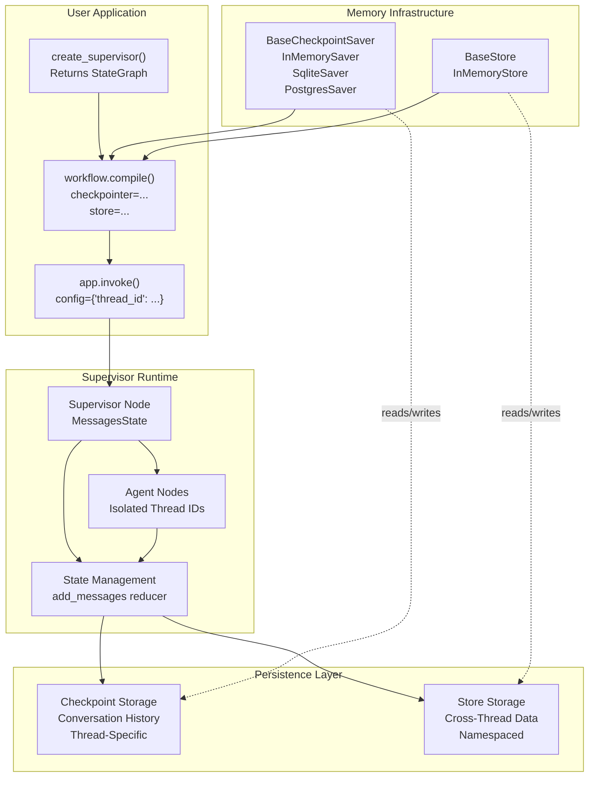
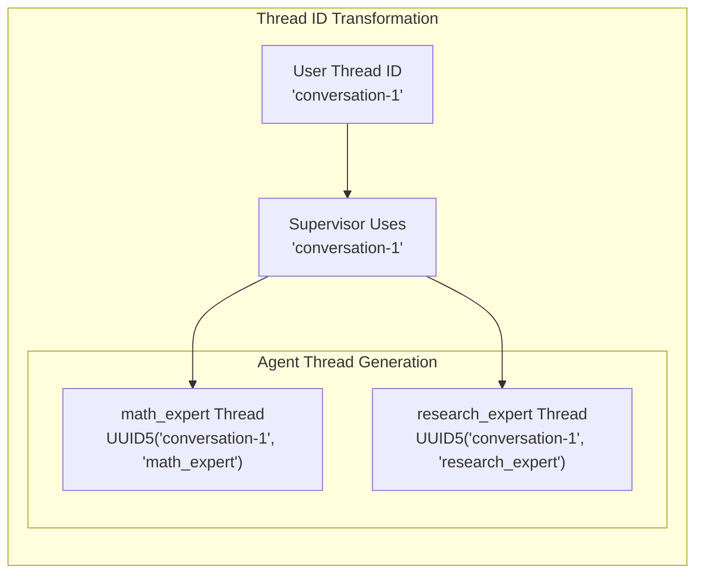

<!-- source: DeepWiki mcp.deepwiki.com · repo langchain-ai/langgraph-supervisor-py · page 4.1 Memory and Persistence · fetched 2026-10-26 -->

# Memory and Persistence

<details>
<summary>Relevant source files</summary>

The following files were used as context for generating this wiki page:

- [README.md](README.md)
- [langgraph_supervisor/supervisor.py](langgraph_supervisor/supervisor.py)

</details>


## Purpose and Scope

This document explains how to add memory capabilities to multi-agent supervisor systems using checkpointers and stores. Memory enables supervisor systems to maintain conversation history across invocations (short-term memory) and share information across different conversation threads (long-term memory).

For information about managing message history within a single conversation, see [Message History Management](#2.4).

---

## Memory Types in Multi-Agent Systems

The `langgraph-supervisor` library leverages LangGraph's memory infrastructure to provide two types of memory:

| Memory Type | Component | Scope | Use Case |
|-------------|-----------|-------|----------|
| **Short-Term Memory** | Checkpointer | Single conversation thread | Maintain conversation history, enable pausing/resuming workflows |
| **Long-Term Memory** | Store | Across conversation threads | Share facts, user preferences, accumulated knowledge |

Both memory types are added at graph compilation time, not during supervisor creation.

**Sources:** [README.md:152-178]()

---

## Architecture Overview



**Diagram: Memory Architecture in Supervisor Systems**

The supervisor system integrates memory at the compilation boundary. The `StateGraph` returned by `create_supervisor()` accepts checkpointer and store instances during `.compile()`, which then manage persistence throughout execution.

**Sources:** [README.md:152-178](), [langgraph_supervisor/supervisor.py:232-469]()

---

## Short-Term Memory with Checkpointers

### Overview

Checkpointers enable conversation persistence by saving the graph state after each step. This allows:

- **Resuming conversations** after interruption
- **Time-travel debugging** by accessing historical states
- **Human-in-the-loop workflows** with pause/resume capabilities

### Checkpointer Interface

LangGraph provides the `BaseCheckpointSaver` interface with several implementations:

| Implementation | Backend | Use Case |
|----------------|---------|----------|
| `InMemorySaver` | In-memory | Development, testing |
| `SqliteSaver` | SQLite database | Single-machine production |
| `PostgresSaver` | PostgreSQL | Multi-machine production |

### Adding a Checkpointer

```python
from langgraph.checkpoint.memory import InMemorySaver
from langgraph_supervisor import create_supervisor

# Create checkpointer instance
checkpointer = InMemorySaver()

# Create supervisor workflow
workflow = create_supervisor(
    [research_agent, math_agent],
    model=model,
    prompt="You are a team supervisor."
)

# Compile with checkpointer
app = workflow.compile(checkpointer=checkpointer)

# Invoke with thread_id
result = app.invoke(
    {"messages": [{"role": "user", "content": "Hello"}]},
    config={"configurable": {"thread_id": "conversation-1"}}
)

# Continue conversation in same thread
result2 = app.invoke(
    {"messages": [{"role": "user", "content": "What did I just say?"}]},
    config={"configurable": {"thread_id": "conversation-1"}}
)
```

The checkpointer automatically saves the full `MessagesState` after each node execution, including all messages generated by the supervisor and managed agents.

**Sources:** [README.md:152-178](), [langgraph_supervisor/supervisor.py:454]()

---

## Long-Term Memory with Stores

### Overview

Stores enable cross-thread persistence by providing a key-value storage mechanism accessible across different conversation threads. This allows agents to:

- **Remember user preferences** across sessions
- **Accumulate facts** learned in one conversation and use them in another
- **Share context** between related workflows

### Store Interface

LangGraph provides the `BaseStore` interface with implementations like `InMemoryStore`. Stores organize data using:

- **Namespace**: Logical grouping (e.g., `"user_preferences"`, `"learned_facts"`)
- **Key**: Unique identifier within namespace
- **Value**: Arbitrary data structure

### Adding a Store

```python
from langgraph.store.memory import InMemoryStore
from langgraph_supervisor import create_supervisor

# Create store instance
store = InMemoryStore()

# Create supervisor workflow
workflow = create_supervisor(
    [research_agent, math_agent],
    model=model,
    prompt="You are a team supervisor."
)

# Compile with store
app = workflow.compile(store=store)

# Agents can now access the store via injected context
# The store is available in the graph context throughout execution
```

Agents access the store through LangGraph's store API, which is injected into the graph context. The store persists independently of any specific thread_id.

**Sources:** [README.md:152-178]()

---

## Combining Checkpointer and Store

Both memory types can be used simultaneously for comprehensive memory management:

```python
from langgraph.checkpoint.memory import InMemorySaver
from langgraph.store.memory import InMemoryStore
from langgraph_supervisor import create_supervisor

# Initialize both memory components
checkpointer = InMemorySaver()
store = InMemoryStore()

# Create supervisor
workflow = create_supervisor(
    [research_agent, math_agent],
    model=model,
    prompt="You are a team supervisor managing experts."
)

# Compile with both
app = workflow.compile(
    checkpointer=checkpointer,
    store=store
)

# Invoke with thread management
result = app.invoke(
    {"messages": [{"role": "user", "content": "Research FAANG companies"}]},
    config={"configurable": {"thread_id": "user-123-session-1"}}
)
```

This configuration enables:
- **Thread-specific conversation history** via checkpointer
- **Cross-thread knowledge sharing** via store
- **Isolated agent conversations** (see next section)

**Sources:** [README.md:152-178]()

---

## Thread ID Management for Isolated Agent Conversations

### Thread ID Transformation

The supervisor system implements automatic thread ID transformation to ensure each managed agent maintains isolated conversation history, even when sharing the same top-level checkpointer.



**Diagram: Thread ID Derivation for Agent Isolation**

### Implementation Details

The `_make_call_agent` function implements thread ID transformation:

```python
def call_agent(state: dict, config: RunnableConfig) -> dict:
    thread_id = config.get("configurable", {}).get("thread_id")
    output = agent.invoke(
        state,
        patch_configurable(
            config,
            {"thread_id": str(uuid5(UUID(str(thread_id)), agent.name)) if thread_id else None},
        )
        if isinstance(agent, RemoteGraph)
        else config,
    )
    return _process_output(output)
```

**Key aspects:**

1. **UUID5 Generation**: [langgraph_supervisor/supervisor.py:107]()
   - Uses parent thread ID as namespace
   - Uses agent name as name component
   - Produces deterministic, collision-free thread IDs

2. **Remote Graph Support**: [langgraph_supervisor/supervisor.py:109-110]()
   - Thread transformation only applies to `RemoteGraph` instances
   - Local graphs share the supervisor's thread ID

3. **Thread ID Inheritance**: 
   - If no `thread_id` is provided in config, agents receive `None`
   - This allows checkpointer-less operation when thread_id is omitted

### Thread ID Isolation Benefits

| Benefit | Description |
|---------|-------------|
| **Independent Checkpoints** | Each agent's conversation history stored separately |
| **Parallel Execution Safety** | No checkpoint conflicts when supervisor hands off to multiple agents |
| **Debugging Clarity** | Can inspect each agent's thread independently |
| **State Isolation** | Agent-specific state doesn't pollute supervisor state |

**Sources:** [langgraph_supervisor/supervisor.py:66-127]()

---

## State Management and Message Reducers

### MessagesState and add_messages

The supervisor system uses LangGraph's `MessagesState` schema with the `add_messages` reducer:

```python
class _OuterState(TypedDict):
    """The state of the supervisor workflow."""
    messages: Annotated[Sequence[AnyMessage], add_messages]
```

The `add_messages` reducer handles:
- **Message deduplication** by ID
- **Message updates** when IDs match
- **Message deletion** via `RemoveMessage` objects
- **Automatic list concatenation**

When a checkpointer is configured, this state is persisted after each node execution in the supervisor workflow.

**Sources:** [langgraph_supervisor/supervisor.py:205-209](), [langgraph_supervisor/supervisor.py:14]()

---

## Memory Configuration in Multi-Level Hierarchies

When creating multi-level supervisor hierarchies, memory configuration propagates through the compilation chain:

```python
from langgraph.checkpoint.memory import InMemorySaver

checkpointer = InMemorySaver()

# Each level is compiled with the same checkpointer
research_team = create_supervisor(
    [research_agent, math_agent],
    model=model,
    supervisor_name="research_supervisor"
).compile(name="research_team", checkpointer=checkpointer)

writing_team = create_supervisor(
    [writing_agent, publishing_agent],
    model=model,
    supervisor_name="writing_supervisor"
).compile(name="writing_team", checkpointer=checkpointer)

# Top-level supervisor also uses same checkpointer
top_level = create_supervisor(
    [research_team, writing_team],
    model=model,
    supervisor_name="top_level_supervisor"
).compile(name="top_level_supervisor", checkpointer=checkpointer)
```

**Thread ID behavior in hierarchies:**

1. Top-level supervisor uses user-provided `thread_id`
2. Mid-level supervisors (teams) get transformed thread IDs based on team name
3. Bottom-level agents get thread IDs derived from their mid-level supervisor's thread

This creates a tree of isolated checkpoint namespaces.

For more information on multi-level hierarchies, see [Multi-level Hierarchies](#4.2).

**Sources:** [README.md:128-150](), [langgraph_supervisor/supervisor.py:101-127]()

---

## Production Considerations

### Choosing a Checkpointer Backend

| Backend | Pros | Cons | Production Ready |
|---------|------|------|------------------|
| `InMemorySaver` | Fast, simple | Data lost on restart | No |
| `SqliteSaver` | Persistent, simple | Single-machine only | Yes (small scale) |
| `PostgresSaver` | Distributed, scalable | Requires database setup | Yes (large scale) |

### Store Persistence Strategies

Stores should be backed by persistent storage in production:
- Use `InMemoryStore` only for development
- Consider external databases or cloud storage for production stores
- Implement proper namespace organization for multi-tenant scenarios

### Thread ID Best Practices

1. **Use meaningful thread IDs**: `f"user-{user_id}-session-{session_id}"`
2. **Document thread ID format**: Establish conventions across your application
3. **Monitor thread growth**: Implement cleanup for old threads
4. **Test isolation**: Verify agents don't leak state between threads

**Sources:** [langgraph_supervisor/supervisor.py:101-127]()

---

## Memory Flow Diagram

```mermaid
sequenceDiagram
    participant User
    participant App["Compiled App<br/>(with checkpointer)"]
    participant Checkpointer
    participant Supervisor["Supervisor Node"]
    participant Agent["Agent Node"]
    participant AgentCheckpoint["Agent Checkpoint<br/>(derived thread_id)"]
    
    User->>App: invoke(messages, thread_id="conv-1")
    App->>Checkpointer: Load state for "conv-1"
    Checkpointer-->>App: Return previous state (if exists)
    
    App->>Supervisor: Execute with loaded state
    Supervisor->>Supervisor: Process messages, decide handoff
    Supervisor->>Checkpointer: Save supervisor state ("conv-1")
    
    Supervisor->>Agent: Handoff with derived thread_id
    Note over Agent: thread_id = uuid5("conv-1", "agent_name")
    Agent->>AgentCheckpoint: Load agent-specific state
    AgentCheckpoint-->>Agent: Return agent history
    
    Agent->>Agent: Execute agent logic
    Agent->>AgentCheckpoint: Save agent state
    Agent-->>Supervisor: Return result
    
    Supervisor->>Checkpointer: Save final supervisor state
    Checkpointer-->>App: State persisted
    App-->>User: Return result
```

**Diagram: Memory Persistence Flow Through Supervisor System**

This sequence shows how checkpointer interactions occur at both supervisor and agent levels, with thread ID transformation ensuring isolated persistence.

**Sources:** [langgraph_supervisor/supervisor.py:101-127](), [langgraph_supervisor/supervisor.py:66-99]()

---

## Summary

The `langgraph-supervisor` library integrates with LangGraph's memory infrastructure by:

1. Accepting checkpointer instances at `.compile()` time for conversation persistence
2. Supporting store instances for cross-thread knowledge sharing  
3. Automatically deriving isolated thread IDs for each managed agent
4. Leveraging `add_messages` reducer for state management

Memory configuration is transparent to the supervisor creation API, occurring entirely at the compilation boundary, which keeps the supervisor creation focused on agent orchestration logic.

**Sources:** [README.md:152-178](), [langgraph_supervisor/supervisor.py:232-469](), [langgraph_supervisor/supervisor.py:66-127]()

---

