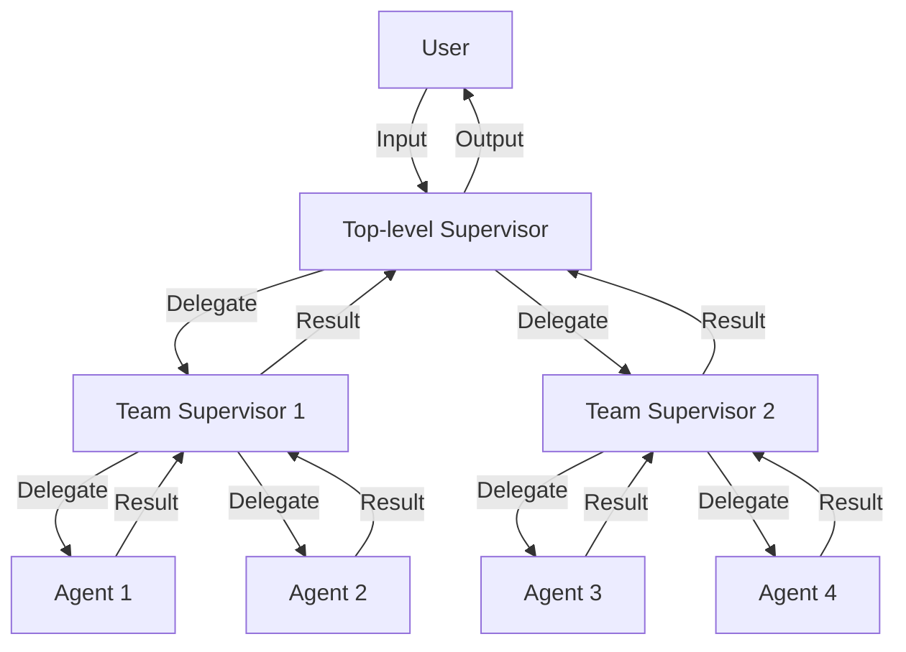
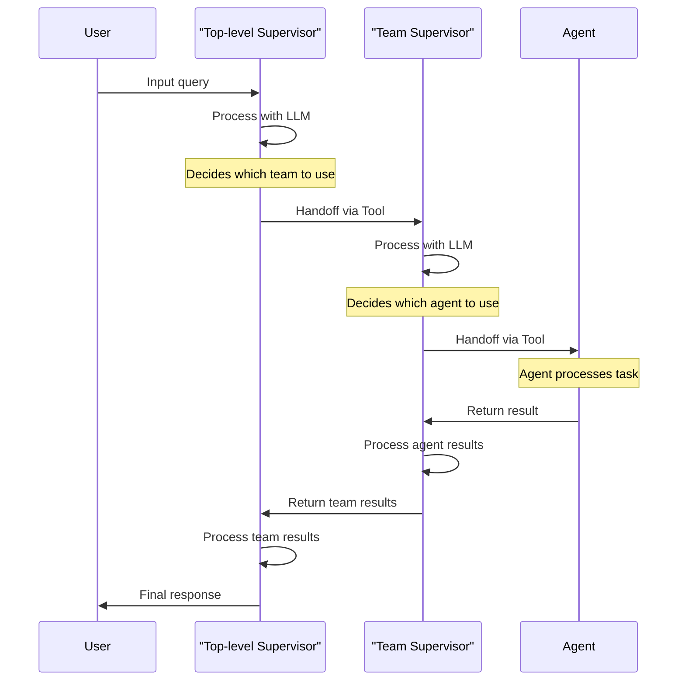
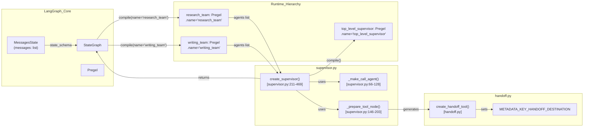
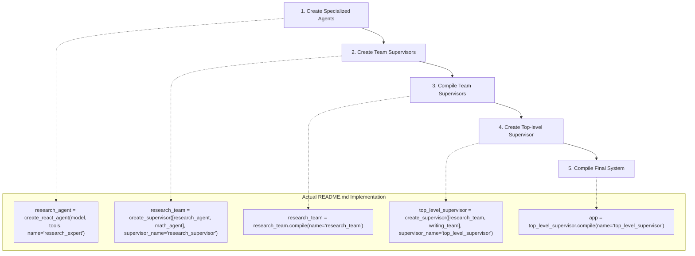
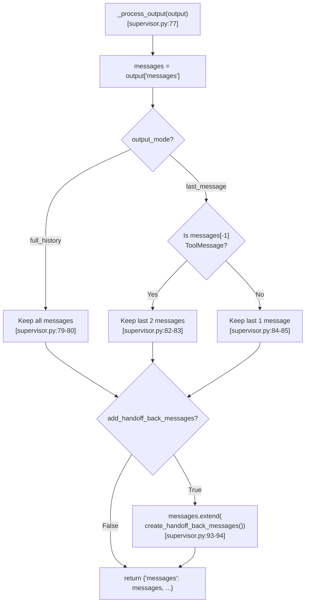
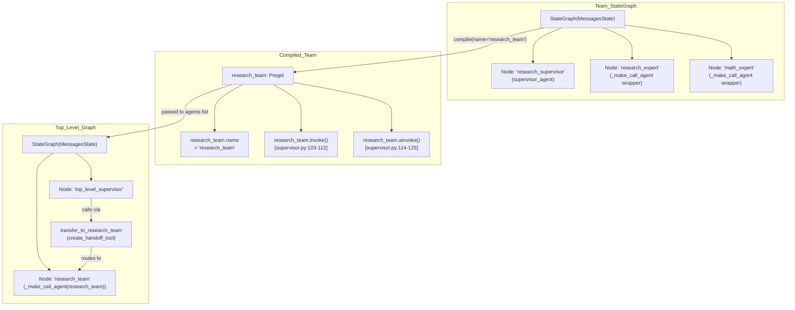
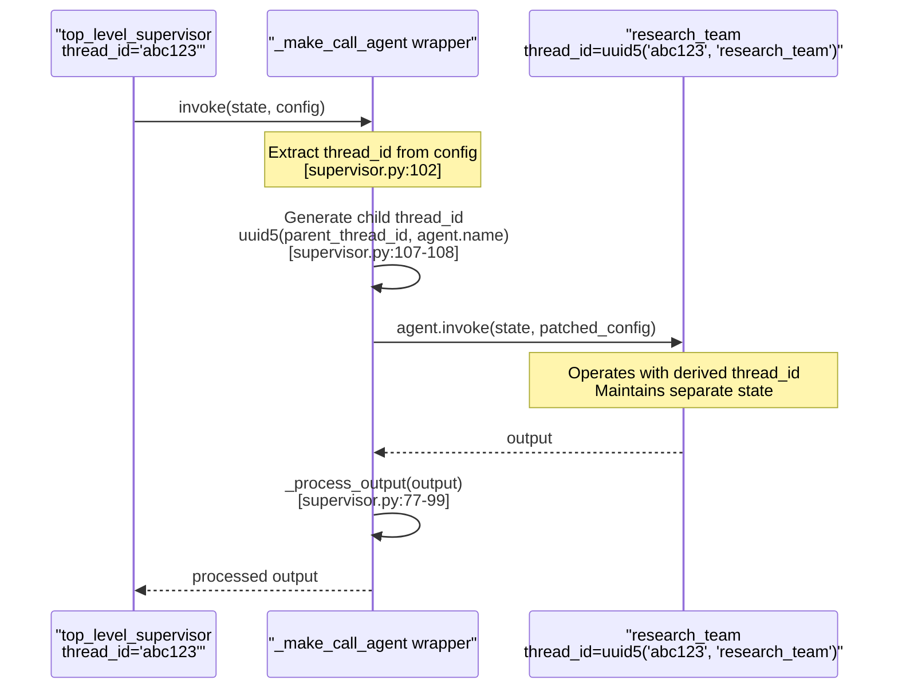
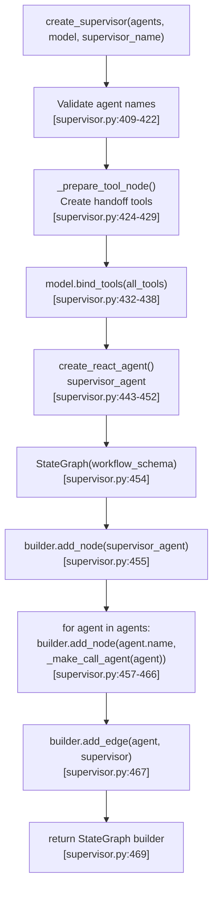

<!-- source: DeepWiki mcp.deepwiki.com · repo langchain-ai/langgraph-supervisor-py · page 4.2 Multi-level Hierarchies · fetched 2026-10-26 -->

# Multi-level Hierarchies

<details>
<summary>Relevant source files</summary>

The following files were used as context for generating this wiki page:

- [README.md](README.md)
- [langgraph_supervisor/supervisor.py](langgraph_supervisor/supervisor.py)

</details>


## Purpose and Scope

This document explains how to create hierarchical multi-agent systems with nested supervisors using the LangGraph Supervisor framework. Multi-level hierarchies allow you to organize agents into teams that are themselves managed by higher-level supervisors, enabling complex organizational structures for sophisticated multi-agent applications. For information about creating a single-level supervisor system, see [Core Architecture](#2).

## Understanding Multi-level Hierarchies

Multi-level hierarchies in LangGraph Supervisor extend the basic supervisor-agent pattern by allowing supervisors to manage other supervisors. This creates a tree-like structure where specialized agents are grouped into teams with their own supervisors, and these team supervisors report to higher-level supervisors.

### Hierarchical Structure



Sources: [README.md:126-148]()

### Information Flow in Multi-level Hierarchies



Sources: [README.md:126-148]()

## Implementing Multi-level Hierarchies

The multi-level hierarchy implementation in LangGraph Supervisor relies on the fact that compiled supervisor graphs can be used as agents in other supervisor graphs. This allows for creating layered architectures where supervisors at each level manage the components below them.

### Code Structure to Architecture Mapping



Sources: [langgraph_supervisor/supervisor.py:66-128](), [langgraph_supervisor/supervisor.py:146-203](), [langgraph_supervisor/supervisor.py:211-469](), [langgraph_supervisor/handoff.py:30-35](), [README.md:131-147]()

### Key Implementation Steps

1. Create specialized agents using `create_react_agent()` or the Functional API
2. Group these agents into teams using `create_supervisor()`
3. Compile each team using `.compile(name="team_name")`
4. Create a top-level supervisor that manages the compiled teams using `create_supervisor()`
5. Compile the top-level supervisor to create the final application

## Creating a Two-Level Hierarchy

To create a multi-level hierarchy, you need to:

1. Define specialized agents
2. Create mid-level supervisors (teams)
3. Create a top-level supervisor that manages the teams

### Team Construction Process



Sources: [README.md:131-147]()

## Implementation Example

The exact implementation from the README demonstrates creating a two-level hierarchy:

```python
research_team = create_supervisor(
    [research_agent, math_agent],
    model=model,
    supervisor_name="research_supervisor"
).compile(name="research_team")

writing_team = create_supervisor(
    [writing_agent, publishing_agent],
    model=model,
    supervisor_name="writing_supervisor"
).compile(name="writing_team")

top_level_supervisor = create_supervisor(
    [research_team, writing_team],
    model=model,
    supervisor_name="top_level_supervisor"
).compile(name="top_level_supervisor")
```

### Key Parameters for Multi-level Hierarchies

| Parameter | Location | Purpose | Example |
|-----------|----------|---------|---------|
| `supervisor_name` | `create_supervisor()` [supervisor.py:229]() | Names the supervisor node within the StateGraph | `"research_supervisor"` |
| `name` | `.compile()` | Sets `.name` attribute on compiled Pregel object | `"research_team"` |
| `agents` | `create_supervisor()` [supervisor.py:212]() | List of Pregel objects (agents or compiled supervisors) | `[research_team, writing_team]` |
| `output_mode` | `create_supervisor()` [supervisor.py:225]() | Controls message history passed to parent | `"last_message"` or `"full_history"` |
| `add_handoff_back_messages` | `create_supervisor()` [supervisor.py:228]() | Whether to add handoff-back messages when returning to supervisor | `True` or `False` |

Sources: [README.md:131-147](), [langgraph_supervisor/supervisor.py:211-231]()

## Message History Management in Hierarchies

The `output_mode` parameter controls how messages from nested agents/supervisors are added to the parent supervisor's message history. This is implemented in `_make_call_agent` via the `_process_output` function [langgraph_supervisor/supervisor.py:77-99]().

### Output Mode Behavior

| Output Mode | Implementation | Effect on Message History |
|-------------|----------------|---------------------------|
| `"full_history"` | Returns all messages from nested agent [langgraph_supervisor/supervisor.py:79-80]() | Parent supervisor sees all intermediate tool calls and responses |
| `"last_message"` | Returns only `messages[-1:]` or `messages[-2:]` if last is ToolMessage [langgraph_supervisor/supervisor.py:81-85]() | Parent supervisor sees only final response from nested agent |

### Output Mode Processing Logic



Sources: [langgraph_supervisor/supervisor.py:77-99]()

### Configuring Output Modes at Different Levels

You can configure different output modes at different hierarchy levels to balance context richness with message history size:

```python
# Team level: full context within the team
research_team = create_supervisor(
    [research_agent, math_agent],
    model=model,
    output_mode="full_history",  # Research supervisor sees all agent tool calls
    supervisor_name="research_supervisor"
).compile(name="research_team")

# Top level: only summaries from each team
top_level_supervisor = create_supervisor(
    [research_team, writing_team],
    model=model,
    output_mode="last_message",  # Top supervisor sees only final team responses
    supervisor_name="top_level_supervisor"
)
```

Sources: [README.md:100-124](), [langgraph_supervisor/supervisor.py:66-99]()

## Under the Hood: How Multi-level Hierarchies Work

Multi-level hierarchies work because compiled LangGraph supervisors are `Pregel` objects that can be treated as agents in other supervisors. The `create_supervisor` function returns a `StateGraph` that, when compiled with a `name` parameter, becomes a `Pregel` object with the required agent interface.

### StateGraph to Agent Transformation



Sources: [langgraph_supervisor/supervisor.py:103-125](), [langgraph_supervisor/supervisor.py:454-469](), [README.md:131-147]()

### Thread ID Management Across Levels

When a supervisor invokes a nested supervisor/agent, thread IDs are managed hierarchically to ensure proper state isolation:



Sources: [langgraph_supervisor/supervisor.py:101-112](), [langgraph_supervisor/supervisor.py:66-128]()

### Implementation Flow in create_supervisor



Sources: [langgraph_supervisor/supervisor.py:211-469]()

### Key Implementation Details

The system works because:

1. **Pregel Interface**: Compiled `StateGraph` objects are `Pregel` instances with:
   - `.name` attribute (set via `compile(name=...)`)
   - `.invoke()` and `.ainvoke()` methods for execution
   - Compatibility with `_make_call_agent` wrapper [langgraph_supervisor/supervisor.py:66-128]()

2. **Agent Wrapping**: Each agent (including nested supervisors) is wrapped by `_make_call_agent`, which:
   - Manages thread ID derivation using `uuid5` for state isolation [langgraph_supervisor/supervisor.py:107-108]()
   - Processes output based on `output_mode` parameter [langgraph_supervisor/supervisor.py:77-99]()
   - Adds handoff-back messages if configured [langgraph_supervisor/supervisor.py:93-94]()

3. **Handoff Tool Routing**: Tools created by `create_handoff_tool` use the `METADATA_KEY_HANDOFF_DESTINATION` to specify target agents, which can be either individual agents or compiled supervisors [langgraph_supervisor/handoff.py:31]()

4. **State Propagation**: All levels share the `MessagesState` schema, ensuring message history flows seamlessly through the hierarchy [langgraph_supervisor/supervisor.py:205-208]()

Sources: [langgraph_supervisor/supervisor.py:66-128](), [langgraph_supervisor/supervisor.py:205-208](), [langgraph_supervisor/handoff.py:30-35]()

## Best Practices for Multi-level Hierarchies

1. **Keep hierarchies shallow**: Generally limit to 2-3 levels to avoid complexity
2. **Use descriptive names**: Name supervisors and agents based on their roles for clarity
3. **Tune output modes carefully**: Use `"full_history"` at lower levels and `"last_message"` at higher levels
4. **Use specific prompts**: Each supervisor should have clear instructions about its team members' capabilities
5. **Balance responsibility**: Divide tasks logically between hierarchy levels

## Common Use Cases

| Use Case | Hierarchy Structure |
|----------|---------------------|
| Research project | Research team, Writing team, Project manager |
| Customer support | Tier 1 support, Tier 2 support, Support manager |
| Software development | Frontend team, Backend team, DevOps team, CTO |
| Content creation | Research team, Creative team, Editorial team, Editor-in-chief |
| Data analysis | Data collection, Analysis team, Visualization team, Project lead |

## Conclusion

Multi-level hierarchies in LangGraph Supervisor provide a powerful way to organize complex multi-agent systems into teams and departments with clear lines of delegation and responsibility. By properly structuring your agent hierarchy, you can create sophisticated AI systems that handle complex, multi-faceted tasks through coordinated specialist teams.

Sources: [README.md:126-148](), [langgraph_supervisor/supervisor.py:103-235]()

---

