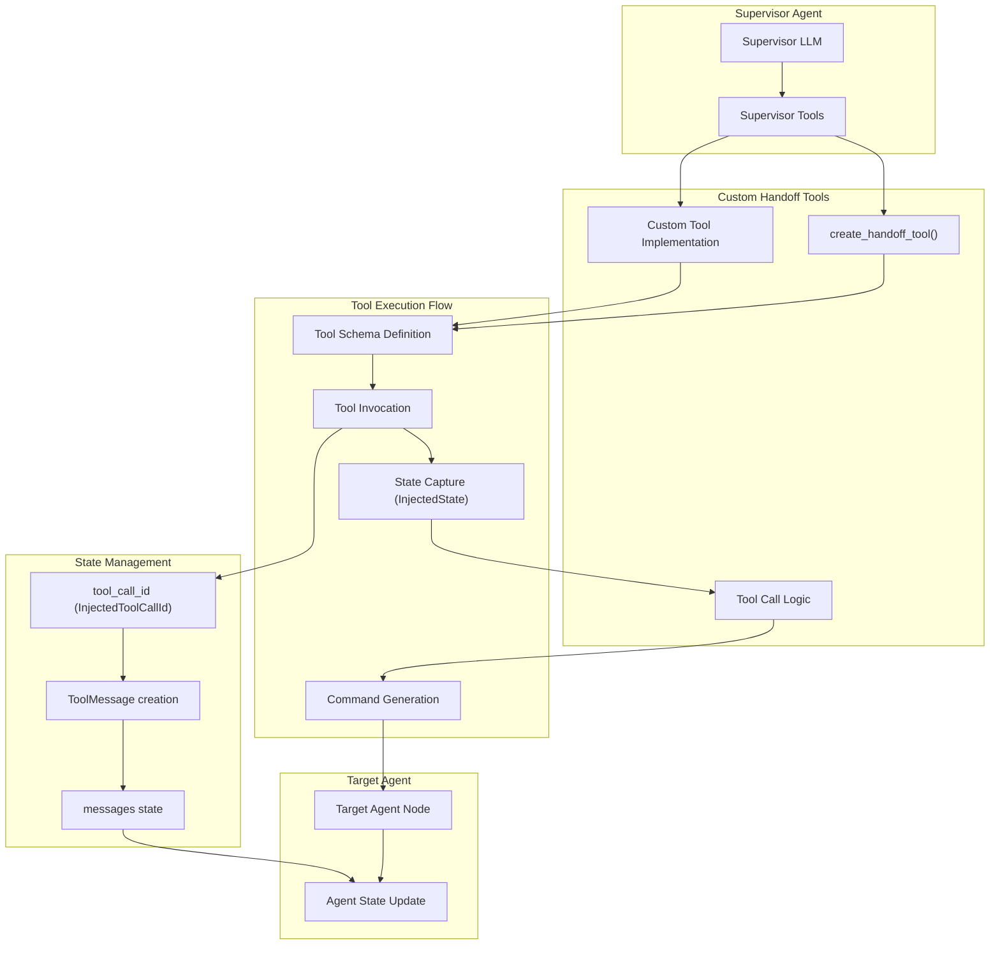
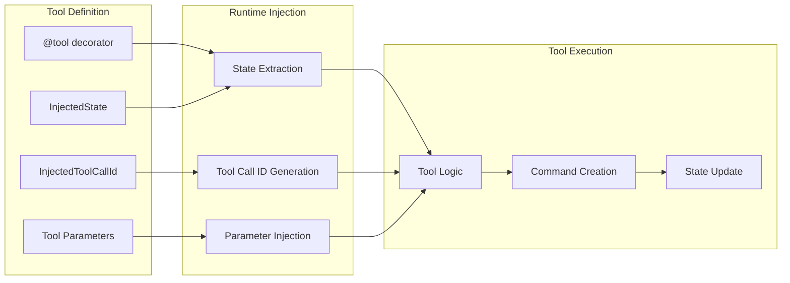
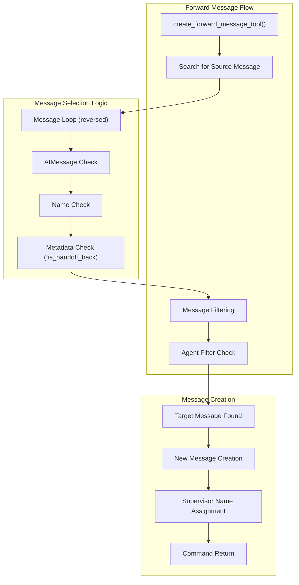

<!-- source: DeepWiki mcp.deepwiki.com · repo langchain-ai/langgraph-supervisor-py · page 4.3 Custom Handoff Tools · fetched 2026-10-26 -->

# Custom Handoff Tools

<details>
<summary>Relevant source files</summary>

The following files were used as context for generating this wiki page:

- [README.md](README.md)
- [langgraph_supervisor/handoff.py](langgraph_supervisor/handoff.py)
- [tests/test_supervisor.py](tests/test_supervisor.py)

</details>


This page covers creating custom handoff tools with additional parameters and specialized behavior beyond the basic handoff tools provided by `create_handoff_tool`. For basic handoff tool API documentation, see [Handoff Tools](#3.2). For information about the overall handoff mechanism, see [Handoff Mechanism](#2.2).

## Purpose and Scope

Custom handoff tools allow you to extend the basic agent transfer functionality with additional parameters, specialized state management, and custom behavior. This includes adding tool call arguments for the LLM to populate, modifying what data is passed during handoffs, and creating tools with custom names and descriptions.

## Basic Customization Options

The `create_handoff_tool` function provides several built-in customization options before you need to implement fully custom tools.

### Tool Name and Description Customization

You can customize the tool name and description when creating handoff tools:

```python
from langgraph_supervisor import create_handoff_tool

# Custom name and description
custom_tool = create_handoff_tool(
    agent_name="math_expert",
    name="assign_to_math_expert",
    description="Assign complex mathematical tasks to the math expert"
)
```

### Message History Control

Control whether handoff messages are added to the conversation history:

```python
# Disable handoff messages for cleaner history
tool_without_messages = create_handoff_tool(
    agent_name="research_expert",
    add_handoff_messages=False
)
```

### Supervisor Integration

Pass custom handoff tools directly to the supervisor:

```python
workflow = create_supervisor(
    [research_agent, math_agent],
    tools=[
        create_handoff_tool(agent_name="math_expert", name="delegate_math"),
        create_handoff_tool(agent_name="research_expert", name="delegate_research")
    ],
    model=model,
)
```

**Sources:** [README.md:180-221](), [langgraph_supervisor/handoff.py:55-126]()

## Custom Handoff Tool Architecture



**Sources:** [langgraph_supervisor/handoff.py:84-125]()

## Creating Fully Custom Handoff Tools

For advanced use cases, you can create completely custom handoff tools using the `@tool` decorator and LangGraph's injection mechanisms.

### Custom Tool Structure

A custom handoff tool follows this pattern:

```python
from typing import Annotated
from langchain_core.tools import tool, BaseTool, InjectedToolCallId
from langchain_core.messages import ToolMessage
from langgraph.types import Command
from langgraph.prebuilt import InjectedState

@tool("custom_handoff_name", description="Custom handoff description")
def custom_handoff_tool(
    # Custom parameters for LLM to populate
    task_description: Annotated[str, "Detailed task description"],
    priority: Annotated[str, "Task priority: high, medium, low"],
    # Required injected parameters
    state: Annotated[dict, InjectedState],
    tool_call_id: Annotated[str, InjectedToolCallId],
) -> Command:
    # Custom logic here
    pass
```

### Advanced Parameter Types

Custom handoff tools can include various parameter types:

| Parameter Type | Purpose | Example |
|----------------|---------|---------|
| `str` | Text descriptions, instructions | `task_description`, `context` |
| `int` | Numeric values, priorities | `priority_level`, `timeout` |
| `bool` | Flags, options | `urgent`, `requires_review` |
| `list[str]` | Multiple items | `required_tools`, `constraints` |

### State Injection Mechanisms

Custom handoff tools use LangGraph's injection system:



**Sources:** [README.md:226-265](), [langgraph_supervisor/handoff.py:6-9]()

## Advanced Handoff Patterns

### Parallel Handoff Support

The handoff system supports parallel handoffs when multiple agents are called simultaneously:

```python
# The system handles parallel handoffs automatically
if len(last_ai_message.tool_calls) > 1:
    # Create Send commands for parallel execution
    return Command(
        graph=Command.PARENT,
        goto=[Send(agent_name, {**state, "messages": handoff_messages})],
    )
```

### Message Filtering and Preparation

Custom tools can implement sophisticated message filtering:

```python
def _remove_non_handoff_tool_calls(last_ai_message, handoff_tool_call_id):
    # Filter out irrelevant tool calls for clean message history
    content = [
        block for block in content 
        if (block["type"] == "tool_use" and block["id"] == handoff_tool_call_id)
        or block["type"] != "tool_use"
    ]
```

### Metadata Tracking

Handoff tools use metadata for tracking:

| Metadata Key | Purpose | Location |
|--------------|---------|----------|
| `__handoff_destination` | Track target agent | ToolMessage metadata |
| `__is_handoff_back` | Mark return transfers | AIMessage metadata |

**Sources:** [langgraph_supervisor/handoff.py:12-13](), [langgraph_supervisor/handoff.py:26-53](), [langgraph_supervisor/handoff.py:96-111]()

## Forward Message Tool

The `create_forward_message_tool` provides a specialized handoff pattern for message forwarding:



### Forward Message Implementation

The forward message tool searches for the latest message from a specified agent:

```python
target_message = next(
    (
        m for m in reversed(state["messages"])
        if isinstance(m, AIMessage)
        and (m.name or "").lower() == from_agent.lower()
        and not m.response_metadata.get(METADATA_KEY_IS_HANDOFF_BACK)
    ),
    None,
)
```

**Sources:** [langgraph_supervisor/handoff.py:151-209](), [langgraph_supervisor/handoff.py:175-184]()

## Tool Name Normalization

The handoff system includes agent name normalization for tool naming:

```python
def _normalize_agent_name(agent_name: str) -> str:
    """Normalize an agent name to be used inside the tool name."""
    return WHITESPACE_RE.sub("_", agent_name.strip()).lower()
```

This ensures consistent tool names by:
- Converting whitespace to underscores
- Lowercasing the name
- Trimming whitespace

**Sources:** [langgraph_supervisor/handoff.py:16-18](), [langgraph_supervisor/handoff.py:11]()

## Integration with Supervisor System

Custom handoff tools integrate seamlessly with the supervisor system:

1. **Tool Registration**: Tools are passed to `create_supervisor` via the `tools` parameter
2. **Automatic Detection**: The supervisor automatically detects handoff tools via metadata
3. **State Management**: Tools receive full supervisor state via `InjectedState`
4. **Command Generation**: Tools return `Command` objects for state graph navigation

```python
# Tools are integrated into the supervisor's tool set
workflow = create_supervisor(
    agents=[agent1, agent2],
    tools=[custom_handoff_tool, forward_message_tool],
    model=model
)
```

**Sources:** [README.md:190-200](), [langgraph_supervisor/handoff.py:124]()

---

