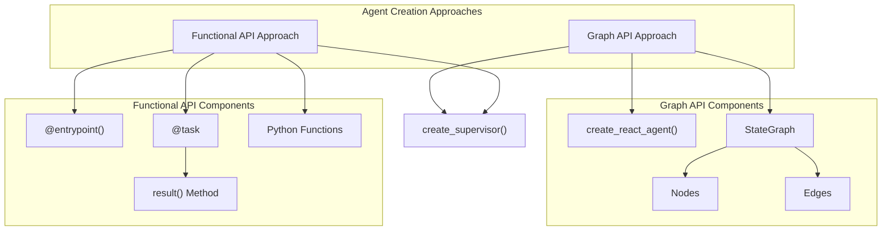
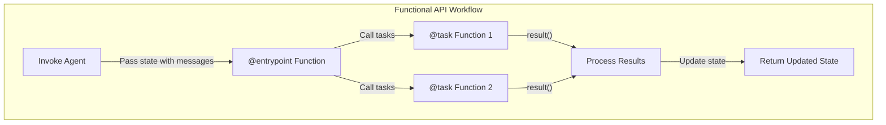
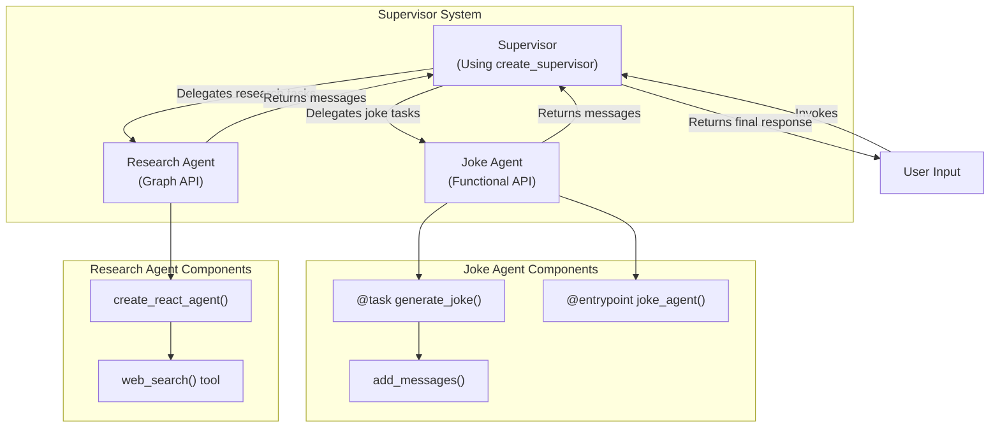
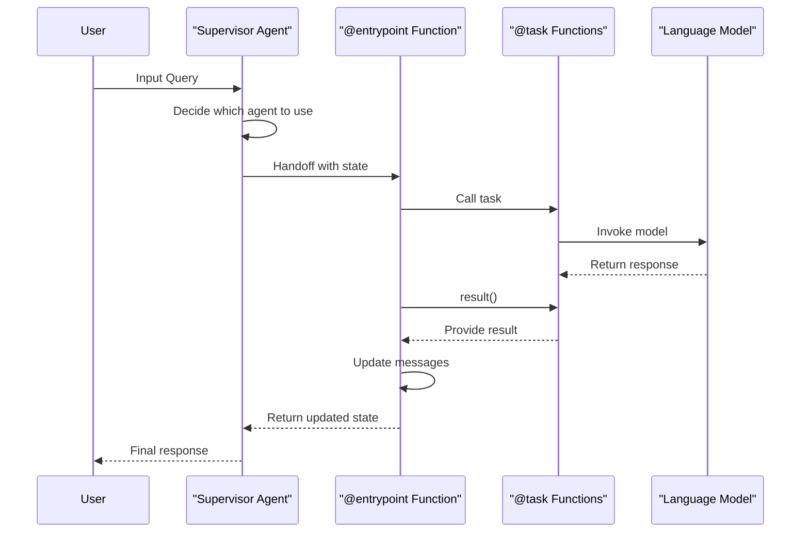

<!-- source: DeepWiki mcp.deepwiki.com · repo langchain-ai/langgraph-supervisor-py · page 4.4 Functional API Integration · fetched 2026-10-26 -->

# Functional API Integration

<details>
<summary>Relevant source files</summary>

The following files were used as context for generating this wiki page:

- [README.md](README.md)
- [tests/test_supervisor_functional_api.py](tests/test_supervisor_functional_api.py)

</details>


The Functional API provides an alternative, more declarative approach to defining agent workflows within the LangGraph Supervisor framework. This page explains how to integrate agents created with LangGraph's Functional API into supervisor-managed multi-agent systems, providing a more intuitive programming model for certain use cases.

For information about creating standard agents using the Graph API approach, see [Core Architecture](#2) and [create_supervisor](#3.1).

## Overview of the Functional API

The Functional API allows you to define agent workflows using Python functions decorated with `@task` and `@entrypoint` decorators, rather than explicitly creating graph structures. This approach offers a more linear and procedural way to define agent logic, which can be easier to understand for developers familiar with functional programming patterns.



Sources: [README.md:246-333]()

## Key Components of the Functional API

The Functional API in LangGraph is built around two primary decorators:

1. **`@task` Decorator**: Defines asynchronous tasks within your workflow, typically involving LLM calls or other operations that may take time to complete.

2. **`@entrypoint()` Decorator**: Defines the main entry point function for your agent workflow, establishing the flow of execution and how different tasks connect.

3. **`add_messages` Function**: A utility function for appending new messages to the existing message history in a state-compatible way.



Sources: [README.md:270-286]()

## Creating an Agent with the Functional API

To create an agent using the Functional API, you need to:

1. Define one or more task functions with the `@task` decorator
2. Create an entrypoint function with the `@entrypoint()` decorator
3. Set a name for the agent workflow
4. Pass the agent to the supervisor

Here's a breakdown of the process:

### 1. Define Task Functions

Task functions are decorated with `@task` and represent individual operations in your agent workflow, typically involving LLM interactions or other potentially time-consuming operations.

```python
@task
def generate_joke(messages):
    """First LLM call to generate initial joke"""
    system_message = {
        "role": "system", 
        "content": "Write a short joke"
    }
    msg = model.invoke(
        [system_message] + messages
    )
    return msg
```

Sources: [README.md:270-280]()

### 2. Create an Entrypoint Function

The entrypoint function serves as the main coordinator for your agent workflow, calling task functions and processing their results.

```python
@entrypoint()
def joke_agent(state):
    joke = generate_joke(state['messages']).result()
    messages = add_messages(state["messages"], [joke])
    return {"messages": messages}
```

Sources: [README.md:282-286]()

### 3. Name Your Agent

For the agent to work with the supervisor, it needs a name that the supervisor can reference:

```python
joke_agent.name = "joke_agent"
```

Sources: [README.md:288]()

### 4. Pass to Supervisor

Once your functional agent is defined, you can pass it to the `create_supervisor` function along with any other agents:

```python
workflow = create_supervisor(
    [research_agent, joke_agent],
    model=model,
    prompt=(
        "You are a team supervisor managing a research expert and a joke expert. "
        "For current events, use research_agent. "
        "For any jokes, use joke_agent."
    )
)
```

Sources: [README.md:310-318]()

## Functional API vs. Graph API

The LangGraph ecosystem supports two primary approaches to defining agent workflows:

| Feature | Functional API | Graph API |
|---------|---------------|-----------|
| Definition Style | Procedural, function-based | Declarative, graph-based |
| Complexity | Lower for linear workflows | Better for complex branching |
| Readability | More readable for simple flows | More explicit for complex flows |
| Paradigm | Similar to standard Python functions | Node and edge-based thinking |
| Learning Curve | Familiar to Python developers | Requires graph-based thinking |
| Use Cases | Simple agent flows, linear processing | Complex decision trees, multiple paths |

Both approaches are fully compatible with the supervisor framework, allowing you to choose the best approach for each specialized agent.

Sources: [README.md:246-333]()

## Example: Mixing Functional and Graph API Agents

The LangGraph Supervisor system allows you to seamlessly mix agents created with different approaches. This example demonstrates integrating a Functional API-based joke agent with a Graph API-based research agent:



Sources: [README.md:246-333]()

## Understanding the Task Execution Model

The Functional API uses an asynchronous execution model with explicit result handling:

1. **Task Definition**: Tasks are defined with the `@task` decorator.
2. **Result Handling**: Task results are accessed using the `.result()` method, which waits for the task to complete.
3. **State Management**: The entrypoint function receives and returns a state dictionary, maintaining the conversation context.

This approach allows for clean, sequential code while still supporting asynchronous operations under the hood.



Sources: [README.md:270-286]()

## Best Practices for Using the Functional API

When using the Functional API with the LangGraph Supervisor, consider these best practices:

1. **Task Granularity**: Design tasks to represent logical units of work, typically involving a single LLM call or other significant operation.

2. **State Management**: Remember that the entrypoint function receives and must return a state dictionary containing at minimum a `messages` key.

3. **Result Handling**: Always use the `.result()` method to await task completion before proceeding.

4. **Agent Naming**: Explicitly set the `.name` attribute for your agent function to ensure proper identification by the supervisor.

5. **Message Updates**: Use the `add_messages` utility function to properly append new messages to the conversation history.

6. **Error Handling**: Consider adding error handling within your task and entrypoint functions to gracefully handle failures.

7. **Documentation**: Include docstrings for your task functions to clarify their purpose and expected inputs/outputs.

Sources: [README.md:246-333]()

## Integration with the Supervisor System

The Functional API provides a different way to define agents, but the integration with the supervisor system remains the same:

1. Define your agents using either the Functional API or Graph API approach
2. Pass all agents to the `create_supervisor` function
3. Compile the resulting workflow
4. Invoke the compiled application with an initial state

The supervisor will handle delegation to the appropriate agent based on the task requirements, regardless of how the agent was defined.

Sources: [README.md:310-333]()

## Summary

The Functional API offers an alternative, more procedural approach to defining agent workflows that can be managed by the LangGraph Supervisor system. It provides a familiar programming model for developers used to function-based approaches, while still leveraging the power of LangGraph's underlying architecture.

Key advantages of the Functional API include:

- More intuitive flow for developers familiar with procedural programming
- Reduced boilerplate for simple, linear workflows
- Clean separation of concerns through task functions
- Compatible with existing Graph API components
- Seamless integration with the supervisor framework

The Functional API is particularly well-suited for specialized agents with straightforward, linear workflows, while more complex agents with branching logic may still benefit from the explicit graph structure of the traditional Graph API approach.

Sources: [README.md:246-333]()

---

