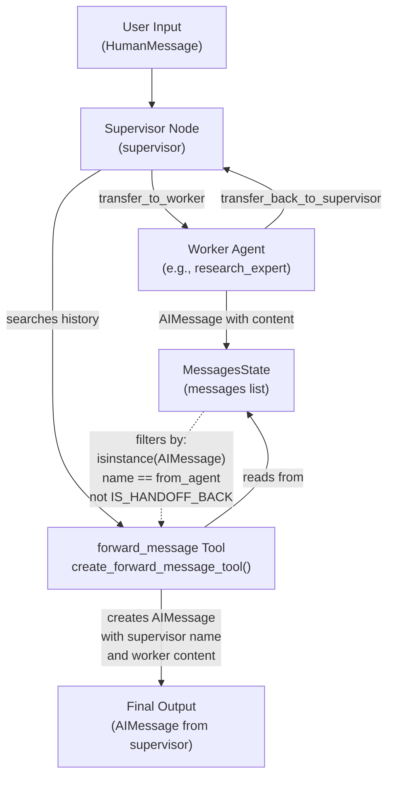
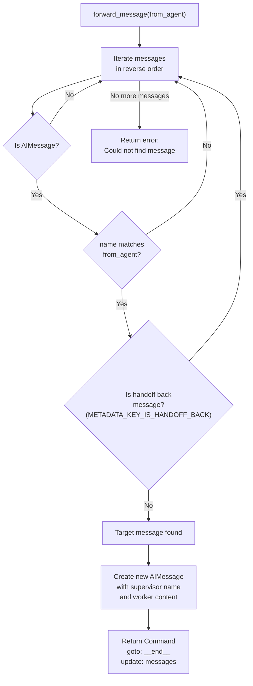
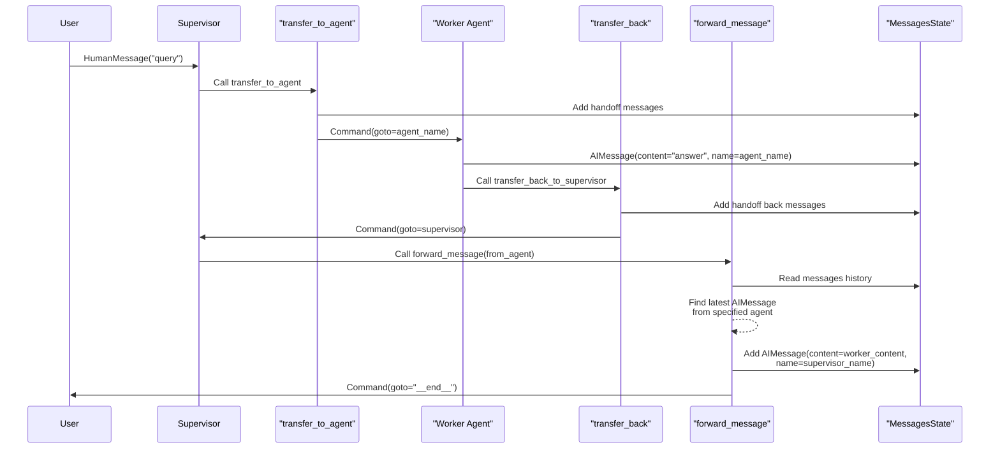

<!-- source: DeepWiki mcp.deepwiki.com · repo langchain-ai/langgraph-supervisor-py · page 4.5 Message Forwarding · fetched 2026-10-26 -->

# Message Forwarding

<details>
<summary>Relevant source files</summary>

The following files were used as context for generating this wiki page:

- [README.md](README.md)
- [langgraph_supervisor/handoff.py](langgraph_supervisor/handoff.py)
- [tests/test_supervisor.py](tests/test_supervisor.py)

</details>


## Purpose and Scope

This document explains how to use the message forwarding feature in langgraph-supervisor to bypass supervisor processing and directly output agent responses. Message forwarding allows the supervisor to preserve the exact content of a worker agent's response without paraphrasing or summarization, reducing token usage and avoiding information loss.

For information about basic handoff mechanisms between supervisor and agents, see [Handoff Mechanism](#2.2). For customizing handoff tools with additional parameters, see [Custom Handoff Tools](#4.3).

**Sources:** [README.md:271-289]()

---

## Overview

Message forwarding provides a mechanism for the supervisor to recognize when a worker agent has already provided a complete and satisfactory response. Instead of the supervisor generating its own paraphrased version of the worker's answer, the supervisor can use the `forward_message` tool to directly output the worker's message as the final result.

### Key Benefits

| Benefit | Description |
|---------|-------------|
| **Token Efficiency** | Avoids additional LLM call for supervisor to reformulate response |
| **Information Fidelity** | Preserves exact wording, technical details, and formatting from specialist agent |
| **Reduced Latency** | Bypasses supervisor processing step for faster responses |
| **Misinterpretation Prevention** | Eliminates risk of supervisor altering meaning during paraphrasing |

**Sources:** [README.md:271-289](), [langgraph_supervisor/handoff.py:155-173]()

---

## Architecture

### Component Interaction Flow



**Sources:** [langgraph_supervisor/handoff.py:155-213](), [tests/test_supervisor.py:428-557]()

### Message Selection Logic

The `forward_message` tool searches the message history using the following criteria:



**Sources:** [langgraph_supervisor/handoff.py:179-195]()

---

## Creating the Forward Message Tool

### Function Signature

The `create_forward_message_tool` function creates a tool instance that the supervisor can use:

```python
def create_forward_message_tool(supervisor_name: str = "supervisor") -> BaseTool
```

**Parameters:**

| Parameter | Type | Default | Description |
|-----------|------|---------|-------------|
| `supervisor_name` | `str` | `"supervisor"` | Name to assign to the forwarded message (sets `AIMessage.name` field) |

**Returns:** `BaseTool` instance with name `"forward_message"`

**Sources:** [langgraph_supervisor/handoff.py:155-163]()

### Tool Definition

The created tool has the following characteristics:

| Property | Value |
|----------|-------|
| **Tool Name** | `"forward_message"` |
| **Tool Parameter** | `from_agent: str` - Name of the agent whose message to forward |
| **Injected Parameters** | `state: Annotated[dict, InjectedState]` - Current graph state |
| **Description** | Forwards the latest message from specified agent without changes |

**Sources:** [langgraph_supervisor/handoff.py:167-178]()

---

## Integration with Supervisor

### Basic Setup

To enable message forwarding, create the tool and pass it to `create_supervisor`:

```python
from langgraph_supervisor import create_supervisor
from langgraph_supervisor.handoff import create_forward_message_tool

# Create the forwarding tool
forwarding_tool = create_forward_message_tool("supervisor")

# Pass it to the supervisor via the tools parameter
workflow = create_supervisor(
    agents=[research_agent, math_agent],
    model=model,
    tools=[forwarding_tool]
)
```

**Sources:** [README.md:276-286](), [tests/test_supervisor.py:473-478]()

### Tool Binding to Supervisor Model

When the supervisor is created, the `forward_message` tool is bound to the supervisor's language model along with handoff tools. The supervisor can then invoke this tool like any other tool in its toolkit.

**Sources:** [langgraph_supervisor/supervisor.py]() (inferred from architecture)

---

## Runtime Execution Flow

### Complete Message Flow



**Sources:** [tests/test_supervisor.py:428-557](), [langgraph_supervisor/handoff.py:174-211]()

---

## Implementation Details

### Message Extraction Algorithm

The `forward_message` function implements the following search algorithm:

**Location:** [langgraph_supervisor/handoff.py:179-195]()

```
1. Start from the end of messages list (most recent)
2. For each message in reverse:
   a. Check if isinstance(m, AIMessage)
   b. Check if (m.name or "").lower() == from_agent.lower()
   c. Check if not m.response_metadata.get(METADATA_KEY_IS_HANDOFF_BACK)
   d. If all conditions met, return this message
3. If no match found, return error message with available agent names
```

**Key Constants:**
- `METADATA_KEY_IS_HANDOFF_BACK = "__is_handoff_back"` - [langgraph_supervisor/handoff.py:13]()

**Sources:** [langgraph_supervisor/handoff.py:179-195]()

### Message Creation and Response

When a matching message is found:

**Location:** [langgraph_supervisor/handoff.py:196-211]()

1. **Create new AIMessage:**
   - `content`: Copied from target worker message
   - `name`: Set to `supervisor_name` parameter
   - `id`: New UUID generated via `str(uuid.uuid4())`

2. **Return Command:**
   - `graph`: `Command.PARENT` - Update parent graph state
   - `goto`: `"__end__"` - Terminal state (ends execution)
   - `update`: `{**state, "messages": updates}` - Apply message update

**Sources:** [langgraph_supervisor/handoff.py:196-211]()

### Error Handling

If no matching message is found:

```python
found_names = set(
    m.name for m in state["messages"] if isinstance(m, AIMessage) and m.name
)
return (
    f"Could not find message from source agent {from_agent}. "
    f"Found names: {found_names}"
)
```

The error message is returned as a string, which becomes the tool result. The supervisor can then handle this error appropriately (e.g., by trying a different agent or responding directly).

**Sources:** [langgraph_supervisor/handoff.py:190-195]()

---

## Message History Comparison

### Without Message Forwarding

When the supervisor doesn't use `forward_message`, it generates its own response after receiving the worker's answer:

| Message Index | Type | Name | Content | Purpose |
|---------------|------|------|---------|---------|
| 0 | HumanMessage | `None` | User query | User input |
| 1 | AIMessage | `supervisor` | Tool call: `transfer_to_agent` | Handoff decision |
| 2 | ToolMessage | `transfer_to_agent` | "Successfully transferred..." | Handoff confirmation |
| 3 | AIMessage | `agent_name` | Agent's answer | Worker response |
| 4 | AIMessage | `agent_name` | Tool call: `transfer_back` | Return to supervisor |
| 5 | ToolMessage | `transfer_back` | "Successfully transferred back..." | Return confirmation |
| 6 | AIMessage | `supervisor` | **Paraphrased answer** | **Supervisor reformulation** |

### With Message Forwarding

When the supervisor uses `forward_message`, the worker's exact content is output:

| Message Index | Type | Name | Content | Purpose |
|---------------|------|------|---------|---------|
| 0 | HumanMessage | `None` | User query | User input |
| 1 | AIMessage | `supervisor` | Tool call: `transfer_to_agent` | Handoff decision |
| 2 | ToolMessage | `transfer_to_agent` | "Successfully transferred..." | Handoff confirmation |
| 3 | AIMessage | `agent_name` | Agent's answer | Worker response |
| 4 | AIMessage | `agent_name` | Tool call: `transfer_back` | Return to supervisor |
| 5 | ToolMessage | `transfer_back` | "Successfully transferred back..." | Return confirmation |
| 6 | AIMessage | `supervisor` | **Exact agent answer** | **Forwarded content** |

**Key Difference:** Message at index 6 contains the exact content from the worker agent, not a paraphrased version.

**Sources:** [tests/test_supervisor.py:493-557]()

---

## Test Case Walkthrough

### Test Execution Flow

The test `test_supervisor_message_forwarding` demonstrates the complete flow:

**Location:** [tests/test_supervisor.py:428-557]()

**Step 1: Agent Setup**
```python
echo_model = FakeChatModel(
    responses=[AIMessage(content="Echo: test forwarding!")]
)
echo_agent = create_react_agent(
    model=echo_model.bind_tools([echo_tool]),
    tools=[echo_tool],
    name="echo_agent"
)
```

**Step 2: Supervisor Configuration**
```python
supervisor_messages = [
    AIMessage(content="", tool_calls=[{"name": "transfer_to_echo_agent", ...}]),
    AIMessage(content="", tool_calls=[{"name": "forward_message", 
                                       "args": {"from_agent": "echo_agent"}, ...}])
]

forwarding = create_forward_message_tool("supervisor")
workflow = create_supervisor(
    [echo_agent],
    model=FakeChatModel(responses=supervisor_messages),
    tools=[forwarding]
)
```

**Step 3: Invocation and Verification**
```python
result = app.invoke({"messages": [HumanMessage(content="Scooby-dooby-doo")]})
```

**Expected Message Sequence:**
1. HumanMessage: User input
2. AIMessage (supervisor): Handoff tool call
3. ToolMessage: Handoff confirmation
4. AIMessage (echo_agent): "Echo: test forwarding!"
5. AIMessage (echo_agent): Transfer back tool call
6. ToolMessage: Transfer back confirmation
7. AIMessage (supervisor): "Echo: test forwarding!" ← **Forwarded content**

**Sources:** [tests/test_supervisor.py:428-557]()

---

## Use Cases

### When to Use Message Forwarding

Message forwarding is particularly valuable in these scenarios:

| Scenario | Reason |
|----------|--------|
| **Factual Information Retrieval** | Preserve exact facts, statistics, and data from research agents |
| **Technical Explanations** | Maintain precise technical language and terminology from expert agents |
| **Code Generation** | Forward code snippets without risk of syntax errors from paraphrasing |
| **Mathematical Proofs** | Preserve logical structure and notation from math agents |
| **Quoted Content** | Keep exact quotations, citations, or references intact |
| **Multi-step Reasoning** | Preserve complete reasoning chains without summarization loss |

### When NOT to Use Message Forwarding

| Scenario | Alternative |
|----------|-------------|
| **Multiple Agent Synthesis** | Let supervisor combine insights from multiple agents |
| **Response Formatting** | Let supervisor format the final answer for the user |
| **Context Reduction** | Let supervisor summarize lengthy worker responses |
| **Error Correction** | Let supervisor correct or clarify agent mistakes |

**Sources:** [README.md:271-289](), [langgraph_supervisor/handoff.py:155-173]()

---

## Advanced Configuration

### Custom Supervisor Name

You can customize the name assigned to forwarded messages:

```python
# Default: forwarded messages will have name="supervisor"
forwarding_tool = create_forward_message_tool("supervisor")

# Custom: forwarded messages will have name="assistant"
forwarding_tool = create_forward_message_tool("assistant")

# Custom: forwarded messages will have name="research_coordinator"
forwarding_tool = create_forward_message_tool("research_coordinator")
```

This affects the `name` field of the final AIMessage that appears in the output.

**Sources:** [langgraph_supervisor/handoff.py:155-163](), [langgraph_supervisor/handoff.py:196-201]()

### Combining with Custom Handoff Tools

The `forward_message` tool can be combined with custom handoff tools (see [Custom Handoff Tools](#4.3)):

```python
from langgraph_supervisor import create_supervisor
from langgraph_supervisor.handoff import create_handoff_tool, create_forward_message_tool

custom_handoff_1 = create_handoff_tool(
    agent_name="research_expert",
    name="delegate_to_research",
    description="Delegate research tasks"
)

custom_handoff_2 = create_handoff_tool(
    agent_name="math_expert", 
    name="delegate_to_math",
    description="Delegate math tasks"
)

forwarding_tool = create_forward_message_tool("supervisor")

workflow = create_supervisor(
    [research_agent, math_agent],
    model=model,
    tools=[custom_handoff_1, custom_handoff_2, forwarding_tool]
)
```

**Sources:** [README.md:192-202](), [README.md:276-286]()

---

## Metadata and State Management

### Message Filtering by Metadata

The forward message tool explicitly filters out handoff back messages using response metadata:

**Metadata Key:** `METADATA_KEY_IS_HANDOFF_BACK = "__is_handoff_back"` - [langgraph_supervisor/handoff.py:13]()

This ensures that when searching for the latest agent message, it finds the actual content message, not the synthetic "transferring back" message created by the handoff mechanism.

**Filter Condition:** [langgraph_supervisor/handoff.py:185]()
```python
and not m.response_metadata.get(METADATA_KEY_IS_HANDOFF_BACK)
```

**Sources:** [langgraph_supervisor/handoff.py:13](), [langgraph_supervisor/handoff.py:179-195](), [langgraph_supervisor/handoff.py:132-152]()

### State Update Mechanism

The `forward_message` tool returns a `Command` object that updates the parent graph's state:

**Command Structure:**
- `graph=Command.PARENT`: Apply update to parent graph (not subgraph)
- `goto="__end__"`: Navigate to terminal state
- `update={**state, "messages": updates}`: Merge new messages into state

**Sources:** [langgraph_supervisor/handoff.py:204-211]()

---

## Integration with Output Modes

Message forwarding works with both output modes (see [Message History Management](#2.4)):

### With `output_mode="last_message"`

Only the final agent message and forwarded message appear in history. Intermediate tool calls and reasoning steps are omitted.

### With `output_mode="full_history"`

All messages including agent reasoning, tool calls, and the forwarded message appear in history.

**Note:** The forwarding mechanism itself is independent of output mode - it always creates a single forwarded AIMessage in the parent graph's state. The output mode affects what other messages from the agent's internal processing are retained.

**Sources:** [README.md:102-126]()

---

## Error Scenarios and Debugging

### Common Error: Agent Name Mismatch

If the `from_agent` parameter doesn't match any agent name in the message history:

**Error Message:**
```
"Could not find message from source agent {from_agent}. Found names: {found_names}"
```

**Causes:**
1. Typo in agent name (case-sensitive comparison uses `.lower()`)
2. Agent hasn't produced any messages yet
3. Only handoff back messages exist from that agent

**Resolution:**
- Verify agent name matches the `name` parameter used in agent creation
- Ensure agent has been invoked before attempting to forward
- Check message history to confirm agent has produced content messages

**Sources:** [langgraph_supervisor/handoff.py:190-195]()

### Debugging Message History

To debug message forwarding issues, inspect the message history:

```python
result = app.invoke({"messages": [HumanMessage(content="query")]})

# Print all messages with their names and types
for i, msg in enumerate(result["messages"]):
    print(f"{i}: {msg.type} - name={msg.name}, content={msg.content[:50]}...")
    if hasattr(msg, 'response_metadata'):
        print(f"   metadata: {msg.response_metadata}")
```

**Sources:** [tests/test_supervisor.py:493-557]()

---

