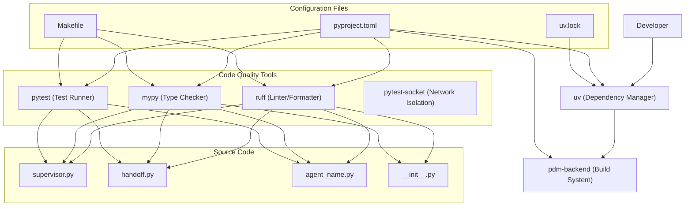
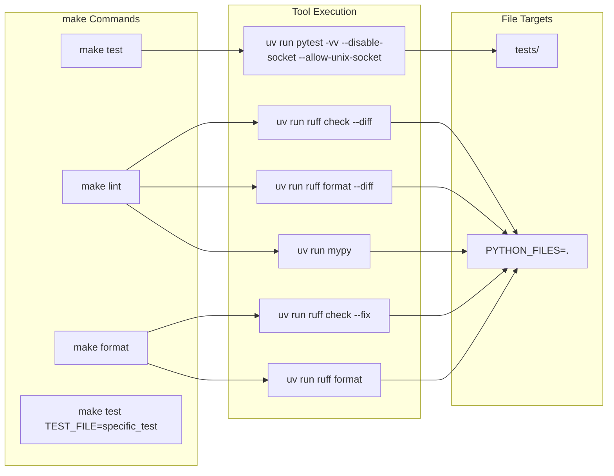
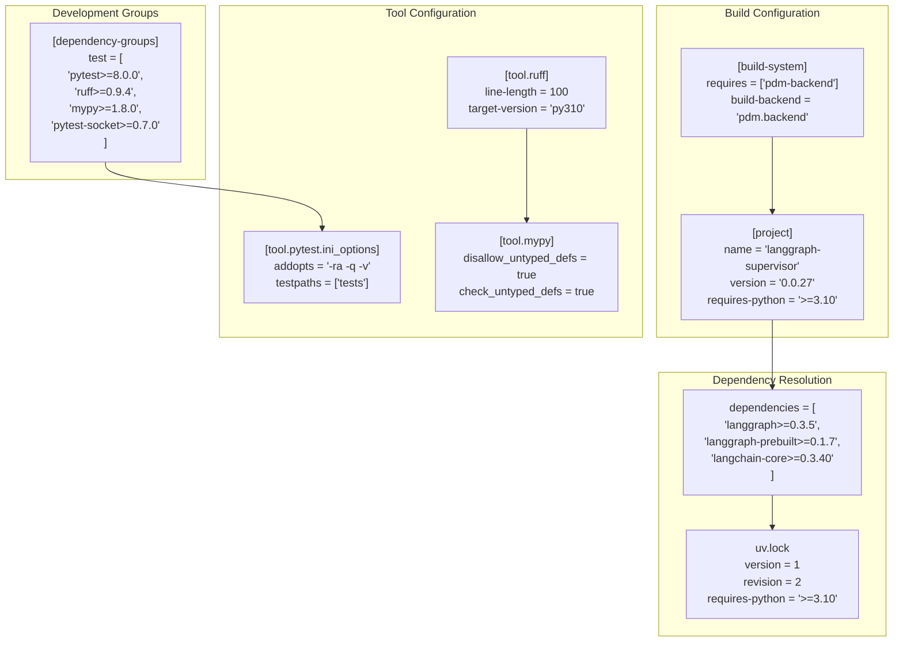

<!-- source: DeepWiki mcp.deepwiki.com · repo langchain-ai/langgraph-supervisor-py · page 5 Development Guide · fetched 2026-10-26 -->

# Development Guide

Relevant source files

The following files were used as context for generating this wiki page:

- [.github/workflows/ci.yml](.github/workflows/ci.yml)
- [Makefile](Makefile)
- [pyproject.toml](pyproject.toml)

This document provides essential information for contributors and developers working on the `langgraph-supervisor` codebase. It covers the development environment setup, build system, testing infrastructure, code quality tools, and release processes.

For information about using the supervisor system in applications, see [Core Architecture](#2). For API documentation, see [API Reference](#3).

## Development Ecosystem Overview

The `langgraph-supervisor` project uses a modern Python development stack centered around `uv` for dependency management and `pdm-backend` for building. The development workflow emphasizes code quality through automated testing, linting, and type checking.

**Sources:** [pyproject.toml:1-63](), [uv.lock:1-800](), [Makefile:1-54]()

## Project Configuration and Dependencies

The project uses `pyproject.toml` as the central configuration file, defining build system, dependencies, and tool configurations. The core runtime dependencies establish the LangGraph ecosystem foundation:

| Dependency | Version Constraint | Purpose |
|------------|-------------------|---------|
| `langgraph` | `>=0.3.5` | State graph orchestration framework |
| `langgraph-prebuilt` | `>=0.1.7` | Pre-built components and utilities |
| `langchain-core` | `>=0.3.40` | LLM abstractions, tools, and messages |

Development dependencies are organized in the `test` group:

| Tool | Version Constraint | Purpose |
|------|-------------------|---------|
| `pytest` | `>=8.0.0` | Test framework with `testpaths = ["tests"]` |
| `ruff` | `>=0.9.4` | Linting and formatting with `line-length = 100` |
| `mypy` | `>=1.8.0` | Type checking with `disallow_untyped_defs = true` |
| `pytest-socket` | `>=0.7.0` | Network isolation during testing |

**Sources:** [pyproject.toml:16-29](), [pyproject.toml:31-38](), [pyproject.toml:40-63]()

## Development Workflow and Automation

The `Makefile` provides standardized commands for common development tasks. The workflow emphasizes deterministic testing and code quality enforcement:

Key workflow characteristics:

- **Network Isolation**: Tests run with `--disable-socket --allow-unix-socket` to prevent external dependencies
- **Comprehensive Linting**: The `lint` target runs format checking, linting, and type checking in sequence
- **Safe Formatting**: Format checking (`--diff`) runs before applying changes (`--fix`)
- **Flexible Testing**: `TEST_FILE` variable allows targeting specific test files or directories

**Sources:** [Makefile:10-17](), [Makefile:25-35]()

## Build System and Dependency Management

The project uses `pdm-backend` as the build system with `uv` for dependency resolution and environment management. This combination provides reproducible builds and fast dependency installation:

The `uv.lock` file contains 366 resolved packages with exact version pins and checksums, ensuring reproducible installations across environments. Key locked versions include:

- `langgraph-supervisor = "0.0.27"` (editable local package)
- `pytest = "8.0.0+"` with extensive plugin ecosystem
- `ruff = "0.9.4+"` for fast Python linting
- `mypy = "1.15.0"` for static type analysis

**Sources:** [pyproject.toml:1-8](), [pyproject.toml:22-29](), [uv.lock:1-10](), [uv.lock:331-365]()

## Code Quality Standards and Configuration

The project enforces strict code quality standards through coordinated tool configuration:

### Ruff Configuration
- **Line Length**: 100 characters (`line-length = 100`)
- **Target Version**: Python 3.10+ (`target-version = "py310"`)
- **Selected Rules**: Pycodestyle errors (E), warnings (W), Pyflakes (F), isort (I), flake8-bugbear (B)
- **Ignored Rules**: E501 (line-length conflicts with formatter)

### MyPy Configuration  
- **Python Version**: 3.11 (`python_version = "3.11"`)
- **Strict Typing**: `disallow_untyped_defs = true`, `check_untyped_defs = true`
- **Warnings**: `warn_return_any = true`, `warn_unused_configs = true`

### Pytest Configuration
- **Minimum Version**: 8.0 (`minversion = "8.0"`)
- **Default Options**: `-ra -q -v` (show all test outcomes, quiet, verbose)
- **Test Discovery**: `testpaths = ["tests"]`, `python_files = ["test_*.py"]`
- **Function Discovery**: `python_functions = ["test_*"]`

**Sources:** [pyproject.toml:40-55](), [pyproject.toml:57-63](), [pyproject.toml:31-38]()

---

