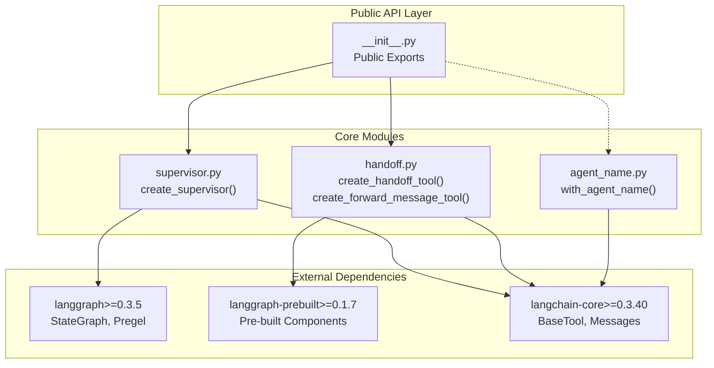
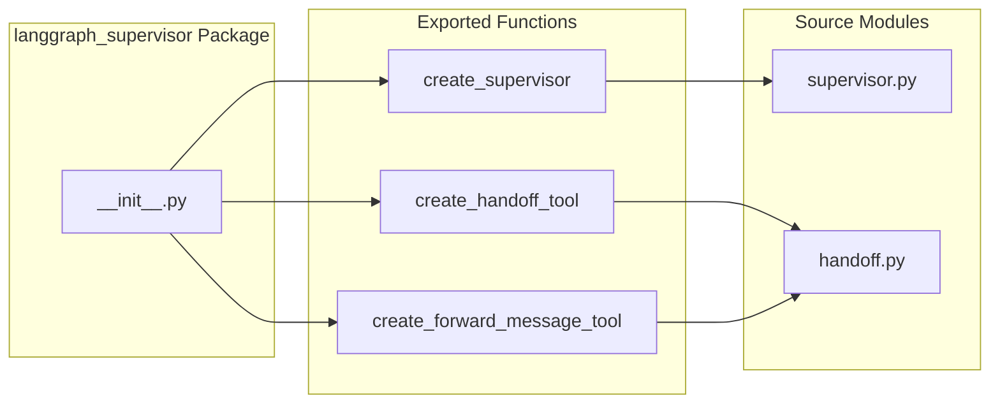
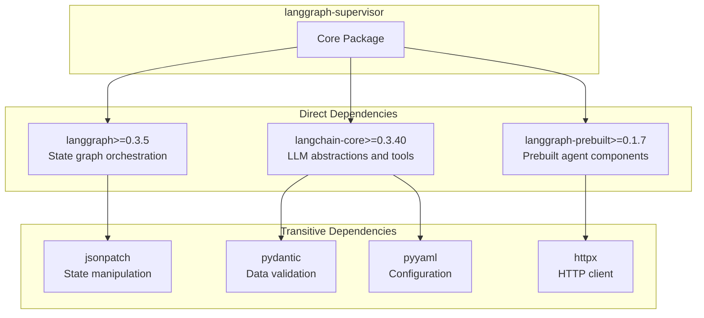
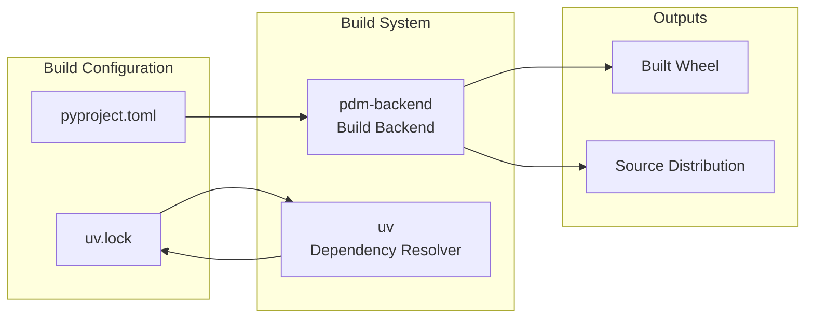
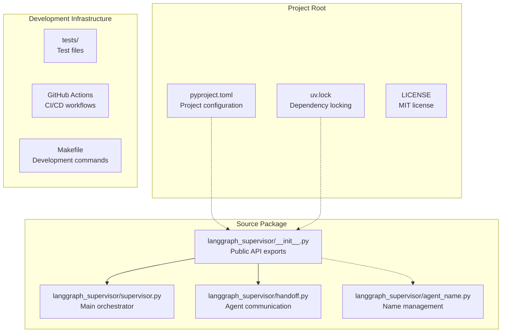

<!-- source: DeepWiki mcp.deepwiki.com · repo langchain-ai/langgraph-supervisor-py · page 5.1 Project Structure · fetched 2026-10-26 -->

# Project Structure

<details>
<summary>Relevant source files</summary>

The following files were used as context for generating this wiki page:

- [.gitignore](.gitignore)
- [LICENSE](LICENSE)
- [langgraph_supervisor/__init__.py](langgraph_supervisor/__init__.py)
- [pyproject.toml](pyproject.toml)

</details>


This document provides an overview of the langgraph-supervisor codebase organization, including its core modules, dependency management, build system, and development infrastructure. This page focuses on the technical architecture and file organization of the project.

For information about using the supervisor API, see [API Reference](#3). For development workflows and testing, see [Testing](#5.2) and [Development Environment](#5.4).

## Package Architecture

The langgraph-supervisor package is organized as a Python package that provides a multi-agent orchestration framework built on top of LangGraph. The core architecture consists of three main functional areas exposed through a clean public API.



**Sources:** [langgraph_supervisor/__init__.py:1-7](), [pyproject.toml:16-20]()

## Core Module Structure

The package follows a modular design with clear separation of concerns across three primary modules:

| Module | Primary Functions | Purpose |
|--------|------------------|---------|
| `supervisor.py` | `create_supervisor()` | Main orchestrator creation and configuration |
| `handoff.py` | `create_handoff_tool()`, `create_forward_message_tool()` | Agent communication and control transfer |
| `agent_name.py` | `with_agent_name()` | Agent identification and message formatting |

### Public API Surface



The package exposes exactly three public functions through its `__init__.py`, providing a minimal and focused API surface for multi-agent orchestration.

**Sources:** [langgraph_supervisor/__init__.py:1-7]()

## Dependency Management

### Core Runtime Dependencies

The project has a carefully curated set of runtime dependencies that provide the foundation for multi-agent workflows:



**Sources:** [pyproject.toml:16-20](), [uv.lock:275-330]()

### Development Dependencies

Development dependencies are organized into a `test` group, providing comprehensive tooling for code quality and testing:

| Tool | Version | Purpose |
|------|---------|---------|
| `pytest` | `>=8.0.0` | Test framework and runner |
| `ruff` | `>=0.9.4` | Linting and code formatting |
| `mypy` | `>=1.8.0` | Static type checking |
| `pytest-socket` | `>=0.7.0` | Network access control in tests |
| `types-setuptools` | `>=69.0.0` | Type stubs for setuptools |

**Sources:** [pyproject.toml:22-29]()

## Build System Configuration

### Project Metadata

The build system uses `pdm-backend` as the build backend, configured through `pyproject.toml`:



**Sources:** [pyproject.toml:1-3](), [pyproject.toml:5-15]()

### Package Metadata

Key package configuration details:

- **Name:** `langgraph-supervisor`
- **Version:** `0.0.27`
- **Python Requirement:** `>=3.10`
- **License:** MIT
- **Build Backend:** `pdm.backend`

**Sources:** [pyproject.toml:5-15](), [LICENSE:1-22]()

## Development Tool Configuration

### Code Quality Tools

The project includes comprehensive tool configuration for maintaining code quality:

#### Ruff Configuration
```toml
[tool.ruff]
line-length = 100
target-version = "py310"

[tool.ruff.lint]
select = ["E", "W", "F", "I", "B"]  # pycodestyle, pyflakes, isort, flake8-bugbear
ignore = ["E501"]  # line-length (handled by formatter)
```

#### MyPy Configuration
```toml
[tool.mypy]
python_version = "3.11"
warn_return_any = true
warn_unused_configs = true
disallow_untyped_defs = true
check_untyped_defs = true
```

**Sources:** [pyproject.toml:40-63]()

#### Pytest Configuration
```toml
[tool.pytest.ini_options]
minversion = "8.0"
addopts = "-ra -q -v"
testpaths = ["tests"]
python_files = ["test_*.py"]
python_functions = ["test_*"]
```

**Sources:** [pyproject.toml:31-38]()

## Dependency Lock File

The `uv.lock` file provides complete dependency resolution with exact version pinning for reproducible builds. This file contains:

- **Version Format:** `version = 1, revision = 2`
- **Python Constraint:** `requires-python = ">=3.10"`
- **Resolution Markers:** Platform-specific dependency resolution
- **Complete Dependency Tree:** All transitive dependencies with exact versions and hashes

The lock file ensures that all environments (development, CI, production) use identical dependency versions, preventing "works on my machine" issues.

**Sources:** [uv.lock:1-7]()

## File Organization Summary



This structure provides clear separation between configuration, source code, and development infrastructure, following Python packaging best practices while maintaining simplicity and focused functionality.

**Sources:** [pyproject.toml:1-63](), [langgraph_supervisor/__init__.py:1-7](), [LICENSE:1-22]()

---

