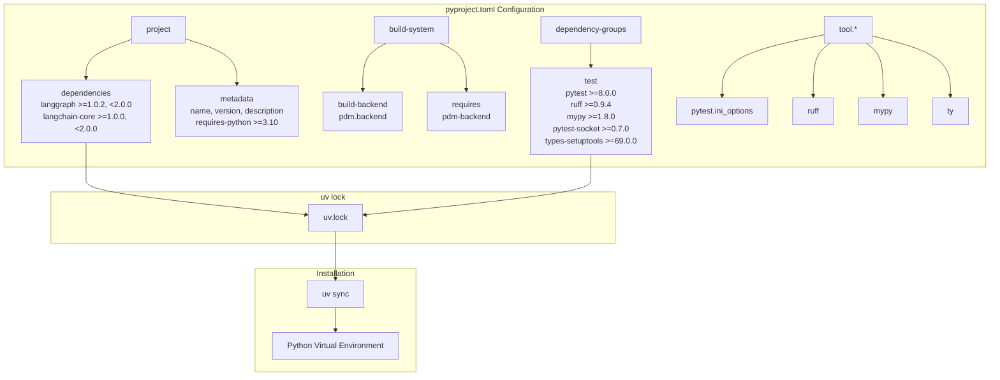
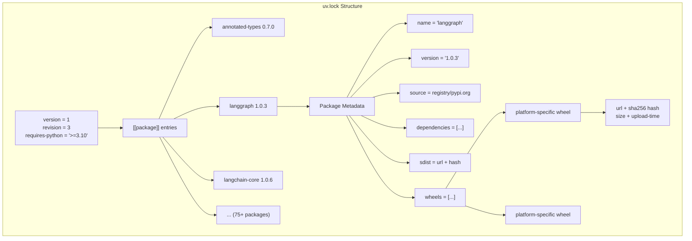
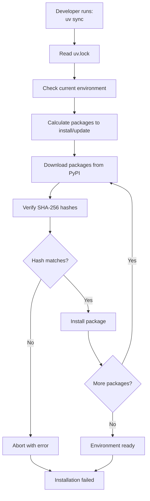
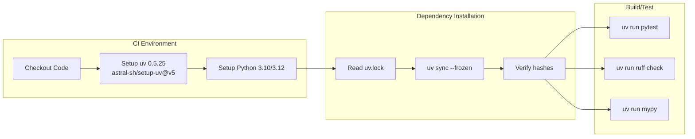

<!-- source: DeepWiki mcp.deepwiki.com · repo langchain-ai/langgraph-supervisor-py · page 5.2 Dependency Management · fetched 2026-10-26 -->

# Dependency Management

<details>
<summary>Relevant source files</summary>

The following files were used as context for generating this wiki page:

- [.github/actions/uv_setup/action.yml](.github/actions/uv_setup/action.yml)
- [pyproject.toml](pyproject.toml)
- [uv.lock](uv.lock)

</details>


## Purpose and Scope

This document explains how dependencies are managed in the langgraph-supervisor project using the `uv` package manager. It covers the dependency configuration in `pyproject.toml`, the lock file mechanism in `uv.lock`, and practical workflows for installing, adding, and updating dependencies. For information about code quality tools (ruff, mypy) that are managed as development dependencies, see [Code Quality](#5.4). For CI/CD workflows that utilize dependency management, see [CI/CD and Release Process](#5.5).

---

## Package Manager: uv

The project uses [uv](https://github.com/astral-sh/uv) version **0.5.25** as its package manager. `uv` is a fast Python package installer and resolver written in Rust that provides:

- **Fast dependency resolution** - significantly faster than pip
- **Reproducible builds** - via lock files with cryptographic hashes
- **Cross-platform consistency** - identical environments across development, CI, and production
- **Workspace support** - manages both runtime and development dependencies

The uv version is pinned in the CI/CD GitHub Actions:

```yaml
env:
  UV_VERSION: "0.5.25"
```

**Sources:** [.github/actions/uv_setup/action.yml:12]()

### Installation

To install uv, follow the [official installation guide](https://github.com/astral-sh/uv#installation). For CI environments, the project uses the `astral-sh/setup-uv@v5` GitHub Action which automatically installs the correct version.

**Sources:** [.github/actions/uv_setup/action.yml:17-21]()

---

## Project Configuration (pyproject.toml)

The `pyproject.toml` file is the single source of truth for project metadata, dependencies, build configuration, and tool settings.

### Project Metadata

```toml
[project]
name = "langgraph-supervisor"
version = "0.0.31"
description = "An implementation of a supervisor multi-agent architecture using LangGraph"
requires-python = ">=3.10"
```

The project requires Python 3.10 or higher and follows semantic versioning.

**Sources:** [pyproject.toml:5-15]()

### Dependency Configuration Diagram



**Sources:** [pyproject.toml:1-76]()

### Runtime Dependencies

The project has two core runtime dependencies with strict version bounds:

| Package | Version Constraint | Purpose |
|---------|-------------------|---------|
| `langgraph` | `>=1.0.2, <2.0.0` | State graph execution and orchestration |
| `langchain-core` | `>=1.0.0, <2.0.0` | Message types and language model abstractions |

These constraints ensure API compatibility while allowing minor and patch updates.

```toml
dependencies = [
    "langgraph>=1.0.2,<2.0.0",
    "langchain-core>=1.0.0,<2.0.0"
]
```

**Sources:** [pyproject.toml:16-19]()

### Development Dependencies (Dependency Groups)

Development dependencies are organized into groups using PEP 735 dependency groups. The `test` group contains all tools needed for development:

```toml
[dependency-groups]
test = [
    "pytest>=8.0.0",
    "ruff>=0.9.4",
    "mypy>=1.8.0",
    "pytest-socket>=0.7.0",
    "types-setuptools>=69.0.0",
]
```

| Tool | Version | Purpose |
|------|---------|---------|
| `pytest` | `>=8.0.0` | Test framework |
| `ruff` | `>=0.9.4` | Linter and formatter |
| `mypy` | `>=1.8.0` | Static type checker |
| `pytest-socket` | `>=0.7.0` | Network call blocking in tests |
| `types-setuptools` | `>=69.0.0` | Type stubs for setuptools |

**Sources:** [pyproject.toml:28-35]()

### Build System Configuration

The project uses `pdm-backend` as its PEP 517 build backend:

```toml
[build-system]
requires = ["pdm-backend"]
build-backend = "pdm.backend"
```

This backend is used during package building (e.g., when running `uv build` for PyPI publishing) but is not required for normal development workflows.

**Sources:** [pyproject.toml:1-3]()

---

## Dependency Lock File (uv.lock)

The `uv.lock` file contains the complete resolved dependency tree with exact versions, sources, and cryptographic hashes for every package.

### Lock File Structure



**Sources:** [uv.lock:1-959]()

### Package Entry Anatomy

Each package in `uv.lock` contains detailed metadata:

```toml
[[package]]
name = "langgraph"
version = "1.0.3"
source = { registry = "https://pypi.org/simple" }
dependencies = [
    { name = "langchain-core" },
    { name = "langgraph-checkpoint" },
    { name = "langgraph-prebuilt" },
    { name = "langgraph-sdk" },
    { name = "pydantic" },
    { name = "xxhash" },
]
sdist = { url = "...", hash = "sha256:873a...", size = 483302 }
wheels = [
    { url = "...", hash = "sha256:4a75...", size = 156845 },
]
```

**Key fields:**

- **name/version**: Exact package identifier
- **source**: Where the package comes from (PyPI, Git, local path)
- **dependencies**: Resolved transitive dependencies
- **sdist**: Source distribution with SHA-256 hash
- **wheels**: Pre-built binaries for different platforms with SHA-256 hashes

**Sources:** [uv.lock:272-286]()

### Hash Verification

Every file (sdist and wheel) includes a SHA-256 hash for integrity verification. When installing, uv:

1. Downloads the package file
2. Computes its SHA-256 hash
3. Compares against the hash in `uv.lock`
4. Aborts installation if hashes don't match

This prevents supply chain attacks and ensures bit-for-bit reproducibility.

### Transitive Dependencies

The lock file includes not just direct dependencies but all transitive dependencies. For example, `langgraph-supervisor` depends on `langgraph`, which depends on:

```toml
dependencies = [
    { name = "langchain-core" },
    { name = "langgraph-checkpoint" },
    { name = "langgraph-prebuilt" },
    { name = "langgraph-sdk" },
    { name = "pydantic" },
    { name = "xxhash" },
]
```

And `langchain-core` further depends on:

```toml
dependencies = [
    { name = "jsonpatch" },
    { name = "langsmith" },
    { name = "packaging" },
    { name = "pydantic" },
    { name = "pyyaml" },
    { name = "tenacity" },
    { name = "typing-extensions" },
]
```

The lock file resolves all these relationships into a flat list of ~75 packages with exact versions.

**Sources:** [uv.lock:272-286](), [uv.lock:254-269]()

### Platform-Specific Wheels

Many packages include multiple wheel entries for different platforms:

```toml
wheels = [
    { url = "...-cp310-cp310-macosx_10_9_x86_64.whl", hash = "sha256:..." },
    { url = "...-cp310-cp310-macosx_11_0_arm64.whl", hash = "sha256:..." },
    { url = "...-cp310-cp310-manylinux_2_17_x86_64.whl", hash = "sha256:..." },
    { url = "...-cp310-cp310-win_amd64.whl", hash = "sha256:..." },
]
```

uv automatically selects the appropriate wheel for the current platform during installation.

**Sources:** [uv.lock:389-414]() (mypy package wheels example)

---

## Working with Dependencies

### Installing Dependencies

To set up the development environment with all dependencies:

```bash
# Install both runtime and development dependencies
uv sync

# Install only runtime dependencies (production)
uv sync --no-dev
```

The `sync` command:
1. Reads `uv.lock` to determine exact versions
2. Downloads packages from PyPI
3. Verifies SHA-256 hashes
4. Installs into the Python environment

**Sources:** [pyproject.toml:16-35](), [uv.lock:1-959]()

### Dependency Installation Workflow



**Sources:** [uv.lock:1-959]()

### Adding New Dependencies

To add a new runtime dependency:

```bash
# Add a new package
uv add <package-name>

# Add with version constraint
uv add "langchain-openai>=0.1.0"

# Add to dev dependencies
uv add --group test <package-name>
```

This will:
1. Update `pyproject.toml` with the new dependency
2. Resolve all dependencies
3. Update `uv.lock` with new resolved versions
4. Install the new package

**Example workflow:**

```bash
# Add langchain-openai as a runtime dependency
uv add "langchain-openai>=0.1.0,<0.2.0"

# This modifies:
# - pyproject.toml: adds langchain-openai to dependencies[]
# - uv.lock: adds langchain-openai and any new transitive deps
```

**Sources:** [pyproject.toml:16-19](), [pyproject.toml:28-35]()

### Updating Dependencies

To update dependencies to their latest compatible versions:

```bash
# Update all dependencies
uv lock --upgrade

# Update a specific package
uv lock --upgrade-package langgraph

# Update and sync in one command
uv sync --upgrade
```

The `--upgrade` flag tells uv to resolve the newest versions that satisfy the constraints in `pyproject.toml`, rather than using the versions in `uv.lock`.

### Removing Dependencies

To remove a dependency:

```bash
# Remove a runtime dependency
uv remove <package-name>

# Remove a dev dependency
uv remove --group test <package-name>
```

This updates both `pyproject.toml` and `uv.lock`, then syncs the environment.

**Sources:** [pyproject.toml:16-35]()

### Inspecting Dependencies

```bash
# Show dependency tree
uv tree

# Show outdated packages
uv pip list --outdated
```

Example output of `uv tree`:

```
langgraph-supervisor v0.0.31
├── langgraph>=1.0.2,<2.0.0
│   ├── langchain-core>=1.0.0,<2.0.0
│   │   ├── jsonpatch
│   │   │   └── jsonpointer
│   │   ├── langsmith
│   │   │   ├── httpx
│   │   │   │   ├── anyio
│   │   │   │   ├── certifi
│   │   │   │   └── ...
│   │   └── ...
│   └── ...
└── langchain-core>=1.0.0,<2.0.0 (*)
```

---

## Version Constraints Strategy

The project uses carefully chosen version constraints to balance stability and compatibility:

### Runtime Dependencies

```toml
dependencies = [
    "langgraph>=1.0.2,<2.0.0",
    "langchain-core>=1.0.0,<2.0.0"
]
```

**Strategy:**
- **Lower bound** (`>=1.0.2`): Minimum version that provides required features
- **Upper bound** (`<2.0.0`): Exclude major versions that may have breaking changes
- This allows automatic minor and patch updates while preventing breaking changes

**Sources:** [pyproject.toml:16-19]()

### Development Dependencies

```toml
test = [
    "pytest>=8.0.0",
    "ruff>=0.9.4",
    "mypy>=1.8.0",
    "pytest-socket>=0.7.0",
    "types-setuptools>=69.0.0",
]
```

**Strategy:**
- **Lower bound only** for dev tools
- Allows automatic updates to get latest features and bug fixes
- Less critical since dev tools don't affect runtime behavior

**Sources:** [pyproject.toml:28-35]()

### Version Constraint Tradeoffs

| Constraint Type | Stability | Updates | Use Case |
|----------------|-----------|---------|----------|
| `>=1.0.0` | Low | Aggressive | Internal tools |
| `>=1.0.0,<2.0.0` | Medium | Moderate | Public API dependencies |
| `==1.0.0` | High | Manual | Critical pinning (rare) |

---

## CI/CD Integration

### GitHub Actions Setup

The project uses a reusable GitHub Action to set up uv in CI:

```yaml
name: uv-install
description: Set up Python and uv

inputs:
  python-version:
    description: Python version, supporting MAJOR.MINOR only
    required: true

env:
  UV_VERSION: "0.5.25"

runs:
  using: composite
  steps:
    - name: Install uv and set the python version
      uses: astral-sh/setup-uv@v5
      with:
        version: ${{ env.UV_VERSION }}
        python-version: ${{ inputs.python-version }}
```

**Sources:** [.github/actions/uv_setup/action.yml:1-22]()

### Usage in CI Workflows

```yaml
# Example from ci.yml workflow
- uses: ./.github/actions/uv_setup
  with:
    python-version: "3.12"

- name: Install dependencies
  run: uv sync --frozen

- name: Run tests
  run: uv run pytest
```

The `--frozen` flag ensures CI uses the exact versions from `uv.lock` without attempting resolution, making builds faster and more reliable.

### CI Dependency Flow



**Sources:** [.github/actions/uv_setup/action.yml:1-22]()

---

## Tool Configuration

The `pyproject.toml` also configures development tools. While detailed tool usage is covered in [Code Quality](#5.4), here are the configuration sections:

### pytest Configuration

```toml
[tool.pytest.ini_options]
minversion = "8.0"
addopts = "-ra -q -v"
testpaths = ["tests"]
python_files = ["test_*.py"]
python_functions = ["test_*"]
```

**Sources:** [pyproject.toml:37-44]()

### ruff Configuration

```toml
[tool.ruff]
line-length = 100
target-version = "py310"

[tool.ruff.lint]
select = ["E", "W", "F", "I", "B"]
ignore = ["E501"]
```

**Sources:** [pyproject.toml:46-61]()

### mypy Configuration

```toml
[tool.mypy]
python_version = "3.11"
warn_return_any = true
warn_unused_configs = true
disallow_untyped_defs = true
check_untyped_defs = true
```

**Sources:** [pyproject.toml:63-68]()

---

## Best Practices

### For Contributors

1. **Always commit both files**: When adding/updating dependencies, commit both `pyproject.toml` and `uv.lock`
2. **Use `uv sync`**: Never use `pip install` directly; always use uv commands
3. **Pin when necessary**: If a specific version is required due to a bug or compatibility issue, document it in a comment
4. **Test before committing**: Run `uv sync` and verify tests pass before committing dependency changes

### For Maintainers

1. **Regular updates**: Periodically run `uv lock --upgrade` to get security fixes
2. **Review lock file changes**: When merging PRs, review `uv.lock` changes to ensure no unexpected updates
3. **Monitor CVEs**: Watch for security advisories in dependencies
4. **Keep uv updated**: Update `UV_VERSION` in `.github/actions/uv_setup/action.yml` when new stable releases are available

**Sources:** [.github/actions/uv_setup/action.yml:12](), [pyproject.toml:1-76](), [uv.lock:1-959]()

---

