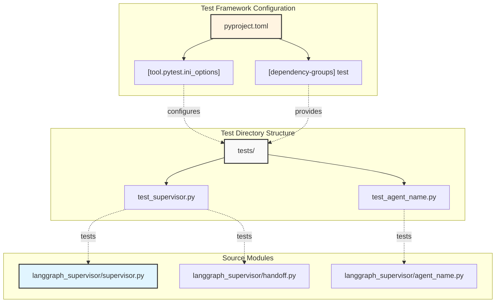
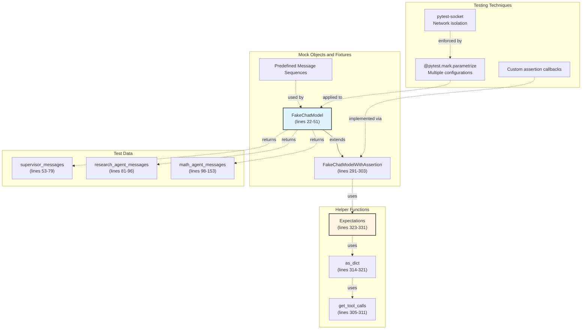

<!-- source: DeepWiki mcp.deepwiki.com · repo langchain-ai/langgraph-supervisor-py · page 5.3 Testing · fetched 2026-10-26 -->

# Testing

<details>
<summary>Relevant source files</summary>

The following files were used as context for generating this wiki page:

- [Makefile](Makefile)
- [pyproject.toml](pyproject.toml)
- [tests/test_agent_name.py](tests/test_agent_name.py)
- [tests/test_supervisor.py](tests/test_supervisor.py)

</details>


This document describes how to run tests, the test structure and organization, and the testing patterns used in the langgraph-supervisor project. For information about code quality tools like linting and type checking, see [Code Quality](#5.4). For information about automated testing in CI/CD pipelines, see [CI/CD and Release Process](#5.5).

---

## Running Tests

The project uses `pytest` as its test framework. Tests can be executed through the `Makefile` or directly using `uv`.

### Basic Test Execution

Run all tests with socket blocking enabled (prevents unintended network calls):

```bash
make test
```

This executes `uv run pytest -vv --disable-socket --allow-unix-socket tests/` as defined in [Makefile:14]().

### Direct pytest Usage

Run tests directly with `uv`:

```bash
uv run pytest -vv --disable-socket --allow-unix-socket tests/
```

### Running Specific Tests

Run a specific test file:

```bash
make test TEST_FILE=tests/test_supervisor.py
```

Run a specific test function:

```bash
uv run pytest tests/test_supervisor.py::test_supervisor_basic_workflow -vv
```

### Test Watch Mode

For continuous testing during development (requires `ptw` package):

```bash
make test_watch
```

**Sources:** [Makefile:10-18](), [pyproject.toml:37-44]()

---

## Test Organization

The test suite is organized in the `tests/` directory with clear naming conventions that map to the modules they test.



### Test File Mapping

| Test File | Source Module | Primary Focus |
|-----------|--------------|---------------|
| `test_supervisor.py` | `supervisor.py`, `handoff.py` | Supervisor orchestration, handoff mechanisms, message routing |
| `test_agent_name.py` | `agent_name.py` | Inline agent name formatting and extraction |

### Test Discovery Configuration

pytest configuration in [pyproject.toml:37-44]():

```toml
[tool.pytest.ini_options]
minversion = "8.0"
addopts = "-ra -q -v"
testpaths = ["tests"]
python_files = ["test_*.py"]
python_functions = ["test_*"]
```

- **testpaths**: Tests are discovered in the `tests/` directory
- **python_files**: Test files must match the pattern `test_*.py`
- **python_functions**: Test functions must be prefixed with `test_`

**Sources:** [tests/test_supervisor.py:1-614](), [tests/test_agent_name.py:1-113](), [pyproject.toml:37-44]()

---

## Test Coverage

The test suite covers the core functionality of the langgraph-supervisor package through comprehensive unit and integration tests.

```mermaid
graph TB
    subgraph "test_supervisor.py Coverage"
        TestBasic["test_supervisor_basic_workflow<br/>(lines 156-289)"]
        TestHideHandoffs["test_worker_hide_handoffs<br/>(lines 333-426)"]
        TestForwarding["test_supervisor_message_forwarding<br/>(lines 428-558)"]
        TestMetadata["test_metadata_passed_to_subagent<br/>(lines 560-614)"]
    end
    
    subgraph "Supervisor Features Tested"
        MultiAgent["Multi-agent orchestration"]
        Handoff["Handoff mechanism"]
        OutputMode["output_mode configuration"]
        MessageForward["forward_message tool"]
        MetadataPass["Config/metadata propagation"]
        AgentNaming["Agent name formatting"]
    end
    
    subgraph "test_agent_name.py Coverage"
        TestAdd["test_add_inline_agent_name<br/>(lines 9-25)"]
        TestAddBlocks["test_add_inline_agent_name_content_blocks<br/>(lines 27-52)"]
        TestRemove["test_remove_inline_agent_name<br/>(lines 54-77)"]
        TestRemoveBlocks["test_remove_inline_agent_name_content_blocks<br/>(lines 79-104)"]
        TestMultiline["test_remove_inline_agent_name_multiline_content<br/>(lines 106-113)"]
    end
    
    subgraph "Agent Name Features Tested"
        InlineAdd["add_inline_agent_name"]
        InlineRemove["remove_inline_agent_name"]
        ContentBlocks["Content block handling"]
        MultilineContent["Multiline content"]
    end
    
    TestBasic --> MultiAgent
    TestBasic --> Handoff
    TestBasic --> OutputMode
    TestBasic --> AgentNaming
    TestHideHandoffs --> Handoff
    TestForwarding --> MessageForward
    TestMetadata --> MetadataPass
    
    TestAdd --> InlineAdd
    TestAddBlocks --> InlineAdd
    TestAddBlocks --> ContentBlocks
    TestRemove --> InlineRemove
    TestRemoveBlocks --> InlineRemove
    TestRemoveBlocks --> ContentBlocks
    TestMultiline --> InlineRemove
    TestMultiline --> MultilineContent
    
    style TestBasic fill:#e1f5ff,stroke:#333,stroke-width:2px
    style MultiAgent fill:#f9f9f9,stroke:#333,stroke-width:1px
```



### Supervisor Module Tests

#### `test_supervisor_basic_workflow`

**Location:** [tests/test_supervisor.py:156-289]()

**Purpose:** Tests the complete multi-agent workflow with supervisor orchestration.

**What it tests:**
- Creating a supervisor with multiple agents (`math_expert`, `research_expert`)
- Agent handoff via `transfer_to_*` tools
- Agent return via `transfer_back_to_supervisor`
- `output_mode` configuration (`last_message` vs `full_history`)
- `include_agent_name` parameter (parameterized test with `None`, `"inline"`)

**Test flow:**
1. User sends question about FAANG headcount
2. Supervisor transfers to `research_expert`
3. Research agent searches web and returns
4. Supervisor transfers to `math_expert`
5. Math agent performs calculations and returns
6. Supervisor provides final answer

#### `test_worker_hide_handoffs`

**Location:** [tests/test_supervisor.py:333-426]()

**Purpose:** Tests the `add_handoff_messages` configuration option.

**What it tests:**
- Setting `add_handoff_messages=False` to hide handoff messages from agents
- Verifies agents only see user messages and their own previous responses
- Uses `FakeChatModelWithAssertion` to validate message filtering

#### `test_supervisor_message_forwarding`

**Location:** [tests/test_supervisor.py:428-558]()

**Purpose:** Tests the `forward_message` tool functionality.

**What it tests:**
- `create_forward_message_tool` function
- Supervisor using `forward_message` to bypass itself and output agent response directly
- Message extraction from specific agent
- Final message structure in conversation history

#### `test_metadata_passed_to_subagent`

**Location:** [tests/test_supervisor.py:560-614]()

**Purpose:** Tests that configuration metadata is propagated to sub-agents.

**What it tests:**
- Passing `RunnableConfig` with metadata to supervisor
- Metadata availability in sub-agent nodes
- Config propagation through the graph execution

### Agent Name Module Tests

#### `test_add_inline_agent_name`

**Location:** [tests/test_agent_name.py:9-25]()

**Purpose:** Tests the `add_inline_agent_name` function with simple string content.

**What it tests:**
- Non-AI messages remain unchanged
- AI messages without names remain unchanged
- AI messages with names get wrapped: `<name>agent</name><content>text</content>`

#### `test_add_inline_agent_name_content_blocks`

**Location:** [tests/test_agent_name.py:27-52]()

**Purpose:** Tests name formatting with structured content blocks (text, images, files).

**What it tests:**
- Text blocks get name/content tags
- Non-text blocks (images, files) remain unchanged
- Empty content blocks are handled correctly

#### `test_remove_inline_agent_name` and Related

**Location:** [tests/test_agent_name.py:54-113]()

**Purpose:** Tests extraction of content from name-tagged messages.

**What it tests:**
- Extracting content from `<name>...</name><content>...</content>` format
- Handling content blocks
- Multiline content preservation
- Messages without tags remain unchanged

**Sources:** [tests/test_supervisor.py:156-614](), [tests/test_agent_name.py:9-113]()

---

## Testing Patterns and Utilities

The test suite employs several patterns and utilities to enable isolated, deterministic testing without external dependencies.



### FakeChatModel

**Location:** [tests/test_supervisor.py:22-51]()

A mock implementation of `BaseChatModel` that returns pre-scripted responses without making real LLM API calls.

**Key features:**
- **responses**: Sequence of `BaseMessage` objects to return
- **idx**: Counter tracking which response to return next
- **_generate**: Returns messages sequentially from the `responses` list
- **bind_tools**: Simulates tool binding without actual LLM interaction

**Usage example:**
```python
model = FakeChatModel(responses=[
    AIMessage(content="", tool_calls=[{"name": "transfer_to_agent", ...}]),
    AIMessage(content="Final answer")
])
```

### FakeChatModelWithAssertion

**Location:** [tests/test_supervisor.py:291-303]()

Extends `FakeChatModel` to add custom assertion logic on received messages.

**Key features:**
- **assertion**: Callable that validates messages before generating response
- Used in `test_worker_hide_handoffs` to verify message filtering

### Test Data Constants

Pre-defined message sequences simulate realistic agent interactions:

| Constant | Lines | Purpose |
|----------|-------|---------|
| `supervisor_messages` | [tests/test_supervisor.py:53-79]() | Supervisor routing decisions and final responses |
| `research_agent_messages` | [tests/test_supervisor.py:81-96]() | Research agent tool calls and responses |
| `math_agent_messages` | [tests/test_supervisor.py:98-153]() | Math agent calculation sequences |

### Helper Functions

#### `get_tool_calls`

**Location:** [tests/test_supervisor.py:305-311]()

Extracts tool call information from a message for comparison.

```python
def get_tool_calls(msg: BaseMessage) -> list[dict[str, Any]] | None:
    # Returns list of {"name": ..., "args": ...} dicts
```

#### `as_dict`

**Location:** [tests/test_supervisor.py:314-321]()

Converts a message to a dictionary representation for assertions.

```python
def as_dict(msg: BaseMessage) -> dict[str, Any]:
    return {
        "name": msg.name,
        "content": msg.content,
        "tool_calls": get_tool_calls(msg),
        "type": msg.type,
    }
```

#### `Expectations`

**Location:** [tests/test_supervisor.py:323-331]()

A stateful assertion helper that verifies messages match expected sequences.

```python
expectations = Expectations([
    [{"name": None, "content": "Hello", ...}],
    [{"name": "agent", "content": "Response", ...}]
])
model = FakeChatModelWithAssertion(responses=[...], assertion=expectations)
```

### Testing Techniques

#### Parameterized Tests

Tests like `test_supervisor_basic_workflow` use `@pytest.mark.parametrize` to test multiple configurations:

```python
@pytest.mark.parametrize(
    "include_agent_name,include_individual_agent_name",
    [(None, None), (None, "inline"), ("inline", None), ("inline", "inline")]
)
```

This pattern tests all combinations of the `include_agent_name` parameter efficiently.

**Location:** [tests/test_supervisor.py:156-164]()

#### Network Isolation

The `pytest-socket` plugin blocks network access during tests:

```bash
pytest --disable-socket --allow-unix-socket
```

This ensures tests don't make unintended API calls. Configured in [Makefile:14]().

#### Tool Mocking

Tests define simple `@tool` functions with predictable behavior:

```python
@tool
def add(a: float, b: float) -> float:
    """Add two numbers."""
    return a + b

@tool
def web_search(query: str) -> str:
    """Search the web for information."""
    return "Mocked search results..."
```

**Location:** [tests/test_supervisor.py:172-187]()

**Sources:** [tests/test_supervisor.py:22-331](), [Makefile:14](), [pyproject.toml:33]()

---

## Test Dependencies

The test suite requires several dependencies defined in the `test` dependency group.

### Test Dependency Table

| Package | Version | Purpose |
|---------|---------|---------|
| `pytest` | >=8.0.0 | Test framework and runner |
| `pytest-socket` | >=0.7.0 | Network isolation during tests |
| `ruff` | >=0.9.4 | Code linting (also used in tests) |
| `mypy` | >=1.8.0 | Type checking (also used in tests) |
| `types-setuptools` | >=69.0.0 | Type stubs for setuptools |

### Installing Test Dependencies

Test dependencies are installed automatically with the full development environment:

```bash
uv sync --all-groups
```

Or install only test dependencies:

```bash
uv sync --group test
```

**Sources:** [pyproject.toml:28-35]()

---

## Test Configuration

Test behavior is configured through `pyproject.toml` and enforced by the test runner.

### pytest Configuration

**Location:** [pyproject.toml:37-44]()

```toml
[tool.pytest.ini_options]
minversion = "8.0"          # Require pytest 8.0+
addopts = "-ra -q -v"       # Report all, quiet, verbose
testpaths = ["tests"]       # Look for tests in tests/ directory
python_files = ["test_*.py"]     # Test file pattern
python_functions = ["test_*"]    # Test function pattern
```

**Configuration options:**
- **minversion**: Ensures pytest 8.0+ is used for compatibility
- **addopts**: 
  - `-ra`: Show summary of all test outcomes
  - `-q`: Reduce verbose output during collection
  - `-v`: Verbose output showing individual test names
- **testpaths**: Restricts test discovery to `tests/` directory
- **python_files**: Only files matching `test_*.py` are considered test modules
- **python_functions**: Only functions starting with `test_` are executed as tests

### Socket Blocking Configuration

Network access is blocked by default in the Makefile test target:

```bash
uv run pytest -vv --disable-socket --allow-unix-socket $(TEST_FILE)
```

- **--disable-socket**: Blocks all socket connections
- **--allow-unix-socket**: Allows Unix domain sockets (needed for some system operations)

This prevents tests from accidentally making network calls to external services.

### Type Checking in Tests

The test files include a mypy directive to skip type checking:

```python
# mypy: ignore-errors
```

**Location:** [tests/test_supervisor.py:2]()

This allows tests to use dynamic mocking and assertion patterns that may not satisfy strict type checking.

**Sources:** [pyproject.toml:37-44](), [Makefile:14](), [tests/test_supervisor.py:2]()

---

