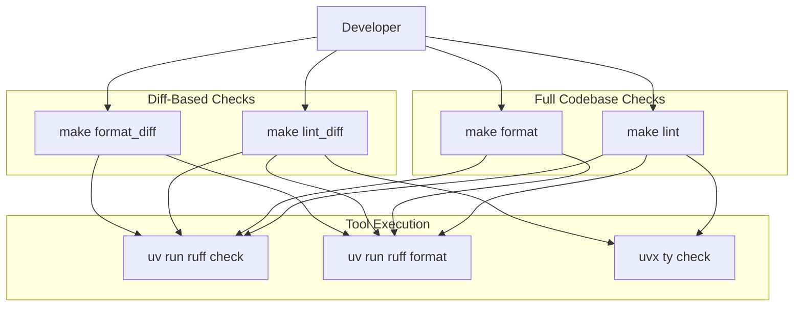
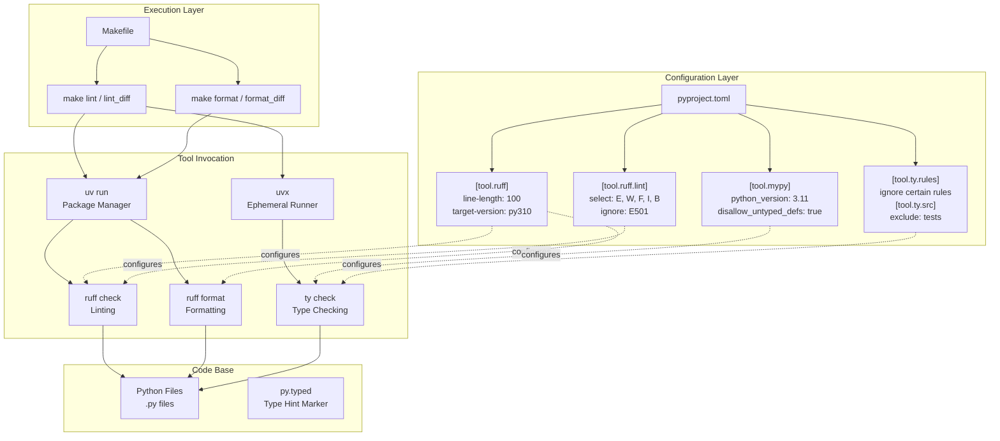
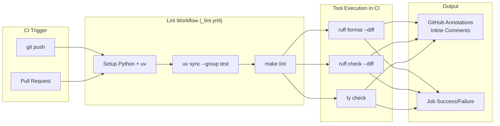

<!-- source: DeepWiki mcp.deepwiki.com · repo langchain-ai/langgraph-supervisor-py · page 5.4 Code Quality · fetched 2026-10-26 -->

# Code Quality

<details>
<summary>Relevant source files</summary>

The following files were used as context for generating this wiki page:

- [.github/workflows/_lint.yml](.github/workflows/_lint.yml)
- [Makefile](Makefile)
- [pyproject.toml](pyproject.toml)

</details>


## Purpose and Scope

This document describes the code quality tools, configurations, and workflows used in the langgraph-supervisor project. It covers linting with `ruff`, type checking with `mypy` and `ty`, and how to run these tools locally and in CI.

For information about running tests, see [Testing](#5.3). For CI/CD automation and release workflows, see [CI/CD and Release Process](#5.5).

---

## Tool Overview

The project uses three primary tools for maintaining code quality:

| Tool | Purpose | Configuration Location |
|------|---------|----------------------|
| **ruff** | Linting and code formatting | [pyproject.toml:46-60]() |
| **mypy** | Static type checking | [pyproject.toml:63-68]() |
| **ty** | Additional type checking (LangChain-specific) | [pyproject.toml:70-75]() |

All three tools are included in the `test` dependency group [pyproject.toml:29-35]() and are invoked via `Makefile` targets for consistent usage across development and CI environments.

**Sources:** [pyproject.toml:1-76](), [Makefile:1-54]()

---

## Ruff Configuration

### Linting and Formatting

Ruff serves dual purposes: it acts as both a linter (replacing flake8, isort, pyflakes) and a code formatter (replacing black). The project configures ruff at [pyproject.toml:46-60]().

### Basic Settings

```toml
[tool.ruff]
line-length = 100
target-version = "py310"
```

- **Line length**: Set to 100 characters [pyproject.toml:47]()
- **Target version**: Python 3.10 for compatibility with the minimum supported version [pyproject.toml:48]()

### Selected Lint Rules

The project enables the following rule categories [pyproject.toml:51-57]():

| Code | Category | Description |
|------|----------|-------------|
| `E` | pycodestyle errors | PEP 8 style violations |
| `W` | pycodestyle warnings | PEP 8 style warnings |
| `F` | pyflakes | Logical errors and undefined names |
| `I` | isort | Import sorting |
| `B` | flake8-bugbear | Common Python bugs |

### Ignored Rules

The project explicitly ignores `E501` (line-length violations) [pyproject.toml:59]() because ruff's formatter handles line length automatically.

**Sources:** [pyproject.toml:46-60]()

---

## Mypy Configuration

### Type Checking Settings

Mypy is configured for strict type checking at [pyproject.toml:63-68]():

```toml
[tool.mypy]
python_version = "3.11"
warn_return_any = true
warn_unused_configs = true
disallow_untyped_defs = true
check_untyped_defs = true
```

### Configuration Details

| Setting | Value | Impact |
|---------|-------|--------|
| `python_version` | `3.11` | Type checks against Python 3.11 semantics [pyproject.toml:64]() |
| `warn_return_any` | `true` | Warns when functions return `Any` type [pyproject.toml:65]() |
| `warn_unused_configs` | `true` | Detects unused mypy configuration options [pyproject.toml:66]() |
| `disallow_untyped_defs` | `true` | Requires all function signatures to have type annotations [pyproject.toml:67]() |
| `check_untyped_defs` | `true` | Type checks function bodies even without annotations [pyproject.toml:68]() |

These settings enforce strict typing throughout the codebase, ensuring all functions have proper type annotations and reducing the risk of type-related runtime errors.

**Sources:** [pyproject.toml:63-68]()

---

## Ty Configuration

### LangChain Type Checker

`ty` is a type checker specifically designed for LangChain projects. It provides additional checks beyond mypy, particularly for LangChain-specific patterns. The configuration is at [pyproject.toml:70-75]().

### Rule Configuration

```toml
[tool.ty.rules]
no-matching-overload = "ignore" 
call-non-callable = "ignore"
unresolved-import = "ignore"
```

The project ignores certain rules [pyproject.toml:71-73]() that would otherwise produce false positives due to LangChain's dynamic nature.

### Source Exclusions

```toml
[tool.ty.src]
exclude = ["tests"]
```

Test files are excluded from `ty` checking [pyproject.toml:75](), allowing more flexible patterns in test code.

**Sources:** [pyproject.toml:70-75]()

---

## Local Development Workflow

### Make Targets

The `Makefile` provides four primary targets for code quality checks:



**Sources:** [Makefile:20-36]()

### Full Codebase Checks

#### `make lint`

Runs all linting tools without making changes [Makefile:28-31]():

```bash
make lint
```

This executes:
1. `uv run ruff format . --diff` - Shows formatting differences
2. `uv run ruff check . --diff` - Shows linting violations
3. `uvx ty check .` - Runs LangChain-specific type checks

#### `make format`

Automatically fixes linting issues and formats code [Makefile:33-35]():

```bash
make format
```

This executes:
1. `uv run ruff check --fix .` - Fixes auto-fixable linting violations
2. `uv run ruff format .` - Formats code according to configuration

### Diff-Based Checks

For faster iteration during development, the project provides diff-based variants that only check files changed from the `master` branch.

#### File Selection

The `PYTHON_FILES` variable is set differently for diff targets [Makefile:26]():

```makefile
lint_diff format_diff: PYTHON_FILES=$(shell git diff --relative=. --name-only --diff-filter=d master | grep -E '\.py$$|\.ipynb$$')
```

This command:
1. Runs `git diff` against `master` branch
2. Filters out deleted files (`--diff-filter=d`)
3. Selects only Python files (`.py`) and notebooks (`.ipynb`)

#### `make lint_diff`

Checks only modified files [Makefile:28-31]():

```bash
make lint_diff
```

#### `make format_diff`

Formats only modified files [Makefile:33-35]():

```bash
make format_diff
```

**Note:** Diff-based targets skip execution if no files have changed, as indicated by the conditional check `[ "$(PYTHON_FILES)" = "" ]` on each command line [Makefile:29-31](), [Makefile:34-35]().

**Sources:** [Makefile:20-36]()

---

## Tool Chain Architecture

The following diagram shows how code quality tools are configured, invoked, and integrated:



**Sources:** [pyproject.toml:46-75](), [Makefile:20-36]()

---

## CI Integration

### Linting Workflow

The CI pipeline includes a dedicated linting job defined in `.github/workflows/_lint.yml`. This reusable workflow is called by the main CI workflow.



**Sources:** [.github/workflows/_lint.yml:1-45]()

### Workflow Configuration

The linting workflow accepts two inputs [.github/workflows/_lint.yml:5-13]():

| Input | Description | Example |
|-------|-------------|---------|
| `working-directory` | Folder from which pipeline executes | `.` |
| `python-version` | Python version to use | `3.12` |

### Environment Variables

Two key environment variables are set [.github/workflows/_lint.yml:15-21]():

```yaml
env:
  RUFF_OUTPUT_FORMAT: github
  UV_FROZEN: "true"
```

- **`RUFF_OUTPUT_FORMAT: github`** [.github/workflows/_lint.yml:19](): Formats ruff output to generate inline annotations in pull requests
- **`UV_FROZEN: "true"`** [.github/workflows/_lint.yml:21](): Ensures `uv` uses the locked dependencies from `uv.lock` without attempting to update them

### Job Steps

The lint job executes the following steps [.github/workflows/_lint.yml:28-44]():

1. **Checkout code** [.github/workflows/_lint.yml:29](): Uses `actions/checkout@v4`
2. **Setup Python and uv** [.github/workflows/_lint.yml:31-34](): Uses the custom `uv_setup` action
3. **Install dependencies** [.github/workflows/_lint.yml:36-39](): Runs `uv sync --group test` to install test dependencies (which include linting tools)
4. **Run linting** [.github/workflows/_lint.yml:41-44](): Executes `make lint`

### Timeout

The job has a 20-minute timeout [.github/workflows/_lint.yml:27]() to prevent hanging on unexpected issues.

**Sources:** [.github/workflows/_lint.yml:1-45]()

---

## Best Practices

### Pre-Commit Workflow

Before committing code, developers should:

1. **Run diff-based formatting**:
   ```bash
   make format_diff
   ```

2. **Verify changes with diff-based linting**:
   ```bash
   make lint_diff
   ```

3. **Commit formatted code**

This workflow is fast because it only processes changed files.

### Pre-Push Workflow

Before pushing code, run full linting to catch any issues:

```bash
make lint
```

This ensures the CI pipeline will pass.

### Integration with IDEs

The ruff and mypy configurations in `pyproject.toml` are automatically detected by most Python IDEs:

- **VS Code**: Install the Python and Ruff extensions
- **PyCharm**: Ruff and mypy are supported natively
- **Neovim/Vim**: Use language server plugins like `pyright` or `ruff-lsp`

**Sources:** [Makefile:20-36](), [pyproject.toml:46-75]()

---

## Summary

The langgraph-supervisor project maintains code quality through:

- **Ruff** for linting and formatting with a 100-character line limit
- **Mypy** for strict static type checking
- **Ty** for LangChain-specific type validation
- **Makefile targets** (`lint`, `format`, `lint_diff`, `format_diff`) for local development
- **CI integration** that enforces quality checks on all pull requests

All configurations are centralized in `pyproject.toml`, and the use of `uv` ensures consistent environments across local development and CI.

**Sources:** [pyproject.toml:46-75](), [Makefile:20-36](), [.github/workflows/_lint.yml:1-45]()

---

