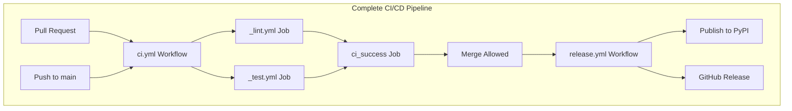
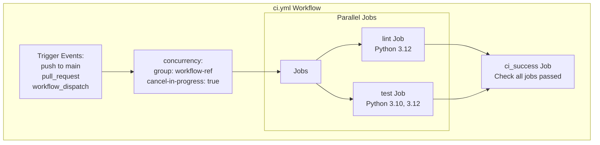
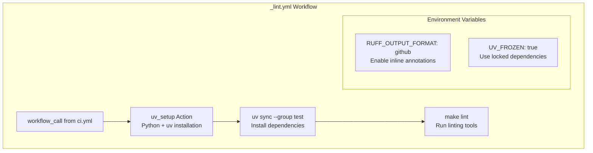
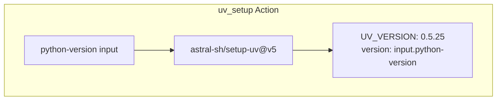
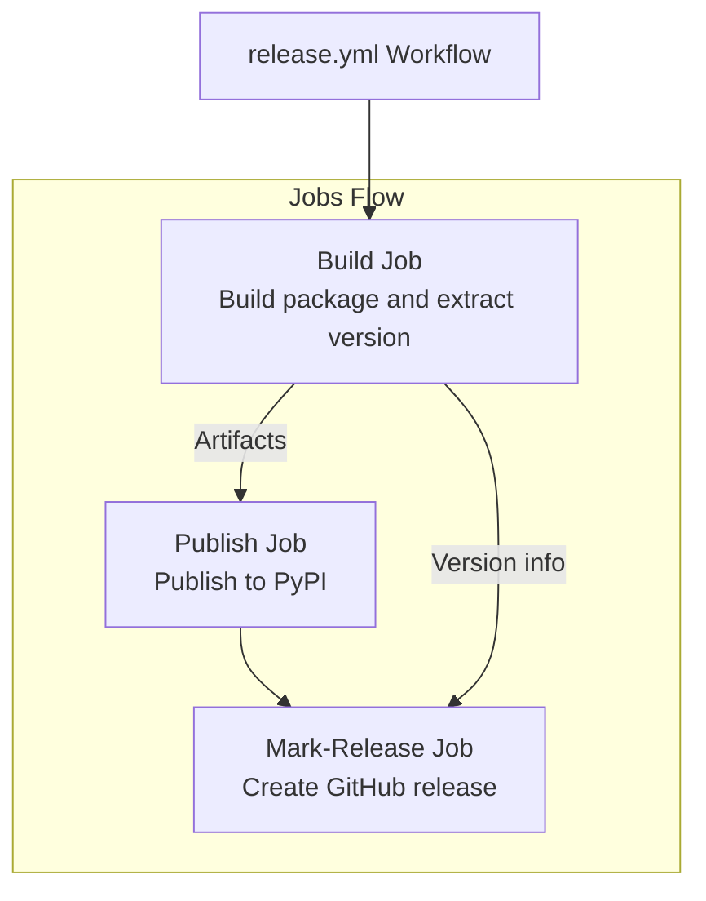
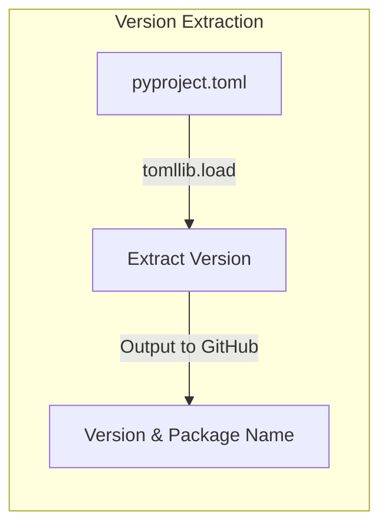
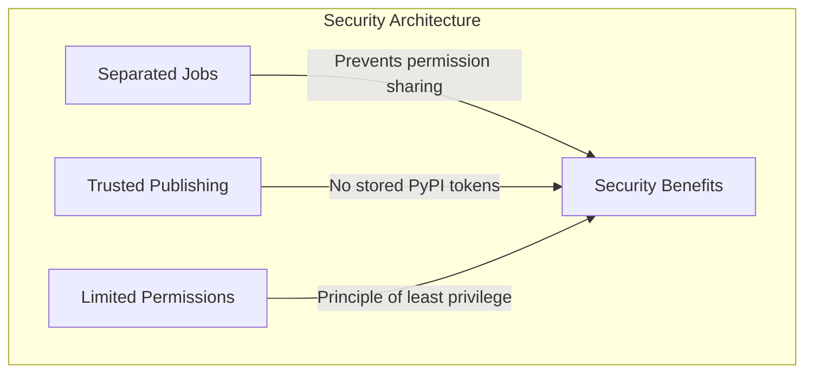
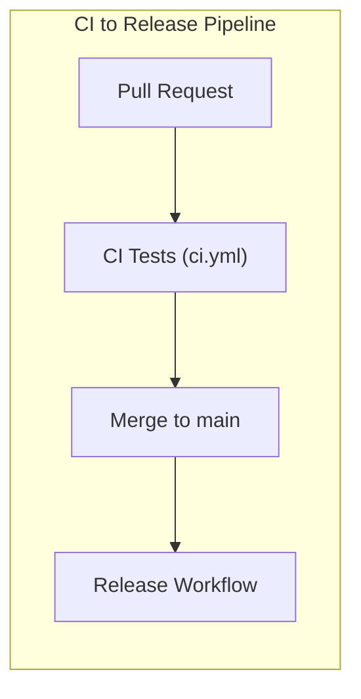

<!-- source: DeepWiki mcp.deepwiki.com · repo langchain-ai/langgraph-supervisor-py · page 5.5 CI/CD and Release Process · fetched 2026-10-26 -->

# CI/CD and Release Process

<details>
<summary>Relevant source files</summary>

The following files were used as context for generating this wiki page:

- [.github/actions/uv_setup/action.yml](.github/actions/uv_setup/action.yml)
- [.github/workflows/ci.yml](.github/workflows/ci.yml)
- [.github/workflows/release.yml](.github/workflows/release.yml)

</details>


This document describes the continuous integration and deployment pipeline for the langgraph-supervisor package, covering automated testing, code quality checks, and the release process. The CI/CD pipeline ensures code quality through automated testing and linting before packages are built and published to PyPI. For information about the project structure and organization, see [Project Structure](#5.1), and for testing procedures, see [Testing](#5.2).

## Overview of the CI/CD Pipeline

The CI/CD pipeline for langgraph-supervisor is implemented through GitHub Actions, consisting of continuous integration checks and automated release workflows. The pipeline ensures code quality through testing and linting before allowing releases to proceed.



Sources: [.github/workflows/ci.yml:1-76](), [.github/workflows/release.yml:1-151]()

## Continuous Integration Pipeline

The main CI pipeline is defined in `ci.yml` and runs automatically on pushes to main and pull requests. The workflow includes concurrency control and parallel job execution for efficiency.

### CI Workflow Structure



Sources: [.github/workflows/ci.yml:4-18](), [.github/workflows/ci.yml:20-57](), [.github/workflows/ci.yml:58-74]()

### Concurrency Management

The CI workflow implements intelligent concurrency control to optimize resource usage:

```yaml
concurrency:
  group: ${{ github.workflow }}-${{ github.ref }}
  cancel-in-progress: true
```

This configuration ensures that when new commits are pushed to the same branch, previous CI runs are cancelled to free up GitHub Actions runners for the latest code.

Sources: [.github/workflows/ci.yml:16-18]()

### Python Version Strategy

The CI pipeline uses a selective Python version matrix to balance thorough testing with efficiency:

| Job Type | Python Versions | Rationale |
|----------|----------------|-----------|
| Lint | 3.12 only | Linting results are consistent across Python versions |
| Test | 3.10, 3.12 | Test minimum and maximum supported versions |

This strategy is based on the assumption that issues appearing on min/max versions will also appear on intermediate versions, while reducing CI execution time.

Sources: [.github/workflows/ci.yml:22-37](), [.github/workflows/ci.yml:40-57]()

## Code Quality Checks

The `_lint.yml` workflow handles code quality enforcement through automated linting and formatting checks.

### Lint Workflow Components



Sources: [.github/workflows/_lint.yml:1-44]()

### Linting Configuration

The lint workflow is configured with specific environment variables to enhance the development experience:

- `RUFF_OUTPUT_FORMAT: github` - Enables inline annotations in pull requests when ruff finds issues
- `UV_FROZEN: "true"` - Ensures reproducible builds by using locked dependency versions

Sources: [.github/workflows/_lint.yml:18-21]()

### Custom uv Setup Action

Both CI and release workflows use a custom `uv_setup` action for consistent Python and dependency management:



Sources: [.github/actions/uv_setup/action.yml:1-22]()

## Release Workflow Components

The release workflow consists of three separate jobs that handle different aspects of the release process:



Sources: [.github/workflows/release.yml:26-151]()

### Build Job

The Build job is responsible for:

1. Checking out the repository
2. Setting up Python 3.11 with the uv package manager
3. Building the package distribution
4. Extracting the package name and version from pyproject.toml
5. Uploading build artifacts for subsequent jobs

This job runs on the main branch by default, or when explicitly allowed for non-main branches using the `dangerous-nonmain-release` input parameter.

Sources: [.github/workflows/release.yml:27-76]()

### Publish Job

The Publish job:

1. Downloads the build artifacts created by the Build job
2. Publishes the package to PyPI using PyPA's trusted publishing mechanism
3. Requires specific `id-token: write` permissions for secure publishing

Sources: [.github/workflows/release.yml:77-113]()

### Mark-Release Job

The Mark-Release job:

1. Downloads the build artifacts
2. Creates a GitHub release with the tag format `package-name==version`
3. Automatically generates release notes
4. Attaches the build artifacts to the release

Sources: [.github/workflows/release.yml:115-151]()

## Version Management

Package versions are defined in the `pyproject.toml` file at the project root. During the release process, the workflow automatically extracts this version information:



The extracted package name and version are used to:
1. Tag the GitHub release
2. Label the published PyPI package

Sources: [.github/workflows/release.yml:63-76]()

## Security Model

The release workflow implements several security best practices:



### Job Separation for Security

The workflow intentionally separates the build and publish steps to enhance security. As noted in the workflow file:

> We want to keep this build stage *separate* from the release stage, so that there's no sharing of permissions between them. The release stage has trusted publishing and GitHub repo contents write access, and we want to keep the scope of that access limited just to the release job. Otherwise, a malicious `build` step (e.g. via a compromised dependency) could get access to our GitHub or PyPI credentials.

### Permission Model

Each job in the workflow is granted only the specific permissions it needs:
- The Build job requires no special permissions
- The Publish job has `id-token: write` for trusted publishing to PyPI
- The Mark-Release job has `contents: write` for creating GitHub releases

Sources: [.github/workflows/release.yml:81-87](), [.github/workflows/release.yml:120-123]()

## Triggering a Release

The release workflow can be triggered in two ways:

### 1. Manual Trigger (workflow_dispatch)

Releases can be triggered manually from the GitHub UI. When triggering manually, you can specify:
- The working directory (defaults to ".")
- Whether to allow a release from a non-main branch (defaults to false)

### 2. Programmatic Trigger (workflow_call)

The workflow can also be called from another workflow, where the working directory must be specified.

Sources: [.github/workflows/release.yml:3-19]()

## Environment Configuration

The release workflow uses the following environment variables:
- `PYTHON_VERSION: "3.11"` - The Python version used for building and publishing
- `UV_FROZEN: "true"` - Ensures dependencies are frozen during the build
- `UV_NO_SYNC: "true"` - Prevents dependency syncing

Sources: [.github/workflows/release.yml:21-24]()

## Workflow Execution Checklist

### For Pull Requests:
1. Ensure CI pipeline passes (lint and test jobs)
2. Verify `ci_success` job completes successfully  
3. Address any ruff linting issues shown as inline annotations
4. Confirm tests pass on both Python 3.10 and 3.12

### For Releases:
1. Update the version in `pyproject.toml` following semantic versioning
2. Ensure all CI checks pass on the main branch
3. Trigger the release workflow (manually via GitHub UI or programmatically)
4. Monitor the three-stage release process:
   - Build job completes and uploads artifacts
   - Publish job successfully uploads to PyPI via trusted publishing
   - Mark-release job creates GitHub release with generated notes
5. Verify the package is available on PyPI with correct version
6. Confirm GitHub release is created with tag format `langgraph-supervisor==x.y.z`

Sources: [.github/workflows/ci.yml:58-74](), [.github/workflows/release.yml:63-76](), [.github/workflows/release.yml:142-148]()

## Integration with CI Pipeline

The release process builds upon the continuous integration (CI) pipeline that ensures code quality through tests and linting:



The CI pipeline runs tests on Python 3.10 and 3.12, while the release workflow uses Python 3.11 for building and publishing the package.

Sources: [.github/workflows/ci.yml:1-59](), [.github/workflows/release.yml:21-24]()