# Page: Overview

# Overview

<details>
<summary>Relevant source files</summary>

The following files were used as context for generating this wiki page:

- [LICENSE](LICENSE)
- [README.md](README.md)
- [langgraph_supervisor/__init__.py](langgraph_supervisor/__init__.py)
- [pyproject.toml](pyproject.toml)

</details>


## Purpose and Scope

This document provides a high-level introduction to **langgraph-supervisor**, a Python library that implements hierarchical multi-agent systems using LangGraph. It covers the library's core purpose, architectural patterns, main components, and capabilities.

For installation instructions, see [Installation](#1.1). For a working example, see [Quick Start](#1.2). For detailed architecture explanations, see [Core Architecture](#2). For complete API documentation, see [API Reference](#3).

**Sources:** [README.md:1-3](), [pyproject.toml:5-8]()

---

## What is a Supervisor Multi-Agent System?

A **supervisor multi-agent system** is a hierarchical architecture where a central **supervisor agent** coordinates multiple **specialized worker agents**. The supervisor controls all communication flow and task delegation, making routing decisions about which agent should handle each task based on context and requirements.

This library implements the supervisor pattern using a **hub-and-spoke** topology where:
- The supervisor is the central hub that receives user input and makes delegation decisions
- Worker agents are specialized spokes that execute specific tasks
- Control flow passes from supervisor → worker → supervisor in a structured manner
- All agents communicate through a shared message state

**Key characteristics:**
- **Centralized control:** The supervisor maintains authority over task routing
- **Tool-based handoffs:** Agents transfer control using handoff tools (function calls)
- **Specialized agents:** Each worker agent has specific capabilities and tools
- **Hierarchical nesting:** Supervisors can manage other supervisors for multi-level hierarchies

**Sources:** [README.md:5-6]()

---

## Core Library Components

The library consists of three primary modules that work together to implement the supervisor pattern:

| Module | File Path | Primary Export | Purpose |
|--------|-----------|----------------|---------|
| **Supervisor** | `langgraph_supervisor/supervisor.py` | `create_supervisor()` | Factory function that constructs the supervisor workflow graph |
| **Handoff** | `langgraph_supervisor/handoff.py` | `create_handoff_tool()`, `create_forward_message_tool()` | Tools for transferring control between agents |
| **Agent Name** | `langgraph_supervisor/agent_name.py` | `with_agent_name()` | Utilities for embedding agent identities in messages |

The public API is exposed through [`langgraph_supervisor/__init__.py:1-7`](), which exports:
- `create_supervisor` - Main factory function
- `create_handoff_tool` - Handoff tool factory
- `create_forward_message_tool` - Message forwarding tool factory

**Sources:** [langgraph_supervisor/__init__.py:1-7](), [README.md:9-11]()

---

## Component Architecture

The following diagram shows how the core components relate to each other and map to code entities:

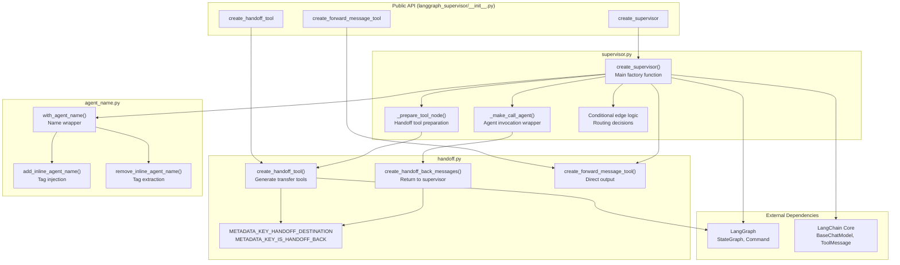

**Explanation:**
- **`create_supervisor()`** is the main entry point that assembles all components
- **`_prepare_tool_node()`** generates handoff tools for each agent
- **`_make_call_agent()`** wraps agent invocations with handoff-back logic
- **Handoff tools** use metadata keys to mark transfer destinations
- **Agent name utilities** optionally wrap models to tag messages
- **LangGraph** provides the graph execution engine (`StateGraph`)
- **LangChain Core** provides message types and model interfaces

**Sources:** [langgraph_supervisor/__init__.py:1-7](), [README.md:184-202]()

---

## Runtime Execution Flow

The following diagram illustrates how a compiled supervisor workflow processes user input at runtime:

```mermaid
sequenceDiagram
    participant User
    participant CompiledGraph["app = workflow.compile()"]
    participant SupervisorNode["Supervisor Node<br/>(create_react_agent)"]
    participant HandoffTool["transfer_to_worker_agent<br/>(handoff tool)"]
    participant WorkerAgent["Worker Agent Node<br/>(create_react_agent)"]
    participant HandoffBack["transfer_back_to_supervisor<br/>(built-in tool)"]
    participant MessagesState["MessagesState<br/>(conversation history)"]
    
    User->>CompiledGraph: app.invoke({"messages": [...]})
    CompiledGraph->>SupervisorNode: Route to supervisor
    SupervisorNode->>SupervisorNode: LLM decides delegation
    SupervisorNode->>HandoffTool: Call transfer_to_worker_agent
    HandoffTool->>MessagesState: Update with handoff metadata
    HandoffTool->>WorkerAgent: Command(goto=agent_name)
    WorkerAgent->>WorkerAgent: Execute task with tools
    WorkerAgent->>HandoffBack: Call transfer_back_to_supervisor
    HandoffBack->>MessagesState: Update with response
    HandoffBack->>SupervisorNode: Command(goto=supervisor)
    SupervisorNode->>SupervisorNode: Synthesize final answer
    SupervisorNode->>MessagesState: Add final message
    CompiledGraph->>User: Return final state
```

**Key runtime behaviors:**
1. **User input** enters through `app.invoke()` with a `messages` list
2. **Supervisor node** uses its LLM to make routing decisions
3. **Handoff tools** transfer control using `Command(goto=agent_name, graph=Command.PARENT)`
4. **Worker agents** process tasks and call `transfer_back_to_supervisor`
5. **Message state** accumulates all conversation history
6. **Final output** returns the complete state to the user

**Sources:** [README.md:36-100]()

---

## Key Capabilities

### Multi-Agent Orchestration

The library provides `create_supervisor()` to construct a workflow graph that coordinates multiple agents:

```python
workflow = create_supervisor(
    [agent1, agent2, agent3],  # List of worker agents
    model=model,                # LLM for supervisor decisions
    prompt="..."                # Supervisor system prompt
)
```

**Supported agent types:**
- **Graph API agents:** Created with `create_react_agent()`
- **Functional API agents:** Created with `@entrypoint()` and `@task` decorators
- **Compiled graphs:** Nested supervisors or custom workflows

**Sources:** [README.md:79-89](), [README.md:291-364]()

### Tool-Based Handoffs

Control transfer between agents uses **handoff tools** that agents can invoke:

| Tool Type | Function | Purpose |
|-----------|----------|---------|
| **Transfer to agent** | `create_handoff_tool()` | Transfer control from supervisor to worker agent |
| **Transfer back** | `create_handoff_back_messages()` | Return control from worker to supervisor |
| **Forward message** | `create_forward_message_tool()` | Bypass supervisor and output directly |

Handoff tools use **metadata annotations** to mark transfer destinations:
- `METADATA_KEY_HANDOFF_DESTINATION`: Target agent name
- `METADATA_KEY_IS_HANDOFF_BACK`: Flag for return transfers

**Sources:** [README.md:184-202](), [README.md:271-290]()

### Message History Management

The library supports two modes for managing conversation history:

| Mode | Configuration | Behavior |
|------|---------------|----------|
| **Full History** | `output_mode="full_history"` | Include all messages from worker agent execution |
| **Last Message** | `output_mode="last_message"` | Include only the final response from worker agent |

This controls what messages from worker agents are added to the overall conversation state.

**Sources:** [README.md:102-126]()

### Hierarchical Nesting

Supervisors can manage other supervisors to create **multi-level hierarchies**:

```python
# Level 1: Worker teams
research_team = create_supervisor([agent1, agent2], ...).compile()
writing_team = create_supervisor([agent3, agent4], ...).compile()

# Level 2: Top-level coordinator
top_supervisor = create_supervisor([research_team, writing_team], ...)
```

Each level maintains its own message state and routing logic.

**Sources:** [README.md:128-150]()

### Memory and Persistence

The library integrates with LangGraph's memory system:

- **Short-term memory:** `checkpointer` parameter for conversation persistence
- **Long-term memory:** `store` parameter for cross-thread data

These are passed to the `.compile()` method of the StateGraph:

```python
workflow = create_supervisor([...], model=model)
app = workflow.compile(
    checkpointer=InMemorySaver(),
    store=InMemoryStore()
)
```

**Sources:** [README.md:152-178]()

---

## Dependencies and Ecosystem

The library is built on top of the LangChain ecosystem:

### Core Dependencies

| Dependency | Version Constraint | Purpose |
|------------|-------------------|---------|
| **langgraph** | `>=1.0.2, <2.0.0` | Graph construction and execution engine |
| **langchain-core** | `>=1.0.0, <2.0.0` | Message types, model interfaces, tool protocols |

**Sources:** [pyproject.toml:16-18]()

### Python Version

- **Minimum:** Python 3.10
- **Tested:** Python 3.10 and 3.12 in CI

**Sources:** [pyproject.toml:15]()

### Dependency Resolution

The repository uses **uv** (version 0.5.25) for dependency management with a lock file (`uv.lock`) for reproducible builds. For details on the dependency management system, see [Dependency Management](#5.2).

**Sources:** [pyproject.toml:1-3]()

---

## Library Architecture Pattern

The following diagram shows the complete system architecture from dependencies to user applications:

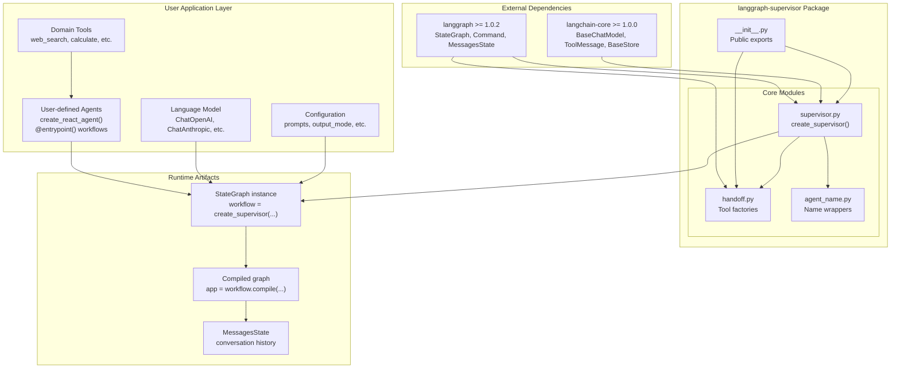

**Architecture layers:**
1. **External Dependencies:** LangGraph and LangChain Core provide foundational abstractions
2. **Library Package:** Three focused modules implement supervisor pattern
3. **User Application:** User-defined agents, models, and configuration
4. **Runtime Artifacts:** StateGraph construction and execution

**Sources:** [pyproject.toml:16-18](), [README.md:36-100]()

---

## Design Philosophy

The library follows these design principles:

### Minimal API Surface

The library exports only three functions:
- [`create_supervisor()`]()
- [`create_handoff_tool()`]()
- [`create_forward_message_tool()`]()

This keeps the API simple while providing customization hooks for advanced use cases.

### Composability

Supervisors return `StateGraph` instances, not compiled graphs. This allows:
- Adding custom nodes and edges
- Composing supervisors into larger hierarchies
- Passing checkpointers and stores to `.compile()`

### LangGraph Native

The implementation uses LangGraph primitives directly:
- `Command` for graph navigation
- `MessagesState` for conversation history
- Conditional edges for routing logic

This ensures compatibility with LangGraph's features (streaming, persistence, human-in-the-loop).

**Sources:** [README.md:152-178]()

---

## Note on Recommended Pattern

The library maintainers recommend using the **supervisor pattern directly via tools** rather than this library for most use cases. The tool-calling approach provides more control over context engineering. This library remains maintained for:
- Users upgrading existing code to LangChain 1.0
- Use cases where the library's abstractions solve specific problems

For new projects, refer to the [LangChain multi-agent guide](https://docs.langchain.com/oss/python/langchain/multi-agent) and [supervisor tutorial](https://docs.langchain.com/oss/python/langchain/supervisor).

**Sources:** [README.md:3-3]()

---

## License

The library is released under the **MIT License**, which permits commercial and non-commercial use with minimal restrictions.

**Sources:** [LICENSE:1-1](), [pyproject.toml:12-13]()

---

## Next Steps

- **Installation:** See [Installation](#1.1) for setup instructions
- **Quick Start:** See [Quick Start](#1.2) for a minimal working example
- **Core Architecture:** See [Core Architecture](#2) for detailed component explanations
- **API Reference:** See [API Reference](#3) for complete function documentation
- **Advanced Usage:** See [Advanced Usage](#4) for complex patterns and customization

---

# Page: Installation

# Installation

<details>
<summary>Relevant source files</summary>

The following files were used as context for generating this wiki page:

- [README.md](README.md)
- [pyproject.toml](pyproject.toml)
- [uv.lock](uv.lock)

</details>


This page provides comprehensive instructions for installing the `langgraph-supervisor` package and its dependencies. It covers system requirements, basic installation, dependency management, and verification steps needed to get started with the multi-agent supervisor framework.

For information about setting up a development environment, see [Development Environment](#5.4). For a quick start guide after installation, see [Quick Start](#1.2).

## System Requirements

The `langgraph-supervisor` package requires specific system dependencies and Python version constraints defined in the project configuration.

### Python Version

```
Python >= 3.10
```

This requirement is enforced in the package configuration and ensures compatibility with modern Python features used throughout the codebase.

Sources: [pyproject.toml:15]()

### Operating System

The package is platform-independent and supports:
- Linux (all major distributions)
- macOS (Intel and Apple Silicon)
- Windows 10/11

## Basic Installation

Install the package using pip from PyPI:

```bash
pip install langgraph-supervisor
```

This installs the latest stable version along with all required dependencies. The package is distributed as a wheel and source distribution through PyPI's trusted publishing system.

Sources: [README.md:15-17](), [pyproject.toml:6-7]()

## Dependencies Overview

The `langgraph-supervisor` package has a carefully managed dependency tree designed to provide multi-agent orchestration capabilities while maintaining version compatibility.

### Dependency Architecture

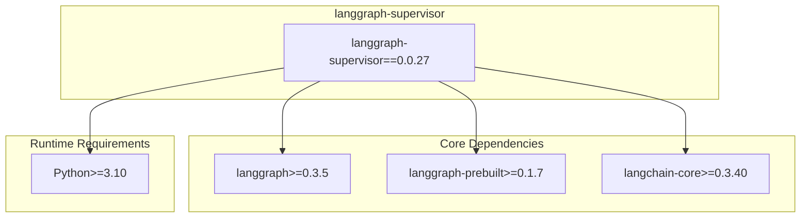

### Core Dependencies

| Package | Version Constraint | Purpose |
|---------|-------------------|---------|
| `langgraph` | `>=0.3.5` | State graph framework for multi-agent workflows |
| `langgraph-prebuilt` | `>=0.1.7` | Pre-built agent components and utilities |
| `langchain-core` | `>=0.3.40` | Core LangChain abstractions for LLM tools and messages |

### Development Dependencies

Additional packages required for development and testing:

| Package | Version Constraint | Purpose |
|---------|-------------------|---------|
| `pytest` | `>=8.0.0` | Testing framework |
| `ruff` | `>=0.9.4` | Code linting and formatting |
| `mypy` | `>=1.8.0` | Static type checking |
| `pytest-socket` | `>=0.7.0` | Network access control in tests |

Sources: [pyproject.toml:16-29]()

## Installation Verification

After installation, verify that the package is correctly installed and accessible:

### Import Test

```python
# Test core package imports
from langgraph_supervisor import create_supervisor
from langgraph_supervisor.handoff import create_handoff_tool, create_forward_message_tool
from langgraph_supervisor.agent_name import with_agent_name

print("langgraph-supervisor successfully installed!")
```

### Version Check

```python
import langgraph_supervisor
# Note: Version checking may require examining package metadata
# as the package may not expose __version__ directly
```

### Dependencies Check

```python
# Verify core dependencies are available
import langgraph
import langchain_core
from langgraph.prebuilt import create_react_agent

print("All dependencies successfully loaded!")
```

## Development Installation

For development work on the `langgraph-supervisor` codebase itself, install with development dependencies:

### Using uv (Recommended)

```bash
git clone https://github.com/langchain-ai/langgraph-supervisor-py
cd langgraph-supervisor-py
uv sync
```

### Using pip with Development Dependencies

```bash
git clone https://github.com/langchain-ai/langgraph-supervisor-py
cd langgraph-supervisor-py
pip install -e ".[test]"
```

This installs the package in editable mode with all development tools including `pytest`, `ruff`, and `mypy`.

Sources: [pyproject.toml:22-29]()

## Installation Process Flow

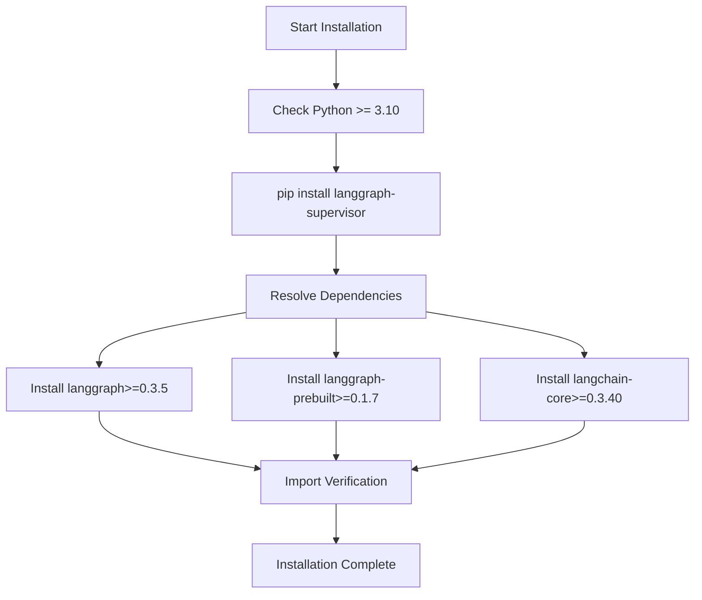

## Common Installation Scenarios

### With Language Model Providers

Most users will need language model providers for the supervisor and agent functionality:

```bash
# For OpenAI models
pip install langgraph-supervisor langchain-openai

# For Anthropic models  
pip install langgraph-supervisor langchain-anthropic

# For local models via Ollama
pip install langgraph-supervisor langchain-ollama
```

### With Memory and Persistence

For applications requiring persistent state and memory:

```bash
pip install langgraph-supervisor langgraph[sqlite]
```

### Container Installation

For Docker-based deployments:

```dockerfile
FROM python:3.11-slim

RUN pip install langgraph-supervisor

# Add your application code
COPY . /app
WORKDIR /app
```

## Troubleshooting

### Common Issues

| Issue | Solution |
|-------|----------|
| `ImportError: No module named 'langgraph'` | Ensure all dependencies installed correctly with `pip install --upgrade langgraph-supervisor` |
| Python version compatibility errors | Verify Python >= 3.10 with `python --version` |
| Dependency conflicts | Use virtual environment: `python -m venv venv && source venv/bin/activate` |

### Dependency Lock File

The repository includes a `uv.lock` file that provides exact version resolution for reproducible installations in development environments.

Sources: [pyproject.toml:1-63](), [README.md:13-32]()

---

# Page: Quick Start

# Quick Start

<details>
<summary>Relevant source files</summary>

The following files were used as context for generating this wiki page:

- [README.md](README.md)
- [langgraph_supervisor/handoff.py](langgraph_supervisor/handoff.py)
- [langgraph_supervisor/supervisor.py](langgraph_supervisor/supervisor.py)

</details>


This guide provides a minimal working example demonstrating how to create a basic multi-agent supervisor system. The supervisor orchestrates specialized agents, routing tasks and managing conversation flow.

## Complete Minimal Example

Here is a complete working example that creates a supervisor managing two specialized agents:

```python
from langchain_openai import ChatOpenAI
from langgraph_supervisor import create_supervisor
from langgraph.prebuilt import create_react_agent

# Define tools
def add(a: float, b: float) -> float:
    """Add two numbers."""
    return a + b

def web_search(query: str) -> str:
    """Search the web for information."""
    return "Search results..."

# Create specialized agents
model = ChatOpenAI(model="gpt-4o")

math_agent = create_react_agent(
    model=model,
    tools=[add],
    name="math_expert",
)

research_agent = create_react_agent(
    model=model,
    tools=[web_search],
    name="research_expert",
)

# Create supervisor
workflow = create_supervisor(
    [research_agent, math_agent],
    model=model,
)

# Compile and run
app = workflow.compile()
result = app.invoke({
    "messages": [{"role": "user", "content": "What is 2 + 2?"}]
})
```

Sources: [README.md:36-99]()

## Architecture Overview

The `create_supervisor` function from [langgraph_supervisor/supervisor.py:211-469]() creates a `StateGraph` containing:

- **Supervisor node**: A `create_react_agent` instance with handoff tools
- **Agent nodes**: Worker agents wrapped by `_make_call_agent` function
- **Handoff tools**: Generated by `create_handoff_tool` for each agent
- **State**: Managed via `MessagesState` with `add_messages` reducer

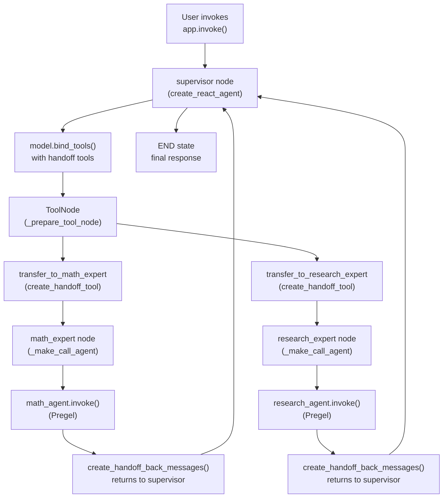

**Code Entity Flow in create_supervisor**

Sources: [langgraph_supervisor/supervisor.py:211-469](), [langgraph_supervisor/handoff.py:55-129](), [langgraph_supervisor/handoff.py:132-152]()

## Basic Setup

### 1. Installation and Imports

Install the required packages and set up your API key:

```bash
pip install langgraph-supervisor langchain-openai
export OPENAI_API_KEY=<your_api_key>
```

Import the core components:

```python
from langchain_openai import ChatOpenAI
from langgraph_supervisor import create_supervisor
from langgraph.prebuilt import create_react_agent
```

Sources: [README.md:28-38]()

### 2. Define Tools

Define domain-specific functions that agents will use:

```python
def add(a: float, b: float) -> float:
    """Add two numbers."""
    return a + b

def web_search(query: str) -> str:
    """Search the web for information."""
    return "Search results..."
```

Sources: [README.md:46-63]()

### 3. Create Agents

Use `create_react_agent` from LangGraph to create worker agents. Each agent requires:
- `model`: A LangChain chat model
- `tools`: List of tool functions
- `name`: Unique identifier (required by supervisor)

```python
math_agent = create_react_agent(
    model=model,
    tools=[add],
    name="math_expert",
)

research_agent = create_react_agent(
    model=model,
    tools=[web_search],
    name="research_expert",
)
```

Sources: [README.md:65-77](), [langgraph_supervisor/supervisor.py:409-422]()

### 4. Create Supervisor

Call `create_supervisor` with the list of agents and a model. The function returns a `StateGraph`:

```python
workflow = create_supervisor(
    [research_agent, math_agent],
    model=model,
)
```

The function automatically:
- Creates handoff tools for each agent via `_prepare_tool_node` [langgraph_supervisor/supervisor.py:146-202]()
- Binds tools to the supervisor model [langgraph_supervisor/supervisor.py:432-438]()
- Creates supervisor agent via `create_react_agent` [langgraph_supervisor/supervisor.py:443-452]()
- Builds graph with edges from START → supervisor → agents → supervisor → END [langgraph_supervisor/supervisor.py:454-467]()

Sources: [langgraph_supervisor/supervisor.py:211-469]()

### 5. Compile and Invoke

Compile the `StateGraph` into a `CompiledStateGraph` and invoke with messages:

```python
app = workflow.compile()
result = app.invoke({
    "messages": [{"role": "user", "content": "What is 2 + 2?"}]
})
```

The `result` dictionary contains a `messages` key with the full conversation history.

Sources: [README.md:91-99]()

## Execution Flow

The compiled application executes through the following sequence:

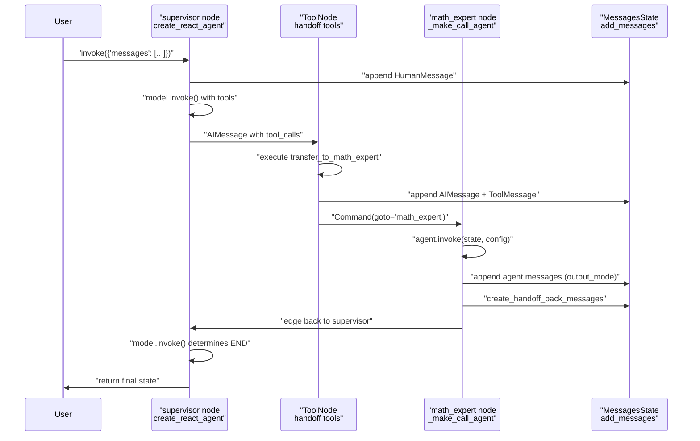

**Runtime Execution Sequence**

The key handoff mechanism uses `Command` objects from [langgraph_supervisor/handoff.py:92-126](). The `create_handoff_tool` function returns a tool that, when called, emits a `Command(goto=agent_name, graph=Command.PARENT)` to transfer control.

Sources: [langgraph_supervisor/supervisor.py:66-127](), [langgraph_supervisor/handoff.py:55-129]()

## Key Components

| Component | Source | Purpose |
|-----------|--------|---------|
| `create_supervisor` | [langgraph_supervisor/supervisor.py:211-469]() | Factory function that creates `StateGraph` with supervisor and agent nodes |
| `create_handoff_tool` | [langgraph_supervisor/handoff.py:55-129]() | Generates `transfer_to_*` tools that emit `Command(goto=agent_name)` |
| `create_handoff_back_messages` | [langgraph_supervisor/handoff.py:132-152]() | Creates (AIMessage, ToolMessage) pair for returning to supervisor |
| `_prepare_tool_node` | [langgraph_supervisor/supervisor.py:146-202]() | Combines user tools with auto-generated handoff tools into `ToolNode` |
| `_make_call_agent` | [langgraph_supervisor/supervisor.py:66-127]() | Wraps agent invocation with output mode handling and handoff messages |
| `MessagesState` | [langgraph_supervisor/supervisor.py:205-208]() | State schema with `messages` field using `add_messages` reducer |

Sources: [langgraph_supervisor/supervisor.py](), [langgraph_supervisor/handoff.py]()

## Output Modes

Control how agent messages appear in the final conversation history:

### Last Message Only (Default)
```python
workflow = create_supervisor(
    agents=[agent1, agent2],
    output_mode="last_message"  # Only final response from each agent
)
```

### Full History
```python
workflow = create_supervisor(
    agents=[agent1, agent2], 
    output_mode="full_history"  # All intermediate messages
)
```

Sources: [README.md:100-124](), [tests/test_supervisor.py:245-287]()

This basic setup creates a functional multi-agent system where the supervisor intelligently routes tasks to appropriate specialized agents based on the request content and returns coordinated responses.

---

# Page: Core Architecture

# Core Architecture

<details>
<summary>Relevant source files</summary>

The following files were used as context for generating this wiki page:

- [README.md](README.md)
- [langgraph_supervisor/agent_name.py](langgraph_supervisor/agent_name.py)
- [langgraph_supervisor/handoff.py](langgraph_supervisor/handoff.py)
- [langgraph_supervisor/supervisor.py](langgraph_supervisor/supervisor.py)

</details>


This page explains the fundamental design patterns, state management, and component interactions in the langgraph-supervisor package. The architecture implements a hierarchical multi-agent pattern where a central supervisor coordinates specialized sub-agents through tool-based handoffs.

## Related Pages

- **[Supervisor Component](#2.1)**: Deep dive into the supervisor's orchestration logic
- **[Handoff Mechanism](#2.2)**: How control transfers between agents
- **[Agent Name Formatting](#2.3)**: Message attribution and formatting
- **[Message History Management](#2.4)**: OutputMode and conversation state control
- **[API Reference](#3)**: Complete function signatures and parameters
- **[Advanced Usage](#4)**: Complex patterns and customization

## Architectural Pattern

The langgraph-supervisor package implements a **hub-and-spoke** multi-agent pattern where a central supervisor agent orchestrates specialized sub-agents. This pattern provides:

- **Centralized Control**: All agent coordination flows through the supervisor
- **Clear Separation of Concerns**: Each agent has a specific domain expertise
- **Flexible Delegation**: The supervisor can dynamically route to appropriate agents
- **Conversation Coherence**: Unified message history maintained across agent transitions

### Component Relationships

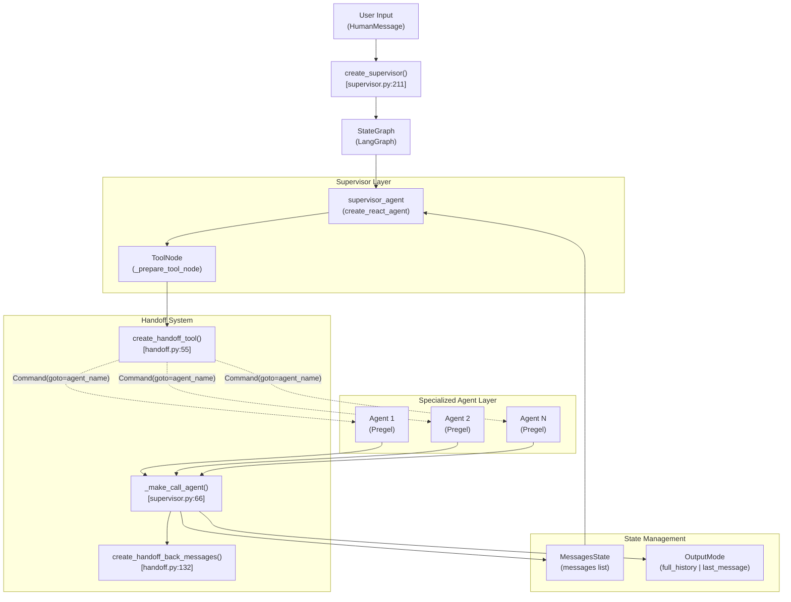

**Sources:** [langgraph_supervisor/supervisor.py:211-469](), [langgraph_supervisor/handoff.py:55-129](), [langgraph_supervisor/handoff.py:132-152]()

## Core Design Patterns

### StateGraph Execution Model

The supervisor uses LangGraph's `StateGraph` to define a cyclic workflow where the supervisor repeatedly evaluates the current state and delegates to agents as needed. The graph topology ensures all agent outputs flow back to the supervisor for coordination.

#### Graph Structure

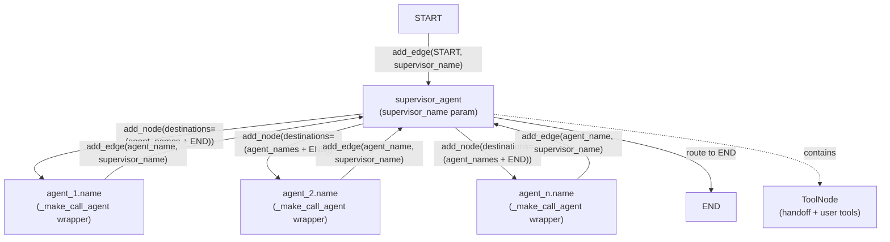

The graph is constructed in [langgraph_supervisor/supervisor.py:454-468]():
- Line 455: `add_node(supervisor_agent, destinations=...)`
- Line 456: `add_edge(START, supervisor_agent.name)`
- Lines 457-467: Add agent nodes with edges back to supervisor

**Sources:** [langgraph_supervisor/supervisor.py:454-468]()

### Agent Isolation and State Filtering

Each specialized agent is wrapped by `_make_call_agent()` to provide execution isolation and output filtering. This wrapper ensures agents operate independently while maintaining conversation coherence.

#### Agent Wrapper Architecture

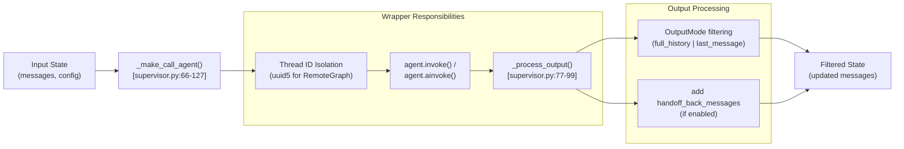

| Wrapper Function | Purpose | Implementation |
|-----------------|---------|----------------|
| **Thread Isolation** | Each agent gets deterministic sub-thread ID | `uuid5(parent_thread_id, agent.name)` for `RemoteGraph` [supervisor.py:102-108]() |
| **Output Filtering** | Controls message history verbosity | `OutputMode` parameter determines full history vs last message [supervisor.py:77-91]() |
| **Handoff Back Messages** | Signals agent completion to supervisor | Calls `create_handoff_back_messages()` if enabled [supervisor.py:93-94]() |

**Sources:** [langgraph_supervisor/supervisor.py:66-127](), [langgraph_supervisor/supervisor.py:77-99]()

### Tool-Based Handoff Pattern

Agent handoffs are implemented as LangChain tools that the supervisor can invoke. When called, these tools use LangGraph's `Command` primitive to transfer control to the target agent.

#### Handoff Tool Preparation

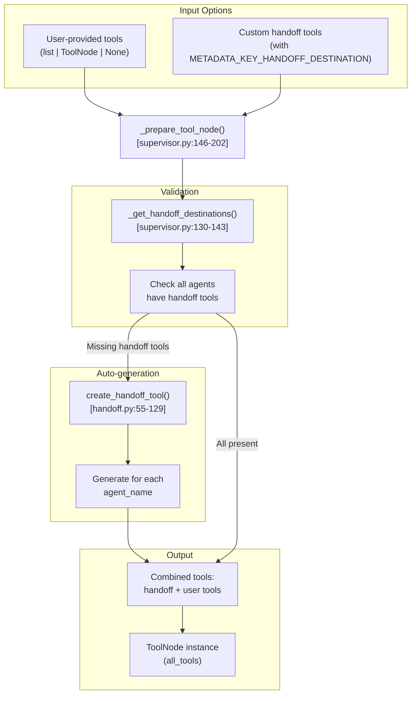

The tool preparation logic in `_prepare_tool_node()` [supervisor.py:146-202]():
1. **Lines 154-162**: Extract tools from input (supports `ToolNode` or list)
2. **Lines 164-170**: Validate custom handoff tools cover all agents
3. **Lines 175-186**: Auto-generate missing handoff tools with configurable prefix
4. **Lines 189-200**: Combine into final `ToolNode`

**Sources:** [langgraph_supervisor/supervisor.py:146-202](), [langgraph_supervisor/supervisor.py:130-143](), [langgraph_supervisor/handoff.py:55-129]()

## State Management

### Message State Flow

The system maintains a shared `MessagesState` containing the conversation history. This state is passed between the supervisor and agents, with each component updating the message list.

#### Execution Sequence

```mermaid
sequenceDiagram
    participant User
    participant StateGraph
    participant SupervisorAgent["supervisor_agent<br/>(create_react_agent)"]
    participant ToolNode
    participant HandoffTool["create_handoff_tool<br/>(tool function)"]
    participant AgentWrapper["_make_call_agent<br/>(wrapper)"]
    participant SpecializedAgent["Specialized Agent<br/>(Pregel)"]
    participant MessagesState["MessagesState<br/>(messages list)"]
    
    User->>StateGraph: HumanMessage
    StateGraph->>MessagesState: Append to messages
    StateGraph->>SupervisorAgent: Invoke with state
    SupervisorAgent->>SupervisorAgent: LLM decides to delegate
    SupervisorAgent->>ToolNode: Call handoff tool
    ToolNode->>HandoffTool: Execute tool function
    
    Note over HandoffTool: Adds ToolMessage<br/>with handoff metadata
    
    HandoffTool->>StateGraph: Command(goto=agent_name,<br/>update=messages)
    StateGraph->>AgentWrapper: Route to agent
    AgentWrapper->>SpecializedAgent: Invoke with filtered state
    SpecializedAgent->>SpecializedAgent: Process with domain tools
    SpecializedAgent->>AgentWrapper: Return agent output
    
    Note over AgentWrapper: Apply OutputMode filtering<br/>Add handoff_back_messages
    
    AgentWrapper->>MessagesState: Update with filtered messages
    StateGraph->>SupervisorAgent: Return control
    SupervisorAgent->>SupervisorAgent: Process agent response
    SupervisorAgent->>User: Final answer or next delegation
```

**Key State Transitions:**
- **Handoff Tool Call**: Adds `(AIMessage, ToolMessage)` pair to indicate delegation [handoff.py:88-126]()
- **Agent Execution**: Messages filtered by `OutputMode` before adding to state [supervisor.py:77-99]()
- **Handoff Back**: Optional `(AIMessage, ToolMessage)` pair signals completion [supervisor.py:93-94](), [handoff.py:132-152]()

**Sources:** [langgraph_supervisor/supervisor.py:66-127](), [langgraph_supervisor/handoff.py:88-126](), [langgraph_supervisor/handoff.py:132-152]()

### State Schema

The workflow uses `_OuterState` which contains an annotated messages list:

```python
class _OuterState(TypedDict):
    messages: Annotated[Sequence[AnyMessage], add_messages]
```

The `add_messages` reducer merges new messages into the existing list. Custom schemas can be provided via the `state_schema` parameter.

**Sources:** [langgraph_supervisor/supervisor.py:205-208](), [langgraph_supervisor/supervisor.py:404-407]()

## Model Configuration

### Supervisor LLM Preparation

The supervisor's language model is configured with tools and optional name formatting before being wrapped in a `create_react_agent`:

#### Model Preparation Pipeline

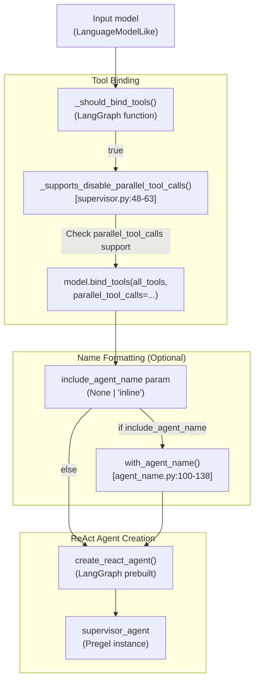

**Tool Binding Logic** [supervisor.py:432-442]():
- Uses LangGraph's `_should_bind_tools()` to determine if model supports tool binding
- Checks if model supports disabling parallel tool calls with `_supports_disable_parallel_tool_calls()` [supervisor.py:48-63]()
- Excludes certain models from parallel tool call configuration (e.g., o3-mini, o3, o4-mini) [supervisor.py:45]()

**Agent Name Formatting** [supervisor.py:440-441]():
- Optional `include_agent_name` parameter adds agent attribution to messages
- Currently supports `"inline"` mode which wraps content with XML tags
- See [Agent Name Formatting](#2.3) for details

**Sources:** [langgraph_supervisor/supervisor.py:432-452](), [langgraph_supervisor/supervisor.py:48-63](), [langgraph_supervisor/supervisor.py:45](), [langgraph_supervisor/agent_name.py:100-138]()

## Integration Points

### LangGraph Framework Dependencies

The supervisor integrates with several LangGraph components:

| Component | Purpose | Import Source |
|-----------|---------|---------------|
| `StateGraph` | Workflow orchestration | `langgraph.graph` |
| `create_react_agent` | Agent creation | `langgraph.prebuilt.chat_agent_executor` |
| `ToolNode` | Tool execution | `langgraph.prebuilt` |
| `AgentState` / `AgentStateWithStructuredResponse` | State schemas | `langgraph.prebuilt.chat_agent_executor` |
| `Pregel` | Agent interface | `langgraph.pregel` |

**Sources:** [langgraph_supervisor/supervisor.py:8-22]()

### Configuration and Extensibility

The `create_supervisor()` function provides extensive configuration options for customizing behavior:

- **State Management**: Custom `state_schema` and `config_schema` support
- **Model Hooks**: `pre_model_hook` and `post_model_hook` for custom processing
- **Tool Configuration**: Custom handoff tools and prefixes
- **Response Formatting**: Structured output via `response_format`
- **Agent Naming**: Configurable agent name inclusion modes

**Sources:** [langgraph_supervisor/supervisor.py:195-361]()

---

# Page: Supervisor Component

# Supervisor Component

<details>
<summary>Relevant source files</summary>

The following files were used as context for generating this wiki page:

- [langgraph_supervisor/supervisor.py](langgraph_supervisor/supervisor.py)
- [tests/test_supervisor.py](tests/test_supervisor.py)

</details>


The supervisor component is the central orchestrator in the langgraph-supervisor framework, responsible for coordinating multiple specialized agents in a hierarchical multi-agent system. This component manages task delegation, agent handoffs, message routing, and maintains conversation state across the entire workflow.

For information about handoff mechanisms between agents, see [Handoff Mechanism](#2.2). For details on agent name management, see [Agent Name Formatting](#2.3).

## Core Architecture

The supervisor component is implemented primarily through the `create_supervisor` function, which constructs a LangGraph StateGraph that orchestrates multiple specialized agents. The supervisor acts as a central hub that receives user requests, decides which agent should handle each task, and coordinates the flow of information between agents.

### Supervisor System Structure

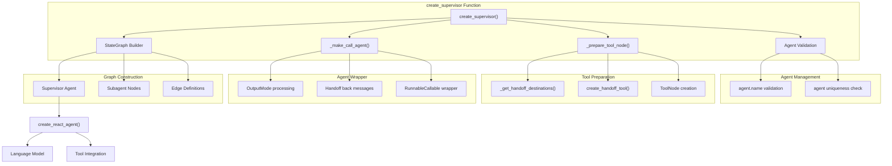

Sources: [langgraph_supervisor/supervisor.py:195-431]()

### StateGraph Architecture

The supervisor creates a StateGraph where the supervisor agent is the central node that can route to any of the managed agents. Each agent returns control to the supervisor after completing its task.

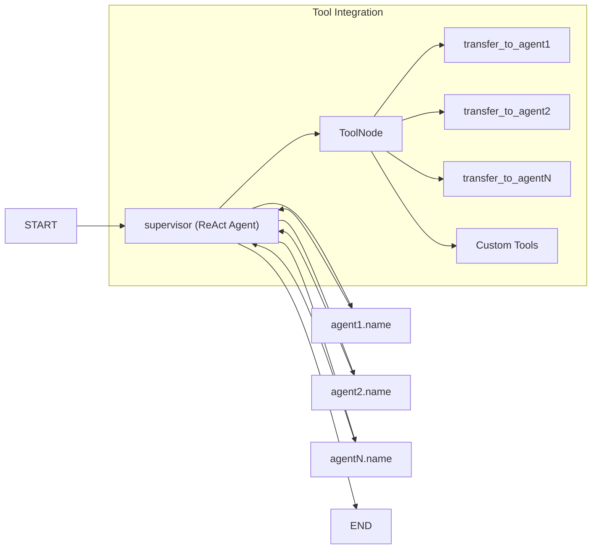

Sources: [langgraph_supervisor/supervisor.py:415-430]()

## Agent Management and Validation

The supervisor performs several validation steps when managing agents to ensure proper configuration and prevent conflicts.

### Agent Name Validation

The supervisor requires each agent to have a unique, non-null name for proper identification and routing:

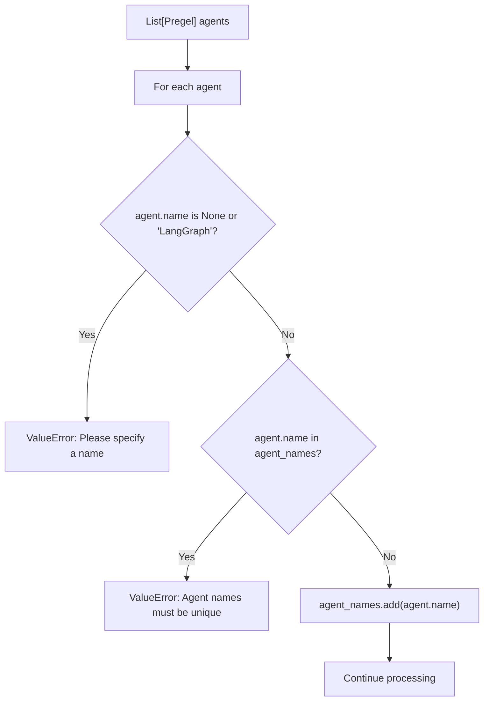

Sources: [langgraph_supervisor/supervisor.py:370-383]()

### Agent Wrapper Creation

Each agent is wrapped with the `_make_call_agent` function to handle output processing and handoff management:

| Component | Purpose | Configuration |
|-----------|---------|---------------|
| `output_mode` | Controls message history inclusion | `"full_history"` or `"last_message"` |
| `add_handoff_back_messages` | Adds return-to-supervisor messages | Boolean flag |
| `thread_id` handling | Manages separate conversation threads | UUID-based thread isolation |

Sources: [langgraph_supervisor/supervisor.py:59-118]()

## Tool Integration and Handoff System

The supervisor integrates tools through the `_prepare_tool_node` function, which combines custom tools with automatically generated handoff tools.

### Tool Node Preparation Flow

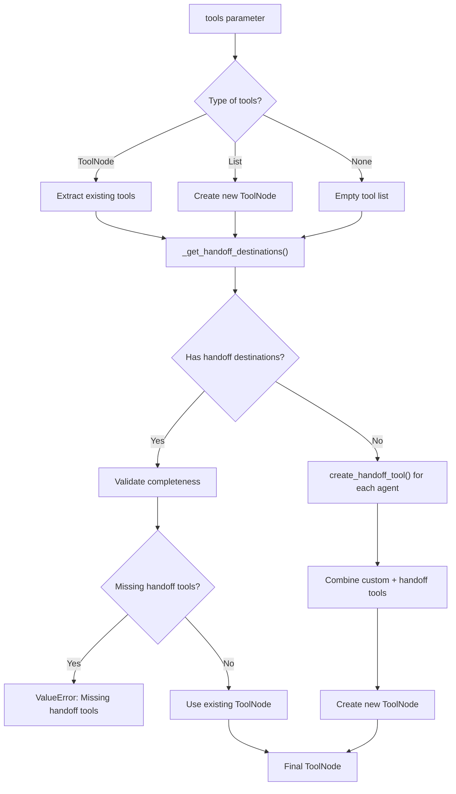

Sources: [langgraph_supervisor/supervisor.py:136-193]()

## Message Flow and State Management

The supervisor manages message flow between agents using different output modes and state processing strategies.

### Output Mode Processing

The `OutputMode` type literal defines how agent outputs are integrated into the message history:

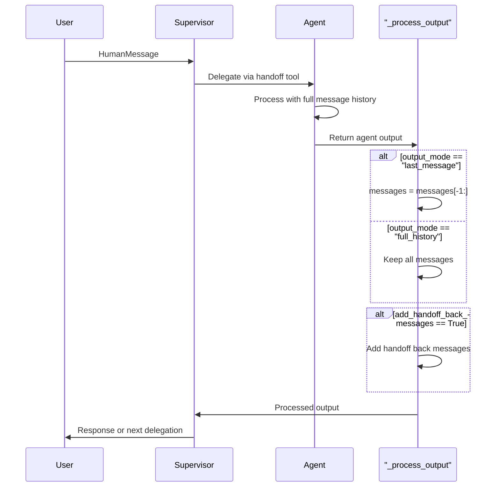

Sources: [langgraph_supervisor/supervisor.py:70-89](), [langgraph_supervisor/supervisor.py:32-37]()

### Thread Isolation

For RemoteGraph agents, the supervisor implements thread isolation using UUID5 generation to prevent conversation mixing:

```python
# Thread ID generation for RemoteGraph isolation
thread_id = str(uuid5(UUID(str(thread_id)), agent.name)) if thread_id else None
```

Sources: [langgraph_supervisor/supervisor.py:97](), [langgraph_supervisor/supervisor.py:110]()

## Configuration Options

The `create_supervisor` function accepts numerous configuration parameters that control behavior across different aspects of the system:

### Core Configuration Parameters

| Parameter | Type | Purpose |
|-----------|------|---------|
| `agents` | `list[Pregel]` | List of specialized agents to manage |
| `model` | `LanguageModelLike` | Language model for supervisor reasoning |
| `tools` | `list[BaseTool] \| ToolNode \| None` | Additional tools for supervisor |
| `parallel_tool_calls` | `bool` | Enable parallel agent handoffs |
| `output_mode` | `OutputMode` | Message history inclusion strategy |
| `supervisor_name` | `str` | Name identifier for supervisor node |

### Advanced Configuration

| Parameter | Type | Purpose |
|-----------|------|---------|
| `pre_model_hook` | `RunnableLike` | Message processing before LLM |
| `post_model_hook` | `RunnableLike` | Post-processing after LLM |
| `handoff_tool_prefix` | `str` | Prefix for generated handoff tools |
| `include_agent_name` | `AgentNameMode` | Agent name embedding strategy |
| `state_schema` | `StateSchemaType` | Custom state schema |
| `response_format` | `StructuredResponseSchema` | Structured output format |

Sources: [langgraph_supervisor/supervisor.py:195-214]()

### Model Integration Features

The supervisor includes intelligent model integration that adapts to different LLM capabilities:

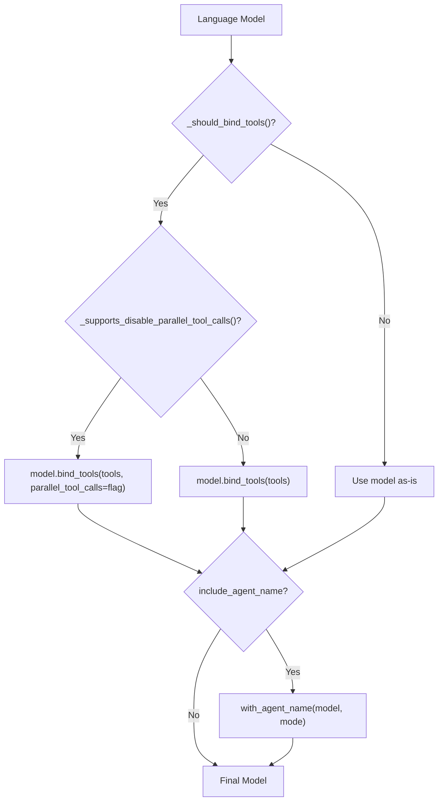

Sources: [langgraph_supervisor/supervisor.py:393-402](), [langgraph_supervisor/supervisor.py:43-56]()

## Integration with LangGraph Framework 

The supervisor leverages several LangGraph components to provide a complete multi-agent orchestration system:

### Framework Dependencies

| Component | Source | Purpose |
|-----------|--------|---------|
| `StateGraph` | `langgraph.graph` | Workflow orchestration |
| `create_react_agent` | `langgraph.prebuilt.chat_agent_executor` | Supervisor agent creation |
| `ToolNode` | `langgraph.prebuilt` | Tool execution management |
| `AgentState` | `langgraph.prebuilt.chat_agent_executor` | Default state schema |
| `Pregel` | `langgraph.pregel` | Base agent interface |

Sources: [langgraph_supervisor/supervisor.py:8-22](), [langgraph_supervisor/supervisor.py:404-413]()

The supervisor component serves as the foundational orchestrator that transforms a collection of specialized agents into a coordinated multi-agent system capable of handling complex, multi-step tasks through intelligent delegation and state management.

---

# Page: Handoff Mechanism

# Handoff Mechanism

<details>
<summary>Relevant source files</summary>

The following files were used as context for generating this wiki page:

- [langgraph_supervisor/handoff.py](langgraph_supervisor/handoff.py)
- [langgraph_supervisor/supervisor.py](langgraph_supervisor/supervisor.py)
- [tests/test_supervisor.py](tests/test_supervisor.py)

</details>


## Purpose and Scope

This document explains the handoff mechanism that enables control transfer between the supervisor and managed agents in the langgraph-supervisor system. A handoff occurs when the supervisor delegates work to a specialized agent, or when an agent returns control back to the supervisor. This page covers the core handoff tools, control flow mechanics, message history management, and integration patterns.

For information about how the supervisor orchestrates these handoffs, see [Supervisor Component](#2.1). For details about agent name formatting in handoff messages, see [Agent Name Formatting](#2.3). For configuration of message history output modes, see [Message History Management](#2.4).

---

## Handoff Tool Architecture

The handoff mechanism is implemented through specialized tools that leverage LangGraph's `Command` API to route execution flow between nodes in the supervisor graph. Each managed agent gets a corresponding handoff tool that the supervisor's language model can invoke to delegate tasks.

### Handoff Tool Creation Flow

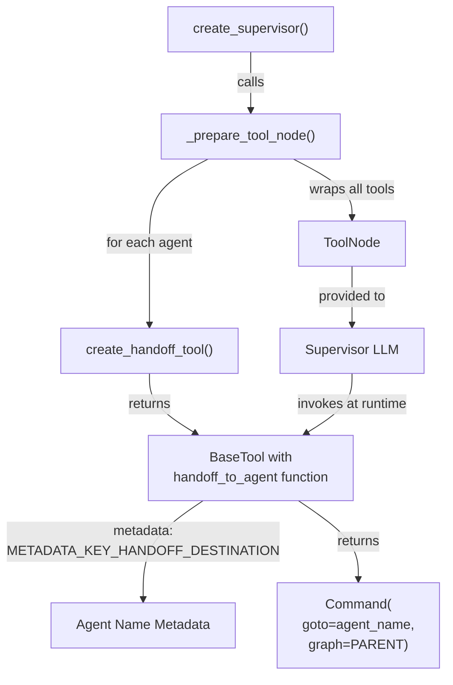

**Sources:** [langgraph_supervisor/supervisor.py:146-203](), [langgraph_supervisor/handoff.py:55-130]()

The `_prepare_tool_node` function generates handoff tools for all agents unless custom handoff tools are provided. Each handoff tool is named using the pattern `transfer_to_<agent_name>` (or a custom prefix), where the agent name is normalized by converting whitespace to underscores and lowercasing.

---

## Core Handoff Functions

### create_handoff_tool

The `create_handoff_tool` function creates a tool that transfers control to a specified agent. When invoked by the supervisor's LLM, it returns a `Command` object that instructs LangGraph to route execution to the target agent node.

**Function Signature:**
```python
create_handoff_tool(
    agent_name: str,
    name: str | None = None,
    description: str | None = None,
    add_handoff_messages: bool = True
) -> BaseTool
```

**Key Parameters:**
- `agent_name`: Target agent node name in the graph
- `name`: Optional tool name (defaults to `transfer_to_<agent_name>`)
- `description`: Optional tool description (defaults to `Ask agent '<agent_name>' for help`)
- `add_handoff_messages`: Whether to add AIMessage/ToolMessage pairs to message history

**Implementation Details:**

```mermaid
sequenceDiagram
    participant LLM as "Supervisor LLM"
    participant Tool as "handoff_to_agent"
    participant State as "Graph State"
    participant Agent as "Target Agent"
    
    LLM->>Tool: invoke(tool_call_id)
    Tool->>State: read messages[-1]
    
    alt Single Handoff
        Tool->>Tool: create ToolMessage
        Tool->>Agent: Command(goto=agent_name)
        Note over Tool,Agent: update={messages: [..., ToolMessage]}
    else Parallel Handoffs
        Tool->>Tool: filter tool calls
        Tool->>Tool: create ToolMessage
        Tool->>Agent: Command(goto=[Send(agent_name, state)])
        Note over Tool,Agent: Uses Send for parallel execution
    end
```

**Sources:** [langgraph_supervisor/handoff.py:55-130]()

The handoff tool implementation handles two scenarios:

1. **Single Handoff** [langgraph_supervisor/handoff.py:117-126](): When the supervisor calls only one handoff tool, the function returns a `Command` with `goto=agent_name` and updates the state with the handoff messages.

2. **Parallel Handoffs** [langgraph_supervisor/handoff.py:100-115](): When multiple handoff tools are called simultaneously, the function uses `Send` commands to enable parallel agent execution. It also filters out non-relevant tool calls from the last AI message to ensure valid message history.

The tool attaches metadata `{METADATA_KEY_HANDOFF_DESTINATION: agent_name}` to enable identification of handoff tools [langgraph_supervisor/handoff.py:128]().

### create_handoff_back_messages

The `create_handoff_back_messages` function generates a pair of messages that indicate an agent is returning control to the supervisor. These messages are automatically appended by the `_make_call_agent` wrapper when `add_handoff_back_messages=True`.

**Function Signature:**
```python
create_handoff_back_messages(
    agent_name: str,
    supervisor_name: str
) -> tuple[AIMessage, ToolMessage]
```

**Generated Message Structure:**

| Message Type | Field | Value |
|--------------|-------|-------|
| AIMessage | `content` | `"Transferring back to {supervisor_name}"` |
| | `tool_calls` | `[ToolCall(name="transfer_back_to_{supervisor_name}", ...)]` |
| | `name` | `agent_name` |
| | `response_metadata` | `{METADATA_KEY_IS_HANDOFF_BACK: True}` |
| ToolMessage | `content` | `"Successfully transferred back to {supervisor_name}"` |
| | `name` | `transfer_back_to_{supervisor_name}` |
| | `tool_call_id` | Generated UUID |
| | `response_metadata` | `{METADATA_KEY_IS_HANDOFF_BACK: True}` |

**Sources:** [langgraph_supervisor/handoff.py:132-152]()

These messages serve as markers in the conversation history that clearly indicate control flow transitions. The `METADATA_KEY_IS_HANDOFF_BACK` metadata flag allows other components (like `create_forward_message_tool`) to distinguish handoff-back messages from actual agent responses.

---

## Control Flow and Command Routing

### Command Pattern Usage

Handoff tools use LangGraph's `Command` API to control graph execution. The `Command` object specifies routing instructions and state updates:

```mermaid
graph LR
    HandoffTool["handoff_to_agent<br/>(tool function)"]
    CommandObj["Command Object"]
    GraphRouter["LangGraph Router"]
    TargetAgent["Agent Node"]
    
    HandoffTool -->|"returns"| CommandObj
    CommandObj -->|"goto: agent_name"| RouteInfo["Routing Info"]
    CommandObj -->|"graph: PARENT"| GraphLevel["Parent Graph Context"]
    CommandObj -->|"update: state changes"| StateUpdate["State Updates"]
    
    GraphRouter -->|"reads"| CommandObj
    GraphRouter -->|"navigates to"| TargetAgent
    GraphRouter -->|"applies"| StateUpdate
```

**Sources:** [langgraph_supervisor/handoff.py:92-126]()

The `graph=Command.PARENT` parameter [langgraph_supervisor/handoff.py:111, 124]() ensures that routing occurs at the parent graph level, allowing the handoff tool (which runs inside the supervisor's tool node) to transfer control to sibling agent nodes.

### Parallel Handoff Handling

When the supervisor LLM calls multiple handoff tools simultaneously, the handoff mechanism must handle parallel execution correctly:

```mermaid
flowchart TD
    SupervisorAI["Supervisor AIMessage<br/>with multiple tool_calls"]
    CheckToolCalls{"len(tool_calls) > 1?"}
    
    SupervisorAI --> CheckToolCalls
    
    CheckToolCalls -->|"Yes<br/>(Parallel)"| FilterCalls["_remove_non_handoff_tool_calls()"]
    CheckToolCalls -->|"No<br/>(Single)"| SingleHandoff["Return Command with<br/>goto=agent_name"]
    
    FilterCalls --> FilteredAI["Filtered AIMessage<br/>(only this handoff)"]
    FilteredAI --> HandoffMessages["Add handoff messages<br/>if add_handoff_messages=True"]
    HandoffMessages --> ParallelCommand["Return Command with<br/>goto=[Send(agent, state)]"]
    
    SingleHandoff --> AddMessages["Append messages<br/>if add_handoff_messages=True"]
    AddMessages --> SingleCommand["Return Command with<br/>goto=agent_name,<br/>update=state"]
```

**Sources:** [langgraph_supervisor/handoff.py:101-126]()

The `_remove_non_handoff_tool_calls` helper function [langgraph_supervisor/handoff.py:26-52]() filters the last AI message to only include the specific tool call relevant to this handoff. This ensures each agent receives a clean message history without tool calls intended for other agents.

For parallel handoffs, the function uses `Send` commands [langgraph_supervisor/handoff.py:114]() to enable LangGraph's parallel execution support. The ToolNode in langgraph.prebuilt knows how to combine multiple Send commands into a single routing instruction.

---

## Message History Management

### Handoff Message Pairs

When `add_handoff_messages=True` (the default), each handoff adds a pair of messages to the conversation history:

1. **AIMessage**: The supervisor's tool call to transfer control
2. **ToolMessage**: Confirmation that the transfer was successful

**Example Message Flow:**

```mermaid
sequenceDiagram
    participant User
    participant Supervisor
    participant Messages as "Message History"
    participant Agent
    
    User->>Messages: HumanMessage("Calculate 5+3")
    Supervisor->>Messages: AIMessage(tool_calls=[transfer_to_math])
    Note over Supervisor,Messages: Handoff message pair added
    Messages->>Messages: ToolMessage("Successfully transferred to math_agent")
    
    Agent->>Agent: Process request
    Agent->>Messages: AIMessage("The result is 8", name="math_agent")
    Agent->>Messages: AIMessage("Transferring back to supervisor", tool_calls=[...])
    Agent->>Messages: ToolMessage("Successfully transferred back to supervisor")
    Note over Agent,Messages: Handoff-back message pair added
    
    Supervisor->>Messages: AIMessage("The result is 8")
    Supervisor->>User: Final response
```

**Sources:** [langgraph_supervisor/handoff.py:89-126](), [langgraph_supervisor/supervisor.py:93-99]()

### Disabling Handoff Messages

Setting `add_handoff_messages=False` omits the handoff message pairs from history. This can be useful for cleaner message logs or when handoff details are not relevant to downstream processing:

```python
workflow = create_supervisor(
    agents=[agent1, agent2],
    model=model,
    add_handoff_messages=False,  # No handoff pairs in history
)
```

When disabled:
- The supervisor's handoff AIMessage and ToolMessage are excluded [langgraph_supervisor/handoff.py:121]()
- Only the initial HumanMessage and agent responses appear in history
- The test at [tests/test_supervisor.py:333-426]() demonstrates this behavior

**Sources:** [langgraph_supervisor/supervisor.py:226, 402](), [langgraph_supervisor/handoff.py:103-121]()

### Metadata Keys

The handoff mechanism uses two metadata keys to track control flow:

| Metadata Key | Purpose | Applied To |
|--------------|---------|------------|
| `METADATA_KEY_HANDOFF_DESTINATION` | Identifies the target agent for a handoff tool | `response_metadata` on ToolMessage [langgraph_supervisor/handoff.py:97]() |
| `METADATA_KEY_IS_HANDOFF_BACK` | Marks messages created when returning to supervisor | `response_metadata` on AIMessage and ToolMessage [langgraph_supervisor/handoff.py:144, 150]() |

**Sources:** [langgraph_supervisor/handoff.py:12-13]()

The `METADATA_KEY_IS_HANDOFF_BACK` flag is particularly important for the `create_forward_message_tool` function, which needs to skip handoff-back messages when searching for the latest agent response [langgraph_supervisor/handoff.py:185]().

---

## Message Forwarding Tool

### create_forward_message_tool

The `create_forward_message_tool` function creates a specialized tool that allows the supervisor to forward an agent's response directly to the user without modification. This is useful for preserving information fidelity and avoiding token costs when the agent's response doesn't need supervisor processing.

**Function Signature:**
```python
create_forward_message_tool(
    supervisor_name: str = "supervisor"
) -> BaseTool
```

**Forwarding Flow:**

```mermaid
sequenceDiagram
    participant Super as "Supervisor LLM"
    participant FwdTool as "forward_message tool"
    participant History as "Message History"
    participant User
    
    Note over History: Contains messages from<br/>multiple agents
    Super->>FwdTool: forward_message(from_agent="research_agent")
    FwdTool->>History: Search backwards for AIMessage<br/>where name="research_agent"<br/>and not IS_HANDOFF_BACK
    History-->>FwdTool: Found: AIMessage("Here's the data...")
    FwdTool->>FwdTool: Create new AIMessage(content, name=supervisor_name)
    FwdTool->>User: Command(goto="__end__", update=new_message)
    Note over FwdTool,User: Bypasses supervisor processing
```

**Sources:** [langgraph_supervisor/handoff.py:155-213]()

### Implementation Details

The tool implementation:

1. **Searches message history** [langgraph_supervisor/handoff.py:179-188](): Iterates backwards through messages to find the latest AIMessage from the specified agent, skipping messages with `METADATA_KEY_IS_HANDOFF_BACK` metadata.

2. **Validates agent name** [langgraph_supervisor/handoff.py:189-195](): Returns an error message if the agent name is not found, including a list of available agent names.

3. **Creates forwarded message** [langgraph_supervisor/handoff.py:196-202](): Constructs a new AIMessage with the agent's content but attributed to the supervisor.

4. **Routes to END** [langgraph_supervisor/handoff.py:204-211](): Returns a Command that routes to `"__end__"` with the forwarded message, bypassing any further supervisor processing.

### Usage Example

From the test suite [tests/test_supervisor.py:428-558]():

```python
# Create forwarding tool
forwarding = create_forward_message_tool("supervisor")

# Include it in supervisor tools
workflow = create_supervisor(
    [echo_agent],
    model=model,
    tools=[forwarding],  # Supervisor can now forward messages
)
```

When the supervisor invokes `forward_message(from_agent="echo_agent")`, the echo agent's response is forwarded directly to the output, preserving the original content without supervisor rewriting.

**Sources:** [langgraph_supervisor/handoff.py:155-213](), [tests/test_supervisor.py:428-558]()

---

## Integration with Supervisor

### Tool Node Preparation

The `_prepare_tool_node` function integrates handoff tools into the supervisor's tool set:

```mermaid
graph TB
    Input["Input:<br/>- tools list/ToolNode<br/>- agent_names set<br/>- handoff_tool_prefix<br/>- add_handoff_messages"]
    
    CheckCustomTools{"Custom handoff<br/>tools provided?"}
    
    Input --> CheckCustomTools
    
    CheckCustomTools -->|"Yes"| ValidateCustom["Validate all agents<br/>have handoff tools"]
    CheckCustomTools -->|"No"| GenerateTools["Generate handoff tools<br/>for each agent"]
    
    ValidateCustom -->|"Valid"| UseExisting["Use existing ToolNode"]
    ValidateCustom -->|"Invalid"| Error["Raise ValueError:<br/>Missing handoff tools"]
    
    GenerateTools --> CreateHandoffs["create_handoff_tool()<br/>for each agent_name"]
    CreateHandoffs --> CombineTools["Combine with<br/>existing tools"]
    CombineTools --> WrapToolNode["Wrap in new ToolNode"]
    
    UseExisting --> Output["Return ToolNode"]
    WrapToolNode --> Output
```

**Sources:** [langgraph_supervisor/supervisor.py:146-203]()

### Handoff Tool Generation

When custom handoff tools are not provided, the function generates them:

```python
handoff_tools = [
    create_handoff_tool(
        agent_name=agent_name,
        name=(
            None
            if handoff_tool_prefix is None
            else f"{handoff_tool_prefix}{_normalize_agent_name(agent_name)}"
        ),
        add_handoff_messages=add_handoff_messages,
    )
    for agent_name in agent_names
]
```

**Sources:** [langgraph_supervisor/supervisor.py:175-186]()

The generated tools are combined with any user-provided tools and wrapped in a `ToolNode`. If the input was already a `ToolNode`, its configuration (name, tags, error handling) is preserved [langgraph_supervisor/supervisor.py:191-198]().

### Custom Handoff Tool Validation

When users provide custom handoff tools, the function validates that handoff tools exist for all agents:

```python
handoff_destinations = _get_handoff_destinations(tool_classes)
if handoff_destinations:
    if missing_handoff_destinations := set(agent_names) - set(handoff_destinations):
        raise ValueError(
            "When providing custom handoff tools, you must provide them for all subagents. "
            f"Missing handoff tools for agents '{missing_handoff_destinations}'."
        )
```

**Sources:** [langgraph_supervisor/supervisor.py:164-170]()

Handoff tools are identified by the presence of `METADATA_KEY_HANDOFF_DESTINATION` in their metadata [langgraph_supervisor/supervisor.py:138-143]().

---

## Configuration Options

### Handoff Tool Prefix

The `handoff_tool_prefix` parameter allows customization of handoff tool names:

```python
# Default: transfer_to_agent_name
workflow = create_supervisor(agents, model=model)

# Custom prefix: delegate_to_agent_name
workflow = create_supervisor(
    agents, 
    model=model,
    handoff_tool_prefix="delegate_to_"
)
```

**Sources:** [langgraph_supervisor/supervisor.py:227, 331-335]()

### Handoff Back Messages

The `add_handoff_back_messages` parameter controls whether agents add handoff-back message pairs when returning control to the supervisor:

```python
# Default: same as add_handoff_messages
workflow = create_supervisor(agents, model=model)

# Explicitly disable handoff-back messages
workflow = create_supervisor(
    agents, 
    model=model,
    add_handoff_back_messages=False
)
```

If `add_handoff_back_messages` is `None`, it defaults to the value of `add_handoff_messages` [langgraph_supervisor/supervisor.py:401-402]().

**Sources:** [langgraph_supervisor/supervisor.py:228, 336-337, 401-402, 463]()

The handoff-back messages are added by the `_make_call_agent` wrapper, which processes agent outputs before returning them to the supervisor [langgraph_supervisor/supervisor.py:93-94]().

---

# Page: Agent Name Formatting

# Agent Name Formatting

<details>
<summary>Relevant source files</summary>

The following files were used as context for generating this wiki page:

- [langgraph_supervisor/agent_name.py](langgraph_supervisor/agent_name.py)
- [tests/test_agent_name.py](tests/test_agent_name.py)

</details>


## Purpose and Scope

This document describes the agent name formatting system in `langgraph-supervisor`, which embeds agent identities directly into message content to improve coherence in multi-agent conversations. The system uses XML-style tags to annotate AI messages with their originating agent's name, making it easier for language models to distinguish between different agents' contributions in conversation history.

For information about how the supervisor orchestrates agent selection and control flow, see [Supervisor Component](#2.1). For details on message history configuration options, see [Message History Management](#2.4).

---

## System Overview

The agent name formatting system provides utilities to inject and extract agent names from message content. When multiple agents participate in a conversation, the language model needs clear attribution to understand which agent said what. This system solves that problem by formatting messages like:

```
Original: "I can help you with math problems"
Formatted: "<name>math_expert</name><content>I can help you with math problems</content>"
```

The system consists of three core functions defined in [langgraph_supervisor/agent_name.py]():

| Function | Purpose |
|----------|---------|
| `add_inline_agent_name()` | Wraps message content with XML tags containing the agent name |
| `remove_inline_agent_name()` | Extracts content from XML tags back to plain text |
| `with_agent_name()` | Wraps a language model to automatically apply formatting |

**Sources:** [langgraph_supervisor/agent_name.py:1-139]()

---

## Message Transformation Pipeline

```mermaid
graph LR
    subgraph "Input Processing"
        InMsg["BaseMessage<br/>(from conversation history)"]
        CheckAI{"Is AIMessage<br/>with name?"}
        InMsg --> CheckAI
    end
    
    subgraph "add_inline_agent_name()"
        ExtractName["Extract message.name"]
        ExtractContent["Extract message.content"]
        WrapTags["Wrap with XML tags:<br/>&lt;name&gt;{name}&lt;/name&gt;<br/>&lt;content&gt;{content}&lt;/content&gt;"]
        ModelCopy["message.model_copy()"]
        
        CheckAI -->|Yes| ModelCopy
        ModelCopy --> ExtractName
        ModelCopy --> ExtractContent
        ExtractName --> WrapTags
        ExtractContent --> WrapTags
    end
    
    subgraph "To Language Model"
        FormattedMsg["Formatted AIMessage<br/>with inline tags"]
        WrapTags --> FormattedMsg
    end
    
    subgraph "From Language Model"
        LLMOutput["AIMessage<br/>with inline tags"]
    end
    
    subgraph "remove_inline_agent_name()"
        ParseTags["Apply NAME_PATTERN<br/>and CONTENT_PATTERN"]
        ExtractInner["Extract content<br/>from &lt;content&gt; tag"]
        CleanMsg["Return clean<br/>AIMessage"]
        
        LLMOutput --> ParseTags
        ParseTags --> ExtractInner
        ExtractInner --> CleanMsg
    end
    
    subgraph "Output"
        OutMsg["BaseMessage<br/>(clean content)"]
        CleanMsg --> OutMsg
    end
    
    CheckAI -->|No| InMsg
    InMsg -.->|Pass through<br/>unchanged| OutMsg
```

**Diagram: Message Transformation Flow Through Inline Name Formatting Functions**

This diagram shows how messages flow through the formatting system. The `add_inline_agent_name()` function only processes `AIMessage` instances that have a `name` attribute set. Other message types and AI messages without names pass through unchanged. The reverse operation `remove_inline_agent_name()` uses regex patterns to extract content.

**Sources:** [langgraph_supervisor/agent_name.py:29-97]()

---

## Pattern Matching and Tag Formats

The system uses two regex patterns defined as module-level constants:

```python
NAME_PATTERN = re.compile(r"<name>(.*?)</name>", re.DOTALL)
CONTENT_PATTERN = re.compile(r"<content>(.*?)</content>", re.DOTALL)
```

These patterns support multi-line content due to the `re.DOTALL` flag, allowing agent responses with line breaks to be properly formatted and parsed.

### Tag Structure

| Component | Format | Example |
|-----------|--------|---------|
| Name tag | `<name>{agent_name}</name>` | `<name>research_expert</name>` |
| Content tag | `<content>{message_text}</content>` | `<content>Here are my findings...</content>` |
| Full format | `<name>...</name><content>...</content>` | `<name>math_expert</name><content>The answer is 42</content>` |

**Sources:** [langgraph_supervisor/agent_name.py:14-15]()

---

## Language Model Wrapper

### with_agent_name Function

The `with_agent_name()` function wraps a language model to automatically apply agent name formatting to all messages passing through it:

```mermaid
graph TB
    subgraph "Model Wrapping"
        InputModel["LanguageModelLike<br/>(original model)"]
        Mode["agent_name_mode<br/>parameter"]
        WithAgent["with_agent_name()<br/>function"]
        
        InputModel --> WithAgent
        Mode --> WithAgent
    end
    
    subgraph "Constructed Chain"
        PreProcess["process_input_messages<br/>lambda function"]
        OrigModel["Original Language Model"]
        PostProcess["RunnableLambda<br/>(process_output_message)"]
        
        PreProcess -->|Sequence| OrigModel
        OrigModel -->|Sequence| PostProcess
    end
    
    subgraph "Input/Output Processing"
        AddFunc["add_inline_agent_name<br/>(process_input_message)"]
        RemoveFunc["remove_inline_agent_name<br/>(process_output_message)"]
        
        PreProcess -.->|calls for each msg| AddFunc
        PostProcess -.->|calls| RemoveFunc
    end
    
    WithAgent -->|returns| PreProcess
    
    subgraph "Runtime Flow"
        InMsgs["Input:<br/>Sequence[MessageLikeRepresentation]"]
        ConvertMsgs["convert_to_messages()"]
        FormatMsgs["Apply add_inline_agent_name<br/>to each message"]
        SendModel["Send to model"]
        GetResp["Get model response"]
        CleanResp["Apply remove_inline_agent_name"]
        OutMsg["Output:<br/>Clean BaseMessage"]
        
        InMsgs --> ConvertMsgs
        ConvertMsgs --> FormatMsgs
        FormatMsgs --> SendModel
        SendModel --> GetResp
        GetResp --> CleanResp
        CleanResp --> OutMsg
    end
```

**Diagram: Language Model Wrapping Architecture**

The `with_agent_name()` function creates a processing chain that sits around the language model. It processes input messages before they reach the model and output messages after the model generates them. This ensures agent names are visible during model inference but hidden from the final output.

**Sources:** [langgraph_supervisor/agent_name.py:100-138]()

### Function Signature

```python
def with_agent_name(
    model: LanguageModelLike,
    agent_name_mode: AgentNameMode,
) -> LanguageModelLike
```

**Parameters:**

| Parameter | Type | Description |
|-----------|------|-------------|
| `model` | `LanguageModelLike` | The language model to wrap with name formatting |
| `agent_name_mode` | `AgentNameMode` | Formatting mode; currently only `"inline"` is supported |

**Returns:** A wrapped language model that automatically applies inline name formatting.

**Sources:** [langgraph_supervisor/agent_name.py:100-103]()

---

## Content Format Handling

The system supports two content formats used by LangChain:

### String Content

Simple text messages where `message.content` is a string:

```python
AIMessage(content="Hello world", name="assistant")
# Formatted: "<name>assistant</name><content>Hello world</content>"
```

### Content Blocks (Multimodal)

Structured content with multiple blocks, supporting images, files, and other media types:

```python
AIMessage(
    content=[
        {"type": "text", "text": "Here's the image"},
        {"type": "image", "image_url": "http://example.com/img.jpg"}
    ],
    name="assistant"
)
# Text block formatted: "<name>assistant</name><content>Here's the image</content>"
# Non-text blocks preserved unchanged
```

```mermaid
graph TB
    subgraph "Content Type Detection"
        CheckContent{"_is_content_blocks_content()"}
        IsList{"Is list?"}
        IsDict{"First element<br/>is dict?"}
        HasType{"Has 'type' key?"}
        
        CheckContent --> IsList
        IsList -->|Yes| IsDict
        IsList -->|No| StringContent["Handle as<br/>string content"]
        IsDict -->|Yes| HasType
        IsDict -->|No| StringContent
        HasType -->|Yes| BlockContent["Handle as<br/>content blocks"]
        HasType -->|No| StringContent
    end
    
    subgraph "Content Block Processing"
        Separate["Separate text blocks<br/>from non-text blocks"]
        FormatText["Format first text block<br/>with name tags"]
        Combine["Combine:<br/>[formatted_text] + non_text_blocks"]
        
        BlockContent --> Separate
        Separate --> FormatText
        FormatText --> Combine
    end
    
    subgraph "String Processing"
        DirectFormat["Apply tags directly<br/>to content string"]
        StringContent --> DirectFormat
    end
```

**Diagram: Content Format Detection and Processing Logic**

The system uses `_is_content_blocks_content()` type guard to determine the content format. For content blocks, it separates text from non-text blocks (images, files), formats only the first text block, and preserves non-text blocks unchanged.

**Sources:** [langgraph_supervisor/agent_name.py:20-26](), [langgraph_supervisor/agent_name.py:44-50](), [langgraph_supervisor/agent_name.py:72-94]()

---

## Processing Rules

### add_inline_agent_name Behavior

| Message Type | Has Name? | Action |
|--------------|-----------|--------|
| Non-AIMessage | N/A | Return unchanged |
| AIMessage | No | Return unchanged |
| AIMessage | Yes | Add XML tags |

For content blocks without any text blocks, the system creates an empty content tag: `<name>agent</name><content></content>`.

**Sources:** [langgraph_supervisor/agent_name.py:29-55](), [tests/test_agent_name.py:9-51]()

### remove_inline_agent_name Behavior

| Condition | Action |
|-----------|--------|
| Non-AIMessage | Return unchanged |
| Empty content | Return unchanged |
| No XML tags found | Return unchanged |
| Valid XML tags | Extract and return inner content |

When extracting content from blocks and the parsed content is empty, non-text blocks are still preserved.

**Sources:** [langgraph_supervisor/agent_name.py:58-97](), [tests/test_agent_name.py:54-113]()

---

## Integration with Agents

The `message.name` field is the source of the agent name. When using agents created with `create_react_agent()`, the name is automatically set on AI messages. For custom agents, developers must ensure the `name` attribute is set on returned `AIMessage` instances.

```mermaid
graph LR
    subgraph "create_react_agent"
        ReactAgent["create_react_agent()<br/>from LangGraph"]
        AutoName["Automatically sets<br/>message.name"]
        ReactAgent --> AutoName
    end
    
    subgraph "Custom Agent"
        CustomAgent["Custom agent<br/>implementation"]
        ManualName["Developer must set<br/>message.name"]
        CustomAgent --> ManualName
    end
    
    subgraph "Agent Name System"
        ReadName["add_inline_agent_name()<br/>reads message.name"]
        FormatMsg["Formats message<br/>with name tags"]
        ReadName --> FormatMsg
    end
    
    AutoName --> ReadName
    ManualName --> ReadName
```

**Diagram: Agent Name Attribution Sources**

This diagram shows the two paths for setting agent names. The `create_react_agent()` function from LangGraph automatically sets the `name` field, while custom agents require manual name assignment.

**Sources:** [langgraph_supervisor/agent_name.py:108-110]()

---

## Usage in Supervisor System

While the functions in `agent_name.py` can be used independently, they are primarily consumed by the supervisor system. The supervisor may optionally wrap language models with `with_agent_name()` to improve multi-agent conversation coherence, though this is configurable behavior rather than a mandatory requirement.

The inline formatting helps language models understand the conversation context when multiple agents contribute to the same thread:

```
Without formatting:
- "I'll calculate that for you"
- "Let me search for information"
- "The calculation shows..."

With inline formatting:
- "<name>math_expert</name><content>I'll calculate that for you</content>"
- "<name>research_expert</name><content>Let me search for information</content>"
- "<name>math_expert</name><content>The calculation shows...</content>"
```

**Sources:** [langgraph_supervisor/agent_name.py:100-117]()

---

## Test Coverage

The test suite in [tests/test_agent_name.py]() validates:

- Non-AI messages pass through unchanged
- AI messages without names pass through unchanged  
- AI messages with names get properly formatted
- Content blocks (multimodal messages) are handled correctly
- Text blocks are formatted while non-text blocks are preserved
- Multi-line content is properly parsed
- Round-trip formatting (add → remove) preserves content

**Sources:** [tests/test_agent_name.py:1-113]()

---

# Page: Message History Management

# Message History Management

<details>
<summary>Relevant source files</summary>

The following files were used as context for generating this wiki page:

- [README.md](README.md)
- [langgraph_supervisor/supervisor.py](langgraph_supervisor/supervisor.py)
- [tests/test_supervisor.py](tests/test_supervisor.py)

</details>


## Purpose and Scope

This document explains how the supervisor manages conversation history when delegating tasks to worker agents. Message history management controls which messages from worker agents are propagated back to the supervisor's conversation state, affecting both context size and token usage.

This page covers the `output_mode`, `add_handoff_messages`, and `add_handoff_back_messages` parameters of `create_supervisor`. For information about how agents are invoked and coordinated, see [Supervisor Component](#2.1). For details on the handoff mechanism itself, see [Handoff Mechanism](#2.2).

---

## Output Modes

The supervisor provides two modes for managing how worker agent outputs are added to the multi-agent conversation history, controlled by the `output_mode` parameter.

### Overview

```mermaid
graph LR
    subgraph "output_mode='full_history'"
        FH_Agent["Worker Agent<br/>Execution"]
        FH_Msgs["All Messages:<br/>- Tool Calls<br/>- Tool Results<br/>- AI Messages"]
        FH_State["Supervisor State"]
        
        FH_Agent --> FH_Msgs
        FH_Msgs --> FH_State
    end
    
    subgraph "output_mode='last_message'"
        LM_Agent["Worker Agent<br/>Execution"]
        LM_Filter["Filter:<br/>Keep Last Message<br/>(+ToolMessage if present)"]
        LM_State["Supervisor State"]
        
        LM_Agent --> LM_Filter
        LM_Filter --> LM_State
    end
```

**Diagram**: Comparison of the two output modes for message history management

Sources: [langgraph_supervisor/supervisor.py:37-42](), [langgraph_supervisor/supervisor.py:323-328]()

### Full History Mode

When `output_mode="full_history"`, all messages generated by the worker agent are added to the supervisor's message history. This includes:

- All intermediate tool calls made by the agent
- All tool execution results
- All AI messages generated during agent execution

**Configuration:**

```python
workflow = create_supervisor(
    agents=[research_agent, math_agent],
    model=model,
    output_mode="full_history"
)
```

**Example Message Flow:**

| Step | Message Type | Content | Added to History |
|------|-------------|---------|------------------|
| 1 | HumanMessage | User query | ✓ |
| 2 | AIMessage | Supervisor delegates to agent | ✓ |
| 3 | ToolMessage | Handoff confirmation | ✓ |
| 4 | AIMessage | Agent calls tool 1 | ✓ |
| 5 | ToolMessage | Tool 1 result | ✓ |
| 6 | AIMessage | Agent calls tool 2 | ✓ |
| 7 | ToolMessage | Tool 2 result | ✓ |
| 8 | AIMessage | Agent final response | ✓ |

**Use Cases:**
- Maximum transparency: Full visibility into agent reasoning
- Debugging: Complete trace of all agent actions
- Complex tasks: When subsequent agents need full context
- Learning systems: When training data requires complete interaction logs

Sources: [langgraph_supervisor/supervisor.py:79-80](), [README.md:106-115](), [tests/test_supervisor.py:246-288]()

### Last Message Mode

When `output_mode="last_message"` (the default), only the final message from the worker agent is added to the supervisor's history. If the last message is a `ToolMessage`, the preceding `AIMessage` (containing the tool call) is also included to maintain context.

**Configuration:**

```python
workflow = create_supervisor(
    agents=[research_agent, math_agent],
    model=model,
    output_mode="last_message"  # This is the default
)
```

**Example Message Flow:**

| Step | Message Type | Content | Added to History |
|------|-------------|---------|------------------|
| 1 | HumanMessage | User query | ✓ |
| 2 | AIMessage | Supervisor delegates to agent | ✓ |
| 3 | ToolMessage | Handoff confirmation | ✓ |
| 4 | AIMessage | Agent calls tool 1 | ✗ |
| 5 | ToolMessage | Tool 1 result | ✗ |
| 6 | AIMessage | Agent calls tool 2 | ✗ |
| 7 | ToolMessage | Tool 2 result | ✗ |
| 8 | AIMessage | Agent final response | ✓ |

**Special Case - ToolMessage Handling:**

If the agent's last message is a `ToolMessage`, the implementation includes the preceding `AIMessage` to preserve the tool call context:

```
messages[-1] = ToolMessage  →  Include messages[-2:] (AIMessage + ToolMessage)
messages[-1] = AIMessage    →  Include messages[-1:] (AIMessage only)
```

**Use Cases:**
- Token efficiency: Minimize context size for cost optimization
- Concise history: When only results matter, not intermediate steps
- Production systems: When performance and cost are critical
- Simple delegation: When agent internal reasoning isn't needed by supervisor

Sources: [langgraph_supervisor/supervisor.py:81-85](), [langgraph_supervisor/supervisor.py:225](), [README.md:117-126](), [tests/test_supervisor.py:224-244]()

---

## Message Processing Implementation

### The _process_output Function

The core message filtering logic is implemented in `_process_output`, which is created within `_make_call_agent`:

```mermaid
graph TB
    Input["Agent Output<br/>{messages: [...]}"]
    CheckMode{"output_mode?"}
    
    FullHistory["Keep All Messages"]
    LastMsg{"Last message is<br/>ToolMessage?"}
    KeepLast["Keep messages[-1:]"]
    KeepLastTwo["Keep messages[-2:]"]
    
    CheckHandoff{"add_handoff_back_messages?"}
    AddHandoff["Extend with<br/>create_handoff_back_messages()"]
    
    Return["Return Processed Output"]
    
    Input --> CheckMode
    CheckMode -->|"full_history"| FullHistory
    CheckMode -->|"last_message"| LastMsg
    
    LastMsg -->|Yes| KeepLastTwo
    LastMsg -->|No| KeepLast
    
    FullHistory --> CheckHandoff
    KeepLast --> CheckHandoff
    KeepLastTwo --> CheckHandoff
    
    CheckHandoff -->|True| AddHandoff
    CheckHandoff -->|False| Return
    AddHandoff --> Return
```

**Diagram**: Message processing flow in the `_process_output` function

Sources: [langgraph_supervisor/supervisor.py:77-99]()

### Thread ID Handling for Agent Isolation

Each worker agent receives a derived thread ID to maintain independent conversation histories:

```mermaid
graph LR
    SupervisorThread["Supervisor Thread ID<br/>e.g., '550e8400-...'"]
    AgentName["Agent Name<br/>e.g., 'math_expert'"]
    
    UUID5["uuid5() Hash Function"]
    
    AgentThread["Agent Thread ID<br/>'a1b2c3d4-...'"]
    
    SupervisorThread --> UUID5
    AgentName --> UUID5
    UUID5 --> AgentThread
```

**Diagram**: Thread ID derivation for agent-specific conversation isolation

The implementation uses UUID5 to deterministically generate agent-specific thread IDs:

```python
thread_id = str(uuid5(UUID(str(thread_id)), agent.name)) if thread_id else None
```

This ensures:
- Each agent maintains its own conversation history in persistence layers
- Multiple invocations of the same agent within a supervisor thread use the same agent thread
- Agent histories are isolated from each other and from the supervisor

Sources: [langgraph_supervisor/supervisor.py:102-111](), [langgraph_supervisor/supervisor.py:114-125]()

---

## Handoff Message Management

### Handoff Invocation Messages

The `add_handoff_messages` parameter controls whether handoff tool invocations are added to the message history when the supervisor delegates to an agent.

**When `add_handoff_messages=True` (default):**

```
1. HumanMessage: "What's 2+2?"
2. AIMessage (supervisor): tool_calls=[transfer_to_math_expert()]
3. ToolMessage: "Successfully transferred to math_expert"
4. AIMessage (math_expert): "The answer is 4"
```

**When `add_handoff_messages=False`:**

```
1. HumanMessage: "What's 2+2?"
2. AIMessage (math_expert): "The answer is 4"
```

**Configuration:**

```python
workflow = create_supervisor(
    agents=[agent1, agent2],
    model=model,
    add_handoff_messages=False  # Hide handoff coordination messages
)
```

Sources: [langgraph_supervisor/supervisor.py:226](), [langgraph_supervisor/supervisor.py:329-330](), [tests/test_supervisor.py:333-426]()

### Handoff Back Messages

The `add_handoff_back_messages` parameter controls whether "transfer back" messages are added when an agent returns control to the supervisor.

**When `add_handoff_back_messages=True` (default):**

After the agent completes its task, `create_handoff_back_messages` generates:

```
AIMessage (agent_name): "Transferring back to supervisor"
    tool_calls=[transfer_back_to_supervisor()]
ToolMessage: "Successfully transferred back to supervisor"
```

**When `add_handoff_back_messages=False`:**

No transfer-back messages are added; the agent's final response flows directly to the supervisor.

**Configuration:**

```python
workflow = create_supervisor(
    agents=[agent1, agent2],
    model=model,
    add_handoff_back_messages=False  # Hide return coordination messages
)
```

**Implementation Detail:**

By default, `add_handoff_back_messages` inherits the value of `add_handoff_messages` if not explicitly set:

```python
if add_handoff_back_messages is None:
    add_handoff_back_messages = add_handoff_messages
```

This maintains consistency: if you hide forward handoffs, return handoffs are also hidden.

Sources: [langgraph_supervisor/supervisor.py:228](), [langgraph_supervisor/supervisor.py:336-337](), [langgraph_supervisor/supervisor.py:401-402](), [langgraph_supervisor/supervisor.py:93-94]()

---

## Integration with Agent Wrapper

The `_make_call_agent` function creates the wrapper that applies message history management:

```mermaid
graph TB
    subgraph "_make_call_agent Factory"
        Params["Parameters:<br/>- agent: Pregel<br/>- output_mode: OutputMode<br/>- add_handoff_back_messages: bool<br/>- supervisor_name: str"]
        
        ProcessFunc["_process_output<br/>Inner Function"]
        CallAgent["call_agent<br/>Sync Wrapper"]
        ACallAgent["acall_agent<br/>Async Wrapper"]
        
        Runnable["RunnableCallable<br/>(call_agent, acall_agent)"]
    end
    
    subgraph "Runtime Execution"
        State["Graph State"]
        Config["RunnableConfig"]
        
        Invoke["agent.invoke()"]
        ThreadID["Thread ID Derivation"]
        Process["_process_output()"]
        
        Result["Processed Messages"]
    end
    
    Params --> ProcessFunc
    Params --> CallAgent
    Params --> ACallAgent
    
    CallAgent --> Runnable
    ACallAgent --> Runnable
    
    State --> CallAgent
    Config --> CallAgent
    CallAgent --> ThreadID
    ThreadID --> Invoke
    Invoke --> Process
    Process --> Result
```

**Diagram**: Structure of the agent wrapper created by `_make_call_agent`

The wrapper performs these operations:
1. **Thread ID Derivation**: Creates agent-specific thread ID from supervisor thread ID
2. **Agent Invocation**: Calls the worker agent with derived configuration
3. **Output Processing**: Applies `output_mode` filtering to agent messages
4. **Handoff Back**: Optionally adds transfer-back messages

Sources: [langgraph_supervisor/supervisor.py:66-128](), [langgraph_supervisor/supervisor.py:458-467]()

---

## Use Cases and Trade-offs

### Comparison Matrix

| Aspect | Full History | Last Message |
|--------|-------------|--------------|
| **Context Size** | Large (all messages) | Small (1-2 messages) |
| **Token Usage** | High | Low |
| **Transparency** | Complete agent trace | Result only |
| **Debugging** | Excellent | Limited |
| **Cost** | Higher | Lower |
| **Supervisor Context** | Maximum information | Essential information |
| **Use Case** | Development, complex tasks | Production, simple delegation |

### Recommended Configurations

**Development and Debugging:**
```python
workflow = create_supervisor(
    agents=[...],
    model=model,
    output_mode="full_history",
    add_handoff_messages=True,
    add_handoff_back_messages=True
)
```

**Production Optimization:**
```python
workflow = create_supervisor(
    agents=[...],
    model=model,
    output_mode="last_message",  # Default
    add_handoff_messages=False,
    add_handoff_back_messages=False
)
```

**Balanced Approach:**
```python
workflow = create_supervisor(
    agents=[...],
    model=model,
    output_mode="last_message",  # Default
    add_handoff_messages=True,  # Keep coordination visible
    add_handoff_back_messages=True
)
```

Sources: [langgraph_supervisor/supervisor.py:211-232](), [README.md:102-126]()

---

## State Schema Compatibility

Message history management operates on the `messages` key in the graph state. The supervisor uses:

- **Default State**: `_OuterState` with `messages: Annotated[Sequence[AnyMessage], add_messages]`
- **Custom State**: Any state schema with a `messages` key annotated with `add_messages`

The `add_messages` reducer ensures messages are properly merged when updates are applied:

```python
class _OuterState(TypedDict):
    messages: Annotated[Sequence[AnyMessage], add_messages]
```

This allows the message filtering and handoff message insertion to work correctly with LangGraph's state management.

Sources: [langgraph_supervisor/supervisor.py:205-208](), [langgraph_supervisor/supervisor.py:407](), [langgraph_supervisor/supervisor.py:454]()

---

# Page: API Reference

# API Reference

<details>
<summary>Relevant source files</summary>

The following files were used as context for generating this wiki page:

- [LICENSE](LICENSE)
- [langgraph_supervisor/__init__.py](langgraph_supervisor/__init__.py)
- [langgraph_supervisor/agent_name.py](langgraph_supervisor/agent_name.py)
- [langgraph_supervisor/handoff.py](langgraph_supervisor/handoff.py)
- [langgraph_supervisor/supervisor.py](langgraph_supervisor/supervisor.py)

</details>


This page provides a comprehensive reference for the primary public APIs available in the LangGraph Supervisor framework. It documents the core functions, types, and constants that you can use to create and configure multi-agent systems with a supervisor architecture.

For information about the high-level architecture, see [Core Architecture](#2). For implementation details of specific components, see the dedicated pages for the [Supervisor Component](#2.1), [Handoff Mechanism](#2.2), and [Agent Name Formatting](#2.3).

## Core API Components

```mermaid
graph TD
    subgraph "Public API"
        create_supervisor["create_supervisor()"]
        create_handoff_tool["create_handoff_tool()"]
        agent_name_utils["with_agent_name()"]
    end
    
    subgraph "Types & Constants"
        OutputMode["OutputMode Literal"]
        AgentNameMode["AgentNameMode Literal"]
        METADATA_KEYS["Metadata Keys"]
    end
    
    subgraph "Internal Utilities"
        make_call_agent["_make_call_agent()"]
        process_output["_process_output()"]
        add_inline_name["add_inline_agent_name()"]
        remove_inline_name["remove_inline_agent_name()"]
    end
    
    create_supervisor -->|uses| create_handoff_tool
    create_supervisor -->|configures with| OutputMode
    create_supervisor -->|optionally uses| agent_name_utils
    
    create_handoff_tool -->|uses| METADATA_KEYS
    
    agent_name_utils -->|uses| AgentNameMode
    agent_name_utils -->|uses| add_inline_name
    agent_name_utils -->|uses| remove_inline_name
    
    create_supervisor -->|uses| make_call_agent
    make_call_agent -->|processes agent output via| process_output
```

Sources: [langgraph_supervisor/supervisor.py:51-90](), [langgraph_supervisor/supervisor.py:103-235](), [langgraph_supervisor/handoff.py:50-106](), [langgraph_supervisor/agent_name.py:94-128]()

## 1. Core Functions

### 1.1 create_supervisor

The primary function for creating a multi-agent system with a supervisor architecture. It creates a `StateGraph` that manages the interaction between a supervisor agent and multiple specialized agents.

**Signature**:
```python
def create_supervisor(
    agents: list[Pregel],
    *,
    model: LanguageModelLike,
    tools: list[BaseTool | Callable] | None = None,
    prompt: Prompt | None = None,
    response_format: Optional[Union[StructuredResponseSchema, tuple[str, StructuredResponseSchema]]] = None,
    parallel_tool_calls: bool = False,
    state_schema: StateSchemaType = AgentState,
    config_schema: Type[Any] | None = None,
    output_mode: OutputMode = "last_message",
    add_handoff_back_messages: bool = True,
    supervisor_name: str = "supervisor",
    include_agent_name: AgentNameMode | None = None,
) -> StateGraph
```

**Parameters**:

| Parameter | Type | Default | Description |
|-----------|------|---------|-------------|
| `agents` | `list[Pregel]` | required | List of agents to be managed by the supervisor |
| `model` | `LanguageModelLike` | required | Language model to use for the supervisor |
| `tools` | `list[BaseTool \| Callable] \| None` | `None` | Tools available to the supervisor, including any custom handoff tools |
| `prompt` | `Prompt \| None` | `None` | Optional prompt for the supervisor |
| `response_format` | `Optional[Union[StructuredResponseSchema, tuple[str, StructuredResponseSchema]]]` | `None` | Optional schema for structured output |
| `parallel_tool_calls` | `bool` | `False` | Whether to allow the supervisor to call tools (including handoffs to agents) in parallel |
| `state_schema` | `StateSchemaType` | `AgentState` | State schema for the supervisor graph |
| `config_schema` | `Type[Any] \| None` | `None` | Optional schema for configuration |
| `output_mode` | `OutputMode` | `"last_message"` | How to add agent outputs to message history |
| `add_handoff_back_messages` | `bool` | `True` | Whether to add messages when returning control to supervisor |
| `supervisor_name` | `str` | `"supervisor"` | Name of the supervisor node |
| `include_agent_name` | `AgentNameMode \| None` | `None` | How to format agent names in messages |

**Returns**: A `StateGraph` that manages the interaction between the supervisor and specialized agents.

**Important Notes**:
- Each agent in the `agents` list must have a unique name.
- If custom handoff tools are provided, they must be provided for all subagents.
- The `parallel_tool_calls` parameter is supported only by OpenAI and Anthropic models.

Sources: [langgraph_supervisor/supervisor.py:103-235]()

### 1.2 create_handoff_tool

Creates a tool that enables the supervisor to handoff control to a specific agent.

**Signature**:
```python
def create_handoff_tool(
    *, 
    agent_name: str, 
    name: str | None = None, 
    description: str | None = None
) -> BaseTool
```

**Parameters**:

| Parameter | Type | Default | Description |
|-----------|------|---------|-------------|
| `agent_name` | `str` | required | Name of the agent to handoff control to |
| `name` | `str \| None` | `None` | Optional custom name for the tool (default: `transfer_to_<agent_name>`) |
| `description` | `str \| None` | `None` | Optional description for the tool (default: `Ask agent '<agent_name>' for help`) |

**Returns**: A `BaseTool` that, when called, transfers control to the specified agent.

**Example**: The tool's name will be formatted as `transfer_to_<agent_name>` if not specified.

Sources: [langgraph_supervisor/handoff.py:50-106]()

## 2. Agent Name Utilities

### 2.1 with_agent_name

Attaches formatted agent names to messages passed to and from a language model. This makes message history with multiple agents more coherent.

**Signature**:
```python
def with_agent_name(
    model: LanguageModelLike,
    agent_name_mode: AgentNameMode,
) -> LanguageModelLike
```

**Parameters**:

| Parameter | Type | Default | Description |
|-----------|------|---------|-------------|
| `model` | `LanguageModelLike` | required | Language model to add agent name formatting to |
| `agent_name_mode` | `AgentNameMode` | required | How to format agent names in messages (`"inline"`) |

**Returns**: A modified language model with agent name formatting applied.

**Note**: The agent name is consumed from the `message.name` field. For agents built with `create_react_agent`, the name is automatically set.

Sources: [langgraph_supervisor/agent_name.py:94-128]()

## 3. Types and Constants

### 3.1 OutputMode

A Literal type that determines how agent outputs are added to the message history in the multi-agent workflow.

```python
OutputMode = Literal["full_history", "last_message"]
```

| Value | Description |
|-------|-------------|
| `"full_history"` | Add the entire agent message history |
| `"last_message"` | Add only the last message (default) |

Sources: [langgraph_supervisor/supervisor.py:24-29]()

### 3.2 AgentNameMode

A Literal type that specifies how to format agent names in messages.

```python
AgentNameMode = Literal["inline"]
```

| Value | Description |
|-------|-------------|
| `"inline"` | Add the agent name directly into the content field of the AI message using XML-style tags |

Sources: [langgraph_supervisor/agent_name.py:11]()

### 3.3 Metadata Keys

Constants used for storing metadata in tool definitions and messages.

| Constant | Value | Purpose |
|----------|-------|---------|
| `METADATA_KEY_HANDOFF_DESTINATION` | `"__handoff_destination"` | Marks a tool as a handoff tool and specifies the destination agent |
| `METADATA_KEY_IS_HANDOFF_BACK` | `"__is_handoff_back"` | Marks messages as handoff-back messages |

Sources: [langgraph_supervisor/handoff.py:12-13]()

## 4. Data Flow and Component Interaction

The following diagram illustrates how data flows through the system when using the LangGraph Supervisor API:

```mermaid
sequenceDiagram
    participant "User"
    participant "create_supervisor()" as supervisor_fn
    participant "StateGraph" as graph
    participant "SupervisorAgent" as super_agent
    participant "create_handoff_tool()" as handoff_fn
    participant "SpecializedAgent" as spec_agent
    
    User->>supervisor_fn: Create multi-agent system
    
    supervisor_fn->>handoff_fn: Create handoff tools
    handoff_fn-->>supervisor_fn: Return handoff tools
    
    supervisor_fn->>graph: Create StateGraph
    supervisor_fn->>super_agent: Configure supervisor agent
    supervisor_fn->>graph: Add supervisor node
    supervisor_fn->>graph: Add agent nodes
    supervisor_fn->>graph: Configure edges
    supervisor_fn-->>User: Return configured StateGraph
    
    User->>graph: Invoke with input
    graph->>super_agent: Process input
    
    super_agent->>spec_agent: Handoff via tool
    spec_agent-->>super_agent: Return results (full_history or last_message)
    
    super_agent-->>graph: Continue processing or END
    graph-->>User: Return final output
```

Sources: [langgraph_supervisor/supervisor.py:103-235](), [langgraph_supervisor/handoff.py:50-106]()

## 5. Message Formatting Workflow

The following diagram shows how agent names are formatted in messages when using the agent name utilities:

```mermaid
flowchart TD
    subgraph "with_agent_name() Pipeline"
        direction LR
        input["Input Messages"] --> format_input["add_inline_agent_name()"]
        format_input --> llm["Language Model"]
        llm --> format_output["remove_inline_agent_name()"]
        format_output --> output["Output Messages"]
    end
    
    subgraph "Message Transformation Examples"
        direction TB
        original_msg["AIMessage(content='Hello', name='agent1')"]
        formatted_msg["AIMessage(content='<name>agent1</name><content>Hello</content>', name='agent1')"]
        final_msg["AIMessage(content='Hello', name='agent1')"]
        
        original_msg -->|"add_inline_agent_name()"| formatted_msg
        formatted_msg -->|"sent to LLM"| formatted_msg
        formatted_msg -->|"remove_inline_agent_name()"| final_msg
    end
```

Sources: [langgraph_supervisor/agent_name.py:11-128](), [langgraph_supervisor/agent_name.py:22-92]()

## 6. Integration with LangGraph Ecosystem

This diagram shows how the LangGraph Supervisor API fits into the broader LangGraph ecosystem:

```mermaid
graph TD
    subgraph "LangGraph Supervisor API"
        create_supervisor["create_supervisor()"]
        create_handoff_tool["create_handoff_tool()"]
        with_agent_name["with_agent_name()"]
    end
    
    subgraph "LangGraph Core"
        StateGraph["StateGraph"]
        Node["Node"]
        Pregel["Pregel"]
    end
    
    subgraph "LangGraph Prebuilt"
        create_react_agent["create_react_agent()"]
        AgentState["AgentState"]
    end
    
    subgraph "LangChain Core"
        BaseTool["BaseTool"]
        LanguageModelLike["LanguageModelLike"]
        AIMessage["AIMessage"]
    end
    
    create_supervisor -->|creates| StateGraph
    create_supervisor -->|uses| create_react_agent
    create_supervisor -->|configures with| AgentState
    create_supervisor -->|manages| Pregel
    
    create_handoff_tool -->|extends| BaseTool
    
    with_agent_name -->|enhances| LanguageModelLike
    with_agent_name -->|formats| AIMessage
```

Sources: [langgraph_supervisor/supervisor.py:4-16](), [langgraph_supervisor/supervisor.py:103-235]()

---

# Page: create_supervisor

# create_supervisor

<details>
<summary>Relevant source files</summary>

The following files were used as context for generating this wiki page:

- [langgraph_supervisor/supervisor.py](langgraph_supervisor/supervisor.py)
- [tests/test_supervisor.py](tests/test_supervisor.py)

</details>


## Purpose and Scope

This page documents the `create_supervisor` function, the primary factory function for creating multi-agent supervisor workflows in the langgraph-supervisor package. This function constructs a `StateGraph` that orchestrates multiple specialized agents through a central supervisor agent using handoff tools and message routing.

For information about handoff tools and message transfers, see [Handoff Tools](#3.2). For agent name formatting utilities, see [Agent Name Utilities](#3.3). For architectural context about the supervisor pattern, see [Supervisor Component](#2.1).

**Sources:** [langgraph_supervisor/supervisor.py:211-469]()

---

## Function Signature

```python
def create_supervisor(
    agents: list[Pregel],
    *,
    model: LanguageModelLike,
    tools: list[BaseTool | Callable] | ToolNode | None = None,
    prompt: Prompt | None = None,
    response_format: Optional[
        Union[StructuredResponseSchema, tuple[str, StructuredResponseSchema]]
    ] = None,
    pre_model_hook: Optional[RunnableLike] = None,
    post_model_hook: Optional[RunnableLike] = None,
    parallel_tool_calls: bool = False,
    state_schema: StateSchemaType | None = None,
    context_schema: Type[Any] | None = None,
    output_mode: OutputMode = "last_message",
    add_handoff_messages: bool = True,
    handoff_tool_prefix: Optional[str] = None,
    add_handoff_back_messages: Optional[bool] = None,
    supervisor_name: str = "supervisor",
    include_agent_name: AgentNameMode | None = None,
    **deprecated_kwargs: Unpack[DeprecatedKwargs],
) -> StateGraph
```

**Sources:** [langgraph_supervisor/supervisor.py:211-232]()

---

## Parameters

### Required Parameters

| Parameter | Type | Description |
|-----------|------|-------------|
| `agents` | `list[Pregel]` | List of agents to manage. Can be `CompiledStateGraph`, functional API workflows, or any `Pregel` objects. Each agent must have a unique name. |
| `model` | `LanguageModelLike` | Language model to use for the supervisor agent's decision making. |

**Sources:** [langgraph_supervisor/supervisor.py:236-241]()

### Optional Tool and Prompt Configuration

| Parameter | Type | Default | Description |
|-----------|------|---------|-------------|
| `tools` | `list[BaseTool \| Callable] \| ToolNode \| None` | `None` | Additional tools for the supervisor beyond auto-generated handoff tools. Can be a list of tools/functions or a pre-configured `ToolNode`. |
| `prompt` | `Prompt \| None` | `None` | Supervisor prompt. Can be: `str` (converted to `SystemMessage`), `SystemMessage`, `Callable` (takes full state), or `Runnable`. |
| `response_format` | `Optional[Union[StructuredResponseSchema, tuple[str, StructuredResponseSchema]]]` | `None` | Schema for structured output. Can be OpenAI function schema, JSON Schema, TypedDict, Pydantic class, or tuple `(prompt, schema)`. Requires model support for `.with_structured_output`. |

**Sources:** [langgraph_supervisor/supervisor.py:242-272]()

### Model Hook Configuration

| Parameter | Type | Default | Description |
|-----------|------|---------|-------------|
| `pre_model_hook` | `Optional[RunnableLike]` | `None` | Node added before the LLM in the supervisor agent. Used for message management (trimming, summarization). Must return state update with `messages` or `llm_input_messages`. |
| `post_model_hook` | `Optional[RunnableLike]` | `None` | Node added after the LLM in the supervisor agent. Used for human-in-the-loop, guardrails, or validation. |
| `parallel_tool_calls` | `bool` | `False` | Whether to allow parallel tool calls (OpenAI/Anthropic only). Controls if supervisor can hand off to multiple agents simultaneously. |

**Sources:** [langgraph_supervisor/supervisor.py:273-320]()

### State and Context Configuration

| Parameter | Type | Default | Description |
|-----------|------|---------|-------------|
| `state_schema` | `StateSchemaType \| None` | `None` | Custom state schema for the supervisor graph. If `None`, uses `AgentStateWithStructuredResponse` when `response_format` is set, otherwise `AgentState`. |
| `context_schema` | `Type[Any] \| None` | `None` | Schema for the context object passed to the workflow. |

**Sources:** [langgraph_supervisor/supervisor.py:321-322](), [langgraph_supervisor/supervisor.py:404-407]()

### Output and Handoff Configuration

| Parameter | Type | Default | Description |
|-----------|------|---------|-------------|
| `output_mode` | `OutputMode` | `"last_message"` | Mode for adding agent outputs to message history. `"full_history"` adds all messages, `"last_message"` adds only the last message (or last two if ToolMessage). |
| `add_handoff_messages` | `bool` | `True` | Whether to add `(AIMessage, ToolMessage)` pair to history when handoff occurs. |
| `handoff_tool_prefix` | `Optional[str]` | `None` | Prefix for handoff tools (e.g., `"delegate_to_"` or `"transfer_to_"`). If `None`, uses `"transfer_to_"`. |
| `add_handoff_back_messages` | `Optional[bool]` | `None` | Whether to add messages when agents return control to supervisor. If `None`, inherits from `add_handoff_messages`. |

**Sources:** [langgraph_supervisor/supervisor.py:323-337](), [langgraph_supervisor/supervisor.py:401-402]()

### Naming Configuration

| Parameter | Type | Default | Description |
|-----------|------|---------|-------------|
| `supervisor_name` | `str` | `"supervisor"` | Name of the supervisor node in the graph. |
| `include_agent_name` | `AgentNameMode \| None` | `None` | How to expose agent names to the supervisor LLM. `None` uses the name attribute on AI messages (OpenAI only). `"inline"` embeds names in message content using XML-style tags. |

**Sources:** [langgraph_supervisor/supervisor.py:338-344]()

---

## Return Value

The function returns a `StateGraph` instance that is not yet compiled. The graph must be compiled before use:

```python
workflow = create_supervisor(agents=[...], model=...)
app = workflow.compile()
```

The returned `StateGraph` contains:
- A supervisor node that manages agent routing
- One node for each agent in the `agents` list
- Edges connecting the supervisor to agents and agents back to the supervisor
- Pre-configured handoff tools for agent transfers

**Sources:** [langgraph_supervisor/supervisor.py:232](), [langgraph_supervisor/supervisor.py:454-469]()

---

## Workflow Construction Process

### High-Level Construction Flow

```mermaid
graph TB
    Start["create_supervisor called"]
    ValidateAgents["Validate agent names<br/>(unique, non-null)"]
    PrepareTools["_prepare_tool_node:<br/>Create handoff tools<br/>Merge with user tools"]
    BindTools["Bind tools to model<br/>(if needed)"]
    WrapModel["with_agent_name:<br/>Wrap model for name injection<br/>(if include_agent_name set)"]
    CreateSupervisor["create_react_agent:<br/>Build supervisor agent"]
    CreateGraph["Build StateGraph:<br/>Add supervisor node<br/>Add agent nodes<br/>Add edges"]
    Return["Return StateGraph"]
    
    Start --> ValidateAgents
    ValidateAgents --> PrepareTools
    PrepareTools --> BindTools
    BindTools --> WrapModel
    WrapModel --> CreateSupervisor
    CreateSupervisor --> CreateGraph
    CreateGraph --> Return
```

**Sources:** [langgraph_supervisor/supervisor.py:211-469]()

### Agent Validation

The function first validates that all agents have unique, non-null names:

```python
agent_names = set()
for agent in agents:
    if agent.name is None or agent.name == "LangGraph":
        raise ValueError(
            "Please specify a name when you create your agent, either via "
            "`create_react_agent(..., name=agent_name)` or via `graph.compile(name=name)`."
        )
    
    if agent.name in agent_names:
        raise ValueError(
            f"Agent with name '{agent.name}' already exists. Agent names must be unique."
        )
    
    agent_names.add(agent.name)
```

**Sources:** [langgraph_supervisor/supervisor.py:409-422]()

### Tool Node Preparation

The `_prepare_tool_node` helper function handles tool configuration:

```mermaid
graph TB
    Input["Input: tools, handoff_tool_prefix,<br/>add_handoff_messages, agent_names"]
    CheckType["Check tools type"]
    IsToolNode["Is ToolNode?"]
    IsList["Is list?"]
    IsNone["Is None?"]
    
    ExtractDestinations["Extract handoff destinations<br/>from existing tools"]
    HasDestinations{"Has handoff<br/>destinations?"}
    
    ValidateCoverage["Validate all agents<br/>have handoff tools"]
    UseExisting["Use existing ToolNode"]
    
    CreateHandoffTools["create_handoff_tool<br/>for each agent"]
    MergeTools["Merge handoff tools<br/>with user tools"]
    CreateNewToolNode["Create new ToolNode"]
    
    Return["Return ToolNode"]
    
    Input --> CheckType
    CheckType --> IsToolNode
    CheckType --> IsList
    CheckType --> IsNone
    
    IsToolNode --> ExtractDestinations
    IsList --> ExtractDestinations
    IsNone --> ExtractDestinations
    
    ExtractDestinations --> HasDestinations
    HasDestinations -->|Yes| ValidateCoverage
    HasDestinations -->|No| CreateHandoffTools
    
    ValidateCoverage --> UseExisting
    CreateHandoffTools --> MergeTools
    MergeTools --> CreateNewToolNode
    
    UseExisting --> Return
    CreateNewToolNode --> Return
```

**Sources:** [langgraph_supervisor/supervisor.py:146-202]()

The function checks if custom handoff tools are provided by looking for the `METADATA_KEY_HANDOFF_DESTINATION` metadata key. If custom handoff tools are found, it validates that all agents have corresponding handoff tools. Otherwise, it generates handoff tools automatically using `create_handoff_tool`.

**Sources:** [langgraph_supervisor/supervisor.py:164-186]()

### Model Binding and Wrapping

The supervisor model goes through several transformation steps:

1. **Tool Binding**: If the model supports tool binding (`_should_bind_tools` returns `True`), tools are bound to the model. If the model supports `parallel_tool_calls` parameter, it's configured according to the `parallel_tool_calls` argument:

```python
if _should_bind_tools(model, all_tools):
    if _supports_disable_parallel_tool_calls(model):
        model = cast(BaseChatModel, model).bind_tools(
            all_tools, parallel_tool_calls=parallel_tool_calls
        )
    else:
        model = cast(BaseChatModel, model).bind_tools(all_tools)
```

**Sources:** [langgraph_supervisor/supervisor.py:432-438]()

2. **Agent Name Wrapping**: If `include_agent_name` is set, the model is wrapped with `with_agent_name` to inject agent names into messages:

```python
if include_agent_name:
    model = with_agent_name(model, include_agent_name)
```

**Sources:** [langgraph_supervisor/supervisor.py:440-441]()

### Parallel Tool Calls Support Detection

The function detects whether a model supports disabling parallel tool calls:

```mermaid
graph TB
    CheckModel["Check if model is BaseChatModel"]
    NotBase["Return False"]
    CheckModelName["Check model.model_name"]
    InBlacklist["In MODELS_NO_PARALLEL_TOOL_CALLS?"]
    ReturnFalse1["Return False"]
    HasBindTools["Has bind_tools method?"]
    ReturnFalse2["Return False"]
    HasParam["parallel_tool_calls<br/>in bind_tools signature?"]
    ReturnFalse3["Return False"]
    ReturnTrue["Return True"]
    
    CheckModel -->|No| NotBase
    CheckModel -->|Yes| CheckModelName
    CheckModelName --> InBlacklist
    InBlacklist -->|Yes| ReturnFalse1
    InBlacklist -->|No| HasBindTools
    HasBindTools -->|No| ReturnFalse2
    HasBindTools -->|Yes| HasParam
    HasParam -->|No| ReturnFalse3
    HasParam -->|Yes| ReturnTrue
```

The `MODELS_NO_PARALLEL_TOOL_CALLS` set contains models that don't support the parameter:

```python
MODELS_NO_PARALLEL_TOOL_CALLS = {"o3-mini", "o3", "o4-mini"}
```

**Sources:** [langgraph_supervisor/supervisor.py:45-63]()

---

## Graph Structure

### Constructed Graph Architecture

```mermaid
graph LR
    START["START"]
    Supervisor["supervisor node<br/>(create_react_agent)<br/>Has: handoff tools + user tools"]
    Agent1["agent1 node<br/>(_make_call_agent wrapper)"]
    Agent2["agent2 node<br/>(_make_call_agent wrapper)"]
    AgentN["agentN node<br/>(_make_call_agent wrapper)"]
    END["END"]
    
    START --> Supervisor
    Supervisor --> Agent1
    Supervisor --> Agent2
    Supervisor --> AgentN
    Supervisor --> END
    
    Agent1 --> Supervisor
    Agent2 --> Supervisor
    AgentN --> Supervisor
```

**Sources:** [langgraph_supervisor/supervisor.py:454-468]()

The graph construction code:

```python
builder = StateGraph(cast(Type[Any], workflow_schema), context_schema=context_schema)
builder.add_node(supervisor_agent, destinations=tuple(agent_names) + (END,))
builder.add_edge(START, supervisor_agent.name)
for agent in agents:
    builder.add_node(
        agent.name,
        _make_call_agent(
            agent,
            output_mode,
            add_handoff_back_messages=add_handoff_back_messages,
            supervisor_name=supervisor_name,
        ),
    )
    builder.add_edge(agent.name, supervisor_agent.name)
```

**Sources:** [langgraph_supervisor/supervisor.py:454-468]()

### Node Types

| Node Type | Description | Implementation |
|-----------|-------------|----------------|
| **Supervisor Node** | Routes to agents via handoff tools | Created with `create_react_agent` |
| **Agent Nodes** | Execute specialized tasks | Wrapped with `_make_call_agent` |

The supervisor node is added with `destinations` parameter specifying all possible agent names plus `END`, allowing it to route to any agent or finish execution.

**Sources:** [langgraph_supervisor/supervisor.py:455]()

---

## Internal Helper Functions

### _make_call_agent

Creates a wrapper that invokes an agent and processes its output according to the configured `output_mode`:

```mermaid
graph TB
    Input["Input: agent, output_mode,<br/>add_handoff_back_messages, supervisor_name"]
    Validate["Validate output_mode"]
    DefineProcessor["Define _process_output:<br/>Apply output_mode filtering"]
    DefineSync["Define call_agent:<br/>Sync invocation wrapper"]
    DefineAsync["Define acall_agent:<br/>Async invocation wrapper"]
    CreateRunnable["Create RunnableCallable<br/>with sync and async"]
    Return["Return RunnableCallable"]
    
    Input --> Validate
    Validate --> DefineProcessor
    DefineProcessor --> DefineSync
    DefineSync --> DefineAsync
    DefineAsync --> CreateRunnable
    CreateRunnable --> Return
    
    subgraph "_process_output logic"
        CheckMode["Check output_mode"]
        FullHistory["full_history:<br/>Keep all messages"]
        LastMessage["last_message:<br/>Keep last 1-2 messages"]
        AddHandoffBack["add_handoff_back_messages?<br/>Add transfer_back_to_supervisor messages"]
        
        CheckMode --> FullHistory
        CheckMode --> LastMessage
        FullHistory --> AddHandoffBack
        LastMessage --> AddHandoffBack
    end
```

**Sources:** [langgraph_supervisor/supervisor.py:66-127]()

#### Output Mode Processing

The `_process_output` function applies message filtering based on `output_mode`:

- **`full_history`**: Keeps all messages from the agent
- **`last_message`**: Keeps only the last message, or last two if the final message is a `ToolMessage`

```python
if output_mode == "full_history":
    pass
elif output_mode == "last_message":
    if isinstance(messages[-1], ToolMessage):
        messages = messages[-2:]
    else:
        messages = messages[-1:]
```

**Sources:** [langgraph_supervisor/supervisor.py:77-91]()

If `add_handoff_back_messages` is `True`, the function appends handoff-back messages to indicate the agent is returning control to the supervisor:

```python
if add_handoff_back_messages:
    messages.extend(create_handoff_back_messages(agent.name, supervisor_name))
```

**Sources:** [langgraph_supervisor/supervisor.py:93-94]()

#### Thread ID Handling for Remote Graphs

For `RemoteGraph` instances, the wrapper generates a unique thread ID for each agent based on the parent thread ID:

```python
thread_id = config.get("configurable", {}).get("thread_id")
output = agent.invoke(
    state,
    patch_configurable(
        config,
        {"thread_id": str(uuid5(UUID(str(thread_id)), agent.name)) if thread_id else None},
    )
    if isinstance(agent, RemoteGraph)
    else config,
)
```

This ensures isolated conversation threads for each agent while maintaining a deterministic relationship to the parent thread.

**Sources:** [langgraph_supervisor/supervisor.py:102-111]()

### _get_handoff_destinations

Extracts handoff destination agent names from tools by checking for the `METADATA_KEY_HANDOFF_DESTINATION` metadata key:

```python
def _get_handoff_destinations(tools: Sequence[BaseTool | Callable]) -> list[str]:
    """Extract handoff destinations from provided tools."""
    return [
        tool.metadata[METADATA_KEY_HANDOFF_DESTINATION]
        for tool in tools
        if isinstance(tool, BaseTool)
        and tool.metadata is not None
        and METADATA_KEY_HANDOFF_DESTINATION in tool.metadata
    ]
```

**Sources:** [langgraph_supervisor/supervisor.py:130-143]()

### _supports_disable_parallel_tool_calls

Determines if a model supports the `parallel_tool_calls` parameter in `bind_tools`:

```python
def _supports_disable_parallel_tool_calls(model: LanguageModelLike) -> bool:
    if not isinstance(model, BaseChatModel):
        return False
    
    if (
        model_name := getattr(model, "model_name", None)
    ) and model_name in MODELS_NO_PARALLEL_TOOL_CALLS:
        return False
    
    if not hasattr(model, "bind_tools"):
        return False
    
    if "parallel_tool_calls" not in inspect.signature(model.bind_tools).parameters:
        return False
    
    return True
```

**Sources:** [langgraph_supervisor/supervisor.py:48-63]()

---

## State Management

### Default State Schema

The function uses a default outer state schema when `state_schema` is not provided:

```python
class _OuterState(TypedDict):
    """The state of the supervisor workflow."""
    
    messages: Annotated[Sequence[AnyMessage], add_messages]
```

**Sources:** [langgraph_supervisor/supervisor.py:205-208]()

### State Schema Selection Logic

The supervisor agent's state schema is determined as follows:

```python
supervisor_schema = state_schema or (
    AgentStateWithStructuredResponse if response_format is not None else AgentState
)
workflow_schema = state_schema or _OuterState
```

- If `state_schema` is provided, it's used for both supervisor and workflow
- If `response_format` is set without `state_schema`, uses `AgentStateWithStructuredResponse` for supervisor
- Otherwise uses `AgentState` for supervisor
- The workflow (outer graph) uses the provided `state_schema` or falls back to `_OuterState`

**Sources:** [langgraph_supervisor/supervisor.py:404-407]()

---

## Usage Examples

### Basic Two-Agent Supervisor

```python
from langchain_openai import ChatOpenAI
from langgraph.prebuilt import create_react_agent
from langgraph_supervisor import create_supervisor

# Define tools
def add(a: float, b: float) -> float:
    '''Add two numbers.'''
    return a + b

def web_search(query: str) -> str:
    '''Search the web for information.'''
    return 'Results...'

# Create agents
math_agent = create_react_agent(
    model="openai:gpt-4o",
    tools=[add],
    name="math_expert",
)

research_agent = create_react_agent(
    model="openai:gpt-4o",
    tools=[web_search],
    name="research_expert",
)

# Create supervisor
workflow = create_supervisor(
    [research_agent, math_agent],
    model=ChatOpenAI(model="gpt-4o"),
)

# Compile and run
app = workflow.compile()
result = app.invoke({
    "messages": [{"role": "user", "content": "Calculate 2+2 and search for FAANG info"}]
})
```

**Sources:** [langgraph_supervisor/supervisor.py:346-391]()

### Supervisor with Custom Tools and Configuration

```python
workflow = create_supervisor(
    agents=[agent1, agent2],
    model=ChatOpenAI(model="gpt-4o"),
    tools=[custom_tool],
    prompt="You are a helpful supervisor that delegates tasks efficiently.",
    output_mode="full_history",
    add_handoff_messages=True,
    handoff_tool_prefix="delegate_to_",
    parallel_tool_calls=True,
    include_agent_name="inline",
)
```

**Sources:** [tests/test_supervisor.py:215-219](), [tests/test_supervisor.py:259-263]()

### Testing Output Modes

From the test suite, demonstrating `last_message` vs `full_history`:

- **`last_message` mode**: Results in 12 total messages (1 human + 11 system messages including handoffs and final responses)
- **`full_history` mode**: Results in 23 total messages (1 human + 22 system messages including all intermediate agent messages)

**Sources:** [tests/test_supervisor.py:234](), [tests/test_supervisor.py:275]()

### Disabling Handoff Messages

To hide handoff messages from agents' message history:

```python
workflow = create_supervisor(
    [agent],
    model=model,
    add_handoff_messages=False,
)
```

This prevents `(AIMessage, ToolMessage)` pairs from being added to the message history during handoffs, allowing agents to see a cleaner conversation history.

**Sources:** [tests/test_supervisor.py:417-421]()

### Metadata Propagation

The supervisor automatically propagates metadata from the config to sub-agents:

```python
test_metadata = {"test_key": "test_value", "another_key": 123}
config: RunnableConfig = {"metadata": test_metadata}

result = supervisor.invoke(
    {"messages": [HumanMessage(content="Test message")]},
    config=config
)
```

Sub-agents receive the same metadata in their `config` parameter.

**Sources:** [tests/test_supervisor.py:605-610]()

---

## Related Configuration

### OutputMode Type

The `OutputMode` literal type defines valid values for the `output_mode` parameter:

```python
OutputMode = Literal["full_history", "last_message"]
```

**Sources:** [langgraph_supervisor/supervisor.py:37-42]()

### Deprecated Parameters

The function handles deprecated parameters through the `deprecated_kwargs`:

```python
if (config_schema := deprecated_kwargs.get("config_schema", None)) is not None:
    warn(
        "`config_schema` is deprecated. Please use `context_schema` instead.",
        DeprecationWarning,
        stacklevel=2,
    )
    context_schema = config_schema
```

The `config_schema` parameter was renamed to `context_schema` but is still supported with a deprecation warning.

**Sources:** [langgraph_supervisor/supervisor.py:393-399]()

---

**Page Sources:** [langgraph_supervisor/supervisor.py:1-470](), [tests/test_supervisor.py:1-614]()

---

# Page: Handoff Tools

# Handoff Tools

<details>
<summary>Relevant source files</summary>

The following files were used as context for generating this wiki page:

- [langgraph_supervisor/handoff.py](langgraph_supervisor/handoff.py)
- [tests/test_supervisor.py](tests/test_supervisor.py)

</details>


The `langgraph_supervisor.handoff` module provides three factory functions for creating tools that enable agent-to-agent control transfer in supervisor systems:

- `create_handoff_tool()` - Creates tools for supervisor-to-agent delegation
- `create_forward_message_tool()` - Creates tools for bypassing supervisor message rewriting
- `create_handoff_back_messages()` - Generates message pairs for agent-to-supervisor returns

For conceptual information about the handoff mechanism, see page 2.2.
</thinking>

Sources: [langgraph_supervisor/handoff.py:1-213]()

## Core Functions

### create_handoff_tool

Factory function that creates a `BaseTool` instance for transferring control from supervisor to agent.

**Function Signature:**
```python
def create_handoff_tool(
    *,
    agent_name: str,
    name: str | None = None,
    description: str | None = None,
    add_handoff_messages: bool = True,
) -> BaseTool
```

**Parameters:**

| Parameter | Type | Required | Default | Description |
|-----------|------|----------|---------|-------------|
| `agent_name` | str | Yes | - | Target agent node name (must match node name in StateGraph) |
| `name` | str | No | `transfer_to_<normalized_agent_name>` | Tool name exposed to LLM (auto-generated via `_normalize_agent_name()`) |
| `description` | str | No | `Ask agent '<agent_name>' for help` | Tool description for LLM tool selection |
| `add_handoff_messages` | bool | No | `True` | Whether to append `AIMessage` and `ToolMessage` to message history during handoff |

**Returns:** `BaseTool` with internal `handoff_to_agent` function using `InjectedState` and `InjectedToolCallId`

**Tool Behavior:**
- Returns `Command(goto=agent_name)` for single handoffs
- Returns `Command(goto=[Send(agent_name, state)])` for parallel handoffs (when `len(last_ai_message.tool_calls) > 1`)
- Sets `response_metadata[METADATA_KEY_HANDOFF_DESTINATION]` on generated `ToolMessage`
- Calls `_remove_non_handoff_tool_calls()` to filter tool calls in parallel scenarios

Sources: [langgraph_supervisor/handoff.py:55-129]()

### create_forward_message_tool

Factory function that creates a `BaseTool` allowing the supervisor to forward agent messages without rewriting them.

**Function Signature:**
```python
def create_forward_message_tool(supervisor_name: str = "supervisor") -> BaseTool
```

**Parameters:**

| Parameter | Type | Required | Default | Description |
|-----------|------|----------|---------|-------------|
| `supervisor_name` | str | No | `"supervisor"` | Supervisor node name (used in created `AIMessage.name` field) |

**Returns:** `BaseTool` named `"forward_message"` with `from_agent: str` parameter

**Tool Behavior:**
- Searches `state["messages"]` in reverse for most recent `AIMessage` where `m.name == from_agent.lower()`
- Excludes messages with `response_metadata[METADATA_KEY_IS_HANDOFF_BACK] == True`
- Creates new `AIMessage` with supervisor name and original content
- Returns `Command(goto="__end__", update=messages)` to terminate graph execution
- Returns error string if target agent message not found

Sources: [langgraph_supervisor/handoff.py:155-213]()

### create_handoff_back_messages

Factory function that generates a message pair representing agent-to-supervisor control return.

**Function Signature:**
```python
def create_handoff_back_messages(
    agent_name: str, supervisor_name: str
) -> tuple[AIMessage, ToolMessage]
```

**Parameters:**

| Parameter | Type | Required | Default | Description |
|-----------|------|----------|---------|-------------|
| `agent_name` | str | Yes | - | Agent node name (set as `AIMessage.name`) |
| `supervisor_name` | str | Yes | - | Supervisor node name (used in message content and tool name) |

**Returns:** `tuple[AIMessage, ToolMessage]` for appending to message history

**Generated Messages:**
1. `AIMessage`:
   - `content`: `"Transferring back to {supervisor_name}"`
   - `tool_calls`: Single `ToolCall` with name `transfer_back_to_{normalized_supervisor_name}`
   - `response_metadata[METADATA_KEY_IS_HANDOFF_BACK]`: `True`
2. `ToolMessage`:
   - `content`: `"Successfully transferred back to {supervisor_name}"`
   - `name`: `transfer_back_to_{normalized_supervisor_name}`
   - `response_metadata[METADATA_KEY_IS_HANDOFF_BACK]`: `True`

Sources: [langgraph_supervisor/handoff.py:132-152]()

## Function Dependencies

**Handoff Tool Creation and Usage**

```mermaid
graph TB
    subgraph "Factory Functions"
        createHandoffTool["create_handoff_tool(agent_name)"]
        createForwardTool["create_forward_message_tool(supervisor_name)"]
        createBackMessages["create_handoff_back_messages(agent_name, supervisor_name)"]
    end
    
    subgraph "Generated Artifacts"
        handoffToAgent["BaseTool: handoff_to_agent()"]
        forwardMessage["BaseTool: forward_message()"]
        backMsgPair["tuple[AIMessage, ToolMessage]"]
    end
    
    subgraph "Internal Utilities"
        normalizeAgent["_normalize_agent_name()"]
        removeToolCalls["_remove_non_handoff_tool_calls()"]
        hasMultiBlock["_has_multiple_content_blocks()"]
    end
    
    subgraph "LangGraph Types"
        InjectedState["InjectedState"]
        InjectedToolCallId["InjectedToolCallId"]
        Command["Command"]
        Send["Send"]
    end
    
    createHandoffTool -->|"returns"| handoffToAgent
    createForwardTool -->|"returns"| forwardMessage
    createBackMessages -->|"returns"| backMsgPair
    
    createHandoffTool -->|"calls"| normalizeAgent
    handoffToAgent -->|"calls"| removeToolCalls
    removeToolCalls -->|"calls"| hasMultiBlock
    
    handoffToAgent -->|"uses"| InjectedState
    handoffToAgent -->|"uses"| InjectedToolCallId
    handoffToAgent -->|"returns"| Command
    handoffToAgent -->|"may use"| Send
    forwardMessage -->|"returns"| Command
```

Sources: [langgraph_supervisor/handoff.py:1-213]()

## Execution Flow

**create_handoff_tool Execution Path**

```mermaid
sequenceDiagram
    participant ToolNode as "ToolNode (supervisor)"
    participant handoffToAgent as "handoff_to_agent()"
    participant state as "state['messages']"
    participant Command as "Command"
    participant StateGraph as "StateGraph"
    
    ToolNode->>handoffToAgent: "invoke(state, tool_call_id)"
    Note over handoffToAgent: "InjectedState + InjectedToolCallId"
    
    handoffToAgent->>state: "Read state['messages'][-1]"
    state-->>handoffToAgent: "last_ai_message: AIMessage"
    
    handoffToAgent->>handoffToAgent: "Create ToolMessage with METADATA_KEY_HANDOFF_DESTINATION"
    
    alt "len(last_ai_message.tool_calls) > 1"
        handoffToAgent->>handoffToAgent: "_remove_non_handoff_tool_calls()"
        handoffToAgent->>Command: "Command(goto=[Send(agent_name, state)])"
    else "Single tool call"
        handoffToAgent->>Command: "Command(goto=agent_name, update=state)"
    end
    
    Command->>StateGraph: "graph=Command.PARENT"
    StateGraph->>StateGraph: "Route to agent_name node"
```

Sources: [langgraph_supervisor/handoff.py:88-126]()

**create_forward_message_tool Execution Path**

```mermaid
sequenceDiagram
    participant ToolNode as "ToolNode (supervisor)"
    participant forwardMessage as "forward_message()"
    participant state as "state['messages']"
    participant Command as "Command"
    
    ToolNode->>forwardMessage: "invoke(from_agent, state)"
    
    forwardMessage->>state: "Reverse iterate state['messages']"
    
    loop "Find target message"
        state-->>forwardMessage: "Check AIMessage.name == from_agent.lower()"
        state-->>forwardMessage: "Skip if METADATA_KEY_IS_HANDOFF_BACK == True"
    end
    
    alt "Target message found"
        forwardMessage->>forwardMessage: "Create AIMessage(content=target.content, name=supervisor_name)"
        forwardMessage->>Command: "Command(goto='__end__', update={messages: [new_msg]})"
        Command-->>ToolNode: "Terminate graph"
    else "Target not found"
        forwardMessage-->>ToolNode: "Error string with found_names"
    end
```

Sources: [langgraph_supervisor/handoff.py:174-211]()

## Implementation Details

### Dependency Injection

The `handoff_to_agent()` function uses LangGraph's dependency injection via `typing_extensions.Annotated`:

| Annotation | Parameter Type | Injected Value | Source |
|------------|---------------|----------------|---------|
| `InjectedState` | `dict` | Current graph state (contains `"messages"` key) | [langgraph_supervisor/handoff.py:90]() |
| `InjectedToolCallId` | `str` | Unique identifier for the tool call (e.g., `"call_gyQS..."`) | [langgraph_supervisor/handoff.py:91]() |

The `forward_message()` function uses only `InjectedState`:

| Annotation | Parameter Type | Injected Value | Source |
|------------|---------------|----------------|---------|
| `InjectedState` | `dict` | Current graph state | [langgraph_supervisor/handoff.py:177]() |

Sources: [langgraph_supervisor/handoff.py:90-91](), [langgraph_supervisor/handoff.py:177]()

### Parallel Handoff Handling

The `handoff_to_agent()` function detects parallel handoffs via `len(last_ai_message.tool_calls) > 1` and adjusts behavior:

**Single Handoff (len(tool_calls) == 1):**
```mermaid
graph LR
    checkToolCalls["len(tool_calls) == 1"] --> appendToolMessage["Append ToolMessage to messages"]
    appendToolMessage --> createCommand["Command(goto=agent_name, update=state)"]
```

**Parallel Handoff (len(tool_calls) > 1):**
```mermaid
graph LR
    checkToolCalls["len(tool_calls) > 1"] --> removeOthers["_remove_non_handoff_tool_calls(last_ai_message, tool_call_id)"]
    removeOthers --> filterMessages["Exclude last AI message from handoff_messages"]
    filterMessages --> createSend["Command(goto=[Send(agent_name, state)])"]
```

The `_remove_non_handoff_tool_calls()` function filters:
1. **Content blocks**: Keeps only `tool_use` blocks matching `tool_call_id` and non-`tool_use` blocks
2. **Tool calls list**: Keeps only the matching `tool_call["id"] == handoff_tool_call_id`

This ensures each agent receives a valid message history containing only its relevant tool call.

Sources: [langgraph_supervisor/handoff.py:101-126](), [langgraph_supervisor/handoff.py:26-52]()

### Content Block Filtering

The `_remove_non_handoff_tool_calls()` function handles Anthropic-style multi-block content:

```python
# Input: AIMessage with multiple tool_use blocks
content = [
    {"type": "text", "text": "..."},
    {"type": "tool_use", "id": "call_A", ...},
    {"type": "tool_use", "id": "call_B", ...}
]

# Output: Filtered to single relevant tool_use
filtered_content = [
    {"type": "text", "text": "..."},
    {"type": "tool_use", "id": "call_A", ...}
]
```

The function:
1. Checks if content has multiple blocks via `_has_multiple_content_blocks(content)` (type guard for `list[dict]`)
2. Filters blocks keeping: `content_block["id"] == handoff_tool_call_id` or `content_block["type"] != "tool_use"`
3. Generates new message with filtered `content` and `tool_calls`, plus new `id=str(uuid.uuid4())`

Sources: [langgraph_supervisor/handoff.py:21-52]()

## Usage Examples

### Basic Handoff Tools

```python
from langgraph_supervisor.handoff import create_handoff_tool

# Create basic handoff tool
research_tool = create_handoff_tool(agent_name="research_expert")
# Creates tool named "transfer_to_research_expert"

# Create custom handoff tool
math_tool = create_handoff_tool(
    agent_name="math_expert",
    name="delegate_to_math",
    description="Delegate mathematical calculations to the math expert"
)
```

Sources: [langgraph_supervisor/handoff.py:55-82]()

### Message Forwarding

```python
from langgraph_supervisor.handoff import create_forward_message_tool

# Create message forwarding tool
forward_tool = create_forward_message_tool("supervisor")

# Usage in supervisor tools list
supervisor = create_supervisor(
    agents=[research_agent, math_agent],
    tools=[forward_tool],  # Supervisor can forward agent messages
    model=model
)
```

Sources: [langgraph_supervisor/handoff.py:151-209](), [tests/test_supervisor.py:472-477]()

### Suppressing Handoff Messages

The `add_handoff_messages` parameter controls whether handoff `AIMessage` and `ToolMessage` are added to state:

```python
# Per-tool suppression
quiet_handoff = create_handoff_tool(
    agent_name="worker_agent",
    add_handoff_messages=False
)

# In handoff_to_agent():
if add_handoff_messages:
    handoff_messages = state["messages"] + [tool_message]
else:
    handoff_messages = state["messages"][:-1]  # Removes supervisor's AIMessage
```

When `False`, the supervisor's tool-calling `AIMessage` and the resulting `ToolMessage` are omitted, creating a cleaner conversation history for the agent.

Sources: [langgraph_supervisor/handoff.py:78-79](), [langgraph_supervisor/handoff.py:103-121](), [tests/test_supervisor.py:420]()

### Manual Handoff Back Messages

```python
from langgraph_supervisor.handoff import create_handoff_back_messages

# Create handoff back messages manually
ai_msg, tool_msg = create_handoff_back_messages(
    agent_name="research_expert",
    supervisor_name="supervisor"
)

# Messages contain handoff metadata
assert tool_msg.response_metadata["__is_handoff_back"] == True
```

Sources: [langgraph_supervisor/handoff.py:128-148]()

## Helper Functions and Constants

### Internal Functions

| Function | Signature | Purpose |
|----------|-----------|---------|
| `_normalize_agent_name` | `(agent_name: str) -> str` | Converts agent name to lowercase with underscores (e.g., `"Math Expert"` → `"math_expert"`) |
| `_has_multiple_content_blocks` | `(content: str \| list) -> TypeGuard[list[dict]]` | Type guard checking if content is multi-block list (Anthropic format) |
| `_remove_non_handoff_tool_calls` | `(last_ai_message: AIMessage, handoff_tool_call_id: str) -> AIMessage` | Filters AIMessage to contain only the specified tool call |

**_normalize_agent_name Implementation:**
```python
WHITESPACE_RE = re.compile(r"\s+")

def _normalize_agent_name(agent_name: str) -> str:
    return WHITESPACE_RE.sub("_", agent_name.strip()).lower()
```

Sources: [langgraph_supervisor/handoff.py:11](), [langgraph_supervisor/handoff.py:16-18](), [langgraph_supervisor/handoff.py:21-23](), [langgraph_supervisor/handoff.py:26-52]()

### Metadata Constants

| Constant | Value | Set On | Usage |
|----------|-------|---------|--------|
| `METADATA_KEY_HANDOFF_DESTINATION` | `"__handoff_destination"` | `ToolMessage.response_metadata`, `BaseTool.metadata` | Identifies target agent for handoff tools |
| `METADATA_KEY_IS_HANDOFF_BACK` | `"__is_handoff_back"` | `AIMessage.response_metadata`, `ToolMessage.response_metadata` | Marks messages from `create_handoff_back_messages()` |

These constants enable filtering logic in `create_forward_message_tool()` and metadata-based routing.

Sources: [langgraph_supervisor/handoff.py:12-13](), [langgraph_supervisor/handoff.py:97](), [langgraph_supervisor/handoff.py:128](), [langgraph_supervisor/handoff.py:144](), [langgraph_supervisor/handoff.py:150](), [langgraph_supervisor/handoff.py:185]()

## Advanced Customization

For advanced use cases, you can create custom handoff tools that:

- Add additional tool call arguments for the LLM to populate (e.g., task descriptions)
- Customize what data is passed to the subagent
- Change how the state is updated during handoff

See [Custom Handoff Tools](#4.3) for more details on implementing fully custom handoff tools.

Sources: [README.md:182-187]()

## Summary

The `create_handoff_tool` function is an essential part of the LangGraph Supervisor framework that enables the creation of hierarchical multi-agent systems. It provides a flexible mechanism for transferring control between agents, allowing the supervisor to delegate tasks to specialized agents through a tool-based interface that language models can easily use.

---

# Page: Agent Name Utilities

# Agent Name Utilities

<details>
<summary>Relevant source files</summary>

The following files were used as context for generating this wiki page:

- [langgraph_supervisor/agent_name.py](langgraph_supervisor/agent_name.py)
- [tests/test_agent_name.py](tests/test_agent_name.py)

</details>


The Agent Name Utilities API provides functions for managing agent identity in multi-agent message flows. The primary function `with_agent_name` wraps language models to automatically format agent names using XML tags, while helper functions `add_inline_agent_name` and `remove_inline_agent_name` handle the underlying message transformations.

Sources: [langgraph_supervisor/agent_name.py:1-139]()

## Function Reference

### with_agent_name

```python
def with_agent_name(
    model: LanguageModelLike,
    agent_name_mode: AgentNameMode,
) -> LanguageModelLike
```

Wraps a language model to automatically format agent names in messages using the specified mode.

#### Parameters

| Parameter | Type | Description |
|-----------|------|-------------|
| `model` | `LanguageModelLike` | The language model to wrap with agent name formatting |
| `agent_name_mode` | `AgentNameMode` | Formatting mode, currently only `"inline"` is supported |

#### Returns

`LanguageModelLike` - A wrapped language model that automatically processes agent names

#### Behavior

The wrapper applies `add_inline_agent_name` to input messages and `remove_inline_agent_name` to output messages, creating a transparent agent name processing layer.

```mermaid
flowchart LR
    InputMessages["Input Messages"] --> ProcessInput["add_inline_agent_name"]
    ProcessInput --> WrappedModel["Language Model"]
    WrappedModel --> ProcessOutput["remove_inline_agent_name"]
    ProcessOutput --> OutputMessage["Output Message"]
```

Sources: [langgraph_supervisor/agent_name.py:100-139]()

### add_inline_agent_name

```python
def add_inline_agent_name(message: BaseMessage) -> BaseMessage
```

Adds XML-style name and content tags to `AIMessage` content for agent identification.

#### Parameters

| Parameter | Type | Description |
|-----------|------|-------------|
| `message` | `BaseMessage` | Message to format, only `AIMessage` instances with `name` attribute are processed |

#### Returns

`BaseMessage` - Message with formatted content or original message if no processing needed

#### Processing Logic

```mermaid
flowchart TD
    CheckMessage["message instanceof AIMessage && message.name?"] -->|"No"| ReturnOriginal["Return message unchanged"]
    CheckMessage -->|"Yes"| CheckContentType["_is_content_blocks_content(message.content)?"]
    CheckContentType -->|"Yes"| ProcessBlocks["Extract text blocks, format first text block"]
    CheckContentType -->|"No"| ProcessText["Format as <name>agent</name><content>text</content>"]
    ProcessBlocks --> ReturnFormatted["Return formatted message"]
    ProcessText --> ReturnFormatted
```

#### Content Format Support

- **String content**: Directly wrapped with XML tags
- **Content blocks**: Only text blocks are processed, other block types (image, file) are preserved

Sources: [langgraph_supervisor/agent_name.py:29-56]()

### remove_inline_agent_name

```python
def remove_inline_agent_name(message: BaseMessage) -> BaseMessage
```

Removes XML-style name and content tags from `AIMessage` content, extracting the original content.

#### Parameters

| Parameter | Type | Description |
|-----------|------|-------------|
| `message` | `BaseMessage` | Message to process, only `AIMessage` instances are processed |

#### Returns

`BaseMessage` - Message with extracted content or original message if no tags found

#### Pattern Matching

Uses `NAME_PATTERN` and `CONTENT_PATTERN` regex patterns to locate and extract content:
- `NAME_PATTERN`: `r"<name>(.*?)</name>"`
- `CONTENT_PATTERN`: `r"<content>(.*?)</content>"`

Both patterns use `re.DOTALL` flag for multiline content support.

Sources: [langgraph_supervisor/agent_name.py:58-98](), [langgraph_supervisor/agent_name.py:14-15]()

## Type Definitions and Constants

### AgentNameMode

```python
AgentNameMode = Literal["inline"]
```

Type alias defining supported agent name formatting modes. Currently only supports `"inline"` mode.

### Regular Expression Patterns

```python
NAME_PATTERN = re.compile(r"<name>(.*?)</name>", re.DOTALL)
CONTENT_PATTERN = re.compile(r"<content>(.*?)</content>", re.DOTALL)
```

Compiled regex patterns for extracting agent names and content from formatted messages.

### Helper Functions

#### _is_content_blocks_content

```python
def _is_content_blocks_content(content: list[dict | str] | str) -> TypeGuard[list[dict]]
```

Type guard function that determines if message content is in content blocks format (list of dictionaries with `type` field).

Sources: [langgraph_supervisor/agent_name.py:17](), [langgraph_supervisor/agent_name.py:14-15](), [langgraph_supervisor/agent_name.py:20-27]()

## Usage Examples

### Basic Message Formatting

```python
from langchain_core.messages import AIMessage
from langgraph_supervisor.agent_name import add_inline_agent_name, remove_inline_agent_name

# Add agent name formatting
message = AIMessage(content="Hello world", name="assistant")
formatted = add_inline_agent_name(message)
# Result: AIMessage(content="<name>assistant</name><content>Hello world</content>", name="assistant")

# Remove agent name formatting
original = remove_inline_agent_name(formatted)
# Result: AIMessage(content="Hello world", name="assistant")
```

### Language Model Wrapping

```python
from langchain_openai import ChatOpenAI
from langgraph_supervisor.agent_name import with_agent_name

# Wrap a language model with automatic agent name processing
llm = ChatOpenAI()
wrapped_llm = with_agent_name(llm, agent_name_mode="inline")

# The wrapped model automatically formats agent names in message flow
response = wrapped_llm.invoke([AIMessage(content="Hello", name="agent1")])
```

### Content Blocks Handling

```python
# Content blocks are supported for multimodal messages
content_blocks = [
    {"type": "text", "text": "Hello world"},
    {"type": "image", "image_url": "http://example.com/image.jpg"}
]
message = AIMessage(content=content_blocks, name="assistant")
formatted = add_inline_agent_name(message)
# Only text blocks are processed, image blocks are preserved
```

Sources: [langgraph_supervisor/agent_name.py:29-56](), [langgraph_supervisor/agent_name.py:100-139]()

## Error Handling and Edge Cases

### Supported Message Types

Only `AIMessage` instances are processed by the agent name functions:

| Message Type | `add_inline_agent_name` | `remove_inline_agent_name` |
|--------------|-------------------------|----------------------------|
| `AIMessage` with `name` | Processes and formats | Processes if tags found |
| `AIMessage` without `name` | Returns unchanged | Returns unchanged |
| `HumanMessage` | Returns unchanged | Returns unchanged |
| Other message types | Returns unchanged | Returns unchanged |

### Content Format Edge Cases

- **Empty content**: Messages with empty content are returned unchanged
- **Missing tags**: `remove_inline_agent_name` returns message unchanged if XML tags are not found
- **Content blocks without text**: Empty text block is created with agent name tags
- **Multiline content**: Handled correctly with `re.DOTALL` flag in regex patterns

### Invalid Agent Name Mode

```python
# Raises ValueError for unsupported modes
with_agent_name(llm, agent_name_mode="unsupported")  # ValueError
```

Sources: [langgraph_supervisor/agent_name.py:40-41](), [langgraph_supervisor/agent_name.py:69-70](), [langgraph_supervisor/agent_name.py:122-124](), [tests/test_agent_name.py:10-18](), [tests/test_agent_name.py:55-68]()

## Usage Examples

### Basic Usage with Regular Text

```python
from langchain_core.messages import AIMessage
from langgraph_supervisor.agent_name import add_inline_agent_name, remove_inline_agent_name

# Adding agent name to a message
message = AIMessage(content="How can I help you?", name="assistant")
formatted = add_inline_agent_name(message)
# Result: AIMessage(content="<name>assistant</name><content>How can I help you?</content>", name="assistant")

# Removing agent name from a message
original = remove_inline_agent_name(formatted)
# Result: AIMessage(content="How can I help you?", name="assistant")
```

### Wrapping a Language Model

```python
from langchain_openai import ChatOpenAI
from langgraph_supervisor.agent_name import with_agent_name

# Create a language model
llm = ChatOpenAI()

# Wrap the model to automatically handle agent names
wrapped_llm = with_agent_name(llm, agent_name_mode="inline")

# Now the wrapped_llm will automatically format agent names in messages
```

Sources: [langgraph_supervisor/agent_name.py:23-47](), [langgraph_supervisor/agent_name.py:94-128]()

## Technical Details

### Regular Expressions

The agent name utilities use two key regular expression patterns:

```python
NAME_PATTERN = re.compile(r"<name>(.*?)</name>", re.DOTALL)
CONTENT_PATTERN = re.compile(r"<content>(.*?)</content>", re.DOTALL)
```

- `re.DOTALL` flag allows matching across multiple lines
- These patterns extract content from XML-style tags

Sources: [langgraph_supervisor/agent_name.py:8-9]()

### Agent Name Modes

Currently, the only supported agent name mode is "inline", which adds XML-style tags directly to the message content. This is defined using a type alias:

```python
AgentNameMode = Literal["inline"]
```

This design allows for possible future extensions to other formatting modes.

Sources: [langgraph_supervisor/agent_name.py:11](), [langgraph_supervisor/agent_name.py:112-118]()

## Summary

Agent Name Utilities provide a robust system for managing agent identities in multi-agent conversations by:

1. Adding clear attribution to messages using XML-style tags
2. Supporting both text content and content blocks for multimodal interactions
3. Providing a convenient wrapper to apply agent name formatting to any language model
4. Handling edge cases like multiline content and empty messages

These utilities enhance the readability and coherence of conversations in multi-agent systems, particularly when a supervisor orchestrates multiple specialized agents.

---

# Page: Advanced Usage

# Advanced Usage

<details>
<summary>Relevant source files</summary>

The following files were used as context for generating this wiki page:

- [README.md](README.md)
- [langgraph_supervisor/supervisor.py](langgraph_supervisor/supervisor.py)
- [tests/test_supervisor.py](tests/test_supervisor.py)

</details>


This document covers sophisticated patterns and configurations for building complex multi-agent systems with langgraph-supervisor. It focuses on advanced architectural patterns, custom tool development, and integration techniques that extend beyond basic supervisor-agent workflows.

For basic setup and simple examples, see [Quick Start](#1.2). For comprehensive API documentation, see [API Reference](#3).

## Memory and Persistence

The `create_supervisor` function returns a `StateGraph` instance that supports LangGraph's memory and persistence features through checkpointers and stores.

### Short-term Memory with Checkpointers

Short-term memory preserves conversation state across multiple invocations within the same thread:

```mermaid
graph TD
    subgraph "Memory Architecture"
        U["User Invocation"] --> S["StateGraph.compile()"]
        S --> C["BaseCheckpointSaver"]
        C --> M["InMemorySaver"]
        C --> F["MemorySaver (File)"]
        C --> P["PostgresSaver"]
        
        S --> ST["Store Integration"]
        ST --> IMS["InMemoryStore"]
        ST --> PS["PostgresStore"]
    end
    
    subgraph "Supervisor Workflow"
        SV["create_supervisor()"] --> SG["StateGraph"]
        SG --> CP["compile(checkpointer=...)"]
        CP --> APP["Compiled Application"]
    end
    
    SV --> S
    APP --> U
```

Sources: [README.md:151-176]()

The supervisor workflow integrates with LangGraph's persistence layer through the compile method. Memory configuration occurs at compile time, not during supervisor creation:

| Memory Type | Checkpointer | Use Case |
|-------------|--------------|----------|
| In-Memory | `InMemorySaver` | Development, testing |
| File-based | `MemorySaver` | Local persistence |
| Database | `PostgresSaver` | Production systems |

### Long-term Memory with Stores

Stores provide persistent data access across different conversation threads, enabling agents to maintain knowledge between separate user sessions.

```mermaid
graph LR
    subgraph "Store Integration Pattern"
        WF["create_supervisor()"] --> CMP["workflow.compile()"]
        CMP --> CHK["checkpointer=saver"]
        CMP --> STR["store=store_instance"]
        
        subgraph "Store Types"
            IMS["InMemoryStore"]
            PS["PostgresStore"]
        end
        
        STR --> IMS
        STR --> PS
    end
```

Sources: [README.md:151-176]()

## Multi-level Hierarchies

Complex systems require hierarchical supervisor arrangements where supervisors manage other supervisors, creating tree-like organizational structures.

### Hierarchical Supervisor Pattern

```mermaid
graph TD
    subgraph "Multi-level Architecture"
        TLS["top_level_supervisor"] --> RST["research_team"]
        TLS --> WST["writing_team"]
        
        RST --> RA["research_agent"]
        RST --> MA["math_agent"]
        
        WST --> WA["writing_agent"]
        WST --> PA["publishing_agent"]
    end
    
    subgraph "Implementation Pattern"
        CS1["create_supervisor(agents=[research_agent, math_agent])"] --> C1["compile(name='research_team')"]
        CS2["create_supervisor(agents=[writing_agent, publishing_agent])"] --> C2["compile(name='writing_team')"]
        CS3["create_supervisor(agents=[research_team, writing_team])"] --> C3["compile(name='top_level_supervisor')"]
    end
```

Sources: [README.md:126-148]()

Each supervisor level operates independently while maintaining the hierarchical command structure. The `supervisor_name` parameter distinguishes different supervisor instances in the hierarchy.

### Hierarchical State Management

Multi-level systems require careful state management to ensure message history and context flow correctly between hierarchy levels:

| Hierarchy Level | State Scope | Message Visibility |
|-----------------|-------------|-------------------|
| Top-level | Global conversation | All messages |
| Mid-level | Team-specific | Team + global context |
| Agent-level | Task-specific | Local + inherited context |

Sources: [README.md:131-142]()

## Custom Handoff Tools

The default handoff mechanism can be extended with custom tools that include additional parameters, specialized behavior, or custom state management.

### Custom Tool Architecture

```mermaid
graph TD
    subgraph "Handoff Tool Creation"
        CHT["create_custom_handoff_tool()"] --> TF["@tool decorator"]
        TF --> HC["handoff_to_agent function"]
        HC --> ARGS["Custom Arguments"]
        HC --> STATE["InjectedState"]
        HC --> TCID["InjectedToolCallId"]
    end
    
    subgraph "Command Generation"
        HC --> CMD["Command(goto=agent_name)"]
        CMD --> UPD["update={'messages': [...]}"]
        UPD --> PAR["graph=Command.PARENT"]
    end
    
    subgraph "Integration"
        CHT --> CS["create_supervisor(tools=[custom_tool])"]
        CS --> APP["Compiled Application"]
    end
```

Sources: [README.md:223-265]()

### Custom Tool Implementation Pattern

Custom handoff tools extend the base functionality by adding LLM-populated parameters and specialized state updates. The pattern involves:

1. **Tool Definition**: Using `@tool` decorator with custom parameters
2. **State Injection**: Accessing current state via `InjectedState`
3. **Command Creation**: Generating `Command` objects for agent transitions
4. **State Updates**: Modifying parent graph state during handoff

Key components include `InjectedState` for accessing current conversation state and `Command.PARENT` for targeting the supervisor graph level.

Sources: [README.md:233-264]()

### Tool Configuration Options

| Parameter | Purpose | Default |
|-----------|---------|---------|
| `add_handoff_messages` | Include tool invocation messages | `True` |
| `handoff_tool_prefix` | Custom tool name prefix | `"transfer_to"` |
| `tools` | Custom handoff tool list | Auto-generated |

Sources: [README.md:202-221]()

## Message Forwarding

Advanced message routing allows supervisors to forward agent responses directly to the output without additional processing.

### Forward Message Architecture

```mermaid
graph TD
    subgraph "Message Forwarding Flow"
        SUP["Supervisor"] --> AGT["Worker Agent"]
        AGT --> RESP["Agent Response"]
        RESP --> FWD["create_forward_message_tool()"]
        FWD --> OUT["Direct Output"]
        
        SUP --> PROC["Normal Processing"]
        PROC --> SUMM["Supervisor Summary"]
        SUMM --> OUT
    end
    
    subgraph "Tool Integration"
        CFMT["create_forward_message_tool(name)"] --> FT["forward_message tool"]
        FT --> CS["create_supervisor(tools=[forwarding_tool])"]
    end
```

Sources: [README.md:267-286]()

The forwarding mechanism bypasses supervisor post-processing, preserving the original agent response and reducing token consumption. The tool expects a `from_agent` parameter specifying which agent's last message to forward.

Sources: [README.md:271-285](), [tests/test_supervisor.py:427-556]()

## Functional API Integration

The supervisor system integrates with LangGraph's Functional API, enabling task-based agent definitions alongside traditional graph-based agents.

### Functional API Agent Pattern

```mermaid
graph TD
    subgraph "Functional API Components"
        TASK["@task decorator"] --> TF["Task Function"]
        EP["@entrypoint() decorator"] --> EF["Entry Function"]
        EF --> AG["Agent Instance"]
        AG --> NAME["agent.name attribute"]
    end
    
    subgraph "Integration with Supervisor"
        AG --> CS["create_supervisor([functional_agent, graph_agent])"]
        CS --> WF["Workflow Compilation"]
    end
    
    subgraph "Execution Flow"
        WF --> INVOKE["app.invoke()"]
        INVOKE --> TASK
        TASK --> RESULT["Task Result"] 
        RESULT --> UPDATE["State Update"]
    end
```

Sources: [README.md:287-374]()

### Task-based Agent Definition

Functional API agents use decorators to define behavior:

- `@task`: Defines individual LLM operations or processing steps
- `@entrypoint()`: Creates the main agent entry point
- `.name` attribute: Required for supervisor recognition

The functional approach enables more granular control over agent operations while maintaining compatibility with the supervisor's handoff mechanism.

Sources: [README.md:310-329]()

## Advanced Configuration Patterns

### Agent Name Management

The supervisor system supports multiple agent naming strategies through the `include_agent_name` parameter and `with_agent_name` function:

```mermaid
graph TD
    subgraph "Agent Name Modes"
        INLINE["AgentNameMode.inline"] --> MSG["Message content includes name"]
        NONE["None (default)"] --> CLEAN["Clean message content"]
    end
    
    subgraph "Implementation"
        WAN["with_agent_name(model, mode)"] --> WRAP["Wrapped Model"]
        CS["create_supervisor(include_agent_name=mode)"] --> CONFIG["Name Configuration"]
    end
```

Sources: [tests/test_supervisor.py:155-218]()

### Metadata Propagation

The supervisor system preserves and propagates metadata from the initial configuration to sub-agents, enabling context-aware agent behavior:

| Configuration Level | Metadata Scope | Access Pattern |
|---------------------|----------------|----------------|
| Supervisor | Global context | `config["metadata"]` |
| Sub-agent | Inherited + local | `config["metadata"]` |
| Tool calls | Tool-specific | Custom injection |

Sources: [tests/test_supervisor.py:559-612]()

### Output Mode Control

The `output_mode` parameter controls message history inclusion:

- `"last_message"`: Include only final agent responses
- `"full_history"`: Include complete agent conversation history

This affects token consumption and conversation clarity in multi-agent scenarios.

Sources: [README.md:100-124](), [tests/test_supervisor.py:244-287]()

---

# Page: Memory and Persistence

# Memory and Persistence

<details>
<summary>Relevant source files</summary>

The following files were used as context for generating this wiki page:

- [README.md](README.md)
- [langgraph_supervisor/supervisor.py](langgraph_supervisor/supervisor.py)

</details>


## Purpose and Scope

This document explains how to add memory capabilities to multi-agent supervisor systems using checkpointers and stores. Memory enables supervisor systems to maintain conversation history across invocations (short-term memory) and share information across different conversation threads (long-term memory).

For information about managing message history within a single conversation, see [Message History Management](#2.4).

---

## Memory Types in Multi-Agent Systems

The `langgraph-supervisor` library leverages LangGraph's memory infrastructure to provide two types of memory:

| Memory Type | Component | Scope | Use Case |
|-------------|-----------|-------|----------|
| **Short-Term Memory** | Checkpointer | Single conversation thread | Maintain conversation history, enable pausing/resuming workflows |
| **Long-Term Memory** | Store | Across conversation threads | Share facts, user preferences, accumulated knowledge |

Both memory types are added at graph compilation time, not during supervisor creation.

**Sources:** [README.md:152-178]()

---

## Architecture Overview

```mermaid
graph TB
    subgraph "User Application"
        CreateSuper["create_supervisor()<br/>Returns StateGraph"]
        CompileGraph["workflow.compile()<br/>checkpointer=...<br/>store=..."]
        InvokeApp["app.invoke()<br/>config={'thread_id': ...}"]
    end
    
    subgraph "Memory Infrastructure"
        Checkpointer["BaseCheckpointSaver<br/>InMemorySaver<br/>SqliteSaver<br/>PostgresSaver"]
        Store["BaseStore<br/>InMemoryStore"]
    end
    
    subgraph "Supervisor Runtime"
        SupervisorNode["Supervisor Node<br/>MessagesState"]
        AgentNodes["Agent Nodes<br/>Isolated Thread IDs"]
        StateManagement["State Management<br/>add_messages reducer"]
    end
    
    subgraph "Persistence Layer"
        CheckpointDB["Checkpoint Storage<br/>Conversation History<br/>Thread-Specific"]
        StoreDB["Store Storage<br/>Cross-Thread Data<br/>Namespaced"]
    end
    
    CreateSuper --> CompileGraph
    CompileGraph --> InvokeApp
    
    Checkpointer --> CompileGraph
    Store --> CompileGraph
    
    InvokeApp --> SupervisorNode
    SupervisorNode --> AgentNodes
    
    SupervisorNode --> StateManagement
    AgentNodes --> StateManagement
    
    StateManagement --> CheckpointDB
    StateManagement --> StoreDB
    
    Checkpointer -.->|"reads/writes"| CheckpointDB
    Store -.->|"reads/writes"| StoreDB
```

**Diagram: Memory Architecture in Supervisor Systems**

The supervisor system integrates memory at the compilation boundary. The `StateGraph` returned by `create_supervisor()` accepts checkpointer and store instances during `.compile()`, which then manage persistence throughout execution.

**Sources:** [README.md:152-178](), [langgraph_supervisor/supervisor.py:232-469]()

---

## Short-Term Memory with Checkpointers

### Overview

Checkpointers enable conversation persistence by saving the graph state after each step. This allows:

- **Resuming conversations** after interruption
- **Time-travel debugging** by accessing historical states
- **Human-in-the-loop workflows** with pause/resume capabilities

### Checkpointer Interface

LangGraph provides the `BaseCheckpointSaver` interface with several implementations:

| Implementation | Backend | Use Case |
|----------------|---------|----------|
| `InMemorySaver` | In-memory | Development, testing |
| `SqliteSaver` | SQLite database | Single-machine production |
| `PostgresSaver` | PostgreSQL | Multi-machine production |

### Adding a Checkpointer

```python
from langgraph.checkpoint.memory import InMemorySaver
from langgraph_supervisor import create_supervisor

# Create checkpointer instance
checkpointer = InMemorySaver()

# Create supervisor workflow
workflow = create_supervisor(
    [research_agent, math_agent],
    model=model,
    prompt="You are a team supervisor."
)

# Compile with checkpointer
app = workflow.compile(checkpointer=checkpointer)

# Invoke with thread_id
result = app.invoke(
    {"messages": [{"role": "user", "content": "Hello"}]},
    config={"configurable": {"thread_id": "conversation-1"}}
)

# Continue conversation in same thread
result2 = app.invoke(
    {"messages": [{"role": "user", "content": "What did I just say?"}]},
    config={"configurable": {"thread_id": "conversation-1"}}
)
```

The checkpointer automatically saves the full `MessagesState` after each node execution, including all messages generated by the supervisor and managed agents.

**Sources:** [README.md:152-178](), [langgraph_supervisor/supervisor.py:454]()

---

## Long-Term Memory with Stores

### Overview

Stores enable cross-thread persistence by providing a key-value storage mechanism accessible across different conversation threads. This allows agents to:

- **Remember user preferences** across sessions
- **Accumulate facts** learned in one conversation and use them in another
- **Share context** between related workflows

### Store Interface

LangGraph provides the `BaseStore` interface with implementations like `InMemoryStore`. Stores organize data using:

- **Namespace**: Logical grouping (e.g., `"user_preferences"`, `"learned_facts"`)
- **Key**: Unique identifier within namespace
- **Value**: Arbitrary data structure

### Adding a Store

```python
from langgraph.store.memory import InMemoryStore
from langgraph_supervisor import create_supervisor

# Create store instance
store = InMemoryStore()

# Create supervisor workflow
workflow = create_supervisor(
    [research_agent, math_agent],
    model=model,
    prompt="You are a team supervisor."
)

# Compile with store
app = workflow.compile(store=store)

# Agents can now access the store via injected context
# The store is available in the graph context throughout execution
```

Agents access the store through LangGraph's store API, which is injected into the graph context. The store persists independently of any specific thread_id.

**Sources:** [README.md:152-178]()

---

## Combining Checkpointer and Store

Both memory types can be used simultaneously for comprehensive memory management:

```python
from langgraph.checkpoint.memory import InMemorySaver
from langgraph.store.memory import InMemoryStore
from langgraph_supervisor import create_supervisor

# Initialize both memory components
checkpointer = InMemorySaver()
store = InMemoryStore()

# Create supervisor
workflow = create_supervisor(
    [research_agent, math_agent],
    model=model,
    prompt="You are a team supervisor managing experts."
)

# Compile with both
app = workflow.compile(
    checkpointer=checkpointer,
    store=store
)

# Invoke with thread management
result = app.invoke(
    {"messages": [{"role": "user", "content": "Research FAANG companies"}]},
    config={"configurable": {"thread_id": "user-123-session-1"}}
)
```

This configuration enables:
- **Thread-specific conversation history** via checkpointer
- **Cross-thread knowledge sharing** via store
- **Isolated agent conversations** (see next section)

**Sources:** [README.md:152-178]()

---

## Thread ID Management for Isolated Agent Conversations

### Thread ID Transformation

The supervisor system implements automatic thread ID transformation to ensure each managed agent maintains isolated conversation history, even when sharing the same top-level checkpointer.

```mermaid
graph LR
    subgraph "Thread ID Transformation"
        UserThread["User Thread ID<br/>'conversation-1'"]
        SupervisorThread["Supervisor Uses<br/>'conversation-1'"]
        
        subgraph "Agent Thread Generation"
            Agent1Thread["math_expert Thread<br/>UUID5('conversation-1', 'math_expert')"]
            Agent2Thread["research_expert Thread<br/>UUID5('conversation-1', 'research_expert')"]
        end
    end
    
    UserThread --> SupervisorThread
    SupervisorThread --> Agent1Thread
    SupervisorThread --> Agent2Thread
```

**Diagram: Thread ID Derivation for Agent Isolation**

### Implementation Details

The `_make_call_agent` function implements thread ID transformation:

```python
def call_agent(state: dict, config: RunnableConfig) -> dict:
    thread_id = config.get("configurable", {}).get("thread_id")
    output = agent.invoke(
        state,
        patch_configurable(
            config,
            {"thread_id": str(uuid5(UUID(str(thread_id)), agent.name)) if thread_id else None},
        )
        if isinstance(agent, RemoteGraph)
        else config,
    )
    return _process_output(output)
```

**Key aspects:**

1. **UUID5 Generation**: [langgraph_supervisor/supervisor.py:107]()
   - Uses parent thread ID as namespace
   - Uses agent name as name component
   - Produces deterministic, collision-free thread IDs

2. **Remote Graph Support**: [langgraph_supervisor/supervisor.py:109-110]()
   - Thread transformation only applies to `RemoteGraph` instances
   - Local graphs share the supervisor's thread ID

3. **Thread ID Inheritance**: 
   - If no `thread_id` is provided in config, agents receive `None`
   - This allows checkpointer-less operation when thread_id is omitted

### Thread ID Isolation Benefits

| Benefit | Description |
|---------|-------------|
| **Independent Checkpoints** | Each agent's conversation history stored separately |
| **Parallel Execution Safety** | No checkpoint conflicts when supervisor hands off to multiple agents |
| **Debugging Clarity** | Can inspect each agent's thread independently |
| **State Isolation** | Agent-specific state doesn't pollute supervisor state |

**Sources:** [langgraph_supervisor/supervisor.py:66-127]()

---

## State Management and Message Reducers

### MessagesState and add_messages

The supervisor system uses LangGraph's `MessagesState` schema with the `add_messages` reducer:

```python
class _OuterState(TypedDict):
    """The state of the supervisor workflow."""
    messages: Annotated[Sequence[AnyMessage], add_messages]
```

The `add_messages` reducer handles:
- **Message deduplication** by ID
- **Message updates** when IDs match
- **Message deletion** via `RemoveMessage` objects
- **Automatic list concatenation**

When a checkpointer is configured, this state is persisted after each node execution in the supervisor workflow.

**Sources:** [langgraph_supervisor/supervisor.py:205-209](), [langgraph_supervisor/supervisor.py:14]()

---

## Memory Configuration in Multi-Level Hierarchies

When creating multi-level supervisor hierarchies, memory configuration propagates through the compilation chain:

```python
from langgraph.checkpoint.memory import InMemorySaver

checkpointer = InMemorySaver()

# Each level is compiled with the same checkpointer
research_team = create_supervisor(
    [research_agent, math_agent],
    model=model,
    supervisor_name="research_supervisor"
).compile(name="research_team", checkpointer=checkpointer)

writing_team = create_supervisor(
    [writing_agent, publishing_agent],
    model=model,
    supervisor_name="writing_supervisor"
).compile(name="writing_team", checkpointer=checkpointer)

# Top-level supervisor also uses same checkpointer
top_level = create_supervisor(
    [research_team, writing_team],
    model=model,
    supervisor_name="top_level_supervisor"
).compile(name="top_level_supervisor", checkpointer=checkpointer)
```

**Thread ID behavior in hierarchies:**

1. Top-level supervisor uses user-provided `thread_id`
2. Mid-level supervisors (teams) get transformed thread IDs based on team name
3. Bottom-level agents get thread IDs derived from their mid-level supervisor's thread

This creates a tree of isolated checkpoint namespaces.

For more information on multi-level hierarchies, see [Multi-level Hierarchies](#4.2).

**Sources:** [README.md:128-150](), [langgraph_supervisor/supervisor.py:101-127]()

---

## Production Considerations

### Choosing a Checkpointer Backend

| Backend | Pros | Cons | Production Ready |
|---------|------|------|------------------|
| `InMemorySaver` | Fast, simple | Data lost on restart | No |
| `SqliteSaver` | Persistent, simple | Single-machine only | Yes (small scale) |
| `PostgresSaver` | Distributed, scalable | Requires database setup | Yes (large scale) |

### Store Persistence Strategies

Stores should be backed by persistent storage in production:
- Use `InMemoryStore` only for development
- Consider external databases or cloud storage for production stores
- Implement proper namespace organization for multi-tenant scenarios

### Thread ID Best Practices

1. **Use meaningful thread IDs**: `f"user-{user_id}-session-{session_id}"`
2. **Document thread ID format**: Establish conventions across your application
3. **Monitor thread growth**: Implement cleanup for old threads
4. **Test isolation**: Verify agents don't leak state between threads

**Sources:** [langgraph_supervisor/supervisor.py:101-127]()

---

## Memory Flow Diagram

```mermaid
sequenceDiagram
    participant User
    participant App["Compiled App<br/>(with checkpointer)"]
    participant Checkpointer
    participant Supervisor["Supervisor Node"]
    participant Agent["Agent Node"]
    participant AgentCheckpoint["Agent Checkpoint<br/>(derived thread_id)"]
    
    User->>App: invoke(messages, thread_id="conv-1")
    App->>Checkpointer: Load state for "conv-1"
    Checkpointer-->>App: Return previous state (if exists)
    
    App->>Supervisor: Execute with loaded state
    Supervisor->>Supervisor: Process messages, decide handoff
    Supervisor->>Checkpointer: Save supervisor state ("conv-1")
    
    Supervisor->>Agent: Handoff with derived thread_id
    Note over Agent: thread_id = uuid5("conv-1", "agent_name")
    Agent->>AgentCheckpoint: Load agent-specific state
    AgentCheckpoint-->>Agent: Return agent history
    
    Agent->>Agent: Execute agent logic
    Agent->>AgentCheckpoint: Save agent state
    Agent-->>Supervisor: Return result
    
    Supervisor->>Checkpointer: Save final supervisor state
    Checkpointer-->>App: State persisted
    App-->>User: Return result
```

**Diagram: Memory Persistence Flow Through Supervisor System**

This sequence shows how checkpointer interactions occur at both supervisor and agent levels, with thread ID transformation ensuring isolated persistence.

**Sources:** [langgraph_supervisor/supervisor.py:101-127](), [langgraph_supervisor/supervisor.py:66-99]()

---

## Summary

The `langgraph-supervisor` library integrates with LangGraph's memory infrastructure by:

1. Accepting checkpointer instances at `.compile()` time for conversation persistence
2. Supporting store instances for cross-thread knowledge sharing  
3. Automatically deriving isolated thread IDs for each managed agent
4. Leveraging `add_messages` reducer for state management

Memory configuration is transparent to the supervisor creation API, occurring entirely at the compilation boundary, which keeps the supervisor creation focused on agent orchestration logic.

**Sources:** [README.md:152-178](), [langgraph_supervisor/supervisor.py:232-469](), [langgraph_supervisor/supervisor.py:66-127]()

---

# Page: Multi-level Hierarchies

# Multi-level Hierarchies

<details>
<summary>Relevant source files</summary>

The following files were used as context for generating this wiki page:

- [README.md](README.md)
- [langgraph_supervisor/supervisor.py](langgraph_supervisor/supervisor.py)

</details>


## Purpose and Scope

This document explains how to create hierarchical multi-agent systems with nested supervisors using the LangGraph Supervisor framework. Multi-level hierarchies allow you to organize agents into teams that are themselves managed by higher-level supervisors, enabling complex organizational structures for sophisticated multi-agent applications. For information about creating a single-level supervisor system, see [Core Architecture](#2).

## Understanding Multi-level Hierarchies

Multi-level hierarchies in LangGraph Supervisor extend the basic supervisor-agent pattern by allowing supervisors to manage other supervisors. This creates a tree-like structure where specialized agents are grouped into teams with their own supervisors, and these team supervisors report to higher-level supervisors.

### Hierarchical Structure

```mermaid
graph TD
    User["User"] -->|"Input"| TopSupervisor["Top-level Supervisor"]
    
    TopSupervisor -->|"Delegate"| TeamSupervisor1["Team Supervisor 1"]
    TopSupervisor -->|"Delegate"| TeamSupervisor2["Team Supervisor 2"]
    
    TeamSupervisor1 -->|"Delegate"| Agent1["Agent 1"]
    TeamSupervisor1 -->|"Delegate"| Agent2["Agent 2"]
    
    TeamSupervisor2 -->|"Delegate"| Agent3["Agent 3"]
    TeamSupervisor2 -->|"Delegate"| Agent4["Agent 4"]
    
    Agent1 & Agent2 -->|"Result"| TeamSupervisor1
    Agent3 & Agent4 -->|"Result"| TeamSupervisor2
    
    TeamSupervisor1 & TeamSupervisor2 -->|"Result"| TopSupervisor
    TopSupervisor -->|"Output"| User
```

Sources: [README.md:126-148]()

### Information Flow in Multi-level Hierarchies

```mermaid
sequenceDiagram
    participant User
    participant TopSupervisor as "Top-level Supervisor"
    participant TeamSupervisor as "Team Supervisor"
    participant Agent
    
    User->>TopSupervisor: Input query
    
    TopSupervisor->>TopSupervisor: Process with LLM
    Note over TopSupervisor: Decides which team to use
    
    TopSupervisor->>TeamSupervisor: Handoff via Tool
    
    TeamSupervisor->>TeamSupervisor: Process with LLM
    Note over TeamSupervisor: Decides which agent to use
    
    TeamSupervisor->>Agent: Handoff via Tool
    Note over Agent: Agent processes task
    
    Agent->>TeamSupervisor: Return result
    
    TeamSupervisor->>TeamSupervisor: Process agent results
    TeamSupervisor->>TopSupervisor: Return team results
    
    TopSupervisor->>TopSupervisor: Process team results
    TopSupervisor->>User: Final response
```

Sources: [README.md:126-148]()

## Implementing Multi-level Hierarchies

The multi-level hierarchy implementation in LangGraph Supervisor relies on the fact that compiled supervisor graphs can be used as agents in other supervisor graphs. This allows for creating layered architectures where supervisors at each level manage the components below them.

### Code Structure to Architecture Mapping

```mermaid
graph LR
    subgraph "LangGraph_Core"
        StateGraph["StateGraph"]
        Pregel["Pregel"]
        MessagesState["MessagesState<br/>(messages: list)"]
    end
    
    subgraph "supervisor.py"
        create_supervisor["create_supervisor()<br/>[supervisor.py:211-469]"]
        make_call_agent["_make_call_agent()<br/>[supervisor.py:66-128]"]
        prepare_tool_node["_prepare_tool_node()<br/>[supervisor.py:146-203]"]
    end
    
    subgraph "handoff.py"
        create_handoff_tool["create_handoff_tool()<br/>[handoff.py]"]
        METADATA_KEY["METADATA_KEY_HANDOFF_DESTINATION"]
    end
    
    subgraph "Runtime_Hierarchy"
        research_team["research_team: Pregel<br/>.name='research_team'"]
        writing_team["writing_team: Pregel<br/>.name='writing_team'"] 
        top_supervisor["top_level_supervisor: Pregel<br/>.name='top_level_supervisor'"]
    end
    
    create_supervisor -->|"returns"| StateGraph
    StateGraph -->|"compile(name='research_team')"| research_team
    StateGraph -->|"compile(name='writing_team')"| writing_team
    
    create_supervisor -->|"uses"| prepare_tool_node
    create_supervisor -->|"uses"| make_call_agent
    prepare_tool_node -->|"generates"| create_handoff_tool
    create_handoff_tool -->|"sets"| METADATA_KEY
    
    research_team -->|"agents list"| create_supervisor
    writing_team -->|"agents list"| create_supervisor
    create_supervisor -->|"compile()"| top_supervisor
    
    MessagesState -->|"state_schema"| StateGraph
```

Sources: [langgraph_supervisor/supervisor.py:66-128](), [langgraph_supervisor/supervisor.py:146-203](), [langgraph_supervisor/supervisor.py:211-469](), [langgraph_supervisor/handoff.py:30-35](), [README.md:131-147]()

### Key Implementation Steps

1. Create specialized agents using `create_react_agent()` or the Functional API
2. Group these agents into teams using `create_supervisor()`
3. Compile each team using `.compile(name="team_name")`
4. Create a top-level supervisor that manages the compiled teams using `create_supervisor()`
5. Compile the top-level supervisor to create the final application

## Creating a Two-Level Hierarchy

To create a multi-level hierarchy, you need to:

1. Define specialized agents
2. Create mid-level supervisors (teams)
3. Create a top-level supervisor that manages the teams

### Team Construction Process

```mermaid
flowchart TD
    step1["1. Create Specialized Agents"] -->
    step2["2. Create Team Supervisors"] -->
    step3["3. Compile Team Supervisors"] -->
    step4["4. Create Top-level Supervisor"] -->
    step5["5. Compile Final System"]
    
    subgraph "Actual README.md Implementation"
        code1["research_agent = create_react_agent(model, tools, name='research_expert')"]
        code2["research_team = create_supervisor([research_agent, math_agent], supervisor_name='research_supervisor')"]
        code3["research_team = research_team.compile(name='research_team')"]
        code4["top_level_supervisor = create_supervisor([research_team, writing_team], supervisor_name='top_level_supervisor')"]
        code5["app = top_level_supervisor.compile(name='top_level_supervisor')"]
    end
    
    step1 -.-> code1
    step2 -.-> code2
    step3 -.-> code3
    step4 -.-> code4
    step5 -.-> code5
```

Sources: [README.md:131-147]()

## Implementation Example

The exact implementation from the README demonstrates creating a two-level hierarchy:

```python
research_team = create_supervisor(
    [research_agent, math_agent],
    model=model,
    supervisor_name="research_supervisor"
).compile(name="research_team")

writing_team = create_supervisor(
    [writing_agent, publishing_agent],
    model=model,
    supervisor_name="writing_supervisor"
).compile(name="writing_team")

top_level_supervisor = create_supervisor(
    [research_team, writing_team],
    model=model,
    supervisor_name="top_level_supervisor"
).compile(name="top_level_supervisor")
```

### Key Parameters for Multi-level Hierarchies

| Parameter | Location | Purpose | Example |
|-----------|----------|---------|---------|
| `supervisor_name` | `create_supervisor()` [supervisor.py:229]() | Names the supervisor node within the StateGraph | `"research_supervisor"` |
| `name` | `.compile()` | Sets `.name` attribute on compiled Pregel object | `"research_team"` |
| `agents` | `create_supervisor()` [supervisor.py:212]() | List of Pregel objects (agents or compiled supervisors) | `[research_team, writing_team]` |
| `output_mode` | `create_supervisor()` [supervisor.py:225]() | Controls message history passed to parent | `"last_message"` or `"full_history"` |
| `add_handoff_back_messages` | `create_supervisor()` [supervisor.py:228]() | Whether to add handoff-back messages when returning to supervisor | `True` or `False` |

Sources: [README.md:131-147](), [langgraph_supervisor/supervisor.py:211-231]()

## Message History Management in Hierarchies

The `output_mode` parameter controls how messages from nested agents/supervisors are added to the parent supervisor's message history. This is implemented in `_make_call_agent` via the `_process_output` function [langgraph_supervisor/supervisor.py:77-99]().

### Output Mode Behavior

| Output Mode | Implementation | Effect on Message History |
|-------------|----------------|---------------------------|
| `"full_history"` | Returns all messages from nested agent [langgraph_supervisor/supervisor.py:79-80]() | Parent supervisor sees all intermediate tool calls and responses |
| `"last_message"` | Returns only `messages[-1:]` or `messages[-2:]` if last is ToolMessage [langgraph_supervisor/supervisor.py:81-85]() | Parent supervisor sees only final response from nested agent |

### Output Mode Processing Logic

```mermaid
flowchart TD
    start["_process_output(output)<br/>[supervisor.py:77]"] -->
    get_messages["messages = output['messages']"] -->
    check_mode{"output_mode?"}
    
    check_mode -->|"full_history"| keep_all["Keep all messages<br/>[supervisor.py:79-80]"]
    check_mode -->|"last_message"| check_tool{"Is messages[-1]<br/>ToolMessage?"}
    
    check_tool -->|"Yes"| keep_two["Keep last 2 messages<br/>[supervisor.py:82-83]"]
    check_tool -->|"No"| keep_one["Keep last 1 message<br/>[supervisor.py:84-85]"]
    
    keep_all --> check_handoff{"add_handoff_back_messages?"}
    keep_two --> check_handoff
    keep_one --> check_handoff
    
    check_handoff -->|"True"| add_handoff["messages.extend(<br/>create_handoff_back_messages())<br/>[supervisor.py:93-94]"]
    check_handoff -->|"False"| return_output["return {'messages': messages, ...}"]
    add_handoff --> return_output
```

Sources: [langgraph_supervisor/supervisor.py:77-99]()

### Configuring Output Modes at Different Levels

You can configure different output modes at different hierarchy levels to balance context richness with message history size:

```python
# Team level: full context within the team
research_team = create_supervisor(
    [research_agent, math_agent],
    model=model,
    output_mode="full_history",  # Research supervisor sees all agent tool calls
    supervisor_name="research_supervisor"
).compile(name="research_team")

# Top level: only summaries from each team
top_level_supervisor = create_supervisor(
    [research_team, writing_team],
    model=model,
    output_mode="last_message",  # Top supervisor sees only final team responses
    supervisor_name="top_level_supervisor"
)
```

Sources: [README.md:100-124](), [langgraph_supervisor/supervisor.py:66-99]()

## Under the Hood: How Multi-level Hierarchies Work

Multi-level hierarchies work because compiled LangGraph supervisors are `Pregel` objects that can be treated as agents in other supervisors. The `create_supervisor` function returns a `StateGraph` that, when compiled with a `name` parameter, becomes a `Pregel` object with the required agent interface.

### StateGraph to Agent Transformation

```mermaid
graph TD
    subgraph "Team_StateGraph"
        team_builder["StateGraph(MessagesState)"]
        research_supervisor_node["Node: 'research_supervisor'<br/>(supervisor_agent)"]
        research_agent_node["Node: 'research_expert'<br/>(_make_call_agent wrapper)"] 
        math_agent_node["Node: 'math_expert'<br/>(_make_call_agent wrapper)"]
        team_builder --> research_supervisor_node
        team_builder --> research_agent_node
        team_builder --> math_agent_node
    end
    
    subgraph "Compiled_Team"
        compiled_team["research_team: Pregel"]
        name_attr["research_team.name<br/>= 'research_team'"]
        invoke_method["research_team.invoke()<br/>[supervisor.py:103-112]"]
        ainvoke_method["research_team.ainvoke()<br/>[supervisor.py:114-125]"]
    end
    
    subgraph "Top_Level_Graph"
        top_builder["StateGraph(MessagesState)"]
        top_supervisor["Node: 'top_level_supervisor'"]
        research_team_node["Node: 'research_team'<br/>(_make_call_agent(research_team))"]
        handoff_tool["transfer_to_research_team<br/>(create_handoff_tool)"]
    end
    
    team_builder -->|"compile(name='research_team')"| compiled_team
    compiled_team --> name_attr
    compiled_team --> invoke_method
    compiled_team --> ainvoke_method
    
    compiled_team -->|"passed to agents list"| top_builder
    top_builder --> top_supervisor
    top_builder --> research_team_node
    top_supervisor -->|"calls via"| handoff_tool
    handoff_tool -->|"routes to"| research_team_node
```

Sources: [langgraph_supervisor/supervisor.py:103-125](), [langgraph_supervisor/supervisor.py:454-469](), [README.md:131-147]()

### Thread ID Management Across Levels

When a supervisor invokes a nested supervisor/agent, thread IDs are managed hierarchically to ensure proper state isolation:

```mermaid
sequenceDiagram
    participant TopSup as "top_level_supervisor<br/>thread_id='abc123'"
    participant CallAgent as "_make_call_agent wrapper"
    participant TeamSup as "research_team<br/>thread_id=uuid5('abc123', 'research_team')"
    
    TopSup->>CallAgent: invoke(state, config)
    Note over CallAgent: Extract thread_id from config<br/>[supervisor.py:102]
    CallAgent->>CallAgent: Generate child thread_id<br/>uuid5(parent_thread_id, agent.name)<br/>[supervisor.py:107-108]
    CallAgent->>TeamSup: agent.invoke(state, patched_config)
    Note over TeamSup: Operates with derived thread_id<br/>Maintains separate state
    TeamSup-->>CallAgent: output
    CallAgent->>CallAgent: _process_output(output)<br/>[supervisor.py:77-99]
    CallAgent-->>TopSup: processed output
```

Sources: [langgraph_supervisor/supervisor.py:101-112](), [langgraph_supervisor/supervisor.py:66-128]()

### Implementation Flow in create_supervisor

```mermaid
flowchart TD
    start["create_supervisor(agents, model, supervisor_name)"] -->
    validate["Validate agent names<br/>[supervisor.py:409-422]"] -->
    prepare_tools["_prepare_tool_node()<br/>Create handoff tools<br/>[supervisor.py:424-429]"] -->
    bind_tools["model.bind_tools(all_tools)<br/>[supervisor.py:432-438]"] -->
    create_react["create_react_agent()<br/>supervisor_agent<br/>[supervisor.py:443-452]"] -->
    build_graph["StateGraph(workflow_schema)<br/>[supervisor.py:454]"] -->
    add_supervisor["builder.add_node(supervisor_agent)<br/>[supervisor.py:455]"] -->
    add_agents["for agent in agents:<br/>builder.add_node(agent.name,<br/>_make_call_agent(agent))<br/>[supervisor.py:457-466]"] -->
    add_edges["builder.add_edge(agent, supervisor)<br/>[supervisor.py:467]"] -->
    return_builder["return StateGraph builder<br/>[supervisor.py:469]"]
```

Sources: [langgraph_supervisor/supervisor.py:211-469]()

### Key Implementation Details

The system works because:

1. **Pregel Interface**: Compiled `StateGraph` objects are `Pregel` instances with:
   - `.name` attribute (set via `compile(name=...)`)
   - `.invoke()` and `.ainvoke()` methods for execution
   - Compatibility with `_make_call_agent` wrapper [langgraph_supervisor/supervisor.py:66-128]()

2. **Agent Wrapping**: Each agent (including nested supervisors) is wrapped by `_make_call_agent`, which:
   - Manages thread ID derivation using `uuid5` for state isolation [langgraph_supervisor/supervisor.py:107-108]()
   - Processes output based on `output_mode` parameter [langgraph_supervisor/supervisor.py:77-99]()
   - Adds handoff-back messages if configured [langgraph_supervisor/supervisor.py:93-94]()

3. **Handoff Tool Routing**: Tools created by `create_handoff_tool` use the `METADATA_KEY_HANDOFF_DESTINATION` to specify target agents, which can be either individual agents or compiled supervisors [langgraph_supervisor/handoff.py:31]()

4. **State Propagation**: All levels share the `MessagesState` schema, ensuring message history flows seamlessly through the hierarchy [langgraph_supervisor/supervisor.py:205-208]()

Sources: [langgraph_supervisor/supervisor.py:66-128](), [langgraph_supervisor/supervisor.py:205-208](), [langgraph_supervisor/handoff.py:30-35]()

## Best Practices for Multi-level Hierarchies

1. **Keep hierarchies shallow**: Generally limit to 2-3 levels to avoid complexity
2. **Use descriptive names**: Name supervisors and agents based on their roles for clarity
3. **Tune output modes carefully**: Use `"full_history"` at lower levels and `"last_message"` at higher levels
4. **Use specific prompts**: Each supervisor should have clear instructions about its team members' capabilities
5. **Balance responsibility**: Divide tasks logically between hierarchy levels

## Common Use Cases

| Use Case | Hierarchy Structure |
|----------|---------------------|
| Research project | Research team, Writing team, Project manager |
| Customer support | Tier 1 support, Tier 2 support, Support manager |
| Software development | Frontend team, Backend team, DevOps team, CTO |
| Content creation | Research team, Creative team, Editorial team, Editor-in-chief |
| Data analysis | Data collection, Analysis team, Visualization team, Project lead |

## Conclusion

Multi-level hierarchies in LangGraph Supervisor provide a powerful way to organize complex multi-agent systems into teams and departments with clear lines of delegation and responsibility. By properly structuring your agent hierarchy, you can create sophisticated AI systems that handle complex, multi-faceted tasks through coordinated specialist teams.

Sources: [README.md:126-148](), [langgraph_supervisor/supervisor.py:103-235]()

---

# Page: Custom Handoff Tools

# Custom Handoff Tools

<details>
<summary>Relevant source files</summary>

The following files were used as context for generating this wiki page:

- [README.md](README.md)
- [langgraph_supervisor/handoff.py](langgraph_supervisor/handoff.py)
- [tests/test_supervisor.py](tests/test_supervisor.py)

</details>


This page covers creating custom handoff tools with additional parameters and specialized behavior beyond the basic handoff tools provided by `create_handoff_tool`. For basic handoff tool API documentation, see [Handoff Tools](#3.2). For information about the overall handoff mechanism, see [Handoff Mechanism](#2.2).

## Purpose and Scope

Custom handoff tools allow you to extend the basic agent transfer functionality with additional parameters, specialized state management, and custom behavior. This includes adding tool call arguments for the LLM to populate, modifying what data is passed during handoffs, and creating tools with custom names and descriptions.

## Basic Customization Options

The `create_handoff_tool` function provides several built-in customization options before you need to implement fully custom tools.

### Tool Name and Description Customization

You can customize the tool name and description when creating handoff tools:

```python
from langgraph_supervisor import create_handoff_tool

# Custom name and description
custom_tool = create_handoff_tool(
    agent_name="math_expert",
    name="assign_to_math_expert",
    description="Assign complex mathematical tasks to the math expert"
)
```

### Message History Control

Control whether handoff messages are added to the conversation history:

```python
# Disable handoff messages for cleaner history
tool_without_messages = create_handoff_tool(
    agent_name="research_expert",
    add_handoff_messages=False
)
```

### Supervisor Integration

Pass custom handoff tools directly to the supervisor:

```python
workflow = create_supervisor(
    [research_agent, math_agent],
    tools=[
        create_handoff_tool(agent_name="math_expert", name="delegate_math"),
        create_handoff_tool(agent_name="research_expert", name="delegate_research")
    ],
    model=model,
)
```

**Sources:** [README.md:180-221](), [langgraph_supervisor/handoff.py:55-126]()

## Custom Handoff Tool Architecture

```mermaid
graph TD
    subgraph "Supervisor Agent"
        S["Supervisor LLM"]
        ST["Supervisor Tools"]
    end
    
    subgraph "Custom Handoff Tools"
        CHT["create_handoff_tool()"]
        CTT["Custom Tool Implementation"]
        TCL["Tool Call Logic"]
    end
    
    subgraph "Tool Execution Flow"
        TS["Tool Schema Definition"]
        TI["Tool Invocation"]
        SC["State Capture (InjectedState)"]
        CMD["Command Generation"]
    end
    
    subgraph "State Management"
        MS["messages state"]
        TC["tool_call_id (InjectedToolCallId)"]
        TM["ToolMessage creation"]
    end
    
    subgraph "Target Agent"
        TA["Target Agent Node"]
        AS["Agent State Update"]
    end
    
    S --> ST
    ST --> CHT
    ST --> CTT
    CHT --> TS
    CTT --> TS
    TS --> TI
    TI --> SC
    TI --> TC
    SC --> TCL
    TC --> TM
    TCL --> CMD
    TM --> MS
    CMD --> TA
    TA --> AS
    MS --> AS
```

**Sources:** [langgraph_supervisor/handoff.py:84-125]()

## Creating Fully Custom Handoff Tools

For advanced use cases, you can create completely custom handoff tools using the `@tool` decorator and LangGraph's injection mechanisms.

### Custom Tool Structure

A custom handoff tool follows this pattern:

```python
from typing import Annotated
from langchain_core.tools import tool, BaseTool, InjectedToolCallId
from langchain_core.messages import ToolMessage
from langgraph.types import Command
from langgraph.prebuilt import InjectedState

@tool("custom_handoff_name", description="Custom handoff description")
def custom_handoff_tool(
    # Custom parameters for LLM to populate
    task_description: Annotated[str, "Detailed task description"],
    priority: Annotated[str, "Task priority: high, medium, low"],
    # Required injected parameters
    state: Annotated[dict, InjectedState],
    tool_call_id: Annotated[str, InjectedToolCallId],
) -> Command:
    # Custom logic here
    pass
```

### Advanced Parameter Types

Custom handoff tools can include various parameter types:

| Parameter Type | Purpose | Example |
|----------------|---------|---------|
| `str` | Text descriptions, instructions | `task_description`, `context` |
| `int` | Numeric values, priorities | `priority_level`, `timeout` |
| `bool` | Flags, options | `urgent`, `requires_review` |
| `list[str]` | Multiple items | `required_tools`, `constraints` |

### State Injection Mechanisms

Custom handoff tools use LangGraph's injection system:

```mermaid
graph LR
    subgraph "Tool Definition"
        TD["@tool decorator"]
        TP["Tool Parameters"]
        IS["InjectedState"]
        ITC["InjectedToolCallId"]
    end
    
    subgraph "Runtime Injection"
        SE["State Extraction"]
        TCI["Tool Call ID Generation"]
        PI["Parameter Injection"]
    end
    
    subgraph "Tool Execution"
        TL["Tool Logic"]
        CMD["Command Creation"]
        SU["State Update"]
    end
    
    TD --> SE
    TP --> PI
    IS --> SE
    ITC --> TCI
    SE --> TL
    TCI --> TL
    PI --> TL
    TL --> CMD
    CMD --> SU
```

**Sources:** [README.md:226-265](), [langgraph_supervisor/handoff.py:6-9]()

## Advanced Handoff Patterns

### Parallel Handoff Support

The handoff system supports parallel handoffs when multiple agents are called simultaneously:

```python
# The system handles parallel handoffs automatically
if len(last_ai_message.tool_calls) > 1:
    # Create Send commands for parallel execution
    return Command(
        graph=Command.PARENT,
        goto=[Send(agent_name, {**state, "messages": handoff_messages})],
    )
```

### Message Filtering and Preparation

Custom tools can implement sophisticated message filtering:

```python
def _remove_non_handoff_tool_calls(last_ai_message, handoff_tool_call_id):
    # Filter out irrelevant tool calls for clean message history
    content = [
        block for block in content 
        if (block["type"] == "tool_use" and block["id"] == handoff_tool_call_id)
        or block["type"] != "tool_use"
    ]
```

### Metadata Tracking

Handoff tools use metadata for tracking:

| Metadata Key | Purpose | Location |
|--------------|---------|----------|
| `__handoff_destination` | Track target agent | ToolMessage metadata |
| `__is_handoff_back` | Mark return transfers | AIMessage metadata |

**Sources:** [langgraph_supervisor/handoff.py:12-13](), [langgraph_supervisor/handoff.py:26-53](), [langgraph_supervisor/handoff.py:96-111]()

## Forward Message Tool

The `create_forward_message_tool` provides a specialized handoff pattern for message forwarding:

```mermaid
graph TD
    subgraph "Forward Message Flow"
        FMT["create_forward_message_tool()"]
        SFS["Search for Source Message"]
        MF["Message Filtering"]
        AFC["Agent Filter Check"]
    end
    
    subgraph "Message Selection Logic"
        ML["Message Loop (reversed)"]
        AIC["AIMessage Check"]
        NC["Name Check"]
        MBC["Metadata Check (!is_handoff_back)"]
    end
    
    subgraph "Message Creation"
        TMF["Target Message Found"]
        NMC["New Message Creation"]
        SUP["Supervisor Name Assignment"]
        CMD["Command Return"]
    end
    
    FMT --> SFS
    SFS --> ML
    ML --> AIC
    AIC --> NC
    NC --> MBC
    MBC --> MF
    MF --> AFC
    AFC --> TMF
    TMF --> NMC
    NMC --> SUP
    SUP --> CMD
```

### Forward Message Implementation

The forward message tool searches for the latest message from a specified agent:

```python
target_message = next(
    (
        m for m in reversed(state["messages"])
        if isinstance(m, AIMessage)
        and (m.name or "").lower() == from_agent.lower()
        and not m.response_metadata.get(METADATA_KEY_IS_HANDOFF_BACK)
    ),
    None,
)
```

**Sources:** [langgraph_supervisor/handoff.py:151-209](), [langgraph_supervisor/handoff.py:175-184]()

## Tool Name Normalization

The handoff system includes agent name normalization for tool naming:

```python
def _normalize_agent_name(agent_name: str) -> str:
    """Normalize an agent name to be used inside the tool name."""
    return WHITESPACE_RE.sub("_", agent_name.strip()).lower()
```

This ensures consistent tool names by:
- Converting whitespace to underscores
- Lowercasing the name
- Trimming whitespace

**Sources:** [langgraph_supervisor/handoff.py:16-18](), [langgraph_supervisor/handoff.py:11]()

## Integration with Supervisor System

Custom handoff tools integrate seamlessly with the supervisor system:

1. **Tool Registration**: Tools are passed to `create_supervisor` via the `tools` parameter
2. **Automatic Detection**: The supervisor automatically detects handoff tools via metadata
3. **State Management**: Tools receive full supervisor state via `InjectedState`
4. **Command Generation**: Tools return `Command` objects for state graph navigation

```python
# Tools are integrated into the supervisor's tool set
workflow = create_supervisor(
    agents=[agent1, agent2],
    tools=[custom_handoff_tool, forward_message_tool],
    model=model
)
```

**Sources:** [README.md:190-200](), [langgraph_supervisor/handoff.py:124]()

---

# Page: Functional API Integration

# Functional API Integration

<details>
<summary>Relevant source files</summary>

The following files were used as context for generating this wiki page:

- [README.md](README.md)
- [tests/test_supervisor_functional_api.py](tests/test_supervisor_functional_api.py)

</details>


The Functional API provides an alternative, more declarative approach to defining agent workflows within the LangGraph Supervisor framework. This page explains how to integrate agents created with LangGraph's Functional API into supervisor-managed multi-agent systems, providing a more intuitive programming model for certain use cases.

For information about creating standard agents using the Graph API approach, see [Core Architecture](#2) and [create_supervisor](#3.1).

## Overview of the Functional API

The Functional API allows you to define agent workflows using Python functions decorated with `@task` and `@entrypoint` decorators, rather than explicitly creating graph structures. This approach offers a more linear and procedural way to define agent logic, which can be easier to understand for developers familiar with functional programming patterns.

```mermaid
graph TD
    subgraph "Agent Creation Approaches"
        GraphAPI["Graph API Approach"]
        FunctionalAPI["Functional API Approach"]
    end
    
    subgraph "Graph API Components"
        CreateReactAgent["create_react_agent()"]
        StateGraph["StateGraph"]
        Nodes["Nodes"]
        Edges["Edges"]
    end
    
    subgraph "Functional API Components"
        EntrypointDecorator["@entrypoint()"]
        TaskDecorator["@task"]
        FunctionDef["Python Functions"]
        ResultHandling["result() Method"]
    end
    
    GraphAPI --> CreateReactAgent
    GraphAPI --> StateGraph
    StateGraph --> Nodes
    StateGraph --> Edges
    
    FunctionalAPI --> EntrypointDecorator
    FunctionalAPI --> TaskDecorator
    FunctionalAPI --> FunctionDef
    TaskDecorator --> ResultHandling
    
    GraphAPI --> Supervisor["create_supervisor()"]
    FunctionalAPI --> Supervisor
```

Sources: [README.md:246-333]()

## Key Components of the Functional API

The Functional API in LangGraph is built around two primary decorators:

1. **`@task` Decorator**: Defines asynchronous tasks within your workflow, typically involving LLM calls or other operations that may take time to complete.

2. **`@entrypoint()` Decorator**: Defines the main entry point function for your agent workflow, establishing the flow of execution and how different tasks connect.

3. **`add_messages` Function**: A utility function for appending new messages to the existing message history in a state-compatible way.

```mermaid
flowchart TD
    subgraph "Functional API Workflow"
        Start["Invoke Agent"] -->|"Pass state with messages"| Entrypoint["@entrypoint Function"]
        Entrypoint -->|"Call tasks"| Task1["@task Function 1"]
        Entrypoint -->|"Call tasks"| Task2["@task Function 2"]
        Task1 -->|"result()"| ProcessResults["Process Results"]
        Task2 -->|"result()"| ProcessResults
        ProcessResults -->|"Update state"| Return["Return Updated State"]
    end
```

Sources: [README.md:270-286]()

## Creating an Agent with the Functional API

To create an agent using the Functional API, you need to:

1. Define one or more task functions with the `@task` decorator
2. Create an entrypoint function with the `@entrypoint()` decorator
3. Set a name for the agent workflow
4. Pass the agent to the supervisor

Here's a breakdown of the process:

### 1. Define Task Functions

Task functions are decorated with `@task` and represent individual operations in your agent workflow, typically involving LLM interactions or other potentially time-consuming operations.

```python
@task
def generate_joke(messages):
    """First LLM call to generate initial joke"""
    system_message = {
        "role": "system", 
        "content": "Write a short joke"
    }
    msg = model.invoke(
        [system_message] + messages
    )
    return msg
```

Sources: [README.md:270-280]()

### 2. Create an Entrypoint Function

The entrypoint function serves as the main coordinator for your agent workflow, calling task functions and processing their results.

```python
@entrypoint()
def joke_agent(state):
    joke = generate_joke(state['messages']).result()
    messages = add_messages(state["messages"], [joke])
    return {"messages": messages}
```

Sources: [README.md:282-286]()

### 3. Name Your Agent

For the agent to work with the supervisor, it needs a name that the supervisor can reference:

```python
joke_agent.name = "joke_agent"
```

Sources: [README.md:288]()

### 4. Pass to Supervisor

Once your functional agent is defined, you can pass it to the `create_supervisor` function along with any other agents:

```python
workflow = create_supervisor(
    [research_agent, joke_agent],
    model=model,
    prompt=(
        "You are a team supervisor managing a research expert and a joke expert. "
        "For current events, use research_agent. "
        "For any jokes, use joke_agent."
    )
)
```

Sources: [README.md:310-318]()

## Functional API vs. Graph API

The LangGraph ecosystem supports two primary approaches to defining agent workflows:

| Feature | Functional API | Graph API |
|---------|---------------|-----------|
| Definition Style | Procedural, function-based | Declarative, graph-based |
| Complexity | Lower for linear workflows | Better for complex branching |
| Readability | More readable for simple flows | More explicit for complex flows |
| Paradigm | Similar to standard Python functions | Node and edge-based thinking |
| Learning Curve | Familiar to Python developers | Requires graph-based thinking |
| Use Cases | Simple agent flows, linear processing | Complex decision trees, multiple paths |

Both approaches are fully compatible with the supervisor framework, allowing you to choose the best approach for each specialized agent.

Sources: [README.md:246-333]()

## Example: Mixing Functional and Graph API Agents

The LangGraph Supervisor system allows you to seamlessly mix agents created with different approaches. This example demonstrates integrating a Functional API-based joke agent with a Graph API-based research agent:

```mermaid
graph TD
    subgraph "Supervisor System"
        Supervisor["Supervisor\n(Using create_supervisor)"]
        Supervisor -->|"Delegates joke tasks"| JokeAgent["Joke Agent\n(Functional API)"]
        Supervisor -->|"Delegates research tasks"| ResearchAgent["Research Agent\n(Graph API)"]
    end
    
    subgraph "Joke Agent Components"
        JokeAgent --> GenerateJoke["@task generate_joke()"]
        JokeAgent --> JokeEntrypoint["@entrypoint joke_agent()"]
        GenerateJoke --> AddMessages["add_messages()"]
    end
    
    subgraph "Research Agent Components"
        ResearchAgent --> ReactAgent["create_react_agent()"]
        ReactAgent --> WebSearch["web_search() tool"]
    end
    
    User["User Input"] -->|"Invokes"| Supervisor
    JokeAgent -->|"Returns messages"| Supervisor
    ResearchAgent -->|"Returns messages"| Supervisor
    Supervisor -->|"Returns final response"| User
```

Sources: [README.md:246-333]()

## Understanding the Task Execution Model

The Functional API uses an asynchronous execution model with explicit result handling:

1. **Task Definition**: Tasks are defined with the `@task` decorator.
2. **Result Handling**: Task results are accessed using the `.result()` method, which waits for the task to complete.
3. **State Management**: The entrypoint function receives and returns a state dictionary, maintaining the conversation context.

This approach allows for clean, sequential code while still supporting asynchronous operations under the hood.

```mermaid
sequenceDiagram
    participant User
    participant Supervisor as "Supervisor Agent"
    participant EntryPoint as "@entrypoint Function"
    participant TaskFn as "@task Functions"
    participant LLM as "Language Model"
    
    User->>Supervisor: Input Query
    Supervisor->>Supervisor: Decide which agent to use
    Supervisor->>EntryPoint: Handoff with state
    
    EntryPoint->>TaskFn: Call task
    TaskFn->>LLM: Invoke model
    LLM-->>TaskFn: Return response
    
    EntryPoint->>TaskFn: result()
    TaskFn-->>EntryPoint: Provide result
    
    EntryPoint->>EntryPoint: Update messages
    EntryPoint-->>Supervisor: Return updated state
    Supervisor-->>User: Final response
```

Sources: [README.md:270-286]()

## Best Practices for Using the Functional API

When using the Functional API with the LangGraph Supervisor, consider these best practices:

1. **Task Granularity**: Design tasks to represent logical units of work, typically involving a single LLM call or other significant operation.

2. **State Management**: Remember that the entrypoint function receives and must return a state dictionary containing at minimum a `messages` key.

3. **Result Handling**: Always use the `.result()` method to await task completion before proceeding.

4. **Agent Naming**: Explicitly set the `.name` attribute for your agent function to ensure proper identification by the supervisor.

5. **Message Updates**: Use the `add_messages` utility function to properly append new messages to the conversation history.

6. **Error Handling**: Consider adding error handling within your task and entrypoint functions to gracefully handle failures.

7. **Documentation**: Include docstrings for your task functions to clarify their purpose and expected inputs/outputs.

Sources: [README.md:246-333]()

## Integration with the Supervisor System

The Functional API provides a different way to define agents, but the integration with the supervisor system remains the same:

1. Define your agents using either the Functional API or Graph API approach
2. Pass all agents to the `create_supervisor` function
3. Compile the resulting workflow
4. Invoke the compiled application with an initial state

The supervisor will handle delegation to the appropriate agent based on the task requirements, regardless of how the agent was defined.

Sources: [README.md:310-333]()

## Summary

The Functional API offers an alternative, more procedural approach to defining agent workflows that can be managed by the LangGraph Supervisor system. It provides a familiar programming model for developers used to function-based approaches, while still leveraging the power of LangGraph's underlying architecture.

Key advantages of the Functional API include:

- More intuitive flow for developers familiar with procedural programming
- Reduced boilerplate for simple, linear workflows
- Clean separation of concerns through task functions
- Compatible with existing Graph API components
- Seamless integration with the supervisor framework

The Functional API is particularly well-suited for specialized agents with straightforward, linear workflows, while more complex agents with branching logic may still benefit from the explicit graph structure of the traditional Graph API approach.

Sources: [README.md:246-333]()

---

# Page: Message Forwarding

# Message Forwarding

<details>
<summary>Relevant source files</summary>

The following files were used as context for generating this wiki page:

- [README.md](README.md)
- [langgraph_supervisor/handoff.py](langgraph_supervisor/handoff.py)
- [tests/test_supervisor.py](tests/test_supervisor.py)

</details>


## Purpose and Scope

This document explains how to use the message forwarding feature in langgraph-supervisor to bypass supervisor processing and directly output agent responses. Message forwarding allows the supervisor to preserve the exact content of a worker agent's response without paraphrasing or summarization, reducing token usage and avoiding information loss.

For information about basic handoff mechanisms between supervisor and agents, see [Handoff Mechanism](#2.2). For customizing handoff tools with additional parameters, see [Custom Handoff Tools](#4.3).

**Sources:** [README.md:271-289]()

---

## Overview

Message forwarding provides a mechanism for the supervisor to recognize when a worker agent has already provided a complete and satisfactory response. Instead of the supervisor generating its own paraphrased version of the worker's answer, the supervisor can use the `forward_message` tool to directly output the worker's message as the final result.

### Key Benefits

| Benefit | Description |
|---------|-------------|
| **Token Efficiency** | Avoids additional LLM call for supervisor to reformulate response |
| **Information Fidelity** | Preserves exact wording, technical details, and formatting from specialist agent |
| **Reduced Latency** | Bypasses supervisor processing step for faster responses |
| **Misinterpretation Prevention** | Eliminates risk of supervisor altering meaning during paraphrasing |

**Sources:** [README.md:271-289](), [langgraph_supervisor/handoff.py:155-173]()

---

## Architecture

### Component Interaction Flow

```mermaid
graph TB
    User["User Input<br/>(HumanMessage)"]
    Supervisor["Supervisor Node<br/>(supervisor)"]
    Worker["Worker Agent<br/>(e.g., research_expert)"]
    ForwardTool["forward_message Tool<br/>create_forward_message_tool()"]
    MessageHistory["MessagesState<br/>(messages list)"]
    Output["Final Output<br/>(AIMessage from supervisor)"]
    
    User --> Supervisor
    Supervisor -->|"transfer_to_worker"| Worker
    Worker -->|"AIMessage with content"| MessageHistory
    Worker -->|"transfer_back_to_supervisor"| Supervisor
    Supervisor -->|"searches history"| ForwardTool
    ForwardTool -->|"reads from"| MessageHistory
    ForwardTool -->|"creates AIMessage<br/>with supervisor name<br/>and worker content"| Output
    
    MessageHistory -.->|"filters by:<br/>isinstance(AIMessage)<br/>name == from_agent<br/>not IS_HANDOFF_BACK"| ForwardTool
```

**Sources:** [langgraph_supervisor/handoff.py:155-213](), [tests/test_supervisor.py:428-557]()

### Message Selection Logic

The `forward_message` tool searches the message history using the following criteria:

```mermaid
flowchart TD
    Start["forward_message(from_agent)"]
    Reverse["Iterate messages<br/>in reverse order"]
    CheckType{"Is AIMessage?"}
    CheckName{"name matches<br/>from_agent?"}
    CheckHandoff{"Is handoff back<br/>message?<br/>(METADATA_KEY_IS_HANDOFF_BACK)"}
    Found["Target message found"]
    Error["Return error:<br/>Could not find message"]
    CreateMsg["Create new AIMessage<br/>with supervisor name<br/>and worker content"]
    Return["Return Command<br/>goto: __end__<br/>update: messages"]
    
    Start --> Reverse
    Reverse --> CheckType
    CheckType -->|"No"| Reverse
    CheckType -->|"Yes"| CheckName
    CheckName -->|"No"| Reverse
    CheckName -->|"Yes"| CheckHandoff
    CheckHandoff -->|"Yes"| Reverse
    CheckHandoff -->|"No"| Found
    Found --> CreateMsg
    CreateMsg --> Return
    Reverse -->|"No more messages"| Error
```

**Sources:** [langgraph_supervisor/handoff.py:179-195]()

---

## Creating the Forward Message Tool

### Function Signature

The `create_forward_message_tool` function creates a tool instance that the supervisor can use:

```python
def create_forward_message_tool(supervisor_name: str = "supervisor") -> BaseTool
```

**Parameters:**

| Parameter | Type | Default | Description |
|-----------|------|---------|-------------|
| `supervisor_name` | `str` | `"supervisor"` | Name to assign to the forwarded message (sets `AIMessage.name` field) |

**Returns:** `BaseTool` instance with name `"forward_message"`

**Sources:** [langgraph_supervisor/handoff.py:155-163]()

### Tool Definition

The created tool has the following characteristics:

| Property | Value |
|----------|-------|
| **Tool Name** | `"forward_message"` |
| **Tool Parameter** | `from_agent: str` - Name of the agent whose message to forward |
| **Injected Parameters** | `state: Annotated[dict, InjectedState]` - Current graph state |
| **Description** | Forwards the latest message from specified agent without changes |

**Sources:** [langgraph_supervisor/handoff.py:167-178]()

---

## Integration with Supervisor

### Basic Setup

To enable message forwarding, create the tool and pass it to `create_supervisor`:

```python
from langgraph_supervisor import create_supervisor
from langgraph_supervisor.handoff import create_forward_message_tool

# Create the forwarding tool
forwarding_tool = create_forward_message_tool("supervisor")

# Pass it to the supervisor via the tools parameter
workflow = create_supervisor(
    agents=[research_agent, math_agent],
    model=model,
    tools=[forwarding_tool]
)
```

**Sources:** [README.md:276-286](), [tests/test_supervisor.py:473-478]()

### Tool Binding to Supervisor Model

When the supervisor is created, the `forward_message` tool is bound to the supervisor's language model along with handoff tools. The supervisor can then invoke this tool like any other tool in its toolkit.

**Sources:** [langgraph_supervisor/supervisor.py]() (inferred from architecture)

---

## Runtime Execution Flow

### Complete Message Flow

```mermaid
sequenceDiagram
    participant User
    participant Supervisor
    participant HandoffTool as "transfer_to_agent"
    participant Agent as "Worker Agent"
    participant HandoffBack as "transfer_back"
    participant ForwardTool as "forward_message"
    participant State as "MessagesState"
    
    User->>Supervisor: HumanMessage("query")
    Supervisor->>HandoffTool: Call transfer_to_agent
    HandoffTool->>State: Add handoff messages
    HandoffTool->>Agent: Command(goto=agent_name)
    
    Agent->>State: AIMessage(content="answer", name=agent_name)
    Agent->>HandoffBack: Call transfer_back_to_supervisor
    HandoffBack->>State: Add handoff back messages
    HandoffBack->>Supervisor: Command(goto=supervisor)
    
    Supervisor->>ForwardTool: Call forward_message(from_agent)
    ForwardTool->>State: Read messages history
    ForwardTool-->>ForwardTool: Find latest AIMessage<br/>from specified agent
    ForwardTool->>State: Add AIMessage(content=worker_content,<br/>name=supervisor_name)
    ForwardTool->>User: Command(goto="__end__")
```

**Sources:** [tests/test_supervisor.py:428-557](), [langgraph_supervisor/handoff.py:174-211]()

---

## Implementation Details

### Message Extraction Algorithm

The `forward_message` function implements the following search algorithm:

**Location:** [langgraph_supervisor/handoff.py:179-195]()

```
1. Start from the end of messages list (most recent)
2. For each message in reverse:
   a. Check if isinstance(m, AIMessage)
   b. Check if (m.name or "").lower() == from_agent.lower()
   c. Check if not m.response_metadata.get(METADATA_KEY_IS_HANDOFF_BACK)
   d. If all conditions met, return this message
3. If no match found, return error message with available agent names
```

**Key Constants:**
- `METADATA_KEY_IS_HANDOFF_BACK = "__is_handoff_back"` - [langgraph_supervisor/handoff.py:13]()

**Sources:** [langgraph_supervisor/handoff.py:179-195]()

### Message Creation and Response

When a matching message is found:

**Location:** [langgraph_supervisor/handoff.py:196-211]()

1. **Create new AIMessage:**
   - `content`: Copied from target worker message
   - `name`: Set to `supervisor_name` parameter
   - `id`: New UUID generated via `str(uuid.uuid4())`

2. **Return Command:**
   - `graph`: `Command.PARENT` - Update parent graph state
   - `goto`: `"__end__"` - Terminal state (ends execution)
   - `update`: `{**state, "messages": updates}` - Apply message update

**Sources:** [langgraph_supervisor/handoff.py:196-211]()

### Error Handling

If no matching message is found:

```python
found_names = set(
    m.name for m in state["messages"] if isinstance(m, AIMessage) and m.name
)
return (
    f"Could not find message from source agent {from_agent}. "
    f"Found names: {found_names}"
)
```

The error message is returned as a string, which becomes the tool result. The supervisor can then handle this error appropriately (e.g., by trying a different agent or responding directly).

**Sources:** [langgraph_supervisor/handoff.py:190-195]()

---

## Message History Comparison

### Without Message Forwarding

When the supervisor doesn't use `forward_message`, it generates its own response after receiving the worker's answer:

| Message Index | Type | Name | Content | Purpose |
|---------------|------|------|---------|---------|
| 0 | HumanMessage | `None` | User query | User input |
| 1 | AIMessage | `supervisor` | Tool call: `transfer_to_agent` | Handoff decision |
| 2 | ToolMessage | `transfer_to_agent` | "Successfully transferred..." | Handoff confirmation |
| 3 | AIMessage | `agent_name` | Agent's answer | Worker response |
| 4 | AIMessage | `agent_name` | Tool call: `transfer_back` | Return to supervisor |
| 5 | ToolMessage | `transfer_back` | "Successfully transferred back..." | Return confirmation |
| 6 | AIMessage | `supervisor` | **Paraphrased answer** | **Supervisor reformulation** |

### With Message Forwarding

When the supervisor uses `forward_message`, the worker's exact content is output:

| Message Index | Type | Name | Content | Purpose |
|---------------|------|------|---------|---------|
| 0 | HumanMessage | `None` | User query | User input |
| 1 | AIMessage | `supervisor` | Tool call: `transfer_to_agent` | Handoff decision |
| 2 | ToolMessage | `transfer_to_agent` | "Successfully transferred..." | Handoff confirmation |
| 3 | AIMessage | `agent_name` | Agent's answer | Worker response |
| 4 | AIMessage | `agent_name` | Tool call: `transfer_back` | Return to supervisor |
| 5 | ToolMessage | `transfer_back` | "Successfully transferred back..." | Return confirmation |
| 6 | AIMessage | `supervisor` | **Exact agent answer** | **Forwarded content** |

**Key Difference:** Message at index 6 contains the exact content from the worker agent, not a paraphrased version.

**Sources:** [tests/test_supervisor.py:493-557]()

---

## Test Case Walkthrough

### Test Execution Flow

The test `test_supervisor_message_forwarding` demonstrates the complete flow:

**Location:** [tests/test_supervisor.py:428-557]()

**Step 1: Agent Setup**
```python
echo_model = FakeChatModel(
    responses=[AIMessage(content="Echo: test forwarding!")]
)
echo_agent = create_react_agent(
    model=echo_model.bind_tools([echo_tool]),
    tools=[echo_tool],
    name="echo_agent"
)
```

**Step 2: Supervisor Configuration**
```python
supervisor_messages = [
    AIMessage(content="", tool_calls=[{"name": "transfer_to_echo_agent", ...}]),
    AIMessage(content="", tool_calls=[{"name": "forward_message", 
                                       "args": {"from_agent": "echo_agent"}, ...}])
]

forwarding = create_forward_message_tool("supervisor")
workflow = create_supervisor(
    [echo_agent],
    model=FakeChatModel(responses=supervisor_messages),
    tools=[forwarding]
)
```

**Step 3: Invocation and Verification**
```python
result = app.invoke({"messages": [HumanMessage(content="Scooby-dooby-doo")]})
```

**Expected Message Sequence:**
1. HumanMessage: User input
2. AIMessage (supervisor): Handoff tool call
3. ToolMessage: Handoff confirmation
4. AIMessage (echo_agent): "Echo: test forwarding!"
5. AIMessage (echo_agent): Transfer back tool call
6. ToolMessage: Transfer back confirmation
7. AIMessage (supervisor): "Echo: test forwarding!" ← **Forwarded content**

**Sources:** [tests/test_supervisor.py:428-557]()

---

## Use Cases

### When to Use Message Forwarding

Message forwarding is particularly valuable in these scenarios:

| Scenario | Reason |
|----------|--------|
| **Factual Information Retrieval** | Preserve exact facts, statistics, and data from research agents |
| **Technical Explanations** | Maintain precise technical language and terminology from expert agents |
| **Code Generation** | Forward code snippets without risk of syntax errors from paraphrasing |
| **Mathematical Proofs** | Preserve logical structure and notation from math agents |
| **Quoted Content** | Keep exact quotations, citations, or references intact |
| **Multi-step Reasoning** | Preserve complete reasoning chains without summarization loss |

### When NOT to Use Message Forwarding

| Scenario | Alternative |
|----------|-------------|
| **Multiple Agent Synthesis** | Let supervisor combine insights from multiple agents |
| **Response Formatting** | Let supervisor format the final answer for the user |
| **Context Reduction** | Let supervisor summarize lengthy worker responses |
| **Error Correction** | Let supervisor correct or clarify agent mistakes |

**Sources:** [README.md:271-289](), [langgraph_supervisor/handoff.py:155-173]()

---

## Advanced Configuration

### Custom Supervisor Name

You can customize the name assigned to forwarded messages:

```python
# Default: forwarded messages will have name="supervisor"
forwarding_tool = create_forward_message_tool("supervisor")

# Custom: forwarded messages will have name="assistant"
forwarding_tool = create_forward_message_tool("assistant")

# Custom: forwarded messages will have name="research_coordinator"
forwarding_tool = create_forward_message_tool("research_coordinator")
```

This affects the `name` field of the final AIMessage that appears in the output.

**Sources:** [langgraph_supervisor/handoff.py:155-163](), [langgraph_supervisor/handoff.py:196-201]()

### Combining with Custom Handoff Tools

The `forward_message` tool can be combined with custom handoff tools (see [Custom Handoff Tools](#4.3)):

```python
from langgraph_supervisor import create_supervisor
from langgraph_supervisor.handoff import create_handoff_tool, create_forward_message_tool

custom_handoff_1 = create_handoff_tool(
    agent_name="research_expert",
    name="delegate_to_research",
    description="Delegate research tasks"
)

custom_handoff_2 = create_handoff_tool(
    agent_name="math_expert", 
    name="delegate_to_math",
    description="Delegate math tasks"
)

forwarding_tool = create_forward_message_tool("supervisor")

workflow = create_supervisor(
    [research_agent, math_agent],
    model=model,
    tools=[custom_handoff_1, custom_handoff_2, forwarding_tool]
)
```

**Sources:** [README.md:192-202](), [README.md:276-286]()

---

## Metadata and State Management

### Message Filtering by Metadata

The forward message tool explicitly filters out handoff back messages using response metadata:

**Metadata Key:** `METADATA_KEY_IS_HANDOFF_BACK = "__is_handoff_back"` - [langgraph_supervisor/handoff.py:13]()

This ensures that when searching for the latest agent message, it finds the actual content message, not the synthetic "transferring back" message created by the handoff mechanism.

**Filter Condition:** [langgraph_supervisor/handoff.py:185]()
```python
and not m.response_metadata.get(METADATA_KEY_IS_HANDOFF_BACK)
```

**Sources:** [langgraph_supervisor/handoff.py:13](), [langgraph_supervisor/handoff.py:179-195](), [langgraph_supervisor/handoff.py:132-152]()

### State Update Mechanism

The `forward_message` tool returns a `Command` object that updates the parent graph's state:

**Command Structure:**
- `graph=Command.PARENT`: Apply update to parent graph (not subgraph)
- `goto="__end__"`: Navigate to terminal state
- `update={**state, "messages": updates}`: Merge new messages into state

**Sources:** [langgraph_supervisor/handoff.py:204-211]()

---

## Integration with Output Modes

Message forwarding works with both output modes (see [Message History Management](#2.4)):

### With `output_mode="last_message"`

Only the final agent message and forwarded message appear in history. Intermediate tool calls and reasoning steps are omitted.

### With `output_mode="full_history"`

All messages including agent reasoning, tool calls, and the forwarded message appear in history.

**Note:** The forwarding mechanism itself is independent of output mode - it always creates a single forwarded AIMessage in the parent graph's state. The output mode affects what other messages from the agent's internal processing are retained.

**Sources:** [README.md:102-126]()

---

## Error Scenarios and Debugging

### Common Error: Agent Name Mismatch

If the `from_agent` parameter doesn't match any agent name in the message history:

**Error Message:**
```
"Could not find message from source agent {from_agent}. Found names: {found_names}"
```

**Causes:**
1. Typo in agent name (case-sensitive comparison uses `.lower()`)
2. Agent hasn't produced any messages yet
3. Only handoff back messages exist from that agent

**Resolution:**
- Verify agent name matches the `name` parameter used in agent creation
- Ensure agent has been invoked before attempting to forward
- Check message history to confirm agent has produced content messages

**Sources:** [langgraph_supervisor/handoff.py:190-195]()

### Debugging Message History

To debug message forwarding issues, inspect the message history:

```python
result = app.invoke({"messages": [HumanMessage(content="query")]})

# Print all messages with their names and types
for i, msg in enumerate(result["messages"]):
    print(f"{i}: {msg.type} - name={msg.name}, content={msg.content[:50]}...")
    if hasattr(msg, 'response_metadata'):
        print(f"   metadata: {msg.response_metadata}")
```

**Sources:** [tests/test_supervisor.py:493-557]()

---

# Page: Development Guide

# Development Guide

<details>
<summary>Relevant source files</summary>

The following files were used as context for generating this wiki page:

- [.github/workflows/ci.yml](.github/workflows/ci.yml)
- [Makefile](Makefile)
- [pyproject.toml](pyproject.toml)

</details>


This document provides essential information for contributors and developers working on the `langgraph-supervisor` codebase. It covers the development environment setup, build system, testing infrastructure, code quality tools, and release processes.

For information about using the supervisor system in applications, see [Core Architecture](#2). For API documentation, see [API Reference](#3).

## Development Ecosystem Overview

The `langgraph-supervisor` project uses a modern Python development stack centered around `uv` for dependency management and `pdm-backend` for building. The development workflow emphasizes code quality through automated testing, linting, and type checking.

```mermaid
graph TD
    DEV["Developer"]
    UV["uv (Dependency Manager)"]
    PDM["pdm-backend (Build System)"]
    
    subgraph "Code Quality Tools"
        RUFF["ruff (Linter/Formatter)"]
        MYPY["mypy (Type Checker)"]
        PYTEST["pytest (Test Runner)"]
        SOCKET["pytest-socket (Network Isolation)"]
    end
    
    subgraph "Configuration Files"
        PYPROJECT["pyproject.toml"]
        UVLOCK["uv.lock"]
        MAKEFILE["Makefile"]
    end
    
    subgraph "Source Code"
        SUPERVISOR["supervisor.py"]
        HANDOFF["handoff.py"]
        AGENTNAME["agent_name.py"]
        INIT["__init__.py"]
    end
    
    DEV --> UV
    UV --> PDM
    PYPROJECT --> UV
    PYPROJECT --> PDM
    PYPROJECT --> RUFF
    PYPROJECT --> MYPY
    PYPROJECT --> PYTEST
    UVLOCK --> UV
    MAKEFILE --> RUFF
    MAKEFILE --> MYPY
    MAKEFILE --> PYTEST
    
    RUFF --> SUPERVISOR
    RUFF --> HANDOFF
    RUFF --> AGENTNAME
    RUFF --> INIT
    MYPY --> SUPERVISOR
    MYPY --> HANDOFF
    MYPY --> AGENTNAME
    MYPY --> INIT
    PYTEST --> SUPERVISOR
    PYTEST --> HANDOFF
    PYTEST --> AGENTNAME
```

**Sources:** [pyproject.toml:1-63](), [uv.lock:1-800](), [Makefile:1-54]()

## Project Configuration and Dependencies

The project uses `pyproject.toml` as the central configuration file, defining build system, dependencies, and tool configurations. The core runtime dependencies establish the LangGraph ecosystem foundation:

| Dependency | Version Constraint | Purpose |
|------------|-------------------|---------|
| `langgraph` | `>=0.3.5` | State graph orchestration framework |
| `langgraph-prebuilt` | `>=0.1.7` | Pre-built components and utilities |
| `langchain-core` | `>=0.3.40` | LLM abstractions, tools, and messages |

Development dependencies are organized in the `test` group:

| Tool | Version Constraint | Purpose |
|------|-------------------|---------|
| `pytest` | `>=8.0.0` | Test framework with `testpaths = ["tests"]` |
| `ruff` | `>=0.9.4` | Linting and formatting with `line-length = 100` |
| `mypy` | `>=1.8.0` | Type checking with `disallow_untyped_defs = true` |
| `pytest-socket` | `>=0.7.0` | Network isolation during testing |

**Sources:** [pyproject.toml:16-29](), [pyproject.toml:31-38](), [pyproject.toml:40-63]()

## Development Workflow and Automation

The `Makefile` provides standardized commands for common development tasks. The workflow emphasizes deterministic testing and code quality enforcement:

```mermaid
graph LR
    subgraph "make Commands"
        TEST["make test"]
        LINT["make lint"] 
        FORMAT["make format"]
        TESTFILE["make test TEST_FILE=specific_test"]
    end
    
    subgraph "Tool Execution"
        PYTEST_CMD["uv run pytest -vv --disable-socket --allow-unix-socket"]
        RUFF_CHECK["uv run ruff check --diff"]
        RUFF_FORMAT["uv run ruff format --diff"]
        MYPY_CHECK["uv run mypy"]
        RUFF_FIX["uv run ruff check --fix"]
        RUFF_FORMAT_APPLY["uv run ruff format"]
    end
    
    subgraph "File Targets"
        TEST_DIR["tests/"]
        PYTHON_FILES["PYTHON_FILES=."]
    end
    
    TEST --> PYTEST_CMD
    PYTEST_CMD --> TEST_DIR
    
    LINT --> RUFF_FORMAT
    LINT --> RUFF_CHECK  
    LINT --> MYPY_CHECK
    
    FORMAT --> RUFF_FIX
    FORMAT --> RUFF_FORMAT_APPLY
    
    RUFF_CHECK --> PYTHON_FILES
    RUFF_FORMAT --> PYTHON_FILES
    MYPY_CHECK --> PYTHON_FILES
    RUFF_FIX --> PYTHON_FILES
    RUFF_FORMAT_APPLY --> PYTHON_FILES
```

Key workflow characteristics:

- **Network Isolation**: Tests run with `--disable-socket --allow-unix-socket` to prevent external dependencies
- **Comprehensive Linting**: The `lint` target runs format checking, linting, and type checking in sequence
- **Safe Formatting**: Format checking (`--diff`) runs before applying changes (`--fix`)
- **Flexible Testing**: `TEST_FILE` variable allows targeting specific test files or directories

**Sources:** [Makefile:10-17](), [Makefile:25-35]()

## Build System and Dependency Management

The project uses `pdm-backend` as the build system with `uv` for dependency resolution and environment management. This combination provides reproducible builds and fast dependency installation:

```mermaid
graph TD
    subgraph "Build Configuration"
        BUILD_SYS["[build-system]<br/>requires = ['pdm-backend']<br/>build-backend = 'pdm.backend'"]
        PROJECT_META["[project]<br/>name = 'langgraph-supervisor'<br/>version = '0.0.27'<br/>requires-python = '>=3.10'"]
    end
    
    subgraph "Dependency Resolution"
        UV_LOCK["uv.lock<br/>version = 1<br/>revision = 2<br/>requires-python = '>=3.10'"]
        DEPS["dependencies = [<br/>'langgraph>=0.3.5',<br/>'langgraph-prebuilt>=0.1.7',<br/>'langchain-core>=0.3.40'<br/>]"]
    end
    
    subgraph "Development Groups"
        TEST_GROUP["[dependency-groups]<br/>test = [<br/>'pytest>=8.0.0',<br/>'ruff>=0.9.4',<br/>'mypy>=1.8.0',<br/>'pytest-socket>=0.7.0'<br/>]"]
    end
    
    subgraph "Tool Configuration"
        PYTEST_CONFIG["[tool.pytest.ini_options]<br/>addopts = '-ra -q -v'<br/>testpaths = ['tests']"]
        RUFF_CONFIG["[tool.ruff]<br/>line-length = 100<br/>target-version = 'py310'"]
        MYPY_CONFIG["[tool.mypy]<br/>disallow_untyped_defs = true<br/>check_untyped_defs = true"]
    end
    
    BUILD_SYS --> PROJECT_META
    PROJECT_META --> DEPS
    DEPS --> UV_LOCK
    TEST_GROUP --> PYTEST_CONFIG
    RUFF_CONFIG --> MYPY_CONFIG
```

The `uv.lock` file contains 366 resolved packages with exact version pins and checksums, ensuring reproducible installations across environments. Key locked versions include:

- `langgraph-supervisor = "0.0.27"` (editable local package)
- `pytest = "8.0.0+"` with extensive plugin ecosystem
- `ruff = "0.9.4+"` for fast Python linting
- `mypy = "1.15.0"` for static type analysis

**Sources:** [pyproject.toml:1-8](), [pyproject.toml:22-29](), [uv.lock:1-10](), [uv.lock:331-365]()

## Code Quality Standards and Configuration

The project enforces strict code quality standards through coordinated tool configuration:

### Ruff Configuration
- **Line Length**: 100 characters (`line-length = 100`)
- **Target Version**: Python 3.10+ (`target-version = "py310"`)
- **Selected Rules**: Pycodestyle errors (E), warnings (W), Pyflakes (F), isort (I), flake8-bugbear (B)
- **Ignored Rules**: E501 (line-length conflicts with formatter)

### MyPy Configuration  
- **Python Version**: 3.11 (`python_version = "3.11"`)
- **Strict Typing**: `disallow_untyped_defs = true`, `check_untyped_defs = true`
- **Warnings**: `warn_return_any = true`, `warn_unused_configs = true`

### Pytest Configuration
- **Minimum Version**: 8.0 (`minversion = "8.0"`)
- **Default Options**: `-ra -q -v` (show all test outcomes, quiet, verbose)
- **Test Discovery**: `testpaths = ["tests"]`, `python_files = ["test_*.py"]`
- **Function Discovery**: `python_functions = ["test_*"]`

**Sources:** [pyproject.toml:40-55](), [pyproject.toml:57-63](), [pyproject.toml:31-38]()

---

# Page: Project Structure

# Project Structure

<details>
<summary>Relevant source files</summary>

The following files were used as context for generating this wiki page:

- [.gitignore](.gitignore)
- [LICENSE](LICENSE)
- [langgraph_supervisor/__init__.py](langgraph_supervisor/__init__.py)
- [pyproject.toml](pyproject.toml)

</details>


This document provides an overview of the langgraph-supervisor codebase organization, including its core modules, dependency management, build system, and development infrastructure. This page focuses on the technical architecture and file organization of the project.

For information about using the supervisor API, see [API Reference](#3). For development workflows and testing, see [Testing](#5.2) and [Development Environment](#5.4).

## Package Architecture

The langgraph-supervisor package is organized as a Python package that provides a multi-agent orchestration framework built on top of LangGraph. The core architecture consists of three main functional areas exposed through a clean public API.

```mermaid
graph TD
    subgraph "Public API Layer"
        API["__init__.py<br/>Public Exports"]
    end
    
    subgraph "Core Modules"
        SUP["supervisor.py<br/>create_supervisor()"]
        HAN["handoff.py<br/>create_handoff_tool()<br/>create_forward_message_tool()"]
        AGT["agent_name.py<br/>with_agent_name()"]
    end
    
    subgraph "External Dependencies"
        LG["langgraph>=0.3.5<br/>StateGraph, Pregel"]
        LP["langgraph-prebuilt>=0.1.7<br/>Pre-built Components"]
        LC["langchain-core>=0.3.40<br/>BaseTool, Messages"]
    end
    
    API --> SUP
    API --> HAN
    API -.-> AGT
    
    SUP --> LG
    SUP --> LC
    HAN --> LC
    HAN --> LP
    AGT --> LC
```

**Sources:** [langgraph_supervisor/__init__.py:1-7](), [pyproject.toml:16-20]()

## Core Module Structure

The package follows a modular design with clear separation of concerns across three primary modules:

| Module | Primary Functions | Purpose |
|--------|------------------|---------|
| `supervisor.py` | `create_supervisor()` | Main orchestrator creation and configuration |
| `handoff.py` | `create_handoff_tool()`, `create_forward_message_tool()` | Agent communication and control transfer |
| `agent_name.py` | `with_agent_name()` | Agent identification and message formatting |

### Public API Surface

```mermaid
graph LR
    subgraph "langgraph_supervisor Package"
        INIT["__init__.py"]
    end
    
    subgraph "Exported Functions"
        CS["create_supervisor"]
        CHT["create_handoff_tool"] 
        CFMT["create_forward_message_tool"]
    end
    
    subgraph "Source Modules"
        SUP_MOD["supervisor.py"]
        HAND_MOD["handoff.py"]
    end
    
    INIT --> CS
    INIT --> CHT
    INIT --> CFMT
    
    CS --> SUP_MOD
    CHT --> HAND_MOD
    CFMT --> HAND_MOD
```

The package exposes exactly three public functions through its `__init__.py`, providing a minimal and focused API surface for multi-agent orchestration.

**Sources:** [langgraph_supervisor/__init__.py:1-7]()

## Dependency Management

### Core Runtime Dependencies

The project has a carefully curated set of runtime dependencies that provide the foundation for multi-agent workflows:

```mermaid
graph TD
    subgraph "langgraph-supervisor"
        CORE["Core Package"]
    end
    
    subgraph "Direct Dependencies"
        LG["langgraph>=0.3.5<br/>State graph orchestration"]
        LP["langgraph-prebuilt>=0.1.7<br/>Prebuilt agent components"]
        LC["langchain-core>=0.3.40<br/>LLM abstractions and tools"]
    end
    
    subgraph "Transitive Dependencies"
        JSON["jsonpatch<br/>State manipulation"]
        PYD["pydantic<br/>Data validation"]
        YAML["pyyaml<br/>Configuration"]
        HTTP["httpx<br/>HTTP client"]
    end
    
    CORE --> LG
    CORE --> LP
    CORE --> LC
    
    LG --> JSON
    LC --> PYD
    LC --> YAML
    LP --> HTTP
```

**Sources:** [pyproject.toml:16-20](), [uv.lock:275-330]()

### Development Dependencies

Development dependencies are organized into a `test` group, providing comprehensive tooling for code quality and testing:

| Tool | Version | Purpose |
|------|---------|---------|
| `pytest` | `>=8.0.0` | Test framework and runner |
| `ruff` | `>=0.9.4` | Linting and code formatting |
| `mypy` | `>=1.8.0` | Static type checking |
| `pytest-socket` | `>=0.7.0` | Network access control in tests |
| `types-setuptools` | `>=69.0.0` | Type stubs for setuptools |

**Sources:** [pyproject.toml:22-29]()

## Build System Configuration

### Project Metadata

The build system uses `pdm-backend` as the build backend, configured through `pyproject.toml`:

```mermaid
graph LR
    subgraph "Build Configuration"
        PYP["pyproject.toml"]
        UV["uv.lock"]
    end
    
    subgraph "Build System"
        PDM["pdm-backend<br/>Build Backend"]
        UV_TOOL["uv<br/>Dependency Resolver"]
    end
    
    subgraph "Outputs"
        WHEEL["Built Wheel"]
        SDIST["Source Distribution"]
    end
    
    PYP --> PDM
    UV --> UV_TOOL
    PDM --> WHEEL
    PDM --> SDIST
    UV_TOOL --> UV
```

**Sources:** [pyproject.toml:1-3](), [pyproject.toml:5-15]()

### Package Metadata

Key package configuration details:

- **Name:** `langgraph-supervisor`
- **Version:** `0.0.27`
- **Python Requirement:** `>=3.10`
- **License:** MIT
- **Build Backend:** `pdm.backend`

**Sources:** [pyproject.toml:5-15](), [LICENSE:1-22]()

## Development Tool Configuration

### Code Quality Tools

The project includes comprehensive tool configuration for maintaining code quality:

#### Ruff Configuration
```toml
[tool.ruff]
line-length = 100
target-version = "py310"

[tool.ruff.lint]
select = ["E", "W", "F", "I", "B"]  # pycodestyle, pyflakes, isort, flake8-bugbear
ignore = ["E501"]  # line-length (handled by formatter)
```

#### MyPy Configuration
```toml
[tool.mypy]
python_version = "3.11"
warn_return_any = true
warn_unused_configs = true
disallow_untyped_defs = true
check_untyped_defs = true
```

**Sources:** [pyproject.toml:40-63]()

#### Pytest Configuration
```toml
[tool.pytest.ini_options]
minversion = "8.0"
addopts = "-ra -q -v"
testpaths = ["tests"]
python_files = ["test_*.py"]
python_functions = ["test_*"]
```

**Sources:** [pyproject.toml:31-38]()

## Dependency Lock File

The `uv.lock` file provides complete dependency resolution with exact version pinning for reproducible builds. This file contains:

- **Version Format:** `version = 1, revision = 2`
- **Python Constraint:** `requires-python = ">=3.10"`
- **Resolution Markers:** Platform-specific dependency resolution
- **Complete Dependency Tree:** All transitive dependencies with exact versions and hashes

The lock file ensures that all environments (development, CI, production) use identical dependency versions, preventing "works on my machine" issues.

**Sources:** [uv.lock:1-7]()

## File Organization Summary

```mermaid
graph TD
    subgraph "Project Root"
        PYP["pyproject.toml<br/>Project configuration"]
        UV["uv.lock<br/>Dependency locking"]
        LIC["LICENSE<br/>MIT license"]
    end
    
    subgraph "Source Package"
        INIT["langgraph_supervisor/__init__.py<br/>Public API exports"]
        SUP["langgraph_supervisor/supervisor.py<br/>Main orchestrator"]
        HAN["langgraph_supervisor/handoff.py<br/>Agent communication"]
        AGT["langgraph_supervisor/agent_name.py<br/>Name management"]
    end
    
    subgraph "Development Infrastructure"
        TESTS["tests/<br/>Test files"]
        CI["GitHub Actions<br/>CI/CD workflows"]
        MAKE["Makefile<br/>Development commands"]
    end
    
    PYP -.-> INIT
    UV -.-> INIT
    INIT --> SUP
    INIT --> HAN
    INIT -.-> AGT
```

This structure provides clear separation between configuration, source code, and development infrastructure, following Python packaging best practices while maintaining simplicity and focused functionality.

**Sources:** [pyproject.toml:1-63](), [langgraph_supervisor/__init__.py:1-7](), [LICENSE:1-22]()

---

# Page: Dependency Management

# Dependency Management

<details>
<summary>Relevant source files</summary>

The following files were used as context for generating this wiki page:

- [.github/actions/uv_setup/action.yml](.github/actions/uv_setup/action.yml)
- [pyproject.toml](pyproject.toml)
- [uv.lock](uv.lock)

</details>


## Purpose and Scope

This document explains how dependencies are managed in the langgraph-supervisor project using the `uv` package manager. It covers the dependency configuration in `pyproject.toml`, the lock file mechanism in `uv.lock`, and practical workflows for installing, adding, and updating dependencies. For information about code quality tools (ruff, mypy) that are managed as development dependencies, see [Code Quality](#5.4). For CI/CD workflows that utilize dependency management, see [CI/CD and Release Process](#5.5).

---

## Package Manager: uv

The project uses [uv](https://github.com/astral-sh/uv) version **0.5.25** as its package manager. `uv` is a fast Python package installer and resolver written in Rust that provides:

- **Fast dependency resolution** - significantly faster than pip
- **Reproducible builds** - via lock files with cryptographic hashes
- **Cross-platform consistency** - identical environments across development, CI, and production
- **Workspace support** - manages both runtime and development dependencies

The uv version is pinned in the CI/CD GitHub Actions:

```yaml
env:
  UV_VERSION: "0.5.25"
```

**Sources:** [.github/actions/uv_setup/action.yml:12]()

### Installation

To install uv, follow the [official installation guide](https://github.com/astral-sh/uv#installation). For CI environments, the project uses the `astral-sh/setup-uv@v5` GitHub Action which automatically installs the correct version.

**Sources:** [.github/actions/uv_setup/action.yml:17-21]()

---

## Project Configuration (pyproject.toml)

The `pyproject.toml` file is the single source of truth for project metadata, dependencies, build configuration, and tool settings.

### Project Metadata

```toml
[project]
name = "langgraph-supervisor"
version = "0.0.31"
description = "An implementation of a supervisor multi-agent architecture using LangGraph"
requires-python = ">=3.10"
```

The project requires Python 3.10 or higher and follows semantic versioning.

**Sources:** [pyproject.toml:5-15]()

### Dependency Configuration Diagram

```mermaid
graph TB
    subgraph "pyproject.toml Configuration"
        Project[project]
        BuildSystem[build-system]
        DepGroups[dependency-groups]
        Tools[tool.*]
        
        Project --> RuntimeDeps["dependencies<br/>langgraph >=1.0.2, <2.0.0<br/>langchain-core >=1.0.0, <2.0.0"]
        Project --> Metadata["metadata<br/>name, version, description<br/>requires-python >=3.10"]
        
        BuildSystem --> Backend["build-backend<br/>pdm.backend"]
        BuildSystem --> Requires["requires<br/>pdm-backend"]
        
        DepGroups --> TestGroup["test<br/>pytest >=8.0.0<br/>ruff >=0.9.4<br/>mypy >=1.8.0<br/>pytest-socket >=0.7.0<br/>types-setuptools >=69.0.0"]
        
        Tools --> Pytest["pytest.ini_options"]
        Tools --> Ruff["ruff"]
        Tools --> Mypy["mypy"]
        Tools --> Ty["ty"]
    end
    
    subgraph "uv lock"
        LockFile[uv.lock]
        RuntimeDeps --> LockFile
        TestGroup --> LockFile
    end
    
    subgraph "Installation"
        LockFile --> SyncCmd["uv sync"]
        SyncCmd --> VirtualEnv["Python Virtual Environment"]
    end
```

**Sources:** [pyproject.toml:1-76]()

### Runtime Dependencies

The project has two core runtime dependencies with strict version bounds:

| Package | Version Constraint | Purpose |
|---------|-------------------|---------|
| `langgraph` | `>=1.0.2, <2.0.0` | State graph execution and orchestration |
| `langchain-core` | `>=1.0.0, <2.0.0` | Message types and language model abstractions |

These constraints ensure API compatibility while allowing minor and patch updates.

```toml
dependencies = [
    "langgraph>=1.0.2,<2.0.0",
    "langchain-core>=1.0.0,<2.0.0"
]
```

**Sources:** [pyproject.toml:16-19]()

### Development Dependencies (Dependency Groups)

Development dependencies are organized into groups using PEP 735 dependency groups. The `test` group contains all tools needed for development:

```toml
[dependency-groups]
test = [
    "pytest>=8.0.0",
    "ruff>=0.9.4",
    "mypy>=1.8.0",
    "pytest-socket>=0.7.0",
    "types-setuptools>=69.0.0",
]
```

| Tool | Version | Purpose |
|------|---------|---------|
| `pytest` | `>=8.0.0` | Test framework |
| `ruff` | `>=0.9.4` | Linter and formatter |
| `mypy` | `>=1.8.0` | Static type checker |
| `pytest-socket` | `>=0.7.0` | Network call blocking in tests |
| `types-setuptools` | `>=69.0.0` | Type stubs for setuptools |

**Sources:** [pyproject.toml:28-35]()

### Build System Configuration

The project uses `pdm-backend` as its PEP 517 build backend:

```toml
[build-system]
requires = ["pdm-backend"]
build-backend = "pdm.backend"
```

This backend is used during package building (e.g., when running `uv build` for PyPI publishing) but is not required for normal development workflows.

**Sources:** [pyproject.toml:1-3]()

---

## Dependency Lock File (uv.lock)

The `uv.lock` file contains the complete resolved dependency tree with exact versions, sources, and cryptographic hashes for every package.

### Lock File Structure

```mermaid
graph TB
    subgraph "uv.lock Structure"
        Header["version = 1<br/>revision = 3<br/>requires-python = '>=3.10'"]
        
        Header --> Packages["[[package]] entries"]
        
        Packages --> Pkg1["annotated-types 0.7.0"]
        Packages --> Pkg2["langgraph 1.0.3"]
        Packages --> Pkg3["langchain-core 1.0.6"]
        Packages --> PkgN["... (75+ packages)"]
        
        Pkg2 --> PkgMeta["Package Metadata"]
        
        PkgMeta --> Name["name = 'langgraph'"]
        PkgMeta --> Version["version = '1.0.3'"]
        PkgMeta --> Source["source = registry/pypi.org"]
        PkgMeta --> Deps["dependencies = [...]"]
        PkgMeta --> Sdist["sdist = url + hash"]
        PkgMeta --> Wheels["wheels = [...]"]
        
        Wheels --> Wheel1["platform-specific wheel"]
        Wheels --> Wheel2["platform-specific wheel"]
        
        Wheel1 --> WheelMeta["url + sha256 hash<br/>size + upload-time"]
    end
```

**Sources:** [uv.lock:1-959]()

### Package Entry Anatomy

Each package in `uv.lock` contains detailed metadata:

```toml
[[package]]
name = "langgraph"
version = "1.0.3"
source = { registry = "https://pypi.org/simple" }
dependencies = [
    { name = "langchain-core" },
    { name = "langgraph-checkpoint" },
    { name = "langgraph-prebuilt" },
    { name = "langgraph-sdk" },
    { name = "pydantic" },
    { name = "xxhash" },
]
sdist = { url = "...", hash = "sha256:873a...", size = 483302 }
wheels = [
    { url = "...", hash = "sha256:4a75...", size = 156845 },
]
```

**Key fields:**

- **name/version**: Exact package identifier
- **source**: Where the package comes from (PyPI, Git, local path)
- **dependencies**: Resolved transitive dependencies
- **sdist**: Source distribution with SHA-256 hash
- **wheels**: Pre-built binaries for different platforms with SHA-256 hashes

**Sources:** [uv.lock:272-286]()

### Hash Verification

Every file (sdist and wheel) includes a SHA-256 hash for integrity verification. When installing, uv:

1. Downloads the package file
2. Computes its SHA-256 hash
3. Compares against the hash in `uv.lock`
4. Aborts installation if hashes don't match

This prevents supply chain attacks and ensures bit-for-bit reproducibility.

### Transitive Dependencies

The lock file includes not just direct dependencies but all transitive dependencies. For example, `langgraph-supervisor` depends on `langgraph`, which depends on:

```toml
dependencies = [
    { name = "langchain-core" },
    { name = "langgraph-checkpoint" },
    { name = "langgraph-prebuilt" },
    { name = "langgraph-sdk" },
    { name = "pydantic" },
    { name = "xxhash" },
]
```

And `langchain-core` further depends on:

```toml
dependencies = [
    { name = "jsonpatch" },
    { name = "langsmith" },
    { name = "packaging" },
    { name = "pydantic" },
    { name = "pyyaml" },
    { name = "tenacity" },
    { name = "typing-extensions" },
]
```

The lock file resolves all these relationships into a flat list of ~75 packages with exact versions.

**Sources:** [uv.lock:272-286](), [uv.lock:254-269]()

### Platform-Specific Wheels

Many packages include multiple wheel entries for different platforms:

```toml
wheels = [
    { url = "...-cp310-cp310-macosx_10_9_x86_64.whl", hash = "sha256:..." },
    { url = "...-cp310-cp310-macosx_11_0_arm64.whl", hash = "sha256:..." },
    { url = "...-cp310-cp310-manylinux_2_17_x86_64.whl", hash = "sha256:..." },
    { url = "...-cp310-cp310-win_amd64.whl", hash = "sha256:..." },
]
```

uv automatically selects the appropriate wheel for the current platform during installation.

**Sources:** [uv.lock:389-414]() (mypy package wheels example)

---

## Working with Dependencies

### Installing Dependencies

To set up the development environment with all dependencies:

```bash
# Install both runtime and development dependencies
uv sync

# Install only runtime dependencies (production)
uv sync --no-dev
```

The `sync` command:
1. Reads `uv.lock` to determine exact versions
2. Downloads packages from PyPI
3. Verifies SHA-256 hashes
4. Installs into the Python environment

**Sources:** [pyproject.toml:16-35](), [uv.lock:1-959]()

### Dependency Installation Workflow

```mermaid
graph TD
    Start["Developer runs:<br/>uv sync"]
    
    Start --> ReadLock["Read uv.lock"]
    ReadLock --> CheckEnv["Check current environment"]
    CheckEnv --> CalcDiff["Calculate packages to install/update"]
    
    CalcDiff --> Download["Download packages from PyPI"]
    Download --> Verify["Verify SHA-256 hashes"]
    
    Verify --> HashOK{Hash matches?}
    HashOK -->|Yes| Install["Install package"]
    HashOK -->|No| Error["Abort with error"]
    
    Install --> More{More packages?}
    More -->|Yes| Download
    More -->|No| Done["Environment ready"]
    
    Error --> End["Installation failed"]
    Done --> End
```

**Sources:** [uv.lock:1-959]()

### Adding New Dependencies

To add a new runtime dependency:

```bash
# Add a new package
uv add <package-name>

# Add with version constraint
uv add "langchain-openai>=0.1.0"

# Add to dev dependencies
uv add --group test <package-name>
```

This will:
1. Update `pyproject.toml` with the new dependency
2. Resolve all dependencies
3. Update `uv.lock` with new resolved versions
4. Install the new package

**Example workflow:**

```bash
# Add langchain-openai as a runtime dependency
uv add "langchain-openai>=0.1.0,<0.2.0"

# This modifies:
# - pyproject.toml: adds langchain-openai to dependencies[]
# - uv.lock: adds langchain-openai and any new transitive deps
```

**Sources:** [pyproject.toml:16-19](), [pyproject.toml:28-35]()

### Updating Dependencies

To update dependencies to their latest compatible versions:

```bash
# Update all dependencies
uv lock --upgrade

# Update a specific package
uv lock --upgrade-package langgraph

# Update and sync in one command
uv sync --upgrade
```

The `--upgrade` flag tells uv to resolve the newest versions that satisfy the constraints in `pyproject.toml`, rather than using the versions in `uv.lock`.

### Removing Dependencies

To remove a dependency:

```bash
# Remove a runtime dependency
uv remove <package-name>

# Remove a dev dependency
uv remove --group test <package-name>
```

This updates both `pyproject.toml` and `uv.lock`, then syncs the environment.

**Sources:** [pyproject.toml:16-35]()

### Inspecting Dependencies

```bash
# Show dependency tree
uv tree

# Show outdated packages
uv pip list --outdated
```

Example output of `uv tree`:

```
langgraph-supervisor v0.0.31
├── langgraph>=1.0.2,<2.0.0
│   ├── langchain-core>=1.0.0,<2.0.0
│   │   ├── jsonpatch
│   │   │   └── jsonpointer
│   │   ├── langsmith
│   │   │   ├── httpx
│   │   │   │   ├── anyio
│   │   │   │   ├── certifi
│   │   │   │   └── ...
│   │   └── ...
│   └── ...
└── langchain-core>=1.0.0,<2.0.0 (*)
```

---

## Version Constraints Strategy

The project uses carefully chosen version constraints to balance stability and compatibility:

### Runtime Dependencies

```toml
dependencies = [
    "langgraph>=1.0.2,<2.0.0",
    "langchain-core>=1.0.0,<2.0.0"
]
```

**Strategy:**
- **Lower bound** (`>=1.0.2`): Minimum version that provides required features
- **Upper bound** (`<2.0.0`): Exclude major versions that may have breaking changes
- This allows automatic minor and patch updates while preventing breaking changes

**Sources:** [pyproject.toml:16-19]()

### Development Dependencies

```toml
test = [
    "pytest>=8.0.0",
    "ruff>=0.9.4",
    "mypy>=1.8.0",
    "pytest-socket>=0.7.0",
    "types-setuptools>=69.0.0",
]
```

**Strategy:**
- **Lower bound only** for dev tools
- Allows automatic updates to get latest features and bug fixes
- Less critical since dev tools don't affect runtime behavior

**Sources:** [pyproject.toml:28-35]()

### Version Constraint Tradeoffs

| Constraint Type | Stability | Updates | Use Case |
|----------------|-----------|---------|----------|
| `>=1.0.0` | Low | Aggressive | Internal tools |
| `>=1.0.0,<2.0.0` | Medium | Moderate | Public API dependencies |
| `==1.0.0` | High | Manual | Critical pinning (rare) |

---

## CI/CD Integration

### GitHub Actions Setup

The project uses a reusable GitHub Action to set up uv in CI:

```yaml
name: uv-install
description: Set up Python and uv

inputs:
  python-version:
    description: Python version, supporting MAJOR.MINOR only
    required: true

env:
  UV_VERSION: "0.5.25"

runs:
  using: composite
  steps:
    - name: Install uv and set the python version
      uses: astral-sh/setup-uv@v5
      with:
        version: ${{ env.UV_VERSION }}
        python-version: ${{ inputs.python-version }}
```

**Sources:** [.github/actions/uv_setup/action.yml:1-22]()

### Usage in CI Workflows

```yaml
# Example from ci.yml workflow
- uses: ./.github/actions/uv_setup
  with:
    python-version: "3.12"

- name: Install dependencies
  run: uv sync --frozen

- name: Run tests
  run: uv run pytest
```

The `--frozen` flag ensures CI uses the exact versions from `uv.lock` without attempting resolution, making builds faster and more reliable.

### CI Dependency Flow

```mermaid
graph LR
    subgraph "CI Environment"
        Checkout["Checkout Code"]
        SetupUV["Setup uv 0.5.25<br/>astral-sh/setup-uv@v5"]
        SetupPython["Setup Python 3.10/3.12"]
        
        Checkout --> SetupUV
        SetupUV --> SetupPython
    end
    
    subgraph "Dependency Installation"
        ReadLock["Read uv.lock"]
        Sync["uv sync --frozen"]
        Verify["Verify hashes"]
        
        SetupPython --> ReadLock
        ReadLock --> Sync
        Sync --> Verify
    end
    
    subgraph "Build/Test"
        RunTests["uv run pytest"]
        RunLint["uv run ruff check"]
        RunType["uv run mypy"]
        
        Verify --> RunTests
        Verify --> RunLint
        Verify --> RunType
    end
```

**Sources:** [.github/actions/uv_setup/action.yml:1-22]()

---

## Tool Configuration

The `pyproject.toml` also configures development tools. While detailed tool usage is covered in [Code Quality](#5.4), here are the configuration sections:

### pytest Configuration

```toml
[tool.pytest.ini_options]
minversion = "8.0"
addopts = "-ra -q -v"
testpaths = ["tests"]
python_files = ["test_*.py"]
python_functions = ["test_*"]
```

**Sources:** [pyproject.toml:37-44]()

### ruff Configuration

```toml
[tool.ruff]
line-length = 100
target-version = "py310"

[tool.ruff.lint]
select = ["E", "W", "F", "I", "B"]
ignore = ["E501"]
```

**Sources:** [pyproject.toml:46-61]()

### mypy Configuration

```toml
[tool.mypy]
python_version = "3.11"
warn_return_any = true
warn_unused_configs = true
disallow_untyped_defs = true
check_untyped_defs = true
```

**Sources:** [pyproject.toml:63-68]()

---

## Best Practices

### For Contributors

1. **Always commit both files**: When adding/updating dependencies, commit both `pyproject.toml` and `uv.lock`
2. **Use `uv sync`**: Never use `pip install` directly; always use uv commands
3. **Pin when necessary**: If a specific version is required due to a bug or compatibility issue, document it in a comment
4. **Test before committing**: Run `uv sync` and verify tests pass before committing dependency changes

### For Maintainers

1. **Regular updates**: Periodically run `uv lock --upgrade` to get security fixes
2. **Review lock file changes**: When merging PRs, review `uv.lock` changes to ensure no unexpected updates
3. **Monitor CVEs**: Watch for security advisories in dependencies
4. **Keep uv updated**: Update `UV_VERSION` in `.github/actions/uv_setup/action.yml` when new stable releases are available

**Sources:** [.github/actions/uv_setup/action.yml:12](), [pyproject.toml:1-76](), [uv.lock:1-959]()

---

# Page: Testing

# Testing

<details>
<summary>Relevant source files</summary>

The following files were used as context for generating this wiki page:

- [Makefile](Makefile)
- [pyproject.toml](pyproject.toml)
- [tests/test_agent_name.py](tests/test_agent_name.py)
- [tests/test_supervisor.py](tests/test_supervisor.py)

</details>


This document describes how to run tests, the test structure and organization, and the testing patterns used in the langgraph-supervisor project. For information about code quality tools like linting and type checking, see [Code Quality](#5.4). For information about automated testing in CI/CD pipelines, see [CI/CD and Release Process](#5.5).

---

## Running Tests

The project uses `pytest` as its test framework. Tests can be executed through the `Makefile` or directly using `uv`.

### Basic Test Execution

Run all tests with socket blocking enabled (prevents unintended network calls):

```bash
make test
```

This executes `uv run pytest -vv --disable-socket --allow-unix-socket tests/` as defined in [Makefile:14]().

### Direct pytest Usage

Run tests directly with `uv`:

```bash
uv run pytest -vv --disable-socket --allow-unix-socket tests/
```

### Running Specific Tests

Run a specific test file:

```bash
make test TEST_FILE=tests/test_supervisor.py
```

Run a specific test function:

```bash
uv run pytest tests/test_supervisor.py::test_supervisor_basic_workflow -vv
```

### Test Watch Mode

For continuous testing during development (requires `ptw` package):

```bash
make test_watch
```

**Sources:** [Makefile:10-18](), [pyproject.toml:37-44]()

---

## Test Organization

The test suite is organized in the `tests/` directory with clear naming conventions that map to the modules they test.

```mermaid
graph TB
    subgraph "Test Directory Structure"
        TestDir["tests/"]
        TestSup["test_supervisor.py"]
        TestAgent["test_agent_name.py"]
        
        TestDir --> TestSup
        TestDir --> TestAgent
    end
    
    subgraph "Source Modules"
        Supervisor["langgraph_supervisor/supervisor.py"]
        AgentName["langgraph_supervisor/agent_name.py"]
        Handoff["langgraph_supervisor/handoff.py"]
    end
    
    subgraph "Test Framework Configuration"
        PyProject["pyproject.toml"]
        PytestConfig["[tool.pytest.ini_options]"]
        PytestDeps["[dependency-groups] test"]
        
        PyProject --> PytestConfig
        PyProject --> PytestDeps
    end
    
    TestSup -.->|"tests"| Supervisor
    TestSup -.->|"tests"| Handoff
    TestAgent -.->|"tests"| AgentName
    
    PytestConfig -.->|"configures"| TestDir
    PytestDeps -.->|"provides"| TestDir
    
    style TestDir fill:#f9f9f9,stroke:#333,stroke-width:2px
    style Supervisor fill:#e1f5ff,stroke:#333,stroke-width:2px
    style PyProject fill:#fff4e1,stroke:#333,stroke-width:2px
```

### Test File Mapping

| Test File | Source Module | Primary Focus |
|-----------|--------------|---------------|
| `test_supervisor.py` | `supervisor.py`, `handoff.py` | Supervisor orchestration, handoff mechanisms, message routing |
| `test_agent_name.py` | `agent_name.py` | Inline agent name formatting and extraction |

### Test Discovery Configuration

pytest configuration in [pyproject.toml:37-44]():

```toml
[tool.pytest.ini_options]
minversion = "8.0"
addopts = "-ra -q -v"
testpaths = ["tests"]
python_files = ["test_*.py"]
python_functions = ["test_*"]
```

- **testpaths**: Tests are discovered in the `tests/` directory
- **python_files**: Test files must match the pattern `test_*.py`
- **python_functions**: Test functions must be prefixed with `test_`

**Sources:** [tests/test_supervisor.py:1-614](), [tests/test_agent_name.py:1-113](), [pyproject.toml:37-44]()

---

## Test Coverage

The test suite covers the core functionality of the langgraph-supervisor package through comprehensive unit and integration tests.

```mermaid
graph TB
    subgraph "test_supervisor.py Coverage"
        TestBasic["test_supervisor_basic_workflow<br/>(lines 156-289)"]
        TestHideHandoffs["test_worker_hide_handoffs<br/>(lines 333-426)"]
        TestForwarding["test_supervisor_message_forwarding<br/>(lines 428-558)"]
        TestMetadata["test_metadata_passed_to_subagent<br/>(lines 560-614)"]
    end
    
    subgraph "Supervisor Features Tested"
        MultiAgent["Multi-agent orchestration"]
        Handoff["Handoff mechanism"]
        OutputMode["output_mode configuration"]
        MessageForward["forward_message tool"]
        MetadataPass["Config/metadata propagation"]
        AgentNaming["Agent name formatting"]
    end
    
    subgraph "test_agent_name.py Coverage"
        TestAdd["test_add_inline_agent_name<br/>(lines 9-25)"]
        TestAddBlocks["test_add_inline_agent_name_content_blocks<br/>(lines 27-52)"]
        TestRemove["test_remove_inline_agent_name<br/>(lines 54-77)"]
        TestRemoveBlocks["test_remove_inline_agent_name_content_blocks<br/>(lines 79-104)"]
        TestMultiline["test_remove_inline_agent_name_multiline_content<br/>(lines 106-113)"]
    end
    
    subgraph "Agent Name Features Tested"
        InlineAdd["add_inline_agent_name"]
        InlineRemove["remove_inline_agent_name"]
        ContentBlocks["Content block handling"]
        MultilineContent["Multiline content"]
    end
    
    TestBasic --> MultiAgent
    TestBasic --> Handoff
    TestBasic --> OutputMode
    TestBasic --> AgentNaming
    TestHideHandoffs --> Handoff
    TestForwarding --> MessageForward
    TestMetadata --> MetadataPass
    
    TestAdd --> InlineAdd
    TestAddBlocks --> InlineAdd
    TestAddBlocks --> ContentBlocks
    TestRemove --> InlineRemove
    TestRemoveBlocks --> InlineRemove
    TestRemoveBlocks --> ContentBlocks
    TestMultiline --> InlineRemove
    TestMultiline --> MultilineContent
    
    style TestBasic fill:#e1f5ff,stroke:#333,stroke-width:2px
    style MultiAgent fill:#f9f9f9,stroke:#333,stroke-width:1px
```

### Supervisor Module Tests

#### `test_supervisor_basic_workflow`

**Location:** [tests/test_supervisor.py:156-289]()

**Purpose:** Tests the complete multi-agent workflow with supervisor orchestration.

**What it tests:**
- Creating a supervisor with multiple agents (`math_expert`, `research_expert`)
- Agent handoff via `transfer_to_*` tools
- Agent return via `transfer_back_to_supervisor`
- `output_mode` configuration (`last_message` vs `full_history`)
- `include_agent_name` parameter (parameterized test with `None`, `"inline"`)

**Test flow:**
1. User sends question about FAANG headcount
2. Supervisor transfers to `research_expert`
3. Research agent searches web and returns
4. Supervisor transfers to `math_expert`
5. Math agent performs calculations and returns
6. Supervisor provides final answer

#### `test_worker_hide_handoffs`

**Location:** [tests/test_supervisor.py:333-426]()

**Purpose:** Tests the `add_handoff_messages` configuration option.

**What it tests:**
- Setting `add_handoff_messages=False` to hide handoff messages from agents
- Verifies agents only see user messages and their own previous responses
- Uses `FakeChatModelWithAssertion` to validate message filtering

#### `test_supervisor_message_forwarding`

**Location:** [tests/test_supervisor.py:428-558]()

**Purpose:** Tests the `forward_message` tool functionality.

**What it tests:**
- `create_forward_message_tool` function
- Supervisor using `forward_message` to bypass itself and output agent response directly
- Message extraction from specific agent
- Final message structure in conversation history

#### `test_metadata_passed_to_subagent`

**Location:** [tests/test_supervisor.py:560-614]()

**Purpose:** Tests that configuration metadata is propagated to sub-agents.

**What it tests:**
- Passing `RunnableConfig` with metadata to supervisor
- Metadata availability in sub-agent nodes
- Config propagation through the graph execution

### Agent Name Module Tests

#### `test_add_inline_agent_name`

**Location:** [tests/test_agent_name.py:9-25]()

**Purpose:** Tests the `add_inline_agent_name` function with simple string content.

**What it tests:**
- Non-AI messages remain unchanged
- AI messages without names remain unchanged
- AI messages with names get wrapped: `<name>agent</name><content>text</content>`

#### `test_add_inline_agent_name_content_blocks`

**Location:** [tests/test_agent_name.py:27-52]()

**Purpose:** Tests name formatting with structured content blocks (text, images, files).

**What it tests:**
- Text blocks get name/content tags
- Non-text blocks (images, files) remain unchanged
- Empty content blocks are handled correctly

#### `test_remove_inline_agent_name` and Related

**Location:** [tests/test_agent_name.py:54-113]()

**Purpose:** Tests extraction of content from name-tagged messages.

**What it tests:**
- Extracting content from `<name>...</name><content>...</content>` format
- Handling content blocks
- Multiline content preservation
- Messages without tags remain unchanged

**Sources:** [tests/test_supervisor.py:156-614](), [tests/test_agent_name.py:9-113]()

---

## Testing Patterns and Utilities

The test suite employs several patterns and utilities to enable isolated, deterministic testing without external dependencies.

```mermaid
graph TB
    subgraph "Mock Objects and Fixtures"
        FakeChatModel["FakeChatModel<br/>(lines 22-51)"]
        FakeChatModelAssertion["FakeChatModelWithAssertion<br/>(lines 291-303)"]
        Responses["Predefined Message Sequences"]
        
        FakeChatModel -->|"extends"| FakeChatModelAssertion
        Responses -.->|"used by"| FakeChatModel
    end
    
    subgraph "Test Data"
        SupervisorMsgs["supervisor_messages<br/>(lines 53-79)"]
        ResearchMsgs["research_agent_messages<br/>(lines 81-96)"]
        MathMsgs["math_agent_messages<br/>(lines 98-153)"]
    end
    
    subgraph "Helper Functions"
        GetToolCalls["get_tool_calls<br/>(lines 305-311)"]
        AsDict["as_dict<br/>(lines 314-321)"]
        Expectations["Expectations<br/>(lines 323-331)"]
    end
    
    subgraph "Testing Techniques"
        Parameterized["@pytest.mark.parametrize<br/>Multiple configurations"]
        SocketBlock["pytest-socket<br/>Network isolation"]
        Assertions["Custom assertion callbacks"]
    end
    
    FakeChatModel -.->|"returns"| SupervisorMsgs
    FakeChatModel -.->|"returns"| ResearchMsgs
    FakeChatModel -.->|"returns"| MathMsgs
    
    FakeChatModelAssertion -.->|"uses"| Expectations
    Expectations -.->|"uses"| AsDict
    AsDict -.->|"uses"| GetToolCalls
    
    Parameterized -.->|"applied to"| FakeChatModel
    SocketBlock -.->|"enforced by"| Parameterized
    Assertions -.->|"implemented via"| FakeChatModelAssertion
    
    style FakeChatModel fill:#e1f5ff,stroke:#333,stroke-width:2px
    style Expectations fill:#fff4e1,stroke:#333,stroke-width:2px
```

### FakeChatModel

**Location:** [tests/test_supervisor.py:22-51]()

A mock implementation of `BaseChatModel` that returns pre-scripted responses without making real LLM API calls.

**Key features:**
- **responses**: Sequence of `BaseMessage` objects to return
- **idx**: Counter tracking which response to return next
- **_generate**: Returns messages sequentially from the `responses` list
- **bind_tools**: Simulates tool binding without actual LLM interaction

**Usage example:**
```python
model = FakeChatModel(responses=[
    AIMessage(content="", tool_calls=[{"name": "transfer_to_agent", ...}]),
    AIMessage(content="Final answer")
])
```

### FakeChatModelWithAssertion

**Location:** [tests/test_supervisor.py:291-303]()

Extends `FakeChatModel` to add custom assertion logic on received messages.

**Key features:**
- **assertion**: Callable that validates messages before generating response
- Used in `test_worker_hide_handoffs` to verify message filtering

### Test Data Constants

Pre-defined message sequences simulate realistic agent interactions:

| Constant | Lines | Purpose |
|----------|-------|---------|
| `supervisor_messages` | [tests/test_supervisor.py:53-79]() | Supervisor routing decisions and final responses |
| `research_agent_messages` | [tests/test_supervisor.py:81-96]() | Research agent tool calls and responses |
| `math_agent_messages` | [tests/test_supervisor.py:98-153]() | Math agent calculation sequences |

### Helper Functions

#### `get_tool_calls`

**Location:** [tests/test_supervisor.py:305-311]()

Extracts tool call information from a message for comparison.

```python
def get_tool_calls(msg: BaseMessage) -> list[dict[str, Any]] | None:
    # Returns list of {"name": ..., "args": ...} dicts
```

#### `as_dict`

**Location:** [tests/test_supervisor.py:314-321]()

Converts a message to a dictionary representation for assertions.

```python
def as_dict(msg: BaseMessage) -> dict[str, Any]:
    return {
        "name": msg.name,
        "content": msg.content,
        "tool_calls": get_tool_calls(msg),
        "type": msg.type,
    }
```

#### `Expectations`

**Location:** [tests/test_supervisor.py:323-331]()

A stateful assertion helper that verifies messages match expected sequences.

```python
expectations = Expectations([
    [{"name": None, "content": "Hello", ...}],
    [{"name": "agent", "content": "Response", ...}]
])
model = FakeChatModelWithAssertion(responses=[...], assertion=expectations)
```

### Testing Techniques

#### Parameterized Tests

Tests like `test_supervisor_basic_workflow` use `@pytest.mark.parametrize` to test multiple configurations:

```python
@pytest.mark.parametrize(
    "include_agent_name,include_individual_agent_name",
    [(None, None), (None, "inline"), ("inline", None), ("inline", "inline")]
)
```

This pattern tests all combinations of the `include_agent_name` parameter efficiently.

**Location:** [tests/test_supervisor.py:156-164]()

#### Network Isolation

The `pytest-socket` plugin blocks network access during tests:

```bash
pytest --disable-socket --allow-unix-socket
```

This ensures tests don't make unintended API calls. Configured in [Makefile:14]().

#### Tool Mocking

Tests define simple `@tool` functions with predictable behavior:

```python
@tool
def add(a: float, b: float) -> float:
    """Add two numbers."""
    return a + b

@tool
def web_search(query: str) -> str:
    """Search the web for information."""
    return "Mocked search results..."
```

**Location:** [tests/test_supervisor.py:172-187]()

**Sources:** [tests/test_supervisor.py:22-331](), [Makefile:14](), [pyproject.toml:33]()

---

## Test Dependencies

The test suite requires several dependencies defined in the `test` dependency group.

### Test Dependency Table

| Package | Version | Purpose |
|---------|---------|---------|
| `pytest` | >=8.0.0 | Test framework and runner |
| `pytest-socket` | >=0.7.0 | Network isolation during tests |
| `ruff` | >=0.9.4 | Code linting (also used in tests) |
| `mypy` | >=1.8.0 | Type checking (also used in tests) |
| `types-setuptools` | >=69.0.0 | Type stubs for setuptools |

### Installing Test Dependencies

Test dependencies are installed automatically with the full development environment:

```bash
uv sync --all-groups
```

Or install only test dependencies:

```bash
uv sync --group test
```

**Sources:** [pyproject.toml:28-35]()

---

## Test Configuration

Test behavior is configured through `pyproject.toml` and enforced by the test runner.

### pytest Configuration

**Location:** [pyproject.toml:37-44]()

```toml
[tool.pytest.ini_options]
minversion = "8.0"          # Require pytest 8.0+
addopts = "-ra -q -v"       # Report all, quiet, verbose
testpaths = ["tests"]       # Look for tests in tests/ directory
python_files = ["test_*.py"]     # Test file pattern
python_functions = ["test_*"]    # Test function pattern
```

**Configuration options:**
- **minversion**: Ensures pytest 8.0+ is used for compatibility
- **addopts**: 
  - `-ra`: Show summary of all test outcomes
  - `-q`: Reduce verbose output during collection
  - `-v`: Verbose output showing individual test names
- **testpaths**: Restricts test discovery to `tests/` directory
- **python_files**: Only files matching `test_*.py` are considered test modules
- **python_functions**: Only functions starting with `test_` are executed as tests

### Socket Blocking Configuration

Network access is blocked by default in the Makefile test target:

```bash
uv run pytest -vv --disable-socket --allow-unix-socket $(TEST_FILE)
```

- **--disable-socket**: Blocks all socket connections
- **--allow-unix-socket**: Allows Unix domain sockets (needed for some system operations)

This prevents tests from accidentally making network calls to external services.

### Type Checking in Tests

The test files include a mypy directive to skip type checking:

```python
# mypy: ignore-errors
```

**Location:** [tests/test_supervisor.py:2]()

This allows tests to use dynamic mocking and assertion patterns that may not satisfy strict type checking.

**Sources:** [pyproject.toml:37-44](), [Makefile:14](), [tests/test_supervisor.py:2]()

---

# Page: Code Quality

# Code Quality

<details>
<summary>Relevant source files</summary>

The following files were used as context for generating this wiki page:

- [.github/workflows/_lint.yml](.github/workflows/_lint.yml)
- [Makefile](Makefile)
- [pyproject.toml](pyproject.toml)

</details>


## Purpose and Scope

This document describes the code quality tools, configurations, and workflows used in the langgraph-supervisor project. It covers linting with `ruff`, type checking with `mypy` and `ty`, and how to run these tools locally and in CI.

For information about running tests, see [Testing](#5.3). For CI/CD automation and release workflows, see [CI/CD and Release Process](#5.5).

---

## Tool Overview

The project uses three primary tools for maintaining code quality:

| Tool | Purpose | Configuration Location |
|------|---------|----------------------|
| **ruff** | Linting and code formatting | [pyproject.toml:46-60]() |
| **mypy** | Static type checking | [pyproject.toml:63-68]() |
| **ty** | Additional type checking (LangChain-specific) | [pyproject.toml:70-75]() |

All three tools are included in the `test` dependency group [pyproject.toml:29-35]() and are invoked via `Makefile` targets for consistent usage across development and CI environments.

**Sources:** [pyproject.toml:1-76](), [Makefile:1-54]()

---

## Ruff Configuration

### Linting and Formatting

Ruff serves dual purposes: it acts as both a linter (replacing flake8, isort, pyflakes) and a code formatter (replacing black). The project configures ruff at [pyproject.toml:46-60]().

### Basic Settings

```toml
[tool.ruff]
line-length = 100
target-version = "py310"
```

- **Line length**: Set to 100 characters [pyproject.toml:47]()
- **Target version**: Python 3.10 for compatibility with the minimum supported version [pyproject.toml:48]()

### Selected Lint Rules

The project enables the following rule categories [pyproject.toml:51-57]():

| Code | Category | Description |
|------|----------|-------------|
| `E` | pycodestyle errors | PEP 8 style violations |
| `W` | pycodestyle warnings | PEP 8 style warnings |
| `F` | pyflakes | Logical errors and undefined names |
| `I` | isort | Import sorting |
| `B` | flake8-bugbear | Common Python bugs |

### Ignored Rules

The project explicitly ignores `E501` (line-length violations) [pyproject.toml:59]() because ruff's formatter handles line length automatically.

**Sources:** [pyproject.toml:46-60]()

---

## Mypy Configuration

### Type Checking Settings

Mypy is configured for strict type checking at [pyproject.toml:63-68]():

```toml
[tool.mypy]
python_version = "3.11"
warn_return_any = true
warn_unused_configs = true
disallow_untyped_defs = true
check_untyped_defs = true
```

### Configuration Details

| Setting | Value | Impact |
|---------|-------|--------|
| `python_version` | `3.11` | Type checks against Python 3.11 semantics [pyproject.toml:64]() |
| `warn_return_any` | `true` | Warns when functions return `Any` type [pyproject.toml:65]() |
| `warn_unused_configs` | `true` | Detects unused mypy configuration options [pyproject.toml:66]() |
| `disallow_untyped_defs` | `true` | Requires all function signatures to have type annotations [pyproject.toml:67]() |
| `check_untyped_defs` | `true` | Type checks function bodies even without annotations [pyproject.toml:68]() |

These settings enforce strict typing throughout the codebase, ensuring all functions have proper type annotations and reducing the risk of type-related runtime errors.

**Sources:** [pyproject.toml:63-68]()

---

## Ty Configuration

### LangChain Type Checker

`ty` is a type checker specifically designed for LangChain projects. It provides additional checks beyond mypy, particularly for LangChain-specific patterns. The configuration is at [pyproject.toml:70-75]().

### Rule Configuration

```toml
[tool.ty.rules]
no-matching-overload = "ignore" 
call-non-callable = "ignore"
unresolved-import = "ignore"
```

The project ignores certain rules [pyproject.toml:71-73]() that would otherwise produce false positives due to LangChain's dynamic nature.

### Source Exclusions

```toml
[tool.ty.src]
exclude = ["tests"]
```

Test files are excluded from `ty` checking [pyproject.toml:75](), allowing more flexible patterns in test code.

**Sources:** [pyproject.toml:70-75]()

---

## Local Development Workflow

### Make Targets

The `Makefile` provides four primary targets for code quality checks:

```mermaid
graph TD
    Dev["Developer"]
    
    subgraph "Full Codebase Checks"
        Lint["make lint"]
        Format["make format"]
    end
    
    subgraph "Diff-Based Checks"
        LintDiff["make lint_diff"]
        FormatDiff["make format_diff"]
    end
    
    subgraph "Tool Execution"
        RuffCheck["uv run ruff check"]
        RuffFormat["uv run ruff format"]
        TyCheck["uvx ty check"]
    end
    
    Dev --> Lint
    Dev --> Format
    Dev --> LintDiff
    Dev --> FormatDiff
    
    Lint --> RuffFormat
    Lint --> RuffCheck
    Lint --> TyCheck
    
    Format --> RuffCheck
    Format --> RuffFormat
    
    LintDiff --> RuffFormat
    LintDiff --> RuffCheck
    LintDiff --> TyCheck
    
    FormatDiff --> RuffCheck
    FormatDiff --> RuffFormat
```

**Sources:** [Makefile:20-36]()

### Full Codebase Checks

#### `make lint`

Runs all linting tools without making changes [Makefile:28-31]():

```bash
make lint
```

This executes:
1. `uv run ruff format . --diff` - Shows formatting differences
2. `uv run ruff check . --diff` - Shows linting violations
3. `uvx ty check .` - Runs LangChain-specific type checks

#### `make format`

Automatically fixes linting issues and formats code [Makefile:33-35]():

```bash
make format
```

This executes:
1. `uv run ruff check --fix .` - Fixes auto-fixable linting violations
2. `uv run ruff format .` - Formats code according to configuration

### Diff-Based Checks

For faster iteration during development, the project provides diff-based variants that only check files changed from the `master` branch.

#### File Selection

The `PYTHON_FILES` variable is set differently for diff targets [Makefile:26]():

```makefile
lint_diff format_diff: PYTHON_FILES=$(shell git diff --relative=. --name-only --diff-filter=d master | grep -E '\.py$$|\.ipynb$$')
```

This command:
1. Runs `git diff` against `master` branch
2. Filters out deleted files (`--diff-filter=d`)
3. Selects only Python files (`.py`) and notebooks (`.ipynb`)

#### `make lint_diff`

Checks only modified files [Makefile:28-31]():

```bash
make lint_diff
```

#### `make format_diff`

Formats only modified files [Makefile:33-35]():

```bash
make format_diff
```

**Note:** Diff-based targets skip execution if no files have changed, as indicated by the conditional check `[ "$(PYTHON_FILES)" = "" ]` on each command line [Makefile:29-31](), [Makefile:34-35]().

**Sources:** [Makefile:20-36]()

---

## Tool Chain Architecture

The following diagram shows how code quality tools are configured, invoked, and integrated:

```mermaid
graph TB
    subgraph "Configuration Layer"
        PyProject["pyproject.toml"]
        
        RuffConfig["[tool.ruff]<br/>line-length: 100<br/>target-version: py310"]
        RuffLintConfig["[tool.ruff.lint]<br/>select: E, W, F, I, B<br/>ignore: E501"]
        MyPyConfig["[tool.mypy]<br/>python_version: 3.11<br/>disallow_untyped_defs: true"]
        TyConfig["[tool.ty.rules]<br/>ignore certain rules<br/>[tool.ty.src]<br/>exclude: tests"]
        
        PyProject --> RuffConfig
        PyProject --> RuffLintConfig
        PyProject --> MyPyConfig
        PyProject --> TyConfig
    end
    
    subgraph "Execution Layer"
        Makefile["Makefile"]
        
        LintTarget["make lint / lint_diff"]
        FormatTarget["make format / format_diff"]
        
        Makefile --> LintTarget
        Makefile --> FormatTarget
    end
    
    subgraph "Tool Invocation"
        UVRun["uv run<br/>Package Manager"]
        UVX["uvx<br/>Ephemeral Runner"]
        
        RuffCheckCmd["ruff check<br/>Linting"]
        RuffFormatCmd["ruff format<br/>Formatting"]
        TyCheckCmd["ty check<br/>Type Checking"]
        
        LintTarget --> UVRun
        FormatTarget --> UVRun
        LintTarget --> UVX
        
        UVRun --> RuffCheckCmd
        UVRun --> RuffFormatCmd
        UVX --> TyCheckCmd
    end
    
    subgraph "Code Base"
        PythonFiles["Python Files<br/>.py files"]
        TypedMarker["py.typed<br/>Type Hint Marker"]
    end
    
    RuffCheckCmd --> PythonFiles
    RuffFormatCmd --> PythonFiles
    TyCheckCmd --> PythonFiles
    
    RuffConfig -.->|configures| RuffCheckCmd
    RuffLintConfig -.->|configures| RuffCheckCmd
    RuffConfig -.->|configures| RuffFormatCmd
    MyPyConfig -.->|configures| TyCheckCmd
    TyConfig -.->|configures| TyCheckCmd
```

**Sources:** [pyproject.toml:46-75](), [Makefile:20-36]()

---

## CI Integration

### Linting Workflow

The CI pipeline includes a dedicated linting job defined in `.github/workflows/_lint.yml`. This reusable workflow is called by the main CI workflow.

```mermaid
graph LR
    subgraph "CI Trigger"
        Push["git push"]
        PR["Pull Request"]
    end
    
    subgraph "Lint Workflow (_lint.yml)"
        Setup["Setup Python + uv"]
        SyncDeps["uv sync --group test"]
        RunLint["make lint"]
    end
    
    subgraph "Tool Execution in CI"
        RuffFormat["ruff format --diff"]
        RuffCheck["ruff check --diff"]
        TyCheck["ty check"]
    end
    
    subgraph "Output"
        GHAnnotations["GitHub Annotations<br/>Inline Comments"]
        JobResult["Job Success/Failure"]
    end
    
    Push --> Setup
    PR --> Setup
    
    Setup --> SyncDeps
    SyncDeps --> RunLint
    
    RunLint --> RuffFormat
    RunLint --> RuffCheck
    RunLint --> TyCheck
    
    RuffFormat --> GHAnnotations
    RuffCheck --> GHAnnotations
    TyCheck --> GHAnnotations
    
    RuffFormat --> JobResult
    RuffCheck --> JobResult
    TyCheck --> JobResult
```

**Sources:** [.github/workflows/_lint.yml:1-45]()

### Workflow Configuration

The linting workflow accepts two inputs [.github/workflows/_lint.yml:5-13]():

| Input | Description | Example |
|-------|-------------|---------|
| `working-directory` | Folder from which pipeline executes | `.` |
| `python-version` | Python version to use | `3.12` |

### Environment Variables

Two key environment variables are set [.github/workflows/_lint.yml:15-21]():

```yaml
env:
  RUFF_OUTPUT_FORMAT: github
  UV_FROZEN: "true"
```

- **`RUFF_OUTPUT_FORMAT: github`** [.github/workflows/_lint.yml:19](): Formats ruff output to generate inline annotations in pull requests
- **`UV_FROZEN: "true"`** [.github/workflows/_lint.yml:21](): Ensures `uv` uses the locked dependencies from `uv.lock` without attempting to update them

### Job Steps

The lint job executes the following steps [.github/workflows/_lint.yml:28-44]():

1. **Checkout code** [.github/workflows/_lint.yml:29](): Uses `actions/checkout@v4`
2. **Setup Python and uv** [.github/workflows/_lint.yml:31-34](): Uses the custom `uv_setup` action
3. **Install dependencies** [.github/workflows/_lint.yml:36-39](): Runs `uv sync --group test` to install test dependencies (which include linting tools)
4. **Run linting** [.github/workflows/_lint.yml:41-44](): Executes `make lint`

### Timeout

The job has a 20-minute timeout [.github/workflows/_lint.yml:27]() to prevent hanging on unexpected issues.

**Sources:** [.github/workflows/_lint.yml:1-45]()

---

## Best Practices

### Pre-Commit Workflow

Before committing code, developers should:

1. **Run diff-based formatting**:
   ```bash
   make format_diff
   ```

2. **Verify changes with diff-based linting**:
   ```bash
   make lint_diff
   ```

3. **Commit formatted code**

This workflow is fast because it only processes changed files.

### Pre-Push Workflow

Before pushing code, run full linting to catch any issues:

```bash
make lint
```

This ensures the CI pipeline will pass.

### Integration with IDEs

The ruff and mypy configurations in `pyproject.toml` are automatically detected by most Python IDEs:

- **VS Code**: Install the Python and Ruff extensions
- **PyCharm**: Ruff and mypy are supported natively
- **Neovim/Vim**: Use language server plugins like `pyright` or `ruff-lsp`

**Sources:** [Makefile:20-36](), [pyproject.toml:46-75]()

---

## Summary

The langgraph-supervisor project maintains code quality through:

- **Ruff** for linting and formatting with a 100-character line limit
- **Mypy** for strict static type checking
- **Ty** for LangChain-specific type validation
- **Makefile targets** (`lint`, `format`, `lint_diff`, `format_diff`) for local development
- **CI integration** that enforces quality checks on all pull requests

All configurations are centralized in `pyproject.toml`, and the use of `uv` ensures consistent environments across local development and CI.

**Sources:** [pyproject.toml:46-75](), [Makefile:20-36](), [.github/workflows/_lint.yml:1-45]()

---

# Page: CI/CD and Release Process

# CI/CD and Release Process

<details>
<summary>Relevant source files</summary>

The following files were used as context for generating this wiki page:

- [.github/actions/uv_setup/action.yml](.github/actions/uv_setup/action.yml)
- [.github/workflows/ci.yml](.github/workflows/ci.yml)
- [.github/workflows/release.yml](.github/workflows/release.yml)

</details>


This document describes the continuous integration and deployment pipeline for the langgraph-supervisor package, covering automated testing, code quality checks, and the release process. The CI/CD pipeline ensures code quality through automated testing and linting before packages are built and published to PyPI. For information about the project structure and organization, see [Project Structure](#5.1), and for testing procedures, see [Testing](#5.2).

## Overview of the CI/CD Pipeline

The CI/CD pipeline for langgraph-supervisor is implemented through GitHub Actions, consisting of continuous integration checks and automated release workflows. The pipeline ensures code quality through testing and linting before allowing releases to proceed.

```mermaid
flowchart TD
    subgraph "Complete CI/CD Pipeline"
        PR["Pull Request"] --> CI["ci.yml Workflow"]
        Push["Push to main"] --> CI
        CI --> Lint["_lint.yml Job"]
        CI --> Test["_test.yml Job"] 
        Lint --> Success["ci_success Job"]
        Test --> Success
        Success --> Merge["Merge Allowed"]
        Merge --> Release["release.yml Workflow"]
        Release --> PyPI["Publish to PyPI"]
        Release --> GitHub["GitHub Release"]
    end
```

Sources: [.github/workflows/ci.yml:1-76](), [.github/workflows/release.yml:1-151]()

## Continuous Integration Pipeline

The main CI pipeline is defined in `ci.yml` and runs automatically on pushes to main and pull requests. The workflow includes concurrency control and parallel job execution for efficiency.

### CI Workflow Structure

```mermaid
flowchart TD
    subgraph "ci.yml Workflow"
        Trigger["Trigger Events:<br/>push to main<br/>pull_request<br/>workflow_dispatch"] --> Concurrency
        Concurrency["concurrency:<br/>group: workflow-ref<br/>cancel-in-progress: true"] --> Jobs
        
        subgraph "Parallel Jobs"
            Jobs --> LintJob["lint Job<br/>Python 3.12"]
            Jobs --> TestJob["test Job<br/>Python 3.10, 3.12"]
        end
        
        LintJob --> CISuccess["ci_success Job<br/>Check all jobs passed"]
        TestJob --> CISuccess
    end
```

Sources: [.github/workflows/ci.yml:4-18](), [.github/workflows/ci.yml:20-57](), [.github/workflows/ci.yml:58-74]()

### Concurrency Management

The CI workflow implements intelligent concurrency control to optimize resource usage:

```yaml
concurrency:
  group: ${{ github.workflow }}-${{ github.ref }}
  cancel-in-progress: true
```

This configuration ensures that when new commits are pushed to the same branch, previous CI runs are cancelled to free up GitHub Actions runners for the latest code.

Sources: [.github/workflows/ci.yml:16-18]()

### Python Version Strategy

The CI pipeline uses a selective Python version matrix to balance thorough testing with efficiency:

| Job Type | Python Versions | Rationale |
|----------|----------------|-----------|
| Lint | 3.12 only | Linting results are consistent across Python versions |
| Test | 3.10, 3.12 | Test minimum and maximum supported versions |

This strategy is based on the assumption that issues appearing on min/max versions will also appear on intermediate versions, while reducing CI execution time.

Sources: [.github/workflows/ci.yml:22-37](), [.github/workflows/ci.yml:40-57]()

## Code Quality Checks

The `_lint.yml` workflow handles code quality enforcement through automated linting and formatting checks.

### Lint Workflow Components

```mermaid
flowchart TD
    subgraph "_lint.yml Workflow"
        Call["workflow_call from ci.yml"] --> Setup["uv_setup Action<br/>Python + uv installation"]
        Setup --> Deps["uv sync --group test<br/>Install dependencies"]
        Deps --> Lint["make lint<br/>Run linting tools"]
        
        subgraph "Environment Variables"
            ENV1["RUFF_OUTPUT_FORMAT: github<br/>Enable inline annotations"]
            ENV2["UV_FROZEN: true<br/>Use locked dependencies"]
        end
    end
```

Sources: [.github/workflows/_lint.yml:1-44]()

### Linting Configuration

The lint workflow is configured with specific environment variables to enhance the development experience:

- `RUFF_OUTPUT_FORMAT: github` - Enables inline annotations in pull requests when ruff finds issues
- `UV_FROZEN: "true"` - Ensures reproducible builds by using locked dependency versions

Sources: [.github/workflows/_lint.yml:18-21]()

### Custom uv Setup Action

Both CI and release workflows use a custom `uv_setup` action for consistent Python and dependency management:

```mermaid
flowchart TD
    subgraph "uv_setup Action"
        Input["python-version input"] --> Setup["astral-sh/setup-uv@v5"]
        Setup --> Config["UV_VERSION: 0.5.25<br/>version: input.python-version"]
    end
```

Sources: [.github/actions/uv_setup/action.yml:1-22]()

## Release Workflow Components

The release workflow consists of three separate jobs that handle different aspects of the release process:

```mermaid
flowchart TD
    Release["release.yml Workflow"] --> Build
    
    subgraph "Jobs Flow"
        Build["Build Job\nBuild package and extract version"] --> |"Artifacts"| Publish
        Publish["Publish Job\nPublish to PyPI"] --> Mark
        Build --> |"Version info"| Mark
        Mark["Mark-Release Job\nCreate GitHub release"]
    end
```

Sources: [.github/workflows/release.yml:26-151]()

### Build Job

The Build job is responsible for:

1. Checking out the repository
2. Setting up Python 3.11 with the uv package manager
3. Building the package distribution
4. Extracting the package name and version from pyproject.toml
5. Uploading build artifacts for subsequent jobs

This job runs on the main branch by default, or when explicitly allowed for non-main branches using the `dangerous-nonmain-release` input parameter.

Sources: [.github/workflows/release.yml:27-76]()

### Publish Job

The Publish job:

1. Downloads the build artifacts created by the Build job
2. Publishes the package to PyPI using PyPA's trusted publishing mechanism
3. Requires specific `id-token: write` permissions for secure publishing

Sources: [.github/workflows/release.yml:77-113]()

### Mark-Release Job

The Mark-Release job:

1. Downloads the build artifacts
2. Creates a GitHub release with the tag format `package-name==version`
3. Automatically generates release notes
4. Attaches the build artifacts to the release

Sources: [.github/workflows/release.yml:115-151]()

## Version Management

Package versions are defined in the `pyproject.toml` file at the project root. During the release process, the workflow automatically extracts this version information:

```mermaid
flowchart LR
    subgraph "Version Extraction"
        PT["pyproject.toml"] --> |"tomllib.load"| Extract["Extract Version"]
        Extract --> |"Output to GitHub"| Version["Version & Package Name"]
    end
```

The extracted package name and version are used to:
1. Tag the GitHub release
2. Label the published PyPI package

Sources: [.github/workflows/release.yml:63-76]()

## Security Model

The release workflow implements several security best practices:

```mermaid
flowchart TD
    subgraph "Security Architecture"
        SJ["Separated Jobs"] --> |"Prevents permission sharing"| S["Security Benefits"]
        TP["Trusted Publishing"] --> |"No stored PyPI tokens"| S
        LP["Limited Permissions"] --> |"Principle of least privilege"| S
    end
```

### Job Separation for Security

The workflow intentionally separates the build and publish steps to enhance security. As noted in the workflow file:

> We want to keep this build stage *separate* from the release stage, so that there's no sharing of permissions between them. The release stage has trusted publishing and GitHub repo contents write access, and we want to keep the scope of that access limited just to the release job. Otherwise, a malicious `build` step (e.g. via a compromised dependency) could get access to our GitHub or PyPI credentials.

### Permission Model

Each job in the workflow is granted only the specific permissions it needs:
- The Build job requires no special permissions
- The Publish job has `id-token: write` for trusted publishing to PyPI
- The Mark-Release job has `contents: write` for creating GitHub releases

Sources: [.github/workflows/release.yml:81-87](), [.github/workflows/release.yml:120-123]()

## Triggering a Release

The release workflow can be triggered in two ways:

### 1. Manual Trigger (workflow_dispatch)

Releases can be triggered manually from the GitHub UI. When triggering manually, you can specify:
- The working directory (defaults to ".")
- Whether to allow a release from a non-main branch (defaults to false)

### 2. Programmatic Trigger (workflow_call)

The workflow can also be called from another workflow, where the working directory must be specified.

Sources: [.github/workflows/release.yml:3-19]()

## Environment Configuration

The release workflow uses the following environment variables:
- `PYTHON_VERSION: "3.11"` - The Python version used for building and publishing
- `UV_FROZEN: "true"` - Ensures dependencies are frozen during the build
- `UV_NO_SYNC: "true"` - Prevents dependency syncing

Sources: [.github/workflows/release.yml:21-24]()

## Workflow Execution Checklist

### For Pull Requests:
1. Ensure CI pipeline passes (lint and test jobs)
2. Verify `ci_success` job completes successfully  
3. Address any ruff linting issues shown as inline annotations
4. Confirm tests pass on both Python 3.10 and 3.12

### For Releases:
1. Update the version in `pyproject.toml` following semantic versioning
2. Ensure all CI checks pass on the main branch
3. Trigger the release workflow (manually via GitHub UI or programmatically)
4. Monitor the three-stage release process:
   - Build job completes and uploads artifacts
   - Publish job successfully uploads to PyPI via trusted publishing
   - Mark-release job creates GitHub release with generated notes
5. Verify the package is available on PyPI with correct version
6. Confirm GitHub release is created with tag format `langgraph-supervisor==x.y.z`

Sources: [.github/workflows/ci.yml:58-74](), [.github/workflows/release.yml:63-76](), [.github/workflows/release.yml:142-148]()

## Integration with CI Pipeline

The release process builds upon the continuous integration (CI) pipeline that ensures code quality through tests and linting:

```mermaid
flowchart LR
    subgraph "CI to Release Pipeline"
        PR["Pull Request"] --> Tests["CI Tests (ci.yml)"]
        Tests --> Merge["Merge to main"]
        Merge --> Release["Release Workflow"]
    end
```

The CI pipeline runs tests on Python 3.10 and 3.12, while the release workflow uses Python 3.11 for building and publishing the package.

Sources: [.github/workflows/ci.yml:1-59](), [.github/workflows/release.yml:21-24]()