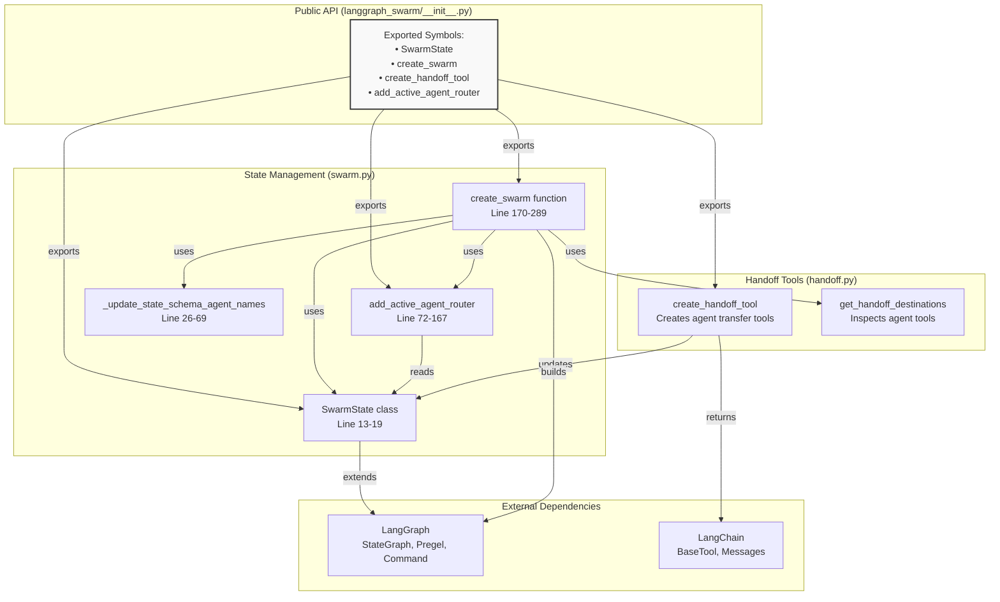
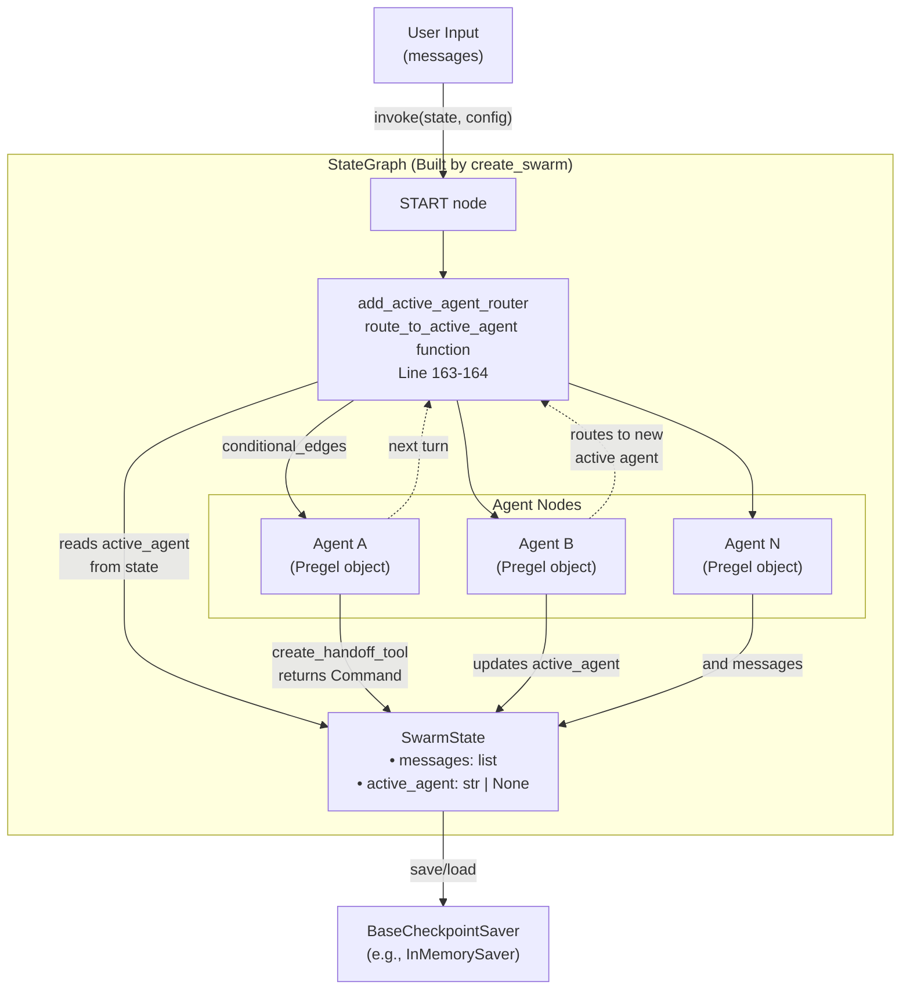
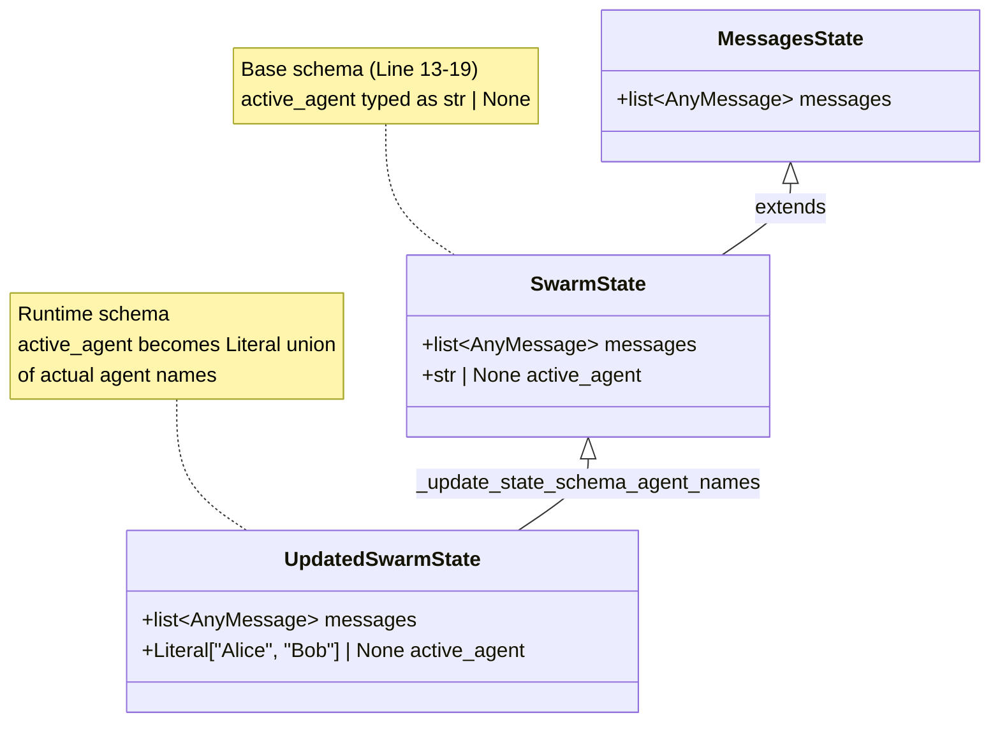
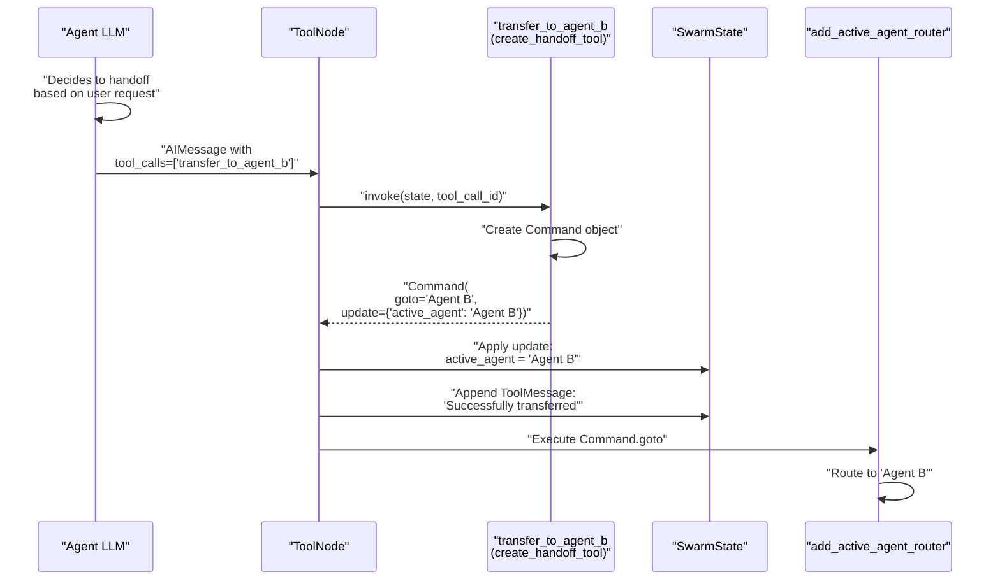
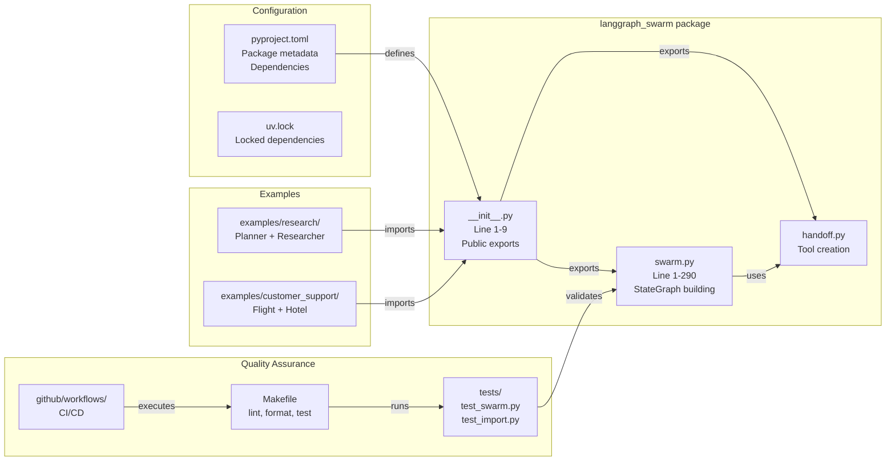
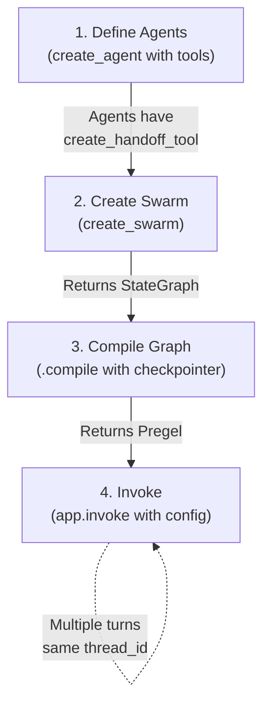

<!-- source: DeepWiki mcp.deepwiki.com · repo langchain-ai/langgraph-swarm-py · page 1 LangGraph Swarm Overview · fetched 2026-10-26 -->

# LangGraph Swarm Overview

<details>
<summary>Relevant source files</summary>

The following files were used as context for generating this wiki page:

- [README.md](README.md)
- [langgraph_swarm/__init__.py](langgraph_swarm/__init__.py)
- [langgraph_swarm/swarm.py](langgraph_swarm/swarm.py)

</details>


## Purpose and Scope

This document provides an overview of the `langgraph-swarm` library, a Python framework for building multi-agent systems where agents dynamically hand off control to each other based on their specializations. This page covers the library's purpose, high-level architecture, and core components.

For detailed information about specific subsystems:
- For state management and routing mechanisms, see [SwarmState and Agent Routing](#2.1)
- For handoff tool implementation details, see [Agent Handoff Mechanism](#2.2)
- For memory and persistence, see [Memory and State Management](#2.3)
- For practical usage examples, see [Example Applications](#3)

---

## What is LangGraph Swarm?

`langgraph-swarm` is a multi-agent orchestration library that enables specialized agents to collaborate by transferring control to each other. A swarm architecture differs from other multi-agent patterns in that:

| Feature | Description |
|---------|-------------|
| **Dynamic Agent Selection** | Agents decide autonomously when to hand off to another agent |
| **Persistent Active Agent** | The system remembers which agent was last active across conversation turns |
| **Shared Message History** | All agents operate on a common message stream (configurable) |
| **Tool-Based Handoffs** | Agents use LangChain tools to trigger transfers, making handoffs explicit in their reasoning |

The library builds on [LangGraph](https://github.com/langchain-ai/langgraph) for graph execution, [LangChain](https://github.com/langchain-ai/langchain) for tool abstractions, and provides built-in support for streaming, memory persistence, and human-in-the-loop interactions.

**Sources:** [README.md:1-12](), [langgraph_swarm/swarm.py:1-19]()

---

## Core Components

The library consists of three main modules that work together to enable multi-agent orchestration:



**Diagram: Core Module Structure and Code Entities**

### Component Descriptions

| Component | Location | Purpose |
|-----------|----------|---------|
| `SwarmState` | [langgraph_swarm/swarm.py:13-19]() | State schema extending `MessagesState` with `active_agent` field |
| `create_swarm` | [langgraph_swarm/swarm.py:170-289]() | Factory function that builds a multi-agent `StateGraph` |
| `create_handoff_tool` | [langgraph_swarm/handoff.py]() | Generates tools that agents use to transfer control |
| `add_active_agent_router` | [langgraph_swarm/swarm.py:72-167]() | Adds conditional routing logic to direct execution to the active agent |
| `get_handoff_destinations` | [langgraph_swarm/handoff.py]() | Extracts which agents can be reached from a given agent's tools |

**Sources:** [langgraph_swarm/__init__.py:1-9](), [langgraph_swarm/swarm.py:13-167]()

---

## High-Level Architecture

The swarm architecture follows a router-agent pattern where a central routing mechanism directs execution to the currently active agent:



**Diagram: Swarm Execution Architecture with Code Symbols**

### Execution Flow

1. **Initialization**: User invokes the compiled swarm with messages and a configuration containing a thread ID
2. **State Loading**: The checkpointer loads the previous state (if any), including the last `active_agent`
3. **Routing**: The `add_active_agent_router` examines `state["active_agent"]` and routes to that agent node
4. **Agent Execution**: The active agent processes messages and decides whether to:
   - Respond to the user, or
   - Invoke a handoff tool created by `create_handoff_tool`
5. **Handoff**: If a handoff tool is invoked, it returns a `Command` object that:
   - Updates `state["active_agent"]` to the new agent name
   - Transitions execution to the new agent node via `Command.goto`
6. **State Persistence**: After each agent turn, the checkpointer saves the updated state
7. **Continuation**: On the next user message, the flow restarts from step 2, resuming with the last active agent

**Sources:** [langgraph_swarm/swarm.py:163-167](), [README.md:86-116]()

---

## SwarmState Schema

The `SwarmState` class is the foundation of swarm orchestration:



**Diagram: SwarmState Type Hierarchy**

The `active_agent` field undergoes a type transformation during swarm creation:

| Stage | Type | Purpose |
|-------|------|---------|
| **Definition** | `str \| None` | Generic type for flexibility |
| **Runtime** | `Literal["Alice", "Bob", ...] \| None` | Specific agent names for type safety |

The `_update_state_schema_agent_names` function [langgraph_swarm/swarm.py:26-69]() performs this transformation, converting the generic `str` annotation to a `Literal` union of actual agent names. This provides:
- IDE autocomplete when accessing `state["active_agent"]`
- Type checking to prevent routing to non-existent agents
- Clear documentation of available agents in the type system

**Sources:** [langgraph_swarm/swarm.py:13-69]()

---

## Agent Handoff Mechanism

Agents transfer control using specialized LangChain tools created by `create_handoff_tool`:



**Diagram: Handoff Tool Execution Flow**

### Handoff Tool Structure

Handoff tools created by `create_handoff_tool` have the following characteristics:

| Property | Value | Purpose |
|----------|-------|---------|
| **Return Type** | `Command` | Instructs LangGraph to update state and route to a new node |
| **Tool Name** | `transfer_to_{agent_name}` | Descriptive name for the LLM to invoke |
| **Command.goto** | Target agent name | Specifies which agent node to execute next |
| **Command.graph** | `Command.PARENT` | Indicates the parent (swarm) graph should be updated |
| **Command.update** | `{"active_agent": ...}` | Sets the new active agent in the state |

**Sources:** [langgraph_swarm/handoff.py](), [README.md:122-172]()

---

## Package Structure

The library is organized into a minimal set of modules for clarity:



**Diagram: Repository Structure**

### Key Files

| Path | Lines | Purpose |
|------|-------|---------|
| `langgraph_swarm/__init__.py` | 1-9 | Exports public API: `SwarmState`, `create_swarm`, `create_handoff_tool`, `add_active_agent_router` |
| `langgraph_swarm/swarm.py` | 1-290 | Core orchestration logic: state schema management, graph building, routing |
| `langgraph_swarm/handoff.py` | - | Handoff tool creation and destination inspection |
| `pyproject.toml` | - | Package configuration, dependencies, build system |
| `examples/` | - | Demonstration applications showing different agent patterns |
| `tests/` | - | Unit tests with mocked LLM interactions |

**Sources:** [langgraph_swarm/__init__.py:1-9](), [langgraph_swarm/swarm.py:1-290]()

---

## Basic Usage Pattern

A typical swarm application follows this structure:



**Diagram: Swarm Usage Flow**

### Minimal Example Structure

From [README.md:28-84]():

1. **Agent Creation**: Each agent is created with:
   - A language model (e.g., GPT-4)
   - Domain-specific tools
   - At least one handoff tool to another agent
   - A system prompt defining its role

2. **Swarm Creation**: `create_swarm([alice, bob], default_active_agent="Alice")` returns a `StateGraph`

3. **Compilation**: The graph is compiled with a checkpointer (e.g., `InMemorySaver()`) to enable state persistence

4. **Invocation**: The app is invoked with messages and a config containing a thread ID

**Sources:** [README.md:28-84]()

---

## Memory and Persistence

The swarm uses LangGraph's checkpointing system to maintain state across turns:

| Memory Type | Component | Purpose |
|-------------|-----------|---------|
| **Short-term (Conversation)** | `BaseCheckpointSaver` | Persists `messages` and `active_agent` within a thread |
| **Long-term (Cross-conversation)** | `BaseStore` | Stores user preferences, facts across multiple threads |

Without a checkpointer, the swarm would "forget" which agent was last active between invocations. The checkpointer ensures that:
- Conversation history is preserved
- The `active_agent` field persists across turns
- Each thread maintains independent state

Configuration example:
```python
config = {"configurable": {"thread_id": "1"}}
turn_1 = app.invoke({"messages": [...]}, config)
turn_2 = app.invoke({"messages": [...]}, config)  # Continues from turn_1
```

**Sources:** [README.md:86-116]()

---

## Where to Learn More

This overview introduced the core concepts of `langgraph-swarm`. For deeper understanding:

- **Core Implementation Details**: See [Core Architecture](#2) for detailed explanations of state management, routing, and handoff mechanisms
- **State and Routing**: See [SwarmState and Agent Routing](#2.1) for the routing algorithm and state schema transformations
- **Handoff Tools**: See [Agent Handoff Mechanism](#2.2) for `create_handoff_tool` implementation and customization patterns
- **Memory Integration**: See [Memory and State Management](#2.3) for checkpointer configuration and cross-turn persistence
- **Example Applications**: See [Example Applications](#3) for complete, working multi-agent systems
- **Development**: See [Development and Configuration](#4) for contributing, testing, and build system documentation

**Sources:** [README.md:1-239](), [langgraph_swarm/swarm.py:1-290]()

---

