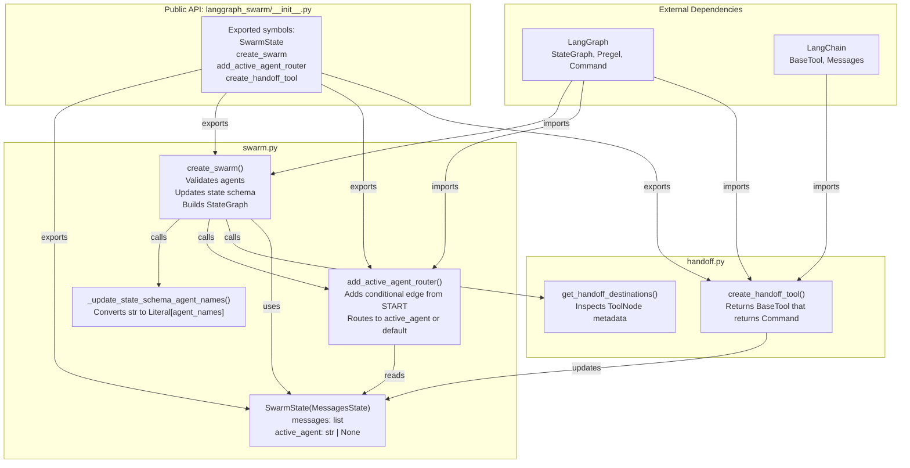
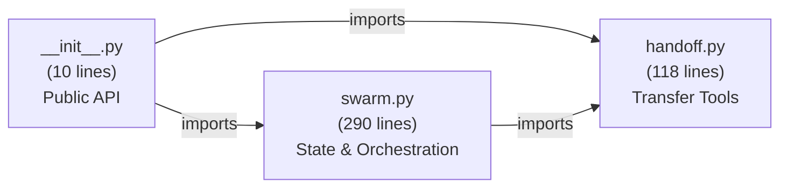
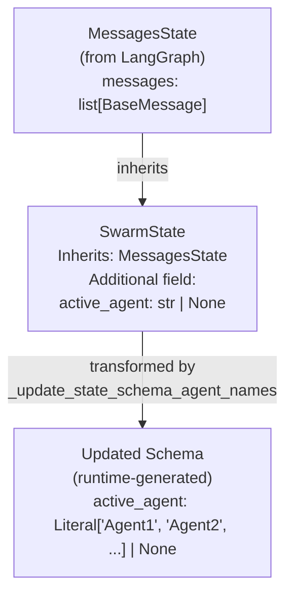
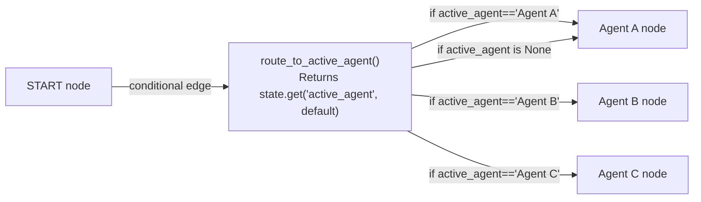
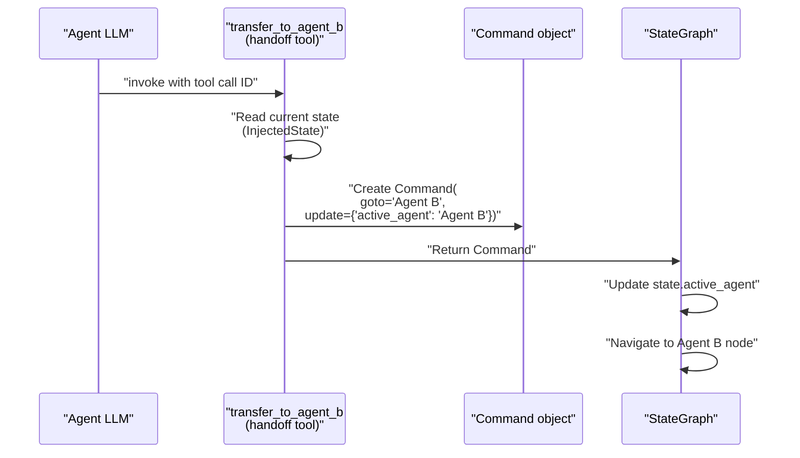
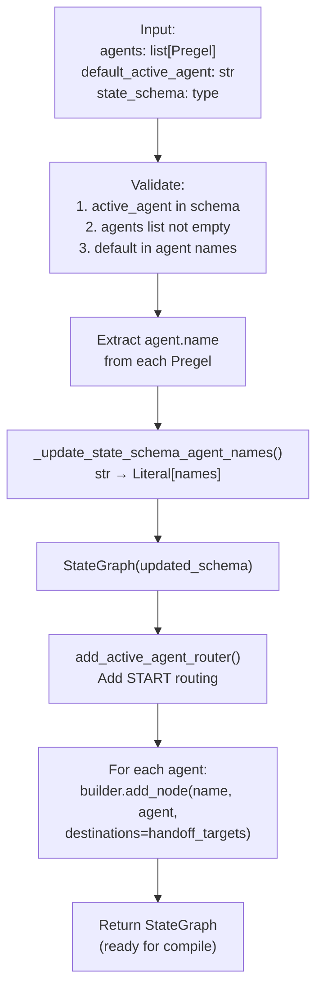
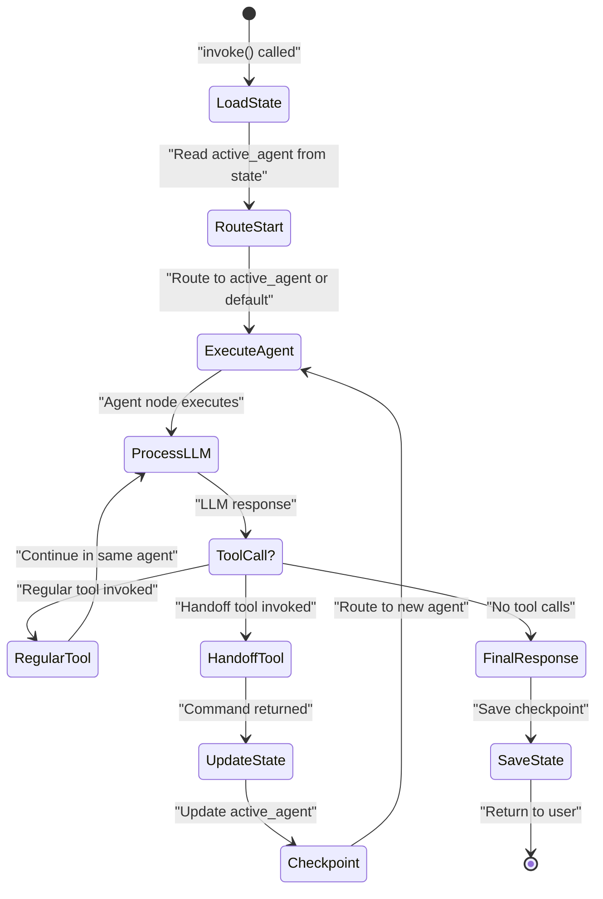
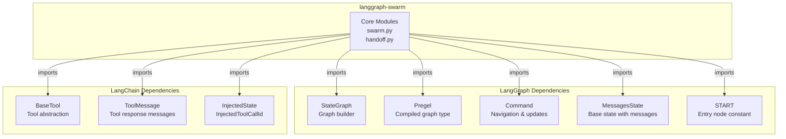

<!-- source: DeepWiki mcp.deepwiki.com · repo langchain-ai/langgraph-swarm-py · page 2 Core Architecture · fetched 2026-10-26 -->

# Core Architecture

Relevant source files

The following files were used as context for generating this wiki page:

- [langgraph_swarm/__init__.py](langgraph_swarm/__init__.py)
- [langgraph_swarm/handoff.py](langgraph_swarm/handoff.py)
- [langgraph_swarm/swarm.py](langgraph_swarm/swarm.py)

## Purpose and Scope

This document provides an overview of the core `langgraph-swarm` library architecture and its primary components. It describes how the library enables multi-agent orchestration through state management, dynamic routing, and agent handoff mechanisms. For detailed implementation specifics, see:
- State schema and routing details: [SwarmState and Agent Routing](#2.1)
- Handoff tool implementation: [Agent Handoff Mechanism](#2.2)
- Persistence and checkpointing: [Memory and State Management](#2.3)

The core library consists of approximately 300 lines of code across two primary modules that build upon LangGraph's `StateGraph` and LangChain's `BaseTool` abstractions.

**Sources:** [langgraph_swarm/__init__.py:1-9](), [langgraph_swarm/swarm.py:1-290](), [langgraph_swarm/handoff.py:1-118]()

## Component Overview

The library provides four main public APIs exported from [langgraph_swarm/__init__.py]():

| Component | Type | Purpose |
|-----------|------|---------|
| `SwarmState` | Class | State schema containing messages and active agent tracking |
| `create_swarm()` | Function | Main entry point to construct multi-agent StateGraph |
| `add_active_agent_router()` | Function | Adds conditional routing from START node based on active_agent |
| `create_handoff_tool()` | Function | Generates tools that enable agent-to-agent transfers |

Additional internal utilities support these core components:

| Component | Type | Purpose |
|-----------|------|---------|
| `_update_state_schema_agent_names()` | Function | Dynamically converts `str` annotations to `Literal` types |
| `get_handoff_destinations()` | Function | Extracts handoff destinations from agent tool metadata |

**Sources:** [langgraph_swarm/__init__.py:1-9](), [langgraph_swarm/swarm.py:13-290](), [langgraph_swarm/handoff.py:43-118]()

## Architecture Diagram

**Sources:** [langgraph_swarm/__init__.py:1-9](), [langgraph_swarm/swarm.py:1-290](), [langgraph_swarm/handoff.py:1-118]()

## Code Organization

The library follows a simple two-module structure:

### Module Responsibilities

**[langgraph_swarm/swarm.py]()**: Core orchestration logic
- `SwarmState` class definition [langgraph_swarm/swarm.py:13-20]()
- `create_swarm()` function that builds the multi-agent graph [langgraph_swarm/swarm.py:170-289]()
- `add_active_agent_router()` for conditional routing [langgraph_swarm/swarm.py:72-167]()
- `_update_state_schema_agent_names()` for dynamic typing [langgraph_swarm/swarm.py:26-69]()

**[langgraph_swarm/handoff.py]()**: Agent transfer mechanisms
- `create_handoff_tool()` that generates transfer tools [langgraph_swarm/handoff.py:43-96]()
- `get_handoff_destinations()` for destination extraction [langgraph_swarm/handoff.py:99-117]()
- Internal utilities for field access and name normalization [langgraph_swarm/handoff.py:13-40]()

**Sources:** [langgraph_swarm/__init__.py:1-9](), [langgraph_swarm/swarm.py:1-290](), [langgraph_swarm/handoff.py:1-118]()

## State Schema Architecture

The `SwarmState` class extends LangGraph's `MessagesState` to track the currently active agent:

The `active_agent` field serves two purposes:
1. **Optional initialization**: Users can optionally specify a starting agent [langgraph_swarm/swarm.py:16-19]()
2. **Runtime tracking**: Updated by handoff tools during execution to track which agent is currently active

The dynamic type transformation from `str | None` to `Literal[agent_names] | None` provides IDE autocomplete and type checking while maintaining runtime flexibility. This transformation occurs in `_update_state_schema_agent_names()` [langgraph_swarm/swarm.py:26-69]().

**Sources:** [langgraph_swarm/swarm.py:13-20](), [langgraph_swarm/swarm.py:26-69]()

## Routing System

The routing system uses LangGraph's conditional edges to direct execution based on the `active_agent` state field:

The `add_active_agent_router()` function [langgraph_swarm/swarm.py:72-167]() implements this by:
1. Validating that `active_agent` exists in the state schema [langgraph_swarm/swarm.py:152-155]()
2. Defining a `route_to_active_agent()` function that reads state [langgraph_swarm/swarm.py:163-164]()
3. Adding a conditional edge from `START` with agent names as the path map [langgraph_swarm/swarm.py:166]()

The router falls back to `default_active_agent` when `active_agent` is `None`, which occurs on the first invocation before any handoffs.

**Sources:** [langgraph_swarm/swarm.py:72-167]()

## Handoff Tool Mechanism

Agent handoffs are implemented as LangChain `BaseTool` instances that return `Command` objects:

The `create_handoff_tool()` function [langgraph_swarm/handoff.py:43-96]() generates tools with:
- Tool name: `transfer_to_{normalized_agent_name}` [langgraph_swarm/handoff.py:68]()
- Injected state parameter for reading current messages [langgraph_swarm/handoff.py:78]()
- Injected tool call ID for creating confirmation message [langgraph_swarm/handoff.py:79]()
- Metadata marking the destination agent [langgraph_swarm/handoff.py:95]()

The returned `Command` object [langgraph_swarm/handoff.py:86-93]() instructs the graph to:
1. Navigate to the target agent node via `goto=agent_name`
2. Update the parent graph state via `graph=Command.PARENT`
3. Append a confirmation `ToolMessage` and update `active_agent`

**Sources:** [langgraph_swarm/handoff.py:43-96]()

## Swarm Construction Flow

The `create_swarm()` function [langgraph_swarm/swarm.py:170-289]() orchestrates the construction of a multi-agent graph:

Key validations performed [langgraph_swarm/swarm.py:255-268]():
1. `active_agent` annotation exists in state schema
2. Agents list is not empty
3. `default_active_agent` exists in the list of agent names

The function also calls `get_handoff_destinations()` [langgraph_swarm/swarm.py:284-286]() to extract handoff targets from each agent's tools, which are registered as valid destinations for the node.

**Sources:** [langgraph_swarm/swarm.py:170-289](), [langgraph_swarm/swarm.py:255-268]()

## Runtime Execution Model

The compiled swarm executes agents in a loop controlled by state and commands:

The execution flow leverages several LangGraph primitives:
- **Checkpointer**: Persists state after each node execution for conversation continuity (covered in [Memory and State Management](#2.3))
- **Command objects**: Enable both navigation (`goto`) and state updates (`update`) in a single return value [langgraph_swarm/handoff.py:86-93]()
- **Conditional edges**: Route based on current state rather than hardcoded transitions [langgraph_swarm/swarm.py:166]()

When a handoff tool returns a `Command` with `graph=Command.PARENT` [langgraph_swarm/handoff.py:88](), the command updates the parent swarm's state, not the individual agent's state. This is critical for maintaining the `active_agent` field at the swarm level.

**Sources:** [langgraph_swarm/swarm.py:166](), [langgraph_swarm/handoff.py:86-93]()

## Dependency Architecture

The library builds on two primary LangChain ecosystem packages:

**LangGraph imports** [langgraph_swarm/swarm.py:6-7]():
- `StateGraph`: Graph construction API used in `create_swarm()`
- `Pregel`: Type annotation for compiled agents
- `MessagesState`: Base class for `SwarmState`
- `START`: Special node identifier for entry point routing

**LangChain imports** [langgraph_swarm/handoff.py:5-6]():
- `BaseTool`: Base class for all tools including handoff tools
- `ToolMessage`: Message type for tool execution results
- `InjectedState`, `InjectedToolCallId`: Annotations for runtime dependency injection

The library requires no direct LLM dependencies, as agents are provided as pre-compiled `Pregel` objects that already contain their model configurations.

**Sources:** [langgraph_swarm/swarm.py:1-11](), [langgraph_swarm/handoff.py:1-10]()

---

