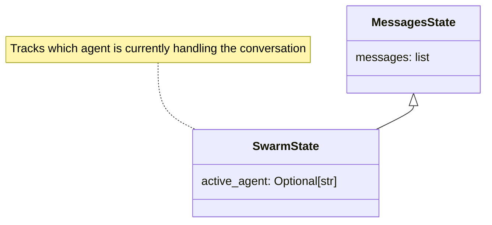
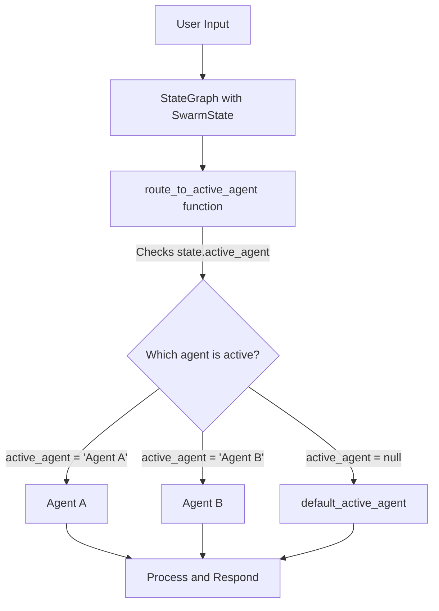
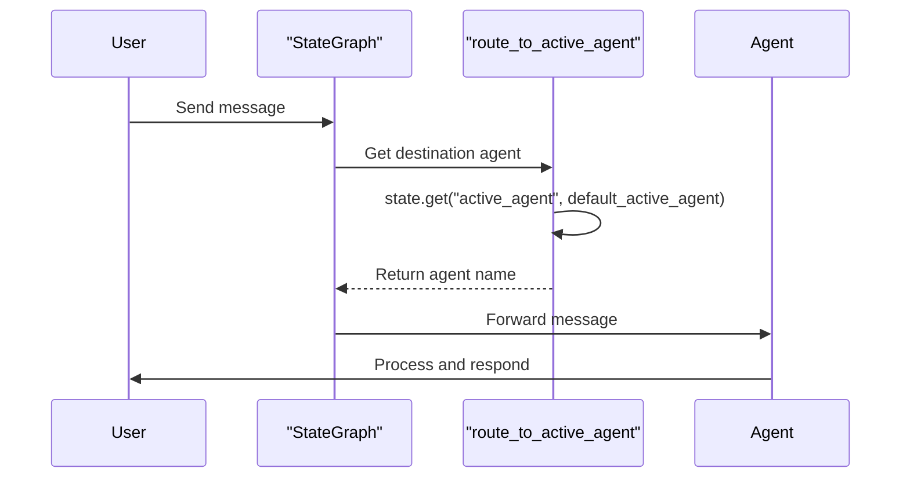
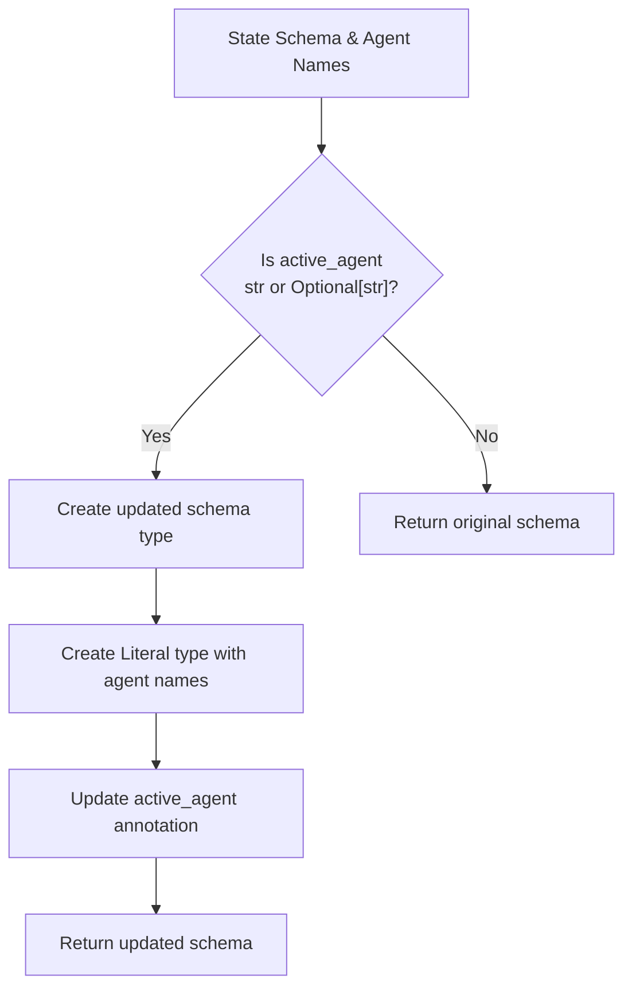
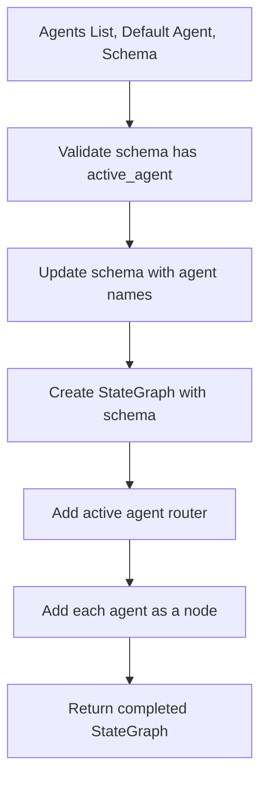
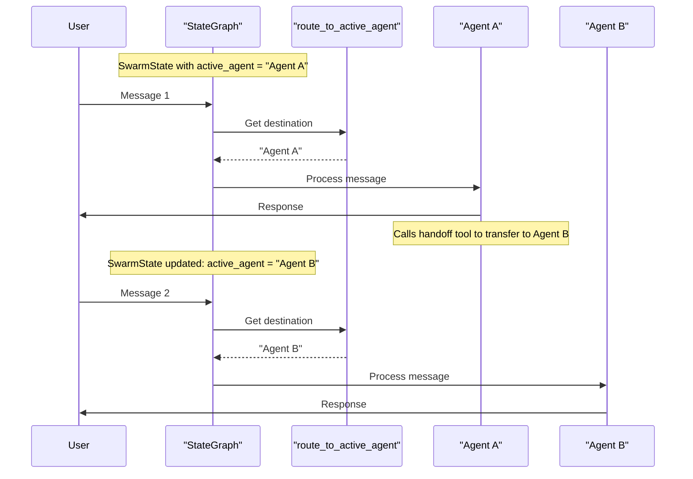

<!-- source: DeepWiki mcp.deepwiki.com · repo langchain-ai/langgraph-swarm-py · page 2.1 SwarmState and Agent Routing · fetched 2026-10-26 -->

# SwarmState and Agent Routing

<details>
<summary>Relevant source files</summary>

The following files were used as context for generating this wiki page:

- [README.md](README.md)
- [langgraph_swarm/swarm.py](langgraph_swarm/swarm.py)
- [tests/test_swarm.py](tests/test_swarm.py)

</details>


This document details the core components that enable automatic routing of messages between agents in the LangGraph Swarm framework. This section focuses specifically on how the system maintains state and determines which agent should handle incoming messages. For information about how agents transfer control between each other, see [Agent Handoff Mechanism](#2.2).

## SwarmState Overview

The `SwarmState` class is the foundation of the multi-agent system's state management. It extends LangGraph's `MessagesState` class and adds a critical field to track which agent is currently active.



Sources: [langgraph_swarm/swarm.py:8-14]()

The `active_agent` field is the key to the routing system - it stores the name of the agent that should receive the next input. This field can be:
- A string representing an agent name
- `None` if no agent is currently active (causing the system to use the default agent)

## How Agent Routing Works

When a user sends a message to the multi-agent system, the message needs to be directed to the appropriate agent. This routing is handled automatically based on the `active_agent` field in the state.



Sources: [langgraph_swarm/swarm.py:56-85]()

### Router Implementation

The routing mechanism is implemented in the `add_active_agent_router` function, which adds a conditional edge to the StateGraph that directs inputs based on the `active_agent` field:



Sources: [langgraph_swarm/swarm.py:56-85](), [langgraph_swarm/swarm.py:81-82]()

The router is implemented with a simple function that retrieves the active agent from the state:

```python
def route_to_active_agent(state: dict):
    return state.get("active_agent", default_active_agent)
```

If the `active_agent` field is not set, it falls back to the default agent specified during system initialization.

## Type Safety for Agent Names

To provide type safety and validation, the framework includes a function that enhances the state schema by converting the `active_agent` field's type annotation from a generic string to a specific `Literal` type containing all valid agent names:



Sources: [langgraph_swarm/swarm.py:21-53]()

This ensures that the `active_agent` field can only be set to valid agent names, preventing routing errors at runtime.

## Creating a Multi-Agent Swarm

The complete multi-agent system is created using the `create_swarm` function, which ties together all these components:



Sources: [langgraph_swarm/swarm.py:88-126]()

The function:
1. Validates that the state schema has an `active_agent` field
2. Updates the schema to use a `Literal` type for `active_agent`
3. Creates a new StateGraph with the enhanced schema
4. Adds the active agent router
5. Adds each agent as a node in the graph
6. Returns the configured StateGraph

## Complete System Flow

Here's how the complete routing system works in practice:



Sources: [langgraph_swarm/swarm.py:8-126]()

This diagram shows how the routing system enables seamless transitions between agents within a conversation flow. When an agent decides to transfer control to another agent, it updates the `active_agent` field in the state, and subsequent messages are automatically routed to the new agent.

## Working with SwarmState in Custom Applications

When creating custom applications with LangGraph Swarm, developers can:

1. Use the default `SwarmState` class as is
2. Extend `SwarmState` to add additional fields while maintaining the routing functionality
3. Specify a different default agent when creating the swarm

Example schema extension pattern:

```python
class CustomSwarmState(SwarmState):
    # Inherit active_agent from SwarmState
    # Add custom fields
    user_preferences: dict
    conversation_context: str
```

The routing system will still work with the extended schema as long as it includes the `active_agent` field.

## Summary

The `SwarmState` and agent routing system provide the foundation for multi-agent conversations by:

1. Tracking which agent is currently active through the `active_agent` field in `SwarmState`
2. Automatically routing incoming messages to the active agent
3. Supporting seamless handoffs between agents by updating the `active_agent` field
4. Ensuring type safety through the use of a `Literal` type for agent names

This system allows for complex, multi-agent conversations where different agents can collaborate on solving user requests, each handling the parts they specialize in.

---

