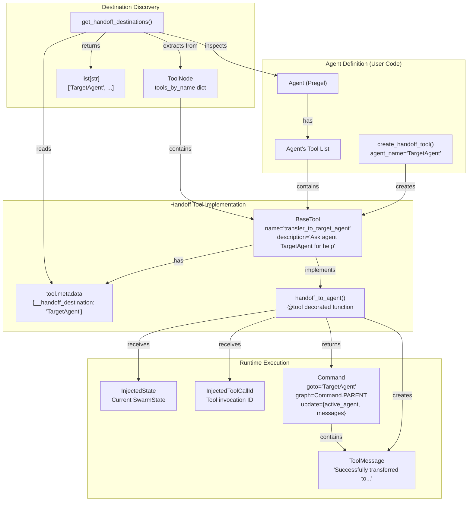
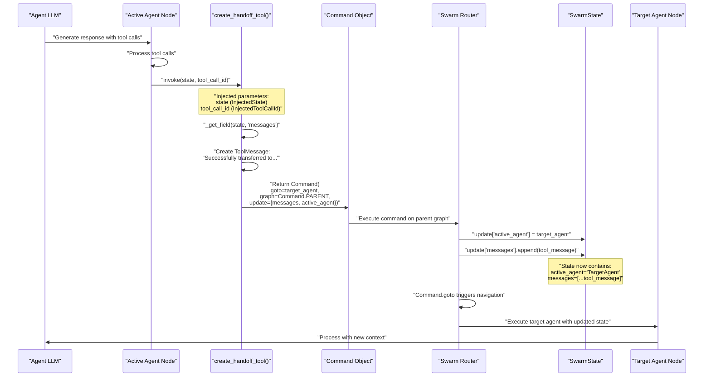

<!-- source: DeepWiki mcp.deepwiki.com · repo langchain-ai/langgraph-swarm-py · page 2.2 Agent Handoff Mechanism · fetched 2026-10-26 -->

# Agent Handoff Mechanism

<details>
<summary>Relevant source files</summary>

The following files were used as context for generating this wiki page:

- [langgraph_swarm/handoff.py](langgraph_swarm/handoff.py)
- [langgraph_swarm/swarm.py](langgraph_swarm/swarm.py)
- [tests/test_swarm.py](tests/test_swarm.py)

</details>


## Purpose and Scope

This document explains the agent handoff mechanism in langgraph-swarm, which enables agents to dynamically transfer control to other agents during execution. The handoff mechanism is implemented through specialized tools that return `Command` objects to update graph state and navigate to different agent nodes.

For information about how the swarm router uses the `active_agent` state to determine which agent executes next, see [SwarmState and Agent Routing](#2.1). For details on how state is persisted across handoffs, see [Memory and State Management](#2.3).

**Sources:** [langgraph_swarm/handoff.py](), [langgraph_swarm/swarm.py]()

---

## Overview

The agent handoff mechanism consists of three primary components:

1. **Handoff tools** - LangChain tools created via `create_handoff_tool()` that agents can invoke to transfer control
2. **Command objects** - Return values from handoff tools that instruct the graph to navigate to a different agent and update state
3. **Destination metadata** - Metadata attached to handoff tools that identifies valid transfer targets

When an agent's LLM decides to invoke a handoff tool, the tool execution returns a `Command` object. This command simultaneously updates the parent graph's state (setting `active_agent` to the target agent name) and instructs the graph to navigate to the target agent's node.

**Sources:** [langgraph_swarm/handoff.py:43-97]()

---

## Architecture: Handoff System Components



**Diagram: Handoff Tool Architecture** - This diagram shows how `create_handoff_tool()` creates a `BaseTool` with handoff metadata, how the tool function receives injected state, and how `get_handoff_destinations()` extracts destination information from agent tools.

**Sources:** [langgraph_swarm/handoff.py:43-97](), [langgraph_swarm/handoff.py:99-117]()

---

## Creating Handoff Tools

### The `create_handoff_tool()` Function

The `create_handoff_tool()` function creates a LangChain tool that enables agent-to-agent transfers. It is defined in [langgraph_swarm/handoff.py:43-97]().

**Function Signature:**
```python
def create_handoff_tool(
    *,
    agent_name: str,
    name: str | None = None,
    description: str | None = None,
) -> BaseTool
```

**Parameters:**

| Parameter | Type | Description |
|-----------|------|-------------|
| `agent_name` | `str` | Name of the target agent node in the multi-agent graph |
| `name` | `str \| None` | Optional tool name (default: `transfer_to_<normalized_agent_name>`) |
| `description` | `str \| None` | Optional tool description (default: `Ask agent '<agent_name>' for help`) |

**Key Implementation Details:**

1. **Name normalization** - Agent names are normalized using `_normalize_agent_name()` [langgraph_swarm/handoff.py:38-40](), which converts whitespace to underscores and converts to lowercase. This ensures tool names are valid identifiers.

2. **Metadata tagging** - The created tool is tagged with metadata containing the destination agent name [langgraph_swarm/handoff.py:95]():
   ```python
   handoff_to_agent.metadata = {METADATA_KEY_HANDOFF_DESTINATION: agent_name}
   ```
   where `METADATA_KEY_HANDOFF_DESTINATION = "__handoff_destination"` [langgraph_swarm/handoff.py:35]()

3. **Injected dependencies** - The tool function uses two injected parameters:
   - `state: Annotated[Any, InjectedState]` - The current graph state
   - `tool_call_id: Annotated[str, InjectedToolCallId]` - The tool invocation ID

**Sources:** [langgraph_swarm/handoff.py:43-97](), [langgraph_swarm/handoff.py:34-40]()

### Tool Function Execution

When an agent's LLM invokes a handoff tool, the inner `handoff_to_agent()` function executes [langgraph_swarm/handoff.py:74-93]():

1. **Creates a ToolMessage** - Constructs a confirmation message:
   ```python
   tool_message = ToolMessage(
       content=f"Successfully transferred to {agent_name}",
       name=name,
       tool_call_id=tool_call_id,
   )
   ```

2. **Returns a Command object** - The command instructs the parent graph to:
   - Navigate to the target agent node (`goto=agent_name`)
   - Target the parent graph (`graph=Command.PARENT`)
   - Update state with the new message and active agent:
     ```python
     update={
         "messages": [*_get_field(state, "messages"), tool_message],
         "active_agent": agent_name,
     }
     ```

The `_get_field()` helper function [langgraph_swarm/handoff.py:13-31]() supports retrieving fields from dictionaries, dataclasses, or Pydantic models, making the handoff mechanism compatible with different state schema types.

**Sources:** [langgraph_swarm/handoff.py:74-93](), [langgraph_swarm/handoff.py:13-31]()

---

## Command Objects and State Updates

### The Command Return Value

Handoff tools return `Command` objects from `langgraph.types` [langgraph_swarm/handoff.py:9](). The `Command` object is a special return type that instructs LangGraph to perform graph navigation and state updates simultaneously.

**Command Structure for Handoffs:**

```python
Command(
    goto=agent_name,          # Navigate to this node
    graph=Command.PARENT,     # Target the parent graph (not subgraph)
    update={                  # State updates to apply
        "messages": [...],    # Append tool message
        "active_agent": agent_name  # Update active agent
    }
)
```

**Key Properties:**

| Property | Value | Purpose |
|----------|-------|---------|
| `goto` | Target agent name | Specifies which graph node to execute next |
| `graph` | `Command.PARENT` | Ensures state updates apply to parent swarm graph, not agent subgraph |
| `update` | State dict | Contains state fields to update (messages, active_agent) |

The `Command.PARENT` directive is critical - it ensures that when an agent (which may be its own subgraph) returns a command, the state update applies to the parent swarm graph's `SwarmState`, not the agent's internal state.

**Sources:** [langgraph_swarm/handoff.py:86-93]()

### State Update Mechanics

The `update` dictionary contains two fields:

1. **`messages`** - The tool message is appended to the conversation history using the spread operator on the current messages list [langgraph_swarm/handoff.py:90](). This preserves all previous messages while adding the handoff confirmation.

2. **`active_agent`** - Set to the target agent name [langgraph_swarm/handoff.py:91](). This field is read by `add_active_agent_router()` (see [SwarmState and Agent Routing](#2.1)) to determine which agent executes on the next graph iteration.

**Sources:** [langgraph_swarm/handoff.py:86-93]()

---

## Handoff Destination Discovery

### The `get_handoff_destinations()` Function

The `get_handoff_destinations()` function extracts a list of valid handoff targets from an agent's tools [langgraph_swarm/handoff.py:99-117]().

**Function Signature:**
```python
def get_handoff_destinations(
    agent: CompiledStateGraph, 
    tool_node_name: str = "tools"
) -> list[str]
```

**Algorithm:**

1. **Retrieve graph nodes** - Gets the graph structure from the compiled agent [langgraph_swarm/handoff.py:103]()
2. **Locate tool node** - Searches for a node with the specified name (default: `"tools"`) [langgraph_swarm/handoff.py:104-105]()
3. **Validate node type** - Ensures the node is a `ToolNode` instance [langgraph_swarm/handoff.py:108-109]()
4. **Extract metadata** - Iterates through `tool_node.tools_by_name.values()` and extracts destinations from tools that have `__handoff_destination` metadata [langgraph_swarm/handoff.py:111-117]()

**Return Value:** A list of agent names (strings) that the agent can transfer to, or an empty list if no handoff tools exist.

**Sources:** [langgraph_swarm/handoff.py:99-117]()

### Integration with `create_swarm()`

The `create_swarm()` function calls `get_handoff_destinations()` for each agent when building the graph [langgraph_swarm/swarm.py:278-287]():

```python
for agent in agents:
    builder.add_node(
        agent.name,
        agent,
        destinations=tuple(
            get_handoff_destinations(agent)
        ),
    )
```

The `destinations` parameter configures the graph edges, allowing LangGraph to validate that handoff targets exist in the graph topology. This prevents runtime errors from agents attempting to transfer to non-existent agents.

**Sources:** [langgraph_swarm/swarm.py:277-287](), [langgraph_swarm/swarm.py:10]()

---

## Handoff Execution Flow



**Diagram: Handoff Execution Sequence** - This sequence diagram shows the complete flow from LLM tool call decision through Command execution and state update to target agent activation.

**Sources:** [langgraph_swarm/handoff.py:74-93](), [tests/test_swarm.py:127-138]()

---

## Handoff Tool Naming Convention

### Name Generation

The default tool name is generated by the pattern `transfer_to_<normalized_agent_name>` [langgraph_swarm/handoff.py:68]().

**Normalization Process:**

The `_normalize_agent_name()` function [langgraph_swarm/handoff.py:38-40]() applies the following transformations:

1. Strip leading/trailing whitespace
2. Replace all internal whitespace sequences with single underscores
3. Convert to lowercase

**Examples:**

| Agent Name | Normalized Name | Tool Name |
|------------|-----------------|-----------|
| `"Bob"` | `"bob"` | `"transfer_to_bob"` |
| `"Flight Assistant"` | `"flight_assistant"` | `"transfer_to_flight_assistant"` |
| `"Hotel   Booking"` | `"hotel_booking"` | `"transfer_to_hotel_booking"` |

This ensures tool names are valid Python identifiers and compatible with LLM provider tool naming requirements.

**Sources:** [langgraph_swarm/handoff.py:38-40](), [langgraph_swarm/handoff.py:67-68]()

---

## Example: Basic Handoff Configuration

The following pattern from the test suite demonstrates handoff tool creation and usage [tests/test_swarm.py:103-124]():

```python
# Agent Alice with handoff capability to Bob
alice = create_agent(
    model,
    tools=[
        add,  # Domain tool
        create_handoff_tool(agent_name="Bob")  # Handoff tool
    ],
    system_prompt="You are Alice, an addition expert.",
    name="Alice",
)

# Agent Bob with handoff capability to Alice
bob = create_agent(
    model,
    tools=[
        create_handoff_tool(
            agent_name="Alice",
            description="Transfer to Alice, she can help with math"
        ),
    ],
    system_prompt="You are Bob, you speak like a pirate.",
    name="Bob",
)
```

**Key Observations:**

1. **Bidirectional handoffs** - Both agents can transfer to each other by including corresponding handoff tools
2. **Tool mixing** - Handoff tools can be mixed with domain-specific tools (like the `add` function in Alice's toolkit)
3. **Custom descriptions** - The description parameter allows agents to understand when to use handoff tools (e.g., "she can help with math" provides context for Bob's LLM)

**Sources:** [tests/test_swarm.py:103-120]()

---

## Runtime Behavior

### Handoff Verification

During execution, the handoff mechanism provides verification through tool messages. After a successful handoff, the message list contains a `ToolMessage` [tests/test_swarm.py:136]():

```python
assert turn_1["messages"][-2].content == "Successfully transferred to Bob"
```

This confirmation message serves multiple purposes:

1. **Debugging** - Provides a clear audit trail of agent transitions
2. **Context** - Informs the target agent that control was transferred from another agent
3. **User visibility** - Can be shown to end users to explain agent transitions

**Sources:** [tests/test_swarm.py:134-138](), [langgraph_swarm/handoff.py:81-85]()

### State Synchronization

The handoff mechanism ensures state consistency by:

1. **Atomic updates** - The `Command` object applies both navigation and state updates as a single operation
2. **Message ordering** - New tool messages are appended to the existing message list, preserving conversation order
3. **Active agent tracking** - The `active_agent` field is updated synchronously with the graph navigation

This synchronization is critical for the router (see [SwarmState and Agent Routing](#2.1)) to correctly route subsequent messages to the active agent.

**Sources:** [langgraph_swarm/handoff.py:86-93]()

---

## Code Entity Reference

### Core Functions and Classes

| Entity | Location | Purpose |
|--------|----------|---------|
| `create_handoff_tool()` | [langgraph_swarm/handoff.py:43-97]() | Creates handoff tools for agent transfers |
| `get_handoff_destinations()` | [langgraph_swarm/handoff.py:99-117]() | Extracts handoff targets from agent tools |
| `_normalize_agent_name()` | [langgraph_swarm/handoff.py:38-40]() | Normalizes agent names for tool naming |
| `_get_field()` | [langgraph_swarm/handoff.py:13-31]() | Retrieves fields from various state types |
| `Command` | `langgraph.types` [langgraph_swarm/handoff.py:9]() | Graph navigation and state update instruction |
| `METADATA_KEY_HANDOFF_DESTINATION` | [langgraph_swarm/handoff.py:35]() | Metadata key for destination tagging (`"__handoff_destination"`) |

### Injected Parameters

The handoff tool function uses LangGraph's dependency injection:

- `InjectedState` [langgraph_swarm/handoff.py:8]() - Provides current graph state
- `InjectedToolCallId` [langgraph_swarm/handoff.py:6]() - Provides tool invocation identifier

**Sources:** [langgraph_swarm/handoff.py]()

---

## Integration Points

### With SwarmState

The handoff mechanism updates the `active_agent` field in `SwarmState` [langgraph_swarm/handoff.py:91](), which is read by the routing logic in `add_active_agent_router()` (documented in [SwarmState and Agent Routing](#2.1)).

### With create_swarm()

The `create_swarm()` function integrates handoff destination discovery when building the graph [langgraph_swarm/swarm.py:277-287](). It calls `get_handoff_destinations()` for each agent to configure valid transfer targets.

### With Checkpointer

After each handoff, the updated state (including new messages and active agent) is persisted by the checkpointer (see [Memory and State Management](#2.3)), enabling conversation continuity across invocations.

**Sources:** [langgraph_swarm/swarm.py:277-287](), [langgraph_swarm/handoff.py:99-117]()

---

