<!-- source: DeepWiki mcp.deepwiki.com · repo langchain-ai/langgraph-swarm-py · page 2.3 Memory and State Management · fetched 2026-10-26 -->

# Memory and State Management

<details>
<summary>Relevant source files</summary>

The following files were used as context for generating this wiki page:

- [README.md](README.md)
- [examples/customer_support/src/agent/customer_support.ipynb](examples/customer_support/src/agent/customer_support.ipynb)
- [langgraph_swarm/swarm.py](langgraph_swarm/swarm.py)

</details>


## Purpose and Scope

This document explains how the langgraph-swarm library manages state and memory across multi-agent conversations. It covers the `SwarmState` schema, checkpointer integration, thread-based persistence, and state lifecycle during agent handoffs. For information about the agent handoff mechanism itself, see [Agent Handoff Mechanism](#2.2). For details on agent routing logic, see [SwarmState and Agent Routing](#2.1).

## State Schema Architecture

### SwarmState Definition

The `SwarmState` class serves as the foundation for all multi-agent state management in the swarm library. It extends LangGraph's `MessagesState` to provide conversation history tracking and adds agent routing capabilities.

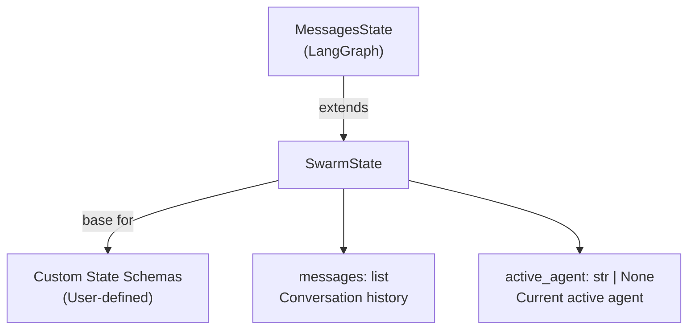

**Sources:** [langgraph_swarm/swarm.py:13-19]()

The `SwarmState` class contains two primary fields:

| Field | Type | Purpose | Required |
|-------|------|---------|----------|
| `messages` | `list` | Stores the complete conversation history across all agents | Yes (inherited) |
| `active_agent` | `str \| None` | Tracks which agent should handle the next interaction | Optional |

The `active_agent` field is marked as optional because:
- It may not be provided on initial invocation
- The system will default to `default_active_agent` if not specified
- It gets automatically updated during agent handoffs

### Dynamic Type Enhancement

The library dynamically enhances the `active_agent` field type from generic `str` to a `Literal` union of actual agent names. This happens in `_update_state_schema_agent_names()` at compile time.

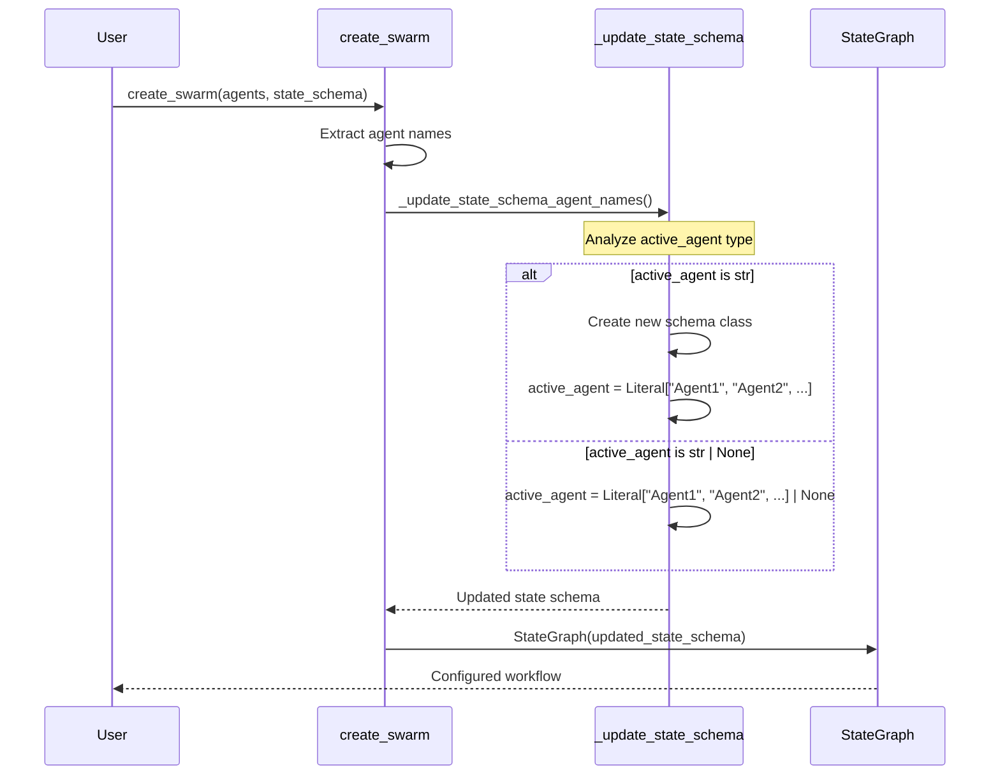

**Sources:** [langgraph_swarm/swarm.py:26-69](), [langgraph_swarm/swarm.py:255-270]()

The type enhancement process:

1. **Type Detection** [langgraph_swarm/swarm.py:31-48](): Checks if `active_agent` is annotated as `str` or `str | None`
2. **Schema Creation** [langgraph_swarm/swarm.py:54-58](): Creates a new class inheriting from the original state schema
3. **Literal Type** [langgraph_swarm/swarm.py:61-67](): Converts the annotation to `Literal[tuple(agent_names)]` or `Literal[tuple(agent_names)] | None`

This provides IDE autocomplete and static type checking for agent names.

## Checkpointer Integration

### Purpose and Functionality

A checkpointer is essential for maintaining conversation continuity in multi-agent systems. Without it, the swarm cannot persist state between invocations and will lose track of conversation history and the active agent.

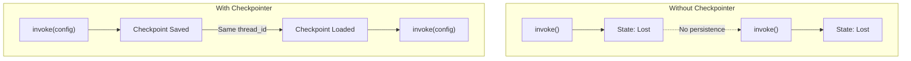

**Sources:** [README.md:86-116]()

The README emphasizes at [README.md:115-116]():

> Adding short-term memory is crucial for maintaining conversation state across multiple interactions. Without it, the swarm would "forget" which agent was last active and lose the conversation history.

### Available Checkpointer Implementations

LangGraph provides several checkpointer implementations:

| Checkpointer | Use Case | Persistence | Imports |
|--------------|----------|-------------|---------|
| `InMemorySaver` | Development/testing | In-process memory only | `from langgraph.checkpoint.memory import InMemorySaver` |
| `MemorySaver` | Development/testing | In-process memory only | `from langgraph.checkpoint.memory import MemorySaver` |
| `SqliteSaver` | Production (single node) | SQLite database | `from langgraph.checkpoint.sqlite import SqliteSaver` |
| `PostgresSaver` | Production (distributed) | PostgreSQL database | `from langgraph.checkpoint.postgres import PostgresSaver` |

**Sources:** [README.md:90-95](), [examples/customer_support/src/agent/customer_support.ipynb:62](), [examples/customer_support/src/agent/customer_support.ipynb:180]()

### Compilation with Checkpointer

The checkpointer is passed during compilation of the state graph:

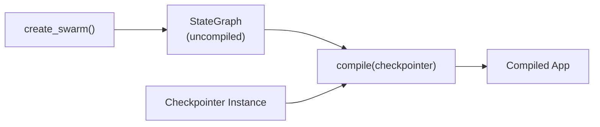

**Sources:** [README.md:66-71](), [examples/customer_support/src/agent/customer_support.ipynb:180-187]()

Example from the customer support application [examples/customer_support/src/agent/customer_support.ipynb:180-187]():

```python
checkpointer = MemorySaver()
builder = create_swarm(
    [flight_assistant, hotel_assistant], 
    default_active_agent="flight_assistant"
)
app = builder.compile(checkpointer=checkpointer)
```

## Thread-Based Persistence

### Thread ID Configuration

State persistence is organized by thread IDs, allowing multiple independent conversation threads. Each invocation must specify a `thread_id` in the configuration to enable persistence.

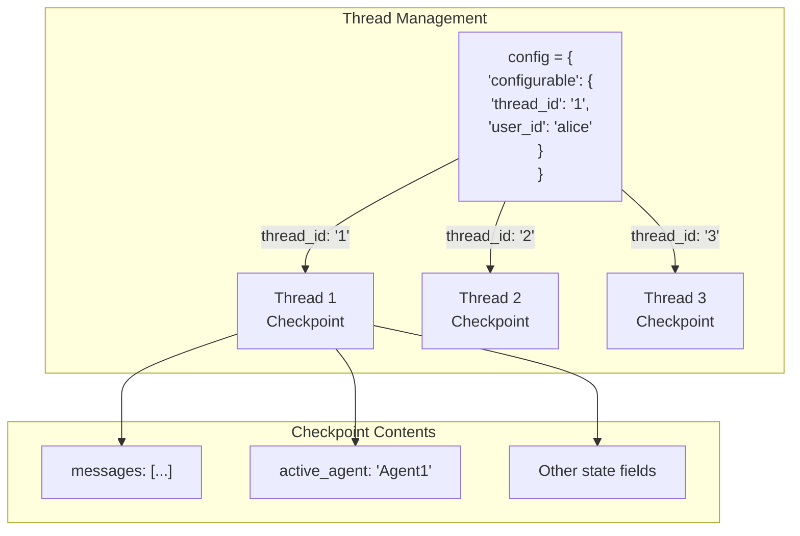

**Sources:** [README.md:73-76](), [examples/customer_support/src/agent/customer_support.ipynb:228-230]()

The configuration dictionary structure:

- **Outer `configurable` key**: Required wrapper for LangGraph configuration
- **`thread_id`**: Unique identifier for the conversation thread (required for persistence)
- **Additional fields**: Custom fields like `user_id` can be passed and accessed via `RunnableConfig`

### Multi-Turn Conversation Flow

The following diagram shows how state persists across multiple turns in a conversation:

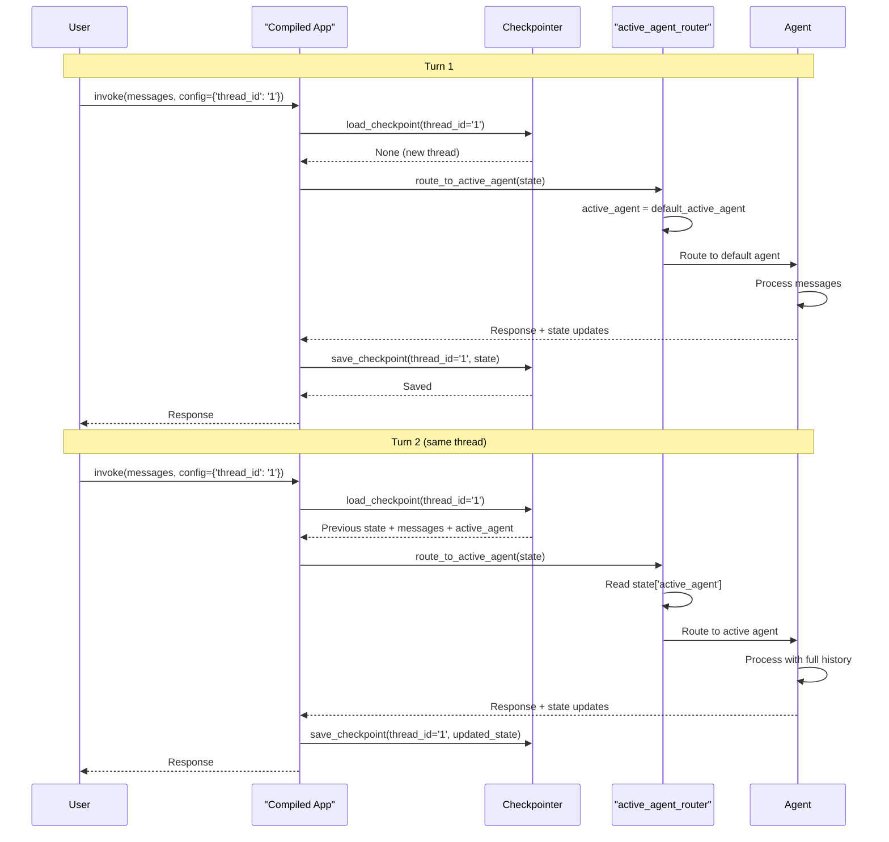

**Sources:** [langgraph_swarm/swarm.py:163-164](), [README.md:73-83]()

The `route_to_active_agent` function [langgraph_swarm/swarm.py:163-164]() implements the routing logic:

```python
def route_to_active_agent(state: dict) -> str:
    return cast("str", state.get("active_agent", default_active_agent))
```

This ensures that if `active_agent` is present in the loaded state, the conversation continues with that agent; otherwise, it defaults to the configured default agent.

## State Persistence Lifecycle

### State Loading and Initialization

When an application is invoked with a configuration containing a `thread_id`, the following state loading process occurs:

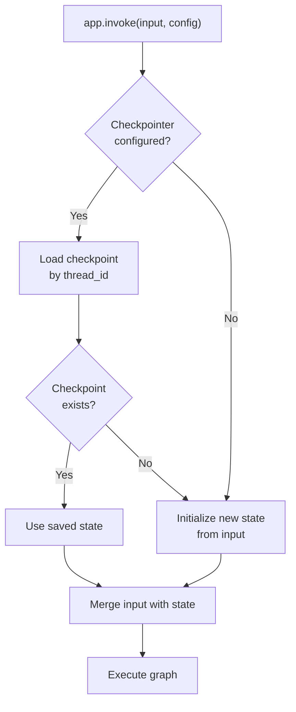

**Sources:** [langgraph_swarm/swarm.py:163-166](), [README.md:73-83]()

Key behaviors:

1. **First invocation**: No checkpoint exists, state initialized from input and defaults
2. **Subsequent invocations**: Previous state loaded and merged with new input
3. **`messages` field**: Appended to existing messages (not replaced)
4. **`active_agent` field**: Preserved from previous state unless explicitly overridden

### State Updates During Execution

As agents execute and tools are invoked, the state is continuously updated:

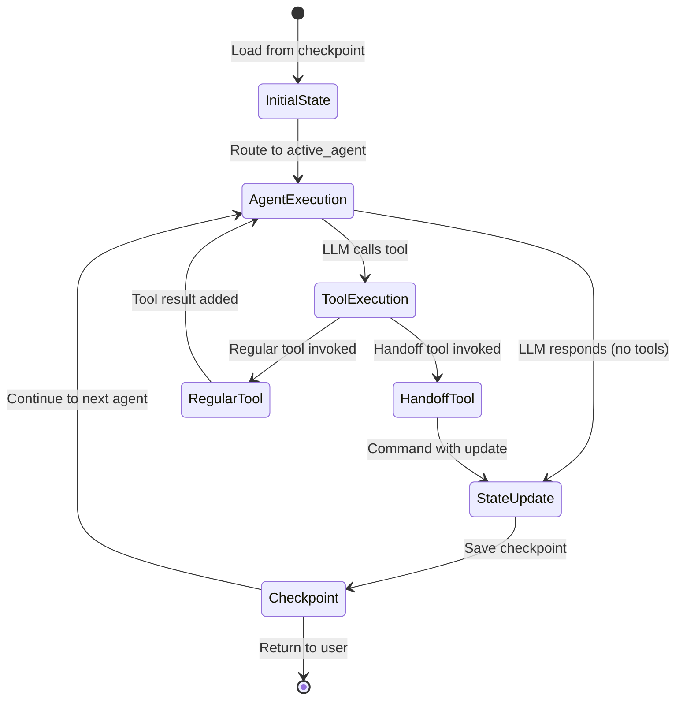

**Sources:** [langgraph_swarm/handoff.py](), [langgraph_swarm/swarm.py:163-166]()

State updates can occur through:

1. **Message additions**: Every AI message, tool call, and tool result is appended to `messages`
2. **Active agent changes**: When a handoff tool is invoked, `active_agent` is updated in the `Command.update` dictionary
3. **Custom state fields**: Handoff tools or agents can update additional custom state fields

### Checkpoint Saving Strategy

Checkpoints are saved at specific points during graph execution to ensure state consistency:

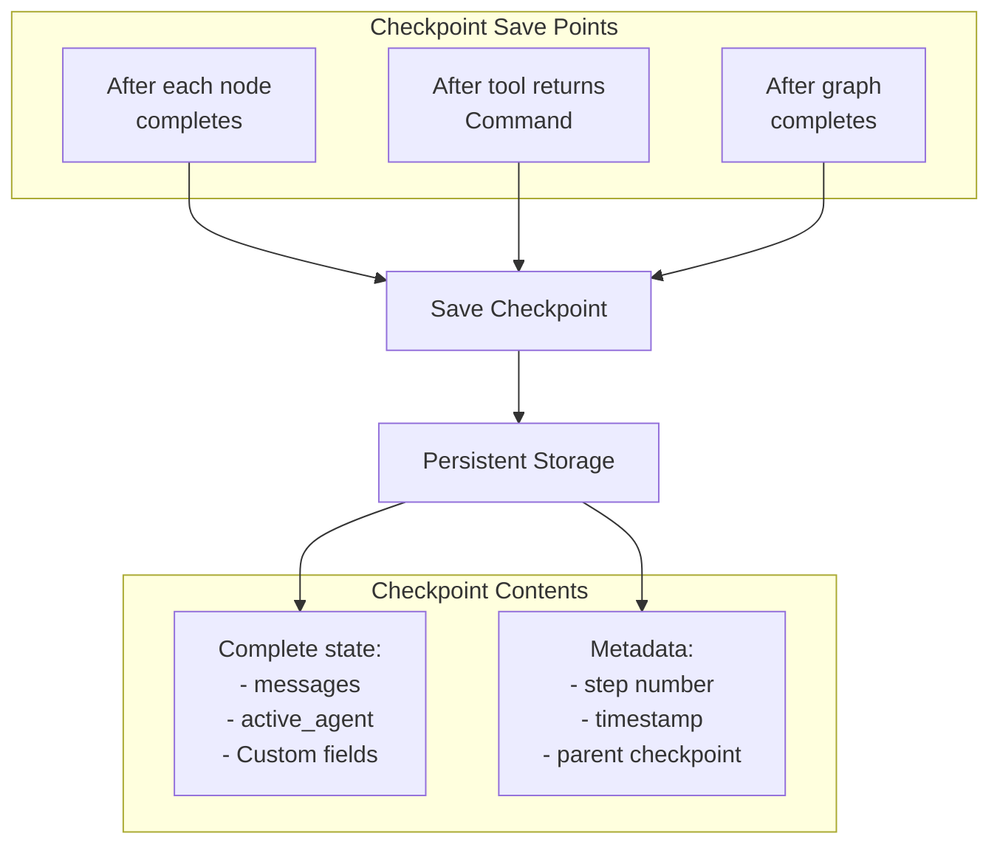

**Sources:** Inferred from LangGraph architecture and [examples/customer_support/src/agent/customer_support.ipynb:180-187]()

This incremental saving ensures that:
- State is never lost mid-execution
- Execution can be interrupted and resumed
- Human-in-the-loop patterns are supported

## State Updates During Handoffs

### Command-Based State Updates

When an agent invokes a handoff tool, it returns a `Command` object that instructs the parent graph to update state and transition to a different agent.

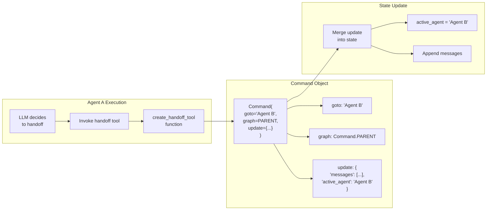

**Sources:** [langgraph_swarm/handoff.py]()

The handoff tool implementation in `create_handoff_tool()` constructs the `Command` with three key components:

1. **`goto`**: Specifies the next agent node to execute
2. **`graph`**: Set to `Command.PARENT` to update the parent swarm graph's state
3. **`update`**: Dictionary containing state updates, including:
   - Updated `messages` list with tool message
   - New `active_agent` value
   - Any custom state fields

### State Merge Behavior

When a `Command.update` is applied, LangGraph merges it with the existing state using channel-specific reducers:

| State Field | Merge Behavior | Reducer Function |
|-------------|----------------|------------------|
| `messages` | Append to list | `add_messages` (from LangGraph) |
| `active_agent` | Replace value | Default (last write wins) |
| Custom fields | Depends on schema definition | User-defined or default |

**Sources:** [langgraph_swarm/swarm.py:13-19]()

Example: After Agent A invokes `transfer_to_agent_b`, the state transformation is:

**Before:**
```python
{
    "messages": [HumanMessage(...), AIMessage(...), ToolMessage(...)],
    "active_agent": "Agent A"
}
```

**Command.update:**
```python
{
    "messages": [ToolMessage("Successfully transferred to Agent B")],
    "active_agent": "Agent B"
}
```

**After:**
```python
{
    "messages": [
        HumanMessage(...), 
        AIMessage(...), 
        ToolMessage(...),
        ToolMessage("Successfully transferred to Agent B")  # Appended
    ],
    "active_agent": "Agent B"  # Replaced
}
```

### Handoff State Flow Example

The following shows the complete state flow during a handoff between agents in the customer support example:

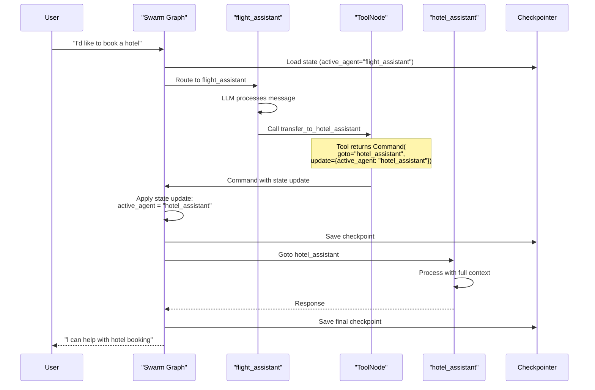

**Sources:** [examples/customer_support/src/agent/customer_support.ipynb:507-519]()

## Configuration Context and Custom Fields

### Accessing Configuration in Tools

Beyond state persistence, the configuration object can pass additional context to agents and tools. This is demonstrated in the customer support example where `user_id` is used to track user-specific reservations.

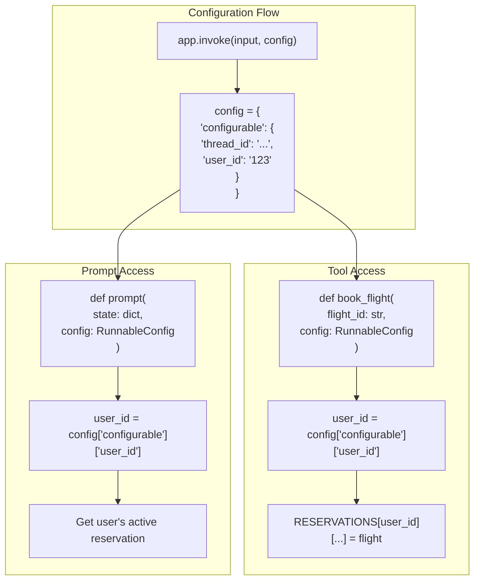

**Sources:** [examples/customer_support/src/agent/customer_support.ipynb:105-113](), [examples/customer_support/src/agent/customer_support.ipynb:127-135](), [examples/customer_support/src/agent/customer_support.ipynb:150-161]()

Implementation examples from the customer support notebook:

**Tool with config access** [examples/customer_support/src/agent/customer_support.ipynb:105-113]():
```python
def book_flight(flight_id: str, config: RunnableConfig) -> str:
    user_id = config["configurable"].get("user_id")
    flight = [flight for flight in FLIGHTS if flight["id"] == flight_id][0]
    RESERVATIONS[user_id]["flight_info"] = flight
    return "Successfully booked flight"
```

**Prompt with config access** [examples/customer_support/src/agent/customer_support.ipynb:150-161]():
```python
def prompt(state: dict, config: RunnableConfig) -> list:
    user_id = config["configurable"].get("user_id")
    current_reservation = RESERVATIONS[user_id]
    system_prompt = (
        base_system_prompt
        + f"\n\nUser's active reservation: {current_reservation}"
        + f"Today is: {datetime.datetime.now()}"
    )
    return [{"role": "system", "content": system_prompt}] + state["messages"]
```

### Store for Long-Term Memory

In addition to checkpointers (short-term memory within a thread), LangGraph supports long-term memory across threads via the `Store` abstraction.

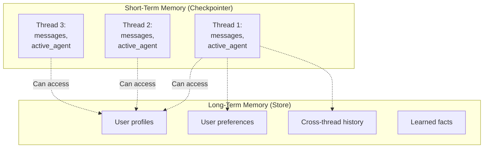

**Sources:** [README.md:86-113]()

The README shows how to compile with both checkpointer and store [README.md:108-112]():

```python
app = workflow.compile(
    checkpointer=checkpointer,  # Short-term memory
    store=store                  # Long-term memory
)
```

Store usage enables:
- Remembering user preferences across different conversations
- Building knowledge bases that persist beyond individual threads
- Cross-thread analytics and insights

## Best Practices

### Memory Configuration Guidelines

| Scenario | Checkpointer | Store | Config Fields |
|----------|--------------|-------|---------------|
| Stateless agents | None | None | Minimal |
| Multi-turn conversation | Required | Optional | `thread_id` |
| Multi-user application | Required | Recommended | `thread_id`, `user_id` |
| Production deployment | `SqliteSaver` or `PostgresSaver` | Database-backed | All context needed |

**Sources:** [README.md:86-116]()

### State Schema Design

When designing custom state schemas:

1. **Inherit from `SwarmState`**: Always extend `SwarmState` to maintain compatibility [langgraph_swarm/swarm.py:13-19]()
2. **Include `active_agent`**: Required for routing, type can be `str | None` [langgraph_swarm/swarm.py:19]()
3. **Use type hints**: Enable dynamic type checking and IDE support [langgraph_swarm/swarm.py:26-69]()
4. **Define reducers**: Specify how fields merge during state updates [langgraph_swarm/swarm.py:13-14]()

### Thread ID Management

Recommendations for `thread_id` handling:

- **Development**: Use hardcoded strings like `"1"` for testing [README.md:73]()
- **Production**: Generate unique IDs (UUID) per conversation [examples/customer_support/src/agent/customer_support.ipynb:228-230]()
- **Multi-user**: Combine user ID and session ID (e.g., `f"{user_id}_{session_id}"`)
- **Consistency**: Use the same `thread_id` for all turns in a conversation

### Checkpoint Cleanup

For long-running applications, implement checkpoint cleanup strategies:

- Set retention policies on database-backed checkpointers
- Implement periodic cleanup jobs for old threads
- Consider user-triggered deletion for privacy compliance
- Monitor checkpoint storage size and growth

**Sources:** Inferred from production best practices

---

**Sources:** [langgraph_swarm/swarm.py](), [README.md:86-116](), [examples/customer_support/src/agent/customer_support.ipynb]()

---

