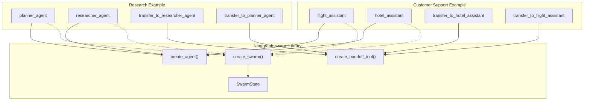
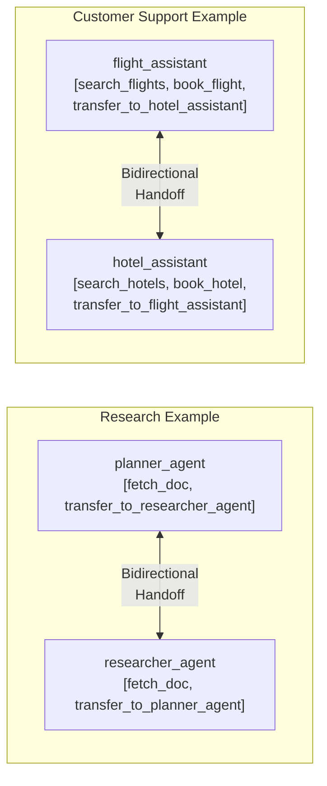
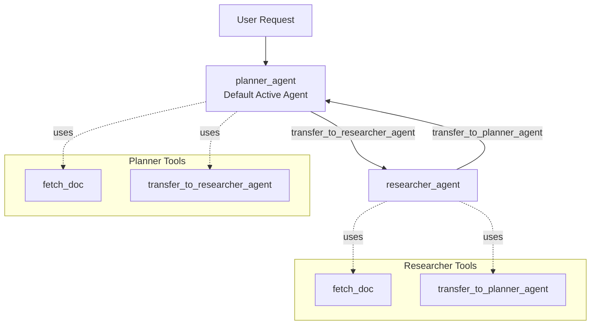
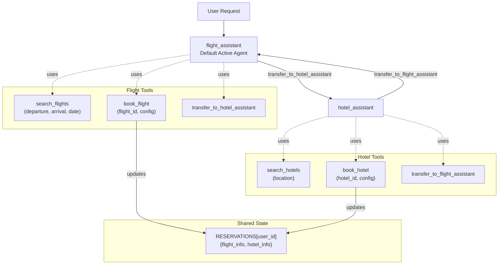
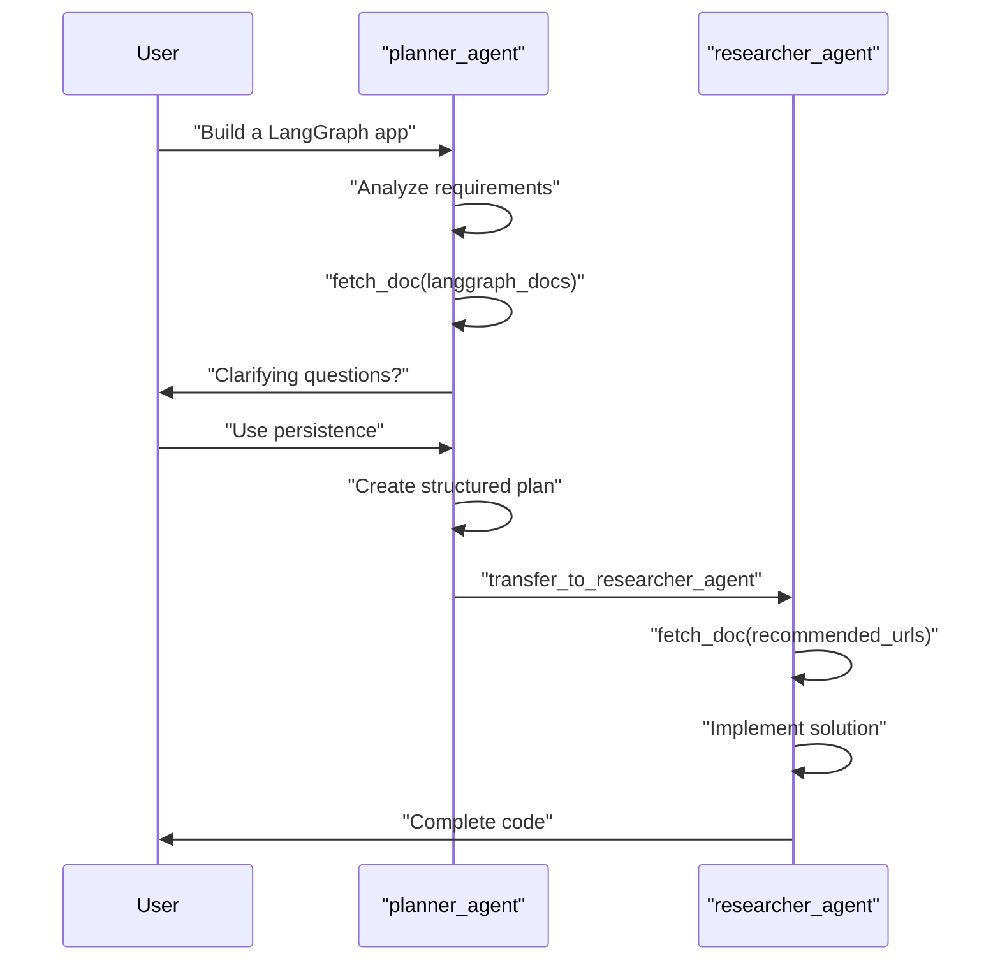
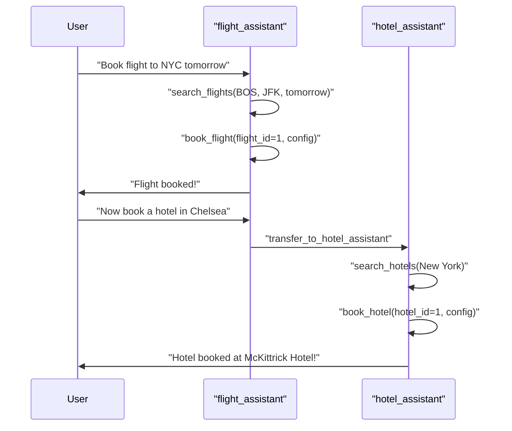

<!-- source: DeepWiki mcp.deepwiki.com · repo langchain-ai/langgraph-swarm-py · page 3 Example Applications · fetched 2026-10-26 -->

# Example Applications

<details>
<summary>Relevant source files</summary>

The following files were used as context for generating this wiki page:

- [examples/customer_support/README.md](examples/customer_support/README.md)
- [examples/customer_support/langgraph.json](examples/customer_support/langgraph.json)
- [examples/customer_support/pyproject.toml](examples/customer_support/pyproject.toml)
- [examples/customer_support/src/agent/customer_support.py](examples/customer_support/src/agent/customer_support.py)
- [examples/research/README.md](examples/research/README.md)
- [examples/research/src/agent/agent.py](examples/research/src/agent/agent.py)

</details>


## Purpose and Scope

This document provides an overview of the example applications included in the LangGraph Swarm repository. These examples demonstrate different multi-agent coordination patterns and serve as practical references for building swarm-based systems. Two complete applications are provided:

- **Research Agent Example**: A planning/execution pattern for research tasks
- **Customer Support Example**: Domain-specialized agents for service requests

For detailed implementation guides, see [Research Agent Example](#3.1) and [Customer Support Example](#3.2). For information about the core swarm orchestration mechanisms these examples use, see [Core Architecture](#2).

---

## Example Overview

The repository includes two example applications that demonstrate distinct multi-agent patterns:

| Example | Location | Default Agent | Agent Count | Primary Pattern |
|---------|----------|---------------|-------------|-----------------|
| Research Agent | `examples/research/` | `planner_agent` | 2 | Planning/Execution Separation |
| Customer Support | `examples/customer_support/` | `flight_assistant` | 2 | Domain-Specialized Services |

Both examples share common infrastructure components:

| Component | Research Example | Customer Support Example |
|-----------|------------------|--------------------------|
| Model | `gpt-4o` (OpenAI) | `gpt-4o` (OpenAI) |
| Handoff Mechanism | `create_handoff_tool()` | `create_handoff_tool()` |
| Orchestration | `create_swarm()` | `create_swarm()` |
| Agent Creation | `create_agent()` | `create_agent()` |
| State Type | `SwarmState` (implicit) | `SwarmState` (implicit) |

**Sources**: [examples/research/src/agent/agent.py:1-46](), [examples/customer_support/src/agent/customer_support.py:1-132]()

---

## Common Architectural Patterns

### Core Library Integration

Both examples follow the same integration pattern with the `langgraph-swarm` library:



**Diagram: Core Library Integration Pattern**

Both examples use the same four-step pattern:
1. Define handoff tools using `create_handoff_tool()` for each agent
2. Create agents using `create_agent()` with domain-specific tools and handoff tools
3. Build the swarm graph using `create_swarm()` with all agents
4. Compile the graph to produce an executable application

**Sources**: [examples/research/src/agent/agent.py:6-46](), [examples/customer_support/src/agent/customer_support.py:9-131]()

### Bidirectional Handoff Pattern

Both examples implement bidirectional handoff capabilities, allowing agents to transfer control back and forth:



**Diagram: Bidirectional Handoff Patterns**

Each agent includes a handoff tool pointing to the other agent, enabling autonomous routing decisions based on task requirements.

**Sources**: [examples/research/src/agent/agent.py:12-19](), [examples/customer_support/src/agent/customer_support.py:87-94]()

### State Management and Context

Both examples manage conversation state through the `SwarmState` schema (implicit in usage):

| State Component | Research Example | Customer Support Example |
|----------------|------------------|--------------------------|
| `messages` | Conversation history | Conversation history + system prompts |
| `active_agent` | `"planner_agent"` or `"researcher_agent"` | `"flight_assistant"` or `"hotel_assistant"` |
| User Context | Implicit in messages | Explicit via `config["configurable"]["user_id"]` |
| Domain Data | Fetched documentation URLs | `RESERVATIONS` dictionary by user |

The customer support example demonstrates advanced state management with user-specific context:

```python
# Dynamic system prompt with user context
def make_prompt(base_system_prompt: str) -> Callable[[dict, RunnableConfig], list]:
    def prompt(state: dict, config: RunnableConfig) -> list:
        user_id = config["configurable"].get("user_id")
        current_reservation = RESERVATIONS[user_id]
        system_prompt = (
            base_system_prompt
            + f"\n\nUser's active reservation: {current_reservation}"
            + f"Today is: {datetime.datetime.now()}"
        )
        return [{"role": "system", "content": system_prompt}] + state["messages"]
    return prompt
```

**Sources**: [examples/customer_support/src/agent/customer_support.py:98-109](), [examples/research/src/agent/agent.py:27-39]()

---

## Research Agent Example Overview

The research example demonstrates a **planning/execution separation pattern**, commonly used in deep research systems.

### Agent Structure



**Diagram: Research Agent Architecture**

The `planner_agent` starts as the default active agent and handles:
- Clarifying user requirements
- Reading documentation via `fetch_doc` tool
- Developing structured research plans
- Identifying relevant resources
- Handing off to `researcher_agent` when ready

The `researcher_agent` handles:
- Following the planner's structured plan
- Implementing solutions based on the plan
- Reading recommended documentation
- Requesting clarification by handing back to `planner_agent`

**Configuration**:
- Default Active Agent: `"planner_agent"` [examples/research/src/agent/agent.py:43-44]()
- LLM: `gpt-4o` via OpenAI [examples/research/src/agent/agent.py:9]()
- Documentation Source: LangGraph llms.txt [examples/research/src/agent/agent.py:22]()

For detailed implementation, prompts, and workflow, see [Research Agent Example](#3.1).

**Sources**: [examples/research/src/agent/agent.py:1-46](), [examples/research/README.md:1-32]()

---

## Customer Support Example Overview

The customer support example demonstrates a **domain-specialized services pattern**, where agents handle specific business domains.

### Agent Structure



**Diagram: Customer Support Agent Architecture**

The `flight_assistant` starts as the default active agent and handles:
- Searching flights by airport codes and dates
- Booking flights by flight ID
- Tracking reservations via `RESERVATIONS` dictionary
- Transferring to `hotel_assistant` for hotel needs

The `hotel_assistant` handles:
- Searching hotels by location
- Booking hotels by hotel ID
- Tracking reservations in shared state
- Transferring back to `flight_assistant` for flight needs

**Key Features**:
- User-specific context via `config["configurable"]["user_id"]` [examples/customer_support/src/agent/customer_support.py:58,80,100]()
- Mock data sources: `FLIGHTS` and `HOTELS` lists [examples/customer_support/src/agent/customer_support.py:17-33]()
- Persistent reservation state: `RESERVATIONS` defaultdict [examples/customer_support/src/agent/customer_support.py:14]()
- Dynamic system prompts including current reservations [examples/customer_support/src/agent/customer_support.py:98-109]()

**Configuration**:
- Default Active Agent: `"flight_assistant"` [examples/customer_support/src/agent/customer_support.py:129]()
- LLM: `gpt-4o` via OpenAI [examples/customer_support/src/agent/customer_support.py:11]()
- Deployment: LangGraph Platform via `langgraph.json` [examples/customer_support/langgraph.json:1-6]()

For complete implementation details, see [Customer Support Example](#3.2).

**Sources**: [examples/customer_support/src/agent/customer_support.py:1-132](), [examples/customer_support/README.md:1-36]()

---

## Running the Examples

Both examples use the LangGraph CLI for local development:

```bash
# Research Example
cd examples/research
uvx --refresh --from "langgraph-cli[inmem]" --with-editable . --python 3.11 langgraph dev

# Customer Support Example
cd examples/customer_support
uvx --refresh --from "langgraph-cli[inmem]" --with-editable . --python 3.11 langgraph dev
```

The `langgraph dev` command starts a local development server with:
- Interactive UI for testing conversations
- In-memory checkpointing for state persistence
- Hot-reload on code changes
- API endpoint for programmatic access

**Deployment Configuration**: Both examples include `langgraph.json` files that define the graph entry point for production deployment to LangGraph Platform.

**Sources**: [examples/research/README.md:10-12](), [examples/customer_support/README.md:15-17](), [examples/customer_support/langgraph.json:1-6]()

---

## Design Patterns Demonstrated

### Pattern 1: Planning/Execution Separation (Research Example)



**Diagram: Planning/Execution Workflow**

This pattern separates strategic planning from tactical execution, allowing specialized agents to focus on their strengths.

**Sources**: [examples/research/README.md:14-30]()

### Pattern 2: Domain-Specialized Services (Customer Support Example)



**Diagram: Domain-Specialized Workflow**

This pattern assigns specialized capabilities to domain-focused agents, enabling efficient service routing based on request type.

**Sources**: [examples/customer_support/README.md:26-32]()

---

## Next Steps

For detailed implementation guides:
- **Research Example**: See [Research Agent Example](#3.1) for prompts, workflow details, and utility functions
- **Customer Support Example**: See [Customer Support Example](#3.2) for reservation tracking, tool implementation, and deployment configuration

For understanding the underlying orchestration mechanisms:
- **Handoff Tools**: See [Agent Handoff Mechanism](#2.2)
- **State Management**: See [Memory and State Management](#2.3)
- **Core Concepts**: See [Core Architecture](#2)

**Sources**: [examples/research/README.md:1-32](), [examples/customer_support/README.md:1-36]()

---

