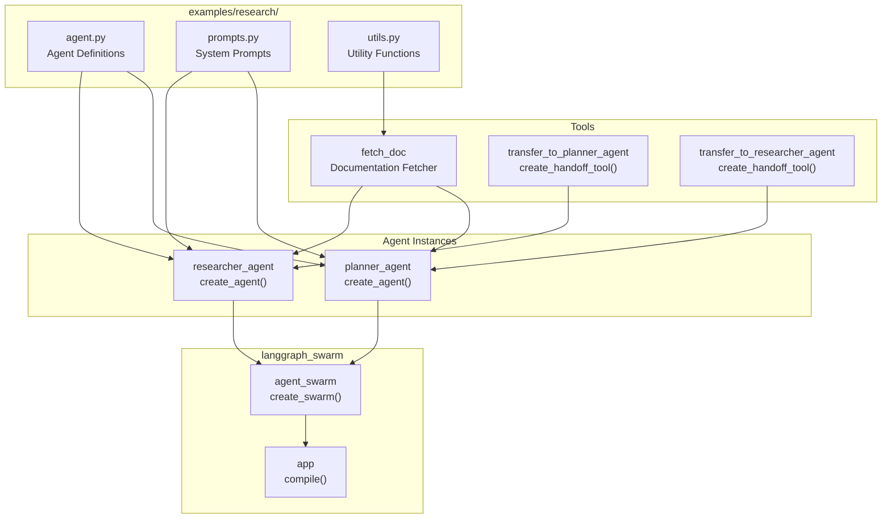

<!-- source: DeepWiki mcp.deepwiki.com · repo langchain-ai/langgraph-swarm-py · page 3.1 Research Agent Example · fetched 2026-10-26 -->

# Research Agent Example

<details>
<summary>Relevant source files</summary>

The following files were used as context for generating this wiki page:

- [examples/research/README.md](examples/research/README.md)
- [examples/research/src/agent/agent.ipynb](examples/research/src/agent/agent.ipynb)
- [examples/research/src/agent/agent.py](examples/research/src/agent/agent.py)

</details>


The Research Agent Example demonstrates a two-phase multi-agent system that uses LangGraph Swarm to coordinate specialized agents for planning and implementation tasks. This example is located in the `examples/research/` directory and showcases how to build collaborative agent systems where control is seamlessly transferred between agents based on task requirements.

Sources: [examples/research/README.md:1-32]()

## Purpose and Pattern

The Research Agent Example implements a common pattern used in deep research systems:

1. **Planning Phase**: A `planner_agent` analyzes the user's request, reads documentation, asks clarifying questions, and develops a structured approach
2. **Implementation Phase**: A `researcher_agent` implements the solution based on the planner's guidance

This separation of concerns allows for more thorough, well-researched outcomes by dedicating separate agents to strategic planning versus tactical implementation. The pattern is particularly useful for:

- Complex research tasks requiring upfront planning
- Tasks where clarifying requirements before implementation is critical
- Projects that benefit from accessing documentation and resources in multiple phases

Sources: [examples/research/README.md:3-30]()

## Architecture Overview

### System Components



The Research Agent Example is built using the core `langgraph_swarm` library. The main components are defined in `examples/research/src/agent/agent.py`, which creates two agent instances using `create_agent()`, configures handoff tools using `create_handoff_tool()`, and combines them into a swarm using `create_swarm()`.

Sources: [examples/research/src/agent/agent.py:1-47]()

### Agent Coordination Flow

```mermaid
sequenceDiagram
    participant User
    participant app["app<br/>(compiled swarm)"]
    participant planner["planner_agent"]
    participant researcher["researcher_agent"]
    
    User->>app: "messages: [{role: user, content: ...}]"
    app->>planner: "Route (default_active_agent)"
    
    planner->>planner: "Analyze request"
    planner->>planner: "invoke fetch_doc"
    planner->>User: "Ask clarifying questions"
    User->>planner: "Provide clarifications"
    planner->>planner: "Create plan + scope"
    
    planner->>app: "invoke transfer_to_researcher_agent"
    Note over app: "SwarmState.active_agent<br/>= 'researcher_agent'"
    
    app->>researcher: "Route to researcher"
    researcher->>researcher: "invoke fetch_doc"
    researcher->>researcher: "Implement solution"
    
    alt "Needs clarification"
        researcher->>app: "invoke transfer_to_planner_agent"
        app->>planner: "Route back to planner"
    end
    
    researcher->>User: "Final solution"
```

The flow is controlled by the `SwarmState.active_agent` field, which is updated when handoff tools are invoked. The swarm router (see page 2.1) uses this field to determine which agent processes the next message.

Sources: [examples/research/src/agent/agent.py:12-46]()

## Agent Roles

The system uses two specialized agents created with `create_agent()`:

| Agent Name | System Prompt | Tools | Primary Responsibilities |
|------------|---------------|-------|-------------------------|
| `planner_agent` | `planner_prompt` (formatted with llms.txt) | `fetch_doc`, `transfer_to_researcher_agent` | • Analyze user requests<br/>• Fetch and review documentation<br/>• Ask clarifying questions<br/>• Create structured plans with URLs<br/>• Define implementation scope |
| `researcher_agent` | `researcher_prompt` | `fetch_doc`, `transfer_to_planner_agent` | • Read recommended documentation<br/>• Implement the solution<br/>• Request clarification if needed |

Both agents are instances of `create_agent()`, which creates a ReAct-style agent that can reason through problems and invoke tools. The key difference is in their system prompts and available tools.

### Default Active Agent

The swarm is initialized with `default_active_agent="planner_agent"` in the `create_swarm()` call, meaning all conversations start with the planner agent.

Sources: [examples/research/src/agent/agent.py:27-46]()

## Tool Configuration

### Documentation Fetching

The `fetch_doc` function (defined in `utils.py`) is provided to both agents, allowing them to retrieve documentation from URLs during their reasoning process.

### Handoff Tools

Two handoff tools enable bidirectional transfer between agents:

- `transfer_to_planner_agent` - created with `create_handoff_tool(agent_name="planner_agent", description=...)`
- `transfer_to_researcher_agent` - created with `create_handoff_tool(agent_name="researcher_agent", description=...)`

The `description` parameter guides the LLM on when to use each handoff tool. These tools return `Command` objects that update the `SwarmState.active_agent` field (see page 2.2 for details on the handoff mechanism).

Sources: [examples/research/src/agent/agent.py:12-19](), [examples/research/src/agent/utils.py]()

## Integration with LangGraph Swarm

The Research Agent Example uses the core `langgraph_swarm` library (see page 2):

1. **SwarmState**: Implicitly managed by `create_swarm()`, tracks `messages` and `active_agent`
2. **create_handoff_tool()**: Creates the handoff tools that return `Command` objects to update state
3. **create_swarm()**: Orchestrates the agents, configures routing, and validates agent names
4. **add_active_agent_router()**: Used internally by `create_swarm()` to route based on `active_agent`

The compiled app is a standard LangGraph `StateGraph` that can be invoked with:
- `app.invoke({"messages": [...]}, config={"configurable": {"thread_id": "..."}})`
- `app.stream({"messages": [...]}, config={...})`

See page 2.1 for details on `SwarmState` and routing, and page 2.2 for the handoff mechanism.

Sources: [examples/research/src/agent/agent.py:1-47]()

## Configuration

The example includes several configuration constants in `agent.py`:

- `LLMS_TXT`: URL to the llms.txt documentation source (LangGraph docs)
- `NUM_URLS`: Number of documentation URLs the planner should include in plans
- `PLANNER_PROMPT_FORMATTED`: The planner's system prompt with documentation URL substituted

The model is initialized with `init_chat_model(model="gpt-4o", model_provider="openai")`, though the notebook version also demonstrates using Anthropic's Claude with extended thinking capabilities.

Sources: [examples/research/src/agent/agent.py:8-24](), [examples/research/src/agent/agent.ipynb:44-53]()

## Key Features and Benefits

1. **Specialized Agents**: Each agent has a specific role, allowing for more focused and effective task completion.

2. **Seamless Handoffs**: The handoff mechanism allows agents to transfer control to each other when appropriate, creating a collaborative workflow.

3. **Checkpoint Persistence**: The system can maintain conversation context across interactions using the checkpointer.

4. **Documentation Access**: Both agents can access documentation to inform their decision-making and implementation.

5. **Two-Phase Approach**: The separation of planning and implementation allows for more thorough, well-researched outcomes.

Sources: [examples/research/README.md:1-30](), [examples/research/src/agent/agent.py:1-48]()

This implementation demonstrates how to use LangGraph Swarm to create a collaborative multi-agent system with specialized agents that can work together through seamless handoffs to solve complex problems.

---

