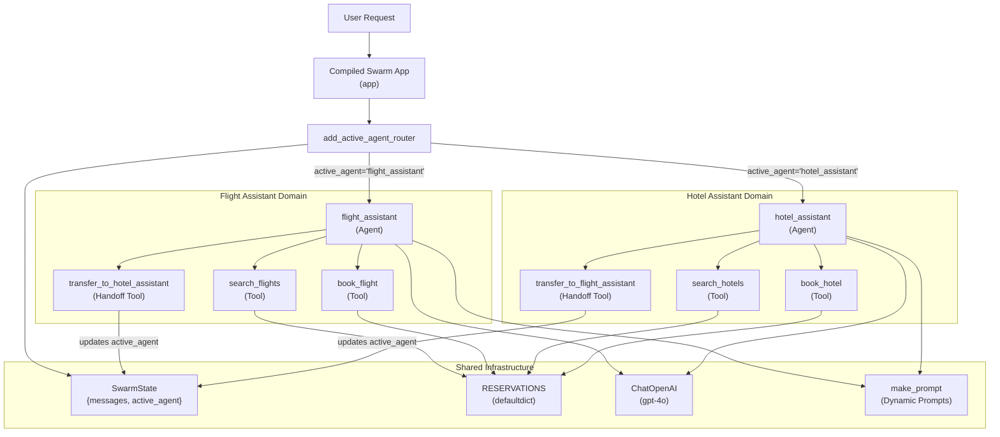
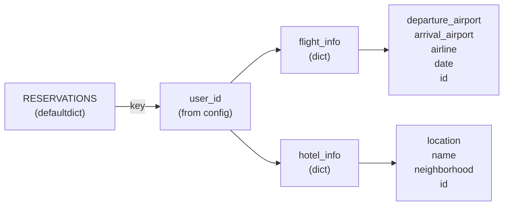
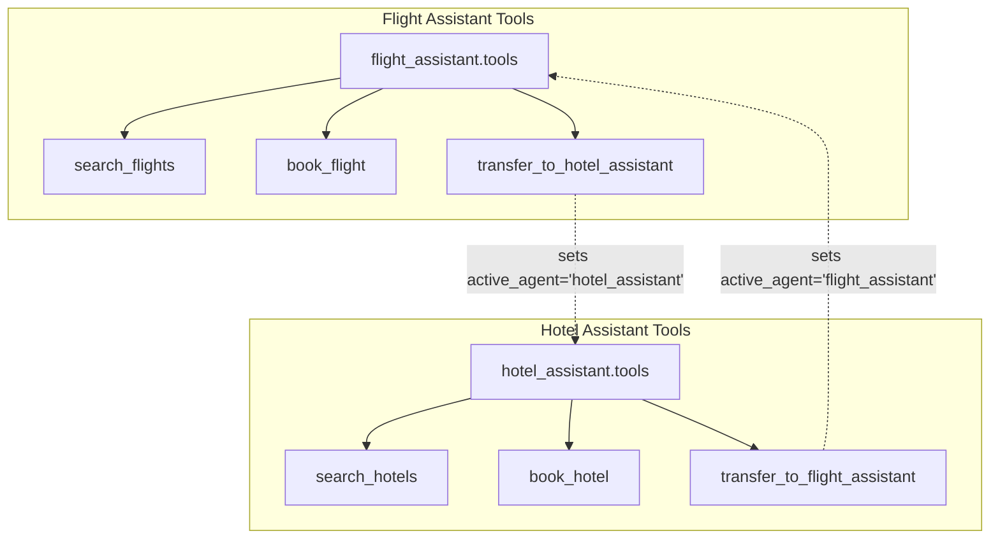
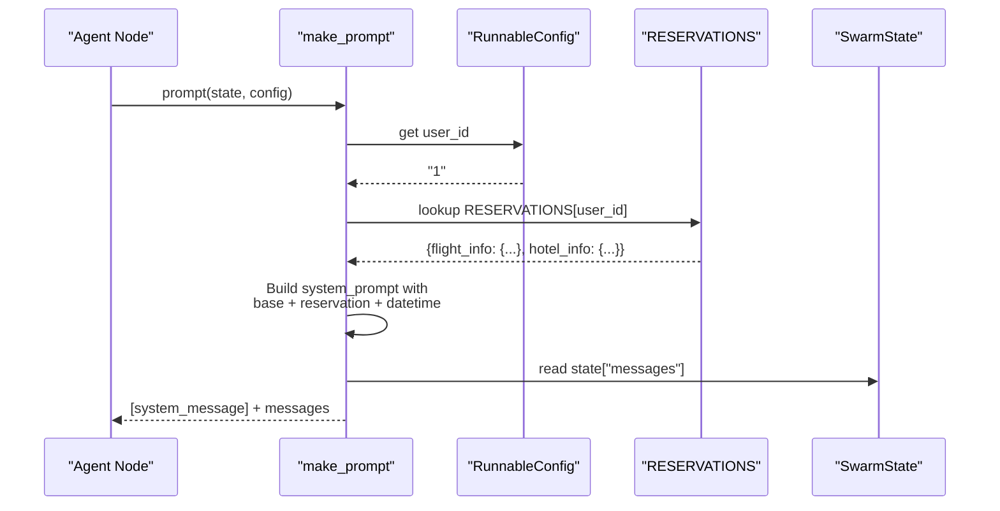
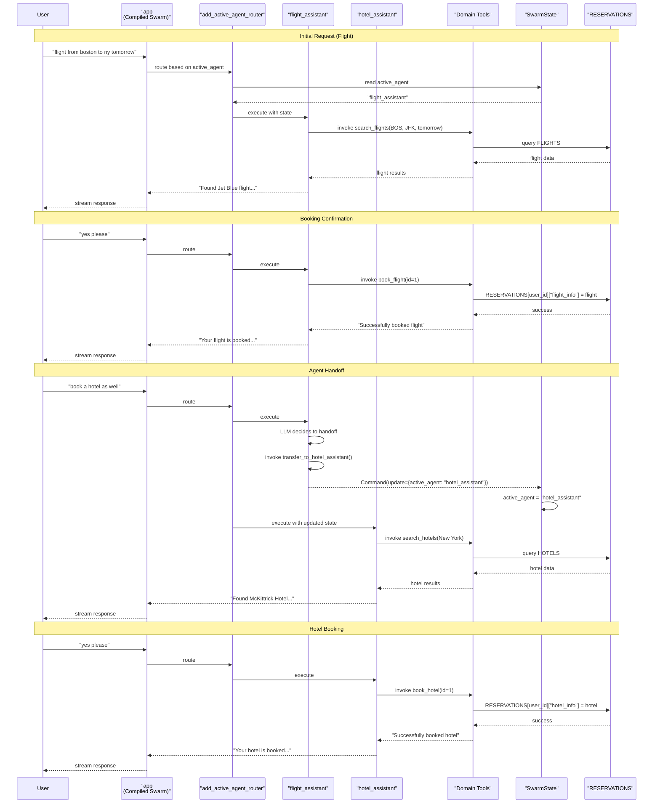

<!-- source: DeepWiki mcp.deepwiki.com · repo langchain-ai/langgraph-swarm-py · page 3.2 Customer Support Example · fetched 2026-10-26 -->

# Customer Support Example

<details>
<summary>Relevant source files</summary>

The following files were used as context for generating this wiki page:

- [examples/customer_support/README.md](examples/customer_support/README.md)
- [examples/customer_support/langgraph.json](examples/customer_support/langgraph.json)
- [examples/customer_support/pyproject.toml](examples/customer_support/pyproject.toml)
- [examples/customer_support/src/agent/customer_support.ipynb](examples/customer_support/src/agent/customer_support.ipynb)
- [examples/customer_support/src/agent/customer_support.py](examples/customer_support/src/agent/customer_support.py)

</details>


## Purpose and Scope

This document provides a comprehensive guide to the Customer Support example application, which demonstrates domain-specialized multi-agent orchestration using the `langgraph-swarm` library. The system implements two specialized agents—`flight_assistant` and `hotel_assistant`—that can autonomously hand off conversations to each other based on user needs. This example illustrates practical patterns for building customer service systems with stateful reservation tracking and bidirectional agent transfers.

For information about the core swarm orchestration primitives used in this example, see [Agent Handoff Mechanism](#2.2). For details on state persistence and conversation continuity, see [Memory and State Management](#2.3). For a different multi-agent pattern (planning/execution separation), see [Research Agent Example](#3.1).

---

## System Architecture

The customer support system consists of two domain-specialized agents orchestrated by the swarm framework. Each agent has access to domain-specific tools and can transfer control to the other agent when the user's needs change.

### Component Overview



**Sources:** [examples/customer_support/src/agent/customer_support.py:1-132](), [examples/customer_support/README.md:1-36]()

---

## Mock Data and Reservation Tracking

The system uses in-memory data structures to simulate a real customer support backend. All data is defined at module level and shared across agent invocations.

### Data Structure Definitions

| Data Structure | Type | Purpose | Location |
|---------------|------|---------|----------|
| `RESERVATIONS` | `defaultdict(lambda: {"flight_info": {}, "hotel_info": {}})` | Per-user reservation storage | Line 14 |
| `TOMORROW` | `str` (ISO date) | Calculated date for flight availability | Line 16 |
| `FLIGHTS` | `list[dict]` | Available flight inventory | Lines 17-25 |
| `HOTELS` | `list[dict]` | Available hotel inventory | Lines 26-33 |

### Reservation Schema



**Flight Data Example:**
```python
{
    "departure_airport": "BOS",
    "arrival_airport": "JFK",
    "airline": "Jet Blue",
    "date": "2025-02-26",  # TOMORROW
    "id": "1"
}
```

**Hotel Data Example:**
```python
{
    "location": "New York",
    "name": "McKittrick Hotel",
    "neighborhood": "Chelsea",
    "id": "1"
}
```

**Sources:** [examples/customer_support/src/agent/customer_support.py:13-33]()

---

## Domain-Specific Tools

Each agent has access to specialized tools for their domain. All tools follow the LangChain `BaseTool` protocol and include docstrings for LLM function calling.

### Flight Tools

#### search_flights

**Function Signature:**
```python
def search_flights(
    departure_airport: str,
    arrival_airport: str,
    date: str,
) -> list[dict]:
```

**Parameters:**
- `departure_airport`: 3-letter IATA airport code (e.g., "BOS")
- `arrival_airport`: 3-letter IATA airport code (e.g., "JFK")
- `date`: ISO format date string (YYYY-MM-DD)

**Behavior:** Returns all flights from `FLIGHTS` list (simplified for demonstration purposes)

**Sources:** [examples/customer_support/src/agent/customer_support.py:37-50]()

#### book_flight

**Function Signature:**
```python
def book_flight(
    flight_id: str,
    config: RunnableConfig,
) -> str:
```

**Parameters:**
- `flight_id`: ID of the flight to book
- `config`: LangGraph configuration containing user context

**Behavior:**
1. Extracts `user_id` from `config["configurable"]`
2. Looks up flight by `flight_id` in `FLIGHTS`
3. Stores flight data in `RESERVATIONS[user_id]["flight_info"]`
4. Returns confirmation message

**Sources:** [examples/customer_support/src/agent/customer_support.py:53-61]()

### Hotel Tools

#### search_hotels

**Function Signature:**
```python
def search_hotels(location: str) -> list[dict]:
```

**Parameters:**
- `location`: Legal city name (proper noun)

**Behavior:** Returns all hotels from `HOTELS` list (simplified for demonstration)

**Sources:** [examples/customer_support/src/agent/customer_support.py:65-72]()

#### book_hotel

**Function Signature:**
```python
def book_hotel(
    hotel_id: str,
    config: RunnableConfig,
) -> str:
```

**Parameters:**
- `hotel_id`: ID of the hotel to book
- `config`: LangGraph configuration containing user context

**Behavior:**
1. Extracts `user_id` from `config["configurable"]`
2. Looks up hotel by `hotel_id` in `HOTELS`
3. Stores hotel data in `RESERVATIONS[user_id]["hotel_info"]`
4. Returns confirmation message

**Sources:** [examples/customer_support/src/agent/customer_support.py:75-83]()

---

## Handoff Tools

Handoff tools enable agents to transfer conversation control to each other. These are created using the `create_handoff_tool` function from the swarm library.

### Handoff Tool Definitions



#### transfer_to_hotel_assistant

**Definition:**
```python
transfer_to_hotel_assistant = create_handoff_tool(
    agent_name="hotel_assistant",
    description="Transfer user to the hotel-booking assistant that can search for and book hotels.",
)
```

**Return Value:** `Command` object that updates `SwarmState.active_agent` to `"hotel_assistant"`

**Sources:** [examples/customer_support/src/agent/customer_support.py:87-90]()

#### transfer_to_flight_assistant

**Definition:**
```python
transfer_to_flight_assistant = create_handoff_tool(
    agent_name="flight_assistant",
    description="Transfer user to the flight-booking assistant that can search for and book flights.",
)
```

**Return Value:** `Command` object that updates `SwarmState.active_agent` to `"flight_assistant"`

**Sources:** [examples/customer_support/src/agent/customer_support.py:91-94]()

---

## Dynamic Prompt Engineering

The system uses a dynamic prompt factory that injects user-specific reservation data into each agent's system prompt at runtime.

### Prompt Factory Pattern



**Implementation:**
```python
def make_prompt(base_system_prompt: str) -> Callable[[dict, RunnableConfig], list]:
    def prompt(state: dict, config: RunnableConfig) -> list:
        user_id = config["configurable"].get("user_id")
        current_reservation = RESERVATIONS[user_id]
        system_prompt = (
            base_system_prompt
            + f"\n\nUser's active reservation: {current_reservation}"
            + f"Today is: {datetime.datetime.now()}"
        )
        return [{"role": "system", "content": system_prompt}] + state["messages"]
    
    return prompt
```

**Key Features:**
1. **Closure Pattern:** Returns a configured prompt function
2. **User Context Injection:** Reads `user_id` from config at runtime
3. **Reservation Awareness:** Includes current reservation state in prompt
4. **Temporal Context:** Adds current datetime for date-relative reasoning
5. **Message History:** Prepends system message to conversation history

**Sources:** [examples/customer_support/src/agent/customer_support.py:98-109]()

---

## Agent Definitions

Both agents are created using LangChain's `create_agent` function with the `ChatOpenAI` model.

### Agent Configuration

| Parameter | Flight Assistant | Hotel Assistant |
|-----------|-----------------|-----------------|
| `model` | `ChatOpenAI(model="gpt-4o")` | `ChatOpenAI(model="gpt-4o")` |
| `tools` | `[search_flights, book_flight, transfer_to_hotel_assistant]` | `[search_hotels, book_hotel, transfer_to_flight_assistant]` |
| `system_prompt` | `make_prompt("You are a flight booking assistant")` | `make_prompt("You are a hotel booking assistant")` |
| `name` | `"flight_assistant"` | `"hotel_assistant"` |

### Agent Creation Code

**flight_assistant:**
```python
flight_assistant = create_agent(
    model,
    tools=[search_flights, book_flight, transfer_to_hotel_assistant],
    system_prompt=make_prompt("You are a flight booking assistant"),
    name="flight_assistant",
)
```

**hotel_assistant:**
```python
hotel_assistant = create_agent(
    model,
    tools=[search_hotels, book_hotel, transfer_to_flight_assistant],
    system_prompt=make_prompt("You are a hotel booking assistant"),
    name="hotel_assistant",
)
```

**Sources:** [examples/customer_support/src/agent/customer_support.py:113-125]()

---

## Swarm Compilation and Configuration

The swarm is built using `create_swarm` and compiled into a runnable LangGraph application.

### Swarm Builder Configuration

```python
builder = create_swarm(
    [flight_assistant, hotel_assistant], 
    default_active_agent="flight_assistant"
)
app = builder.compile()
```

**Configuration Parameters:**
- **Agents List:** `[flight_assistant, hotel_assistant]` - All agents in the swarm
- **Default Active Agent:** `"flight_assistant"` - Initial agent when conversation starts
- **Checkpointer:** Optional (shown in notebook as `MemorySaver()`) for persistence

**Sources:** [examples/customer_support/src/agent/customer_support.py:128-131]()

---

## Conversation Flow

The following diagram illustrates a complete conversation flow demonstrating agent handoff, tool invocation, and state management.



**Sources:** [examples/customer_support/src/agent/customer_support.ipynb:331-661]()

---

## Running the Example

### Configuration Files

The example includes LangGraph deployment configuration for running as a service.

**langgraph.json:**
```json
{
    "dependencies": ["."],
    "graphs": {
      "agent": "./src/agent/customer_support.py:app"
    }
}
```

This configuration:
- Specifies local package as dependency
- Defines `agent` graph pointing to exported `app` object
- Enables LangGraph CLI deployment

**Sources:** [examples/customer_support/langgraph.json:1-6]()

### Package Configuration

**Key Dependencies:**
- `langchain-openai>=0.3.11` - OpenAI model integration
- `langgraph>=0.3.21` - Graph execution engine
- `langgraph-swarm>=0.0.7` - Swarm orchestration primitives
- `langchain>=0.3.21` - Base abstractions

**Sources:** [examples/customer_support/pyproject.toml:11-16]()

### Usage Example

**Configuration Object:**
```python
config = {
    "configurable": {
        "thread_id": str(uuid.uuid4()),  # Unique conversation ID
        "user_id": "1"                   # User identifier for reservations
    }
}
```

**Invoking the App:**
```python
app.stream(
    {"messages": [{"role": "user", "content": "flight from boston to ny tomorrow"}]},
    config,
    subgraphs=True  # Include subgraph (agent-level) updates in stream
)
```

**Key Configuration Parameters:**
- `thread_id`: Enables conversation persistence across multiple invocations
- `user_id`: Links reservations to specific user in `RESERVATIONS` dict
- `subgraphs=True`: Streams both parent swarm updates and individual agent outputs

**Sources:** [examples/customer_support/src/agent/customer_support.ipynb:227-345]()

---

## State Management

The customer support system maintains two levels of state:

### SwarmState

Managed by the `langgraph-swarm` library:
- **`messages`**: Complete conversation history
- **`active_agent`**: Currently active agent name (`"flight_assistant"` or `"hotel_assistant"`)

### Application State

Managed by the example application:
- **`RESERVATIONS`**: Per-user booking data (flights and hotels)
- **`FLIGHTS`**: Global flight inventory
- **`HOTELS`**: Global hotel inventory

**State Persistence:**
When compiled with a checkpointer (e.g., `MemorySaver()`), the swarm automatically persists:
1. Full message history
2. Current active agent
3. Conversation continuity across invocations with same `thread_id`

**Sources:** [examples/customer_support/src/agent/customer_support.py:14-33](), [examples/customer_support/src/agent/customer_support.ipynb:180-187]()

---

## Key Design Patterns

### 1. Domain Specialization

Each agent has a narrow, well-defined domain with specialized tools. This prevents tool overload and enables clearer LLM reasoning about when to invoke functions.

### 2. Bidirectional Handoff

Both agents can transfer control to each other, creating a symmetric handoff graph rather than a hierarchical structure. The LLM determines when handoff is appropriate based on user intent.

### 3. Contextual Prompting

The `make_prompt` factory injects runtime context (reservations, datetime) into system prompts, enabling agents to reference previous bookings without explicit conversation history parsing.

### 4. User-Scoped State

Reservations are keyed by `user_id` from the configuration, enabling multi-user scenarios where different users maintain separate booking states.

### 5. Mock Data Simplification

Tools return all available data rather than filtering, simplifying the example while maintaining the full tool-calling workflow for demonstration purposes.

**Sources:** [examples/customer_support/src/agent/customer_support.py:1-132](), [examples/customer_support/README.md:19-32]()

---

