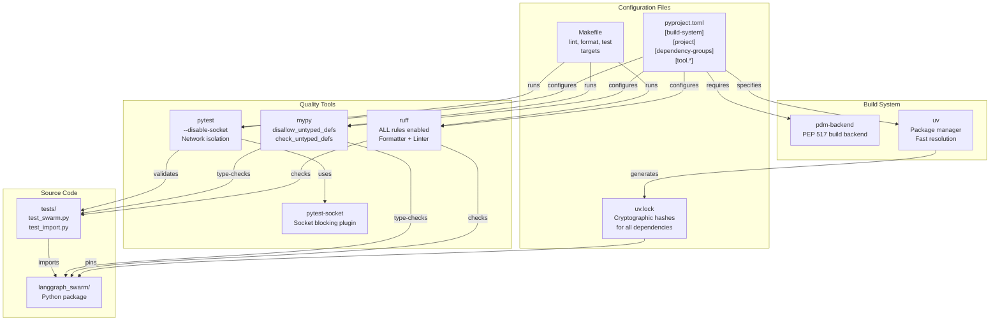
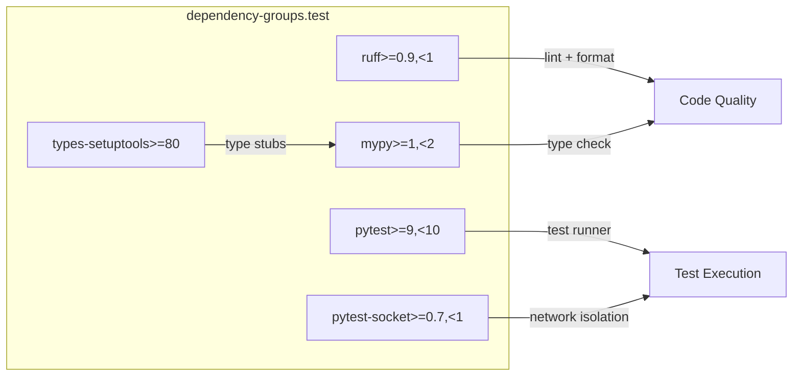
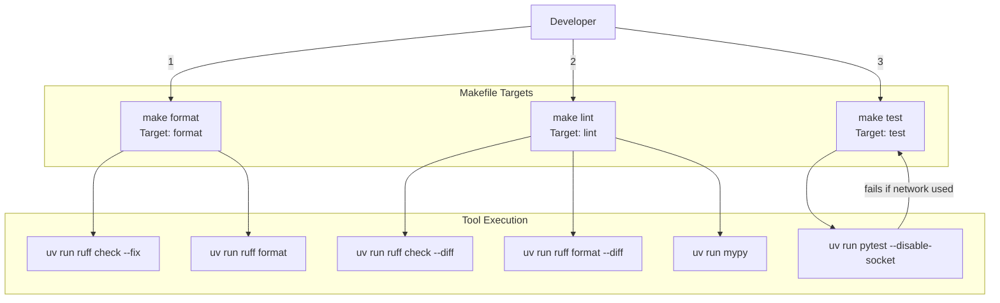
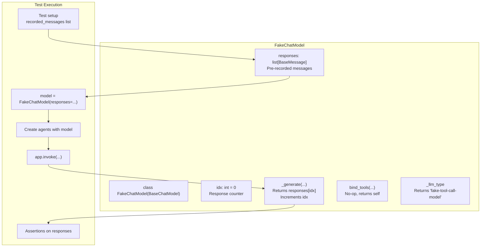

<!-- source: DeepWiki mcp.deepwiki.com · repo langchain-ai/langgraph-swarm-py · page 4 Development and Configuration · fetched 2026-10-26 -->

# Development and Configuration

Relevant source files

The following files were used as context for generating this wiki page:

- [Makefile](Makefile)
- [pyproject.toml](pyproject.toml)
- [tests/test_swarm.py](tests/test_swarm.py)

This document provides a comprehensive guide for developers working on or contributing to the `langgraph-swarm` project. It covers the development infrastructure, build system configuration, dependency management, testing framework, code quality tools, and automated workflows. This page serves as an entry point for understanding the project's development setup and standards.

For specific details on dependency management and build configuration, see [Dependencies and Build System](#4.1). For testing infrastructure and mock implementations, see [Testing](#4.2). For continuous integration and code quality automation, see [CI/CD and Code Quality](#4.3).

## Development Infrastructure Overview

The `langgraph-swarm` project employs a modern Python development stack with strict quality standards. The infrastructure consists of three primary layers:

1. **Build and Dependency Management**: Uses `pdm-backend` for PEP 517-compliant builds and `uv` for fast, reproducible dependency resolution
2. **Testing Framework**: pytest-based test suite with network isolation and mock implementations
3. **Code Quality Tooling**: Comprehensive linting (Ruff), type checking (mypy), and formatting automation

**Sources**: [pyproject.toml:1-78](), [Makefile:1-54]()

## Project Configuration Structure

The `pyproject.toml` file is the central configuration hub, structured into distinct sections that define the project's metadata, dependencies, build system, and tool configurations.

### Build System and Project Metadata

The build configuration uses `pdm-backend` as the PEP 517-compliant build backend ([pyproject.toml:1-3]()). The project metadata defines the package identity and core dependencies:

| Configuration Key | Value | Purpose |
|------------------|-------|---------|
| `name` | `"langgraph-swarm"` | Package name for PyPI |
| `version` | `"0.1.0"` | Current version number |
| `requires-python` | `">=3.10"` | Minimum Python version |
| `dependencies` | `langchain`, `langchain-core`, `langgraph` | Runtime requirements, all version-constrained to `>=1,<2` |
| `build-backend` | `"pdm.backend"` | PEP 517 build system |

The dependencies are strictly constrained to major version 1 for all LangChain components, ensuring API stability ([pyproject.toml:16]()).

**Sources**: [pyproject.toml:1-16]()

### Dependency Groups

Development dependencies are organized under `[dependency-groups]`, separating test and development tooling from runtime requirements:

The `pytest-socket` plugin enforces network isolation during testing ([pyproject.toml:23]()), ensuring tests remain deterministic and fast by blocking all socket operations.

**Sources**: [pyproject.toml:18-25]()

## Development Workflow

The `Makefile` provides standardized commands for common development tasks. The workflow follows a pattern of format → lint → test:

All commands use `uv run` to execute within the managed environment ([Makefile:14](), [Makefile:29-31](), [Makefile:34-35]()). The `TEST_FILE` variable allows targeting specific test files ([Makefile:11]()).

**Sources**: [Makefile:1-54]()

## Tool Configuration Details

### pytest Configuration

The pytest configuration enforces strict testing standards:

| Setting | Value | Purpose |
|---------|-------|---------|
| `minversion` | `"8.0"` | Requires pytest 8.0+ |
| `addopts` | `"-ra -q -v"` | Show all test outcomes (`-ra`), quiet mode (`-q`), verbose (`-v`) |
| `testpaths` | `["tests"]` | Restrict test discovery to `tests/` directory |
| `python_files` | `["test_*.py"]` | Only discover files matching `test_*.py` pattern |
| `python_functions` | `["test_*"]` | Only run functions starting with `test_` |

The `Makefile` adds `--disable-socket --allow-unix-socket` flags ([Makefile:14]()), blocking network access while permitting Unix sockets for local IPC.

**Sources**: [pyproject.toml:27-32](), [Makefile:14]()

### Ruff Configuration

Ruff is configured with an aggressive ruleset, enabling ALL rules then selectively ignoring specific ones:

```mermaid
graph TB
    subgraph "Ruff Base Config"
        SELECT["select = ['ALL']<br/>Enable all rules"]
        LINE["line-length = 88<br/>Black-compatible"]
        TARGET["target-version = 'py310'<br/>Python 3.10 syntax"]
    end
    
    subgraph "Global Ignores"
        E501["E501: line-length<br/>Handled by formatter"]
        D100["D100: Module docstrings"]
        D104["D104: Package docstrings"]
        D203["D203: Blank line before class"]
        D213["D213: Multi-line summary"]
        UP007["UP007: Union syntax"]
        COM812["COM812: Trailing commas"]
        ANN["ANN: Type annotations"]
    end
    
    subgraph "Test File Overrides"
        S101["S101: Allow asserts"]
        ARG["ARG: Unused args ok<br/>for fixtures"]
        FBT["FBT: Boolean positionals"]
        D_SERIES["D100-105: No docstrings<br/>in tests"]
        PLR2004["PLR2004: Magic values"]
        S311["S311: Pseudo-random ok"]
    end
    
    SELECT --> E501
    SELECT --> D100
    SELECT --> D104
    SELECT --> D203
    SELECT --> D213
    SELECT --> UP007
    SELECT --> COM812
    SELECT --> ANN
    
    TESTS_DIR["tests/**/*.py"] --> S101
    TESTS_DIR --> ARG
    TESTS_DIR --> FBT
    TESTS_DIR --> D_SERIES
    TESTS_DIR --> PLR2004
    TESTS_DIR --> S311
```

The `[tool.ruff.lint.extend-per-file-ignores]` section ([pyproject.toml:60-77]()) relaxes rules for test files, recognizing that tests have different quality standards than production code (e.g., asserts are required, magic values are acceptable).

**Sources**: [pyproject.toml:34-77]()

### mypy Configuration

The mypy configuration enforces strict type checking:

| Setting | Value | Effect |
|---------|-------|--------|
| `python_version` | `"3.11"` | Type check against Python 3.11 semantics |
| `warn_return_any` | `true` | Warn on functions returning `Any` |
| `warn_unused_configs` | `true` | Detect unused mypy settings |
| `disallow_untyped_defs` | `true` | Require type annotations on all function definitions |
| `check_untyped_defs` | `true` | Type-check functions even without annotations |

The `disallow_untyped_defs` setting ([pyproject.toml:56]()) is particularly strict—it requires explicit type annotations on all function parameters and return values throughout the codebase.

**Sources**: [pyproject.toml:52-57]()

## Test Infrastructure

The test suite in `tests/test_swarm.py` demonstrates the testing patterns used throughout the project:

### FakeChatModel Implementation

The `FakeChatModel` class ([tests/test_swarm.py:19-46]()) is a mock implementation of `BaseChatModel` that returns pre-recorded responses:

Each invocation of `_generate` returns the next message from the `responses` list ([tests/test_swarm.py:34-36]()), allowing tests to simulate multi-turn conversations without actual LLM calls.

**Sources**: [tests/test_swarm.py:19-46]()

### Test Structure

The test suite includes two primary tests demonstrating swarm behavior:

1. **`test_basic_swarm`** ([tests/test_swarm.py:48-153]()): Tests agent handoffs using default `AgentState` schema
2. **`test_basic_swarm_pydantic`** ([tests/test_swarm.py:155-274]()): Tests with custom Pydantic `SwarmState` schema

Both tests follow the same pattern:
- Define pre-recorded AI responses with tool calls
- Create `FakeChatModel` with responses
- Define agents (Alice, Bob) with handoff tools
- Use `MemorySaver` checkpointer for state persistence
- Verify message counts and active agent transitions

The tests validate the complete handoff cycle: Alice → Bob → Alice, with intermediate tool calls and state updates.

**Sources**: [tests/test_swarm.py:48-274]()

## Command Reference

| Command | Purpose | Key Flags |
|---------|---------|-----------|
| `make test` | Run full test suite | `--disable-socket --allow-unix-socket` |
| `make test TEST_FILE=tests/test_file.py` | Run specific test file | Same as above |
| `make lint` | Check code style and types | `--diff` (non-modifying) |
| `make format` | Auto-fix style issues | `--fix` (modifying) |
| `make lint_diff` | Lint only changed files | Compares against `master` branch |
| `make format_diff` | Format only changed files | Compares against `master` branch |

All commands use `uv run` to ensure execution within the managed environment. The `_diff` variants ([Makefile:26]()) use git to identify changed files, reducing execution time during iterative development.

**Sources**: [Makefile:1-54]()

---

