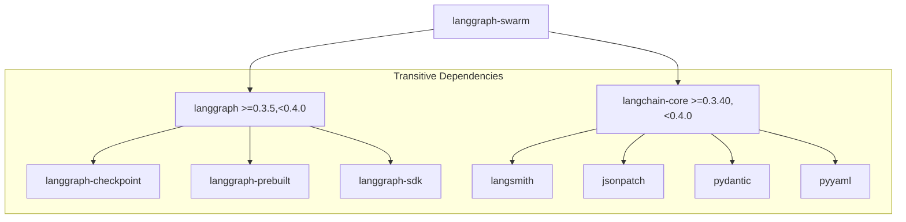
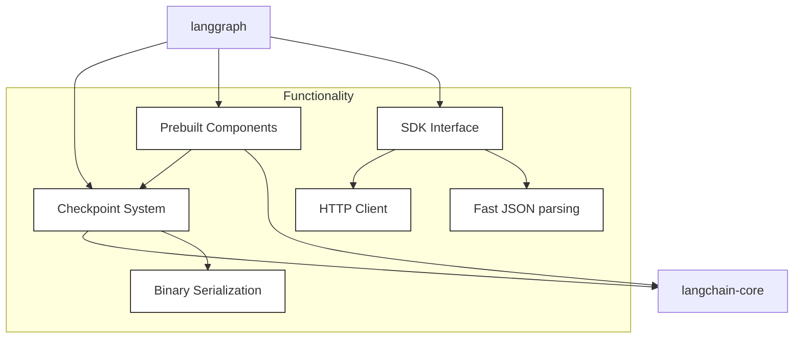
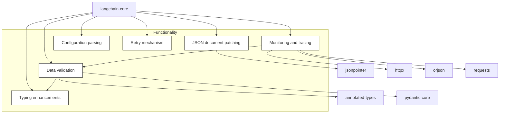
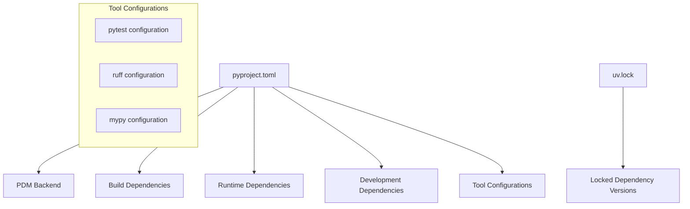
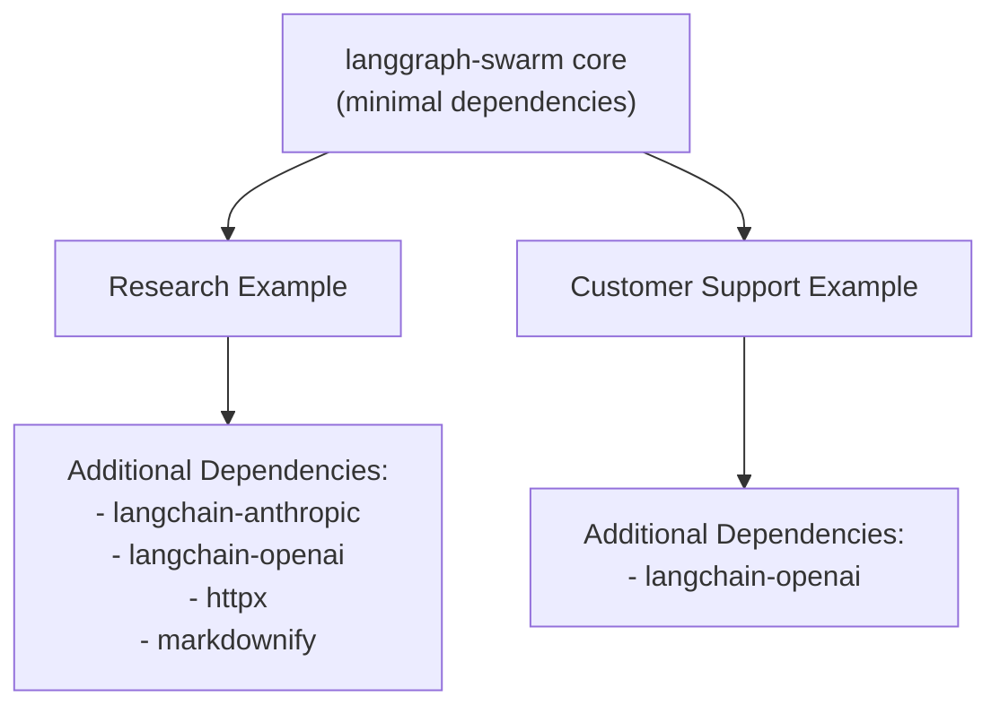

<!-- source: DeepWiki mcp.deepwiki.com · repo langchain-ai/langgraph-swarm-py · page 4.1 Dependencies and Build System · fetched 2026-10-26 -->

# Dependencies

<details>
<summary>Relevant source files</summary>

The following files were used as context for generating this wiki page:

- [pyproject.toml](pyproject.toml)
- [uv.lock](uv.lock)

</details>


This document outlines the dependencies used by the `langgraph-swarm` package. It provides a detailed view of both runtime dependencies required for the package to function and development dependencies used for testing, linting, and maintaining code quality.

## Overview of Dependencies

The `langgraph-swarm` package relies on a minimal set of direct dependencies but includes several transitive dependencies that enable its functionality. The package uses modern Python dependency management through PDM.



Sources: [pyproject.toml:14-17](), [uv.lock:273-282](), [uv.lock:255-271]()

## Core Runtime Dependencies

The `langgraph-swarm` package has two primary direct dependencies:

| Dependency | Version Constraint | Purpose |
|------------|-------------------|---------|
| langgraph | >=0.3.5,<0.4.0 | Provides the graph-based architecture for building agent workflows |
| langchain-core | >=0.3.40,<0.4.0 | Core components for LLM-based application development |

### LangGraph Dependency Chain

LangGraph serves as the foundation for the multi-agent swarm architecture, providing the state management and graph-based workflow capabilities essential for routing between agents.



Sources: [uv.lock:273-285](), [uv.lock:288-298](), [uv.lock:300-311](), [uv.lock:314-324]()

### LangChain Core Dependency Chain

LangChain Core provides essential abstractions and utilities for working with language models and structuring LLM applications.



Sources: [uv.lock:255-271](), [uv.lock:234-243](), [uv.lock:360-374](), [uv.lock:563-575](), [uv.lock:682-684]()

## Development Dependencies

The project uses several development tools for testing, linting, and maintaining code quality:

| Tool | Version | Purpose |
|------|---------|---------|
| pytest | >=8.0.0 | Testing framework |
| ruff | >=0.9.4 | Fast Python linter written in Rust |
| mypy | >=1.8.0 | Static type checker |
| pytest-socket | >=0.7.0 | Control socket usage during tests |
| types-setuptools | >=69.0.0 | Type stubs for setuptools |

```mermaid
flowchart LR
    Dev["Development Process"]
    
    subgraph "Testing"
        Pytest["pytest >=8.0.0"]
        PySocket["pytest-socket >=0.7.0"]
    end
    
    subgraph "Code Quality"
        Ruff["ruff >=0.9.4"]
        Mypy["mypy >=1.8.0"]
        TypeStubs["types-setuptools >=69.0.0"]
    end
    
    Dev --> Testing
    Dev --> "Code Quality"
    
    Pytest --> PySocket
```

Sources: [pyproject.toml:20-26](), [uv.lock:429-464](), [uv.lock:652-666](), [uv.lock:669-678]()

## Dependency Configuration and Management

The project uses PDM for dependency management, which is a modern Python package manager. The dependency specifications are defined in the `pyproject.toml` file, while the exact locked versions are stored in the `uv.lock` file.

### Build System Configuration



Sources: [pyproject.toml:1-60](), [uv.lock:1-684]()

### Python Version Requirements

The package requires Python 3.10 or later as specified in the `pyproject.toml` file. This ensures compatibility with modern Python features while maintaining reasonable backward compatibility.

```
requires-python = ">=3.10"
```

Sources: [pyproject.toml:13](), [uv.lock:3]()

## Testing and Quality Assurance Dependencies

The testing infrastructure is primarily built around pytest, with additional plugins and tools to ensure code quality.

```mermaid
flowchart TD
    Testing["Testing Process"]
    
    Testing --> Pytest["pytest"]
    Testing --> Socket["pytest-socket"]
    
    Pytest --> INIConfig["iniconfig"]
    Pytest --> Pluggy["pluggy"]
    
    Socket --> Pytest
    
    subgraph "Quality Assurance"
        Mypy["mypy"]
        Ruff["ruff"]
    end
    
    Testing --> "Quality Assurance"
    
    Mypy --> MyPyExt["mypy-extensions"]
    Mypy --> TypExt["typing-extensions"]
```

Sources: [uv.lock:429-464](), [uv.lock:652-666](), [uv.lock:669-678](), [pyproject.toml:28-36]()

## Relationship to Example Applications

The example applications in the repository often include additional dependencies beyond the core package requirements. These are not part of the main package but are needed for the specific functionality of each example.



Sources: [uv.lock:255-285](), [uv.lock:188-213]() (for httpx)

## Conclusion

The `langgraph-swarm` package maintains a minimal and focused set of dependencies, primarily building on top of `langgraph` and `langchain-core`. This approach ensures that the core functionality remains lightweight while still leveraging the powerful capabilities of these foundational libraries.

The development environment includes a comprehensive set of tools for testing, linting, and type checking, ensuring code quality and maintainability throughout the development process.

---

