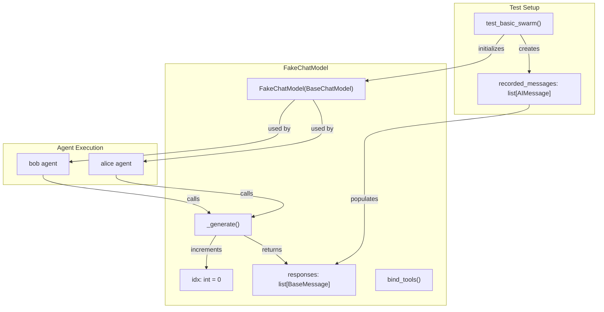
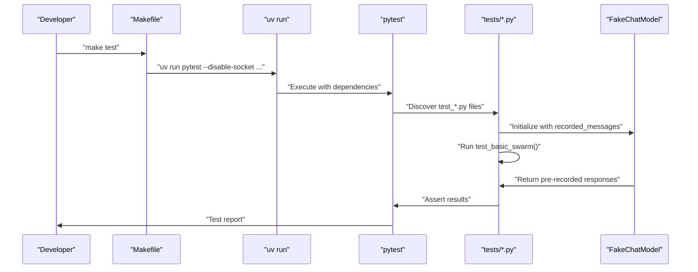
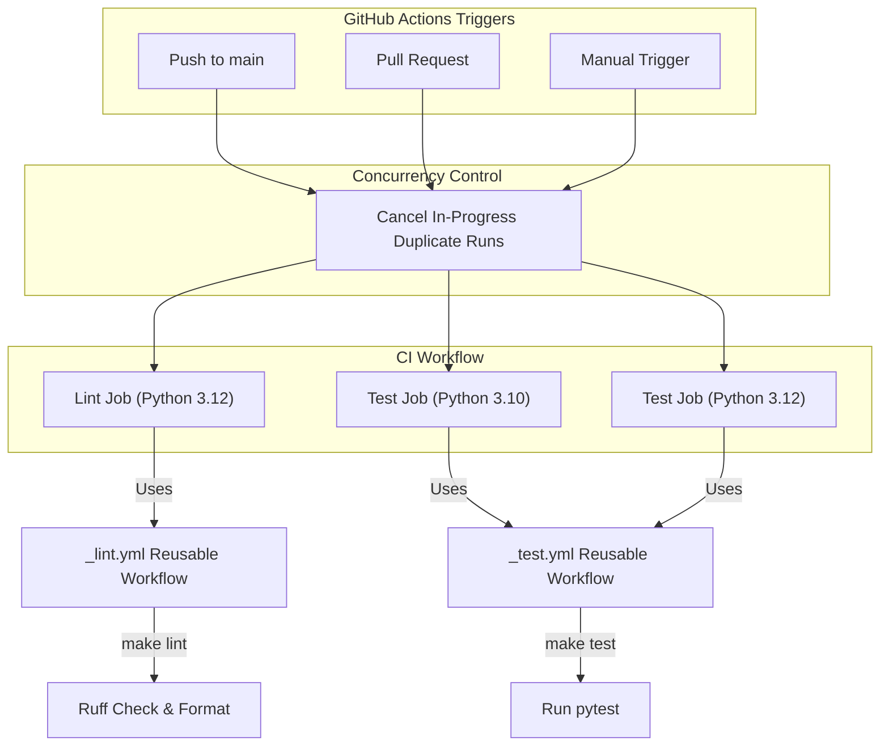
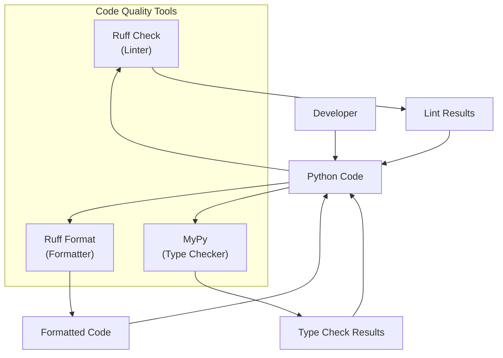

<!-- source: DeepWiki mcp.deepwiki.com · repo langchain-ai/langgraph-swarm-py · page 4.2 Testing · fetched 2026-10-26 -->

# Testing

<details>
<summary>Relevant source files</summary>

The following files were used as context for generating this wiki page:

- [Makefile](Makefile)
- [pyproject.toml](pyproject.toml)
- [tests/test_import.py](tests/test_import.py)
- [tests/test_swarm.py](tests/test_swarm.py)

</details>


This document covers the test suite structure, pytest configuration, mocking infrastructure, and how to run tests for the LangGraph Swarm project. For information about project dependencies, see page 4.1, and for CI/CD workflows, see page 4.3.

## Test Suite Structure

The test suite is organized in the `tests/` directory with the following structure:

| File | Purpose | Lines of Code |
|------|---------|---------------|
| `tests/test_swarm.py` | Core swarm functionality tests | 275 |
| `tests/test_import.py` | Import validation | 3 |

**Test Discovery Pattern**: pytest discovers tests using patterns defined in [pyproject.toml:31-32]():
- Files matching `test_*.py`
- Functions matching `test_*`

Sources: [tests/test_swarm.py:1-275](), [tests/test_import.py:1-3](), [pyproject.toml:31-32]()

### Core Test Scenarios

The test suite validates two primary scenarios:

#### 1. test_basic_swarm()

Tests multi-agent handoff with dictionary-based state schema:

- **Agents**: `Alice` (addition expert) and `Bob` (pirate-speaking agent)
- **Tools**: `add()` function, `transfer_to_bob`, `transfer_to_alice`
- **Validation**: Agent handoffs, tool execution, state persistence
- **Turns**: 2-turn conversation with handoff in each turn

Sources: [tests/test_swarm.py:48-153]()

#### 2. test_basic_swarm_pydantic()

Tests multi-agent handoff with Pydantic state schema:

- **State Schema**: Custom `SwarmState(AgentState)` class with typed `active_agent` field
- **Agents**: Same Alice/Bob setup as basic test
- **Validation**: Pydantic state handling, type annotations, agent transitions

Sources: [tests/test_swarm.py:155-274]()

## Pytest Configuration

The project uses pytest with specific configuration in [pyproject.toml:27-32]():

```ini
[tool.pytest.ini_options]
minversion = "8.0"
addopts = "-ra -q -v"
testpaths = ["tests"]
python_files = ["test_*.py"]
python_functions = ["test_*"]
```

**Configuration Details**:

| Option | Value | Purpose |
|--------|-------|---------|
| `minversion` | `"8.0"` | Requires pytest 8.0 or newer |
| `addopts` | `"-ra -q -v"` | `-ra` shows summary of all test outcomes, `-q` quiet mode, `-v` verbose |
| `testpaths` | `["tests"]` | Limits test discovery to `tests/` directory |
| `python_files` | `["test_*.py"]` | Discovers only files starting with `test_` |
| `python_functions` | `["test_*"]` | Runs only functions starting with `test_` |

Sources: [pyproject.toml:27-32]()

## FakeChatModel Mocking Infrastructure

The test suite uses `FakeChatModel` to mock LLM interactions without external API calls:

### FakeChatModel Architecture



**Sources**: [tests/test_swarm.py:19-46]()

### FakeChatModel Implementation

The `FakeChatModel` class implements `BaseChatModel` with pre-recorded responses:

**Key Components**:

| Field/Method | Type | Purpose |
|--------------|------|---------|
| `idx` | `int` | Tracks current position in response sequence |
| `responses` | `list[BaseMessage]` | Pre-recorded AI messages to return |
| `_generate()` | method | Returns next message from `responses`, increments `idx` |
| `bind_tools()` | method | Returns self (no-op, tools not used in mock) |

**Usage Pattern**:
1. Create list of `AIMessage` objects with predetermined content and tool calls
2. Initialize `FakeChatModel(responses=recorded_messages)`
3. Pass model to agent creation functions
4. Model returns responses sequentially as agents execute

Sources: [tests/test_swarm.py:19-46]()

### Example Recorded Messages

The test uses 5 pre-recorded messages simulating agent behavior:

```python
recorded_messages = [
    AIMessage(content="", name="Alice", tool_calls=[{"name": "transfer_to_bob", ...}]),  # Alice transfers to Bob
    AIMessage(content="Ahoy, matey! ...", name="Bob"),  # Bob responds
    AIMessage(content="", name="Bob", tool_calls=[{"name": "transfer_to_alice", ...}]),  # Bob transfers back
    AIMessage(content="", name="Alice", tool_calls=[{"name": "add", "args": {"a": 5, "b": 7}, ...}]),  # Alice uses tool
    AIMessage(content="The sum of 5 and 7 is 12.", name="Alice"),  # Alice responds
]
```

This sequence tests:
- Agent-to-agent handoffs (Alice → Bob → Alice)
- Tool execution (`add()` function)
- State updates via `Command` objects
- Message history preservation

Sources: [tests/test_swarm.py:50-95]()

## Running Tests

### Test Commands

The project provides `make` commands that wrap pytest execution:

| Command | Purpose | Flags |
|---------|---------|-------|
| `make test` | Run all tests | `--disable-socket --allow-unix-socket` |
| `make test TEST_FILE=tests/test_swarm.py` | Run specific file | Same as above |
| `make test_watch` | Watch mode (auto-rerun) | Same as above |

**Network Isolation**: All tests run with `--disable-socket --allow-unix-socket` flags to:
- Prevent accidental external API calls
- Ensure deterministic test results
- Avoid network-dependent failures
- Force use of mocks/fakes

Sources: [Makefile:10-17]()

### Test Execution Flow



Sources: [Makefile:13-14](), [tests/test_swarm.py:48-153]()

### Dependencies

Testing requires the following dependencies from [pyproject.toml:18-25]():

| Package | Version | Purpose |
|---------|---------|---------|
| `pytest` | `>=9,<10` | Test runner |
| `pytest-socket` | `>=0.7,<1` | Network isolation enforcement |
| `ruff` | `>=0.9,<1` | Linter (used in CI) |
| `mypy` | `>=1,<2` | Type checker (used in CI) |
| `types-setuptools` | `>=80` | Type stubs for setuptools |

Sources: [pyproject.toml:18-25]()

## Continuous Integration

The project uses GitHub Actions for continuous integration to ensure code quality with each pull request and commit to the main branch.

### CI Workflow Architecture



The workflow includes the following components:

1. **Triggers**: The CI workflow runs on:
   - Push to the main branch
   - Any pull request
   - Manual workflow dispatch

2. **Concurrency Control**: If a new commit is pushed while a workflow is running for the same branch or PR, the older workflow is automatically canceled.

3. **Jobs**:
   - Linting on Python 3.12
   - Testing on Python 3.10 (minimum supported version)
   - Testing on Python 3.12 (latest supported version)

Sources: [.github/workflows/ci.yml:2-39](), [.github/workflows/ci.yml:40-57]()

### Reusable Workflows

The CI pipeline uses two reusable workflows to standardize the testing and linting processes:

#### Lint Workflow

The lint workflow (`_lint.yml`) performs code quality checks:

1. Sets up Python with the specified version
2. Configures UV package manager
3. Installs test dependencies
4. Runs `make lint` to check code quality

Sources: [.github/workflows/_lint.yml:1-44]()

#### Test Workflow

The test workflow (`_test.yml`) runs the test suite:

1. Sets up Python with the specified version
2. Configures UV package manager
3. Installs test dependencies
4. Runs `make test` to execute the pytest suite

Sources: [.github/workflows/_test.yml:1-43]()

## Code Quality Tools

The LangGraph Swarm project uses several tools to maintain code quality:

### Linting and Formatting



1. **Ruff**: Used for both linting and formatting Python code
   - `ruff check`: Checks code for issues
   - `ruff format`: Formats code according to style guidelines

2. **MyPy**: Optional type checking (commented out in the current setup)

The project includes specialized commands for checking only changed files:
- `make lint_diff`: Lints only files that have changed compared to the master branch
- `make format_diff`: Formats only files that have changed

Sources: [Makefile:20-36]()

## Best Practices for Contributors

When contributing to LangGraph Swarm, follow these testing best practices:

1. **Run Tests Locally**: Always run `make test` before submitting a pull request to ensure your changes don't break existing functionality.

2. **Format Your Code**: Use `make format` to ensure your code adheres to the project's style guidelines.

3. **Write Test Cases**: Add tests for new features or bug fixes to maintain code coverage.

4. **Check CI Results**: After submitting a PR, verify that all CI checks pass. Address any issues that arise.

## File Organization

The testing infrastructure involves several key files:

| File | Purpose |
|------|---------|
| `Makefile` | Defines commands for testing and linting |
| `.github/workflows/ci.yml` | Main CI workflow configuration |
| `.github/workflows/_test.yml` | Reusable workflow for testing |
| `.github/workflows/_lint.yml` | Reusable workflow for linting |
| `tests/` | Directory containing test files |

Sources: [Makefile:1-54](), [.github/workflows/ci.yml:1-59](), [.github/workflows/_test.yml:1-43](), [.github/workflows/_lint.yml:1-44]()

## Environment Considerations

The testing infrastructure is designed to be:

1. **Isolated**: Tests run without network access to ensure deterministic results.
2. **Cross-platform**: Tests can run on different Python versions (3.10 to 3.12).
3. **Reproducible**: The UV package manager ensures consistent dependency versions.

Sources: [.github/workflows/ci.yml:40-57](), [Makefile:9-17]()

---

