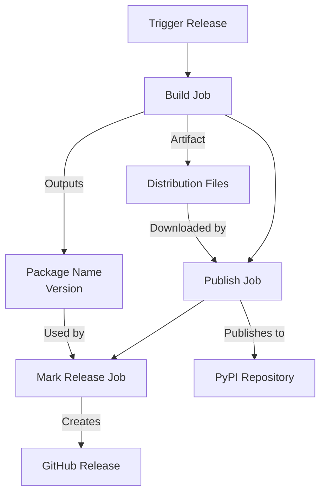
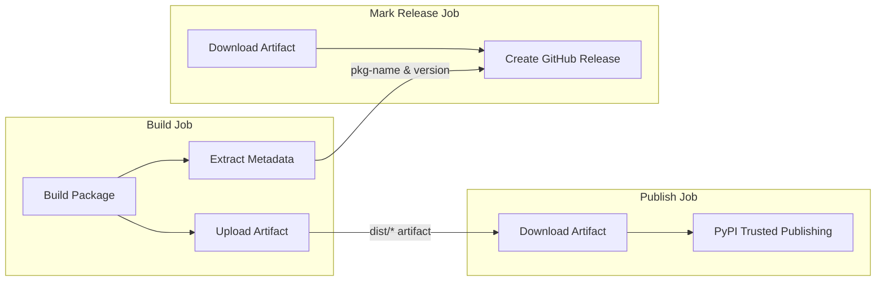
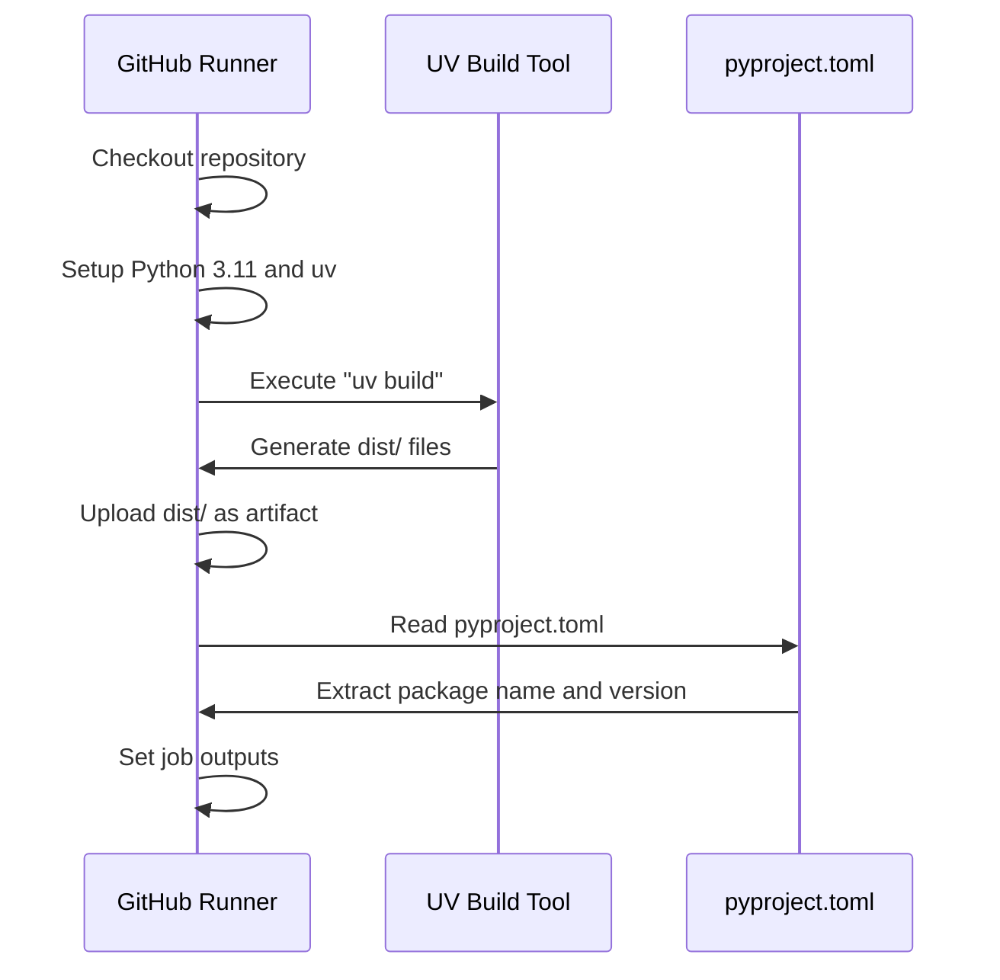
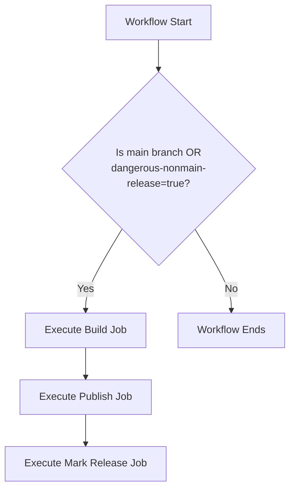

<!-- source: DeepWiki mcp.deepwiki.com · repo langchain-ai/langgraph-swarm-py · page 4.3 CI/CD and Code Quality · fetched 2026-10-26 -->

# Release Process

Relevant source files

The following files were used as context for generating this wiki page:

- [.github/actions/uv_setup/action.yml](.github/actions/uv_setup/action.yml)
- [.github/workflows/_lint.yml](.github/workflows/_lint.yml)
- [.github/workflows/_test.yml](.github/workflows/_test.yml)
- [Makefile](Makefile)
- [pyproject.toml](pyproject.toml)

This document details the automated release process for the LangGraph Swarm package. It covers how releases are triggered, the stages of the release pipeline, and the security considerations built into the process. For information about dependencies and package configuration, see [Dependencies](#4.1).

## Overview

The LangGraph Swarm package uses a GitHub Actions workflow for automated releases. This process ensures consistent, secure publishing to PyPI and proper GitHub release creation.

Sources: [.github/workflows/release.yml:1-151]()

## Release Workflow Triggers

The release workflow can be initiated in two ways:

1. **Called by another workflow** - Through the `workflow_call` trigger
2. **Manually triggered** - Through the `workflow_dispatch` trigger with customizable inputs

| Input Parameter | Description | Default |
|----------------|-------------|---------|
| `working-directory` | Directory from which the pipeline executes | "." |
| `dangerous-nonmain-release` | Allow releasing from a non-main branch | false |

Sources: [.github/workflows/release.yml:1-19]()

## Security Design

The release workflow incorporates several security best practices:

The workflow deliberately separates the build and publish stages to limit the scope of permissions, preventing a compromised build step from accessing PyPI or GitHub credentials.

Sources: [.github/workflows/release.yml:43-55]()

## Release Pipeline

The release process consists of three sequential jobs:

### 1. Build Job

This job prepares the package for distribution:

- Checks out the repository code
- Sets up Python and the uv package manager
- Builds the package distribution files
- Uploads the distribution as a GitHub Actions artifact
- Extracts package name and version from pyproject.toml

Sources: [.github/workflows/release.yml:26-76](), [.github/actions/uv_setup/action.yml:1-22]()

### 2. Publish Job

This job publishes the package to PyPI:

- Sets up Python and uv
- Downloads the distribution artifact
- Publishes the package to PyPI using trusted publishing

The job needs the `id-token: write` permission for PyPI trusted publishing.

Sources: [.github/workflows/release.yml:77-113]()

### 3. Mark Release Job

This job creates a GitHub release:

- Downloads the distribution artifact
- Creates a GitHub release tag using the format `package-name==version`
- Generates release notes
- Uploads distribution files as release artifacts

The job needs the `contents: write` permission to create GitHub releases.

Sources: [.github/workflows/release.yml:115-151]()

## Environment Configuration

The release workflow uses fixed environment variables to ensure consistent builds:

| Environment Variable | Value | Purpose |
|---------------------|-------|---------|
| `PYTHON_VERSION` | "3.11" | Python version used for building and publishing |
| `UV_FROZEN` | "true" | Ensures uv uses the lockfile for reproducible builds |
| `UV_NO_SYNC` | "true" | Prevents uv from syncing changes to requirements files |

Sources: [.github/workflows/release.yml:21-24]()

## Execution Safeguards

The workflow includes safeguards to prevent accidental releases:

1. By default, releases only run on the `main` branch
2. The option to release from non-main branches is explicitly labeled "dangerous"
3. The build job checks the branch before proceeding

Sources: [.github/workflows/release.yml:28]()

## PyPI Trusted Publishing

The workflow uses PyPI's trusted publishing for secure package uploads without storing PyPI credentials:

1. The workflow uses the `pypa/gh-action-pypi-publish` action
2. GitHub's OIDC token is used for authentication with PyPI
3. The package must be configured on PyPI to trust the GitHub repository's OIDC token

Sources: [.github/workflows/release.yml:82-87](), [.github/workflows/release.yml:106-113]()

## GitHub Release Creation

After successful PyPI publishing, the workflow creates a GitHub release with:

- Tag in the format `package-name==version`
- Automatically generated release notes
- Distribution files attached as artifacts
- Set as the "latest" release

Sources: [.github/workflows/release.yml:142-150]()

## Running a Release

To trigger a release manually:

1. Navigate to the Actions tab in the GitHub repository
2. Select the "release" workflow
3. Click "Run workflow"
4. Select the target branch (main is recommended)
5. Optionally set the working directory (defaults to ".")
6. Click "Run workflow"

The release version is determined by the version specified in the `pyproject.toml` file.