# Page: LangGraph Swarm Overview

# LangGraph Swarm Overview

<details>
<summary>Relevant source files</summary>

The following files were used as context for generating this wiki page:

- [README.md](README.md)
- [langgraph_swarm/__init__.py](langgraph_swarm/__init__.py)
- [langgraph_swarm/swarm.py](langgraph_swarm/swarm.py)

</details>


## Purpose and Scope

This document provides an overview of the `langgraph-swarm` library, a Python framework for building multi-agent systems where agents dynamically hand off control to each other based on their specializations. This page covers the library's purpose, high-level architecture, and core components.

For detailed information about specific subsystems:
- For state management and routing mechanisms, see [SwarmState and Agent Routing](#2.1)
- For handoff tool implementation details, see [Agent Handoff Mechanism](#2.2)
- For memory and persistence, see [Memory and State Management](#2.3)
- For practical usage examples, see [Example Applications](#3)

---

## What is LangGraph Swarm?

`langgraph-swarm` is a multi-agent orchestration library that enables specialized agents to collaborate by transferring control to each other. A swarm architecture differs from other multi-agent patterns in that:

| Feature | Description |
|---------|-------------|
| **Dynamic Agent Selection** | Agents decide autonomously when to hand off to another agent |
| **Persistent Active Agent** | The system remembers which agent was last active across conversation turns |
| **Shared Message History** | All agents operate on a common message stream (configurable) |
| **Tool-Based Handoffs** | Agents use LangChain tools to trigger transfers, making handoffs explicit in their reasoning |

The library builds on [LangGraph](https://github.com/langchain-ai/langgraph) for graph execution, [LangChain](https://github.com/langchain-ai/langchain) for tool abstractions, and provides built-in support for streaming, memory persistence, and human-in-the-loop interactions.

**Sources:** [README.md:1-12](), [langgraph_swarm/swarm.py:1-19]()

---

## Core Components

The library consists of three main modules that work together to enable multi-agent orchestration:

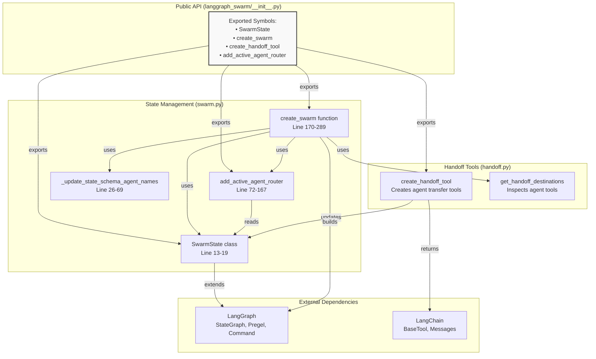

**Diagram: Core Module Structure and Code Entities**

### Component Descriptions

| Component | Location | Purpose |
|-----------|----------|---------|
| `SwarmState` | [langgraph_swarm/swarm.py:13-19]() | State schema extending `MessagesState` with `active_agent` field |
| `create_swarm` | [langgraph_swarm/swarm.py:170-289]() | Factory function that builds a multi-agent `StateGraph` |
| `create_handoff_tool` | [langgraph_swarm/handoff.py]() | Generates tools that agents use to transfer control |
| `add_active_agent_router` | [langgraph_swarm/swarm.py:72-167]() | Adds conditional routing logic to direct execution to the active agent |
| `get_handoff_destinations` | [langgraph_swarm/handoff.py]() | Extracts which agents can be reached from a given agent's tools |

**Sources:** [langgraph_swarm/__init__.py:1-9](), [langgraph_swarm/swarm.py:13-167]()

---

## High-Level Architecture

The swarm architecture follows a router-agent pattern where a central routing mechanism directs execution to the currently active agent:

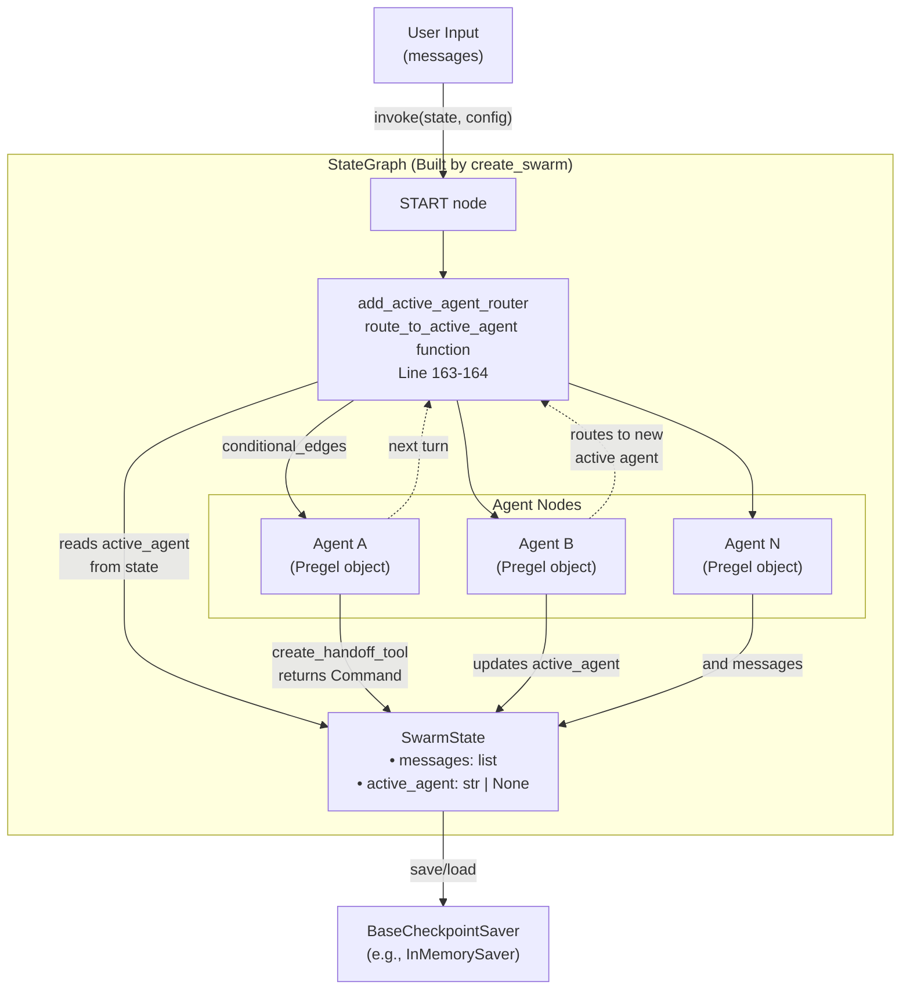

**Diagram: Swarm Execution Architecture with Code Symbols**

### Execution Flow

1. **Initialization**: User invokes the compiled swarm with messages and a configuration containing a thread ID
2. **State Loading**: The checkpointer loads the previous state (if any), including the last `active_agent`
3. **Routing**: The `add_active_agent_router` examines `state["active_agent"]` and routes to that agent node
4. **Agent Execution**: The active agent processes messages and decides whether to:
   - Respond to the user, or
   - Invoke a handoff tool created by `create_handoff_tool`
5. **Handoff**: If a handoff tool is invoked, it returns a `Command` object that:
   - Updates `state["active_agent"]` to the new agent name
   - Transitions execution to the new agent node via `Command.goto`
6. **State Persistence**: After each agent turn, the checkpointer saves the updated state
7. **Continuation**: On the next user message, the flow restarts from step 2, resuming with the last active agent

**Sources:** [langgraph_swarm/swarm.py:163-167](), [README.md:86-116]()

---

## SwarmState Schema

The `SwarmState` class is the foundation of swarm orchestration:

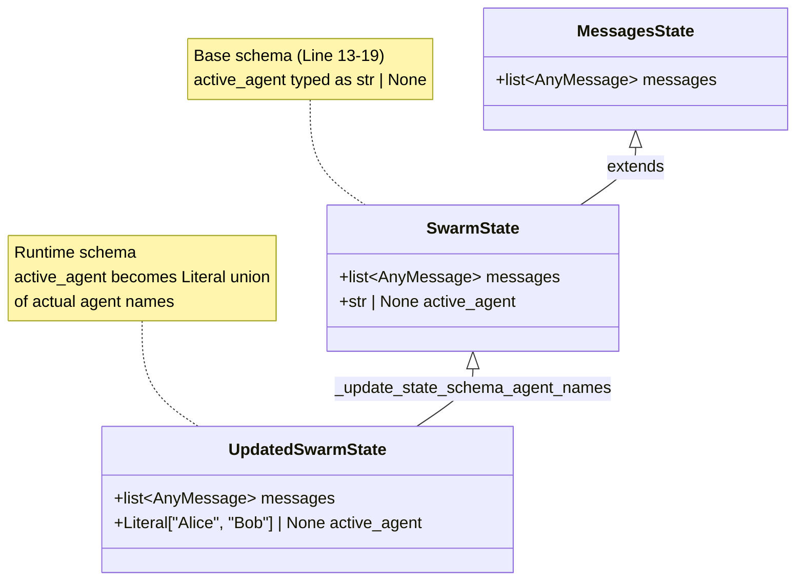

**Diagram: SwarmState Type Hierarchy**

The `active_agent` field undergoes a type transformation during swarm creation:

| Stage | Type | Purpose |
|-------|------|---------|
| **Definition** | `str \| None` | Generic type for flexibility |
| **Runtime** | `Literal["Alice", "Bob", ...] \| None` | Specific agent names for type safety |

The `_update_state_schema_agent_names` function [langgraph_swarm/swarm.py:26-69]() performs this transformation, converting the generic `str` annotation to a `Literal` union of actual agent names. This provides:
- IDE autocomplete when accessing `state["active_agent"]`
- Type checking to prevent routing to non-existent agents
- Clear documentation of available agents in the type system

**Sources:** [langgraph_swarm/swarm.py:13-69]()

---

## Agent Handoff Mechanism

Agents transfer control using specialized LangChain tools created by `create_handoff_tool`:

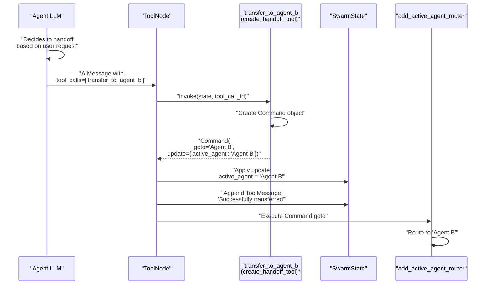

**Diagram: Handoff Tool Execution Flow**

### Handoff Tool Structure

Handoff tools created by `create_handoff_tool` have the following characteristics:

| Property | Value | Purpose |
|----------|-------|---------|
| **Return Type** | `Command` | Instructs LangGraph to update state and route to a new node |
| **Tool Name** | `transfer_to_{agent_name}` | Descriptive name for the LLM to invoke |
| **Command.goto** | Target agent name | Specifies which agent node to execute next |
| **Command.graph** | `Command.PARENT` | Indicates the parent (swarm) graph should be updated |
| **Command.update** | `{"active_agent": ...}` | Sets the new active agent in the state |

**Sources:** [langgraph_swarm/handoff.py](), [README.md:122-172]()

---

## Package Structure

The library is organized into a minimal set of modules for clarity:

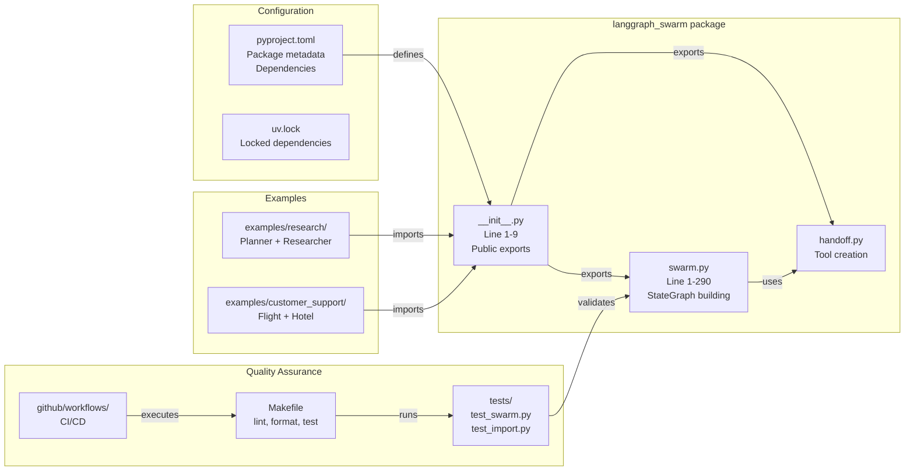

**Diagram: Repository Structure**

### Key Files

| Path | Lines | Purpose |
|------|-------|---------|
| `langgraph_swarm/__init__.py` | 1-9 | Exports public API: `SwarmState`, `create_swarm`, `create_handoff_tool`, `add_active_agent_router` |
| `langgraph_swarm/swarm.py` | 1-290 | Core orchestration logic: state schema management, graph building, routing |
| `langgraph_swarm/handoff.py` | - | Handoff tool creation and destination inspection |
| `pyproject.toml` | - | Package configuration, dependencies, build system |
| `examples/` | - | Demonstration applications showing different agent patterns |
| `tests/` | - | Unit tests with mocked LLM interactions |

**Sources:** [langgraph_swarm/__init__.py:1-9](), [langgraph_swarm/swarm.py:1-290]()

---

## Basic Usage Pattern

A typical swarm application follows this structure:

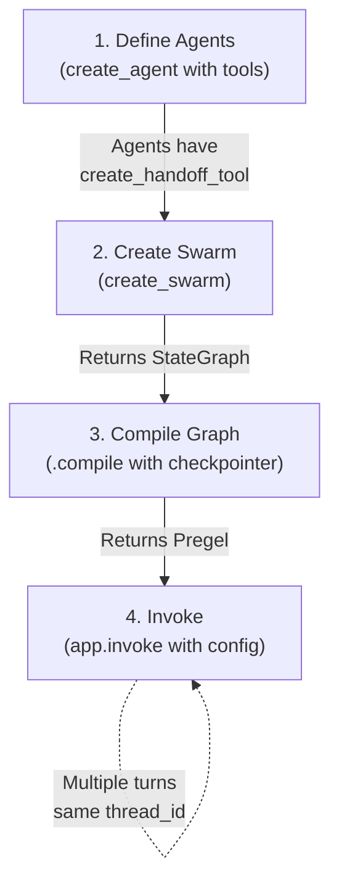

**Diagram: Swarm Usage Flow**

### Minimal Example Structure

From [README.md:28-84]():

1. **Agent Creation**: Each agent is created with:
   - A language model (e.g., GPT-4)
   - Domain-specific tools
   - At least one handoff tool to another agent
   - A system prompt defining its role

2. **Swarm Creation**: `create_swarm([alice, bob], default_active_agent="Alice")` returns a `StateGraph`

3. **Compilation**: The graph is compiled with a checkpointer (e.g., `InMemorySaver()`) to enable state persistence

4. **Invocation**: The app is invoked with messages and a config containing a thread ID

**Sources:** [README.md:28-84]()

---

## Memory and Persistence

The swarm uses LangGraph's checkpointing system to maintain state across turns:

| Memory Type | Component | Purpose |
|-------------|-----------|---------|
| **Short-term (Conversation)** | `BaseCheckpointSaver` | Persists `messages` and `active_agent` within a thread |
| **Long-term (Cross-conversation)** | `BaseStore` | Stores user preferences, facts across multiple threads |

Without a checkpointer, the swarm would "forget" which agent was last active between invocations. The checkpointer ensures that:
- Conversation history is preserved
- The `active_agent` field persists across turns
- Each thread maintains independent state

Configuration example:
```python
config = {"configurable": {"thread_id": "1"}}
turn_1 = app.invoke({"messages": [...]}, config)
turn_2 = app.invoke({"messages": [...]}, config)  # Continues from turn_1
```

**Sources:** [README.md:86-116]()

---

## Where to Learn More

This overview introduced the core concepts of `langgraph-swarm`. For deeper understanding:

- **Core Implementation Details**: See [Core Architecture](#2) for detailed explanations of state management, routing, and handoff mechanisms
- **State and Routing**: See [SwarmState and Agent Routing](#2.1) for the routing algorithm and state schema transformations
- **Handoff Tools**: See [Agent Handoff Mechanism](#2.2) for `create_handoff_tool` implementation and customization patterns
- **Memory Integration**: See [Memory and State Management](#2.3) for checkpointer configuration and cross-turn persistence
- **Example Applications**: See [Example Applications](#3) for complete, working multi-agent systems
- **Development**: See [Development and Configuration](#4) for contributing, testing, and build system documentation

**Sources:** [README.md:1-239](), [langgraph_swarm/swarm.py:1-290]()

---

# Page: Core Architecture

# Core Architecture

<details>
<summary>Relevant source files</summary>

The following files were used as context for generating this wiki page:

- [langgraph_swarm/__init__.py](langgraph_swarm/__init__.py)
- [langgraph_swarm/handoff.py](langgraph_swarm/handoff.py)
- [langgraph_swarm/swarm.py](langgraph_swarm/swarm.py)

</details>


## Purpose and Scope

This document provides an overview of the core `langgraph-swarm` library architecture and its primary components. It describes how the library enables multi-agent orchestration through state management, dynamic routing, and agent handoff mechanisms. For detailed implementation specifics, see:
- State schema and routing details: [SwarmState and Agent Routing](#2.1)
- Handoff tool implementation: [Agent Handoff Mechanism](#2.2)
- Persistence and checkpointing: [Memory and State Management](#2.3)

The core library consists of approximately 300 lines of code across two primary modules that build upon LangGraph's `StateGraph` and LangChain's `BaseTool` abstractions.

**Sources:** [langgraph_swarm/__init__.py:1-9](), [langgraph_swarm/swarm.py:1-290](), [langgraph_swarm/handoff.py:1-118]()

## Component Overview

The library provides four main public APIs exported from [langgraph_swarm/__init__.py]():

| Component | Type | Purpose |
|-----------|------|---------|
| `SwarmState` | Class | State schema containing messages and active agent tracking |
| `create_swarm()` | Function | Main entry point to construct multi-agent StateGraph |
| `add_active_agent_router()` | Function | Adds conditional routing from START node based on active_agent |
| `create_handoff_tool()` | Function | Generates tools that enable agent-to-agent transfers |

Additional internal utilities support these core components:

| Component | Type | Purpose |
|-----------|------|---------|
| `_update_state_schema_agent_names()` | Function | Dynamically converts `str` annotations to `Literal` types |
| `get_handoff_destinations()` | Function | Extracts handoff destinations from agent tool metadata |

**Sources:** [langgraph_swarm/__init__.py:1-9](), [langgraph_swarm/swarm.py:13-290](), [langgraph_swarm/handoff.py:43-118]()

## Architecture Diagram

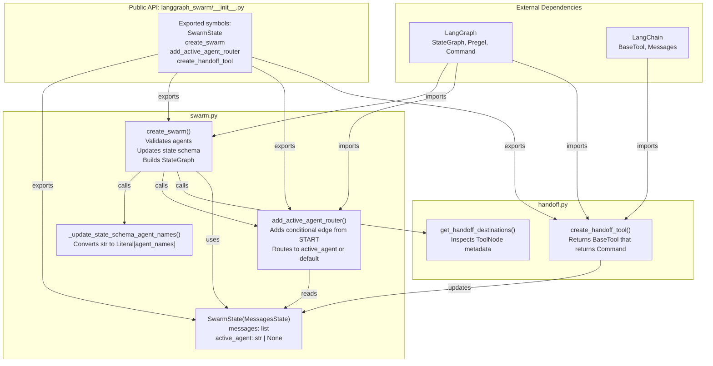

**Sources:** [langgraph_swarm/__init__.py:1-9](), [langgraph_swarm/swarm.py:1-290](), [langgraph_swarm/handoff.py:1-118]()

## Code Organization

The library follows a simple two-module structure:

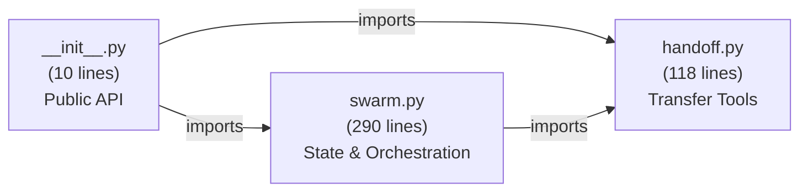

### Module Responsibilities

**[langgraph_swarm/swarm.py]()**: Core orchestration logic
- `SwarmState` class definition [langgraph_swarm/swarm.py:13-20]()
- `create_swarm()` function that builds the multi-agent graph [langgraph_swarm/swarm.py:170-289]()
- `add_active_agent_router()` for conditional routing [langgraph_swarm/swarm.py:72-167]()
- `_update_state_schema_agent_names()` for dynamic typing [langgraph_swarm/swarm.py:26-69]()

**[langgraph_swarm/handoff.py]()**: Agent transfer mechanisms
- `create_handoff_tool()` that generates transfer tools [langgraph_swarm/handoff.py:43-96]()
- `get_handoff_destinations()` for destination extraction [langgraph_swarm/handoff.py:99-117]()
- Internal utilities for field access and name normalization [langgraph_swarm/handoff.py:13-40]()

**Sources:** [langgraph_swarm/__init__.py:1-9](), [langgraph_swarm/swarm.py:1-290](), [langgraph_swarm/handoff.py:1-118]()

## State Schema Architecture

The `SwarmState` class extends LangGraph's `MessagesState` to track the currently active agent:

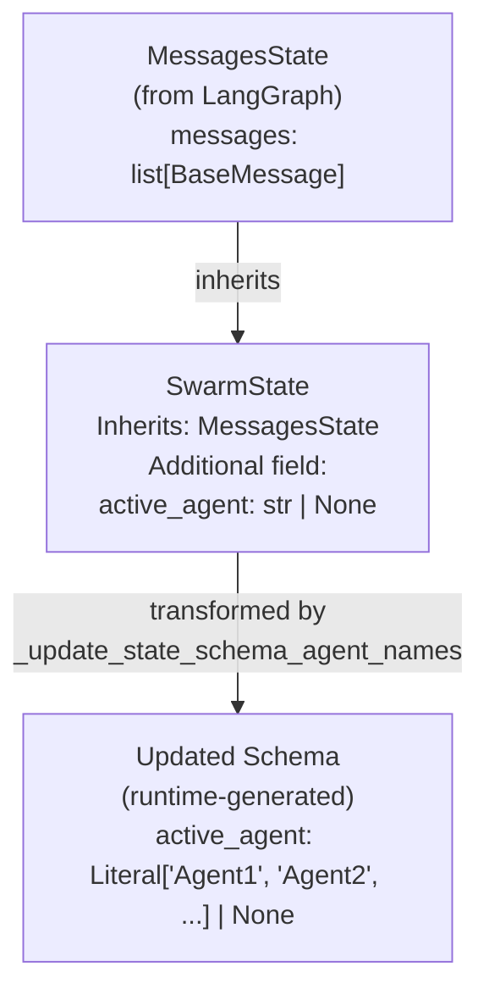

The `active_agent` field serves two purposes:
1. **Optional initialization**: Users can optionally specify a starting agent [langgraph_swarm/swarm.py:16-19]()
2. **Runtime tracking**: Updated by handoff tools during execution to track which agent is currently active

The dynamic type transformation from `str | None` to `Literal[agent_names] | None` provides IDE autocomplete and type checking while maintaining runtime flexibility. This transformation occurs in `_update_state_schema_agent_names()` [langgraph_swarm/swarm.py:26-69]().

**Sources:** [langgraph_swarm/swarm.py:13-20](), [langgraph_swarm/swarm.py:26-69]()

## Routing System

The routing system uses LangGraph's conditional edges to direct execution based on the `active_agent` state field:

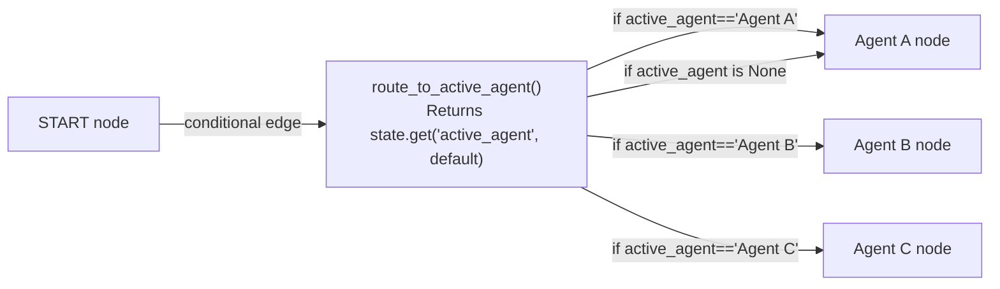

The `add_active_agent_router()` function [langgraph_swarm/swarm.py:72-167]() implements this by:
1. Validating that `active_agent` exists in the state schema [langgraph_swarm/swarm.py:152-155]()
2. Defining a `route_to_active_agent()` function that reads state [langgraph_swarm/swarm.py:163-164]()
3. Adding a conditional edge from `START` with agent names as the path map [langgraph_swarm/swarm.py:166]()

The router falls back to `default_active_agent` when `active_agent` is `None`, which occurs on the first invocation before any handoffs.

**Sources:** [langgraph_swarm/swarm.py:72-167]()

## Handoff Tool Mechanism

Agent handoffs are implemented as LangChain `BaseTool` instances that return `Command` objects:

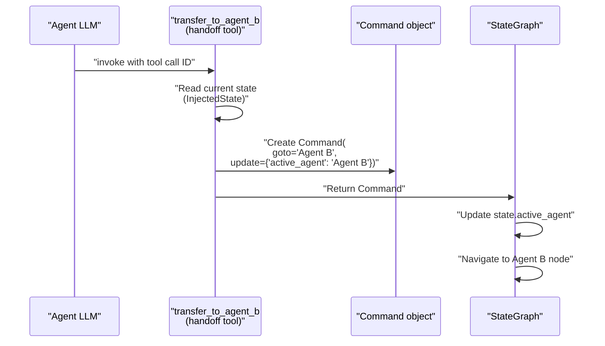

The `create_handoff_tool()` function [langgraph_swarm/handoff.py:43-96]() generates tools with:
- Tool name: `transfer_to_{normalized_agent_name}` [langgraph_swarm/handoff.py:68]()
- Injected state parameter for reading current messages [langgraph_swarm/handoff.py:78]()
- Injected tool call ID for creating confirmation message [langgraph_swarm/handoff.py:79]()
- Metadata marking the destination agent [langgraph_swarm/handoff.py:95]()

The returned `Command` object [langgraph_swarm/handoff.py:86-93]() instructs the graph to:
1. Navigate to the target agent node via `goto=agent_name`
2. Update the parent graph state via `graph=Command.PARENT`
3. Append a confirmation `ToolMessage` and update `active_agent`

**Sources:** [langgraph_swarm/handoff.py:43-96]()

## Swarm Construction Flow

The `create_swarm()` function [langgraph_swarm/swarm.py:170-289]() orchestrates the construction of a multi-agent graph:

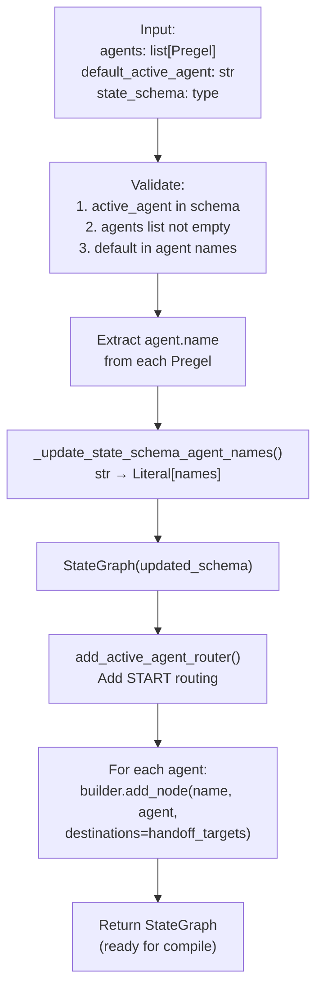

Key validations performed [langgraph_swarm/swarm.py:255-268]():
1. `active_agent` annotation exists in state schema
2. Agents list is not empty
3. `default_active_agent` exists in the list of agent names

The function also calls `get_handoff_destinations()` [langgraph_swarm/swarm.py:284-286]() to extract handoff targets from each agent's tools, which are registered as valid destinations for the node.

**Sources:** [langgraph_swarm/swarm.py:170-289](), [langgraph_swarm/swarm.py:255-268]()

## Runtime Execution Model

The compiled swarm executes agents in a loop controlled by state and commands:

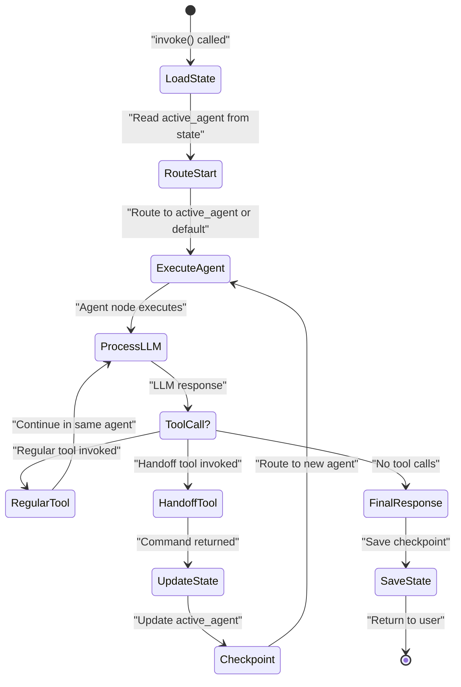

The execution flow leverages several LangGraph primitives:
- **Checkpointer**: Persists state after each node execution for conversation continuity (covered in [Memory and State Management](#2.3))
- **Command objects**: Enable both navigation (`goto`) and state updates (`update`) in a single return value [langgraph_swarm/handoff.py:86-93]()
- **Conditional edges**: Route based on current state rather than hardcoded transitions [langgraph_swarm/swarm.py:166]()

When a handoff tool returns a `Command` with `graph=Command.PARENT` [langgraph_swarm/handoff.py:88](), the command updates the parent swarm's state, not the individual agent's state. This is critical for maintaining the `active_agent` field at the swarm level.

**Sources:** [langgraph_swarm/swarm.py:166](), [langgraph_swarm/handoff.py:86-93]()

## Dependency Architecture

The library builds on two primary LangChain ecosystem packages:

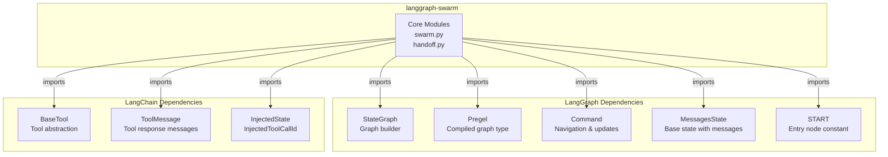

**LangGraph imports** [langgraph_swarm/swarm.py:6-7]():
- `StateGraph`: Graph construction API used in `create_swarm()`
- `Pregel`: Type annotation for compiled agents
- `MessagesState`: Base class for `SwarmState`
- `START`: Special node identifier for entry point routing

**LangChain imports** [langgraph_swarm/handoff.py:5-6]():
- `BaseTool`: Base class for all tools including handoff tools
- `ToolMessage`: Message type for tool execution results
- `InjectedState`, `InjectedToolCallId`: Annotations for runtime dependency injection

The library requires no direct LLM dependencies, as agents are provided as pre-compiled `Pregel` objects that already contain their model configurations.

**Sources:** [langgraph_swarm/swarm.py:1-11](), [langgraph_swarm/handoff.py:1-10]()

---

# Page: SwarmState and Agent Routing

# SwarmState and Agent Routing

<details>
<summary>Relevant source files</summary>

The following files were used as context for generating this wiki page:

- [README.md](README.md)
- [langgraph_swarm/swarm.py](langgraph_swarm/swarm.py)
- [tests/test_swarm.py](tests/test_swarm.py)

</details>


This document details the core components that enable automatic routing of messages between agents in the LangGraph Swarm framework. This section focuses specifically on how the system maintains state and determines which agent should handle incoming messages. For information about how agents transfer control between each other, see [Agent Handoff Mechanism](#2.2).

## SwarmState Overview

The `SwarmState` class is the foundation of the multi-agent system's state management. It extends LangGraph's `MessagesState` class and adds a critical field to track which agent is currently active.

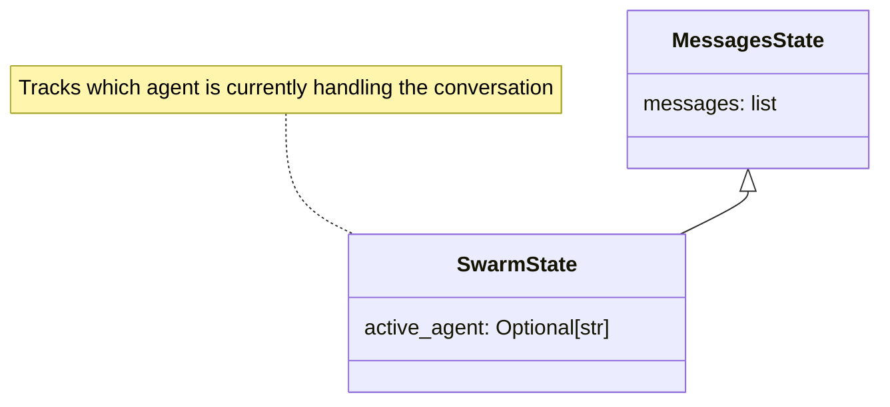

Sources: [langgraph_swarm/swarm.py:8-14]()

The `active_agent` field is the key to the routing system - it stores the name of the agent that should receive the next input. This field can be:
- A string representing an agent name
- `None` if no agent is currently active (causing the system to use the default agent)

## How Agent Routing Works

When a user sends a message to the multi-agent system, the message needs to be directed to the appropriate agent. This routing is handled automatically based on the `active_agent` field in the state.

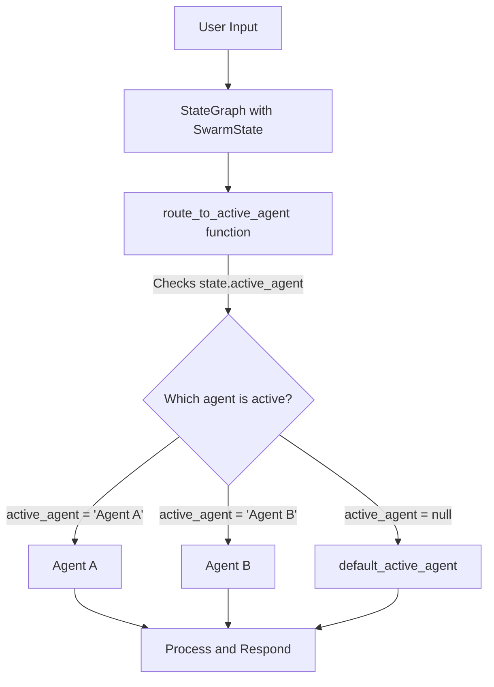

Sources: [langgraph_swarm/swarm.py:56-85]()

### Router Implementation

The routing mechanism is implemented in the `add_active_agent_router` function, which adds a conditional edge to the StateGraph that directs inputs based on the `active_agent` field:

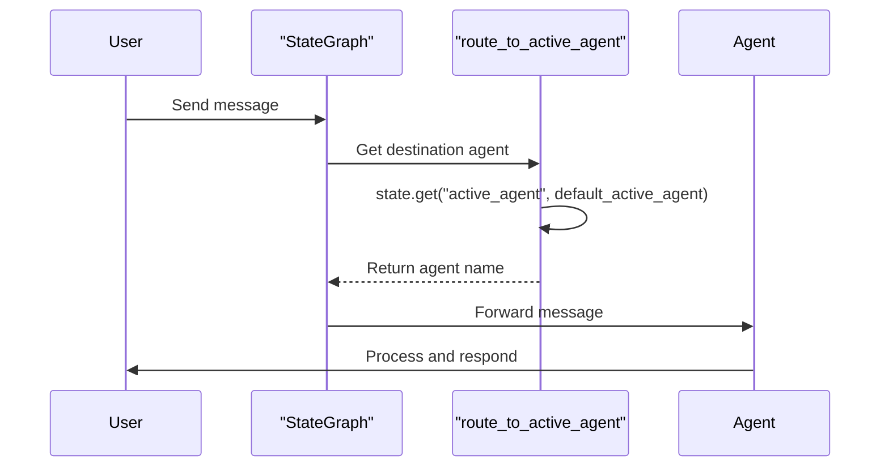

Sources: [langgraph_swarm/swarm.py:56-85](), [langgraph_swarm/swarm.py:81-82]()

The router is implemented with a simple function that retrieves the active agent from the state:

```python
def route_to_active_agent(state: dict):
    return state.get("active_agent", default_active_agent)
```

If the `active_agent` field is not set, it falls back to the default agent specified during system initialization.

## Type Safety for Agent Names

To provide type safety and validation, the framework includes a function that enhances the state schema by converting the `active_agent` field's type annotation from a generic string to a specific `Literal` type containing all valid agent names:

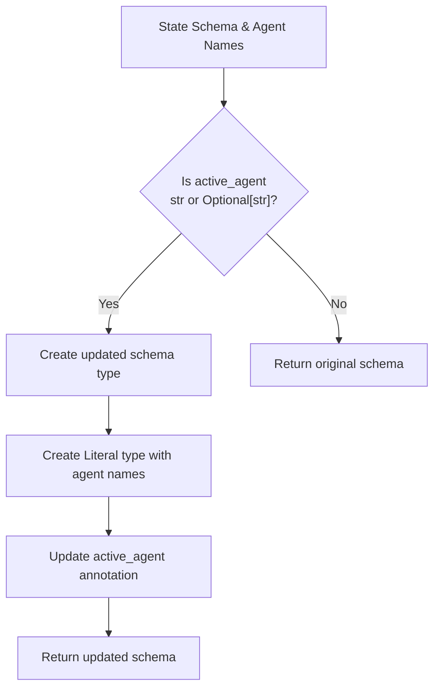

Sources: [langgraph_swarm/swarm.py:21-53]()

This ensures that the `active_agent` field can only be set to valid agent names, preventing routing errors at runtime.

## Creating a Multi-Agent Swarm

The complete multi-agent system is created using the `create_swarm` function, which ties together all these components:

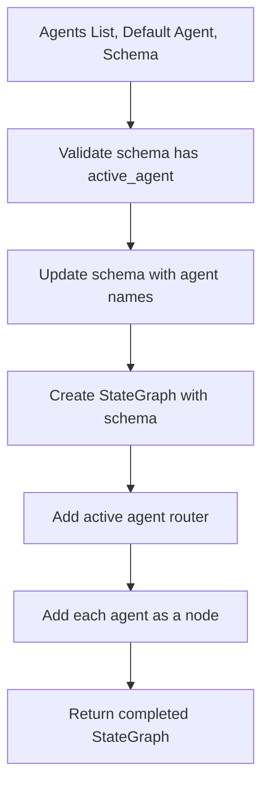

Sources: [langgraph_swarm/swarm.py:88-126]()

The function:
1. Validates that the state schema has an `active_agent` field
2. Updates the schema to use a `Literal` type for `active_agent`
3. Creates a new StateGraph with the enhanced schema
4. Adds the active agent router
5. Adds each agent as a node in the graph
6. Returns the configured StateGraph

## Complete System Flow

Here's how the complete routing system works in practice:

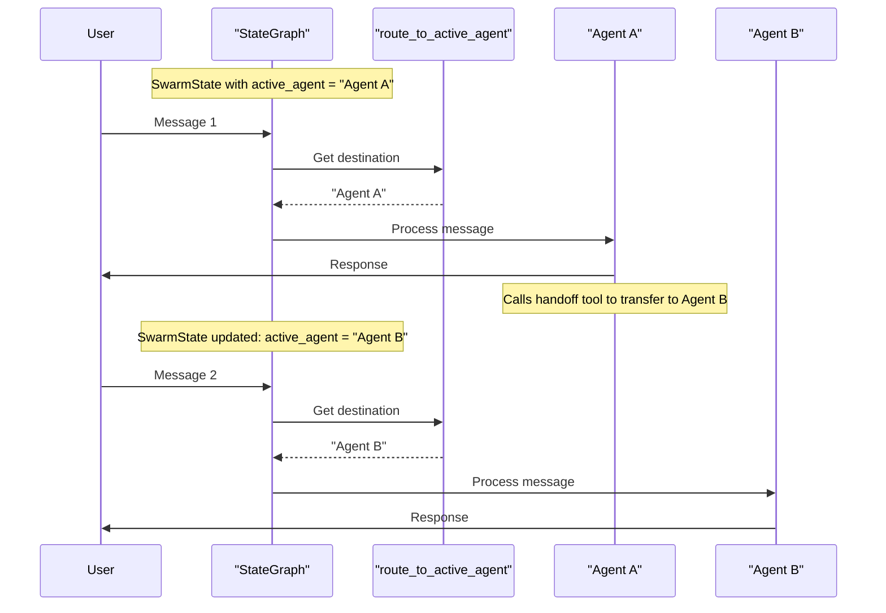

Sources: [langgraph_swarm/swarm.py:8-126]()

This diagram shows how the routing system enables seamless transitions between agents within a conversation flow. When an agent decides to transfer control to another agent, it updates the `active_agent` field in the state, and subsequent messages are automatically routed to the new agent.

## Working with SwarmState in Custom Applications

When creating custom applications with LangGraph Swarm, developers can:

1. Use the default `SwarmState` class as is
2. Extend `SwarmState` to add additional fields while maintaining the routing functionality
3. Specify a different default agent when creating the swarm

Example schema extension pattern:

```python
class CustomSwarmState(SwarmState):
    # Inherit active_agent from SwarmState
    # Add custom fields
    user_preferences: dict
    conversation_context: str
```

The routing system will still work with the extended schema as long as it includes the `active_agent` field.

## Summary

The `SwarmState` and agent routing system provide the foundation for multi-agent conversations by:

1. Tracking which agent is currently active through the `active_agent` field in `SwarmState`
2. Automatically routing incoming messages to the active agent
3. Supporting seamless handoffs between agents by updating the `active_agent` field
4. Ensuring type safety through the use of a `Literal` type for agent names

This system allows for complex, multi-agent conversations where different agents can collaborate on solving user requests, each handling the parts they specialize in.

---

# Page: Agent Handoff Mechanism

# Agent Handoff Mechanism

<details>
<summary>Relevant source files</summary>

The following files were used as context for generating this wiki page:

- [langgraph_swarm/handoff.py](langgraph_swarm/handoff.py)
- [langgraph_swarm/swarm.py](langgraph_swarm/swarm.py)
- [tests/test_swarm.py](tests/test_swarm.py)

</details>


## Purpose and Scope

This document explains the agent handoff mechanism in langgraph-swarm, which enables agents to dynamically transfer control to other agents during execution. The handoff mechanism is implemented through specialized tools that return `Command` objects to update graph state and navigate to different agent nodes.

For information about how the swarm router uses the `active_agent` state to determine which agent executes next, see [SwarmState and Agent Routing](#2.1). For details on how state is persisted across handoffs, see [Memory and State Management](#2.3).

**Sources:** [langgraph_swarm/handoff.py](), [langgraph_swarm/swarm.py]()

---

## Overview

The agent handoff mechanism consists of three primary components:

1. **Handoff tools** - LangChain tools created via `create_handoff_tool()` that agents can invoke to transfer control
2. **Command objects** - Return values from handoff tools that instruct the graph to navigate to a different agent and update state
3. **Destination metadata** - Metadata attached to handoff tools that identifies valid transfer targets

When an agent's LLM decides to invoke a handoff tool, the tool execution returns a `Command` object. This command simultaneously updates the parent graph's state (setting `active_agent` to the target agent name) and instructs the graph to navigate to the target agent's node.

**Sources:** [langgraph_swarm/handoff.py:43-97]()

---

## Architecture: Handoff System Components

```mermaid
graph TB
    subgraph "Agent Definition (User Code)"
        AGENT["Agent (Pregel)"]
        TOOLS["Agent's Tool List"]
        HANDOFF_TOOL["create_handoff_tool()<br/>agent_name='TargetAgent'"]
    end
    
    subgraph "Handoff Tool Implementation"
        TOOL_DEF["BaseTool<br/>name='transfer_to_target_agent'<br/>description='Ask agent TargetAgent for help'"]
        METADATA["tool.metadata<br/>{__handoff_destination: 'TargetAgent'}"]
        TOOL_FUNC["handoff_to_agent()<br/>@tool decorated function"]
    end
    
    subgraph "Runtime Execution"
        STATE_INPUT["InjectedState<br/>Current SwarmState"]
        TOOL_CALL_ID["InjectedToolCallId<br/>Tool invocation ID"]
        CMD["Command<br/>goto='TargetAgent'<br/>graph=Command.PARENT<br/>update={active_agent, messages}"]
        TOOL_MSG["ToolMessage<br/>'Successfully transferred to...'"]
    end
    
    subgraph "Destination Discovery"
        GET_DEST["get_handoff_destinations()"]
        TOOL_NODE["ToolNode<br/>tools_by_name dict"]
        DEST_LIST["list[str]<br/>['TargetAgent', ...]"]
    end
    
    HANDOFF_TOOL -->|creates| TOOL_DEF
    TOOL_DEF -->|has| METADATA
    TOOL_DEF -->|implements| TOOL_FUNC
    TOOLS -->|contains| TOOL_DEF
    AGENT -->|has| TOOLS
    
    TOOL_FUNC -->|receives| STATE_INPUT
    TOOL_FUNC -->|receives| TOOL_CALL_ID
    TOOL_FUNC -->|creates| TOOL_MSG
    TOOL_FUNC -->|returns| CMD
    CMD -->|contains| TOOL_MSG
    
    GET_DEST -->|inspects| AGENT
    GET_DEST -->|extracts from| TOOL_NODE
    TOOL_NODE -->|contains| TOOL_DEF
    GET_DEST -->|reads| METADATA
    GET_DEST -->|returns| DEST_LIST
```

**Diagram: Handoff Tool Architecture** - This diagram shows how `create_handoff_tool()` creates a `BaseTool` with handoff metadata, how the tool function receives injected state, and how `get_handoff_destinations()` extracts destination information from agent tools.

**Sources:** [langgraph_swarm/handoff.py:43-97](), [langgraph_swarm/handoff.py:99-117]()

---

## Creating Handoff Tools

### The `create_handoff_tool()` Function

The `create_handoff_tool()` function creates a LangChain tool that enables agent-to-agent transfers. It is defined in [langgraph_swarm/handoff.py:43-97]().

**Function Signature:**
```python
def create_handoff_tool(
    *,
    agent_name: str,
    name: str | None = None,
    description: str | None = None,
) -> BaseTool
```

**Parameters:**

| Parameter | Type | Description |
|-----------|------|-------------|
| `agent_name` | `str` | Name of the target agent node in the multi-agent graph |
| `name` | `str \| None` | Optional tool name (default: `transfer_to_<normalized_agent_name>`) |
| `description` | `str \| None` | Optional tool description (default: `Ask agent '<agent_name>' for help`) |

**Key Implementation Details:**

1. **Name normalization** - Agent names are normalized using `_normalize_agent_name()` [langgraph_swarm/handoff.py:38-40](), which converts whitespace to underscores and converts to lowercase. This ensures tool names are valid identifiers.

2. **Metadata tagging** - The created tool is tagged with metadata containing the destination agent name [langgraph_swarm/handoff.py:95]():
   ```python
   handoff_to_agent.metadata = {METADATA_KEY_HANDOFF_DESTINATION: agent_name}
   ```
   where `METADATA_KEY_HANDOFF_DESTINATION = "__handoff_destination"` [langgraph_swarm/handoff.py:35]()

3. **Injected dependencies** - The tool function uses two injected parameters:
   - `state: Annotated[Any, InjectedState]` - The current graph state
   - `tool_call_id: Annotated[str, InjectedToolCallId]` - The tool invocation ID

**Sources:** [langgraph_swarm/handoff.py:43-97](), [langgraph_swarm/handoff.py:34-40]()

### Tool Function Execution

When an agent's LLM invokes a handoff tool, the inner `handoff_to_agent()` function executes [langgraph_swarm/handoff.py:74-93]():

1. **Creates a ToolMessage** - Constructs a confirmation message:
   ```python
   tool_message = ToolMessage(
       content=f"Successfully transferred to {agent_name}",
       name=name,
       tool_call_id=tool_call_id,
   )
   ```

2. **Returns a Command object** - The command instructs the parent graph to:
   - Navigate to the target agent node (`goto=agent_name`)
   - Target the parent graph (`graph=Command.PARENT`)
   - Update state with the new message and active agent:
     ```python
     update={
         "messages": [*_get_field(state, "messages"), tool_message],
         "active_agent": agent_name,
     }
     ```

The `_get_field()` helper function [langgraph_swarm/handoff.py:13-31]() supports retrieving fields from dictionaries, dataclasses, or Pydantic models, making the handoff mechanism compatible with different state schema types.

**Sources:** [langgraph_swarm/handoff.py:74-93](), [langgraph_swarm/handoff.py:13-31]()

---

## Command Objects and State Updates

### The Command Return Value

Handoff tools return `Command` objects from `langgraph.types` [langgraph_swarm/handoff.py:9](). The `Command` object is a special return type that instructs LangGraph to perform graph navigation and state updates simultaneously.

**Command Structure for Handoffs:**

```python
Command(
    goto=agent_name,          # Navigate to this node
    graph=Command.PARENT,     # Target the parent graph (not subgraph)
    update={                  # State updates to apply
        "messages": [...],    # Append tool message
        "active_agent": agent_name  # Update active agent
    }
)
```

**Key Properties:**

| Property | Value | Purpose |
|----------|-------|---------|
| `goto` | Target agent name | Specifies which graph node to execute next |
| `graph` | `Command.PARENT` | Ensures state updates apply to parent swarm graph, not agent subgraph |
| `update` | State dict | Contains state fields to update (messages, active_agent) |

The `Command.PARENT` directive is critical - it ensures that when an agent (which may be its own subgraph) returns a command, the state update applies to the parent swarm graph's `SwarmState`, not the agent's internal state.

**Sources:** [langgraph_swarm/handoff.py:86-93]()

### State Update Mechanics

The `update` dictionary contains two fields:

1. **`messages`** - The tool message is appended to the conversation history using the spread operator on the current messages list [langgraph_swarm/handoff.py:90](). This preserves all previous messages while adding the handoff confirmation.

2. **`active_agent`** - Set to the target agent name [langgraph_swarm/handoff.py:91](). This field is read by `add_active_agent_router()` (see [SwarmState and Agent Routing](#2.1)) to determine which agent executes on the next graph iteration.

**Sources:** [langgraph_swarm/handoff.py:86-93]()

---

## Handoff Destination Discovery

### The `get_handoff_destinations()` Function

The `get_handoff_destinations()` function extracts a list of valid handoff targets from an agent's tools [langgraph_swarm/handoff.py:99-117]().

**Function Signature:**
```python
def get_handoff_destinations(
    agent: CompiledStateGraph, 
    tool_node_name: str = "tools"
) -> list[str]
```

**Algorithm:**

1. **Retrieve graph nodes** - Gets the graph structure from the compiled agent [langgraph_swarm/handoff.py:103]()
2. **Locate tool node** - Searches for a node with the specified name (default: `"tools"`) [langgraph_swarm/handoff.py:104-105]()
3. **Validate node type** - Ensures the node is a `ToolNode` instance [langgraph_swarm/handoff.py:108-109]()
4. **Extract metadata** - Iterates through `tool_node.tools_by_name.values()` and extracts destinations from tools that have `__handoff_destination` metadata [langgraph_swarm/handoff.py:111-117]()

**Return Value:** A list of agent names (strings) that the agent can transfer to, or an empty list if no handoff tools exist.

**Sources:** [langgraph_swarm/handoff.py:99-117]()

### Integration with `create_swarm()`

The `create_swarm()` function calls `get_handoff_destinations()` for each agent when building the graph [langgraph_swarm/swarm.py:278-287]():

```python
for agent in agents:
    builder.add_node(
        agent.name,
        agent,
        destinations=tuple(
            get_handoff_destinations(agent)
        ),
    )
```

The `destinations` parameter configures the graph edges, allowing LangGraph to validate that handoff targets exist in the graph topology. This prevents runtime errors from agents attempting to transfer to non-existent agents.

**Sources:** [langgraph_swarm/swarm.py:277-287](), [langgraph_swarm/swarm.py:10]()

---

## Handoff Execution Flow

```mermaid
sequenceDiagram
    participant LLM as "Agent LLM"
    participant Agent as "Active Agent Node"
    participant Tool as "create_handoff_tool()"
    participant Cmd as "Command Object"
    participant Router as "Swarm Router"
    participant State as "SwarmState"
    participant Target as "Target Agent Node"
    
    LLM->>Agent: "Generate response with tool calls"
    Agent->>Agent: "Process tool calls"
    Agent->>Tool: "invoke(state, tool_call_id)"
    
    Note over Tool: "Injected parameters:<br/>state (InjectedState)<br/>tool_call_id (InjectedToolCallId)"
    
    Tool->>Tool: "_get_field(state, 'messages')"
    Tool->>Tool: "Create ToolMessage:<br/>'Successfully transferred to...'"
    
    Tool->>Cmd: "Return Command(<br/>goto=target_agent,<br/>graph=Command.PARENT,<br/>update={messages, active_agent})"
    
    Cmd->>Router: "Execute command on parent graph"
    Router->>State: "update['active_agent'] = target_agent"
    Router->>State: "update['messages'].append(tool_message)"
    
    Note over State: "State now contains:<br/>active_agent='TargetAgent'<br/>messages=[...tool_message]"
    
    Router->>Router: "Command.goto triggers navigation"
    Router->>Target: "Execute target agent with updated state"
    Target->>LLM: "Process with new context"
```

**Diagram: Handoff Execution Sequence** - This sequence diagram shows the complete flow from LLM tool call decision through Command execution and state update to target agent activation.

**Sources:** [langgraph_swarm/handoff.py:74-93](), [tests/test_swarm.py:127-138]()

---

## Handoff Tool Naming Convention

### Name Generation

The default tool name is generated by the pattern `transfer_to_<normalized_agent_name>` [langgraph_swarm/handoff.py:68]().

**Normalization Process:**

The `_normalize_agent_name()` function [langgraph_swarm/handoff.py:38-40]() applies the following transformations:

1. Strip leading/trailing whitespace
2. Replace all internal whitespace sequences with single underscores
3. Convert to lowercase

**Examples:**

| Agent Name | Normalized Name | Tool Name |
|------------|-----------------|-----------|
| `"Bob"` | `"bob"` | `"transfer_to_bob"` |
| `"Flight Assistant"` | `"flight_assistant"` | `"transfer_to_flight_assistant"` |
| `"Hotel   Booking"` | `"hotel_booking"` | `"transfer_to_hotel_booking"` |

This ensures tool names are valid Python identifiers and compatible with LLM provider tool naming requirements.

**Sources:** [langgraph_swarm/handoff.py:38-40](), [langgraph_swarm/handoff.py:67-68]()

---

## Example: Basic Handoff Configuration

The following pattern from the test suite demonstrates handoff tool creation and usage [tests/test_swarm.py:103-124]():

```python
# Agent Alice with handoff capability to Bob
alice = create_agent(
    model,
    tools=[
        add,  # Domain tool
        create_handoff_tool(agent_name="Bob")  # Handoff tool
    ],
    system_prompt="You are Alice, an addition expert.",
    name="Alice",
)

# Agent Bob with handoff capability to Alice
bob = create_agent(
    model,
    tools=[
        create_handoff_tool(
            agent_name="Alice",
            description="Transfer to Alice, she can help with math"
        ),
    ],
    system_prompt="You are Bob, you speak like a pirate.",
    name="Bob",
)
```

**Key Observations:**

1. **Bidirectional handoffs** - Both agents can transfer to each other by including corresponding handoff tools
2. **Tool mixing** - Handoff tools can be mixed with domain-specific tools (like the `add` function in Alice's toolkit)
3. **Custom descriptions** - The description parameter allows agents to understand when to use handoff tools (e.g., "she can help with math" provides context for Bob's LLM)

**Sources:** [tests/test_swarm.py:103-120]()

---

## Runtime Behavior

### Handoff Verification

During execution, the handoff mechanism provides verification through tool messages. After a successful handoff, the message list contains a `ToolMessage` [tests/test_swarm.py:136]():

```python
assert turn_1["messages"][-2].content == "Successfully transferred to Bob"
```

This confirmation message serves multiple purposes:

1. **Debugging** - Provides a clear audit trail of agent transitions
2. **Context** - Informs the target agent that control was transferred from another agent
3. **User visibility** - Can be shown to end users to explain agent transitions

**Sources:** [tests/test_swarm.py:134-138](), [langgraph_swarm/handoff.py:81-85]()

### State Synchronization

The handoff mechanism ensures state consistency by:

1. **Atomic updates** - The `Command` object applies both navigation and state updates as a single operation
2. **Message ordering** - New tool messages are appended to the existing message list, preserving conversation order
3. **Active agent tracking** - The `active_agent` field is updated synchronously with the graph navigation

This synchronization is critical for the router (see [SwarmState and Agent Routing](#2.1)) to correctly route subsequent messages to the active agent.

**Sources:** [langgraph_swarm/handoff.py:86-93]()

---

## Code Entity Reference

### Core Functions and Classes

| Entity | Location | Purpose |
|--------|----------|---------|
| `create_handoff_tool()` | [langgraph_swarm/handoff.py:43-97]() | Creates handoff tools for agent transfers |
| `get_handoff_destinations()` | [langgraph_swarm/handoff.py:99-117]() | Extracts handoff targets from agent tools |
| `_normalize_agent_name()` | [langgraph_swarm/handoff.py:38-40]() | Normalizes agent names for tool naming |
| `_get_field()` | [langgraph_swarm/handoff.py:13-31]() | Retrieves fields from various state types |
| `Command` | `langgraph.types` [langgraph_swarm/handoff.py:9]() | Graph navigation and state update instruction |
| `METADATA_KEY_HANDOFF_DESTINATION` | [langgraph_swarm/handoff.py:35]() | Metadata key for destination tagging (`"__handoff_destination"`) |

### Injected Parameters

The handoff tool function uses LangGraph's dependency injection:

- `InjectedState` [langgraph_swarm/handoff.py:8]() - Provides current graph state
- `InjectedToolCallId` [langgraph_swarm/handoff.py:6]() - Provides tool invocation identifier

**Sources:** [langgraph_swarm/handoff.py]()

---

## Integration Points

### With SwarmState

The handoff mechanism updates the `active_agent` field in `SwarmState` [langgraph_swarm/handoff.py:91](), which is read by the routing logic in `add_active_agent_router()` (documented in [SwarmState and Agent Routing](#2.1)).

### With create_swarm()

The `create_swarm()` function integrates handoff destination discovery when building the graph [langgraph_swarm/swarm.py:277-287](). It calls `get_handoff_destinations()` for each agent to configure valid transfer targets.

### With Checkpointer

After each handoff, the updated state (including new messages and active agent) is persisted by the checkpointer (see [Memory and State Management](#2.3)), enabling conversation continuity across invocations.

**Sources:** [langgraph_swarm/swarm.py:277-287](), [langgraph_swarm/handoff.py:99-117]()

---

# Page: Memory and State Management

# Memory and State Management

<details>
<summary>Relevant source files</summary>

The following files were used as context for generating this wiki page:

- [README.md](README.md)
- [examples/customer_support/src/agent/customer_support.ipynb](examples/customer_support/src/agent/customer_support.ipynb)
- [langgraph_swarm/swarm.py](langgraph_swarm/swarm.py)

</details>


## Purpose and Scope

This document explains how the langgraph-swarm library manages state and memory across multi-agent conversations. It covers the `SwarmState` schema, checkpointer integration, thread-based persistence, and state lifecycle during agent handoffs. For information about the agent handoff mechanism itself, see [Agent Handoff Mechanism](#2.2). For details on agent routing logic, see [SwarmState and Agent Routing](#2.1).

## State Schema Architecture

### SwarmState Definition

The `SwarmState` class serves as the foundation for all multi-agent state management in the swarm library. It extends LangGraph's `MessagesState` to provide conversation history tracking and adds agent routing capabilities.

```mermaid
graph TB
    MessagesState["MessagesState<br/>(LangGraph)"]
    SwarmState["SwarmState"]
    CustomState["Custom State Schemas<br/>(User-defined)"]
    
    MessagesState -->|"extends"| SwarmState
    SwarmState -->|"base for"| CustomState
    
    Messages["messages: list<br/>Conversation history"]
    ActiveAgent["active_agent: str | None<br/>Current active agent"]
    
    SwarmState --> Messages
    SwarmState --> ActiveAgent
```

**Sources:** [langgraph_swarm/swarm.py:13-19]()

The `SwarmState` class contains two primary fields:

| Field | Type | Purpose | Required |
|-------|------|---------|----------|
| `messages` | `list` | Stores the complete conversation history across all agents | Yes (inherited) |
| `active_agent` | `str \| None` | Tracks which agent should handle the next interaction | Optional |

The `active_agent` field is marked as optional because:
- It may not be provided on initial invocation
- The system will default to `default_active_agent` if not specified
- It gets automatically updated during agent handoffs

### Dynamic Type Enhancement

The library dynamically enhances the `active_agent` field type from generic `str` to a `Literal` union of actual agent names. This happens in `_update_state_schema_agent_names()` at compile time.

```mermaid
sequenceDiagram
    participant User
    participant create_swarm
    participant _update_state_schema
    participant StateGraph
    
    User->>create_swarm: create_swarm(agents, state_schema)
    create_swarm->>create_swarm: Extract agent names
    create_swarm->>_update_state_schema: _update_state_schema_agent_names()
    
    Note over _update_state_schema: Analyze active_agent type
    
    alt active_agent is str
        _update_state_schema->>_update_state_schema: Create new schema class
        _update_state_schema->>_update_state_schema: active_agent = Literal["Agent1", "Agent2", ...]
    else active_agent is str | None
        _update_state_schema->>_update_state_schema: active_agent = Literal["Agent1", "Agent2", ...] | None
    end
    
    _update_state_schema-->>create_swarm: Updated state schema
    create_swarm->>StateGraph: StateGraph(updated_state_schema)
    StateGraph-->>User: Configured workflow
```

**Sources:** [langgraph_swarm/swarm.py:26-69](), [langgraph_swarm/swarm.py:255-270]()

The type enhancement process:

1. **Type Detection** [langgraph_swarm/swarm.py:31-48](): Checks if `active_agent` is annotated as `str` or `str | None`
2. **Schema Creation** [langgraph_swarm/swarm.py:54-58](): Creates a new class inheriting from the original state schema
3. **Literal Type** [langgraph_swarm/swarm.py:61-67](): Converts the annotation to `Literal[tuple(agent_names)]` or `Literal[tuple(agent_names)] | None`

This provides IDE autocomplete and static type checking for agent names.

## Checkpointer Integration

### Purpose and Functionality

A checkpointer is essential for maintaining conversation continuity in multi-agent systems. Without it, the swarm cannot persist state between invocations and will lose track of conversation history and the active agent.

```mermaid
graph TB
    subgraph "Without Checkpointer"
        Invoke1["invoke()"]
        State1["State: Lost"]
        Invoke2["invoke()"]
        State2["State: Lost"]
        
        Invoke1 --> State1
        State1 -.->|"No persistence"| Invoke2
        Invoke2 --> State2
    end
    
    subgraph "With Checkpointer"
        InvokeA["invoke(config)"]
        Save["Checkpoint Saved"]
        Load["Checkpoint Loaded"]
        InvokeB["invoke(config)"]
        
        InvokeA --> Save
        Save -->|"Same thread_id"| Load
        Load --> InvokeB
    end
```

**Sources:** [README.md:86-116]()

The README emphasizes at [README.md:115-116]():

> Adding short-term memory is crucial for maintaining conversation state across multiple interactions. Without it, the swarm would "forget" which agent was last active and lose the conversation history.

### Available Checkpointer Implementations

LangGraph provides several checkpointer implementations:

| Checkpointer | Use Case | Persistence | Imports |
|--------------|----------|-------------|---------|
| `InMemorySaver` | Development/testing | In-process memory only | `from langgraph.checkpoint.memory import InMemorySaver` |
| `MemorySaver` | Development/testing | In-process memory only | `from langgraph.checkpoint.memory import MemorySaver` |
| `SqliteSaver` | Production (single node) | SQLite database | `from langgraph.checkpoint.sqlite import SqliteSaver` |
| `PostgresSaver` | Production (distributed) | PostgreSQL database | `from langgraph.checkpoint.postgres import PostgresSaver` |

**Sources:** [README.md:90-95](), [examples/customer_support/src/agent/customer_support.ipynb:62](), [examples/customer_support/src/agent/customer_support.ipynb:180]()

### Compilation with Checkpointer

The checkpointer is passed during compilation of the state graph:

```mermaid
graph LR
    create_swarm["create_swarm()"]
    StateGraph["StateGraph<br/>(uncompiled)"]
    compile["compile(checkpointer)"]
    App["Compiled App"]
    
    create_swarm --> StateGraph
    StateGraph --> compile
    Checkpointer["Checkpointer Instance"] --> compile
    compile --> App
```

**Sources:** [README.md:66-71](), [examples/customer_support/src/agent/customer_support.ipynb:180-187]()

Example from the customer support application [examples/customer_support/src/agent/customer_support.ipynb:180-187]():

```python
checkpointer = MemorySaver()
builder = create_swarm(
    [flight_assistant, hotel_assistant], 
    default_active_agent="flight_assistant"
)
app = builder.compile(checkpointer=checkpointer)
```

## Thread-Based Persistence

### Thread ID Configuration

State persistence is organized by thread IDs, allowing multiple independent conversation threads. Each invocation must specify a `thread_id` in the configuration to enable persistence.

```mermaid
graph TB
    subgraph "Thread Management"
        Config["config = {<br/>  'configurable': {<br/>    'thread_id': '1',<br/>    'user_id': 'alice'<br/>  }<br/>}"]
        
        Checkpoint1["Thread 1<br/>Checkpoint"]
        Checkpoint2["Thread 2<br/>Checkpoint"]
        Checkpoint3["Thread 3<br/>Checkpoint"]
        
        Config -->|"thread_id: '1'"| Checkpoint1
        Config -->|"thread_id: '2'"| Checkpoint2
        Config -->|"thread_id: '3'"| Checkpoint3
    end
    
    subgraph "Checkpoint Contents"
        Messages["messages: [...]"]
        ActiveAgent["active_agent: 'Agent1'"]
        OtherState["Other state fields"]
        
        Checkpoint1 --> Messages
        Checkpoint1 --> ActiveAgent
        Checkpoint1 --> OtherState
    end
```

**Sources:** [README.md:73-76](), [examples/customer_support/src/agent/customer_support.ipynb:228-230]()

The configuration dictionary structure:

- **Outer `configurable` key**: Required wrapper for LangGraph configuration
- **`thread_id`**: Unique identifier for the conversation thread (required for persistence)
- **Additional fields**: Custom fields like `user_id` can be passed and accessed via `RunnableConfig`

### Multi-Turn Conversation Flow

The following diagram shows how state persists across multiple turns in a conversation:

```mermaid
sequenceDiagram
    participant User
    participant App as "Compiled App"
    participant Checkpointer
    participant Router as "active_agent_router"
    participant Agent
    
    Note over User,Agent: Turn 1
    User->>App: invoke(messages, config={'thread_id': '1'})
    App->>Checkpointer: load_checkpoint(thread_id='1')
    Checkpointer-->>App: None (new thread)
    App->>Router: route_to_active_agent(state)
    Router->>Router: active_agent = default_active_agent
    Router->>Agent: Route to default agent
    Agent->>Agent: Process messages
    Agent-->>App: Response + state updates
    App->>Checkpointer: save_checkpoint(thread_id='1', state)
    Checkpointer-->>App: Saved
    App-->>User: Response
    
    Note over User,Agent: Turn 2 (same thread)
    User->>App: invoke(messages, config={'thread_id': '1'})
    App->>Checkpointer: load_checkpoint(thread_id='1')
    Checkpointer-->>App: Previous state + messages + active_agent
    App->>Router: route_to_active_agent(state)
    Router->>Router: Read state['active_agent']
    Router->>Agent: Route to active agent
    Agent->>Agent: Process with full history
    Agent-->>App: Response + state updates
    App->>Checkpointer: save_checkpoint(thread_id='1', updated_state)
    App-->>User: Response
```

**Sources:** [langgraph_swarm/swarm.py:163-164](), [README.md:73-83]()

The `route_to_active_agent` function [langgraph_swarm/swarm.py:163-164]() implements the routing logic:

```python
def route_to_active_agent(state: dict) -> str:
    return cast("str", state.get("active_agent", default_active_agent))
```

This ensures that if `active_agent` is present in the loaded state, the conversation continues with that agent; otherwise, it defaults to the configured default agent.

## State Persistence Lifecycle

### State Loading and Initialization

When an application is invoked with a configuration containing a `thread_id`, the following state loading process occurs:

```mermaid
graph TD
    Start["app.invoke(input, config)"]
    LoadCheck{"Checkpointer<br/>configured?"}
    LoadState["Load checkpoint<br/>by thread_id"]
    CheckExists{"Checkpoint<br/>exists?"}
    UseSaved["Use saved state"]
    InitNew["Initialize new state<br/>from input"]
    Merge["Merge input with state"]
    Execute["Execute graph"]
    
    Start --> LoadCheck
    LoadCheck -->|"Yes"| LoadState
    LoadCheck -->|"No"| InitNew
    LoadState --> CheckExists
    CheckExists -->|"Yes"| UseSaved
    CheckExists -->|"No"| InitNew
    UseSaved --> Merge
    InitNew --> Merge
    Merge --> Execute
```

**Sources:** [langgraph_swarm/swarm.py:163-166](), [README.md:73-83]()

Key behaviors:

1. **First invocation**: No checkpoint exists, state initialized from input and defaults
2. **Subsequent invocations**: Previous state loaded and merged with new input
3. **`messages` field**: Appended to existing messages (not replaced)
4. **`active_agent` field**: Preserved from previous state unless explicitly overridden

### State Updates During Execution

As agents execute and tools are invoked, the state is continuously updated:

```mermaid
stateDiagram-v2
    [*] --> InitialState: Load from checkpoint
    
    InitialState --> AgentExecution: Route to active_agent
    
    AgentExecution --> ToolExecution: LLM calls tool
    AgentExecution --> StateUpdate: LLM responds (no tools)
    
    ToolExecution --> HandoffTool: Handoff tool invoked
    ToolExecution --> RegularTool: Regular tool invoked
    
    RegularTool --> AgentExecution: Tool result added
    
    HandoffTool --> StateUpdate: Command with update
    StateUpdate --> Checkpoint: Save checkpoint
    
    Checkpoint --> [*]: Return to user
    Checkpoint --> AgentExecution: Continue to next agent
```

**Sources:** [langgraph_swarm/handoff.py](), [langgraph_swarm/swarm.py:163-166]()

State updates can occur through:

1. **Message additions**: Every AI message, tool call, and tool result is appended to `messages`
2. **Active agent changes**: When a handoff tool is invoked, `active_agent` is updated in the `Command.update` dictionary
3. **Custom state fields**: Handoff tools or agents can update additional custom state fields

### Checkpoint Saving Strategy

Checkpoints are saved at specific points during graph execution to ensure state consistency:

```mermaid
graph TB
    subgraph "Checkpoint Save Points"
        NodeComplete["After each node<br/>completes"]
        ToolReturn["After tool returns<br/>Command"]
        GraphComplete["After graph<br/>completes"]
    end
    
    NodeComplete --> SaveCheckpoint["Save Checkpoint"]
    ToolReturn --> SaveCheckpoint
    GraphComplete --> SaveCheckpoint
    
    SaveCheckpoint --> Storage["Persistent Storage"]
    
    subgraph "Checkpoint Contents"
        FullState["Complete state:<br/>- messages<br/>- active_agent<br/>- Custom fields"]
        Metadata["Metadata:<br/>- step number<br/>- timestamp<br/>- parent checkpoint"]
    end
    
    Storage --> FullState
    Storage --> Metadata
```

**Sources:** Inferred from LangGraph architecture and [examples/customer_support/src/agent/customer_support.ipynb:180-187]()

This incremental saving ensures that:
- State is never lost mid-execution
- Execution can be interrupted and resumed
- Human-in-the-loop patterns are supported

## State Updates During Handoffs

### Command-Based State Updates

When an agent invokes a handoff tool, it returns a `Command` object that instructs the parent graph to update state and transition to a different agent.

```mermaid
graph LR
    subgraph "Agent A Execution"
        LLM["LLM decides<br/>to handoff"]
        CallTool["Invoke handoff tool"]
        ToolFunc["create_handoff_tool<br/>function"]
    end
    
    subgraph "Command Object"
        CommandObj["Command(<br/>  goto='Agent B',<br/>  graph=PARENT,<br/>  update={...}<br/>)"]
        
        Goto["goto: 'Agent B'"]
        Graph["graph: Command.PARENT"]
        Update["update: {<br/>  'messages': [...],<br/>  'active_agent': 'Agent B'<br/>}"]
        
        CommandObj --> Goto
        CommandObj --> Graph
        CommandObj --> Update
    end
    
    subgraph "State Update"
        Merge["Merge update<br/>into state"]
        NewAgent["active_agent = 'Agent B'"]
        AddMessages["Append messages"]
    end
    
    LLM --> CallTool
    CallTool --> ToolFunc
    ToolFunc --> CommandObj
    CommandObj --> Merge
    Merge --> NewAgent
    Merge --> AddMessages
```

**Sources:** [langgraph_swarm/handoff.py]()

The handoff tool implementation in `create_handoff_tool()` constructs the `Command` with three key components:

1. **`goto`**: Specifies the next agent node to execute
2. **`graph`**: Set to `Command.PARENT` to update the parent swarm graph's state
3. **`update`**: Dictionary containing state updates, including:
   - Updated `messages` list with tool message
   - New `active_agent` value
   - Any custom state fields

### State Merge Behavior

When a `Command.update` is applied, LangGraph merges it with the existing state using channel-specific reducers:

| State Field | Merge Behavior | Reducer Function |
|-------------|----------------|------------------|
| `messages` | Append to list | `add_messages` (from LangGraph) |
| `active_agent` | Replace value | Default (last write wins) |
| Custom fields | Depends on schema definition | User-defined or default |

**Sources:** [langgraph_swarm/swarm.py:13-19]()

Example: After Agent A invokes `transfer_to_agent_b`, the state transformation is:

**Before:**
```python
{
    "messages": [HumanMessage(...), AIMessage(...), ToolMessage(...)],
    "active_agent": "Agent A"
}
```

**Command.update:**
```python
{
    "messages": [ToolMessage("Successfully transferred to Agent B")],
    "active_agent": "Agent B"
}
```

**After:**
```python
{
    "messages": [
        HumanMessage(...), 
        AIMessage(...), 
        ToolMessage(...),
        ToolMessage("Successfully transferred to Agent B")  # Appended
    ],
    "active_agent": "Agent B"  # Replaced
}
```

### Handoff State Flow Example

The following shows the complete state flow during a handoff between agents in the customer support example:

```mermaid
sequenceDiagram
    participant User
    participant Swarm as "Swarm Graph"
    participant FlightAgent as "flight_assistant"
    participant ToolNode as "ToolNode"
    participant HotelAgent as "hotel_assistant"
    participant Checkpointer
    
    User->>Swarm: "I'd like to book a hotel"
    Swarm->>Checkpointer: Load state (active_agent="flight_assistant")
    Swarm->>FlightAgent: Route to flight_assistant
    
    FlightAgent->>FlightAgent: LLM processes message
    FlightAgent->>ToolNode: Call transfer_to_hotel_assistant
    
    Note over ToolNode: Tool returns Command(<br/>goto="hotel_assistant",<br/>update={active_agent: "hotel_assistant"})
    
    ToolNode->>Swarm: Command with state update
    Swarm->>Swarm: Apply state update:<br/>active_agent = "hotel_assistant"
    Swarm->>Checkpointer: Save checkpoint
    
    Swarm->>HotelAgent: Goto hotel_assistant
    HotelAgent->>HotelAgent: Process with full context
    HotelAgent-->>Swarm: Response
    Swarm->>Checkpointer: Save final checkpoint
    Swarm-->>User: "I can help with hotel booking"
```

**Sources:** [examples/customer_support/src/agent/customer_support.ipynb:507-519]()

## Configuration Context and Custom Fields

### Accessing Configuration in Tools

Beyond state persistence, the configuration object can pass additional context to agents and tools. This is demonstrated in the customer support example where `user_id` is used to track user-specific reservations.

```mermaid
graph TB
    subgraph "Configuration Flow"
        UserCode["app.invoke(input, config)"]
        Config["config = {<br/>  'configurable': {<br/>    'thread_id': '...',<br/>    'user_id': '123'<br/>  }<br/>}"]
        
        UserCode --> Config
    end
    
    subgraph "Tool Access"
        ToolFunc["def book_flight(<br/>  flight_id: str,<br/>  config: RunnableConfig<br/>)"]
        ExtractID["user_id = config['configurable']['user_id']"]
        UseID["RESERVATIONS[user_id][...] = flight"]
    end
    
    Config --> ToolFunc
    ToolFunc --> ExtractID
    ExtractID --> UseID
    
    subgraph "Prompt Access"
        PromptFunc["def prompt(<br/>  state: dict,<br/>  config: RunnableConfig<br/>)"]
        ExtractID2["user_id = config['configurable']['user_id']"]
        UseReservation["Get user's active reservation"]
    end
    
    Config --> PromptFunc
    PromptFunc --> ExtractID2
    ExtractID2 --> UseReservation
```

**Sources:** [examples/customer_support/src/agent/customer_support.ipynb:105-113](), [examples/customer_support/src/agent/customer_support.ipynb:127-135](), [examples/customer_support/src/agent/customer_support.ipynb:150-161]()

Implementation examples from the customer support notebook:

**Tool with config access** [examples/customer_support/src/agent/customer_support.ipynb:105-113]():
```python
def book_flight(flight_id: str, config: RunnableConfig) -> str:
    user_id = config["configurable"].get("user_id")
    flight = [flight for flight in FLIGHTS if flight["id"] == flight_id][0]
    RESERVATIONS[user_id]["flight_info"] = flight
    return "Successfully booked flight"
```

**Prompt with config access** [examples/customer_support/src/agent/customer_support.ipynb:150-161]():
```python
def prompt(state: dict, config: RunnableConfig) -> list:
    user_id = config["configurable"].get("user_id")
    current_reservation = RESERVATIONS[user_id]
    system_prompt = (
        base_system_prompt
        + f"\n\nUser's active reservation: {current_reservation}"
        + f"Today is: {datetime.datetime.now()}"
    )
    return [{"role": "system", "content": system_prompt}] + state["messages"]
```

### Store for Long-Term Memory

In addition to checkpointers (short-term memory within a thread), LangGraph supports long-term memory across threads via the `Store` abstraction.

```mermaid
graph TB
    subgraph "Short-Term Memory (Checkpointer)"
        Thread1["Thread 1:<br/>messages,<br/>active_agent"]
        Thread2["Thread 2:<br/>messages,<br/>active_agent"]
        Thread3["Thread 3:<br/>messages,<br/>active_agent"]
    end
    
    subgraph "Long-Term Memory (Store)"
        UserProfile["User profiles"]
        Preferences["User preferences"]
        History["Cross-thread history"]
        Facts["Learned facts"]
    end
    
    Thread1 -.->|"Can access"| UserProfile
    Thread2 -.->|"Can access"| UserProfile
    Thread3 -.->|"Can access"| UserProfile
    
    Thread1 -.-> Preferences
    Thread1 -.-> History
```

**Sources:** [README.md:86-113]()

The README shows how to compile with both checkpointer and store [README.md:108-112]():

```python
app = workflow.compile(
    checkpointer=checkpointer,  # Short-term memory
    store=store                  # Long-term memory
)
```

Store usage enables:
- Remembering user preferences across different conversations
- Building knowledge bases that persist beyond individual threads
- Cross-thread analytics and insights

## Best Practices

### Memory Configuration Guidelines

| Scenario | Checkpointer | Store | Config Fields |
|----------|--------------|-------|---------------|
| Stateless agents | None | None | Minimal |
| Multi-turn conversation | Required | Optional | `thread_id` |
| Multi-user application | Required | Recommended | `thread_id`, `user_id` |
| Production deployment | `SqliteSaver` or `PostgresSaver` | Database-backed | All context needed |

**Sources:** [README.md:86-116]()

### State Schema Design

When designing custom state schemas:

1. **Inherit from `SwarmState`**: Always extend `SwarmState` to maintain compatibility [langgraph_swarm/swarm.py:13-19]()
2. **Include `active_agent`**: Required for routing, type can be `str | None` [langgraph_swarm/swarm.py:19]()
3. **Use type hints**: Enable dynamic type checking and IDE support [langgraph_swarm/swarm.py:26-69]()
4. **Define reducers**: Specify how fields merge during state updates [langgraph_swarm/swarm.py:13-14]()

### Thread ID Management

Recommendations for `thread_id` handling:

- **Development**: Use hardcoded strings like `"1"` for testing [README.md:73]()
- **Production**: Generate unique IDs (UUID) per conversation [examples/customer_support/src/agent/customer_support.ipynb:228-230]()
- **Multi-user**: Combine user ID and session ID (e.g., `f"{user_id}_{session_id}"`)
- **Consistency**: Use the same `thread_id` for all turns in a conversation

### Checkpoint Cleanup

For long-running applications, implement checkpoint cleanup strategies:

- Set retention policies on database-backed checkpointers
- Implement periodic cleanup jobs for old threads
- Consider user-triggered deletion for privacy compliance
- Monitor checkpoint storage size and growth

**Sources:** Inferred from production best practices

---

**Sources:** [langgraph_swarm/swarm.py](), [README.md:86-116](), [examples/customer_support/src/agent/customer_support.ipynb]()

---

# Page: Example Applications

# Example Applications

<details>
<summary>Relevant source files</summary>

The following files were used as context for generating this wiki page:

- [examples/customer_support/README.md](examples/customer_support/README.md)
- [examples/customer_support/langgraph.json](examples/customer_support/langgraph.json)
- [examples/customer_support/pyproject.toml](examples/customer_support/pyproject.toml)
- [examples/customer_support/src/agent/customer_support.py](examples/customer_support/src/agent/customer_support.py)
- [examples/research/README.md](examples/research/README.md)
- [examples/research/src/agent/agent.py](examples/research/src/agent/agent.py)

</details>


## Purpose and Scope

This document provides an overview of the example applications included in the LangGraph Swarm repository. These examples demonstrate different multi-agent coordination patterns and serve as practical references for building swarm-based systems. Two complete applications are provided:

- **Research Agent Example**: A planning/execution pattern for research tasks
- **Customer Support Example**: Domain-specialized agents for service requests

For detailed implementation guides, see [Research Agent Example](#3.1) and [Customer Support Example](#3.2). For information about the core swarm orchestration mechanisms these examples use, see [Core Architecture](#2).

---

## Example Overview

The repository includes two example applications that demonstrate distinct multi-agent patterns:

| Example | Location | Default Agent | Agent Count | Primary Pattern |
|---------|----------|---------------|-------------|-----------------|
| Research Agent | `examples/research/` | `planner_agent` | 2 | Planning/Execution Separation |
| Customer Support | `examples/customer_support/` | `flight_assistant` | 2 | Domain-Specialized Services |

Both examples share common infrastructure components:

| Component | Research Example | Customer Support Example |
|-----------|------------------|--------------------------|
| Model | `gpt-4o` (OpenAI) | `gpt-4o` (OpenAI) |
| Handoff Mechanism | `create_handoff_tool()` | `create_handoff_tool()` |
| Orchestration | `create_swarm()` | `create_swarm()` |
| Agent Creation | `create_agent()` | `create_agent()` |
| State Type | `SwarmState` (implicit) | `SwarmState` (implicit) |

**Sources**: [examples/research/src/agent/agent.py:1-46](), [examples/customer_support/src/agent/customer_support.py:1-132]()

---

## Common Architectural Patterns

### Core Library Integration

Both examples follow the same integration pattern with the `langgraph-swarm` library:

```mermaid
graph TB
    subgraph "Research Example"
        RA1["planner_agent"]
        RA2["researcher_agent"]
        RT1["transfer_to_researcher_agent"]
        RT2["transfer_to_planner_agent"]
    end
    
    subgraph "Customer Support Example"
        CA1["flight_assistant"]
        CA2["hotel_assistant"]
        CT1["transfer_to_hotel_assistant"]
        CT2["transfer_to_flight_assistant"]
    end
    
    subgraph "langgraph-swarm Library"
        LIB1["create_agent()"]
        LIB2["create_handoff_tool()"]
        LIB3["create_swarm()"]
        LIB4["SwarmState"]
    end
    
    RA1 --> LIB1
    RA2 --> LIB1
    RT1 --> LIB2
    RT2 --> LIB2
    RA1 -.-> LIB3
    RA2 -.-> LIB3
    
    CA1 --> LIB1
    CA2 --> LIB1
    CT1 --> LIB2
    CT2 --> LIB2
    CA1 -.-> LIB3
    CA2 -.-> LIB3
    
    LIB3 --> LIB4
```

**Diagram: Core Library Integration Pattern**

Both examples use the same four-step pattern:
1. Define handoff tools using `create_handoff_tool()` for each agent
2. Create agents using `create_agent()` with domain-specific tools and handoff tools
3. Build the swarm graph using `create_swarm()` with all agents
4. Compile the graph to produce an executable application

**Sources**: [examples/research/src/agent/agent.py:6-46](), [examples/customer_support/src/agent/customer_support.py:9-131]()

### Bidirectional Handoff Pattern

Both examples implement bidirectional handoff capabilities, allowing agents to transfer control back and forth:

```mermaid
graph LR
    subgraph "Research Example"
        P["planner_agent<br/>[fetch_doc, transfer_to_researcher_agent]"]
        R["researcher_agent<br/>[fetch_doc, transfer_to_planner_agent]"]
        P <-->|"Bidirectional<br/>Handoff"| R
    end
    
    subgraph "Customer Support Example"
        F["flight_assistant<br/>[search_flights, book_flight,<br/>transfer_to_hotel_assistant]"]
        H["hotel_assistant<br/>[search_hotels, book_hotel,<br/>transfer_to_flight_assistant]"]
        F <-->|"Bidirectional<br/>Handoff"| H
    end
```

**Diagram: Bidirectional Handoff Patterns**

Each agent includes a handoff tool pointing to the other agent, enabling autonomous routing decisions based on task requirements.

**Sources**: [examples/research/src/agent/agent.py:12-19](), [examples/customer_support/src/agent/customer_support.py:87-94]()

### State Management and Context

Both examples manage conversation state through the `SwarmState` schema (implicit in usage):

| State Component | Research Example | Customer Support Example |
|----------------|------------------|--------------------------|
| `messages` | Conversation history | Conversation history + system prompts |
| `active_agent` | `"planner_agent"` or `"researcher_agent"` | `"flight_assistant"` or `"hotel_assistant"` |
| User Context | Implicit in messages | Explicit via `config["configurable"]["user_id"]` |
| Domain Data | Fetched documentation URLs | `RESERVATIONS` dictionary by user |

The customer support example demonstrates advanced state management with user-specific context:

```python
# Dynamic system prompt with user context
def make_prompt(base_system_prompt: str) -> Callable[[dict, RunnableConfig], list]:
    def prompt(state: dict, config: RunnableConfig) -> list:
        user_id = config["configurable"].get("user_id")
        current_reservation = RESERVATIONS[user_id]
        system_prompt = (
            base_system_prompt
            + f"\n\nUser's active reservation: {current_reservation}"
            + f"Today is: {datetime.datetime.now()}"
        )
        return [{"role": "system", "content": system_prompt}] + state["messages"]
    return prompt
```

**Sources**: [examples/customer_support/src/agent/customer_support.py:98-109](), [examples/research/src/agent/agent.py:27-39]()

---

## Research Agent Example Overview

The research example demonstrates a **planning/execution separation pattern**, commonly used in deep research systems.

### Agent Structure

```mermaid
graph TD
    START["User Request"]
    PA["planner_agent<br/>Default Active Agent"]
    RA["researcher_agent"]
    
    START --> PA
    PA -->|"transfer_to_researcher_agent"| RA
    RA -->|"transfer_to_planner_agent"| PA
    
    subgraph "Planner Tools"
        PT1["fetch_doc"]
        PT2["transfer_to_researcher_agent"]
    end
    
    subgraph "Researcher Tools"
        RT1["fetch_doc"]
        RT2["transfer_to_planner_agent"]
    end
    
    PA -.->|"uses"| PT1
    PA -.->|"uses"| PT2
    RA -.->|"uses"| RT1
    RA -.->|"uses"| RT2
```

**Diagram: Research Agent Architecture**

The `planner_agent` starts as the default active agent and handles:
- Clarifying user requirements
- Reading documentation via `fetch_doc` tool
- Developing structured research plans
- Identifying relevant resources
- Handing off to `researcher_agent` when ready

The `researcher_agent` handles:
- Following the planner's structured plan
- Implementing solutions based on the plan
- Reading recommended documentation
- Requesting clarification by handing back to `planner_agent`

**Configuration**:
- Default Active Agent: `"planner_agent"` [examples/research/src/agent/agent.py:43-44]()
- LLM: `gpt-4o` via OpenAI [examples/research/src/agent/agent.py:9]()
- Documentation Source: LangGraph llms.txt [examples/research/src/agent/agent.py:22]()

For detailed implementation, prompts, and workflow, see [Research Agent Example](#3.1).

**Sources**: [examples/research/src/agent/agent.py:1-46](), [examples/research/README.md:1-32]()

---

## Customer Support Example Overview

The customer support example demonstrates a **domain-specialized services pattern**, where agents handle specific business domains.

### Agent Structure

```mermaid
graph TD
    START["User Request"]
    FA["flight_assistant<br/>Default Active Agent"]
    HA["hotel_assistant"]
    
    START --> FA
    FA -->|"transfer_to_hotel_assistant"| HA
    HA -->|"transfer_to_flight_assistant"| FA
    
    subgraph "Flight Tools"
        FT1["search_flights<br/>(departure, arrival, date)"]
        FT2["book_flight<br/>(flight_id, config)"]
        FT3["transfer_to_hotel_assistant"]
    end
    
    subgraph "Hotel Tools"
        HT1["search_hotels<br/>(location)"]
        HT2["book_hotel<br/>(hotel_id, config)"]
        HT3["transfer_to_flight_assistant"]
    end
    
    subgraph "Shared State"
        RESERVATIONS["RESERVATIONS[user_id]<br/>{flight_info, hotel_info}"]
    end
    
    FA -.->|"uses"| FT1
    FA -.->|"uses"| FT2
    FA -.->|"uses"| FT3
    HA -.->|"uses"| HT1
    HA -.->|"uses"| HT2
    HA -.->|"uses"| HT3
    
    FT2 -->|"updates"| RESERVATIONS
    HT2 -->|"updates"| RESERVATIONS
```

**Diagram: Customer Support Agent Architecture**

The `flight_assistant` starts as the default active agent and handles:
- Searching flights by airport codes and dates
- Booking flights by flight ID
- Tracking reservations via `RESERVATIONS` dictionary
- Transferring to `hotel_assistant` for hotel needs

The `hotel_assistant` handles:
- Searching hotels by location
- Booking hotels by hotel ID
- Tracking reservations in shared state
- Transferring back to `flight_assistant` for flight needs

**Key Features**:
- User-specific context via `config["configurable"]["user_id"]` [examples/customer_support/src/agent/customer_support.py:58,80,100]()
- Mock data sources: `FLIGHTS` and `HOTELS` lists [examples/customer_support/src/agent/customer_support.py:17-33]()
- Persistent reservation state: `RESERVATIONS` defaultdict [examples/customer_support/src/agent/customer_support.py:14]()
- Dynamic system prompts including current reservations [examples/customer_support/src/agent/customer_support.py:98-109]()

**Configuration**:
- Default Active Agent: `"flight_assistant"` [examples/customer_support/src/agent/customer_support.py:129]()
- LLM: `gpt-4o` via OpenAI [examples/customer_support/src/agent/customer_support.py:11]()
- Deployment: LangGraph Platform via `langgraph.json` [examples/customer_support/langgraph.json:1-6]()

For complete implementation details, see [Customer Support Example](#3.2).

**Sources**: [examples/customer_support/src/agent/customer_support.py:1-132](), [examples/customer_support/README.md:1-36]()

---

## Running the Examples

Both examples use the LangGraph CLI for local development:

```bash
# Research Example
cd examples/research
uvx --refresh --from "langgraph-cli[inmem]" --with-editable . --python 3.11 langgraph dev

# Customer Support Example
cd examples/customer_support
uvx --refresh --from "langgraph-cli[inmem]" --with-editable . --python 3.11 langgraph dev
```

The `langgraph dev` command starts a local development server with:
- Interactive UI for testing conversations
- In-memory checkpointing for state persistence
- Hot-reload on code changes
- API endpoint for programmatic access

**Deployment Configuration**: Both examples include `langgraph.json` files that define the graph entry point for production deployment to LangGraph Platform.

**Sources**: [examples/research/README.md:10-12](), [examples/customer_support/README.md:15-17](), [examples/customer_support/langgraph.json:1-6]()

---

## Design Patterns Demonstrated

### Pattern 1: Planning/Execution Separation (Research Example)

```mermaid
sequenceDiagram
    participant User
    participant Planner as "planner_agent"
    participant Researcher as "researcher_agent"
    
    User->>Planner: "Build a LangGraph app"
    Planner->>Planner: "Analyze requirements"
    Planner->>Planner: "fetch_doc(langgraph_docs)"
    Planner->>User: "Clarifying questions?"
    User->>Planner: "Use persistence"
    Planner->>Planner: "Create structured plan"
    Planner->>Researcher: "transfer_to_researcher_agent"
    Researcher->>Researcher: "fetch_doc(recommended_urls)"
    Researcher->>Researcher: "Implement solution"
    Researcher->>User: "Complete code"
```

**Diagram: Planning/Execution Workflow**

This pattern separates strategic planning from tactical execution, allowing specialized agents to focus on their strengths.

**Sources**: [examples/research/README.md:14-30]()

### Pattern 2: Domain-Specialized Services (Customer Support Example)

```mermaid
sequenceDiagram
    participant User
    participant Flight as "flight_assistant"
    participant Hotel as "hotel_assistant"
    
    User->>Flight: "Book flight to NYC tomorrow"
    Flight->>Flight: "search_flights(BOS, JFK, tomorrow)"
    Flight->>Flight: "book_flight(flight_id=1, config)"
    Flight->>User: "Flight booked!"
    User->>Flight: "Now book a hotel in Chelsea"
    Flight->>Hotel: "transfer_to_hotel_assistant"
    Hotel->>Hotel: "search_hotels(New York)"
    Hotel->>Hotel: "book_hotel(hotel_id=1, config)"
    Hotel->>User: "Hotel booked at McKittrick Hotel!"
```

**Diagram: Domain-Specialized Workflow**

This pattern assigns specialized capabilities to domain-focused agents, enabling efficient service routing based on request type.

**Sources**: [examples/customer_support/README.md:26-32]()

---

## Next Steps

For detailed implementation guides:
- **Research Example**: See [Research Agent Example](#3.1) for prompts, workflow details, and utility functions
- **Customer Support Example**: See [Customer Support Example](#3.2) for reservation tracking, tool implementation, and deployment configuration

For understanding the underlying orchestration mechanisms:
- **Handoff Tools**: See [Agent Handoff Mechanism](#2.2)
- **State Management**: See [Memory and State Management](#2.3)
- **Core Concepts**: See [Core Architecture](#2)

**Sources**: [examples/research/README.md:1-32](), [examples/customer_support/README.md:1-36]()

---

# Page: Research Agent Example

# Research Agent Example

<details>
<summary>Relevant source files</summary>

The following files were used as context for generating this wiki page:

- [examples/research/README.md](examples/research/README.md)
- [examples/research/src/agent/agent.ipynb](examples/research/src/agent/agent.ipynb)
- [examples/research/src/agent/agent.py](examples/research/src/agent/agent.py)

</details>


The Research Agent Example demonstrates a two-phase multi-agent system that uses LangGraph Swarm to coordinate specialized agents for planning and implementation tasks. This example is located in the `examples/research/` directory and showcases how to build collaborative agent systems where control is seamlessly transferred between agents based on task requirements.

Sources: [examples/research/README.md:1-32]()

## Purpose and Pattern

The Research Agent Example implements a common pattern used in deep research systems:

1. **Planning Phase**: A `planner_agent` analyzes the user's request, reads documentation, asks clarifying questions, and develops a structured approach
2. **Implementation Phase**: A `researcher_agent` implements the solution based on the planner's guidance

This separation of concerns allows for more thorough, well-researched outcomes by dedicating separate agents to strategic planning versus tactical implementation. The pattern is particularly useful for:

- Complex research tasks requiring upfront planning
- Tasks where clarifying requirements before implementation is critical
- Projects that benefit from accessing documentation and resources in multiple phases

Sources: [examples/research/README.md:3-30]()

## Architecture Overview

### System Components

```mermaid
graph TB
    subgraph "examples/research/"
        agent_py["agent.py<br/>Agent Definitions"]
        prompts_py["prompts.py<br/>System Prompts"]
        utils_py["utils.py<br/>Utility Functions"]
    end
    
    subgraph "Agent Instances"
        planner["planner_agent<br/>create_agent()"]
        researcher["researcher_agent<br/>create_agent()"]
    end
    
    subgraph "Tools"
        fetch["fetch_doc<br/>Documentation Fetcher"]
        transfer_p["transfer_to_planner_agent<br/>create_handoff_tool()"]
        transfer_r["transfer_to_researcher_agent<br/>create_handoff_tool()"]
    end
    
    subgraph "langgraph_swarm"
        swarm["agent_swarm<br/>create_swarm()"]
        app["app<br/>compile()"]
    end
    
    agent_py --> planner
    agent_py --> researcher
    prompts_py --> planner
    prompts_py --> researcher
    utils_py --> fetch
    
    planner --> swarm
    researcher --> swarm
    
    fetch --> planner
    fetch --> researcher
    transfer_r --> planner
    transfer_p --> researcher
    
    swarm --> app
```

The Research Agent Example is built using the core `langgraph_swarm` library. The main components are defined in `examples/research/src/agent/agent.py`, which creates two agent instances using `create_agent()`, configures handoff tools using `create_handoff_tool()`, and combines them into a swarm using `create_swarm()`.

Sources: [examples/research/src/agent/agent.py:1-47]()

### Agent Coordination Flow

```mermaid
sequenceDiagram
    participant User
    participant app["app<br/>(compiled swarm)"]
    participant planner["planner_agent"]
    participant researcher["researcher_agent"]
    
    User->>app: "messages: [{role: user, content: ...}]"
    app->>planner: "Route (default_active_agent)"
    
    planner->>planner: "Analyze request"
    planner->>planner: "invoke fetch_doc"
    planner->>User: "Ask clarifying questions"
    User->>planner: "Provide clarifications"
    planner->>planner: "Create plan + scope"
    
    planner->>app: "invoke transfer_to_researcher_agent"
    Note over app: "SwarmState.active_agent<br/>= 'researcher_agent'"
    
    app->>researcher: "Route to researcher"
    researcher->>researcher: "invoke fetch_doc"
    researcher->>researcher: "Implement solution"
    
    alt "Needs clarification"
        researcher->>app: "invoke transfer_to_planner_agent"
        app->>planner: "Route back to planner"
    end
    
    researcher->>User: "Final solution"
```

The flow is controlled by the `SwarmState.active_agent` field, which is updated when handoff tools are invoked. The swarm router (see page 2.1) uses this field to determine which agent processes the next message.

Sources: [examples/research/src/agent/agent.py:12-46]()

## Agent Roles

The system uses two specialized agents created with `create_agent()`:

| Agent Name | System Prompt | Tools | Primary Responsibilities |
|------------|---------------|-------|-------------------------|
| `planner_agent` | `planner_prompt` (formatted with llms.txt) | `fetch_doc`, `transfer_to_researcher_agent` | • Analyze user requests<br/>• Fetch and review documentation<br/>• Ask clarifying questions<br/>• Create structured plans with URLs<br/>• Define implementation scope |
| `researcher_agent` | `researcher_prompt` | `fetch_doc`, `transfer_to_planner_agent` | • Read recommended documentation<br/>• Implement the solution<br/>• Request clarification if needed |

Both agents are instances of `create_agent()`, which creates a ReAct-style agent that can reason through problems and invoke tools. The key difference is in their system prompts and available tools.

### Default Active Agent

The swarm is initialized with `default_active_agent="planner_agent"` in the `create_swarm()` call, meaning all conversations start with the planner agent.

Sources: [examples/research/src/agent/agent.py:27-46]()

## Tool Configuration

### Documentation Fetching

The `fetch_doc` function (defined in `utils.py`) is provided to both agents, allowing them to retrieve documentation from URLs during their reasoning process.

### Handoff Tools

Two handoff tools enable bidirectional transfer between agents:

- `transfer_to_planner_agent` - created with `create_handoff_tool(agent_name="planner_agent", description=...)`
- `transfer_to_researcher_agent` - created with `create_handoff_tool(agent_name="researcher_agent", description=...)`

The `description` parameter guides the LLM on when to use each handoff tool. These tools return `Command` objects that update the `SwarmState.active_agent` field (see page 2.2 for details on the handoff mechanism).

Sources: [examples/research/src/agent/agent.py:12-19](), [examples/research/src/agent/utils.py]()

## Integration with LangGraph Swarm

The Research Agent Example uses the core `langgraph_swarm` library (see page 2):

1. **SwarmState**: Implicitly managed by `create_swarm()`, tracks `messages` and `active_agent`
2. **create_handoff_tool()**: Creates the handoff tools that return `Command` objects to update state
3. **create_swarm()**: Orchestrates the agents, configures routing, and validates agent names
4. **add_active_agent_router()**: Used internally by `create_swarm()` to route based on `active_agent`

The compiled app is a standard LangGraph `StateGraph` that can be invoked with:
- `app.invoke({"messages": [...]}, config={"configurable": {"thread_id": "..."}})`
- `app.stream({"messages": [...]}, config={...})`

See page 2.1 for details on `SwarmState` and routing, and page 2.2 for the handoff mechanism.

Sources: [examples/research/src/agent/agent.py:1-47]()

## Configuration

The example includes several configuration constants in `agent.py`:

- `LLMS_TXT`: URL to the llms.txt documentation source (LangGraph docs)
- `NUM_URLS`: Number of documentation URLs the planner should include in plans
- `PLANNER_PROMPT_FORMATTED`: The planner's system prompt with documentation URL substituted

The model is initialized with `init_chat_model(model="gpt-4o", model_provider="openai")`, though the notebook version also demonstrates using Anthropic's Claude with extended thinking capabilities.

Sources: [examples/research/src/agent/agent.py:8-24](), [examples/research/src/agent/agent.ipynb:44-53]()

## Key Features and Benefits

1. **Specialized Agents**: Each agent has a specific role, allowing for more focused and effective task completion.

2. **Seamless Handoffs**: The handoff mechanism allows agents to transfer control to each other when appropriate, creating a collaborative workflow.

3. **Checkpoint Persistence**: The system can maintain conversation context across interactions using the checkpointer.

4. **Documentation Access**: Both agents can access documentation to inform their decision-making and implementation.

5. **Two-Phase Approach**: The separation of planning and implementation allows for more thorough, well-researched outcomes.

Sources: [examples/research/README.md:1-30](), [examples/research/src/agent/agent.py:1-48]()

This implementation demonstrates how to use LangGraph Swarm to create a collaborative multi-agent system with specialized agents that can work together through seamless handoffs to solve complex problems.

---

# Page: Implementation and Workflow

# Implementation and Workflow

<details>
<summary>Relevant source files</summary>

The following files were used as context for generating this wiki page:

- [examples/research/src/agent/agent.ipynb](examples/research/src/agent/agent.ipynb)
- [examples/research/src/agent/agent.py](examples/research/src/agent/agent.py)
- [examples/research/src/agent/prompts.py](examples/research/src/agent/prompts.py)

</details>


This document provides a detailed walkthrough of the Research Agent implementation, including the planner/researcher separation pattern, prompt engineering, agent configuration, and execution workflow. The Research Agent demonstrates how to build a multi-agent system using `langgraph-swarm` where specialized agents collaborate through handoffs to accomplish complex tasks. For utility functions and configuration, see page 3.1.2.

## Purpose and Overview

The Research Agent example demonstrates how to create a specialized multi-agent system that:

1. Accepts a user's request to build a LangGraph application
2. Plans the implementation approach by researching relevant documentation
3. Asks clarifying questions when needed
4. Implements a solution based on the gathered information

The system consists of two specialized agents that collaborate using handoffs:
- **Planner Agent**: Analyzes requests, researches documentation, and creates implementation plans
- **Researcher Agent**: Implements solutions based on the planner's guidance

```mermaid
sequenceDiagram
    participant "User" as user
    participant "Planner Agent" as planner
    participant "Researcher Agent" as researcher
    
    user->>planner: Request to build LangGraph application
    planner->>planner: Research documentation
    planner->>user: Ask clarifying questions
    user->>planner: Provide clarifications
    planner->>planner: Create implementation plan
    planner->>researcher: Transfer with scope and URLs
    researcher->>researcher: Fetch documentation
    researcher->>researcher: Implement solution
    alt Needs Clarification
        researcher->>planner: Transfer for clarification
        planner->>user: Ask additional questions
        user->>planner: Provide clarification
        planner->>researcher: Transfer with updated info
    end
    researcher->>user: Deliver implemented solution
```

Sources: [examples/research/src/agent/agent.ipynb:271-277]()

## Agent Prompts

The Research Agent relies on two carefully crafted prompts that guide the behavior of the planner and researcher agents.

### Planner Agent Prompt

The planner agent prompt is designed to guide the agent through analyzing user requests, gathering information, and creating implementation plans:

```
<Task>
You will help plan the steps to implement a LangGraph application based on the user's request. 
</Task>

<Instructions>
1. Reflect on the user's request and the project scope
2. Use the fetch_doc tool to read this llms.txt file, which gives you access to the LangGraph documentation: {llms_txt}
3. [IMPORTANT]: After reading the llms.txt file, ask the user for clarifications to help refine the project scope.
4. Once you have a clear project scope based on the user's feedback, select the most relevant URLs from the llms.txt file to reference in order to implement the project.
5. Then, produce a short summary with two markdown sections: 
- ## Scope: A short description that lays out the scope of the project with up to 5 bullet points
- ## URLs: A list of the {num_urls} relevant URLs to reference in order to implement the project
6. Finally, transfer to the research agent using the transfer_to_researcher_agent tool.
</Instructions>
```

Key parameters:
- `{llms_txt}`: URL to the LangGraph documentation file
- `{num_urls}`: Maximum number of relevant documentation URLs to select

Sources: [examples/research/src/agent/prompts.py:1-16]()

### Researcher Agent Prompt

The researcher agent prompt focuses on implementing solutions based on the planner's guidance:

```
<Task>
You will implement the solution to the user's request. 
</Task>

<Instructions>
1. First, reflect of the project Scope as provided by the planner agent.
2. Then, use the fetch_doc tool to fetch and read each URL in the list of URLs provided by the planner agent.
3. Reflect on the information in the URLs.
4. Think carefully.
5. Implement the solution to the user's request using the information in the URLs.
6. If you need further clarification or additional sources to implement the solution, then transfer to transfer_to_planner_agent.
</Instructions>

<Checklist> 
Check that your solution satisfies all bullet points in the project Scope.
</Checklist>
```

Sources: [examples/research/src/agent/prompts.py:18-35]()

## Research Agent Workflow

The workflow of the Research Agent follows a specific pattern designed to efficiently process and implement user requests.

```mermaid
graph TD
    A["User Request"] --> B["Planner Agent"]
    B --> C["Analyze Request"]
    C --> D["Fetch Documentation<br/>(fetch_doc tool)"]
    D --> E["Ask Clarifying Questions"]
    E --> F["Create Implementation Plan<br/>(Scope + URLs)"]
    F --> G["Handoff to Researcher<br/>(transfer_to_researcher_agent)"]
    G --> H["Researcher Agent"]
    H --> I["Review Scope"]
    I --> J["Fetch Documentation<br/>(fetch_doc tool)"]
    J --> K["Implement Solution"]
    
    K --> L{"Needs Clarification?"}
    L -->|"Yes"| M["Handoff to Planner<br/>(transfer_to_planner_agent)"]
    M --> B
    L -->|"No"| N["Deliver Solution to User"]
```

Sources: [examples/research/src/agent/agent.ipynb:248-269](), [examples/research/src/agent/prompts.py:1-35]()

### 1. Initial Request Processing

1. User submits a request to build a LangGraph application
2. The planner agent receives the request and begins analysis
3. The planner uses the `fetch_doc` tool to access LangGraph documentation
4. The planner analyzes the documentation to understand implementation options

### 2. Scope Refinement

1. The planner asks clarifying questions to the user 
2. Based on user responses, the planner refines the project scope
3. The planner selects the most relevant documentation URLs (up to the number specified by `num_urls`)
4. The planner creates a concise project scope summary with bullet points

### 3. Research and Implementation

1. The planner transfers control to the researcher agent using the `transfer_to_researcher_agent` tool
2. The researcher agent reviews the scope provided by the planner
3. The researcher uses the `fetch_doc` tool to access each URL in the planner's list
4. The researcher implements a solution based on the documentation and scope

### 4. Clarification Cycle (if needed)

1. If the researcher needs additional information, it transfers back to the planner using `transfer_to_planner_agent`
2. The planner asks additional clarifying questions to the user
3. Once clarification is received, the planner transfers back to the researcher with updated information
4. The researcher continues with implementation

### 5. Solution Delivery

1. The researcher completes the implementation
2. The solution is delivered to the user

Sources: [examples/research/src/agent/agent.ipynb:271-277]()

## Implementation Architecture

The Research Agent implementation consists of several key code components that work together to enable multi-agent collaboration. The following diagram maps the architectural concepts to specific code entities:

**Diagram: Code Entity Architecture**

```mermaid
graph TB
    subgraph "Prompt Definitions (prompts.py)"
        PP["planner_prompt<br/>lines 1-16"]
        RP["researcher_prompt<br/>lines 18-35"]
    end
    
    subgraph "Tool Definitions (agent.py)"
        FD["fetch_doc<br/>imported from utils"]
        TPA["transfer_to_planner_agent<br/>lines 12-15"]
        TRA["transfer_to_researcher_agent<br/>lines 16-19"]
    end
    
    subgraph "Agent Creation (agent.py)"
        PA["planner_agent<br/>lines 26-32<br/>create_agent()"]
        RA["researcher_agent<br/>lines 34-40<br/>create_agent()"]
    end
    
    subgraph "Swarm Orchestration (agent.py)"
        AS["agent_swarm<br/>lines 42-45<br/>create_swarm()"]
        APP["app<br/>line 46<br/>compile()"]
    end
    
    PP --> PA
    RP --> RA
    FD --> PA
    FD --> RA
    TRA --> PA
    TPA --> RA
    PA --> AS
    RA --> AS
    AS --> APP
```

Sources: [examples/research/src/agent/agent.py:1-47](), [examples/research/src/agent/prompts.py:1-36]()

### Core Implementation Components

The implementation consists of the following code entities:

| Component | Code Entity | Location | Purpose |
|-----------|-------------|----------|---------|
| Model | `model` | [agent.py:9]() | LLM instance created via `init_chat_model` |
| Handoff Tools | `transfer_to_planner_agent` | [agent.py:12-15]() | Creates handoff to planner |
| Handoff Tools | `transfer_to_researcher_agent` | [agent.py:16-19]() | Creates handoff to researcher |
| Documentation URL | `LLMS_TXT` | [agent.py:22]() | LangGraph documentation source |
| URL Count | `NUM_URLS` | [agent.py:23]() | Max URLs for planner to select |
| Formatted Prompt | `PLANNER_PROMPT_FORMATTED` | [agent.py:24]() | Planner prompt with config |
| Planner Agent | `planner_agent` | [agent.py:27-32]() | Agent instance with tools |
| Researcher Agent | `researcher_agent` | [agent.py:34-40]() | Agent instance with tools |
| Swarm Graph | `agent_swarm` | [agent.py:43-45]() | Multi-agent state graph |
| Compiled App | `app` | [agent.py:46]() | Executable graph application |

Sources: [examples/research/src/agent/agent.py:1-47]()

### Agent Configuration Details

Both agents are created using `create_agent` from LangChain with specific configurations:

**Planner Agent Configuration:**
- **Model**: Shared LLM instance (`model`)
- **System Prompt**: `PLANNER_PROMPT_FORMATTED` with documentation URL and URL count parameters
- **Tools**: `[fetch_doc, transfer_to_researcher_agent]`
- **Name**: `"planner_agent"`

**Researcher Agent Configuration:**
- **Model**: Shared LLM instance (`model`)
- **System Prompt**: `researcher_prompt` (raw, unformatted)
- **Tools**: `[fetch_doc, transfer_to_planner_agent]`
- **Name**: `"researcher_agent"`

The key difference is that the planner has access to transfer to the researcher, while the researcher can transfer back to the planner, creating a bidirectional handoff pattern.

Sources: [examples/research/src/agent/agent.py:27-40]()

### Swarm Creation and Compilation

The swarm is created using the `create_swarm` function from `langgraph_swarm`:

```
agent_swarm = create_swarm(
    [planner_agent, researcher_agent], 
    default_active_agent="planner_agent"
)
app = agent_swarm.compile()
```

This creates a `StateGraph` that manages routing between agents based on the `active_agent` field in the state. The `default_active_agent` parameter ensures that conversations start with the planner agent.

Sources: [examples/research/src/agent/agent.py:43-46]()

## Example Use Case

The primary use case for the Research Agent is assisting users in building LangGraph applications. For example:

1. A user requests: "Create a LangGraph application that is a prompt chain: it takes a topic from a user, generates a joke, and checks if the joke has a punchline."

2. The planner agent:
   - Analyzes the request
   - Researches LangGraph documentation
   - Asks clarifying questions about requirements
   - Creates a plan with relevant documentation URLs

3. The researcher agent:
   - Implements the joke generator application
   - Ensures it includes topic input, joke generation, and punchline validation
   - Delivers a complete solution to the user

This collaborative approach leverages specialized agents for planning and implementation, producing higher quality results than a single agent could achieve.

Sources: [examples/research/src/agent/agent.ipynb:271-277]()

## Summary

The Research Agent Prompts and Workflow demonstrate an effective pattern for building complex LangGraph applications through multi-agent collaboration. The specialized prompts guide the planner and researcher agents in their respective roles, while the handoff mechanism allows them to seamlessly collaborate and consult with the user when needed.

This approach can be adapted for various domains beyond LangGraph application development by modifying the prompts and tools to suit different research and implementation tasks.

---

# Page: Utilities and Configuration

# Utilities and Configuration

<details>
<summary>Relevant source files</summary>

The following files were used as context for generating this wiki page:

- [examples/research/langgraph.json](examples/research/langgraph.json)
- [examples/research/pyproject.toml](examples/research/pyproject.toml)
- [examples/research/src/agent/configuration.py](examples/research/src/agent/configuration.py)
- [examples/research/src/agent/utils.py](examples/research/src/agent/utils.py)

</details>


This page documents the utility functions, configuration management, and project setup for the research agent example. The research agent relies on web document fetching, stream output formatting, flexible configuration sourcing, and specific package dependencies. For the agent implementation details, see page 3.1.1.

## 1. Utility Functions

The research example includes two utility functions in `utils.py`: `fetch_doc` for retrieving web documents and `print_stream` for formatting LangGraph output.

### 1.1 fetch_doc Function

**Purpose**: Retrieve HTML documents from URLs and convert them to markdown format for LLM processing.

```mermaid
flowchart LR
    A["fetch_doc(url)"] -->|"httpx_client.get()"| B["HTTP Response"]
    B -->|"markdownify()"| C["Markdown Text"]
    B -->|"Exception"| D["Error String"]
```

**Implementation Details**:
- Uses global `httpx_client` configured with `follow_redirects=False` and `timeout=10` [examples/research/src/agent/utils.py:4]()
- Calls `httpx_client.get(url, timeout=10)` with 10-second timeout [examples/research/src/agent/utils.py:44]()
- Converts HTML response to markdown using `markdownify()` [examples/research/src/agent/utils.py:46]()
- Returns error message string for `httpx.HTTPStatusError` or `httpx.RequestError` [examples/research/src/agent/utils.py:47-48]()

Sources: [examples/research/src/agent/utils.py:1-49]()

### 1.2 print_stream Function

**Purpose**: Format and display LangGraph streaming output by extracting and pretty-printing messages.

```mermaid
flowchart TD
    A["print_stream(stream)"] --> B["for ns, update in stream"]
    B --> C["for node, node_updates in update.items()"]
    C --> D["Normalize to list"]
    D --> E["Search for 'messages' key"]
    E -->|"Found"| F["node_updates[messages_key][-1].pretty_print()"]
    E -->|"Not found"| G["Skip"]
```

**Implementation Details**:
- Iterates over `(namespace, update)` tuples from stream [examples/research/src/agent/utils.py:8]()
- Normalizes `node_updates` to list format (handles dict, tuple, or list) [examples/research/src/agent/utils.py:13-18]()
- Searches for any key containing "messages" string [examples/research/src/agent/utils.py:23-25]()
- Calls `.pretty_print()` on last message in the list [examples/research/src/agent/utils.py:27]()
- Used for debugging agent interactions during development

Sources: [examples/research/src/agent/utils.py:7-30]()

## 2. Configuration System

### 2.1 Configuration Class

The `Configuration` class extends `pydantic.BaseModel` and defines configurable parameters for the research agent.

```mermaid
classDiagram
    class Configuration {
        +str llms_txt
        +from_runnable_config(config: Optional[RunnableConfig]) Configuration
    }
    
    class BaseModel {
        <<pydantic>>
    }
    
    BaseModel <|-- Configuration
    
    class RunnableConfig {
        <<langchain>>
        +dict configurable
    }
    
    Configuration ..> RunnableConfig : uses
```

**Fields**:
| Field | Type | Default | Description |
|-------|------|---------|-------------|
| `llms_txt` | `int` (should be `str`) | `"https://langchain-ai.github.io/langgraph/llms.txt"` | URL for llms.txt resource |

Note: The type annotation shows `int` but the default is a string URL [examples/research/src/agent/configuration.py:11-15]().

Sources: [examples/research/src/agent/configuration.py:8-16]()

### 2.2 from_runnable_config Method

The `from_runnable_config` classmethod constructs a `Configuration` instance from environment variables and runtime config.

```mermaid
flowchart LR
    A["from_runnable_config(config)"] --> B["Extract config['configurable']"]
    B --> C["For each field in cls.model_fields"]
    C --> D["os.environ.get(name.upper())"]
    C --> E["configurable.get(name)"]
    D --> F["Filter None values"]
    E --> F
    F --> G["cls(**values)"]
```

**Value Precedence** (highest to lowest):
1. Environment variable (uppercase field name, e.g., `LLMS_TXT`)
2. `RunnableConfig["configurable"][field_name]`
3. Field default value

**Implementation**:
- Extracts `configurable` dict from `config` parameter or defaults to `{}` [examples/research/src/agent/configuration.py:22-24]()
- Creates `raw_values` dict by checking `os.environ` then `configurable` [examples/research/src/agent/configuration.py:27-30]()
- Filters out `None` values before constructing instance [examples/research/src/agent/configuration.py:33]()

Sources: [examples/research/src/agent/configuration.py:17-35]()

## 3. Project Dependencies

### 3.1 pyproject.toml Configuration

The research example is configured as a Python package named `swarm-researcher` [examples/research/pyproject.toml:2]().

**Package Metadata**:
| Field | Value |
|-------|-------|
| `name` | `"swarm-researcher"` |
| `version` | `"0.0.1"` |
| `requires-python` | `">=3.9"` |
| `build-backend` | `"setuptools.build_meta"` |

**Package Structure**:
- Source directory: `src/agent` maps to package `swarm_researcher` [examples/research/pyproject.toml:32-33]()
- Type stub marker: `py.typed` included in package data [examples/research/pyproject.toml:36]()

Sources: [examples/research/pyproject.toml:1-37]()

### 3.2 Runtime Dependencies

```mermaid
graph TD
    swarm_researcher["swarm_researcher package"] --> httpx["httpx>=0.28.1"]
    swarm_researcher --> markdownify["markdownify>=1.1.0"]
    swarm_researcher --> anthropic["langchain-anthropic>=0.3.10"]
    swarm_researcher --> openai["langchain-openai>=0.3.11"]
    swarm_researcher --> mcp["langchain-mcp-adapters>=0.0.5"]
    swarm_researcher --> langgraph["langgraph>=0.3.21"]
    swarm_researcher --> langgraph_swarm["langgraph-swarm>=0.0.7"]
    swarm_researcher --> langchain["langchain>=0.3.21"]
```

| Dependency | Version | Purpose |
|------------|---------|---------|
| `httpx` | `>=0.28.1` | HTTP client for `fetch_doc` |
| `markdownify` | `>=1.1.0` | HTML to markdown conversion |
| `langchain-anthropic` | `>=0.3.10` | Claude LLM provider |
| `langchain-openai` | `>=0.3.11` | OpenAI LLM provider |
| `langchain-mcp-adapters` | `>=0.0.5` | Model Context Protocol adapters |
| `langgraph` | `>=0.3.21` | State graph framework |
| `langgraph-swarm` | `>=0.0.7` | Multi-agent orchestration |
| `langchain` | `>=0.3.21` | Core LangChain abstractions |

Sources: [examples/research/pyproject.toml:11-20]()

### 3.3 Development Dependencies

Optional `dev` dependency group for code quality tools:

| Tool | Version | Purpose |
|------|---------|---------|
| `mypy` | `>=1.11.1` | Static type checking |
| `ruff` | `>=0.6.1` | Linting and formatting |

Sources: [examples/research/pyproject.toml:23]()

### 3.4 Ruff Configuration

Ruff linting configuration in `pyproject.toml`:

**Selected Rules**:
- `E`: pycodestyle errors
- `F`: pyflakes
- `I`: isort (import sorting)
- `D`: pydocstyle (docstring conventions)
- `D401`: imperative mood requirement
- `T201`: print statement detection
- `UP`: pyupgrade

**Ignored Rules**:
- `UP006`, `UP007`, `UP035`: Union type syntax upgrades
- `D417`: Missing argument descriptions
- `E501`: Line length

**Per-file Ignores**:
- `tests/*`: Ignores `D` (docstrings) and `UP` rules

**Docstring Convention**: Google style [examples/research/pyproject.toml:60]()

Sources: [examples/research/pyproject.toml:38-60]()

## 4. LangGraph Deployment Configuration

### 4.1 langgraph.json

The `langgraph.json` file configures deployment with LangGraph Cloud and CLI tools.

```mermaid
graph LR
    langgraph_json["langgraph.json"] -->|"dependencies: ['.']"| local["Local package install"]
    langgraph_json -->|"graphs.agent"| app["./src/agent/agent.py:app"]
    app -->|"references"| compiled_graph["Compiled StateGraph"]
```

**Configuration Fields**:
| Field | Value | Description |
|-------|-------|-------------|
| `dependencies` | `["."]` | Install local package before deployment |
| `graphs.agent` | `"./src/agent/agent.py:app"` | Path to exported graph variable |

The `graphs.agent` value points to the `app` variable exported from `agent.py`, which is the compiled `StateGraph` instance created by `create_swarm()`.

Sources: [examples/research/langgraph.json:1-6]()

## 5. Overall Architecture

The utilities and configuration components form a critical part of the research agent system, enabling its core functionality while providing flexibility for different deployment scenarios.

```mermaid
graph TD
    subgraph "Research Agent System"
        Agent["Agent Implementation"] -->|"Uses"| Utils["Utility Functions"]
        Agent -->|"Configured by"| Config["Configuration System"]
        
        Utils -->|"Includes"| FetchDoc["fetch_doc()"]
        Utils -->|"Includes"| PrintStream["print_stream()"]
        
        Config -->|"Defines"| ConfigClass["Configuration Class"]
        ConfigClass -->|"Sources from"| EnvVars["Environment Variables"]
        ConfigClass -->|"Sources from"| RunConfig["Runnable Config"]
        ConfigClass -->|"Sources from"| Defaults["Default Values"]
        
        Agent -->|"Depends on"| Dependencies["Project Dependencies"]
    end
    
    Dependencies -->|"Web Interaction"| HTTPX["httpx"]
    Dependencies -->|"HTML Processing"| Markdownify["markdownify"]
    Dependencies -->|"LLM Integration"| LLMIntegrations["langchain-*"]
    Dependencies -->|"Framework"| Framework["langgraph, langgraph-swarm"]
```

This architecture provides:
1. Clear separation of concerns between agent logic, utilities, and configuration
2. Flexible configuration sourcing for different environments
3. Reusable utilities that encapsulate common functionality
4. Explicit dependency management for reliable deployment

Sources: 
- [examples/research/src/agent/utils.py]()
- [examples/research/src/agent/configuration.py]()
- [examples/research/pyproject.toml]()
- [examples/research/langgraph.json]()

---

# Page: Customer Support Example

# Customer Support Example

<details>
<summary>Relevant source files</summary>

The following files were used as context for generating this wiki page:

- [examples/customer_support/README.md](examples/customer_support/README.md)
- [examples/customer_support/langgraph.json](examples/customer_support/langgraph.json)
- [examples/customer_support/pyproject.toml](examples/customer_support/pyproject.toml)
- [examples/customer_support/src/agent/customer_support.ipynb](examples/customer_support/src/agent/customer_support.ipynb)
- [examples/customer_support/src/agent/customer_support.py](examples/customer_support/src/agent/customer_support.py)

</details>


## Purpose and Scope

This document provides a comprehensive guide to the Customer Support example application, which demonstrates domain-specialized multi-agent orchestration using the `langgraph-swarm` library. The system implements two specialized agents—`flight_assistant` and `hotel_assistant`—that can autonomously hand off conversations to each other based on user needs. This example illustrates practical patterns for building customer service systems with stateful reservation tracking and bidirectional agent transfers.

For information about the core swarm orchestration primitives used in this example, see [Agent Handoff Mechanism](#2.2). For details on state persistence and conversation continuity, see [Memory and State Management](#2.3). For a different multi-agent pattern (planning/execution separation), see [Research Agent Example](#3.1).

---

## System Architecture

The customer support system consists of two domain-specialized agents orchestrated by the swarm framework. Each agent has access to domain-specific tools and can transfer control to the other agent when the user's needs change.

### Component Overview

```mermaid
graph TB
    User["User Request"]
    App["Compiled Swarm App<br/>(app)"]
    Router["add_active_agent_router"]
    
    subgraph "Flight Assistant Domain"
        FA["flight_assistant<br/>(Agent)"]
        SearchF["search_flights<br/>(Tool)"]
        BookF["book_flight<br/>(Tool)"]
        TransH["transfer_to_hotel_assistant<br/>(Handoff Tool)"]
    end
    
    subgraph "Hotel Assistant Domain"
        HA["hotel_assistant<br/>(Agent)"]
        SearchH["search_hotels<br/>(Tool)"]
        BookH["book_hotel<br/>(Tool)"]
        TransF["transfer_to_flight_assistant<br/>(Handoff Tool)"]
    end
    
    subgraph "Shared Infrastructure"
        State["SwarmState<br/>{messages, active_agent}"]
        Reservations["RESERVATIONS<br/>(defaultdict)"]
        Model["ChatOpenAI<br/>(gpt-4o)"]
        Prompt["make_prompt<br/>(Dynamic Prompts)"]
    end
    
    User --> App
    App --> Router
    Router --> State
    
    Router -->|"active_agent='flight_assistant'"| FA
    Router -->|"active_agent='hotel_assistant'"| HA
    
    FA --> SearchF
    FA --> BookF
    FA --> TransH
    FA --> Model
    FA --> Prompt
    
    HA --> SearchH
    HA --> BookH
    HA --> TransF
    HA --> Model
    HA --> Prompt
    
    SearchF --> Reservations
    BookF --> Reservations
    SearchH --> Reservations
    BookH --> Reservations
    
    TransH -->|"updates active_agent"| State
    TransF -->|"updates active_agent"| State
```

**Sources:** [examples/customer_support/src/agent/customer_support.py:1-132](), [examples/customer_support/README.md:1-36]()

---

## Mock Data and Reservation Tracking

The system uses in-memory data structures to simulate a real customer support backend. All data is defined at module level and shared across agent invocations.

### Data Structure Definitions

| Data Structure | Type | Purpose | Location |
|---------------|------|---------|----------|
| `RESERVATIONS` | `defaultdict(lambda: {"flight_info": {}, "hotel_info": {}})` | Per-user reservation storage | Line 14 |
| `TOMORROW` | `str` (ISO date) | Calculated date for flight availability | Line 16 |
| `FLIGHTS` | `list[dict]` | Available flight inventory | Lines 17-25 |
| `HOTELS` | `list[dict]` | Available hotel inventory | Lines 26-33 |

### Reservation Schema

```mermaid
graph LR
    RESERVATIONS["RESERVATIONS<br/>(defaultdict)"]
    UserID["user_id<br/>(from config)"]
    FlightInfo["flight_info<br/>(dict)"]
    HotelInfo["hotel_info<br/>(dict)"]
    
    RESERVATIONS -->|"key"| UserID
    UserID --> FlightInfo
    UserID --> HotelInfo
    
    FlightInfo --> FlightFields["departure_airport<br/>arrival_airport<br/>airline<br/>date<br/>id"]
    HotelInfo --> HotelFields["location<br/>name<br/>neighborhood<br/>id"]
```

**Flight Data Example:**
```python
{
    "departure_airport": "BOS",
    "arrival_airport": "JFK",
    "airline": "Jet Blue",
    "date": "2025-02-26",  # TOMORROW
    "id": "1"
}
```

**Hotel Data Example:**
```python
{
    "location": "New York",
    "name": "McKittrick Hotel",
    "neighborhood": "Chelsea",
    "id": "1"
}
```

**Sources:** [examples/customer_support/src/agent/customer_support.py:13-33]()

---

## Domain-Specific Tools

Each agent has access to specialized tools for their domain. All tools follow the LangChain `BaseTool` protocol and include docstrings for LLM function calling.

### Flight Tools

#### search_flights

**Function Signature:**
```python
def search_flights(
    departure_airport: str,
    arrival_airport: str,
    date: str,
) -> list[dict]:
```

**Parameters:**
- `departure_airport`: 3-letter IATA airport code (e.g., "BOS")
- `arrival_airport`: 3-letter IATA airport code (e.g., "JFK")
- `date`: ISO format date string (YYYY-MM-DD)

**Behavior:** Returns all flights from `FLIGHTS` list (simplified for demonstration purposes)

**Sources:** [examples/customer_support/src/agent/customer_support.py:37-50]()

#### book_flight

**Function Signature:**
```python
def book_flight(
    flight_id: str,
    config: RunnableConfig,
) -> str:
```

**Parameters:**
- `flight_id`: ID of the flight to book
- `config`: LangGraph configuration containing user context

**Behavior:**
1. Extracts `user_id` from `config["configurable"]`
2. Looks up flight by `flight_id` in `FLIGHTS`
3. Stores flight data in `RESERVATIONS[user_id]["flight_info"]`
4. Returns confirmation message

**Sources:** [examples/customer_support/src/agent/customer_support.py:53-61]()

### Hotel Tools

#### search_hotels

**Function Signature:**
```python
def search_hotels(location: str) -> list[dict]:
```

**Parameters:**
- `location`: Legal city name (proper noun)

**Behavior:** Returns all hotels from `HOTELS` list (simplified for demonstration)

**Sources:** [examples/customer_support/src/agent/customer_support.py:65-72]()

#### book_hotel

**Function Signature:**
```python
def book_hotel(
    hotel_id: str,
    config: RunnableConfig,
) -> str:
```

**Parameters:**
- `hotel_id`: ID of the hotel to book
- `config`: LangGraph configuration containing user context

**Behavior:**
1. Extracts `user_id` from `config["configurable"]`
2. Looks up hotel by `hotel_id` in `HOTELS`
3. Stores hotel data in `RESERVATIONS[user_id]["hotel_info"]`
4. Returns confirmation message

**Sources:** [examples/customer_support/src/agent/customer_support.py:75-83]()

---

## Handoff Tools

Handoff tools enable agents to transfer conversation control to each other. These are created using the `create_handoff_tool` function from the swarm library.

### Handoff Tool Definitions

```mermaid
graph TB
    subgraph "Flight Assistant Tools"
        FA_Tools["flight_assistant.tools"]
        FASearch["search_flights"]
        FABook["book_flight"]
        FATransfer["transfer_to_hotel_assistant"]
    end
    
    subgraph "Hotel Assistant Tools"
        HA_Tools["hotel_assistant.tools"]
        HASearch["search_hotels"]
        HABook["book_hotel"]
        HATransfer["transfer_to_flight_assistant"]
    end
    
    FA_Tools --> FASearch
    FA_Tools --> FABook
    FA_Tools --> FATransfer
    
    HA_Tools --> HASearch
    HA_Tools --> HABook
    HA_Tools --> HATransfer
    
    FATransfer -.->|"sets active_agent='hotel_assistant'"| HA_Tools
    HATransfer -.->|"sets active_agent='flight_assistant'"| FA_Tools
```

#### transfer_to_hotel_assistant

**Definition:**
```python
transfer_to_hotel_assistant = create_handoff_tool(
    agent_name="hotel_assistant",
    description="Transfer user to the hotel-booking assistant that can search for and book hotels.",
)
```

**Return Value:** `Command` object that updates `SwarmState.active_agent` to `"hotel_assistant"`

**Sources:** [examples/customer_support/src/agent/customer_support.py:87-90]()

#### transfer_to_flight_assistant

**Definition:**
```python
transfer_to_flight_assistant = create_handoff_tool(
    agent_name="flight_assistant",
    description="Transfer user to the flight-booking assistant that can search for and book flights.",
)
```

**Return Value:** `Command` object that updates `SwarmState.active_agent` to `"flight_assistant"`

**Sources:** [examples/customer_support/src/agent/customer_support.py:91-94]()

---

## Dynamic Prompt Engineering

The system uses a dynamic prompt factory that injects user-specific reservation data into each agent's system prompt at runtime.

### Prompt Factory Pattern

```mermaid
sequenceDiagram
    participant Agent as "Agent Node"
    participant Factory as "make_prompt"
    participant Config as "RunnableConfig"
    participant Reservations as "RESERVATIONS"
    participant State as "SwarmState"
    
    Agent->>Factory: prompt(state, config)
    Factory->>Config: get user_id
    Config-->>Factory: "1"
    Factory->>Reservations: lookup RESERVATIONS[user_id]
    Reservations-->>Factory: {flight_info: {...}, hotel_info: {...}}
    Factory->>Factory: Build system_prompt with<br/>base + reservation + datetime
    Factory->>State: read state["messages"]
    Factory-->>Agent: [system_message] + messages
```

**Implementation:**
```python
def make_prompt(base_system_prompt: str) -> Callable[[dict, RunnableConfig], list]:
    def prompt(state: dict, config: RunnableConfig) -> list:
        user_id = config["configurable"].get("user_id")
        current_reservation = RESERVATIONS[user_id]
        system_prompt = (
            base_system_prompt
            + f"\n\nUser's active reservation: {current_reservation}"
            + f"Today is: {datetime.datetime.now()}"
        )
        return [{"role": "system", "content": system_prompt}] + state["messages"]
    
    return prompt
```

**Key Features:**
1. **Closure Pattern:** Returns a configured prompt function
2. **User Context Injection:** Reads `user_id` from config at runtime
3. **Reservation Awareness:** Includes current reservation state in prompt
4. **Temporal Context:** Adds current datetime for date-relative reasoning
5. **Message History:** Prepends system message to conversation history

**Sources:** [examples/customer_support/src/agent/customer_support.py:98-109]()

---

## Agent Definitions

Both agents are created using LangChain's `create_agent` function with the `ChatOpenAI` model.

### Agent Configuration

| Parameter | Flight Assistant | Hotel Assistant |
|-----------|-----------------|-----------------|
| `model` | `ChatOpenAI(model="gpt-4o")` | `ChatOpenAI(model="gpt-4o")` |
| `tools` | `[search_flights, book_flight, transfer_to_hotel_assistant]` | `[search_hotels, book_hotel, transfer_to_flight_assistant]` |
| `system_prompt` | `make_prompt("You are a flight booking assistant")` | `make_prompt("You are a hotel booking assistant")` |
| `name` | `"flight_assistant"` | `"hotel_assistant"` |

### Agent Creation Code

**flight_assistant:**
```python
flight_assistant = create_agent(
    model,
    tools=[search_flights, book_flight, transfer_to_hotel_assistant],
    system_prompt=make_prompt("You are a flight booking assistant"),
    name="flight_assistant",
)
```

**hotel_assistant:**
```python
hotel_assistant = create_agent(
    model,
    tools=[search_hotels, book_hotel, transfer_to_flight_assistant],
    system_prompt=make_prompt("You are a hotel booking assistant"),
    name="hotel_assistant",
)
```

**Sources:** [examples/customer_support/src/agent/customer_support.py:113-125]()

---

## Swarm Compilation and Configuration

The swarm is built using `create_swarm` and compiled into a runnable LangGraph application.

### Swarm Builder Configuration

```python
builder = create_swarm(
    [flight_assistant, hotel_assistant], 
    default_active_agent="flight_assistant"
)
app = builder.compile()
```

**Configuration Parameters:**
- **Agents List:** `[flight_assistant, hotel_assistant]` - All agents in the swarm
- **Default Active Agent:** `"flight_assistant"` - Initial agent when conversation starts
- **Checkpointer:** Optional (shown in notebook as `MemorySaver()`) for persistence

**Sources:** [examples/customer_support/src/agent/customer_support.py:128-131]()

---

## Conversation Flow

The following diagram illustrates a complete conversation flow demonstrating agent handoff, tool invocation, and state management.

```mermaid
sequenceDiagram
    participant User
    participant App as "app<br/>(Compiled Swarm)"
    participant Router as "add_active_agent_router"
    participant FA as "flight_assistant"
    participant HA as "hotel_assistant"
    participant Tools as "Domain Tools"
    participant State as "SwarmState"
    participant Res as "RESERVATIONS"
    
    Note over User,Res: Initial Request (Flight)
    User->>App: "flight from boston to ny tomorrow"
    App->>Router: route based on active_agent
    Router->>State: read active_agent
    State-->>Router: "flight_assistant"
    Router->>FA: execute with state
    FA->>Tools: invoke search_flights(BOS, JFK, tomorrow)
    Tools->>Res: query FLIGHTS
    Res-->>Tools: flight data
    Tools-->>FA: flight results
    FA-->>App: "Found Jet Blue flight..."
    App-->>User: stream response
    
    Note over User,Res: Booking Confirmation
    User->>App: "yes please"
    App->>Router: route
    Router->>FA: execute
    FA->>Tools: invoke book_flight(id=1)
    Tools->>Res: RESERVATIONS[user_id]["flight_info"] = flight
    Res-->>Tools: success
    Tools-->>FA: "Successfully booked flight"
    FA-->>App: "Your flight is booked..."
    App-->>User: stream response
    
    Note over User,Res: Agent Handoff
    User->>App: "book a hotel as well"
    App->>Router: route
    Router->>FA: execute
    FA->>FA: LLM decides to handoff
    FA->>FA: invoke transfer_to_hotel_assistant()
    FA-->>State: Command(update={active_agent: "hotel_assistant"})
    State->>State: active_agent = "hotel_assistant"
    Router->>HA: execute with updated state
    HA->>Tools: invoke search_hotels(New York)
    Tools->>Res: query HOTELS
    Res-->>Tools: hotel data
    Tools-->>HA: hotel results
    HA-->>App: "Found McKittrick Hotel..."
    App-->>User: stream response
    
    Note over User,Res: Hotel Booking
    User->>App: "yes please"
    App->>Router: route
    Router->>HA: execute
    HA->>Tools: invoke book_hotel(id=1)
    Tools->>Res: RESERVATIONS[user_id]["hotel_info"] = hotel
    Res-->>Tools: success
    Tools-->>HA: "Successfully booked hotel"
    HA-->>App: "Your hotel is booked..."
    App-->>User: stream response
```

**Sources:** [examples/customer_support/src/agent/customer_support.ipynb:331-661]()

---

## Running the Example

### Configuration Files

The example includes LangGraph deployment configuration for running as a service.

**langgraph.json:**
```json
{
    "dependencies": ["."],
    "graphs": {
      "agent": "./src/agent/customer_support.py:app"
    }
}
```

This configuration:
- Specifies local package as dependency
- Defines `agent` graph pointing to exported `app` object
- Enables LangGraph CLI deployment

**Sources:** [examples/customer_support/langgraph.json:1-6]()

### Package Configuration

**Key Dependencies:**
- `langchain-openai>=0.3.11` - OpenAI model integration
- `langgraph>=0.3.21` - Graph execution engine
- `langgraph-swarm>=0.0.7` - Swarm orchestration primitives
- `langchain>=0.3.21` - Base abstractions

**Sources:** [examples/customer_support/pyproject.toml:11-16]()

### Usage Example

**Configuration Object:**
```python
config = {
    "configurable": {
        "thread_id": str(uuid.uuid4()),  # Unique conversation ID
        "user_id": "1"                   # User identifier for reservations
    }
}
```

**Invoking the App:**
```python
app.stream(
    {"messages": [{"role": "user", "content": "flight from boston to ny tomorrow"}]},
    config,
    subgraphs=True  # Include subgraph (agent-level) updates in stream
)
```

**Key Configuration Parameters:**
- `thread_id`: Enables conversation persistence across multiple invocations
- `user_id`: Links reservations to specific user in `RESERVATIONS` dict
- `subgraphs=True`: Streams both parent swarm updates and individual agent outputs

**Sources:** [examples/customer_support/src/agent/customer_support.ipynb:227-345]()

---

## State Management

The customer support system maintains two levels of state:

### SwarmState

Managed by the `langgraph-swarm` library:
- **`messages`**: Complete conversation history
- **`active_agent`**: Currently active agent name (`"flight_assistant"` or `"hotel_assistant"`)

### Application State

Managed by the example application:
- **`RESERVATIONS`**: Per-user booking data (flights and hotels)
- **`FLIGHTS`**: Global flight inventory
- **`HOTELS`**: Global hotel inventory

**State Persistence:**
When compiled with a checkpointer (e.g., `MemorySaver()`), the swarm automatically persists:
1. Full message history
2. Current active agent
3. Conversation continuity across invocations with same `thread_id`

**Sources:** [examples/customer_support/src/agent/customer_support.py:14-33](), [examples/customer_support/src/agent/customer_support.ipynb:180-187]()

---

## Key Design Patterns

### 1. Domain Specialization

Each agent has a narrow, well-defined domain with specialized tools. This prevents tool overload and enables clearer LLM reasoning about when to invoke functions.

### 2. Bidirectional Handoff

Both agents can transfer control to each other, creating a symmetric handoff graph rather than a hierarchical structure. The LLM determines when handoff is appropriate based on user intent.

### 3. Contextual Prompting

The `make_prompt` factory injects runtime context (reservations, datetime) into system prompts, enabling agents to reference previous bookings without explicit conversation history parsing.

### 4. User-Scoped State

Reservations are keyed by `user_id` from the configuration, enabling multi-user scenarios where different users maintain separate booking states.

### 5. Mock Data Simplification

Tools return all available data rather than filtering, simplifying the example while maintaining the full tool-calling workflow for demonstration purposes.

**Sources:** [examples/customer_support/src/agent/customer_support.py:1-132](), [examples/customer_support/README.md:19-32]()

---

# Page: Development and Configuration

# Development and Configuration

<details>
<summary>Relevant source files</summary>

The following files were used as context for generating this wiki page:

- [Makefile](Makefile)
- [pyproject.toml](pyproject.toml)
- [tests/test_swarm.py](tests/test_swarm.py)

</details>


This document provides a comprehensive guide for developers working on or contributing to the `langgraph-swarm` project. It covers the development infrastructure, build system configuration, dependency management, testing framework, code quality tools, and automated workflows. This page serves as an entry point for understanding the project's development setup and standards.

For specific details on dependency management and build configuration, see [Dependencies and Build System](#4.1). For testing infrastructure and mock implementations, see [Testing](#4.2). For continuous integration and code quality automation, see [CI/CD and Code Quality](#4.3).

## Development Infrastructure Overview

The `langgraph-swarm` project employs a modern Python development stack with strict quality standards. The infrastructure consists of three primary layers:

1. **Build and Dependency Management**: Uses `pdm-backend` for PEP 517-compliant builds and `uv` for fast, reproducible dependency resolution
2. **Testing Framework**: pytest-based test suite with network isolation and mock implementations
3. **Code Quality Tooling**: Comprehensive linting (Ruff), type checking (mypy), and formatting automation

```mermaid
graph TB
    subgraph "Configuration Files"
        PYPROJECT["pyproject.toml<br/>[build-system]<br/>[project]<br/>[dependency-groups]<br/>[tool.*]"]
        UVLOCK["uv.lock<br/>Cryptographic hashes<br/>for all dependencies"]
        MAKEFILE["Makefile<br/>lint, format, test<br/>targets"]
    end
    
    subgraph "Build System"
        PDM["pdm-backend<br/>PEP 517 build backend"]
        UV["uv<br/>Package manager<br/>Fast resolution"]
    end
    
    subgraph "Quality Tools"
        RUFF["ruff<br/>ALL rules enabled<br/>Formatter + Linter"]
        MYPY["mypy<br/>disallow_untyped_defs<br/>check_untyped_defs"]
        PYTEST["pytest<br/>--disable-socket<br/>Network isolation"]
        SOCKET["pytest-socket<br/>Socket blocking plugin"]
    end
    
    subgraph "Source Code"
        SRC["langgraph_swarm/<br/>Python package"]
        TESTS["tests/<br/>test_swarm.py<br/>test_import.py"]
    end
    
    PYPROJECT -->|"requires"| PDM
    PYPROJECT -->|"specifies"| UV
    PYPROJECT -->|"configures"| RUFF
    PYPROJECT -->|"configures"| MYPY
    PYPROJECT -->|"configures"| PYTEST
    
    UV -->|"generates"| UVLOCK
    UVLOCK -->|"pins"| SRC
    
    MAKEFILE -->|"runs"| RUFF
    MAKEFILE -->|"runs"| MYPY
    MAKEFILE -->|"runs"| PYTEST
    
    RUFF -->|"checks"| SRC
    RUFF -->|"checks"| TESTS
    MYPY -->|"type-checks"| SRC
    MYPY -->|"type-checks"| TESTS
    PYTEST -->|"validates"| TESTS
    PYTEST -->|"uses"| SOCKET
    TESTS -->|"imports"| SRC
```

**Sources**: [pyproject.toml:1-78](), [Makefile:1-54]()

## Project Configuration Structure

The `pyproject.toml` file is the central configuration hub, structured into distinct sections that define the project's metadata, dependencies, build system, and tool configurations.

### Build System and Project Metadata

The build configuration uses `pdm-backend` as the PEP 517-compliant build backend ([pyproject.toml:1-3]()). The project metadata defines the package identity and core dependencies:

| Configuration Key | Value | Purpose |
|------------------|-------|---------|
| `name` | `"langgraph-swarm"` | Package name for PyPI |
| `version` | `"0.1.0"` | Current version number |
| `requires-python` | `">=3.10"` | Minimum Python version |
| `dependencies` | `langchain`, `langchain-core`, `langgraph` | Runtime requirements, all version-constrained to `>=1,<2` |
| `build-backend` | `"pdm.backend"` | PEP 517 build system |

The dependencies are strictly constrained to major version 1 for all LangChain components, ensuring API stability ([pyproject.toml:16]()).

**Sources**: [pyproject.toml:1-16]()

### Dependency Groups

Development dependencies are organized under `[dependency-groups]`, separating test and development tooling from runtime requirements:

```mermaid
graph LR
    subgraph "dependency-groups.test"
        PYTEST_PKG["pytest>=9,<10"]
        RUFF_PKG["ruff>=0.9,<1"]
        MYPY_PKG["mypy>=1,<2"]
        SOCKET_PKG["pytest-socket>=0.7,<1"]
        TYPES["types-setuptools>=80"]
    end
    
    PYTEST_PKG -->|"test runner"| TEST_SUITE["Test Execution"]
    RUFF_PKG -->|"lint + format"| CODE_QUALITY["Code Quality"]
    MYPY_PKG -->|"type check"| CODE_QUALITY
    SOCKET_PKG -->|"network isolation"| TEST_SUITE
    TYPES -->|"type stubs"| MYPY_PKG
```

The `pytest-socket` plugin enforces network isolation during testing ([pyproject.toml:23]()), ensuring tests remain deterministic and fast by blocking all socket operations.

**Sources**: [pyproject.toml:18-25]()

## Development Workflow

The `Makefile` provides standardized commands for common development tasks. The workflow follows a pattern of format → lint → test:

```mermaid
graph TB
    DEV["Developer"]
    
    subgraph "Makefile Targets"
        FORMAT["make format<br/>Target: format"]
        LINT["make lint<br/>Target: lint"]
        TEST["make test<br/>Target: test"]
    end
    
    subgraph "Tool Execution"
        RUFF_FIX["uv run ruff check --fix"]
        RUFF_FORMAT["uv run ruff format"]
        RUFF_CHECK["uv run ruff check --diff"]
        RUFF_FORMAT_DIFF["uv run ruff format --diff"]
        MYPY_CHECK["uv run mypy"]
        PYTEST_RUN["uv run pytest --disable-socket"]
    end
    
    DEV -->|1| FORMAT
    FORMAT --> RUFF_FIX
    FORMAT --> RUFF_FORMAT
    
    DEV -->|2| LINT
    LINT --> RUFF_FORMAT_DIFF
    LINT --> RUFF_CHECK
    LINT --> MYPY_CHECK
    
    DEV -->|3| TEST
    TEST --> PYTEST_RUN
    
    PYTEST_RUN -->|"fails if network used"| TEST
```

All commands use `uv run` to execute within the managed environment ([Makefile:14](), [Makefile:29-31](), [Makefile:34-35]()). The `TEST_FILE` variable allows targeting specific test files ([Makefile:11]()).

**Sources**: [Makefile:1-54]()

## Tool Configuration Details

### pytest Configuration

The pytest configuration enforces strict testing standards:

| Setting | Value | Purpose |
|---------|-------|---------|
| `minversion` | `"8.0"` | Requires pytest 8.0+ |
| `addopts` | `"-ra -q -v"` | Show all test outcomes (`-ra`), quiet mode (`-q`), verbose (`-v`) |
| `testpaths` | `["tests"]` | Restrict test discovery to `tests/` directory |
| `python_files` | `["test_*.py"]` | Only discover files matching `test_*.py` pattern |
| `python_functions` | `["test_*"]` | Only run functions starting with `test_` |

The `Makefile` adds `--disable-socket --allow-unix-socket` flags ([Makefile:14]()), blocking network access while permitting Unix sockets for local IPC.

**Sources**: [pyproject.toml:27-32](), [Makefile:14]()

### Ruff Configuration

Ruff is configured with an aggressive ruleset, enabling ALL rules then selectively ignoring specific ones:

```mermaid
graph TB
    subgraph "Ruff Base Config"
        SELECT["select = ['ALL']<br/>Enable all rules"]
        LINE["line-length = 88<br/>Black-compatible"]
        TARGET["target-version = 'py310'<br/>Python 3.10 syntax"]
    end
    
    subgraph "Global Ignores"
        E501["E501: line-length<br/>Handled by formatter"]
        D100["D100: Module docstrings"]
        D104["D104: Package docstrings"]
        D203["D203: Blank line before class"]
        D213["D213: Multi-line summary"]
        UP007["UP007: Union syntax"]
        COM812["COM812: Trailing commas"]
        ANN["ANN: Type annotations"]
    end
    
    subgraph "Test File Overrides"
        S101["S101: Allow asserts"]
        ARG["ARG: Unused args ok<br/>for fixtures"]
        FBT["FBT: Boolean positionals"]
        D_SERIES["D100-105: No docstrings<br/>in tests"]
        PLR2004["PLR2004: Magic values"]
        S311["S311: Pseudo-random ok"]
    end
    
    SELECT --> E501
    SELECT --> D100
    SELECT --> D104
    SELECT --> D203
    SELECT --> D213
    SELECT --> UP007
    SELECT --> COM812
    SELECT --> ANN
    
    TESTS_DIR["tests/**/*.py"] --> S101
    TESTS_DIR --> ARG
    TESTS_DIR --> FBT
    TESTS_DIR --> D_SERIES
    TESTS_DIR --> PLR2004
    TESTS_DIR --> S311
```

The `[tool.ruff.lint.extend-per-file-ignores]` section ([pyproject.toml:60-77]()) relaxes rules for test files, recognizing that tests have different quality standards than production code (e.g., asserts are required, magic values are acceptable).

**Sources**: [pyproject.toml:34-77]()

### mypy Configuration

The mypy configuration enforces strict type checking:

| Setting | Value | Effect |
|---------|-------|--------|
| `python_version` | `"3.11"` | Type check against Python 3.11 semantics |
| `warn_return_any` | `true` | Warn on functions returning `Any` |
| `warn_unused_configs` | `true` | Detect unused mypy settings |
| `disallow_untyped_defs` | `true` | Require type annotations on all function definitions |
| `check_untyped_defs` | `true` | Type-check functions even without annotations |

The `disallow_untyped_defs` setting ([pyproject.toml:56]()) is particularly strict—it requires explicit type annotations on all function parameters and return values throughout the codebase.

**Sources**: [pyproject.toml:52-57]()

## Test Infrastructure

The test suite in `tests/test_swarm.py` demonstrates the testing patterns used throughout the project:

### FakeChatModel Implementation

The `FakeChatModel` class ([tests/test_swarm.py:19-46]()) is a mock implementation of `BaseChatModel` that returns pre-recorded responses:

```mermaid
graph TB
    subgraph "FakeChatModel"
        CLASS["class FakeChatModel(BaseChatModel)"]
        IDX["idx: int = 0<br/>Response counter"]
        RESPONSES["responses: list[BaseMessage]<br/>Pre-recorded messages"]
        
        GENERATE["_generate(...)<br/>Returns responses[idx]<br/>Increments idx"]
        BIND["bind_tools(...)<br/>No-op, returns self"]
        TYPE["_llm_type<br/>Returns 'fake-tool-call-model'"]
    end
    
    subgraph "Test Execution"
        SETUP["Test setup<br/>recorded_messages list"]
        MODEL["model = FakeChatModel(responses=...)"]
        AGENTS["Create agents with model"]
        INVOKE["app.invoke(...)"]
        ASSERT["Assertions on responses"]
    end
    
    SETUP --> RESPONSES
    RESPONSES --> MODEL
    MODEL --> AGENTS
    AGENTS --> INVOKE
    INVOKE --> GENERATE
    GENERATE --> ASSERT
```

Each invocation of `_generate` returns the next message from the `responses` list ([tests/test_swarm.py:34-36]()), allowing tests to simulate multi-turn conversations without actual LLM calls.

**Sources**: [tests/test_swarm.py:19-46]()

### Test Structure

The test suite includes two primary tests demonstrating swarm behavior:

1. **`test_basic_swarm`** ([tests/test_swarm.py:48-153]()): Tests agent handoffs using default `AgentState` schema
2. **`test_basic_swarm_pydantic`** ([tests/test_swarm.py:155-274]()): Tests with custom Pydantic `SwarmState` schema

Both tests follow the same pattern:
- Define pre-recorded AI responses with tool calls
- Create `FakeChatModel` with responses
- Define agents (Alice, Bob) with handoff tools
- Use `MemorySaver` checkpointer for state persistence
- Verify message counts and active agent transitions

The tests validate the complete handoff cycle: Alice → Bob → Alice, with intermediate tool calls and state updates.

**Sources**: [tests/test_swarm.py:48-274]()

## Command Reference

| Command | Purpose | Key Flags |
|---------|---------|-----------|
| `make test` | Run full test suite | `--disable-socket --allow-unix-socket` |
| `make test TEST_FILE=tests/test_file.py` | Run specific test file | Same as above |
| `make lint` | Check code style and types | `--diff` (non-modifying) |
| `make format` | Auto-fix style issues | `--fix` (modifying) |
| `make lint_diff` | Lint only changed files | Compares against `master` branch |
| `make format_diff` | Format only changed files | Compares against `master` branch |

All commands use `uv run` to ensure execution within the managed environment. The `_diff` variants ([Makefile:26]()) use git to identify changed files, reducing execution time during iterative development.

**Sources**: [Makefile:1-54]()

---

# Page: Dependencies and Build System

# Dependencies

<details>
<summary>Relevant source files</summary>

The following files were used as context for generating this wiki page:

- [pyproject.toml](pyproject.toml)
- [uv.lock](uv.lock)

</details>


This document outlines the dependencies used by the `langgraph-swarm` package. It provides a detailed view of both runtime dependencies required for the package to function and development dependencies used for testing, linting, and maintaining code quality.

## Overview of Dependencies

The `langgraph-swarm` package relies on a minimal set of direct dependencies but includes several transitive dependencies that enable its functionality. The package uses modern Python dependency management through PDM.

```mermaid
flowchart TD
    LGS["langgraph-swarm"]
    LG["langgraph >=0.3.5,<0.4.0"]
    LCC["langchain-core >=0.3.40,<0.4.0"]
    
    LGS --> LG
    LGS --> LCC
    
    subgraph "Transitive Dependencies"
        LG --> LGC["langgraph-checkpoint"]
        LG --> LGP["langgraph-prebuilt"]
        LG --> LGSDK["langgraph-sdk"]
        
        LCC --> LS["langsmith"]
        LCC --> JP["jsonpatch"]
        LCC --> PYD["pydantic"]
        LCC --> YML["pyyaml"]
    end
```

Sources: [pyproject.toml:14-17](), [uv.lock:273-282](), [uv.lock:255-271]()

## Core Runtime Dependencies

The `langgraph-swarm` package has two primary direct dependencies:

| Dependency | Version Constraint | Purpose |
|------------|-------------------|---------|
| langgraph | >=0.3.5,<0.4.0 | Provides the graph-based architecture for building agent workflows |
| langchain-core | >=0.3.40,<0.4.0 | Core components for LLM-based application development |

### LangGraph Dependency Chain

LangGraph serves as the foundation for the multi-agent swarm architecture, providing the state management and graph-based workflow capabilities essential for routing between agents.

```mermaid
flowchart TD
    LG["langgraph"]
    LGC["langgraph-checkpoint"]
    LGP["langgraph-prebuilt"]
    LGSDK["langgraph-sdk"]
    
    LG --> LGC
    LG --> LGP
    LG --> LGSDK
    
    LGC --> LCC["langchain-core"]
    LGC --> MSG["msgpack"]
    
    LGP --> LGC
    LGP --> LCC
    
    LGSDK --> HTTPX["httpx"]
    LGSDK --> ORJSON["orjson"]
    
    subgraph "Functionality"
        LGC["Checkpoint System"]:::func
        LGP["Prebuilt Components"]:::func
        LGSDK["SDK Interface"]:::func
        MSG["Binary Serialization"]:::func
        HTTPX["HTTP Client"]:::func
        ORJSON["Fast JSON parsing"]:::func
    end
    
    classDef func fill:white,stroke:black;
```

Sources: [uv.lock:273-285](), [uv.lock:288-298](), [uv.lock:300-311](), [uv.lock:314-324]()

### LangChain Core Dependency Chain

LangChain Core provides essential abstractions and utilities for working with language models and structuring LLM applications.

```mermaid
flowchart TD
    LCC["langchain-core"]
    JP["jsonpatch"]
    LS["langsmith"]
    PYD["pydantic"]
    YAML["pyyaml"]
    TEN["tenacity"]
    TE["typing-extensions"]
    
    LCC --> JP
    LCC --> LS
    LCC --> PYD
    LCC --> YAML
    LCC --> TEN
    LCC --> TE
    
    JP --> JPP["jsonpointer"]
    
    LS --> HTTPX["httpx"]
    LS --> ORJSON["orjson"]
    LS --> PYD
    LS --> REQ["requests"]
    
    PYD --> AT["annotated-types"]
    PYD --> PYDC["pydantic-core"]
    PYD --> TE
    
    subgraph "Functionality"
        JP["JSON document patching"]:::func
        LS["Monitoring and tracing"]:::func
        PYD["Data validation"]:::func
        YAML["Configuration parsing"]:::func
        TEN["Retry mechanism"]:::func
        TE["Typing enhancements"]:::func
    end
    
    classDef func fill:white,stroke:black;
```

Sources: [uv.lock:255-271](), [uv.lock:234-243](), [uv.lock:360-374](), [uv.lock:563-575](), [uv.lock:682-684]()

## Development Dependencies

The project uses several development tools for testing, linting, and maintaining code quality:

| Tool | Version | Purpose |
|------|---------|---------|
| pytest | >=8.0.0 | Testing framework |
| ruff | >=0.9.4 | Fast Python linter written in Rust |
| mypy | >=1.8.0 | Static type checker |
| pytest-socket | >=0.7.0 | Control socket usage during tests |
| types-setuptools | >=69.0.0 | Type stubs for setuptools |

```mermaid
flowchart LR
    Dev["Development Process"]
    
    subgraph "Testing"
        Pytest["pytest >=8.0.0"]
        PySocket["pytest-socket >=0.7.0"]
    end
    
    subgraph "Code Quality"
        Ruff["ruff >=0.9.4"]
        Mypy["mypy >=1.8.0"]
        TypeStubs["types-setuptools >=69.0.0"]
    end
    
    Dev --> Testing
    Dev --> "Code Quality"
    
    Pytest --> PySocket
```

Sources: [pyproject.toml:20-26](), [uv.lock:429-464](), [uv.lock:652-666](), [uv.lock:669-678]()

## Dependency Configuration and Management

The project uses PDM for dependency management, which is a modern Python package manager. The dependency specifications are defined in the `pyproject.toml` file, while the exact locked versions are stored in the `uv.lock` file.

### Build System Configuration

```mermaid
flowchart TD
    PyProject["pyproject.toml"]
    UVLock["uv.lock"]
    
    PyProject --> PDM["PDM Backend"]
    PyProject --> BDeps["Build Dependencies"]
    PyProject --> RDeps["Runtime Dependencies"]
    PyProject --> DDeps["Development Dependencies"]
    PyProject --> Tools["Tool Configurations"]
    
    UVLock --> LockedVersions["Locked Dependency Versions"]
    
    subgraph "Tool Configurations"
        Pytest["pytest configuration"]
        Ruff["ruff configuration"]
        Mypy["mypy configuration"]
    end
```

Sources: [pyproject.toml:1-60](), [uv.lock:1-684]()

### Python Version Requirements

The package requires Python 3.10 or later as specified in the `pyproject.toml` file. This ensures compatibility with modern Python features while maintaining reasonable backward compatibility.

```
requires-python = ">=3.10"
```

Sources: [pyproject.toml:13](), [uv.lock:3]()

## Testing and Quality Assurance Dependencies

The testing infrastructure is primarily built around pytest, with additional plugins and tools to ensure code quality.

```mermaid
flowchart TD
    Testing["Testing Process"]
    
    Testing --> Pytest["pytest"]
    Testing --> Socket["pytest-socket"]
    
    Pytest --> INIConfig["iniconfig"]
    Pytest --> Pluggy["pluggy"]
    
    Socket --> Pytest
    
    subgraph "Quality Assurance"
        Mypy["mypy"]
        Ruff["ruff"]
    end
    
    Testing --> "Quality Assurance"
    
    Mypy --> MyPyExt["mypy-extensions"]
    Mypy --> TypExt["typing-extensions"]
```

Sources: [uv.lock:429-464](), [uv.lock:652-666](), [uv.lock:669-678](), [pyproject.toml:28-36]()

## Relationship to Example Applications

The example applications in the repository often include additional dependencies beyond the core package requirements. These are not part of the main package but are needed for the specific functionality of each example.

```mermaid
flowchart TD
    Core["langgraph-swarm core\n(minimal dependencies)"]
    
    Core --> Research["Research Example"]
    Core --> Customer["Customer Support Example"]
    
    Research --> ResearchDeps["Additional Dependencies:\n- langchain-anthropic\n- langchain-openai\n- httpx\n- markdownify"]
    
    Customer --> CustomerDeps["Additional Dependencies:\n- langchain-openai"]
```

Sources: [uv.lock:255-285](), [uv.lock:188-213]() (for httpx)

## Conclusion

The `langgraph-swarm` package maintains a minimal and focused set of dependencies, primarily building on top of `langgraph` and `langchain-core`. This approach ensures that the core functionality remains lightweight while still leveraging the powerful capabilities of these foundational libraries.

The development environment includes a comprehensive set of tools for testing, linting, and type checking, ensuring code quality and maintainability throughout the development process.

---

# Page: Testing

# Testing

<details>
<summary>Relevant source files</summary>

The following files were used as context for generating this wiki page:

- [Makefile](Makefile)
- [pyproject.toml](pyproject.toml)
- [tests/test_import.py](tests/test_import.py)
- [tests/test_swarm.py](tests/test_swarm.py)

</details>


This document covers the test suite structure, pytest configuration, mocking infrastructure, and how to run tests for the LangGraph Swarm project. For information about project dependencies, see page 4.1, and for CI/CD workflows, see page 4.3.

## Test Suite Structure

The test suite is organized in the `tests/` directory with the following structure:

| File | Purpose | Lines of Code |
|------|---------|---------------|
| `tests/test_swarm.py` | Core swarm functionality tests | 275 |
| `tests/test_import.py` | Import validation | 3 |

**Test Discovery Pattern**: pytest discovers tests using patterns defined in [pyproject.toml:31-32]():
- Files matching `test_*.py`
- Functions matching `test_*`

Sources: [tests/test_swarm.py:1-275](), [tests/test_import.py:1-3](), [pyproject.toml:31-32]()

### Core Test Scenarios

The test suite validates two primary scenarios:

#### 1. test_basic_swarm()

Tests multi-agent handoff with dictionary-based state schema:

- **Agents**: `Alice` (addition expert) and `Bob` (pirate-speaking agent)
- **Tools**: `add()` function, `transfer_to_bob`, `transfer_to_alice`
- **Validation**: Agent handoffs, tool execution, state persistence
- **Turns**: 2-turn conversation with handoff in each turn

Sources: [tests/test_swarm.py:48-153]()

#### 2. test_basic_swarm_pydantic()

Tests multi-agent handoff with Pydantic state schema:

- **State Schema**: Custom `SwarmState(AgentState)` class with typed `active_agent` field
- **Agents**: Same Alice/Bob setup as basic test
- **Validation**: Pydantic state handling, type annotations, agent transitions

Sources: [tests/test_swarm.py:155-274]()

## Pytest Configuration

The project uses pytest with specific configuration in [pyproject.toml:27-32]():

```ini
[tool.pytest.ini_options]
minversion = "8.0"
addopts = "-ra -q -v"
testpaths = ["tests"]
python_files = ["test_*.py"]
python_functions = ["test_*"]
```

**Configuration Details**:

| Option | Value | Purpose |
|--------|-------|---------|
| `minversion` | `"8.0"` | Requires pytest 8.0 or newer |
| `addopts` | `"-ra -q -v"` | `-ra` shows summary of all test outcomes, `-q` quiet mode, `-v` verbose |
| `testpaths` | `["tests"]` | Limits test discovery to `tests/` directory |
| `python_files` | `["test_*.py"]` | Discovers only files starting with `test_` |
| `python_functions` | `["test_*"]` | Runs only functions starting with `test_` |

Sources: [pyproject.toml:27-32]()

## FakeChatModel Mocking Infrastructure

The test suite uses `FakeChatModel` to mock LLM interactions without external API calls:

### FakeChatModel Architecture

```mermaid
graph TB
    subgraph "Test Setup"
        test_func["test_basic_swarm()"]
        recorded["recorded_messages: list[AIMessage]"]
    end
    
    subgraph "FakeChatModel"
        fake["FakeChatModel(BaseChatModel)"]
        idx["idx: int = 0"]
        responses["responses: list[BaseMessage]"]
        generate["_generate()"]
        bind["bind_tools()"]
    end
    
    subgraph "Agent Execution"
        alice["alice agent"]
        bob["bob agent"]
    end
    
    test_func -->|"creates"| recorded
    test_func -->|"initializes"| fake
    recorded -->|"populates"| responses
    fake -->|"used by"| alice
    fake -->|"used by"| bob
    
    alice -->|"calls"| generate
    bob -->|"calls"| generate
    generate -->|"returns"| responses
    generate -->|"increments"| idx
```

**Sources**: [tests/test_swarm.py:19-46]()

### FakeChatModel Implementation

The `FakeChatModel` class implements `BaseChatModel` with pre-recorded responses:

**Key Components**:

| Field/Method | Type | Purpose |
|--------------|------|---------|
| `idx` | `int` | Tracks current position in response sequence |
| `responses` | `list[BaseMessage]` | Pre-recorded AI messages to return |
| `_generate()` | method | Returns next message from `responses`, increments `idx` |
| `bind_tools()` | method | Returns self (no-op, tools not used in mock) |

**Usage Pattern**:
1. Create list of `AIMessage` objects with predetermined content and tool calls
2. Initialize `FakeChatModel(responses=recorded_messages)`
3. Pass model to agent creation functions
4. Model returns responses sequentially as agents execute

Sources: [tests/test_swarm.py:19-46]()

### Example Recorded Messages

The test uses 5 pre-recorded messages simulating agent behavior:

```python
recorded_messages = [
    AIMessage(content="", name="Alice", tool_calls=[{"name": "transfer_to_bob", ...}]),  # Alice transfers to Bob
    AIMessage(content="Ahoy, matey! ...", name="Bob"),  # Bob responds
    AIMessage(content="", name="Bob", tool_calls=[{"name": "transfer_to_alice", ...}]),  # Bob transfers back
    AIMessage(content="", name="Alice", tool_calls=[{"name": "add", "args": {"a": 5, "b": 7}, ...}]),  # Alice uses tool
    AIMessage(content="The sum of 5 and 7 is 12.", name="Alice"),  # Alice responds
]
```

This sequence tests:
- Agent-to-agent handoffs (Alice → Bob → Alice)
- Tool execution (`add()` function)
- State updates via `Command` objects
- Message history preservation

Sources: [tests/test_swarm.py:50-95]()

## Running Tests

### Test Commands

The project provides `make` commands that wrap pytest execution:

| Command | Purpose | Flags |
|---------|---------|-------|
| `make test` | Run all tests | `--disable-socket --allow-unix-socket` |
| `make test TEST_FILE=tests/test_swarm.py` | Run specific file | Same as above |
| `make test_watch` | Watch mode (auto-rerun) | Same as above |

**Network Isolation**: All tests run with `--disable-socket --allow-unix-socket` flags to:
- Prevent accidental external API calls
- Ensure deterministic test results
- Avoid network-dependent failures
- Force use of mocks/fakes

Sources: [Makefile:10-17]()

### Test Execution Flow

```mermaid
sequenceDiagram
    participant Dev as "Developer"
    participant Make as "Makefile"
    participant UV as "uv run"
    participant Pytest as "pytest"
    participant Tests as "tests/*.py"
    participant Fake as "FakeChatModel"
    
    Dev->>Make: "make test"
    Make->>UV: "uv run pytest --disable-socket ..."
    UV->>Pytest: "Execute with dependencies"
    Pytest->>Tests: "Discover test_*.py files"
    Tests->>Fake: "Initialize with recorded_messages"
    Tests->>Tests: "Run test_basic_swarm()"
    Fake->>Tests: "Return pre-recorded responses"
    Tests->>Pytest: "Assert results"
    Pytest->>Dev: "Test report"
```

Sources: [Makefile:13-14](), [tests/test_swarm.py:48-153]()

### Dependencies

Testing requires the following dependencies from [pyproject.toml:18-25]():

| Package | Version | Purpose |
|---------|---------|---------|
| `pytest` | `>=9,<10` | Test runner |
| `pytest-socket` | `>=0.7,<1` | Network isolation enforcement |
| `ruff` | `>=0.9,<1` | Linter (used in CI) |
| `mypy` | `>=1,<2` | Type checker (used in CI) |
| `types-setuptools` | `>=80` | Type stubs for setuptools |

Sources: [pyproject.toml:18-25]()

## Continuous Integration

The project uses GitHub Actions for continuous integration to ensure code quality with each pull request and commit to the main branch.

### CI Workflow Architecture

```mermaid
graph TD
    subgraph "GitHub Actions Triggers"
        push["Push to main"]
        pr["Pull Request"]
        manual["Manual Trigger"]
    end
    
    subgraph "Concurrency Control"
        concurrency["Cancel In-Progress Duplicate Runs"]
    end
    
    subgraph "CI Workflow"
        lint_job["Lint Job (Python 3.12)"]
        test_job_310["Test Job (Python 3.10)"]
        test_job_312["Test Job (Python 3.12)"]
    end
    
    push --> concurrency
    pr --> concurrency
    manual --> concurrency
    
    concurrency --> lint_job
    concurrency --> test_job_310
    concurrency --> test_job_312
    
    lint_job -->|"Uses"| lint_wf["_lint.yml Reusable Workflow"]
    test_job_310 -->|"Uses"| test_wf["_test.yml Reusable Workflow"]
    test_job_312 -->|"Uses"| test_wf
    
    lint_wf -->|"make lint"| lint_check["Ruff Check & Format"]
    test_wf -->|"make test"| run_tests["Run pytest"]
```

The workflow includes the following components:

1. **Triggers**: The CI workflow runs on:
   - Push to the main branch
   - Any pull request
   - Manual workflow dispatch

2. **Concurrency Control**: If a new commit is pushed while a workflow is running for the same branch or PR, the older workflow is automatically canceled.

3. **Jobs**:
   - Linting on Python 3.12
   - Testing on Python 3.10 (minimum supported version)
   - Testing on Python 3.12 (latest supported version)

Sources: [.github/workflows/ci.yml:2-39](), [.github/workflows/ci.yml:40-57]()

### Reusable Workflows

The CI pipeline uses two reusable workflows to standardize the testing and linting processes:

#### Lint Workflow

The lint workflow (`_lint.yml`) performs code quality checks:

1. Sets up Python with the specified version
2. Configures UV package manager
3. Installs test dependencies
4. Runs `make lint` to check code quality

Sources: [.github/workflows/_lint.yml:1-44]()

#### Test Workflow

The test workflow (`_test.yml`) runs the test suite:

1. Sets up Python with the specified version
2. Configures UV package manager
3. Installs test dependencies
4. Runs `make test` to execute the pytest suite

Sources: [.github/workflows/_test.yml:1-43]()

## Code Quality Tools

The LangGraph Swarm project uses several tools to maintain code quality:

### Linting and Formatting

```mermaid
flowchart TD
    subgraph "Code Quality Tools"
        ruff_check["Ruff Check\n(Linter)"]
        ruff_format["Ruff Format\n(Formatter)"]
        mypy["MyPy\n(Type Checker)"]
    end
    
    dev["Developer"] --> code["Python Code"]
    code --> ruff_check
    code --> ruff_format
    code --> mypy
    
    ruff_check --> lint_results["Lint Results"]
    ruff_format --> formatted_code["Formatted Code"]
    mypy --> type_check_results["Type Check Results"]
    
    lint_results --> code
    formatted_code --> code
    type_check_results --> code
```

1. **Ruff**: Used for both linting and formatting Python code
   - `ruff check`: Checks code for issues
   - `ruff format`: Formats code according to style guidelines

2. **MyPy**: Optional type checking (commented out in the current setup)

The project includes specialized commands for checking only changed files:
- `make lint_diff`: Lints only files that have changed compared to the master branch
- `make format_diff`: Formats only files that have changed

Sources: [Makefile:20-36]()

## Best Practices for Contributors

When contributing to LangGraph Swarm, follow these testing best practices:

1. **Run Tests Locally**: Always run `make test` before submitting a pull request to ensure your changes don't break existing functionality.

2. **Format Your Code**: Use `make format` to ensure your code adheres to the project's style guidelines.

3. **Write Test Cases**: Add tests for new features or bug fixes to maintain code coverage.

4. **Check CI Results**: After submitting a PR, verify that all CI checks pass. Address any issues that arise.

## File Organization

The testing infrastructure involves several key files:

| File | Purpose |
|------|---------|
| `Makefile` | Defines commands for testing and linting |
| `.github/workflows/ci.yml` | Main CI workflow configuration |
| `.github/workflows/_test.yml` | Reusable workflow for testing |
| `.github/workflows/_lint.yml` | Reusable workflow for linting |
| `tests/` | Directory containing test files |

Sources: [Makefile:1-54](), [.github/workflows/ci.yml:1-59](), [.github/workflows/_test.yml:1-43](), [.github/workflows/_lint.yml:1-44]()

## Environment Considerations

The testing infrastructure is designed to be:

1. **Isolated**: Tests run without network access to ensure deterministic results.
2. **Cross-platform**: Tests can run on different Python versions (3.10 to 3.12).
3. **Reproducible**: The UV package manager ensures consistent dependency versions.

Sources: [.github/workflows/ci.yml:40-57](), [Makefile:9-17]()

---

# Page: CI/CD and Code Quality

# Release Process

<details>
<summary>Relevant source files</summary>

The following files were used as context for generating this wiki page:

- [.github/actions/uv_setup/action.yml](.github/actions/uv_setup/action.yml)
- [.github/workflows/_lint.yml](.github/workflows/_lint.yml)
- [.github/workflows/_test.yml](.github/workflows/_test.yml)
- [Makefile](Makefile)
- [pyproject.toml](pyproject.toml)

</details>


This document details the automated release process for the LangGraph Swarm package. It covers how releases are triggered, the stages of the release pipeline, and the security considerations built into the process. For information about dependencies and package configuration, see [Dependencies](#4.1).

## Overview

The LangGraph Swarm package uses a GitHub Actions workflow for automated releases. This process ensures consistent, secure publishing to PyPI and proper GitHub release creation.

```mermaid
flowchart TD
    A["Trigger Release"] --> B["Build Job"]
    B --> C["Publish Job"]
    C --> D["Mark Release Job"]
    
    B -->|"Outputs"| B1["Package Name\nVersion"]
    B -->|"Artifact"| B2["Distribution Files"]
    
    B2 -->|"Downloaded by"| C
    B1 -->|"Used by"| D
    
    C -->|"Publishes to"| PyPI["PyPI Repository"]
    D -->|"Creates"| GH["GitHub Release"]
```

Sources: [.github/workflows/release.yml:1-151]()

## Release Workflow Triggers

The release workflow can be initiated in two ways:

1. **Called by another workflow** - Through the `workflow_call` trigger
2. **Manually triggered** - Through the `workflow_dispatch` trigger with customizable inputs

| Input Parameter | Description | Default |
|----------------|-------------|---------|
| `working-directory` | Directory from which the pipeline executes | "." |
| `dangerous-nonmain-release` | Allow releasing from a non-main branch | false |

Sources: [.github/workflows/release.yml:1-19]()

## Security Design

The release workflow incorporates several security best practices:

```mermaid
flowchart LR
    subgraph "Build Job"
        B1["Build Package"]
        B2["Upload Artifact"]
        B3["Extract Metadata"]
        
        B1 --> B2
        B1 --> B3
    end
    
    subgraph "Publish Job"
        P1["Download Artifact"]
        P2["PyPI Trusted Publishing"]
        
        P1 --> P2
    end
    
    subgraph "Mark Release Job"
        M1["Download Artifact"]
        M2["Create GitHub Release"]
        
        M1 --> M2
    end
    
    B2 -->|"dist/* artifact"| P1
    B3 -->|"pkg-name & version"| M2
```

The workflow deliberately separates the build and publish stages to limit the scope of permissions, preventing a compromised build step from accessing PyPI or GitHub credentials.

Sources: [.github/workflows/release.yml:43-55]()

## Release Pipeline

The release process consists of three sequential jobs:

### 1. Build Job

This job prepares the package for distribution:

- Checks out the repository code
- Sets up Python and the uv package manager
- Builds the package distribution files
- Uploads the distribution as a GitHub Actions artifact
- Extracts package name and version from pyproject.toml

```mermaid
sequenceDiagram
    participant GH as GitHub Runner
    participant UV as UV Build Tool
    participant TOML as pyproject.toml
    
    GH->>GH: Checkout repository
    GH->>GH: Setup Python 3.11 and uv
    GH->>UV: Execute "uv build"
    UV->>GH: Generate dist/ files
    GH->>GH: Upload dist/ as artifact
    GH->>TOML: Read pyproject.toml
    TOML->>GH: Extract package name and version
    GH->>GH: Set job outputs
```

Sources: [.github/workflows/release.yml:26-76](), [.github/actions/uv_setup/action.yml:1-22]()

### 2. Publish Job

This job publishes the package to PyPI:

- Sets up Python and uv
- Downloads the distribution artifact
- Publishes the package to PyPI using trusted publishing

The job needs the `id-token: write` permission for PyPI trusted publishing.

Sources: [.github/workflows/release.yml:77-113]()

### 3. Mark Release Job

This job creates a GitHub release:

- Downloads the distribution artifact
- Creates a GitHub release tag using the format `package-name==version`
- Generates release notes
- Uploads distribution files as release artifacts

The job needs the `contents: write` permission to create GitHub releases.

Sources: [.github/workflows/release.yml:115-151]()

## Environment Configuration

The release workflow uses fixed environment variables to ensure consistent builds:

| Environment Variable | Value | Purpose |
|---------------------|-------|---------|
| `PYTHON_VERSION` | "3.11" | Python version used for building and publishing |
| `UV_FROZEN` | "true" | Ensures uv uses the lockfile for reproducible builds |
| `UV_NO_SYNC` | "true" | Prevents uv from syncing changes to requirements files |

Sources: [.github/workflows/release.yml:21-24]()

## Execution Safeguards

The workflow includes safeguards to prevent accidental releases:

1. By default, releases only run on the `main` branch
2. The option to release from non-main branches is explicitly labeled "dangerous"
3. The build job checks the branch before proceeding

```mermaid
flowchart TD
    Start["Workflow Start"] --> BranchCheck{"Is main branch OR\ndangerous-nonmain-release=true?"}
    BranchCheck -->|"Yes"| BuildJob["Execute Build Job"]
    BranchCheck -->|"No"| End["Workflow Ends"]
    BuildJob --> PublishJob["Execute Publish Job"]
    PublishJob --> MarkReleaseJob["Execute Mark Release Job"]
```

Sources: [.github/workflows/release.yml:28]()

## PyPI Trusted Publishing

The workflow uses PyPI's trusted publishing for secure package uploads without storing PyPI credentials:

1. The workflow uses the `pypa/gh-action-pypi-publish` action
2. GitHub's OIDC token is used for authentication with PyPI
3. The package must be configured on PyPI to trust the GitHub repository's OIDC token

Sources: [.github/workflows/release.yml:82-87](), [.github/workflows/release.yml:106-113]()

## GitHub Release Creation

After successful PyPI publishing, the workflow creates a GitHub release with:

- Tag in the format `package-name==version`
- Automatically generated release notes
- Distribution files attached as artifacts
- Set as the "latest" release

Sources: [.github/workflows/release.yml:142-150]()

## Running a Release

To trigger a release manually:

1. Navigate to the Actions tab in the GitHub repository
2. Select the "release" workflow
3. Click "Run workflow"
4. Select the target branch (main is recommended)
5. Optionally set the working directory (defaults to ".")
6. Click "Run workflow"

The release version is determined by the version specified in the `pyproject.toml` file.