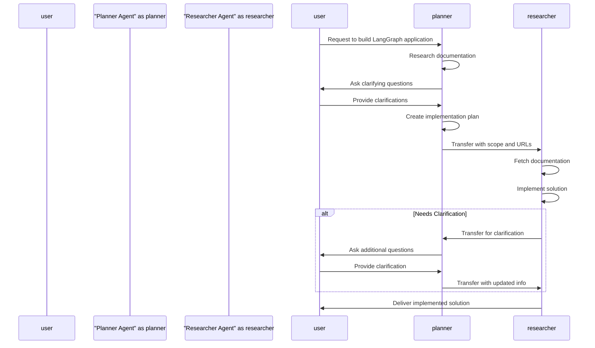
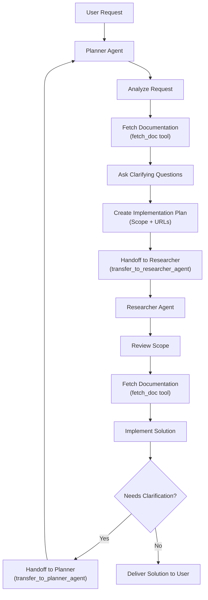
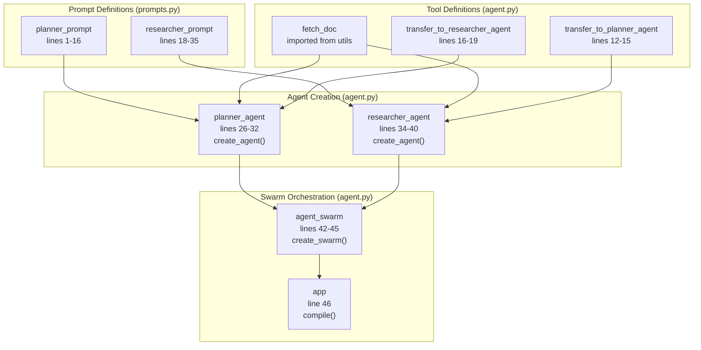

<!-- source: DeepWiki mcp.deepwiki.com · repo langchain-ai/langgraph-swarm-py · extra page Implementation and Workflow · fetched 2026-10-26 -->

# Implementation and Workflow

<details>
<summary>Relevant source files</summary>

The following files were used as context for generating this wiki page:

- [examples/research/src/agent/agent.ipynb](examples/research/src/agent/agent.ipynb)
- [examples/research/src/agent/agent.py](examples/research/src/agent/agent.py)
- [examples/research/src/agent/prompts.py](examples/research/src/agent/prompts.py)

</details>


This document provides a detailed walkthrough of the Research Agent implementation, including the planner/researcher separation pattern, prompt engineering, agent configuration, and execution workflow. The Research Agent demonstrates how to build a multi-agent system using `langgraph-swarm` where specialized agents collaborate through handoffs to accomplish complex tasks. For utility functions and configuration, see page 3.1.2.

## Purpose and Overview

The Research Agent example demonstrates how to create a specialized multi-agent system that:

1. Accepts a user's request to build a LangGraph application
2. Plans the implementation approach by researching relevant documentation
3. Asks clarifying questions when needed
4. Implements a solution based on the gathered information

The system consists of two specialized agents that collaborate using handoffs:
- **Planner Agent**: Analyzes requests, researches documentation, and creates implementation plans
- **Researcher Agent**: Implements solutions based on the planner's guidance



Sources: [examples/research/src/agent/agent.ipynb:271-277]()

## Agent Prompts

The Research Agent relies on two carefully crafted prompts that guide the behavior of the planner and researcher agents.

### Planner Agent Prompt

The planner agent prompt is designed to guide the agent through analyzing user requests, gathering information, and creating implementation plans:

```
<Task>
You will help plan the steps to implement a LangGraph application based on the user's request. 
</Task>

<Instructions>
1. Reflect on the user's request and the project scope
2. Use the fetch_doc tool to read this llms.txt file, which gives you access to the LangGraph documentation: {llms_txt}
3. [IMPORTANT]: After reading the llms.txt file, ask the user for clarifications to help refine the project scope.
4. Once you have a clear project scope based on the user's feedback, select the most relevant URLs from the llms.txt file to reference in order to implement the project.
5. Then, produce a short summary with two markdown sections: 
- ## Scope: A short description that lays out the scope of the project with up to 5 bullet points
- ## URLs: A list of the {num_urls} relevant URLs to reference in order to implement the project
6. Finally, transfer to the research agent using the transfer_to_researcher_agent tool.
</Instructions>
```

Key parameters:
- `{llms_txt}`: URL to the LangGraph documentation file
- `{num_urls}`: Maximum number of relevant documentation URLs to select

Sources: [examples/research/src/agent/prompts.py:1-16]()

### Researcher Agent Prompt

The researcher agent prompt focuses on implementing solutions based on the planner's guidance:

```
<Task>
You will implement the solution to the user's request. 
</Task>

<Instructions>
1. First, reflect of the project Scope as provided by the planner agent.
2. Then, use the fetch_doc tool to fetch and read each URL in the list of URLs provided by the planner agent.
3. Reflect on the information in the URLs.
4. Think carefully.
5. Implement the solution to the user's request using the information in the URLs.
6. If you need further clarification or additional sources to implement the solution, then transfer to transfer_to_planner_agent.
</Instructions>

<Checklist> 
Check that your solution satisfies all bullet points in the project Scope.
</Checklist>
```

Sources: [examples/research/src/agent/prompts.py:18-35]()

## Research Agent Workflow

The workflow of the Research Agent follows a specific pattern designed to efficiently process and implement user requests.



Sources: [examples/research/src/agent/agent.ipynb:248-269](), [examples/research/src/agent/prompts.py:1-35]()

### 1. Initial Request Processing

1. User submits a request to build a LangGraph application
2. The planner agent receives the request and begins analysis
3. The planner uses the `fetch_doc` tool to access LangGraph documentation
4. The planner analyzes the documentation to understand implementation options

### 2. Scope Refinement

1. The planner asks clarifying questions to the user 
2. Based on user responses, the planner refines the project scope
3. The planner selects the most relevant documentation URLs (up to the number specified by `num_urls`)
4. The planner creates a concise project scope summary with bullet points

### 3. Research and Implementation

1. The planner transfers control to the researcher agent using the `transfer_to_researcher_agent` tool
2. The researcher agent reviews the scope provided by the planner
3. The researcher uses the `fetch_doc` tool to access each URL in the planner's list
4. The researcher implements a solution based on the documentation and scope

### 4. Clarification Cycle (if needed)

1. If the researcher needs additional information, it transfers back to the planner using `transfer_to_planner_agent`
2. The planner asks additional clarifying questions to the user
3. Once clarification is received, the planner transfers back to the researcher with updated information
4. The researcher continues with implementation

### 5. Solution Delivery

1. The researcher completes the implementation
2. The solution is delivered to the user

Sources: [examples/research/src/agent/agent.ipynb:271-277]()

## Implementation Architecture

The Research Agent implementation consists of several key code components that work together to enable multi-agent collaboration. The following diagram maps the architectural concepts to specific code entities:

**Diagram: Code Entity Architecture**



Sources: [examples/research/src/agent/agent.py:1-47](), [examples/research/src/agent/prompts.py:1-36]()

### Core Implementation Components

The implementation consists of the following code entities:

| Component | Code Entity | Location | Purpose |
|-----------|-------------|----------|---------|
| Model | `model` | [agent.py:9]() | LLM instance created via `init_chat_model` |
| Handoff Tools | `transfer_to_planner_agent` | [agent.py:12-15]() | Creates handoff to planner |
| Handoff Tools | `transfer_to_researcher_agent` | [agent.py:16-19]() | Creates handoff to researcher |
| Documentation URL | `LLMS_TXT` | [agent.py:22]() | LangGraph documentation source |
| URL Count | `NUM_URLS` | [agent.py:23]() | Max URLs for planner to select |
| Formatted Prompt | `PLANNER_PROMPT_FORMATTED` | [agent.py:24]() | Planner prompt with config |
| Planner Agent | `planner_agent` | [agent.py:27-32]() | Agent instance with tools |
| Researcher Agent | `researcher_agent` | [agent.py:34-40]() | Agent instance with tools |
| Swarm Graph | `agent_swarm` | [agent.py:43-45]() | Multi-agent state graph |
| Compiled App | `app` | [agent.py:46]() | Executable graph application |

Sources: [examples/research/src/agent/agent.py:1-47]()

### Agent Configuration Details

Both agents are created using `create_agent` from LangChain with specific configurations:

**Planner Agent Configuration:**
- **Model**: Shared LLM instance (`model`)
- **System Prompt**: `PLANNER_PROMPT_FORMATTED` with documentation URL and URL count parameters
- **Tools**: `[fetch_doc, transfer_to_researcher_agent]`
- **Name**: `"planner_agent"`

**Researcher Agent Configuration:**
- **Model**: Shared LLM instance (`model`)
- **System Prompt**: `researcher_prompt` (raw, unformatted)
- **Tools**: `[fetch_doc, transfer_to_planner_agent]`
- **Name**: `"researcher_agent"`

The key difference is that the planner has access to transfer to the researcher, while the researcher can transfer back to the planner, creating a bidirectional handoff pattern.

Sources: [examples/research/src/agent/agent.py:27-40]()

### Swarm Creation and Compilation

The swarm is created using the `create_swarm` function from `langgraph_swarm`:

```
agent_swarm = create_swarm(
    [planner_agent, researcher_agent], 
    default_active_agent="planner_agent"
)
app = agent_swarm.compile()
```

This creates a `StateGraph` that manages routing between agents based on the `active_agent` field in the state. The `default_active_agent` parameter ensures that conversations start with the planner agent.

Sources: [examples/research/src/agent/agent.py:43-46]()

## Example Use Case

The primary use case for the Research Agent is assisting users in building LangGraph applications. For example:

1. A user requests: "Create a LangGraph application that is a prompt chain: it takes a topic from a user, generates a joke, and checks if the joke has a punchline."

2. The planner agent:
   - Analyzes the request
   - Researches LangGraph documentation
   - Asks clarifying questions about requirements
   - Creates a plan with relevant documentation URLs

3. The researcher agent:
   - Implements the joke generator application
   - Ensures it includes topic input, joke generation, and punchline validation
   - Delivers a complete solution to the user

This collaborative approach leverages specialized agents for planning and implementation, producing higher quality results than a single agent could achieve.

Sources: [examples/research/src/agent/agent.ipynb:271-277]()

## Summary

The Research Agent Prompts and Workflow demonstrate an effective pattern for building complex LangGraph applications through multi-agent collaboration. The specialized prompts guide the planner and researcher agents in their respective roles, while the handoff mechanism allows them to seamlessly collaborate and consult with the user when needed.

This approach can be adapted for various domains beyond LangGraph application development by modifying the prompts and tools to suit different research and implementation tasks.

---

