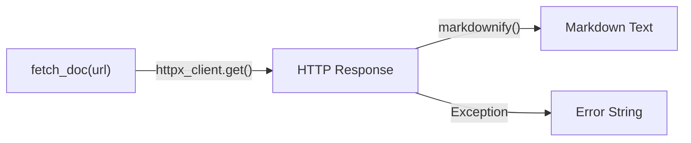
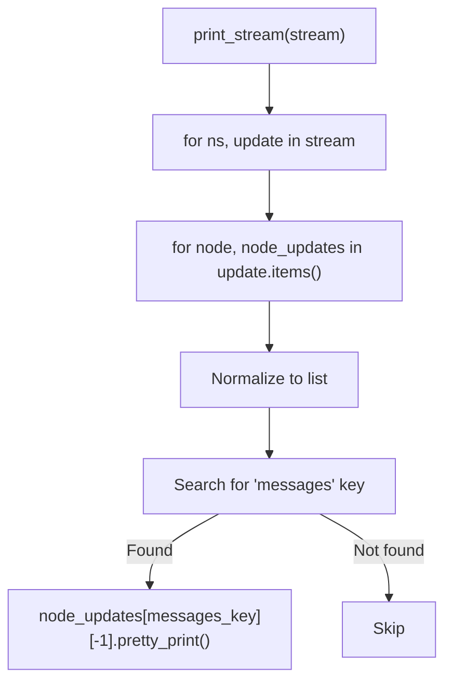
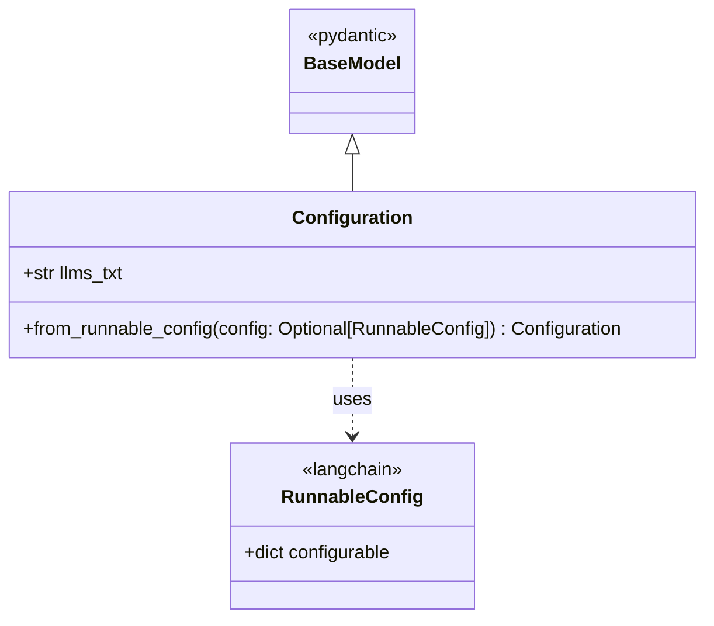
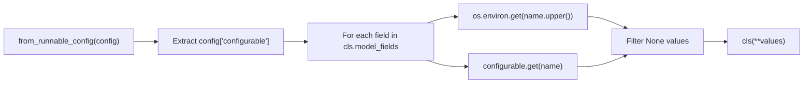
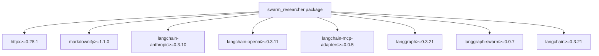
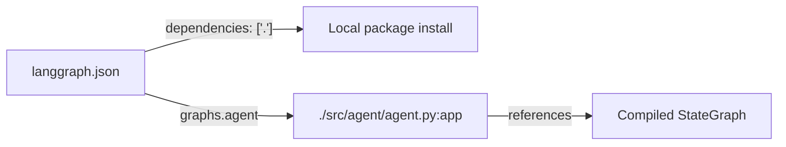
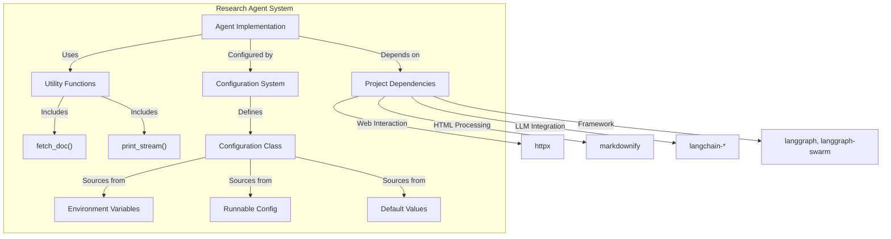

<!-- source: DeepWiki mcp.deepwiki.com · repo langchain-ai/langgraph-swarm-py · extra page Utilities and Configuration · fetched 2026-10-26 -->

# Utilities and Configuration

Relevant source files

The following files were used as context for generating this wiki page:

- [examples/research/langgraph.json](examples/research/langgraph.json)
- [examples/research/pyproject.toml](examples/research/pyproject.toml)
- [examples/research/src/agent/configuration.py](examples/research/src/agent/configuration.py)
- [examples/research/src/agent/utils.py](examples/research/src/agent/utils.py)

This page documents the utility functions, configuration management, and project setup for the research agent example. The research agent relies on web document fetching, stream output formatting, flexible configuration sourcing, and specific package dependencies. For the agent implementation details, see page 3.1.1.

## 1. Utility Functions

The research example includes two utility functions in `utils.py`: `fetch_doc` for retrieving web documents and `print_stream` for formatting LangGraph output.

### 1.1 fetch_doc Function

**Purpose**: Retrieve HTML documents from URLs and convert them to markdown format for LLM processing.

**Implementation Details**:
- Uses global `httpx_client` configured with `follow_redirects=False` and `timeout=10` [examples/research/src/agent/utils.py:4]()
- Calls `httpx_client.get(url, timeout=10)` with 10-second timeout [examples/research/src/agent/utils.py:44]()
- Converts HTML response to markdown using `markdownify()` [examples/research/src/agent/utils.py:46]()
- Returns error message string for `httpx.HTTPStatusError` or `httpx.RequestError` [examples/research/src/agent/utils.py:47-48]()

Sources: [examples/research/src/agent/utils.py:1-49]()

### 1.2 print_stream Function

**Purpose**: Format and display LangGraph streaming output by extracting and pretty-printing messages.

**Implementation Details**:
- Iterates over `(namespace, update)` tuples from stream [examples/research/src/agent/utils.py:8]()
- Normalizes `node_updates` to list format (handles dict, tuple, or list) [examples/research/src/agent/utils.py:13-18]()
- Searches for any key containing "messages" string [examples/research/src/agent/utils.py:23-25]()
- Calls `.pretty_print()` on last message in the list [examples/research/src/agent/utils.py:27]()
- Used for debugging agent interactions during development

Sources: [examples/research/src/agent/utils.py:7-30]()

## 2. Configuration System

### 2.1 Configuration Class

The `Configuration` class extends `pydantic.BaseModel` and defines configurable parameters for the research agent.

**Fields**:
| Field | Type | Default | Description |
|-------|------|---------|-------------|
| `llms_txt` | `int` (should be `str`) | `"https://langchain-ai.github.io/langgraph/llms.txt"` | URL for llms.txt resource |

Note: The type annotation shows `int` but the default is a string URL [examples/research/src/agent/configuration.py:11-15]().

Sources: [examples/research/src/agent/configuration.py:8-16]()

### 2.2 from_runnable_config Method

The `from_runnable_config` classmethod constructs a `Configuration` instance from environment variables and runtime config.

**Value Precedence** (highest to lowest):
1. Environment variable (uppercase field name, e.g., `LLMS_TXT`)
2. `RunnableConfig["configurable"][field_name]`
3. Field default value

**Implementation**:
- Extracts `configurable` dict from `config` parameter or defaults to `{}` [examples/research/src/agent/configuration.py:22-24]()
- Creates `raw_values` dict by checking `os.environ` then `configurable` [examples/research/src/agent/configuration.py:27-30]()
- Filters out `None` values before constructing instance [examples/research/src/agent/configuration.py:33]()

Sources: [examples/research/src/agent/configuration.py:17-35]()

## 3. Project Dependencies

### 3.1 pyproject.toml Configuration

The research example is configured as a Python package named `swarm-researcher` [examples/research/pyproject.toml:2]().

**Package Metadata**:
| Field | Value |
|-------|-------|
| `name` | `"swarm-researcher"` |
| `version` | `"0.0.1"` |
| `requires-python` | `">=3.9"` |
| `build-backend` | `"setuptools.build_meta"` |

**Package Structure**:
- Source directory: `src/agent` maps to package `swarm_researcher` [examples/research/pyproject.toml:32-33]()
- Type stub marker: `py.typed` included in package data [examples/research/pyproject.toml:36]()

Sources: [examples/research/pyproject.toml:1-37]()

### 3.2 Runtime Dependencies

| Dependency | Version | Purpose |
|------------|---------|---------|
| `httpx` | `>=0.28.1` | HTTP client for `fetch_doc` |
| `markdownify` | `>=1.1.0` | HTML to markdown conversion |
| `langchain-anthropic` | `>=0.3.10` | Claude LLM provider |
| `langchain-openai` | `>=0.3.11` | OpenAI LLM provider |
| `langchain-mcp-adapters` | `>=0.0.5` | Model Context Protocol adapters |
| `langgraph` | `>=0.3.21` | State graph framework |
| `langgraph-swarm` | `>=0.0.7` | Multi-agent orchestration |
| `langchain` | `>=0.3.21` | Core LangChain abstractions |

Sources: [examples/research/pyproject.toml:11-20]()

### 3.3 Development Dependencies

Optional `dev` dependency group for code quality tools:

| Tool | Version | Purpose |
|------|---------|---------|
| `mypy` | `>=1.11.1` | Static type checking |
| `ruff` | `>=0.6.1` | Linting and formatting |

Sources: [examples/research/pyproject.toml:23]()

### 3.4 Ruff Configuration

Ruff linting configuration in `pyproject.toml`:

**Selected Rules**:
- `E`: pycodestyle errors
- `F`: pyflakes
- `I`: isort (import sorting)
- `D`: pydocstyle (docstring conventions)
- `D401`: imperative mood requirement
- `T201`: print statement detection
- `UP`: pyupgrade

**Ignored Rules**:
- `UP006`, `UP007`, `UP035`: Union type syntax upgrades
- `D417`: Missing argument descriptions
- `E501`: Line length

**Per-file Ignores**:
- `tests/*`: Ignores `D` (docstrings) and `UP` rules

**Docstring Convention**: Google style [examples/research/pyproject.toml:60]()

Sources: [examples/research/pyproject.toml:38-60]()

## 4. LangGraph Deployment Configuration

### 4.1 langgraph.json

The `langgraph.json` file configures deployment with LangGraph Cloud and CLI tools.

**Configuration Fields**:
| Field | Value | Description |
|-------|-------|-------------|
| `dependencies` | `["."]` | Install local package before deployment |
| `graphs.agent` | `"./src/agent/agent.py:app"` | Path to exported graph variable |

The `graphs.agent` value points to the `app` variable exported from `agent.py`, which is the compiled `StateGraph` instance created by `create_swarm()`.

Sources: [examples/research/langgraph.json:1-6]()

## 5. Overall Architecture

The utilities and configuration components form a critical part of the research agent system, enabling its core functionality while providing flexibility for different deployment scenarios.

This architecture provides:
1. Clear separation of concerns between agent logic, utilities, and configuration
2. Flexible configuration sourcing for different environments
3. Reusable utilities that encapsulate common functionality
4. Explicit dependency management for reliable deployment

Sources: 
- [examples/research/src/agent/utils.py]()
- [examples/research/src/agent/configuration.py]()
- [examples/research/pyproject.toml]()
- [examples/research/langgraph.json]()

---

