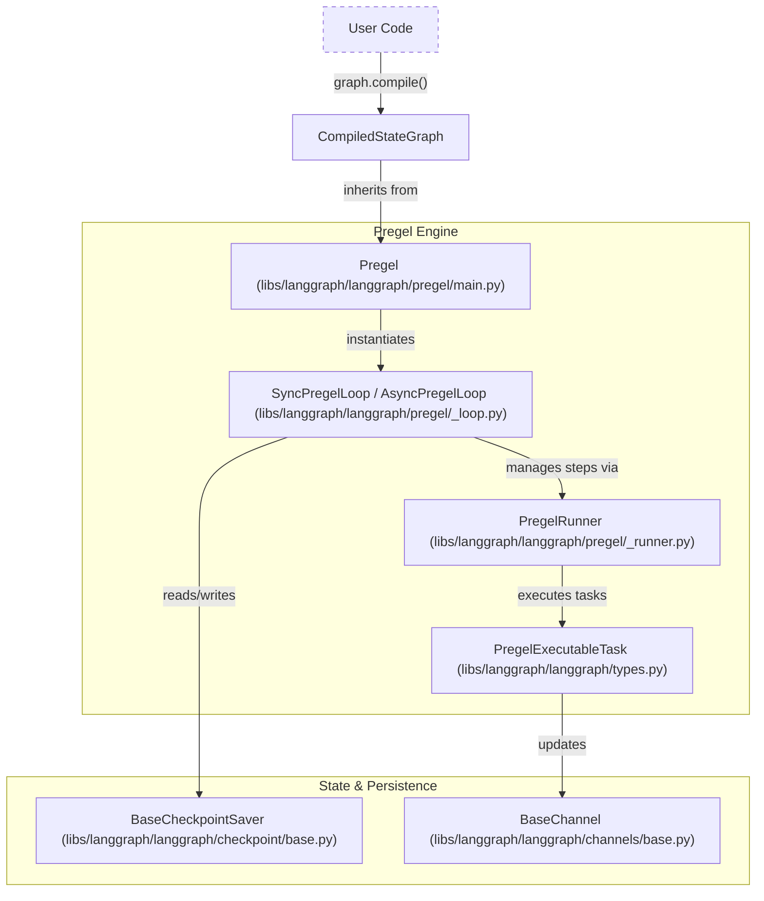
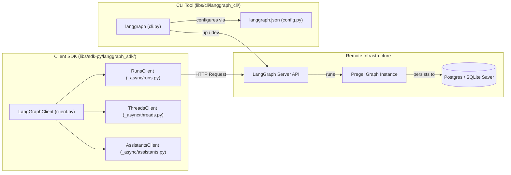

<!-- source: DeepWiki mcp.deepwiki.com · repo langchain-ai/langgraph · page 10 Glossary · fetched 2026-10-26 -->

# Glossary

Relevant source files

The following files were used as context for generating this wiki page:

- [libs/checkpoint-conformance/uv.lock](libs/checkpoint-conformance/uv.lock)
- [libs/checkpoint-postgres/langgraph/checkpoint/postgres/__init__.py](libs/checkpoint-postgres/langgraph/checkpoint/postgres/__init__.py)
- [libs/checkpoint-postgres/langgraph/checkpoint/postgres/aio.py](libs/checkpoint-postgres/langgraph/checkpoint/postgres/aio.py)
- [libs/checkpoint-postgres/langgraph/checkpoint/postgres/base.py](libs/checkpoint-postgres/langgraph/checkpoint/postgres/base.py)
- [libs/checkpoint-postgres/langgraph/checkpoint/postgres/shallow.py](libs/checkpoint-postgres/langgraph/checkpoint/postgres/shallow.py)
- [libs/checkpoint-postgres/pyproject.toml](libs/checkpoint-postgres/pyproject.toml)
- [libs/checkpoint-postgres/tests/test_async.py](libs/checkpoint-postgres/tests/test_async.py)
- [libs/checkpoint-postgres/tests/test_sync.py](libs/checkpoint-postgres/tests/test_sync.py)
- [libs/checkpoint-postgres/uv.lock](libs/checkpoint-postgres/uv.lock)
- [libs/checkpoint-sqlite/langgraph/checkpoint/sqlite/__init__.py](libs/checkpoint-sqlite/langgraph/checkpoint/sqlite/__init__.py)
- [libs/checkpoint-sqlite/langgraph/checkpoint/sqlite/aio.py](libs/checkpoint-sqlite/langgraph/checkpoint/sqlite/aio.py)
- [libs/checkpoint-sqlite/pyproject.toml](libs/checkpoint-sqlite/pyproject.toml)
- [libs/checkpoint-sqlite/uv.lock](libs/checkpoint-sqlite/uv.lock)
- [libs/checkpoint/langgraph/checkpoint/base/__init__.py](libs/checkpoint/langgraph/checkpoint/base/__init__.py)
- [libs/checkpoint/langgraph/checkpoint/memory/__init__.py](libs/checkpoint/langgraph/checkpoint/memory/__init__.py)
- [libs/checkpoint/pyproject.toml](libs/checkpoint/pyproject.toml)
- [libs/checkpoint/uv.lock](libs/checkpoint/uv.lock)
- [libs/cli/langgraph_cli/__init__.py](libs/cli/langgraph_cli/__init__.py)
- [libs/cli/langgraph_cli/cli.py](libs/cli/langgraph_cli/cli.py)
- [libs/cli/langgraph_cli/config.py](libs/cli/langgraph_cli/config.py)
- [libs/cli/pyproject.toml](libs/cli/pyproject.toml)
- [libs/cli/tests/unit_tests/cli/test_cli.py](libs/cli/tests/unit_tests/cli/test_cli.py)
- [libs/cli/tests/unit_tests/test_config.py](libs/cli/tests/unit_tests/test_config.py)
- [libs/cli/uv.lock](libs/cli/uv.lock)
- [libs/langgraph/langgraph/func/__init__.py](libs/langgraph/langgraph/func/__init__.py)
- [libs/langgraph/langgraph/graph/__init__.py](libs/langgraph/langgraph/graph/__init__.py)
- [libs/langgraph/langgraph/graph/state.py](libs/langgraph/langgraph/graph/state.py)
- [libs/langgraph/langgraph/pregel/__init__.py](libs/langgraph/langgraph/pregel/__init__.py)
- [libs/langgraph/langgraph/types.py](libs/langgraph/langgraph/types.py)
- [libs/langgraph/pyproject.toml](libs/langgraph/pyproject.toml)
- [libs/langgraph/tests/test_pregel.py](libs/langgraph/tests/test_pregel.py)
- [libs/langgraph/tests/test_pregel_async.py](libs/langgraph/tests/test_pregel_async.py)
- [libs/langgraph/tests/test_state.py](libs/langgraph/tests/test_state.py)
- [libs/langgraph/uv.lock](libs/langgraph/uv.lock)
- [libs/prebuilt/langgraph/prebuilt/chat_agent_executor.py](libs/prebuilt/langgraph/prebuilt/chat_agent_executor.py)
- [libs/prebuilt/langgraph/prebuilt/tool_node.py](libs/prebuilt/langgraph/prebuilt/tool_node.py)
- [libs/prebuilt/langgraph/prebuilt/tool_validator.py](libs/prebuilt/langgraph/prebuilt/tool_validator.py)
- [libs/prebuilt/pyproject.toml](libs/prebuilt/pyproject.toml)
- [libs/prebuilt/tests/test_deprecation.py](libs/prebuilt/tests/test_deprecation.py)
- [libs/prebuilt/tests/test_injected_state_not_required.py](libs/prebuilt/tests/test_injected_state_not_required.py)
- [libs/prebuilt/tests/test_on_tool_call.py](libs/prebuilt/tests/test_on_tool_call.py)
- [libs/prebuilt/tests/test_react_agent.py](libs/prebuilt/tests/test_react_agent.py)
- [libs/prebuilt/tests/test_tool_node.py](libs/prebuilt/tests/test_tool_node.py)
- [libs/prebuilt/uv.lock](libs/prebuilt/uv.lock)
- [libs/sdk-py/langgraph_sdk/__init__.py](libs/sdk-py/langgraph_sdk/__init__.py)
- [libs/sdk-py/langgraph_sdk/auth/__init__.py](libs/sdk-py/langgraph_sdk/auth/__init__.py)
- [libs/sdk-py/langgraph_sdk/auth/exceptions.py](libs/sdk-py/langgraph_sdk/auth/exceptions.py)
- [libs/sdk-py/langgraph_sdk/auth/types.py](libs/sdk-py/langgraph_sdk/auth/types.py)
- [libs/sdk-py/langgraph_sdk/client.py](libs/sdk-py/langgraph_sdk/client.py)
- [libs/sdk-py/langgraph_sdk/schema.py](libs/sdk-py/langgraph_sdk/schema.py)
- [libs/sdk-py/pyproject.toml](libs/sdk-py/pyproject.toml)
- [libs/sdk-py/uv.lock](libs/sdk-py/uv.lock)

This glossary defines codebase-specific terms, jargon, and domain concepts used throughout the LangGraph repository. It serves as a technical reference for onboarding engineers to understand the implementation details and data flow of the framework.

## Core Concepts

### Pregel
The underlying execution engine for LangGraph. It is based on the Pregel graph processing model, where nodes execute in "supersteps." In each step, nodes that have received updates (triggers) execute in parallel and write updates to shared state (channels), which then trigger subsequent nodes.

*   **Implementation**: The main loop is managed by `SyncPregelLoop` and `AsyncPregelLoop` in [libs/langgraph/langgraph/pregel/_loop.py:73-73]().
*   **Task Orchestration**: `PregelRunner` handles the actual execution of node logic [libs/langgraph/langgraph/pregel/_runner.py:74-74]().
*   **Entry Point**: The `Pregel` class is the compiled executable form of a graph [libs/langgraph/langgraph/pregel/main.py:1-1]().

### Channel
A state container within a graph. Channels are not just variables; they have specific behaviors for how they handle updates (e.g., overwriting, appending, or aggregating).

| Channel Type | Code Entity | Description |
| :--- | :--- | :--- |
| **LastValue** | `LastValue` [libs/langgraph/langgraph/channels/last_value.py:61-61]() | Stores only the most recent value written to it. |
| **Topic** | `Topic` [libs/langgraph/langgraph/channels/topic.py:62-62]() | A queue-like channel that accumulates values until they are consumed. |
| **BinaryOperatorAggregate** | `BinaryOperatorAggregate` [libs/langgraph/langgraph/channels/binop.py:58-58]() | Applies a reducer function (e.g., `operator.add`) to aggregate new values with existing ones. |
| **EphemeralValue** | `EphemeralValue` [libs/langgraph/langgraph/channels/ephemeral_value.py:60-60]() | Values that exist only for the duration of a single step. |
| **UntrackedValue** | `UntrackedValue` [libs/langgraph/langgraph/channels/untracked_value.py:63-63]() | Values that are not tracked in checkpoints. |
| **DeltaChannel** | `DeltaChannel` [libs/langgraph/langgraph/channels/delta.py:59-60]() | Specialized channel for accumulating incremental updates. |

### Checkpoint
A persisted snapshot of the graph's state at a specific point in time (a "thread"). Checkpoints allow for "Time Travel," error recovery, and human-in-the-loop interactions.

*   **Data Model**: Defined by the `Checkpoint` TypedDict [libs/langgraph/langgraph/checkpoint/base.py:44-44]().
*   **Interface**: All savers must implement `BaseCheckpointSaver` [libs/langgraph/langgraph/checkpoint/base.py:43-43]().
*   **Validation**: The system ensures valid checkpointer types using `ensure_valid_checkpointer` [libs/langgraph/langgraph/types.py:109-119]().

### Thread
A unique identifier for a specific instance of a graph execution. All checkpoints within the same `thread_id` share a history.

### Reducer
A function used by a `BinaryOperatorAggregate` channel to combine a new update with the current state.
*   **Signature**: `(current_state, update) -> new_state`.
*   **Usage**: Defined via `Annotated[Type, reducer_function]` in a `TypedDict` state schema [libs/langgraph/langgraph/graph/state.py:135-138]().

---

## Control Flow Primitives

### Command
A control object returned by a node to dynamically influence graph execution. It can update state, route to a specific node, or trigger an interrupt.

*   **Definition**: `Command` dataclass [libs/langgraph/langgraph/types.py:81-81]().
*   **Usage**: Used to specify `goto` targets and `update` state keys [libs/langgraph/tests/test_pregel.py:184-187]().

### Send
A primitive used for dynamic fan-out (map-reduce patterns). It allows a node to schedule multiple instances of another node with different inputs.

*   **Definition**: `Send` class [libs/langgraph/langgraph/types.py:80-80]().
*   **Implementation**: Handled by the graph builder during compilation to manage branching [libs/langgraph/langgraph/graph/state.py:86-86]().

### Interrupt
A mechanism to pause graph execution and wait for external input.

*   **Function**: `interrupt()` used within a node to halt and return a value to the caller [libs/langgraph/langgraph/types.py:88-88]().
*   **Types**: Represented by the `Interrupt` dataclass [libs/langgraph/langgraph/types.py:75-75]().

---

## Code Mapping Diagrams

### Execution Flow: From User Call to Pregel Loop
This diagram maps high-level API calls to the internal classes handling the Pregel execution loop, specifically showing the association between user-facing `StateGraph` and internal `Pregel` entities.

**Sources**: [libs/langgraph/langgraph/pregel/main.py:1-1](), [libs/langgraph/langgraph/pregel/_loop.py:73-73](), [libs/langgraph/langgraph/graph/state.py:131-210]()

### Remote Execution: SDK to API Server
This diagram shows how the `LangGraphClient` interacts with remote resources and how the CLI facilitates local development of these services.

**Sources**: [libs/sdk-py/langgraph_sdk/client.py:16-55](), [libs/cli/langgraph_cli/cli.py:37-37](), [libs/cli/langgraph_cli/config.py:1-20]()

---

## Technical Abbreviations & Jargon

| Term | Full Name | Context |
| :--- | :--- | :--- |
| **Durability** | Execution Durability | Controls when changes are persisted (`sync`, `async`, `exit`) [libs/langgraph/langgraph/types.py:89-95](). |
| **StreamMode** | Streaming Mode | Determines output format (`values`, `updates`, `messages`, etc.) [libs/langgraph/langgraph/types.py:122-136](). |
| **HIL** | Human-in-the-Loop | Patterns involving `interrupt` and state snapshots for manual approval [libs/langgraph/langgraph/types.py:75-85](). |
| **Managed Value** | Managed Value | Values provided by the framework like `BaseStore` or `BaseCache` [libs/langgraph/langgraph/graph/state.py:69-72](). |
| **Checkpointer** | Checkpoint Saver | Interface for persisting graph state across steps [libs/langgraph/langgraph/types.py:100-106](). |

## Deployment & CLI Jargon

*   **langgraph.json**: The primary configuration file for the LangGraph CLI, defining dependencies, graphs, and environment variables [libs/cli/langgraph_cli/cli.py:37-37]().
*   **Functional API**: The `@task` and `@entrypoint` decorators used to define workflows without a class-based graph builder [libs/langgraph/langgraph/func/__init__.py:1-1]().
*   **RemoteGraph**: A proxy class that allows interacting with a graph hosted on a remote LangGraph server as if it were a local graph [libs/langgraph/langgraph/types.py:41-41]().

**Sources**:
*   `Pregel` imports: [libs/langgraph/langgraph/pregel/__init__.py:1-3]()
*   `StateGraph` definition: [libs/langgraph/langgraph/graph/state.py:131-210]()
*   `task` and `entrypoint` decorators: [libs/langgraph/langgraph/func/__init__.py:1-1]()
*   `LangGraphClient` exports: [libs/sdk-py/langgraph_sdk/client.py:16-55]()
*   CLI command structure: [libs/cli/langgraph_cli/cli.py:37-37]()
*   Pregel Loop: [libs/langgraph/langgraph/pregel/_loop.py:73-73]()
*   Pregel Runner: [libs/langgraph/langgraph/pregel/_runner.py:74-74]()