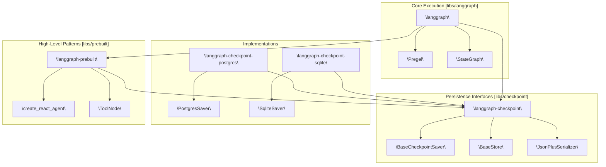

<!-- source: DeepWiki mcp.deepwiki.com · repo langchain-ai/langgraph · page 2 Package Structure and Dependencies · fetched 2026-10-26 -->

# Package Structure and Dependencies

<details>
<summary>Relevant source files</summary>

The following files were used as context for generating this wiki page:

- [AGENTS.md](AGENTS.md)
- [CLAUDE.md](CLAUDE.md)
- [libs/checkpoint-conformance/uv.lock](libs/checkpoint-conformance/uv.lock)
- [libs/checkpoint-postgres/pyproject.toml](libs/checkpoint-postgres/pyproject.toml)
- [libs/checkpoint-postgres/uv.lock](libs/checkpoint-postgres/uv.lock)
- [libs/checkpoint-sqlite/pyproject.toml](libs/checkpoint-sqlite/pyproject.toml)
- [libs/checkpoint-sqlite/uv.lock](libs/checkpoint-sqlite/uv.lock)
- [libs/checkpoint/pyproject.toml](libs/checkpoint/pyproject.toml)
- [libs/checkpoint/uv.lock](libs/checkpoint/uv.lock)
- [libs/langgraph/pyproject.toml](libs/langgraph/pyproject.toml)
- [libs/langgraph/uv.lock](libs/langgraph/uv.lock)
- [libs/prebuilt/pyproject.toml](libs/prebuilt/pyproject.toml)
- [libs/prebuilt/uv.lock](libs/prebuilt/uv.lock)
- [libs/sdk-py/uv.lock](libs/sdk-py/uv.lock)

</details>


This page enumerates every package in the LangGraph monorepo, describes what each package is responsible for, and documents the inter-package dependency graph. It covers the source layout under `libs/` and the declared runtime dependencies of each package.

For details on the monorepo's build and dependency management system, see [Monorepo Structure and Build System](#2.1). For details on the persistence interfaces, see [Persistence and Memory](#4). For CLI and deployment specifics, see [CLI and Deployment](#6).

---

## Repository Layout

The monorepo organizes all Python packages under the `libs/` directory. Each subdirectory is an independently installable Python package with its own `pyproject.toml` and `uv.lock` file.

```
libs/
├── langgraph/              # Core graph execution library
├── checkpoint/             # Base persistence interfaces
├── checkpoint-postgres/    # PostgreSQL checkpoint/store implementations
├── checkpoint-sqlite/      # SQLite checkpoint implementation
├── prebuilt/               # High-level agent APIs
├── sdk-py/                 # Python client SDK
├── cli/                    # langgraph CLI tool
└── scheduler-kafka/        # Distributed Kafka-based scheduler
```

The root `Makefile` provides targets to orchestrate tasks across all packages, such as `lint`, `format`, and `test`.

Sources: [libs/langgraph/pyproject.toml:83-89](), [libs/checkpoint/pyproject.toml:1-17](), [libs/prebuilt/pyproject.toml:1-29]()

---

## Package Inventory

| Package Name | Directory | Current Version | Primary Role |
|---|---|---|---|
| `langgraph` | `libs/langgraph/` | 1.2.11 | Core graph construction and execution |
| `langgraph-checkpoint` | `libs/checkpoint/` | 4.2.0 | Abstract checkpoint and store interfaces |
| `langgraph-checkpoint-postgres` | `libs/checkpoint-postgres/` | 3.1.2 | PostgreSQL-backed checkpoint and store |
| `langgraph-checkpoint-sqlite` | `libs/checkpoint-sqlite/` | 3.1.1 | SQLite-backed checkpoint implementation |
| `langgraph-prebuilt` | `libs/prebuilt/` | 1.1.0 | Pre-built agent graphs (`create_react_agent`, `ToolNode`) |
| `langgraph-sdk` | `libs/sdk-py/` | ≥0.4.2,<0.5.0 | Python client for the LangGraph API server |
| `langgraph-cli` | `libs/cli/` | — | `langgraph` CLI command group |

Sources: [libs/langgraph/pyproject.toml:6-33](), [libs/checkpoint/pyproject.toml:6-17](), [libs/checkpoint-postgres/pyproject.toml:6-19](), [libs/checkpoint-sqlite/pyproject.toml:6-18](), [libs/prebuilt/pyproject.toml:6-7]()

---

## Package Descriptions

### `langgraph`

The central user-facing library. It provides the `StateGraph` builder, the functional API (`@task`, `@entrypoint`), and the `Pregel` execution engine. It pulls in the SDK and prebuilt components as transitive dependencies to ensure a complete runtime environment.

**Runtime dependencies** declared in [libs/langgraph/pyproject.toml:26-33]():
- `langchain-core>=1.4.7,<2`
- `langgraph-checkpoint>=4.1.0,<5.0.0`
- `langgraph-sdk>=0.4.2,<0.5.0`
- `langgraph-prebuilt>=1.1.0,<1.2.0`
- `xxhash>=3.5.0`
- `pydantic>=2.7.4`

---

### `langgraph-checkpoint`

The abstract persistence layer. It defines the base interfaces that all checkpointers must implement, such as `BaseCheckpointSaver`. It is kept minimal to avoid forcing specific database drivers on users.

**Runtime dependencies** declared in [libs/checkpoint/pyproject.toml:14-17]():
- `langchain-core>=0.2.38`
- `ormsgpack>=1.12.0` (Used for binary serialization via `JsonPlusSerializer`)

---

### `langgraph-checkpoint-postgres`

Implements persistence against PostgreSQL. It provides `PostgresSaver` and `PostgresStore` for state and cross-thread memory.

**Runtime dependencies** declared in [libs/checkpoint-postgres/pyproject.toml:14-19]():
- `langgraph-checkpoint>=4.1.0,<5.0.0`
- `orjson>=3.11.5`
- `psycopg>=3.2.0` (Async-capable PostgreSQL driver)
- `psycopg-pool>=3.2.0`

---

### `langgraph-checkpoint-sqlite`

Implements persistence against SQLite. It provides `SqliteSaver` for local development and lightweight production use cases.

**Runtime dependencies** declared in [libs/checkpoint-sqlite/pyproject.toml:14-18]():
- `langgraph-checkpoint>=4.1.0,<5.0.0`
- `aiosqlite>=0.20`
- `sqlite-vec>=0.1.6`

---

### `langgraph-prebuilt`

Contains high-level agentic patterns like `create_react_agent` and infrastructure components like `ToolNode`.

**Runtime dependencies** declared in [libs/prebuilt/pyproject.toml:26-29]():
- `langgraph-checkpoint>=2.1.0,<5.0.0`
- `langchain-core>=1.3.1`

Note: `langgraph-prebuilt` does **not** depend on `langgraph` at runtime to avoid circularity. `langgraph` depends on `prebuilt`.

---

## Dependency Graph

The following diagrams illustrate how core packages and their corresponding code entities relate to one another.

**Diagram: System Components to Code Entities**



Sources: [libs/langgraph/pyproject.toml:26-33](), [libs/checkpoint/pyproject.toml:14-17](), [libs/prebuilt/pyproject.toml:26-29]()

---

## Development Dependency Management

During development, the monorepo uses `uv` workspace features to resolve internal dependencies to local file paths rather than PyPI versions.

**Diagram: Local Path Resolution**

```mermaid
graph LR
    subgraph "libs/langgraph/pyproject.toml"
        UV["\"[tool.uv.sources]\""]
    end

    UV -->|"path = ../prebuilt"| P_DIR["\"libs/prebuilt/\""]
    UV -->|"path = ../checkpoint"| C_DIR["\"libs/checkpoint/\""]
    UV -->|"path = ../sdk-py"| S_DIR["\"libs/sdk-py/\""]
    UV -->|"path = ../cli"| CL_DIR["\"libs/cli/\""]
    UV -->|"path = ../checkpoint-sqlite"| CS_DIR["\"libs/checkpoint-sqlite/\""]
    UV -->|"path = ../checkpoint-postgres"| CP_DIR["\"libs/checkpoint-postgres/\""]
```

Sources: [libs/langgraph/pyproject.toml:83-89](), [libs/checkpoint-postgres/pyproject.toml:51-53](), [libs/prebuilt/pyproject.toml:64-68]()

---

## Python Version Support

All packages in the monorepo target Python `>=3.10`. The project is tested against CPython 3.10 through 3.13 and PyPy.

Sources: [libs/langgraph/pyproject.toml:10-25](), [libs/prebuilt/pyproject.toml:10-25](), [libs/checkpoint/pyproject.toml:10]()

---

## Key External Dependencies

| Package | Used By | Role |
|---|---|---|
| `langchain-core` | Most packages | Message types and Runnable protocol |
| `ormsgpack` | `langgraph-checkpoint` | High-performance binary serialization |
| `psycopg` | `langgraph-checkpoint-postgres` | Non-blocking PostgreSQL communication |
| `aiosqlite` | `langgraph-checkpoint-sqlite` | Async wrapper for SQLite |
| `pydantic` | `langgraph` | Data validation and settings management |
| `xxhash` | `langgraph` | Fast non-cryptographic hashing for state tracking |
| `anyio` | `sdk-py`, `checkpoint-postgres` | Asynchronous I/O support |

Sources: [libs/langgraph/pyproject.toml:26-33](), [libs/checkpoint/pyproject.toml:14-17](), [libs/checkpoint-postgres/pyproject.toml:14-19](), [libs/sdk-py/uv.lock:19-30](), [libs/checkpoint-sqlite/pyproject.toml:14-18]()

---

