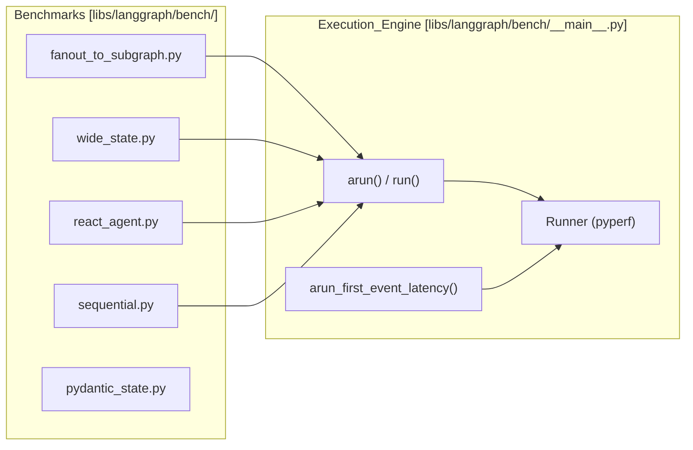

<!-- source: DeepWiki mcp.deepwiki.com · repo langchain-ai/langgraph · page 2.2 Testing Infrastructure · fetched 2026-10-26 -->

# Testing Infrastructure

<details>
<summary>Relevant source files</summary>

The following files were used as context for generating this wiki page:

- [libs/checkpoint-sqlite/Makefile](libs/checkpoint-sqlite/Makefile)
- [libs/checkpoint/Makefile](libs/checkpoint/Makefile)
- [libs/cli/Makefile](libs/cli/Makefile)
- [libs/langgraph/Makefile](libs/langgraph/Makefile)
- [libs/langgraph/bench/__main__.py](libs/langgraph/bench/__main__.py)
- [libs/langgraph/bench/fanout_to_subgraph.py](libs/langgraph/bench/fanout_to_subgraph.py)
- [libs/langgraph/bench/pydantic_state.py](libs/langgraph/bench/pydantic_state.py)
- [libs/langgraph/bench/react_agent.py](libs/langgraph/bench/react_agent.py)
- [libs/langgraph/bench/sequential.py](libs/langgraph/bench/sequential.py)
- [libs/langgraph/bench/wide_dict.py](libs/langgraph/bench/wide_dict.py)
- [libs/langgraph/bench/wide_state.py](libs/langgraph/bench/wide_state.py)
- [libs/langgraph/tests/conftest.py](libs/langgraph/tests/conftest.py)
- [libs/langgraph/tests/conftest_checkpointer.py](libs/langgraph/tests/conftest_checkpointer.py)
- [libs/langgraph/tests/test_interruption.py](libs/langgraph/tests/test_interruption.py)
- [libs/prebuilt/Makefile](libs/prebuilt/Makefile)
- [libs/prebuilt/tests/any_str.py](libs/prebuilt/tests/any_str.py)
- [libs/prebuilt/tests/conftest.py](libs/prebuilt/tests/conftest.py)
- [libs/prebuilt/tests/memory_assert.py](libs/prebuilt/tests/memory_assert.py)
- [libs/prebuilt/tests/messages.py](libs/prebuilt/tests/messages.py)
- [libs/sdk-py/Makefile](libs/sdk-py/Makefile)

</details>


This page documents the testing setup, pytest configuration, test matrices, integration tests, benchmarking, and test helper utilities used across the LangGraph monorepo. The infrastructure is designed to validate the core graph engine, persistence layers, and prebuilt components across multiple Python versions and database backends.

---

## Overview

The test suite is built around a parameterized pytest fixture system that runs the same test against multiple backend implementations (in-memory, SQLite, PostgreSQL). Fixtures are conditionally parameterized at collection time based on the `NO_DOCKER` environment variable, which determines whether Docker-dependent backends like PostgreSQL and Redis are included in the test matrix.

The central configuration resides in `libs/langgraph/tests/conftest.py`, which wires together checkpointer, store, and cache fixtures.

---

## Fixture Architecture

The testing infrastructure uses a layered fixture approach to provide interchangeable components for graphs.

**Fixture Dependency and Data Flow**

```mermaid
graph TD
    subgraph "pytest_Fixtures [libs/langgraph/tests/conftest.py]"
        SC["sync_checkpointer"]
        AC["async_checkpointer"]
        SS["sync_store"]
        AS["async_store"]
        CF["cache"]
        DU["durability"]
        DUUID["deterministic_uuids"]
    end

    subgraph "Checkpointer_Factories [tests/conftest_checkpointer.py]"
        CM["_checkpointer_memory()"]
        CMS["_checkpointer_memory_migrate_sends()"]
        CS["_checkpointer_sqlite()"]
        CSA["_checkpointer_sqlite_aes()"]
        CSAI["_checkpointer_sqlite_aio()"]
        CP["_checkpointer_postgres()"]
        CPP["_checkpointer_postgres_pipe()"]
        CPAIO["_checkpointer_postgres_aio()"]
    end

    subgraph "Store_Factories [tests/conftest_store.py]"
        SM["_store_memory()"]
        SP["_store_postgres()"]
        SPAIO["_store_postgres_aio()"]
    end

    SC --> CM
    SC --> CMS
    SC --> CS
    SC --> CP
    AC --> CM
    AC --> CSAI
    AC --> CPAIO
    SS --> SM
    SS --> SP
    AS --> SM
    AS --> SPAIO
```



Sources: [libs/langgraph/tests/conftest.py:42-226](), [libs/langgraph/tests/conftest.py:16-37]()

---

## The `NO_DOCKER` Environment Variable

A critical control for the testing environment is the `NO_DOCKER` flag. It determines if the test runner expects external services (Postgres, Redis) to be available via Docker.

[libs/langgraph/tests/conftest.py:39]() defines:
```python
NO_DOCKER = os.getenv("NO_DOCKER", "false") == "true"
```

When `NO_DOCKER=true`, fixtures fall back to in-process or file-based backends (SQLite/Memory) to allow testing in restricted environments or for fast local iterations.

**Fixture Parameterization Matrix**

| Fixture | `NO_DOCKER=false` (Default) | `NO_DOCKER=true` |
|---|---|---|
| `sync_checkpointer` | memory, memory_migrate_sends, sqlite, sqlite_aes, postgres, postgres_pipe, postgres_pool | memory, sqlite, sqlite_aes |
| `async_checkpointer` | memory, sqlite_aio, postgres_aio, postgres_aio_pipe, postgres_aio_pool | memory, sqlite_aio |
| `sync_store` | in_memory, postgres, postgres_pipe, postgres_pool | in_memory |
| `async_store` | in_memory, postgres_aio, postgres_aio_pipe, postgres_aio_pool | in_memory |
| `cache` | sqlite, memory, redis | sqlite, memory |

Sources: [libs/langgraph/tests/conftest.py:60-63](), [libs/langgraph/tests/conftest.py:92-96](), [libs/langgraph/tests/conftest.py:120-123](), [libs/langgraph/tests/conftest.py:144-161](), [libs/langgraph/tests/conftest.py:191-205]()

---

## Checkpointer and Store Fixtures

### Checkpointer Implementation Testing
The `sync_checkpointer` and `async_checkpointer` fixtures ensure that `StateGraph` persistence works identically across all supported `BaseCheckpointSaver` implementations.

- **Sync variants**: Include `SqliteSaver`, `PostgresSaver` (with pipeline and pool variants), and `InMemorySaver` [libs/langgraph/tests/conftest.py:165-186]().
- **Async variants**: Include `AsyncSqliteSaver` and `AsyncPostgresSaver` [libs/langgraph/tests/conftest.py:209-225]().

### Store Implementation Testing
The `sync_store` and `async_store` fixtures provide instances of `BaseStore` (e.g., `InMemoryStore`, `PostgresStore`) to test cross-thread memory and semantic search capabilities [libs/langgraph/tests/conftest.py:98-141]().

---

## Cache Fixture and Parallelism

The `cache` fixture [libs/langgraph/tests/conftest.py:60-89]() yields `BaseCache` implementations. For `RedisCache`, the infrastructure handles parallel test isolation using `pytest-xdist`.

- **Isolation**: It retrieves the `workerid` from the pytest config [libs/langgraph/tests/conftest.py:71]().
- **Prefixing**: It applies a worker-specific prefix `test:cache:{worker_id}:` to avoid key collisions between parallel processes [libs/langgraph/tests/conftest.py:77]().
- **Cleanup**: Teardown logic ensures only keys with the worker's specific prefix are deleted [libs/langgraph/tests/conftest.py:81-87]().

---

## Benchmarking Infrastructure

LangGraph includes a dedicated benchmarking suite in `libs/langgraph/bench/` to track execution performance, latency, and serialization overhead.

**Benchmarking Components**



### Key Benchmarks
- **Fanout to Subgraph**: Measures performance of `Send` operations and nested graph execution [libs/langgraph/bench/fanout_to_subgraph.py:11-108]().
- **Wide State**: Tests overhead of managing large state objects with many fields and frequent updates [libs/langgraph/bench/wide_state.py:12-135]().
- **Sequential**: Measures the overhead of a graph with thousands of no-op nodes [libs/langgraph/bench/sequential.py:7-28]().
- **Latency**: Measures "Time to First Event" using `arun_first_event_latency` and `run_first_event_latency` [libs/langgraph/bench/__main__.py:36-55](), [libs/langgraph/bench/__main__.py:73-92]().

### Running Benchmarks
Benchmarks are executed via the `Makefile`:
- `make benchmark`: Runs the suite rigorously using `pyperf` and `uv run python -m bench` [libs/langgraph/Makefile:17-20]().
- `make profile`: Generates a flamegraph using `py-spy` for a specific graph [libs/langgraph/Makefile:29-31]().

Sources: [libs/langgraph/bench/__main__.py:99-238](), [libs/langgraph/Makefile:10-31]()

---

## Test Utilities and Helpers

### Deterministic UUIDs
The `deterministic_uuids` fixture [libs/langgraph/tests/conftest.py:47-52]() patches `uuid.uuid4` to return a predictable sequence. This is essential for tests that compare full state snapshots where internal task IDs must be stable.

### Memory Assertion Helpers
Specialized checkpointer wrappers are used to assert internal behaviors during tests:
- `MemorySaverAssertImmutable`: Extends `InMemorySaver` to verify that checkpoints are not mutated after being written.
- `MemorySaverNeedsPendingSendsMigration`: Simulates older checkpoint versions to test migration logic for `pending_sends`.

### Interruption Testing
Tests in `libs/langgraph/tests/test_interruption.py` validate that the graph correctly handles `interrupt_after` and `interrupt_before` configurations, ensuring state is persisted even when no keys are updated in a step [libs/langgraph/tests/test_interruption.py:11-51]().

---

## Service Management (Docker)

External services required for integration tests (Postgres, Redis) are managed via Docker Compose.

**Service Topology**
| Service | Image | Configuration File |
|---|---|---|
| PostgreSQL | `pgvector/pgvector:pg16` | `libs/langgraph/tests/compose-postgres.yml` |
| Redis | `redis:alpine` | `libs/langgraph/tests/compose-redis.yml` |

The `Makefile` provides targets to orchestrate these:
- `make start-services`: Starts Postgres and Redis with `--wait` to ensure they are ready [libs/langgraph/Makefile:40-41]().
- `make stop-services`: Shuts down services and removes volumes [libs/langgraph/Makefile:43-44]().

Sources: [libs/langgraph/Makefile:40-45](), [libs/prebuilt/Makefile:10-14]()

---

## Test Execution Summary

| Command | Scope | Features |
|---|---|---|
| `uv run pytest` | Unit Tests | Core logic, Pregel algo, StateGraph builder |
| `make integration_tests` | Integration | End-to-end flows, external service connectivity [libs/langgraph/Makefile:85-86]() |
| `make test_parallel` | All | Uses `pytest-xdist` with `worksteal` distribution [libs/langgraph/Makefile:76-83]() |
| `make coverage` | Unit/Int | Generates XML reports for CI and terminal summaries [libs/langgraph/Makefile:34-38]() |
| `make test-fast` | Prebuilt | Runs tests with `LANGGRAPH_TEST_FAST=1` [libs/prebuilt/Makefile:18-19]() |

Sources: [libs/langgraph/Makefile:61-106](), [libs/cli/Makefile:8-11](), [libs/sdk-py/Makefile:3-4](), [libs/prebuilt/Makefile:18-25]()

---

