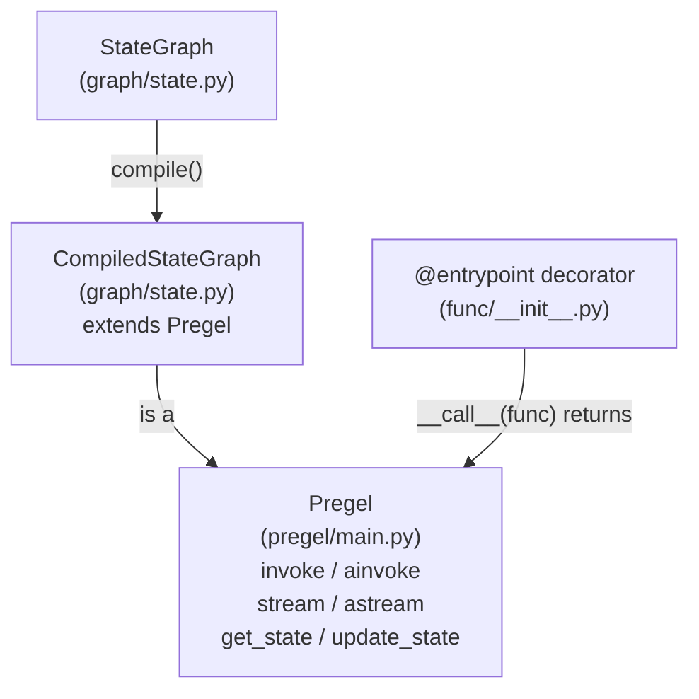
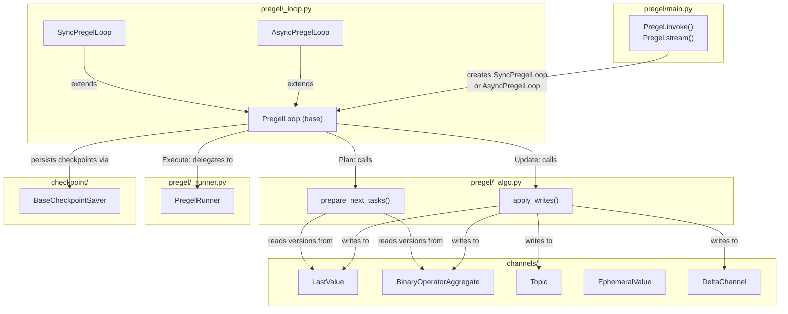
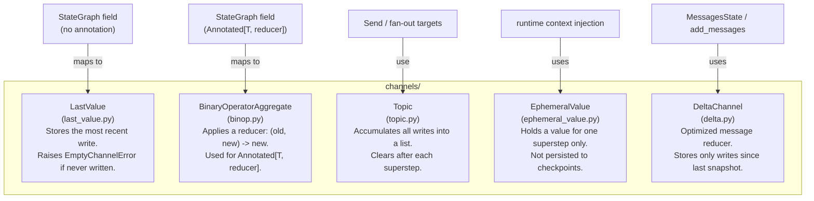

<!-- source: DeepWiki mcp.deepwiki.com · repo langchain-ai/langgraph · page 3 Core Execution System · fetched 2026-10-26 -->

# Core Execution System

<details>
<summary>Relevant source files</summary>

The following files were used as context for generating this wiki page:

- [libs/langgraph/langgraph/channels/delta.py](libs/langgraph/langgraph/channels/delta.py)
- [libs/langgraph/langgraph/func/__init__.py](libs/langgraph/langgraph/func/__init__.py)
- [libs/langgraph/langgraph/graph/state.py](libs/langgraph/langgraph/graph/state.py)
- [libs/langgraph/langgraph/pregel/__init__.py](libs/langgraph/langgraph/pregel/__init__.py)
- [libs/langgraph/langgraph/pregel/_checkpoint.py](libs/langgraph/langgraph/pregel/_checkpoint.py)
- [libs/langgraph/langgraph/pregel/_loop.py](libs/langgraph/langgraph/pregel/_loop.py)
- [libs/langgraph/langgraph/pregel/main.py](libs/langgraph/langgraph/pregel/main.py)
- [libs/langgraph/langgraph/types.py](libs/langgraph/langgraph/types.py)
- [libs/langgraph/tests/test_channels.py](libs/langgraph/tests/test_channels.py)
- [libs/langgraph/tests/test_delta_channel_exit_mode.py](libs/langgraph/tests/test_delta_channel_exit_mode.py)
- [libs/langgraph/tests/test_delta_channel_supersteps_bound.py](libs/langgraph/tests/test_delta_channel_supersteps_bound.py)
- [libs/langgraph/tests/test_delta_channel_update_state.py](libs/langgraph/tests/test_delta_channel_update_state.py)
- [libs/langgraph/tests/test_pregel.py](libs/langgraph/tests/test_pregel.py)
- [libs/langgraph/tests/test_pregel_async.py](libs/langgraph/tests/test_pregel_async.py)
- [libs/langgraph/tests/test_state.py](libs/langgraph/tests/test_state.py)

</details>


This page describes the architecture of the LangGraph core execution engine: the Pregel computational model, the user-facing graph definition APIs, and how each internal component participates in running a graph. It covers the **what** and **why** at the system level.

For full API details on each subsystem, see the child pages:
- State schemas, `add_node`, `compile()` → [StateGraph API](#3.1)
- `@task` and `@entrypoint` → [Functional API (@task and @entrypoint)](#3.2)
- Superstep cycle internals → [Pregel Execution Engine](#3.3)
- Channel types and reducers → [State Management and Channels](#3.4)
- `Send`, `Command`, conditional edges → [Control Flow Primitives](#3.5)
- Graph composition and nested structures → [Graph Composition and Nested Graphs](#3.6)
- Interrupts and human-in-the-loop → [Human-in-the-Loop and Interrupts](#3.7)
- `RetryPolicy`, `CachePolicy` → [Error Handling and Retry Policies](#3.8), [Caching System](#3.10)
- Runtime and Dependency Injection → [Runtime and Dependency Injection](#3.9)
- Streaming architecture and modes → [Streaming Architecture](#3.11)

---

## Computational Model

LangGraph's execution engine is an implementation of the **Pregel / Bulk Synchronous Parallel (BSP)** model. In this model, a graph is composed of **actors** (nodes) that communicate exclusively through **channels** (shared state slots). Execution is divided into discrete **supersteps**. Within each superstep, no actor can observe another actor's writes — all writes from one superstep become visible at the start of the next.

Each superstep runs three sequential phases:

| Phase | Description | Key code |
|---|---|---|
| **Plan** | Determine which actors are eligible to run based on which channels were updated in the previous superstep. | `prepare_next_tasks()` in [libs/langgraph/langgraph/pregel/_algo.py:127-128]() |
| **Execute** | Run all selected actors concurrently. Each actor reads from its subscribed channels and writes its outputs. | `PregelRunner` in [libs/langgraph/langgraph/pregel/_runner.py:74-74]() |
| **Update** | Commit the actors' writes to channels, applying any reducers. | `apply_writes()` in [libs/langgraph/langgraph/pregel/_algo.py:125-125]() |

The loop continues until no actors are eligible (graph is drained), a recursion limit is reached, or an interrupt occurs.

**Sources:** [libs/langgraph/langgraph/pregel/main.py:122-128](), [libs/langgraph/langgraph/pregel/_loop.py:85-98](), [libs/langgraph/langgraph/pregel/_algo.py:122-127]()

---

## Two Entry Points, One Runtime

Users can define graphs in two ways. Both ultimately produce a `Pregel` instance, which is the actual runtime object that supports `invoke`, `stream`, `ainvoke`, and `astream`.

**Diagram: Graph Definition APIs and Their Compiled Output**



**Sources:** [libs/langgraph/langgraph/graph/state.py:131-200](), [libs/langgraph/langgraph/func/__init__.py:144-190](), [libs/langgraph/langgraph/pregel/main.py:1-3](), [libs/langgraph/langgraph/graph/state.py:73-74]()

### StateGraph Path

`StateGraph` is a **builder** — it holds node and edge declarations but cannot execute anything directly. Calling `.compile()` validates the graph structure and returns a `CompiledStateGraph`, which subclasses `Pregel`. During compilation, `StateGraph` converts its nodes and channels into the internal `PregelNode` and `BaseChannel` objects that `Pregel` uses at runtime.

```python
# Example: StateGraph -> CompiledStateGraph (Pregel)
builder = StateGraph(State)
builder.add_node("my_node", my_func)
builder.add_edge(START, "my_node")
graph = builder.compile()        # returns CompiledStateGraph
graph.invoke({"key": "value"})   # runs via Pregel
```

**Sources:** [libs/langgraph/langgraph/graph/state.py:131-200](), [libs/langgraph/tests/test_pregel.py:104-134](), [libs/langgraph/langgraph/graph/state.py:94-94]()

### Functional API Path

The `@entrypoint` decorator wraps a Python function and directly constructs a `Pregel` instance. No explicit `StateGraph` construction is needed. Tasks declared with `@task` become `PregelNode` actors inside the Pregel graph created by `@entrypoint`.

```python
# Example: @entrypoint -> Pregel
@task
def fetch_data(url: str) -> str: ...

@entrypoint(checkpointer=InMemorySaver())
def my_workflow(input: str) -> str:
    result = fetch_data(input).result()
    return result

my_workflow.invoke("http://...")   # my_workflow IS a Pregel instance
```

The `entrypoint` decorator internally uses `get_runnable_for_entrypoint` to map the function to the underlying Pregel structure.

**Sources:** [libs/langgraph/langgraph/func/__init__.py:144-190](), [libs/langgraph/langgraph/func/__init__.py:56-56](), [libs/langgraph/langgraph/pregel/_call.py:41-41]()

---

## The Pregel Runtime

`Pregel` in [libs/langgraph/langgraph/pregel/main.py:1-3]() is the central runtime class. It holds:

| Attribute | Type | Purpose |
|---|---|---|
| `nodes` | `Mapping[str, PregelNode]` | All actor definitions |
| `channels` | `Mapping[str, BaseChannel]` | All communication channels |
| `input_channels` | `str \| Sequence[str]` | Which channels accept external input |
| `output_channels` | `str \| Sequence[str]` | Which channels produce final output |
| `checkpointer` | `BaseCheckpointSaver \| None` | Persistence layer |
| `interrupt_before` | `Sequence[str] \| All` | Node names to interrupt before |
| `interrupt_after` | `Sequence[str] \| All` | Node names to interrupt after |
| `retry_policy` | `RetryPolicy \| None` | Default retry behavior |
| `cache_policy` | `CachePolicy \| None` | Default caching behavior |

`Pregel` exposes the public execution interface: `invoke`, `ainvoke`, `stream`, `astream`, `batch`, `get_state`, `update_state`, `get_state_history`.

### NodeBuilder

`NodeBuilder` in [libs/langgraph/langgraph/pregel/main.py:206-230]() is a fluent builder for creating low-level `PregelNode` actors directly — used primarily in tests and advanced scenarios where a `StateGraph` is unnecessary.

```python
node = (
    NodeBuilder()
    .subscribe_only("input")   # read from channel "input"
    .do(my_func)               # run my_func
    .write_to("output")        # write result to channel "output"
    .build()                   # returns PregelNode
)
```

`StateGraph` creates `PregelNode` instances internally during `compile()`, so most users never use `NodeBuilder` directly.

**Sources:** [libs/langgraph/langgraph/pregel/main.py:206-230](), [libs/langgraph/langgraph/pregel/__init__.py:1-3]()

---

## Internal Execution Components

**Diagram: Runtime Component Relationships**



**Sources:** [libs/langgraph/langgraph/pregel/_loop.py:158-223](), [libs/langgraph/langgraph/pregel/_runner.py:74-74](), [libs/langgraph/langgraph/pregel/main.py:141-144](), [libs/langgraph/langgraph/pregel/_algo.py:122-128](), [libs/langgraph/langgraph/pregel/_algo.py:125-125]()

### PregelLoop

`PregelLoop` is the superstep controller. There are two concrete subclasses:

- `SyncPregelLoop` — used by `invoke` and `stream` [libs/langgraph/langgraph/pregel/_loop.py:158]()
- `AsyncPregelLoop` — used by `ainvoke` and `astream` [libs/langgraph/langgraph/pregel/_loop.py:73]()

The loop tracks:
- `step` — current superstep index [libs/langgraph/langgraph/pregel/_loop.py:162]()
- `stop` — maximum allowed step (recursion limit) [libs/langgraph/langgraph/pregel/_loop.py:163]()
- `channels` — the hydrated state channels for the current superstep [libs/langgraph/langgraph/pregel/_loop.py:200]()
- checkpoint management (reading initial state, writing after each step)
- interrupt handling (`interrupt_before`, `interrupt_after`) [libs/langgraph/langgraph/pregel/_loop.py:176-177]()
- durability modes (`sync`, `async`, `exit`) [libs/langgraph/langgraph/pregel/_loop.py:178]()

**Sources:** [libs/langgraph/langgraph/pregel/_loop.py:158-223](), [libs/langgraph/tests/test_pregel.py:73-73]()

### prepare_next_tasks

`prepare_next_tasks()` is called at the start of each superstep (Plan phase). It inspects which channels were updated in the previous superstep and returns the set of `PregelExecutableTask` objects whose trigger conditions are satisfied.

A `PregelExecutableTask` carries:
- `name` — node name [libs/langgraph/langgraph/types.py:149]()
- `input` — the channel values the node receives [libs/langgraph/langgraph/types.py:151]()
- `proc` — the `Runnable` to execute
- `writes` — a `deque` for collecting outputs
- `config` — `RunnableConfig` with injected context

**Sources:** [libs/langgraph/langgraph/types.py:76-76](), [libs/langgraph/langgraph/pregel/_algo.py:127-128](), [libs/langgraph/langgraph/types.py:142-163]()

### PregelRunner

`PregelRunner` executes a set of `PregelExecutableTask` objects concurrently (Execute phase). It:

- Runs sync tasks using the loop's submit mechanism [libs/langgraph/langgraph/pregel/_runner.py:74-74]()
- Applies retry logic from each task's `retry_policy` [libs/langgraph/langgraph/types.py:82-83]()
- Checks the cache (via `CachePolicy`) before executing [libs/langgraph/langgraph/types.py:72-72]()
- Handles task completion and error propagation

**Sources:** [libs/langgraph/langgraph/pregel/_runner.py:74-74](), [libs/langgraph/langgraph/pregel/_loop.py:179-180]()

### apply_writes

`apply_writes()` processes all the writes accumulated in `PregelExecutableTask.writes` (Update phase). It calls each channel's `update()` method with the new values, applying reducers where applicable. Conflicts (e.g., two nodes writing to the same `LastValue` channel in one superstep without a reducer) raise `InvalidUpdateError`.

**Sources:** [libs/langgraph/langgraph/errors.py:63-66](), [libs/langgraph/langgraph/pregel/_algo.py:125-125]()

---

## Channels

Channels are the shared state mechanism between nodes. Each state field maps to exactly one channel instance. Channels manage their own values across supersteps.

**Diagram: Channel Types and Their Semantics**



**Sources:** [libs/langgraph/langgraph/graph/state.py:51-55](), [libs/langgraph/langgraph/channels/last_value.py:55-55](), [libs/langgraph/langgraph/channels/binop.py:52-52](), [libs/langgraph/langgraph/channels/topic.py:48-48](), [libs/langgraph/langgraph/channels/ephemeral_value.py:54-54](), [libs/langgraph/langgraph/channels/delta.py:15-15]()

---

## Key Types

These types from [libs/langgraph/langgraph/types.py]() appear throughout the execution system:

| Type | Purpose |
|---|---|
| `PregelExecutableTask` | Fully-constructed task ready for execution in one superstep. |
| `StateSnapshot` | The state of the graph at a given checkpoint (values, next nodes, tasks, interrupts). |
| `Send` | Routes to a node with custom input; enables dynamic fan-out. |
| `Command` | Combines a state update with a routing directive (`goto`) or an interrupt resume value. |
| `Interrupt` | Payload produced by the `interrupt()` function; surfaced to the caller. |
| `RetryPolicy` | Configures retry behavior: `max_attempts`, `backoff_factor`, `retry_on`. |
| `Durability` | Controls when checkpoints are written: `"sync"`, `"async"`, or `"exit"`. |
| `StreamMode` | Selects what the stream emits: `"values"`, `"updates"`, `"messages"`, `"debug"`, etc. |

**Sources:** [libs/langgraph/langgraph/types.py:52-85](), [libs/langgraph/langgraph/types.py:89-95]()

---

## Constants

`START` and `END` are special sentinel node names defined in [libs/langgraph/langgraph/constants.py:60-60]():

- `START = "__start__"` — the virtual entry node. Edges from `START` specify which real nodes run first.
- `END = "__end__"` — the virtual exit node. Edges to `END` mark a termination path.

Both are interned strings, safe to use in `add_edge(START, "my_node")` and `add_edge("my_node", END)`.

**Sources:** [libs/langgraph/langgraph/constants.py:60-60]()

---

## Relationship to the Persistence Layer

`Pregel` accepts an optional `checkpointer: BaseCheckpointSaver`. When present:

1. At the start of `invoke`/`stream`, `PregelLoop` restores previous state from the checkpointer via `channels_from_checkpoint` or `achannels_from_checkpoint` [libs/langgraph/langgraph/pregel/_loop.py:100-101]().
2. After each superstep, the loop persists a new checkpoint via `create_checkpoint` if the step was not interrupted [libs/langgraph/langgraph/pregel/_checkpoint.py:149-158]().
3. The `durability` parameter on `invoke`/`stream` controls how eagerly checkpoints are flushed: `"sync"` (before next step), `"async"` (in background), or `"exit"` (only when the graph exits) [libs/langgraph/langgraph/types.py:89-95]().

**Sources:** [libs/langgraph/langgraph/types.py:89-95](), [libs/langgraph/tests/test_pregel.py:197-217](), [libs/langgraph/tests/test_pregel_async.py:109-130]()

---

