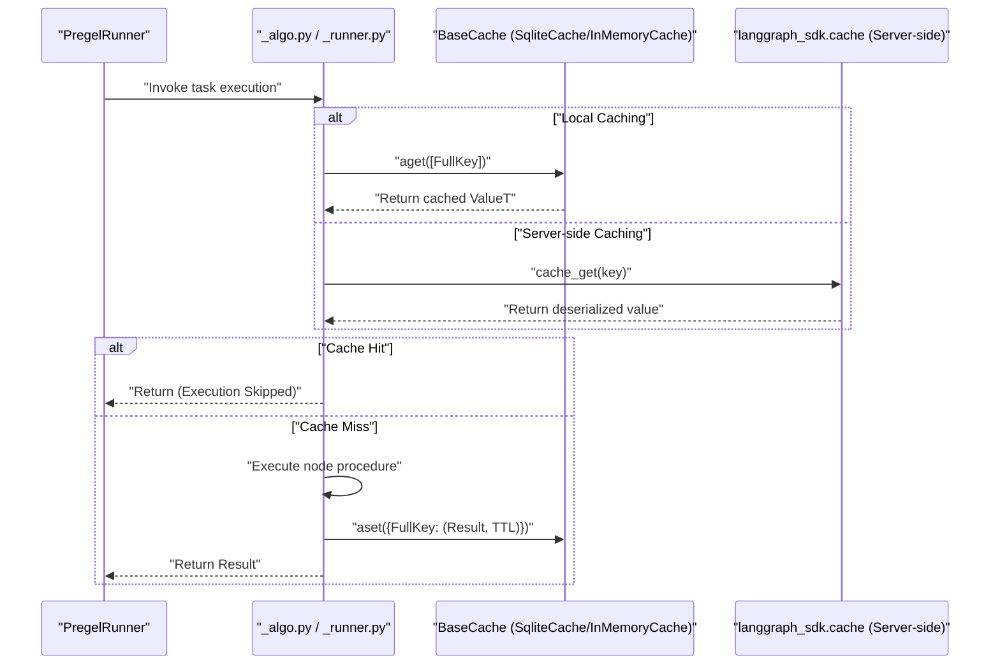
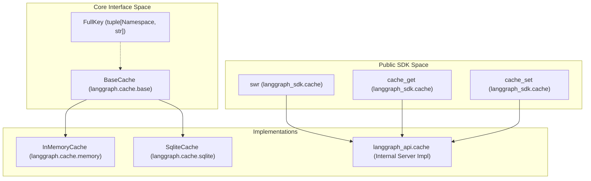

<!-- source: DeepWiki mcp.deepwiki.com · repo langchain-ai/langgraph · page 3.10 Caching System · fetched 2026-10-26 -->

# Caching System

Relevant source files

The following files were used as context for generating this wiki page:

- [libs/checkpoint-sqlite/langgraph/cache/sqlite/__init__.py](libs/checkpoint-sqlite/langgraph/cache/sqlite/__init__.py)
- [libs/checkpoint/langgraph/cache/base/__init__.py](libs/checkpoint/langgraph/cache/base/__init__.py)
- [libs/checkpoint/langgraph/cache/memory/__init__.py](libs/checkpoint/langgraph/cache/memory/__init__.py)
- [libs/sdk-py/langgraph_sdk/_async/client.py](libs/sdk-py/langgraph_sdk/_async/client.py)
- [libs/sdk-py/langgraph_sdk/_sync/client.py](libs/sdk-py/langgraph_sdk/_sync/client.py)
- [libs/sdk-py/langgraph_sdk/cache.py](libs/sdk-py/langgraph_sdk/cache.py)
- [libs/sdk-py/langgraph_sdk/runtime.py](libs/sdk-py/langgraph_sdk/runtime.py)
- [libs/sdk-py/tests/test_cache.py](libs/sdk-py/tests/test_cache.py)

This page documents the LangGraph caching system, which provides result memoization for nodes and tasks to avoid redundant re-execution. It covers the `CachePolicy` configuration, the `BaseCache` interface, specific backend implementations (Memory, SQLite, and Server-side), and how the system integrates with the execution engine.

---

## Overview

The caching system allows individual nodes in a `StateGraph` or tasks in the Functional API to skip execution if their inputs have been processed previously. This is distinct from checkpointing, which persists the entire graph state for recovery and time travel.

| Component | Responsibility |
|:---|:---|
| **`CachePolicy`** | Defines *how* a node should be cached (TTL, key generation function). |
| **`BaseCache`** | Abstract interface for cache storage backends. |
| **`FullKey`** | A unique identifier for a specific execution attempt, consisting of a `Namespace` (tuple of strings) and a string key. |
| **`swr`** | Server-side helper for stale-while-revalidate semantics. |

Sources: [libs/checkpoint/langgraph/cache/base/__init__.py:11-16](), [libs/sdk-py/langgraph_sdk/cache.py:93-131]()

---

## Cache Configuration

### CachePolicy
`CachePolicy` is a configuration object used to define caching behavior. In the Functional API, it is passed to the `@task` decorator. In `StateGraph`, it can be applied as a default policy to nodes.

| Field | Type | Description |
|:---|:---|:---|
| `key_func` | `Callable` | Function to generate a string/byte key from node inputs. |
| `ttl` | `int | None` | Time-to-live in seconds. `None` indicates no expiration. |

Sources: [libs/checkpoint/langgraph/cache/base/__init__.py:33-34](), [libs/sdk-py/langgraph_sdk/cache.py:74-80]()

### Cache Key Generation
The execution engine uses a `FullKey` to perform lookups. It combines a namespace with the specific key generated by the policy.
* **`Namespace`**: A tuple of strings used to isolate cache entries. [libs/checkpoint/langgraph/cache/base/__init__.py:11-11]()
* **`FullKey`**: A composite identifier of `(Namespace, str)`. [libs/checkpoint/langgraph/cache/base/__init__.py:12-12]()

---

## Cache Backend Interface

All caching backends must implement the `BaseCache` interface. This interface supports both synchronous and asynchronous operations and uses a `SerializerProtocol` (defaulting to `JsonPlusSerializer`) to handle data conversion.

**Core Interface Methods:**
* `get(keys: Sequence[FullKey]) -> dict[FullKey, ValueT]` [libs/checkpoint/langgraph/cache/base/__init__.py:25-27]()
* `set(pairs: Mapping[FullKey, tuple[ValueT, int | None]])` [libs/checkpoint/langgraph/cache/base/__init__.py:33-35]()
* `clear(namespaces: Sequence[Namespace] | None)` [libs/checkpoint/langgraph/cache/base/__init__.py:41-43]()

### Implementations

#### 1. InMemoryCache
A thread-safe, non-persistent cache stored in a nested Python dictionary.
* **File:** `libs/checkpoint/langgraph/cache/memory/__init__.py` [libs/checkpoint/langgraph/cache/memory/__init__.py:11-15]()
* **Storage:** `dict[Namespace, dict[str, tuple[str, bytes, float | None]]]` [libs/checkpoint/langgraph/cache/memory/__init__.py:14-14]()
* **Concurrency:** Uses `threading.RLock` to manage concurrent access. [libs/checkpoint/langgraph/cache/memory/__init__.py:15-15]()

#### 2. SqliteCache
A persistent, file-based cache using SQLite.
* **File:** `libs/checkpoint-sqlite/langgraph/cache/sqlite/__init__.py` [libs/checkpoint-sqlite/langgraph/cache/sqlite/__init__.py:13-15]()
* **Schema:** A `cache` table with columns `ns`, `key`, `expiry`, `encoding`, and `val`. [libs/checkpoint-sqlite/langgraph/cache/sqlite/__init__.py:35-42]()
* **Concurrency:** Enables WAL (Write-Ahead Logging) mode and uses `threading.RLock` to serialize access to the shared connection across threads. [libs/checkpoint-sqlite/langgraph/cache/sqlite/__init__.py:30-32]()

---

## Server-Side Caching (LangGraph SDK)

For deployments within the LangGraph Agent Server, the SDK provides a specialized caching API via `langgraph_sdk.cache`. This is intended for internal async dependencies like auth or metadata lookups.

### Stale-While-Revalidate (SWR)
The `swr` function implements semantics where stale data is returned immediately while a background refresh is triggered.

* **`fresh_for`**: Duration the value is considered fresh (defaults to 0). [libs/sdk-py/langgraph_sdk/cache.py:137-138]()
* **`max_age`**: Total lifetime before the next access blocks on the loader (defaults to 24h). [libs/sdk-py/langgraph_sdk/cache.py:139-140]()
* **`SWRResult`**: Contains the `.value`, `.status` (`miss`, `fresh`, `stale`, `expired`), and a `.mutate()` method to manually update the cache. [libs/sdk-py/langgraph_sdk/cache.py:37-49]()

Sources: [libs/sdk-py/langgraph_sdk/cache.py:93-143]()

---

## Execution Integration

Caching is integrated into the node execution lifecycle. The following diagram illustrates how the execution loop interacts with the `BaseCache`.

**Pregel Execution and Cache Lookup**

Sources: [libs/checkpoint/langgraph/cache/base/__init__.py:25-38](), [libs/sdk-py/langgraph_sdk/cache.py:59-90]()

---

## Code Entity Mapping

This diagram bridges the conceptual "Cache System" with the specific classes and files in the codebase.

**Caching System Code Map**

Sources: [libs/checkpoint/langgraph/cache/base/__init__.py:11-15](), [libs/sdk-py/langgraph_sdk/cache.py:18-35](), [libs/checkpoint-sqlite/langgraph/cache/sqlite/__init__.py:13-15]()

---

## Key Functions and Classes

### `BaseCache.get` / `BaseCache.set`
These methods handle the serialization and TTL logic.
* In `SqliteCache.get`, expired entries are automatically purged if the current timestamp exceeds the `expiry` value. [libs/checkpoint-sqlite/langgraph/cache/sqlite/__init__.py:62-68]()
* In `InMemoryCache.get`, the lock ensures that reading and purging expired entries is atomic. [libs/checkpoint/langgraph/cache/memory/__init__.py:19-31]()

### `ServerRuntime`
In the Agent Server, the `ServerRuntime` provides the `store` and `access_context`, which can be used in conjunction with the caching system to conditionally set up expensive resources. It allows distinguishing between full graph execution (`threads.create_run`) and introspection contexts like `assistants.read`.
* **File:** `libs/sdk-py/langgraph_sdk/runtime.py` [libs/sdk-py/langgraph_sdk/runtime.py:179-183]()

### `JsonPlusSerializer`
The default serializer for all cache implementations. It handles complex Python types and integrates with the LangGraph serialization ecosystem.
* **File:** `libs/checkpoint/langgraph/cache/base/__init__.py` [libs/checkpoint/langgraph/cache/base/__init__.py:18-18]()

Sources: [libs/checkpoint-sqlite/langgraph/cache/sqlite/__init__.py:46-96](), [libs/checkpoint/langgraph/cache/memory/__init__.py:17-58](), [libs/sdk-py/langgraph_sdk/runtime.py:94-96](), [libs/sdk-py/langgraph_sdk/runtime.py:44-90]()

---

