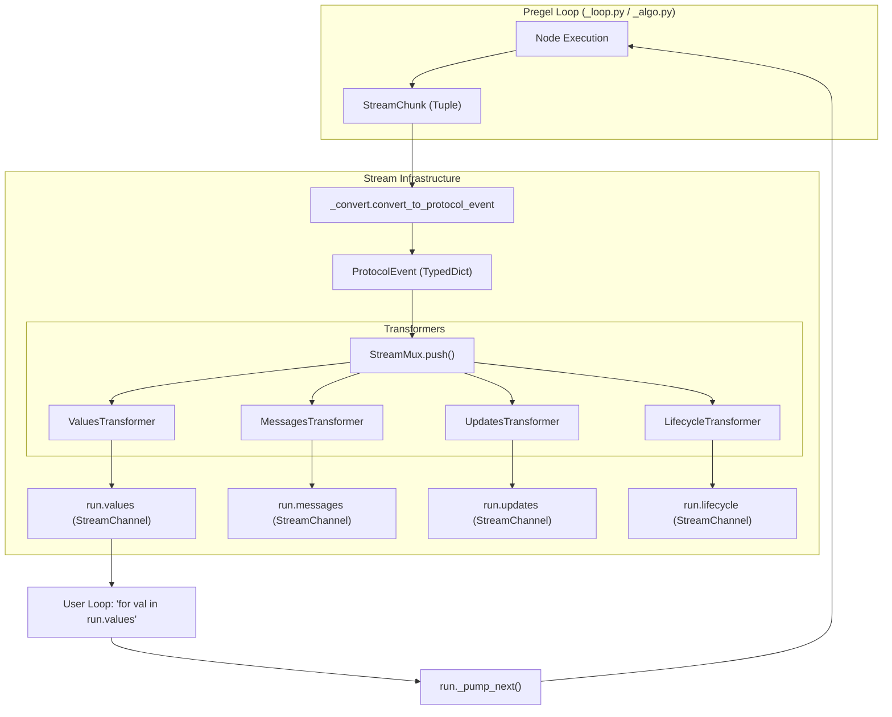
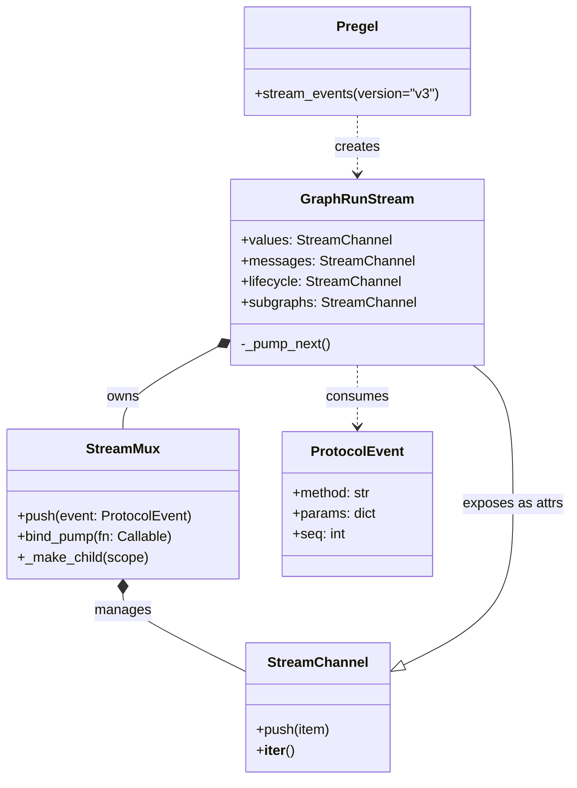

<!-- source: DeepWiki mcp.deepwiki.com · repo langchain-ai/langgraph · page 3.11 Streaming Architecture · fetched 2026-10-26 -->

# Streaming Architecture

Relevant source files

The following files were used as context for generating this wiki page:

- [libs/langgraph/langgraph/pregel/_messages.py](libs/langgraph/langgraph/pregel/_messages.py)
- [libs/langgraph/langgraph/stream/__init__.py](libs/langgraph/langgraph/stream/__init__.py)
- [libs/langgraph/langgraph/stream/_mux.py](libs/langgraph/langgraph/stream/_mux.py)
- [libs/langgraph/langgraph/stream/_types.py](libs/langgraph/langgraph/stream/_types.py)
- [libs/langgraph/langgraph/stream/run_stream.py](libs/langgraph/langgraph/stream/run_stream.py)
- [libs/langgraph/langgraph/stream/stream_channel.py](libs/langgraph/langgraph/stream/stream_channel.py)
- [libs/langgraph/langgraph/stream/transformers.py](libs/langgraph/langgraph/stream/transformers.py)
- [libs/langgraph/tests/test_delta_channel_id_stability.py](libs/langgraph/tests/test_delta_channel_id_stability.py)
- [libs/langgraph/tests/test_interleave_arrival_order.py](libs/langgraph/tests/test_interleave_arrival_order.py)
- [libs/langgraph/tests/test_pregel_stream_events_v3.py](libs/langgraph/tests/test_pregel_stream_events_v3.py)
- [libs/langgraph/tests/test_stream_before_builtins.py](libs/langgraph/tests/test_stream_before_builtins.py)
- [libs/langgraph/tests/test_stream_data_transformers.py](libs/langgraph/tests/test_stream_data_transformers.py)
- [libs/langgraph/tests/test_stream_events_v3.py](libs/langgraph/tests/test_stream_events_v3.py)
- [libs/langgraph/tests/test_stream_lifecycle_transformer.py](libs/langgraph/tests/test_stream_lifecycle_transformer.py)
- [libs/langgraph/tests/test_stream_messages_transformer.py](libs/langgraph/tests/test_stream_messages_transformer.py)
- [libs/langgraph/tests/test_stream_subgraph_transformer.py](libs/langgraph/tests/test_stream_subgraph_transformer.py)
- [libs/prebuilt/langgraph/prebuilt/_tool_call_transformer.py](libs/prebuilt/langgraph/prebuilt/_tool_call_transformer.py)
- [libs/prebuilt/tests/test_tool_call_transformer.py](libs/prebuilt/tests/test_tool_call_transformer.py)

The streaming architecture in LangGraph (introduced in v3) is built around a pull-based, reactive pipeline that transforms raw graph execution events into ergonomic, typed projections. Unlike previous versions that relied on a fixed set of stream modes, the v3 architecture uses a **Transformer-Mux** pattern that allows for extensible, nested, and granular streaming of state, messages, tool calls, and subgraph lifecycles.

## Core Components

### StreamMux
The `StreamMux` is the central dispatcher. It owns the main event log and routes `ProtocolEvent` objects through a pipeline of registered `StreamTransformer` instances. [`libs/langgraph/langgraph/stream/_mux.py:26-46`]().

*   **Sequencing**: It assigns a monotonic `seq` number to every event to ensure total ordering across different stream modes. [`libs/langgraph/langgraph/stream/_mux.py:39-41`]().
*   **Nesting**: It supports creating child muxes via `_make_child(scope)`, which is critical for streaming nested subgraphs while maintaining the correct namespace context. [`libs/langgraph/langgraph/stream/_mux.py:175-188`]().
*   **Registration**: It handles the ordering of transformers, ensuring those with `before_builtins = True` run first to allow for mutations like PII redaction. [`libs/langgraph/langgraph/stream/_mux.py:123-148`]().

### StreamTransformer
An abstract base class for defining how raw events should be projected. Transformers can be "native" (exposed as direct attributes on the run stream) or "extensions". [`libs/langgraph/langgraph/stream/_types.py:44-52`]().

Key methods:
*   `init()`: Returns the projection dictionary (e.g., `{"values": StreamChannel()}`). [`libs/langgraph/langgraph/stream/_types.py:127-138`]().
*   `process(event)`: Synchronous observation/mutation of events. Returning `False` suppresses the event from the main log. [`libs/langgraph/langgraph/stream/_types.py:148-161`]().
*   `aprocess(event)`: Async counterpart for transformers requiring I/O (e.g., PII redaction). [`libs/langgraph/langgraph/stream/_types.py:166-167`]().

### StreamChannel
A generic, drainable buffer that powers individual projections. It supports both sync and async iteration and can be "wired" to a pump that pulls more data from the graph execution loop when the buffer is empty. [`libs/langgraph/langgraph/stream/stream_channel.py:1-20`]().

**Sources**: [`libs/langgraph/langgraph/stream/_mux.py:26-150`](), [`libs/langgraph/langgraph/stream/_types.py:44-140`](), [`libs/langgraph/langgraph/stream/stream_channel.py:1-20`]()

---

## Data Flow: From Pregel to Projections

The following diagram illustrates how a raw event generated by the Pregel execution loop travels through the streaming subsystem to reach the end-user.

### Event Propagation Diagram

**Sources**: [`libs/langgraph/langgraph/stream/run_stream.py:123-147`](), [`libs/langgraph/langgraph/stream/_mux.py:230-250`](), [`libs/langgraph/langgraph/stream/transformers.py:28-154`]()

---

## StreamMode Transformers

LangGraph provides several built-in transformers that map to specific `StreamMode` options.

| Transformer | Mode | Projection | Description |
| :--- | :--- | :--- | :--- |
| `ValuesTransformer` | `values` | `run.values` | Full state snapshots after each step. [`libs/langgraph/langgraph/stream/transformers.py:28-44`]() |
| `UpdatesTransformer` | `updates` | `run.updates` | Dict of `{node_name: output}` for the current step. [`libs/langgraph/langgraph/stream/transformers.py:120-135`]() |
| `MessagesTransformer` | `messages` | `run.messages` | Yields `ChatModelStream` objects for LLM calls. [`libs/langgraph/langgraph/stream/transformers.py:155-182`]() |
| `CustomTransformer` | `custom` | `run.custom` | Payloads emitted via `get_stream_writer()`. [`libs/langgraph/langgraph/stream/transformers.py:85-97`]() |
| `LifecycleTransformer`| `tasks` | `run.lifecycle` | Emits `started`/`completed` events for subgraphs. [`libs/langgraph/langgraph/stream/transformers.py:441-455`]() |
| `ToolCallTransformer`| `tools` | `run.tool_calls` | (Prebuilt) Yields `ToolCallStream` for tool execution. [`libs/prebuilt/langgraph/prebuilt/_tool_call_transformer.py:44-64`]() |

### Subgraph Streaming Architecture
When a graph contains a subgraph, the `SubgraphTransformer` detects `tasks` events indicating a subgraph start. It uses `StreamMux._make_child(scope)` to create a nested streaming context. This allows users to iterate over `run.subgraphs` and get a `SubgraphRunStream` handle that has its own scoped projections (`.values`, `.messages`, etc.). [`libs/langgraph/langgraph/stream/transformers.py:315-340`](), [`libs/langgraph/langgraph/stream/run_stream.py:65-66`]().

---

## The V3 Protocol and Run Streams

The `GraphRunStream` implements a **pull-based** streaming model. The graph does not run in a background thread; instead, the act of iterating over a projection drives the execution loop.

### Code Entity Association
This diagram maps high-level streaming concepts to specific classes and functions.

**Sources**: [`libs/langgraph/langgraph/stream/run_stream.py:37-98`](), [`libs/langgraph/langgraph/stream/_mux.py:26-46`](), [`libs/langgraph/langgraph/stream/stream_channel.py:22-40`]()

### Pumping Mechanism
1.  User calls `for event in run.values:`.
2.  `StreamChannel.__iter__` finds its buffer empty and calls the `_request_more` callback.
3.  The callback triggers `GraphRunStream._pump_next`, which calls `next(self._graph_iter)` to execute one step of the Pregel loop. [`libs/langgraph/langgraph/stream/run_stream.py:123-138`]().
4.  The resulting chunk is converted to a `ProtocolEvent` and pushed into the `StreamMux`. [`libs/langgraph/langgraph/stream/run_stream.py:134-137`]().
5.  `StreamMux` distributes the event to transformers, which populate their respective `StreamChannel` buffers. [`libs/langgraph/langgraph/stream/_mux.py:230-245`]().

---

## Message and Tool Streaming Details

### MessagesTransformer
The `MessagesTransformer` provides a unified `run.messages` stream by handling two data shapes via `StreamMessagesHandler`:
1.  **Protocol Events**: Captures `message-start`, `content-block-delta`, etc., emitted by LLMs via the `on_stream_event` callback. [`libs/langgraph/langgraph/stream/transformers.py:167-171`]().
2.  **Finalized Messages**: Captures `AIMessage` objects from `on_chain_end` when a node returns a finalized message. These are replayed as synthetic protocol events via `message_to_events`. [`libs/langgraph/langgraph/stream/transformers.py:172-175`]().

### ToolCallTransformer
Located in `langgraph-prebuilt`, this transformer projects `tools` channel events into `ToolCallStream` handles. Each `tool-started` event spawns a new stream pushed onto `run.tool_calls`. [`libs/prebuilt/langgraph/prebuilt/_tool_call_transformer.py:44-52`](). It Accumulates `tool-output-delta` events into the active stream's log until `tool-finished` or `tool-error` is received. [`libs/prebuilt/langgraph/prebuilt/_tool_call_transformer.py:135-146`]().

**Sources**: [`libs/langgraph/langgraph/stream/transformers.py:155-268`](), [`libs/langgraph/langgraph/pregel/_messages.py:49-105`](), [`libs/prebuilt/langgraph/prebuilt/_tool_call_transformer.py:44-165`]()

---

