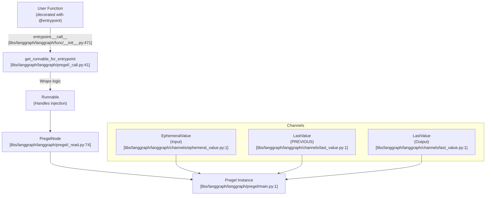
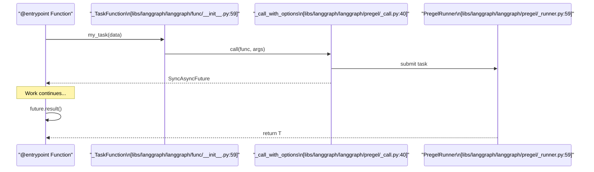

<!-- source: DeepWiki mcp.deepwiki.com · repo langchain-ai/langgraph · page 3.2 Functional API (@task and @entrypoint) · fetched 2026-10-26 -->

# Functional API (@task and @entrypoint)

<details>
<summary>Relevant source files</summary>

The following files were used as context for generating this wiki page:

- [libs/langgraph/langgraph/func/__init__.py](libs/langgraph/langgraph/func/__init__.py)
- [libs/langgraph/langgraph/graph/state.py](libs/langgraph/langgraph/graph/state.py)
- [libs/langgraph/langgraph/pregel/__init__.py](libs/langgraph/langgraph/pregel/__init__.py)
- [libs/langgraph/langgraph/types.py](libs/langgraph/langgraph/types.py)
- [libs/langgraph/tests/test_pregel.py](libs/langgraph/tests/test_pregel.py)
- [libs/langgraph/tests/test_pregel_async.py](libs/langgraph/tests/test_pregel_async.py)
- [libs/langgraph/tests/test_state.py](libs/langgraph/tests/test_state.py)

</details>


This page documents the `@task` and `@entrypoint` decorators from `langgraph.func`, which allow composing LangGraph workflows entirely in Python without explicitly constructing a `StateGraph`. Like `StateGraph`, both decorators ultimately compile down to a `Pregel` instance—the same core execution engine that powers all LangGraph graphs.

For the explicit graph builder pattern, see [StateGraph API (3.1)](). For the Pregel execution engine that runs both models, see [Pregel Execution Engine (3.3)]().

---

## Overview

Both decorators are defined in `langgraph.func` [libs/langgraph/langgraph/func/__init__.py:56](). They provide a functional interface to the underlying Pregel orchestration system, enabling developers to use native Python control flow (loops, conditionals) while retaining LangGraph's persistence and parallelization features.

| Decorator | Role | Returns |
|-----------|------|---------|
| `@task` | Unit of work, schedulable as a concurrent future | `_TaskFunction[P, T]` wrapping a `SyncAsyncFuture[T]` [libs/langgraph/langgraph/func/__init__.py:59-86]() |
| `@entrypoint` | Top-level workflow; the graph's entry and exit point | `Pregel` instance [libs/langgraph/langgraph/func/__init__.py:471-492]() |

**Comparison with `StateGraph`:**

| Aspect | `StateGraph` | Functional API |
|--------|-------------|----------------|
| Structure definition | Explicit nodes + edges [libs/langgraph/langgraph/graph/state.py:201-207]() | Python control flow (loops, if/else) |
| State | Typed dict / schema channels [libs/langgraph/langgraph/graph/state.py:131-138]() | Function arguments and return values |
| Parallelism | Multiple nodes in same superstep | Multiple `@task` futures dispatched before `.result()` [libs/langgraph/langgraph/func/__init__.py:180-188]() |
| Default stream mode | `"updates"` [libs/langgraph/langgraph/types.py:125]() | `"updates"` [libs/langgraph/langgraph/types.py:125]() |
| Compilation | `builder.compile()` [libs/langgraph/langgraph/graph/state.py:93]() | Automatic via decorator [libs/langgraph/langgraph/func/__init__.py:471]() |

Sources: [libs/langgraph/langgraph/func/__init__.py:56-86](), [libs/langgraph/langgraph/graph/state.py:131-207](), [libs/langgraph/langgraph/types.py:120-132]()

---

## Key Code Entities

The functional API maps Python functions to `Pregel` nodes and channels.

### Class Relationships

```mermaid
classDiagram
    class entrypoint {
        +checkpointer: BaseCheckpointSaver
        +store: BaseStore
        +context_schema: type
        +__call__(func) Pregel
    }
    class final["entrypoint.final[R, S]"] {
        +value: R
        +save: S
    }
    class _TaskFunction {
        +func: Callable
        +retry_policy: Sequence[RetryPolicy]
        +cache_policy: CachePolicy
        +__call__(*args) SyncAsyncFuture
    }
    class SyncAsyncFuture {
        +result() T
    }
    class Pregel {
        +invoke()
        +ainvoke()
        +stream()
        +astream()
    }

    entrypoint --> final : "nested class defined in [libs/langgraph/langgraph/func/__init__.py:430]"
    entrypoint ..> Pregel : "compiles to via __call__ in [libs/langgraph/langgraph/func/__init__.py:471]"
    _TaskFunction ..> SyncAsyncFuture : "returns on call in [libs/langgraph/langgraph/func/__init__.py:86]"
    Pregel ..> SyncAsyncFuture : "managed by PregelRunner in [libs/langgraph/langgraph/pregel/_runner.py:59]"
```

Sources: [libs/langgraph/langgraph/func/__init__.py:47-492](), [libs/langgraph/langgraph/pregel/__init__.py:1-2](), [libs/langgraph/langgraph/pregel/_runner.py:59-60]()

---

## `@task` Decorator

**Source:** [libs/langgraph/langgraph/func/__init__.py:132-217]()

`@task` wraps a sync or async function in a `_TaskFunction`. Calling the wrapped function schedules execution within the current Pregel superstep and returns a `SyncAsyncFuture[T]`.

### Parameters

| Parameter | Type | Default | Description |
|-----------|------|---------|-------------|
| `name` | `str \| None` | `None` | Override task name; defaults to `func.__name__` [libs/langgraph/langgraph/func/__init__.py:67-79]() |
| `retry_policy` | `RetryPolicy \| Sequence[RetryPolicy] \| None` | `None` | Retry configuration on failure [libs/langgraph/langgraph/func/__init__.py:160]() |
| `cache_policy` | `CachePolicy \| None` | `None` | Cache configuration for results [libs/langgraph/langgraph/func/__init__.py:161]() |
| `timeout` | `float \| timedelta \| TimeoutPolicy \| None` | `None` | Execution timeout; supported for async tasks [libs/langgraph/langgraph/func/__init__.py:162-168]() |

### Execution and Parallelism

Calling a task returns a future. To run tasks in parallel, dispatch them and then collect results:

```python
# Dispatched in parallel
futures = [my_task(i) for i in range(3)]
# Block/Await for results
results = [f.result() for f in futures] 
```

Tasks can only be called from inside an `@entrypoint` or a `StateGraph` node [libs/langgraph/langgraph/func/__init__.py:150-156]().

---

## `@entrypoint` Decorator

**Source:** [libs/langgraph/langgraph/func/__init__.py:228-492]()

The `@entrypoint` decorator transforms a Python function into a `Pregel` instance. It manages the lifecycle of the workflow, including checkpointing and dependency injection.

### Parameters

| Parameter | Type | Description |
|-----------|------|-------------|
| `checkpointer` | `Checkpointer` | Enables persistence across invocations [libs/langgraph/langgraph/func/__init__.py:255]() |
| `store` | `BaseStore \| None` | Cross-thread key-value store [libs/langgraph/langgraph/func/__init__.py:256]() |
| `context_schema` | `type[ContextT] \| None` | Schema for run-scoped context [libs/langgraph/langgraph/func/__init__.py:258]() |

### Runtime Injection and Special Arguments

Entrypoints can receive injected parameters by including them in the function signature:

- `config`: The `RunnableConfig` for the current run.
- `previous`: The return value from the prior invocation (requires a checkpointer) [libs/langgraph/langgraph/func/__init__.py:25]().
- `runtime`: A `Runtime` object containing `context`, `store`, and `stream_writer`.

Sources: [libs/langgraph/langgraph/func/__init__.py:278-310]()

---

## Compilation to Pregel

When `@entrypoint` is applied to a function, it compiles it into a `Pregel` object by mapping the function logic to a `PregelNode` and setting up appropriate channels.

### Compilation Flow



Sources: [libs/langgraph/langgraph/func/__init__.py:471-492](), [libs/langgraph/langgraph/pregel/_call.py:41](), [libs/langgraph/langgraph/pregel/_read.py:74]()

### Task Scheduling Sequence



Sources: [libs/langgraph/langgraph/func/__init__.py:86-94](), [libs/langgraph/langgraph/pregel/_runner.py:59-60](), [libs/langgraph/langgraph/pregel/_call.py:40]()

---

## State and Persistence

### `entrypoint.final`

To decouple the value returned to the user from the value saved for the next invocation (the `previous` parameter), use `entrypoint.final` [libs/langgraph/langgraph/func/__init__.py:430-469]().

| Field | Description |
|-------|-------------|
| `value` | The result returned by `invoke()` or `stream()` |
| `save` | The value persisted to the checkpoint as `PREVIOUS` |

### Channel Layout

The functional API uses a specific channel layout to mimic standard function behavior:

| Channel | Type | Role |
|---------|------|------|
| Input | `EphemeralValue` | Holds the input for the current superstep [libs/langgraph/langgraph/func/__init__.py:32]() |
| `PREVIOUS` | `LastValue` | Persists state across threads/checkpoints [libs/langgraph/langgraph/func/__init__.py:25]() |
| Output | `LastValue` | Captures the final return value [libs/langgraph/langgraph/func/__init__.py:33]() |

Sources: [libs/langgraph/langgraph/func/__init__.py:25-33](), [libs/langgraph/langgraph/channels/ephemeral_value.py:1-5](), [libs/langgraph/langgraph/channels/last_value.py:1-5]()

---

## Streaming and Interrupts

- **Streaming**: Functional API supports all `StreamMode` values. `"values"` mode emits the final result, while `"updates"` emits individual task results [libs/langgraph/langgraph/types.py:120-134]().
- **Interrupts**: The `interrupt()` function can be used within tasks or entrypoints to pause execution. Resuming triggers a replay of completed tasks from the checkpoint [libs/langgraph/langgraph/types.py:81](), [libs/langgraph/langgraph/func/__init__.py:312-325]().
- **Drain Requests**: The `RunControl.request_drain()` method can be used within an entrypoint to request a graceful stop while allowing currently scheduled tasks to finish [libs/langgraph/langgraph/runtime.py:75](). This allows inflight call scheduling to complete before the graph exits [libs/langgraph/tests/test_pregel.py:140-160]().

Sources: [libs/langgraph/langgraph/types.py:81-134](), [libs/langgraph/langgraph/func/__init__.py:312-325](), [libs/langgraph/tests/test_pregel.py:140-160](), [libs/langgraph/langgraph/runtime.py:75]()

---

