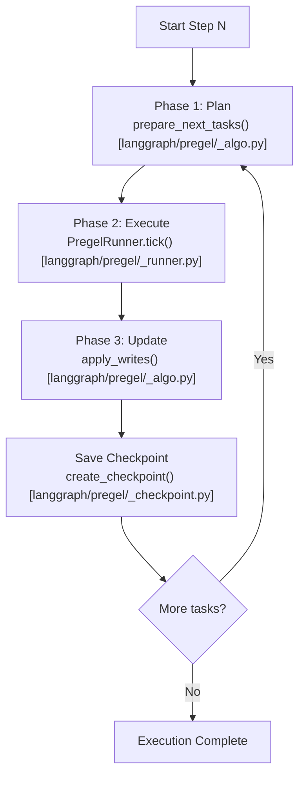
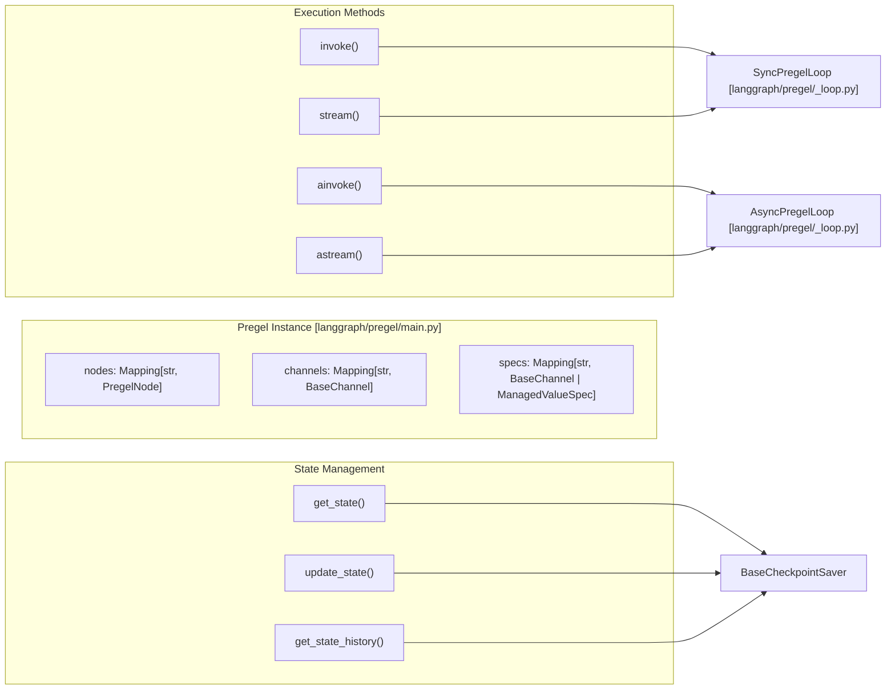
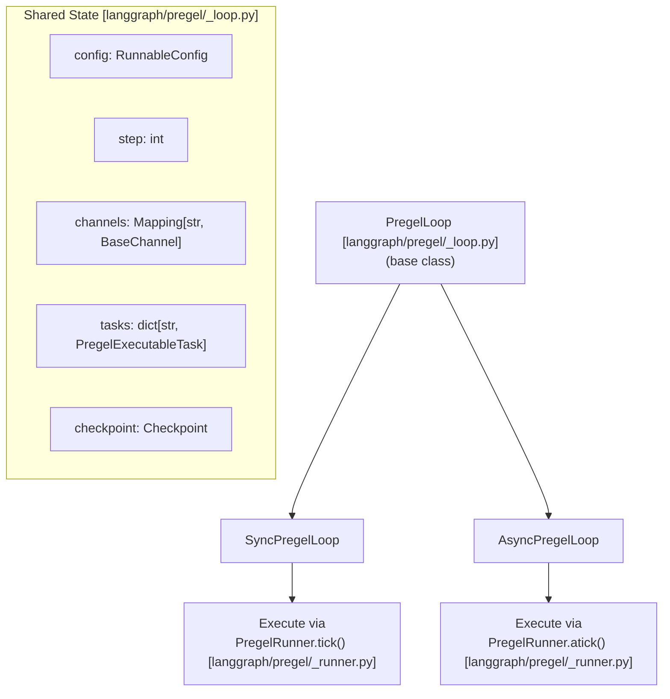
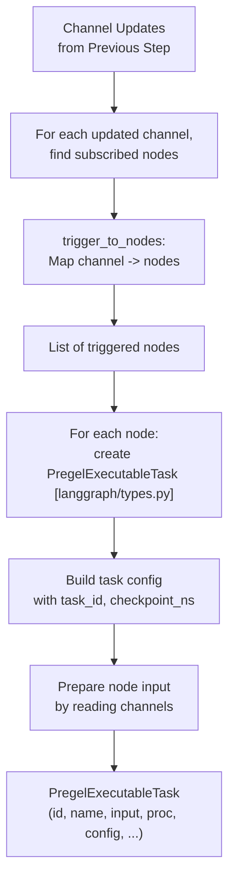

<!-- source: DeepWiki mcp.deepwiki.com · repo langchain-ai/langgraph · page 3.3 Pregel Execution Engine · fetched 2026-10-26 -->

# Pregel Execution Engine

Relevant source files

The following files were used as context for generating this wiki page:

- [libs/langgraph/langgraph/_internal/_constants.py](libs/langgraph/langgraph/_internal/_constants.py)
- [libs/langgraph/langgraph/_internal/_runnable.py](libs/langgraph/langgraph/_internal/_runnable.py)
- [libs/langgraph/langgraph/channels/delta.py](libs/langgraph/langgraph/channels/delta.py)
- [libs/langgraph/langgraph/constants.py](libs/langgraph/langgraph/constants.py)
- [libs/langgraph/langgraph/graph/_node.py](libs/langgraph/langgraph/graph/_node.py)
- [libs/langgraph/langgraph/pregel/_algo.py](libs/langgraph/langgraph/pregel/_algo.py)
- [libs/langgraph/langgraph/pregel/_checkpoint.py](libs/langgraph/langgraph/pregel/_checkpoint.py)
- [libs/langgraph/langgraph/pregel/_loop.py](libs/langgraph/langgraph/pregel/_loop.py)
- [libs/langgraph/langgraph/pregel/_read.py](libs/langgraph/langgraph/pregel/_read.py)
- [libs/langgraph/langgraph/pregel/_runner.py](libs/langgraph/langgraph/pregel/_runner.py)
- [libs/langgraph/langgraph/pregel/debug.py](libs/langgraph/langgraph/pregel/debug.py)
- [libs/langgraph/langgraph/pregel/main.py](libs/langgraph/langgraph/pregel/main.py)
- [libs/langgraph/langgraph/pregel/protocol.py](libs/langgraph/langgraph/pregel/protocol.py)
- [libs/langgraph/langgraph/pregel/types.py](libs/langgraph/langgraph/pregel/types.py)
- [libs/langgraph/langgraph/typing.py](libs/langgraph/langgraph/typing.py)
- [libs/langgraph/langgraph/warnings.py](libs/langgraph/langgraph/warnings.py)
- [libs/langgraph/tests/test_channels.py](libs/langgraph/tests/test_channels.py)
- [libs/langgraph/tests/test_delta_channel_exit_mode.py](libs/langgraph/tests/test_delta_channel_exit_mode.py)
- [libs/langgraph/tests/test_delta_channel_supersteps_bound.py](libs/langgraph/tests/test_delta_channel_supersteps_bound.py)
- [libs/langgraph/tests/test_delta_channel_update_state.py](libs/langgraph/tests/test_delta_channel_update_state.py)
- [libs/langgraph/tests/test_deprecation.py](libs/langgraph/tests/test_deprecation.py)
- [libs/langgraph/tests/test_trace_policy.py](libs/langgraph/tests/test_trace_policy.py)
- [libs/langgraph/tests/test_type_checking.py](libs/langgraph/tests/test_type_checking.py)

The Pregel execution engine is the core runtime that orchestrates graph execution in LangGraph. It implements a **Bulk Synchronous Parallel (BSP)** model inspired by Google's Pregel algorithm, managing the step-by-step execution of nodes, task scheduling, parallel execution, and state synchronization through channels.

For information about building graphs using the StateGraph API, see [StateGraph API](). For information about the functional API, see [Functional API (@task and @entrypoint)](). For information about state management and channels, see [State Management and Channels]().

## Purpose and Scope

This document covers the internal execution mechanics of the Pregel engine:
- The Bulk Synchronous Parallel execution model.
- The `Pregel` class and `PregelLoop` execution lifecycle.
- Task scheduling and preparation (`prepare_next_tasks`).
- Parallel task execution via `PregelRunner` and `PregelRunner.tick`.
- Runtime state injection via the `Runtime` and `ExecutionInfo` classes.
- Integration with checkpointing and durability modes, including the `DeltaChannel` optimization.

## Execution Model Overview

The Pregel engine follows the **Bulk Synchronous Parallel (BSP)** model, where execution proceeds in discrete steps (supersteps). Each step consists of three phases:

**Phase 1: Plan** — Determines which nodes to execute by examining channel updates from the previous step. The `prepare_next_tasks` function selects nodes whose trigger channels were updated [[libs/langgraph/langgraph/pregel/_algo.py:92-92]]().

**Phase 2: Execute** — Runs all selected tasks in parallel using `PregelRunner`. Tasks execute concurrently but cannot see each other's writes until the next step [[libs/langgraph/langgraph/pregel/_runner.py:188-190]]().

**Phase 3: Update** — Applies all writes from completed tasks to channels using `apply_writes`. Updates are atomic within a step [[libs/langgraph/langgraph/pregel/_algo.py:232-235]]().

### Pregel Execution Loop Diagram

Sources: [[libs/langgraph/langgraph/pregel/main.py:122-128]](), [[libs/langgraph/langgraph/pregel/_loop.py:158-223]](), [[libs/langgraph/langgraph/pregel/_algo.py:92-92]](), [[libs/langgraph/langgraph/pregel/_runner.py:135-188]]()

## Core Components

### Pregel Class

The `Pregel` class is the main entry point for graph execution. It extends `PregelProtocol` and manages the overall execution lifecycle [[libs/langgraph/langgraph/pregel/main.py:441-445]]().

**Pregel System Components**

Key attributes:
- `nodes` — Map of node names to `PregelNode` instances [[libs/langgraph/langgraph/pregel/main.py:456-456]]().
- `channels` — Map of channel names to `BaseChannel` instances [[libs/langgraph/langgraph/pregel/_loop.py:200-200]]().
- `checkpointer` — Optional `BaseCheckpointSaver` for persistence [[libs/langgraph/langgraph/pregel/_loop.py:167-167]]().
- `retry_policy` — Default retry configuration for all nodes [[libs/langgraph/langgraph/pregel/_loop.py:179-179]]().

Sources: [[libs/langgraph/langgraph/pregel/main.py:441-460]](), [[libs/langgraph/langgraph/pregel/_loop.py:158-223]]()

### PregelLoop and Execution Variants

Execution is delegated to either `SyncPregelLoop` or `AsyncPregelLoop` depending on the invocation method. These classes manage the state machine of the BSP loop [[libs/langgraph/langgraph/pregel/_loop.py:158-223]]().

The `PregelLoop` manages:
- **Step tracking** — Current step number and maximum steps (`recursion_limit`) [[libs/langgraph/langgraph/pregel/_loop.py:162-163]]().
- **Channel state** — Current values in all channels [[libs/langgraph/langgraph/pregel/_loop.py:200-200]]().
- **Checkpoint state** — Management of `Checkpoint` and `CheckpointMetadata` during the loop [[libs/langgraph/langgraph/pregel/_loop.py:31-33]]().

Sources: [[libs/langgraph/langgraph/pregel/_loop.py:158-223]](), [[libs/langgraph/langgraph/pregel/_algo.py:232-320]]()

## Runtime and Execution Metadata

The `Runtime` class provides nodes with access to execution-scoped metadata and utilities [[libs/langgraph/langgraph/runtime.py:160-166]]().

| Class | Purpose | Key Fields |
|-------|---------|------------|
| `Runtime` | Bundles run-scoped context | `store`, `execution_info` [[libs/langgraph/langgraph/runtime.py:160-166]]() |
| `ExecutionInfo` | Read-only execution metadata | `checkpoint_id`, `task_id` [[libs/langgraph/langgraph/runtime.py:52-56]]() |

Nodes can access this by adding a `runtime: Runtime` parameter or using the `CONFIG_KEY_RUNTIME` in the configuration [[libs/langgraph/langgraph/_internal/_constants.py:70-70]]().

Sources: [[libs/langgraph/langgraph/runtime.py:52-166]](), [[libs/langgraph/langgraph/_internal/_constants.py:70-70]]()

## Task Preparation and Scheduling

### prepare_next_tasks Function

The `prepare_next_tasks` function determines which nodes to execute in the current step by building a list of `PregelExecutableTask` objects [[libs/langgraph/langgraph/pregel/_algo.py:92-92]]().

**PregelExecutableTask Structure:**

| Field | Type | Description |
|-------|------|-------------|
| `id` | `str` | Unique task identifier |
| `name` | `str` | Node name |
| `input` | `Any` | Input data for the node |
| `proc` | `Runnable` | The actual node to execute |
| `writes` | `deque` | Queue to collect writes |

Sources: [[libs/langgraph/langgraph/pregel/_algo.py:92-92]](), [[libs/langgraph/langgraph/pregel/_read.py:97-148]]()

## Parallel Execution and Retries

### PregelRunner and tick()

The `PregelRunner` executes tasks concurrently [[libs/langgraph/langgraph/pregel/_runner.py:135-138]](). The `tick()` method manages the execution of a batch of tasks, yielding control back to the loop when results are ready [[libs/langgraph/langgraph/pregel/_runner.py:176-188]]().

**Execution Flow:**
1. **Submit tasks** — Tasks are tracked in `FuturesDict` which monitors completion [[libs/langgraph/langgraph/pregel/_runner.py:75-134]]().
2. **Parallel execution** — Tasks run concurrently using `run_with_retry` [[libs/langgraph/langgraph/pregel/_runner.py:207-210]]().
3. **Commit writes** — Once a task completes, its writes are committed via `self.commit()` [[libs/langgraph/langgraph/pregel/_runner.py:191-191]]().

Sources: [[libs/langgraph/langgraph/pregel/_runner.py:75-210]](), [[libs/langgraph/langgraph/pregel/_retry.py:47-47]]()

### Retry Logic

`run_with_retry` implements the retry logic for individual nodes [[libs/langgraph/langgraph/pregel/_retry.py:47-47]]().

- **Exception Filtering**: Uses `_should_retry_on` to check if an exception matches the `RetryPolicy` [[libs/langgraph/langgraph/pregel/_retry.py:53-53]]().
- **Scope Management**: Uses `_TimedAttemptScope` to track execution timing and timeouts [[libs/langgraph/langgraph/pregel/_retry.py:128-128]]().

Sources: [[libs/langgraph/langgraph/pregel/_retry.py:47-193]]()

## State Updates and Channel Synchronization

### apply_writes Function

After all tasks complete, `apply_writes` applies their writes to channels atomically [[libs/langgraph/langgraph/pregel/_algo.py:232-235]]().

**Write Application Rules:**
1. **Checkpointing** — Writes are applied to the `Checkpoint` object's `channel_values` [[libs/langgraph/langgraph/pregel/_algo.py:232-235]]().
2. **Versioning** — Channel versions are incremented using the `increment` function [[libs/langgraph/langgraph/pregel/_algo.py:227-230]]().

Sources: [[libs/langgraph/langgraph/pregel/_algo.py:227-320]](), [[libs/langgraph/langgraph/pregel/_checkpoint.py:149-158]]()

### DeltaChannel Optimization

`DeltaChannel` is a specialized reducer channel that optimizes checkpoint size by storing only a sentinel (`_DeltaSnapshot`) in checkpoint blobs [[libs/langgraph/langgraph/channels/delta.py:25-36]]().

- **State Reconstruction**: Reconstructs state by replaying ancestor writes from `checkpoint_writes` [[libs/langgraph/langgraph/channels/delta.py:139-145]]().
- **Snapshot Cadence**: A full snapshot is written only when update counts reach `snapshot_frequency` or supersteps reach `DELTA_MAX_SUPERSTEPS_SINCE_SNAPSHOT` [[libs/langgraph/langgraph/channels/delta.py:50-55]]().
- **Update State API**: `create_checkpoint_plan_for_update_state_api` determines if an `update_state` call should trigger a snapshot or remain a delta [[libs/langgraph/langgraph/pregel/_checkpoint.py:117-126]]().

Sources: [[libs/langgraph/langgraph/channels/delta.py:25-158]](), [[libs/langgraph/langgraph/pregel/_checkpoint.py:50-71]](), [[libs/langgraph/langgraph/pregel/_checkpoint.py:117-146]]()

### Checkpoint Durability

The loop saves checkpoints between steps based on `Durability` [[libs/langgraph/langgraph/pregel/_loop.py:178-178]]():
- `sync`: Blocks until checkpoint is saved.
- `async`: Continues execution while checkpoint saves in the background.
- `exit`: Accumulates writes in `_exit_delta_writes` and only persists them when the graph exits [[libs/langgraph/langgraph/pregel/_loop.py:215-223]]().

Sources: [[libs/langgraph/langgraph/pregel/_loop.py:158-223]](), [[libs/langgraph/langgraph/pregel/_checkpoint.py:149-168]]()

---

