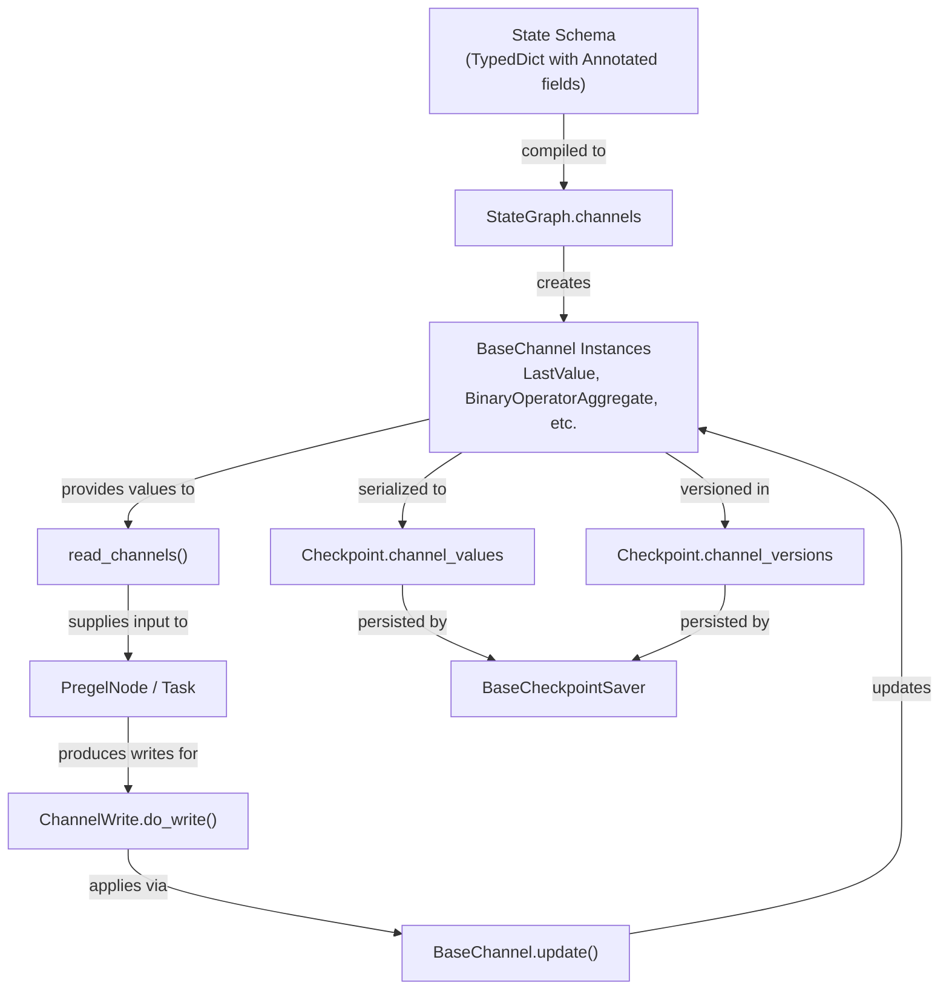
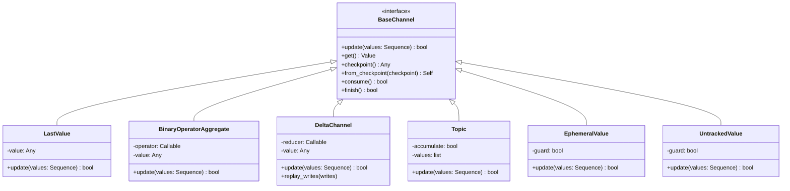
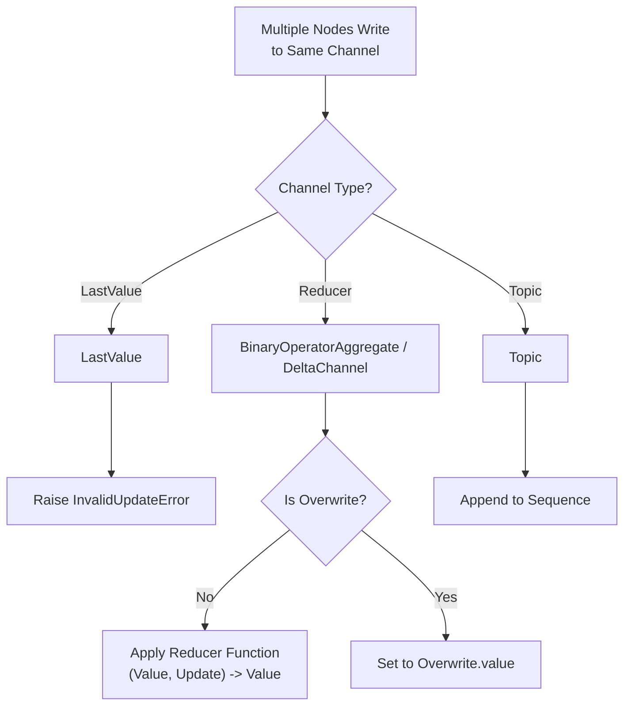

<!-- source: DeepWiki mcp.deepwiki.com · repo langchain-ai/langgraph · page 3.4 State Management and Channels · fetched 2026-10-26 -->

# State Management and Channels

Relevant source files

The following files were used as context for generating this wiki page:

- [libs/langgraph/langgraph/channels/__init__.py](libs/langgraph/langgraph/channels/__init__.py)
- [libs/langgraph/langgraph/channels/any_value.py](libs/langgraph/langgraph/channels/any_value.py)
- [libs/langgraph/langgraph/channels/base.py](libs/langgraph/langgraph/channels/base.py)
- [libs/langgraph/langgraph/channels/binop.py](libs/langgraph/langgraph/channels/binop.py)
- [libs/langgraph/langgraph/channels/delta.py](libs/langgraph/langgraph/channels/delta.py)
- [libs/langgraph/langgraph/channels/ephemeral_value.py](libs/langgraph/langgraph/channels/ephemeral_value.py)
- [libs/langgraph/langgraph/channels/last_value.py](libs/langgraph/langgraph/channels/last_value.py)
- [libs/langgraph/langgraph/channels/named_barrier_value.py](libs/langgraph/langgraph/channels/named_barrier_value.py)
- [libs/langgraph/langgraph/channels/topic.py](libs/langgraph/langgraph/channels/topic.py)
- [libs/langgraph/langgraph/channels/untracked_value.py](libs/langgraph/langgraph/channels/untracked_value.py)
- [libs/langgraph/langgraph/managed/base.py](libs/langgraph/langgraph/managed/base.py)
- [libs/langgraph/langgraph/managed/is_last_step.py](libs/langgraph/langgraph/managed/is_last_step.py)
- [libs/langgraph/langgraph/pregel/_checkpoint.py](libs/langgraph/langgraph/pregel/_checkpoint.py)
- [libs/langgraph/langgraph/pregel/_loop.py](libs/langgraph/langgraph/pregel/_loop.py)
- [libs/langgraph/langgraph/pregel/main.py](libs/langgraph/langgraph/pregel/main.py)
- [libs/langgraph/tests/test_channels.py](libs/langgraph/tests/test_channels.py)
- [libs/langgraph/tests/test_delta_channel_exit_mode.py](libs/langgraph/tests/test_delta_channel_exit_mode.py)
- [libs/langgraph/tests/test_delta_channel_supersteps_bound.py](libs/langgraph/tests/test_delta_channel_supersteps_bound.py)
- [libs/langgraph/tests/test_delta_channel_update_state.py](libs/langgraph/tests/test_delta_channel_update_state.py)

## Purpose and Scope

This document describes LangGraph's channel system, which provides the core state management primitives for graphs. Channels control how state flows between nodes, how concurrent updates are resolved, and how state persists across graph executions.

For information about the StateGraph API that uses channels, see [StateGraph API](3.1). For information about checkpointing and state persistence, see [Checkpointing Architecture](4.1). For control flow primitives that interact with state, see [Control Flow Primitives](3.5).

## Channel System Overview

Channels are the fundamental abstraction for state management in LangGraph. Each key in a graph's state schema maps to a channel that governs how that key's value is read, updated, and persisted.

### Channels in the Execution Architecture

The diagram below illustrates how state defined in a schema is transformed into runtime `BaseChannel` instances and managed by the `Pregel` loop.

**Sources:** [libs/langgraph/langgraph/pregel/_io.py:113-119](), [libs/langgraph/langgraph/pregel/_write.py:1-50](), [libs/langgraph/langgraph/checkpoint/base.py:28-32]()

### Channel Interface

All channels implement the `BaseChannel` interface, which defines the lifecycle of state within a single superstep and across checkpoints.

- **`update(values)`**: Applies a sequence of updates to the channel [libs/langgraph/langgraph/channels/base.py:90-99]().
- **`get()`**: Retrieves the current value [libs/langgraph/langgraph/channels/base.py:70-73]().
- **`checkpoint()`**: Returns a serializable representation [libs/langgraph/langgraph/channels/base.py:49-59]().
- **`from_checkpoint(checkpoint)`**: Restores a new channel instance from a checkpoint [libs/langgraph/langgraph/channels/base.py:61-65]().

**Sources:** [libs/langgraph/langgraph/channels/base.py:19-121](), [libs/langgraph/langgraph/channels/last_value.py:20-25](), [libs/langgraph/langgraph/channels/binop.py:65-73](), [libs/langgraph/langgraph/channels/delta.py:25-66](), [libs/langgraph/langgraph/channels/topic.py:23-32](), [libs/langgraph/langgraph/channels/untracked_value.py:15-25]()

## State Schema to Channel Mapping

`StateGraph` automatically converts state schemas into channels during compilation. It analyzes type hints and annotations to determine which channel type to use for each field.

### Mapping Rules

| State Schema Type | Channel Type | Behavior |
|-------------------|--------------|----------|
| `str`, `int`, `SomeClass` | `LastValue` | Replaces value on each update. Multiple writes in one step cause an error [libs/langgraph/langgraph/channels/last_value.py:56-67](). |
| `Annotated[T, reducer]` | `BinaryOperatorAggregate` | Applies the reducer function to merge updates [libs/langgraph/langgraph/channels/binop.py:123-144](). |
| `list` without annotation | `LastValue` | Replaces entire list. |
| `Annotated[list, operator.add]` | `BinaryOperatorAggregate` | Appends to list using `operator.add` [libs/langgraph/langgraph/channels/binop.py:77-93](). |
| `Annotated[list, add_messages]` | `DeltaChannel` | Specialized channel for message history that optimizes persistence by storing deltas [libs/langgraph/langgraph/channels/delta.py:25-64](). |

**Sources:** [libs/langgraph/langgraph/channels/last_value.py:56-67](), [libs/langgraph/langgraph/channels/binop.py:65-93](), [libs/langgraph/langgraph/channels/delta.py:25-64]()

## Channel Types

### LastValue
Stores the most recent value. It raises an `InvalidUpdateError` if multiple nodes write to the same `LastValue` channel in a single step [libs/langgraph/langgraph/channels/last_value.py:59-64](). `LastValueAfterFinish` is a variant that only makes the value available after the graph step finishes [libs/langgraph/langgraph/channels/last_value.py:81-85]().

### BinaryOperatorAggregate (Reducers)
Uses a binary operator to combine the current value with new updates. It supports the `Overwrite` primitive to bypass the reducer [libs/langgraph/langgraph/channels/binop.py:123-144]().

### DeltaChannel
A specialized reducer channel designed for large state like message histories. Instead of storing the full value in every checkpoint, it stores a sentinel and reconstructs state by replaying ancestor writes through the reducer [libs/langgraph/langgraph/channels/delta.py:25-55](). It writes full `_DeltaSnapshot` blobs periodically based on `snapshot_frequency` or the system-wide `DELTA_MAX_SUPERSTEPS_SINCE_SNAPSHOT` bound [libs/langgraph/langgraph/channels/delta.py:50-55](), [libs/langgraph/langgraph/pregel/_checkpoint.py:50-71]().

### Topic
A PubSub topic that accumulates values received into a list. If `accumulate=False` (default), the channel is emptied after each step. If `accumulate=True`, it persists values across steps [libs/langgraph/langgraph/channels/topic.py:27-32]().

### EphemeralValue
Values are cleared after being consumed or after the superstep ends. It can be configured with a `guard` to prevent multiple updates in a single step [libs/langgraph/langgraph/channels/ephemeral_value.py:12-25]().

### UntrackedValue
Stores the last value received but returns `MISSING` during `checkpoint()`, preventing persistence in the checkpointer [libs/langgraph/langgraph/channels/untracked_value.py:48-50]().

### DynamicBarrierValue and NamedBarrierValue
Specialized channels used for synchronization. `NamedBarrierValue` waits for a specific set of names to be provided before releasing the state, often used to implement "wait for all" logic in parallel execution branches.

**Sources:** [libs/langgraph/langgraph/channels/last_value.py:20-25](), [libs/langgraph/langgraph/channels/binop.py:65-73](), [libs/langgraph/langgraph/channels/delta.py:25-66](), [libs/langgraph/langgraph/channels/topic.py:23-32](), [libs/langgraph/langgraph/channels/untracked_value.py:15-25](), [libs/langgraph/langgraph/channels/named_barrier_value.py:1-20]()

## Concurrent Updates and Reducers

Channels handle concurrent updates based on their internal logic:

**Sources:** [libs/langgraph/langgraph/channels/last_value.py:59-64](), [libs/langgraph/langgraph/channels/binop.py:123-144](), [libs/langgraph/langgraph/channels/delta.py:159-183]()

## The Overwrite Primitive

The `Overwrite` class allows a node to explicitly replace the state in a reducer-based channel, ignoring the reducer [libs/langgraph/langgraph/channels/binop.py:16-16]().

- **Recognition**: LangGraph recognizes the `Overwrite` dataclass, the sentinel-keyed `{"__overwrite__": value}` dict form, and the dataclass-erased `{"value": ..., "type": "__overwrite__"}` form that results from JSON-serialisation [libs/langgraph/langgraph/channels/binop.py:31-51]().
- **Validation**: Reducer channels like `BinaryOperatorAggregate` and `DeltaChannel` enforce that only one `Overwrite` value can be received per super-step [libs/langgraph/langgraph/channels/binop.py:133-138](), [libs/langgraph/langgraph/channels/delta.py:166-172]().

**Sources:** [libs/langgraph/langgraph/channels/binop.py:31-51](), [libs/langgraph/langgraph/channels/binop.py:123-144](), [libs/langgraph/langgraph/channels/delta.py:162-172]()

## Channel Versioning and State Propagation

LangGraph tracks state changes using versioning to orchestrate the Pregel execution loop.

- **`ChannelVersions`**: A mapping of channel names to their current version [libs/langgraph/langgraph/checkpoint/base.py:30-30]().
- **Version Bumping**: When `BaseChannel.update()` returns `True`, the execution engine bumps the channel's version using `increment` [libs/langgraph/langgraph/pregel/_algo.py:89-91]().
- **Triggering**: Nodes are scheduled for the next superstep if any of their subscribed channels have a version newer than what the node has "seen" [libs/langgraph/langgraph/pregel/_algo.py:127-128]().
- **Managed Values**: In addition to standard channels, `ManagedValue` provides a way to inject system state (like `IsLastStep`) into nodes without persisting it as part of the graph state [libs/langgraph/langgraph/managed/base.py:18-24]().

**Sources:** [libs/langgraph/langgraph/checkpoint/base.py:30-30](), [libs/langgraph/langgraph/pregel/_algo.py:89-91](), [libs/langgraph/langgraph/pregel/_loop.py:182-184](), [libs/langgraph/langgraph/managed/base.py:18-24]()

---

