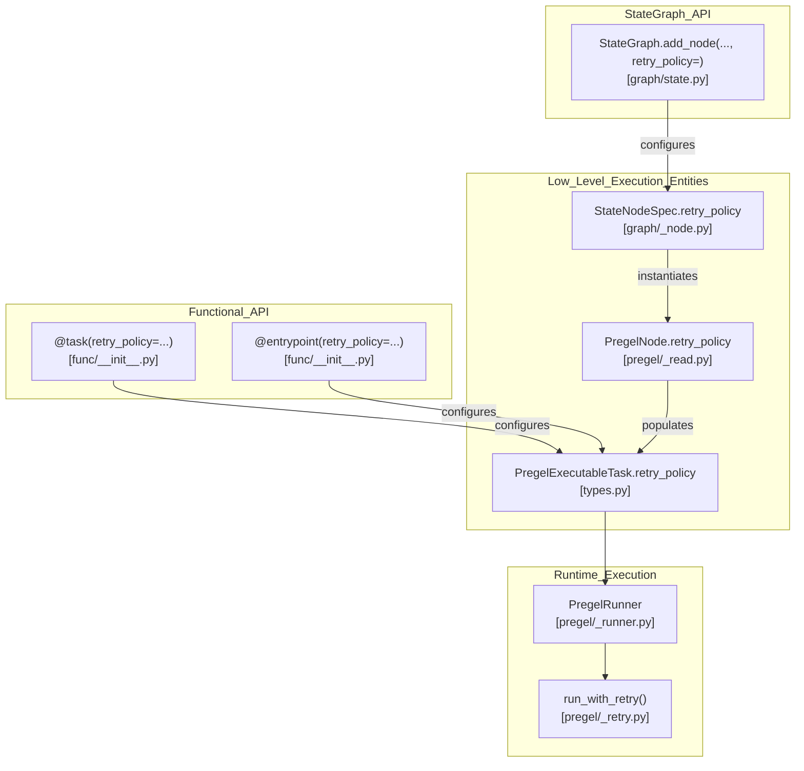
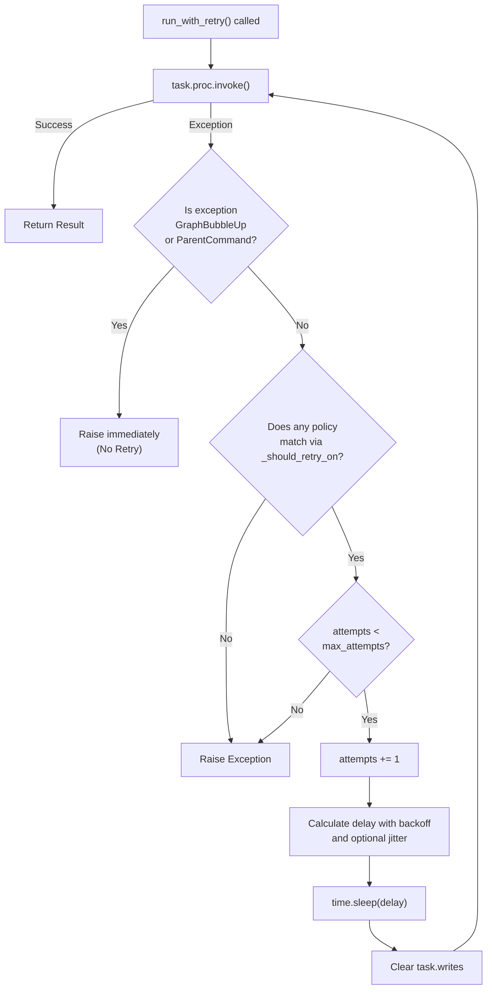
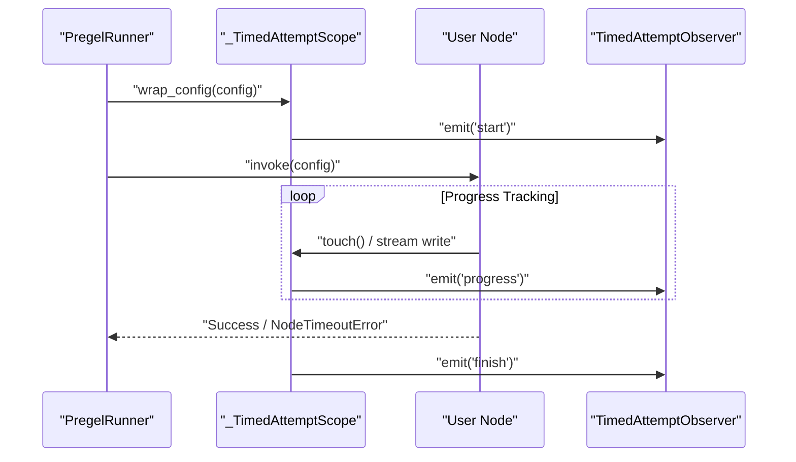

<!-- source: DeepWiki mcp.deepwiki.com · repo langchain-ai/langgraph · page 3.8 Error Handling and Retry Policies · fetched 2026-10-26 -->

# Error Handling and Retry Policies

<details>
<summary>Relevant source files</summary>

The following files were used as context for generating this wiki page:

- [libs/langgraph/langgraph/errors.py](libs/langgraph/langgraph/errors.py)
- [libs/langgraph/langgraph/pregel/_call.py](libs/langgraph/langgraph/pregel/_call.py)
- [libs/langgraph/langgraph/pregel/_retry.py](libs/langgraph/langgraph/pregel/_retry.py)
- [libs/langgraph/tests/test_retry.py](libs/langgraph/tests/test_retry.py)

</details>


This page documents how LangGraph handles node-level errors, configures automatic retry behavior, and preserves partial execution state when failures occur. The focus is on the `RetryPolicy` type, how it attaches to nodes and tasks, the mechanics of backoff and retry execution, and the relationship between errors and checkpointing.

For human-in-the-loop interrupts (which use `GraphInterrupt` but are not errors), see [3.7](). For the checkpointing system that enables execution resumption, see [4.1]().

---

## RetryPolicy

`RetryPolicy` is a configuration object defined in [libs/langgraph/langgraph/types.py:63-84]() that controls automatic retry behavior for a node or task.

| Field | Type | Default | Description |
|---|---|---|---|
| `initial_interval` | `float` | `0.5` | Seconds to wait before the first retry. |
| `backoff_factor` | `float` | `2.0` | Multiplier applied to the interval after each retry. |
| `max_interval` | `float` | `128.0` | Maximum seconds between retries. |
| `max_attempts` | `int` | `3` | Total attempts, including the first. |
| `jitter` | `bool` | `True` | Add random noise to the computed interval. |
| `retry_on` | `type[Exception] | Sequence[type[Exception]] | Callable[[Exception], bool]` | `default_retry_on` | Filter determining which exceptions should trigger a retry. |

The computed delay for attempt `n` (where `n` is the attempt count) is implemented in `run_with_retry` [libs/langgraph/langgraph/pregel/_retry.py:273-282]():

```python
interval = min(
    policy.max_interval,
    policy.initial_interval * (policy.backoff_factor ** (attempts - 1)),
)
if policy.jitter:
    sleep_time = interval + random.uniform(0, 1)
```

### `retry_on` and Exception Filtering

The `retry_on` field controls which exceptions are retried. The logic for evaluating this is handled by `_should_retry_on` [libs/langgraph/langgraph/pregel/_retry.py:89-158](). 

By default, the system retries transient errors like `ConnectionError` and 5xx HTTP status codes from `httpx` or `requests` [libs/langgraph/tests/test_retry.py:181-183](). It explicitly ignores common programming errors like `ValueError`, `TypeError`, or `SyntaxError` [libs/langgraph/tests/test_retry.py:184-192](). 

**Note:** Control-flow signals like `GraphBubbleUp`, `GraphInterrupt`, and `ParentCommand` are never retried regardless of policy [libs/langgraph/langgraph/pregel/_retry.py:304-320]().

### Multiple Policies

Both `StateGraph.add_node` and `@task` accept `retry_policy: RetryPolicy | Sequence[RetryPolicy]`. When a sequence is provided, the execution loop applies the **first policy whose `retry_on` matches the exception** [libs/langgraph/langgraph/pregel/_retry.py:299-303]().

**Sources:** [libs/langgraph/langgraph/types.py:63-84](), [libs/langgraph/langgraph/pregel/_retry.py:89-320](), [libs/langgraph/tests/test_retry.py:89-192]()

---

## Attaching Retry Policies

**RetryPolicy** can be attached at the graph level via node definitions or the task (functional API) level.

### Diagram: RetryPolicy Attachment Points


**Sources:** [libs/langgraph/langgraph/graph/_node.py:89-96](), [libs/langgraph/langgraph/pregel/_read.py:122-123](), [libs/langgraph/langgraph/types.py:84](), [libs/langgraph/langgraph/pregel/_runner.py:182]()

#### PregelNode and StateNodeSpec
The `StateNodeSpec` dataclass holds the `retry_policy` for a node [libs/langgraph/langgraph/graph/_node.py:89](). During graph construction, these are converted into `PregelNode` attributes [libs/langgraph/langgraph/pregel/_read.py:173-176](). At runtime, the `PregelRunner` uses these to populate the `retry_policy` of a `PregelExecutableTask` [libs/langgraph/langgraph/pregel/_runner.py:182]().

---

## Retry Execution Mechanics

`PregelRunner` orchestrates task execution. It calls `run_with_retry` (sync) or `arun_with_retry` (async) for each task [libs/langgraph/langgraph/pregel/_runner.py:207-213]().

### Execution Context and ExecutionInfo
Before a retry attempt, the system ensures `ExecutionInfo` is available in the `Runtime` object to track the attempt number (1-indexed) [libs/langgraph/langgraph/pregel/_retry.py:448-451](). This allows nodes to check their own retry state via `runtime.execution_info.node_attempt`.

### Diagram: Retry Decision Flow


**Sources:** [libs/langgraph/langgraph/pregel/_retry.py:265-343](), [libs/langgraph/langgraph/errors.py:50-135]()

### State Isolation during Retries
A critical feature is that `run_with_retry` calls `task.writes.clear()` before every retry attempt [libs/langgraph/langgraph/pregel/_retry.py:292](). This ensures that partial writes from a failed attempt do not pollute the state when the node is re-run.

---

## Error Handling and Propagation

When a node fails (after all retries are exhausted), the error is captured by the `PregelRunner` and committed via `self.commit(task, exception)` [libs/langgraph/langgraph/pregel/_runner.py:124]().

### Error Recording
The error is recorded as a write to the reserved `ERROR` channel [libs/langgraph/langgraph/_internal/_constants.py:13](). 
- If a checkpointer is present, the error is stored in `pending_writes` [libs/langgraph/langgraph/checkpoint/base.py:28]().
- The checkpoint version is **not advanced**; the state remains at the beginning of the superstep that failed.

### Node-Level Error Handlers
Users can register a specific node as an error handler for another node using `StateGraph.add_node(..., error_handler="handler_node_name")` [libs/langgraph/langgraph/graph/_node.py:92]().
- When the source node fails, the runner routes the failure to the handler node if configured [libs/langgraph/langgraph/pregel/_runner.py:171-174]().
- The handler node can inject the error context by defining a parameter typed as `NodeError` [libs/langgraph/langgraph/errors.py:149-166]().

---

## Timeouts

LangGraph supports `TimeoutPolicy` [libs/langgraph/langgraph/types.py:67-77]() for async nodes.
- **run_timeout**: Total time allowed for the node execution [libs/langgraph/langgraph/errors.py:203]().
- **idle_timeout**: Time allowed without the node making observable progress (e.g., emitting a stream event or a write) [libs/langgraph/langgraph/errors.py:204]().

If a timeout is exceeded, the system raises a `NodeTimeoutError` [libs/langgraph/langgraph/errors.py:190-207](). Because this does not inherit from the built-in `TimeoutError`, it is treated as retryable by the default `RetryPolicy` [libs/langgraph/langgraph/errors.py:193-194]().

### Diagram: Timeout Observation and Progress


**Sources:** [libs/langgraph/langgraph/pregel/_retry.py:128-193](), [libs/langgraph/langgraph/errors.py:190-212]()

---

## Error Types Reference

| Class | Definition | Description |
|---|---|---|
| `GraphRecursionError` | [libs/langgraph/langgraph/errors.py:67-87]() | Raised when the number of supersteps exceeds `recursion_limit`. |
| `InvalidUpdateError` | [libs/langgraph/langgraph/errors.py:90-99]() | Raised when multiple nodes write to the same channel without a reducer. |
| `NodeTimeoutError` | [libs/langgraph/langgraph/errors.py:190-227]() | Raised when a node exceeds `run_timeout` or `idle_timeout`. |
| `ParentCommand` | [libs/langgraph/langgraph/errors.py:129-135]() | Special exception used to bubble a `Command` up to a parent graph. |
| `NodeCancelledError` | [libs/langgraph/langgraph/errors.py:168-188]() | Raised when a node body raises `asyncio.CancelledError` itself. |
| `GraphDrained` | [libs/langgraph/langgraph/errors.py:54-66]() | Raised when a graph run exits early due to a drain request (e.g., SIGTERM). |

**Sources:** [libs/langgraph/langgraph/errors.py](), [libs/langgraph/langgraph/pregel/_retry.py](), [libs/langgraph/langgraph/pregel/_runner.py](), [libs/langgraph/langgraph/pregel/_algo.py]()

---

