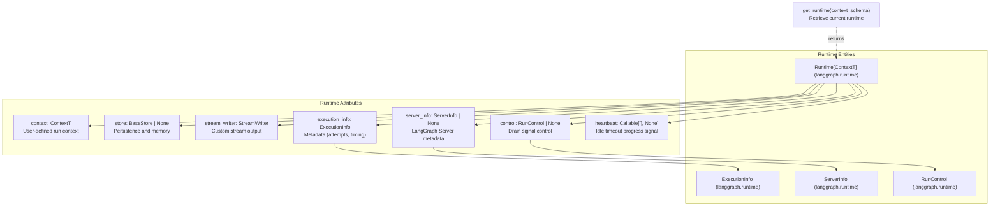
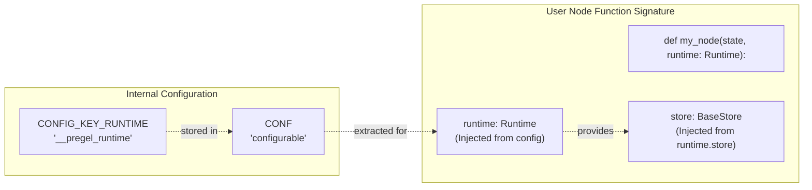

<!-- source: DeepWiki mcp.deepwiki.com · repo langchain-ai/langgraph · page 3.9 Runtime and Dependency Injection · fetched 2026-10-26 -->

# Runtime and Dependency Injection

<details>
<summary>Relevant source files</summary>

The following files were used as context for generating this wiki page:

- [libs/langgraph/langgraph/runtime.py](libs/langgraph/langgraph/runtime.py)
- [libs/langgraph/langgraph/utils/__init__.py](libs/langgraph/langgraph/utils/__init__.py)
- [libs/langgraph/langgraph/utils/config.py](libs/langgraph/langgraph/utils/config.py)
- [libs/langgraph/langgraph/utils/runnable.py](libs/langgraph/langgraph/utils/runnable.py)
- [libs/langgraph/tests/test_runtime.py](libs/langgraph/tests/test_runtime.py)
- [libs/sdk-py/integration/Dockerfile](libs/sdk-py/integration/Dockerfile)
- [libs/sdk-py/integration/docker-compose.yml](libs/sdk-py/integration/docker-compose.yml)
- [libs/sdk-py/integration/graph/factory_graph.py](libs/sdk-py/integration/graph/factory_graph.py)
- [libs/sdk-py/integration/langgraph.json](libs/sdk-py/integration/langgraph.json)
- [libs/sdk-py/tests/integration/conftest.py](libs/sdk-py/tests/integration/conftest.py)
- [libs/sdk-py/tests/integration/test_factory_graph.py](libs/sdk-py/tests/integration/test_factory_graph.py)

</details>


## Purpose and Scope

This document explains LangGraph's runtime dependency injection system (v0.6.0+). This system enables nodes and tools to receive execution-scoped dependencies—such as context, stores, stream writers, and execution metadata—without manual parameter passing. The `Runtime` class bundles these dependencies and makes them available to node functions through automatic parameter injection based on type annotations and function signatures. It also introduces `RunControl` for cooperative draining of graph runs and `ManagedValue` for automatic step-level state injection.

---

## Runtime Class Structure

The `Runtime` class is a generic dataclass that bundles run-scoped dependencies and utilities available to nodes during graph execution. It is designed to be injected into graph nodes and middleware.

### Runtime and Execution Entities

The following diagram associates the natural language concepts of execution context with the specific code entities used in the LangGraph runtime.



**Sources:** [libs/langgraph/langgraph/runtime.py:26-125](), [libs/langgraph/langgraph/runtime.py:198-223]()

### Runtime Attributes and Execution Info

| Attribute | Type | Purpose |
|-----------|------|---------|
| `context` | `ContextT` | Static context for the graph run (e.g., `user_id`, `db_conn`), defined by `context_schema`. [libs/langgraph/langgraph/runtime.py:198-201]() |
| `store` | `BaseStore \| None` | Key-value store for persistence and long-term memory. [libs/langgraph/langgraph/runtime.py:203-204]() |
| `stream_writer` | `StreamWriter` | Function for writing to the custom stream mode. [libs/langgraph/langgraph/runtime.py:206-207]() |
| `execution_info` | `ExecutionInfo` | Read-only metadata about the current execution (checkpoint IDs, task IDs). [libs/langgraph/langgraph/runtime.py:217-218]() |
| `server_info` | `ServerInfo \| None` | Metadata injected by LangGraph Server (assistant ID, graph ID, user). [libs/langgraph/langgraph/runtime.py:219-220]() |
| `control` | `RunControl \| None` | Surface for cooperative draining (e.g., shutdown signals). [libs/langgraph/langgraph/runtime.py:222-223]() |
| `previous` | `Any` | Previous return value for the thread (functional API with checkpointer only). [libs/langgraph/langgraph/runtime.py:214-215]() |
| `heartbeat` | `Callable[[], None]` | Progress signal for `idle_timeout` monitoring. [libs/langgraph/langgraph/runtime.py:209-212]() |

The `ExecutionInfo` class provides specific tracking data for the current node execution:
*   `node_attempt`: Current node execution attempt number (1-indexed). [libs/langgraph/langgraph/runtime.py:49-50]()
*   `node_first_attempt_time`: Unix timestamp for when the first attempt started. [libs/langgraph/langgraph/runtime.py:52-53]()
*   `checkpoint_id` / `checkpoint_ns`: Identifiers for the current state snapshot. [libs/langgraph/langgraph/runtime.py:30-34]()
*   `task_id`: The specific task ID for the current execution. [libs/langgraph/langgraph/runtime.py:36-37]()

**Sources:** [libs/langgraph/langgraph/runtime.py:26-59](), [libs/langgraph/langgraph/runtime.py:198-223]()

---

## Injectable Dependencies

LangGraph supports automatic injection of multiple dependencies into node functions and tools. This is managed via the internal configuration and the `Runtime` dataclass.

### Injection Association Diagram

This diagram maps the internal configuration keys and the `Runtime` class to the parameters available in a user's node function.



**Sources:** [libs/langgraph/langgraph/_internal/_constants.py:11](), [libs/langgraph/langgraph/runtime.py:125-141]()

### Supported Injectable Parameters

The system recognizes the following parameters in node signatures:

1.  **`runtime: Runtime[Context]`**: The complete runtime object, providing access to `execution_info`, `server_info`, and `context`. [libs/langgraph/langgraph/runtime.py:125-141]()
2.  **`store: BaseStore`**: Direct access to the cross-thread memory store (available via `runtime.store`). [libs/langgraph/langgraph/runtime.py:203-204]()
3.  **`writer: StreamWriter`**: Function for writing custom data to the stream (available via `runtime.stream_writer`). [libs/langgraph/langgraph/runtime.py:206-207]()
4.  **`config: RunnableConfig`**: The standard LangChain configuration object. [libs/langgraph/langgraph/runtime.py:131-135]()

**Sources:** [libs/langgraph/langgraph/runtime.py:125-141](), [libs/langgraph/langgraph/config.py:1-5]()

---

## Managed Values

Managed values are a specific type of dependency injection where values are computed dynamically by the Pregel engine based on the current execution state (the `PregelScratchpad`).

*   **`IsLastStep`**: Injects a boolean indicating if the current step is the last one allowed by the `recursion_limit`. [libs/langgraph/langgraph/managed/is_last_step.py:9-15]()
*   **`RemainingSteps`**: Injects an integer representing how many steps are left before reaching the `recursion_limit`. [libs/langgraph/langgraph/managed/is_last_step.py:18-24]()

**Sources:** [libs/langgraph/langgraph/managed/is_last_step.py:1-24]()

---

## Run Control and Draining

The `RunControl` class provides a mechanism for cooperative draining of a graph run. This is particularly useful for handling shutdown signals (e.g., `SIGTERM`) or pre-empting execution gracefully.

*   **`request_drain(reason)`**: Signals that the run should stop after the current step. [libs/langgraph/langgraph/runtime.py:95-96]()
*   **`drain_requested`**: A boolean flag checked by the execution engine between steps. [libs/langgraph/langgraph/runtime.py:99-100]()

If `request_drain()` is called during a node's execution, the graph will complete the current step and then raise a `GraphDrained` exception instead of proceeding to the next step. This allows for durability on exit where the state is saved so it can be resumed later. [libs/langgraph/tests/test_runtime.py:102-125](), [libs/langgraph/tests/test_runtime.py:172-203]()

**Sources:** [libs/langgraph/langgraph/runtime.py:79-106](), [libs/langgraph/tests/test_runtime.py:102-170]()

---

## Server Runtime and Factory Injection

When graphs are created via a factory function (e.g., in LangGraph Server), the server injects a `ServerRuntime` into the factory. This allows the factory to be aware of the `access_context` (the API endpoint triggering the build) and whether it is being built for execution or just for inspection.

The `ServerRuntime` is represented internally by `_ExecutionRuntime` or `_ReadRuntime`. It provides access to the `BaseStore` even before the graph is fully compiled. [libs/sdk-py/integration/graph/factory_graph.py:32-57]()

**Sources:** [libs/sdk-py/integration/graph/factory_graph.py:1-70](), [libs/sdk-py/tests/integration/test_factory_graph.py:1-9]()

---

## Runtime and Tool Injection

In the `langgraph.prebuilt` module, specialized injection markers are used to pass context into tools. This allows tools to access the graph state, the specific `tool_call_id`, and the runtime store without needing to be passed these values manually by the LLM.

*   **`InjectedState`**: Used to inject the full graph state or a specific key into a tool argument.
*   **`InjectedStore`**: Used to inject the `BaseStore` into a tool.
*   **`InjectedToolCallId`**: Used to inject the ID of the current tool call.

**Sources:** [libs/langgraph/langgraph/runtime.py:137-141]()

---

## Implementation Details

### Runtime Retrieval
While parameter injection is the preferred method, the `get_runtime` function allows retrieving the current `Runtime` instance from within a function using the `RunnableConfig`.

```python
def my_node(state: State, config: RunnableConfig):
    runtime = get_runtime(Context, config)
    # ...
```

**Sources:** [libs/langgraph/langgraph/runtime.py:233-241](), [libs/langgraph/tests/test_runtime.py:47-67]()

### Runtime Merging and Overriding
The `Runtime` class supports functional updates:
*   **`patch(**overrides)`**: Returns a new `Runtime` instance with specific fields updated. [libs/langgraph/langgraph/runtime.py:243-245]()
*   **`merge(other)`**: Combines two runtime objects, where the `other` object's non-null values take precedence. [libs/langgraph/langgraph/runtime.py:247-259]()

**Sources:** [libs/langgraph/langgraph/runtime.py:243-259](), [libs/langgraph/tests/test_runtime.py:70-99]()

---

## Configuration Summary

The runtime system relies on internal configuration keys to pass the `Runtime` object through the `RunnableConfig`.

| Constant | Value | Description |
|----------|-------|-------------|
| `CONFIG_KEY_RUNTIME` | `"__pregel_runtime"` | Key in `configurable` for the `Runtime` instance. [libs/langgraph/langgraph/_internal/_constants.py:11]() |
| `CONF` | `"configurable"` | The key in `RunnableConfig` containing the runtime metadata. [libs/langgraph/langgraph/_internal/_constants.py:11]() |

**Sources:** [libs/langgraph/langgraph/_internal/_constants.py:11](), [libs/langgraph/langgraph/runtime.py:11-12]()

---

