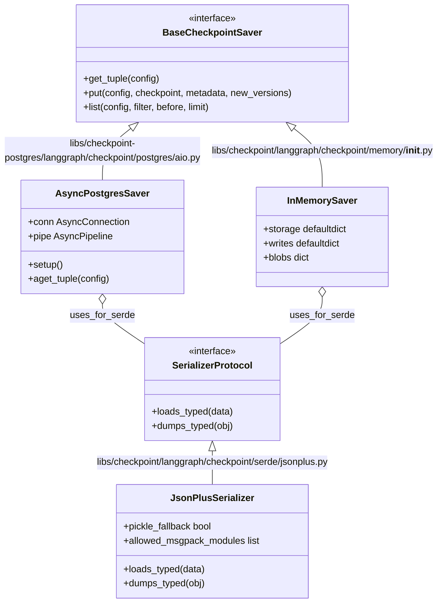

<!-- source: DeepWiki mcp.deepwiki.com · repo langchain-ai/langgraph · page 4 Persistence and Memory · fetched 2026-10-26 -->

# Persistence and Memory

<details>
<summary>Relevant source files</summary>

The following files were used as context for generating this wiki page:

- [libs/checkpoint-postgres/langgraph/checkpoint/postgres/__init__.py](libs/checkpoint-postgres/langgraph/checkpoint/postgres/__init__.py)
- [libs/checkpoint-postgres/langgraph/checkpoint/postgres/aio.py](libs/checkpoint-postgres/langgraph/checkpoint/postgres/aio.py)
- [libs/checkpoint-postgres/langgraph/checkpoint/postgres/base.py](libs/checkpoint-postgres/langgraph/checkpoint/postgres/base.py)
- [libs/checkpoint-postgres/langgraph/checkpoint/postgres/shallow.py](libs/checkpoint-postgres/langgraph/checkpoint/postgres/shallow.py)
- [libs/checkpoint-postgres/tests/test_async.py](libs/checkpoint-postgres/tests/test_async.py)
- [libs/checkpoint-postgres/tests/test_sync.py](libs/checkpoint-postgres/tests/test_sync.py)
- [libs/checkpoint-sqlite/langgraph/checkpoint/sqlite/__init__.py](libs/checkpoint-sqlite/langgraph/checkpoint/sqlite/__init__.py)
- [libs/checkpoint-sqlite/langgraph/checkpoint/sqlite/aio.py](libs/checkpoint-sqlite/langgraph/checkpoint/sqlite/aio.py)
- [libs/checkpoint/langgraph/checkpoint/base/__init__.py](libs/checkpoint/langgraph/checkpoint/base/__init__.py)
- [libs/checkpoint/langgraph/checkpoint/memory/__init__.py](libs/checkpoint/langgraph/checkpoint/memory/__init__.py)
- [libs/checkpoint/langgraph/checkpoint/serde/jsonplus.py](libs/checkpoint/langgraph/checkpoint/serde/jsonplus.py)
- [libs/checkpoint/langgraph/checkpoint/serde/types.py](libs/checkpoint/langgraph/checkpoint/serde/types.py)
- [libs/checkpoint/tests/test_encrypted.py](libs/checkpoint/tests/test_encrypted.py)
- [libs/checkpoint/tests/test_jsonplus.py](libs/checkpoint/tests/test_jsonplus.py)
- [libs/checkpoint/tests/test_memory.py](libs/checkpoint/tests/test_memory.py)
- [libs/langgraph/tests/test_serde_allowlist.py](libs/langgraph/tests/test_serde_allowlist.py)

</details>


LangGraph's persistence and memory system is divided into two distinct layers that serve complementary purposes for stateful applications.

| Layer | Interface | Scope | Primary Purpose |
|-------|-----------|-------|-----------------|
| **Checkpointer** | `BaseCheckpointSaver` | Per-thread | Durable execution, error recovery, and "Time Travel" (state replay) |
| **Store** | `BaseStore` | Cross-thread | Long-term memory, shared knowledge, user profiles, and global state |

**Checkpointers** save a full snapshot of the graph state after every superstep. They are indexed by a `thread_id`, allowing a specific conversation or workflow to be paused and resumed [libs/checkpoint/langgraph/checkpoint/base/__init__.py:182-192](). **Stores** provide a global, namespace-keyed document store that any thread can access, making them ideal for information that must persist across different conversations (e.g., remembering a user's name across multiple independent threads).

### System Architecture

The following diagram illustrates how these two systems interact with graph execution threads.

**Persistence Architecture Overview**
```mermaid
graph TD
    subgraph "Execution_Contexts"
        [T1]Thread_A["Thread_A_(thread_id='A')"]
        [T2]Thread_B["Thread_B_(thread_id='B')"]
    end

    subgraph "Checkpointer_Layer_(Per-Thread)"
        [CP_A]CP_History_A["Checkpoint_History_for_A"]
        [CP_B]CP_History_B["Checkpoint_History_for_B"]
    end

    subgraph "Store_Layer_(Cross-Thread)"
        [NS_USER]NS_User_123["Namespace:_('users',_'123')"]
        [NS_GLOBAL]NS_Memories["Namespace:_('memories',)"]
    end

    [T1]Thread_A -->|"read/write"| [CP_A]CP_History_A
    [T2]Thread_B -->|"read/write"| [CP_B]CP_History_B
    
    [T1]Thread_A -->|"InjectedStore"| [NS_USER]NS_User_123
    [T2]Thread_B -->|"InjectedStore"| [NS_USER]NS_User_123
    [T1]Thread_A -->|"InjectedStore"| [NS_GLOBAL]NS_Memories

    [CP_A]CP_History_A -.["BaseCheckpointSaver"]-> [BACKEND_CP]Checkpointer_Impls["PostgresSaver\nSqliteSaver\nInMemorySaver"]
    [NS_USER]NS_User_123 -.["BaseStore"]-> [BACKEND_STORE]Store_Impls["PostgresStore\nSqliteStore"]
```
Sources: [libs/checkpoint/langgraph/checkpoint/memory/__init__.py:33-46](), [libs/checkpoint-postgres/langgraph/checkpoint/postgres/aio.py:40-41](), [libs/checkpoint/langgraph/checkpoint/base/__init__.py:176-180]()

---

## The Checkpointer Layer

The checkpointer is responsible for the durability of the graph's execution state. It captures the values of all channels (state variables) at the end of every superstep. Recent updates introduce support for `DeltaChannel`, allowing for more efficient reconstruction of history for specific channel types [libs/checkpoint/langgraph/checkpoint/base/__init__.py:149-174]().

### Key Data Models
- **`Checkpoint`**: A `TypedDict` containing the raw state, including `channel_values`, `channel_versions`, and `versions_seen` [libs/checkpoint/langgraph/checkpoint/base/__init__.py:92-123]().
- **`CheckpointTuple`**: A container returned by the saver that bundles the `Checkpoint` with its `config`, `metadata`, and any `pending_writes` [libs/checkpoint/langgraph/checkpoint/base/__init__.py:139-146]().
- **`CheckpointMetadata`**: Metadata about the step, such as the `source` (e.g., "loop", "input", "update", "fork") and `step` number [libs/checkpoint/langgraph/checkpoint/base/__init__.py:38-62]().

### Implementations
LangGraph provides several concrete implementations of checkpointers:
- **`PostgresSaver` / `AsyncPostgresSaver`**: Recommended for production. Supports high-concurrency, migrations, and robust persistence using `psycopg` [libs/checkpoint-postgres/langgraph/checkpoint/postgres/aio.py:40-62]().
- **`ShallowPostgresSaver`**: A specialized Postgres implementation that optimizes storage by not keeping full history of all channel blobs. Note: This class is deprecated in favor of `PostgresSaver` with specific durability settings [libs/checkpoint-postgres/langgraph/checkpoint/postgres/shallow.py:169-197]().
- **`SqliteSaver` / `AsyncSqliteSaver`**: Ideal for local development. `AsyncSqliteSaver` provides an asynchronous interface using `aiosqlite` [libs/checkpoint-sqlite/langgraph/checkpoint/sqlite/aio.py:38-51]().
- **`InMemorySaver`**: Volatile storage used primarily for testing and ephemeral sessions. It uses `defaultdict` to store checkpoints, writes, and blobs in memory [libs/checkpoint/langgraph/checkpoint/memory/__init__.py:33-84]().

For more details on the architecture and lifecycle, see [Checkpointing Architecture](#4.1) and [Checkpoint Implementations](#4.2).

---

## The Store System

The `BaseStore` interface provides a hierarchical, document-style storage system. Unlike checkpointers, which are tied to a specific `thread_id`, the Store allows nodes to share data across different threads using **Namespaces**.

### Features
- **Namespacing**: Data is organized by a hierarchy, allowing for scoped access (e.g., per-user or per-organization).
- **Persistence**: Store implementations (Postgres, SQLite) ensure that memories survive across application restarts.
- **Search**: Supports listing and searching for items within specific namespaces.

For more details on cross-thread memory, see [Store System](#4.3).

---

## Serialization and Security

LangGraph uses a specialized serialization protocol to convert complex Python objects into storable formats.

- **`JsonPlusSerializer`**: The default serializer. It uses `ormsgpack` for high-performance binary encoding and handles extended types like Pydantic models, LangChain objects, and datetimes [libs/checkpoint/langgraph/checkpoint/serde/jsonplus.py:82-106]().
- **`EncryptedSerializer`**: A wrapper that provides a layer for encrypting sensitive state at rest [libs/checkpoint/langgraph/checkpoint/base/__init__.py:20-20]().
- **`SerializerProtocol`**: Defines the interface for implementing custom serialization logic, including `loads_typed` and `dumps_typed` [libs/checkpoint-postgres/langgraph/checkpoint/postgres/aio.py:20-20]().
- **Strict Mode**: The environment variable `LANGGRAPH_STRICT_MSGPACK=true` can be set to restrict deserialization to a built-in allowlist of safe types [libs/checkpoint/langgraph/checkpoint/serde/jsonplus.py:85-94]().

For more details on how data is encoded, see [Serialization](#4.4).

---

## Time Travel and State Forking

Because every superstep is persisted as a unique checkpoint, LangGraph supports "Time Travel." This allows developers to:
1. **View State History**: Re-examine what the graph looked like at any previous step using `list` or `alist` [libs/checkpoint-postgres/langgraph/checkpoint/postgres/aio.py:119-126]().
2. **Replay**: Resume execution from a past checkpoint by specifying a `checkpoint_id` in the `RunnableConfig` [libs/checkpoint/langgraph/checkpoint/base/__init__.py:182-192]().
3. **Fork**: Create a new execution branch by updating the state of a past checkpoint and resuming from there [libs/checkpoint/langgraph/checkpoint/base/__init__.py:41-48]().

This is managed via the `configurable` fields in `RunnableConfig`. If a `checkpoint_id` is provided, the checkpointer retrieves that specific snapshot [libs/checkpoint-postgres/langgraph/checkpoint/postgres/aio.py:181-182]().

For more details on these capabilities, see [Time Travel and State Forking](#4.5).

---

## Summary of Core Entities

The following diagram maps the conceptual persistence entities to their specific code implementations.

**Entity to Code Mapping**

Sources: [libs/checkpoint-postgres/langgraph/checkpoint/postgres/aio.py:40-50](), [libs/checkpoint/langgraph/checkpoint/memory/__init__.py:33-46](), [libs/checkpoint/langgraph/checkpoint/base/__init__.py:176-200](), [libs/checkpoint/langgraph/checkpoint/serde/jsonplus.py:82-95]()

**Sources**:
- [libs/checkpoint/langgraph/checkpoint/base/__init__.py]()
- [libs/checkpoint/langgraph/checkpoint/memory/__init__.py]()
- [libs/checkpoint-postgres/langgraph/checkpoint/postgres/aio.py]()
- [libs/checkpoint-postgres/langgraph/checkpoint/postgres/base.py]()
- [libs/checkpoint-postgres/langgraph/checkpoint/postgres/shallow.py]()
- [libs/checkpoint-sqlite/langgraph/checkpoint/sqlite/aio.py]()
- [libs/checkpoint/langgraph/checkpoint/serde/jsonplus.py]()

---

