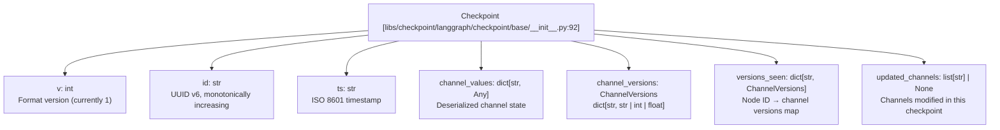
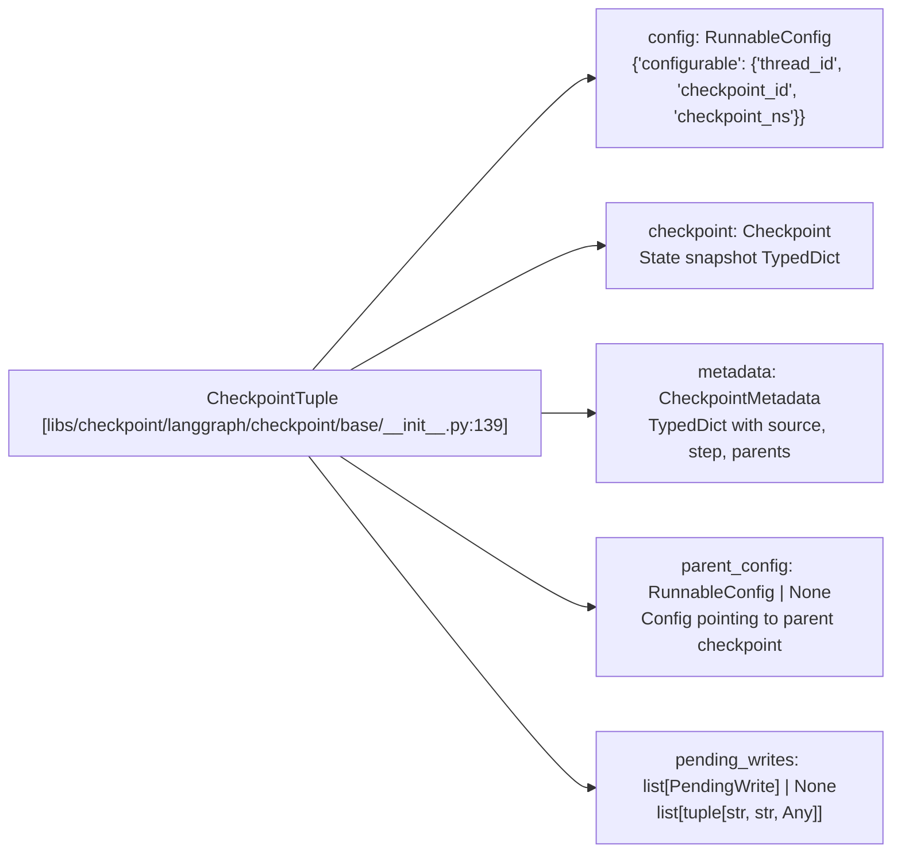
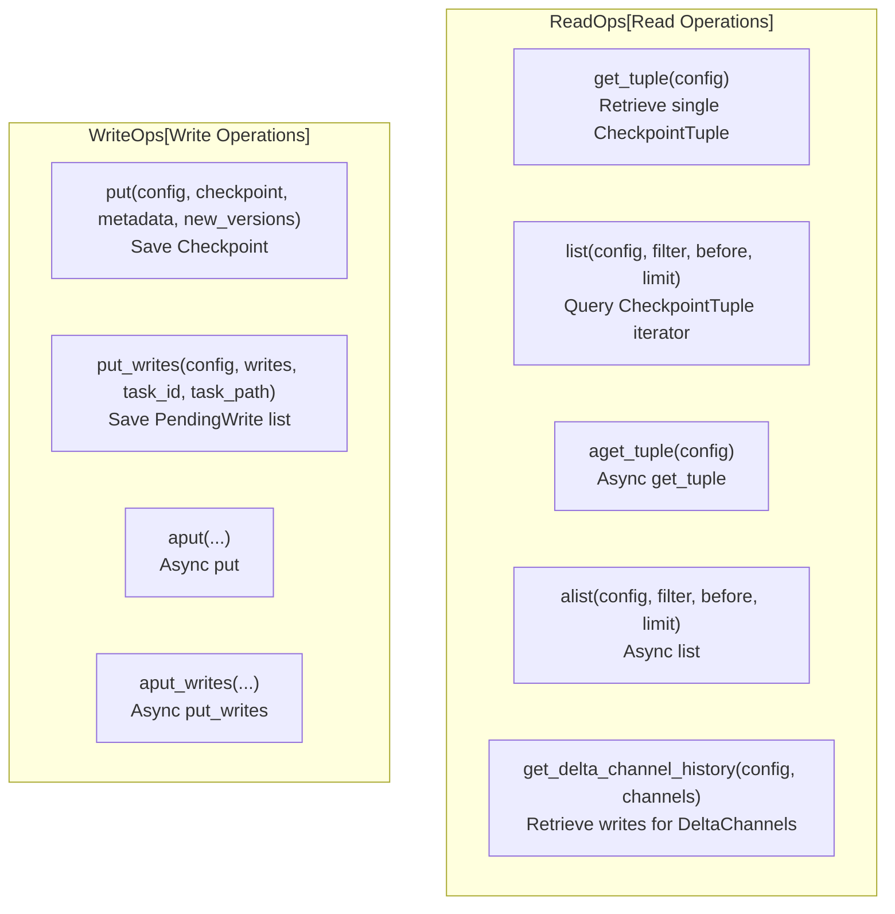
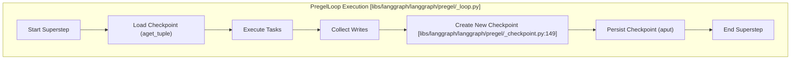
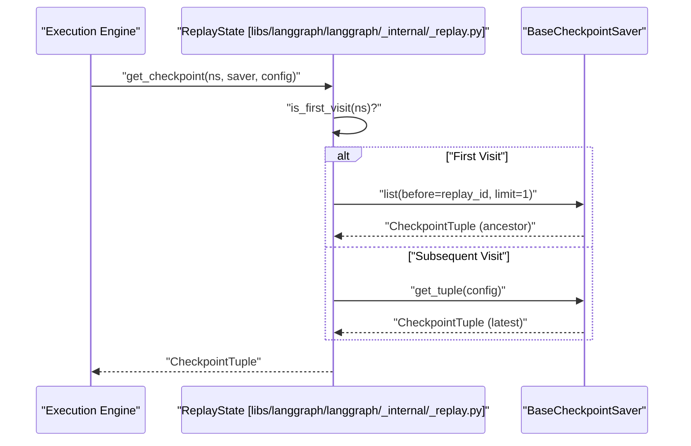

<!-- source: DeepWiki mcp.deepwiki.com · repo langchain-ai/langgraph · page 4.1 Checkpointing Architecture · fetched 2026-10-26 -->

# Checkpointing Architecture

Relevant source files

The following files were used as context for generating this wiki page:

- [libs/checkpoint-postgres/langgraph/checkpoint/postgres/__init__.py](libs/checkpoint-postgres/langgraph/checkpoint/postgres/__init__.py)
- [libs/checkpoint-postgres/langgraph/checkpoint/postgres/aio.py](libs/checkpoint-postgres/langgraph/checkpoint/postgres/aio.py)
- [libs/checkpoint-postgres/langgraph/checkpoint/postgres/base.py](libs/checkpoint-postgres/langgraph/checkpoint/postgres/base.py)
- [libs/checkpoint-postgres/langgraph/checkpoint/postgres/shallow.py](libs/checkpoint-postgres/langgraph/checkpoint/postgres/shallow.py)
- [libs/checkpoint-postgres/tests/test_async.py](libs/checkpoint-postgres/tests/test_async.py)
- [libs/checkpoint-postgres/tests/test_sync.py](libs/checkpoint-postgres/tests/test_sync.py)
- [libs/checkpoint-sqlite/langgraph/checkpoint/sqlite/__init__.py](libs/checkpoint-sqlite/langgraph/checkpoint/sqlite/__init__.py)
- [libs/checkpoint-sqlite/langgraph/checkpoint/sqlite/aio.py](libs/checkpoint-sqlite/langgraph/checkpoint/sqlite/aio.py)
- [libs/checkpoint/langgraph/checkpoint/base/__init__.py](libs/checkpoint/langgraph/checkpoint/base/__init__.py)
- [libs/checkpoint/langgraph/checkpoint/memory/__init__.py](libs/checkpoint/langgraph/checkpoint/memory/__init__.py)
- [libs/langgraph/langgraph/channels/delta.py](libs/langgraph/langgraph/channels/delta.py)
- [libs/langgraph/langgraph/pregel/_checkpoint.py](libs/langgraph/langgraph/pregel/_checkpoint.py)
- [libs/langgraph/langgraph/pregel/_loop.py](libs/langgraph/langgraph/pregel/_loop.py)
- [libs/langgraph/langgraph/pregel/main.py](libs/langgraph/langgraph/pregel/main.py)
- [libs/langgraph/tests/test_channels.py](libs/langgraph/tests/test_channels.py)
- [libs/langgraph/tests/test_delta_channel_exit_mode.py](libs/langgraph/tests/test_delta_channel_exit_mode.py)
- [libs/langgraph/tests/test_delta_channel_supersteps_bound.py](libs/langgraph/tests/test_delta_channel_supersteps_bound.py)
- [libs/langgraph/tests/test_delta_channel_update_state.py](libs/langgraph/tests/test_delta_channel_update_state.py)

## Purpose and Scope

This document describes the checkpointing architecture that enables LangGraph's durable, stateful execution. Checkpoints capture the complete state of a graph at specific points in time, enabling persistence, resumability, time-travel debugging, and human-in-the-loop workflows.

This page covers the checkpoint data model (`Checkpoint`, `CheckpointTuple`, `CheckpointMetadata`), the `BaseCheckpointSaver` abstract interface, and how the Pregel execution loop interacts with the checkpointer. It also documents the **DeltaChannel** system, which optimizes storage by replaying writes instead of snapshotting full state.

---

## Core Data Structures

The checkpoint system is built around several primary data structures that capture and restore graph state.

### Checkpoint TypedDict

The `Checkpoint` TypedDict [[libs/checkpoint/langgraph/checkpoint/base/__init__.py:92-125]]() represents a complete snapshot of graph state at a specific point in time.

**Checkpoint Structure Diagram**:

Sources: [[libs/checkpoint/langgraph/checkpoint/base/__init__.py:92-125]]()

**Checkpoint Structure Fields**:

| Field | Type | Description |
|-------|------|-------------|
| `v` | `int` | Checkpoint format version (currently `1`) [[libs/checkpoint/langgraph/checkpoint/base/__init__.py:95-96]]() |
| `id` | `str` | Unique identifier generated via `uuid6`, monotonically increasing [[libs/checkpoint/langgraph/checkpoint/base/__init__.py:97-101]]() |
| `ts` | `str` | Creation timestamp in ISO 8601 format [[libs/checkpoint/langgraph/checkpoint/base/__init__.py:102-103]]() |
| `channel_values` | `dict[str, Any]` | Deserialized state values indexed by channel name [[libs/checkpoint/langgraph/checkpoint/base/__init__.py:104-108]]() |
| `channel_versions` | `ChannelVersions` | Version identifier for each channel (str/int/float) [[libs/checkpoint/langgraph/checkpoint/base/__init__.py:109-114]]() |
| `versions_seen` | `dict[str, ChannelVersions]` | Maps node ID to channel versions that node has processed [[libs/checkpoint/langgraph/checkpoint/base/__init__.py:115-120]]() |
| `updated_channels` | `list[str] \| None` | List of channel names modified in this checkpoint [[libs/checkpoint/langgraph/checkpoint/base/__init__.py:121-123]]() |

Sources: [[libs/checkpoint/langgraph/checkpoint/base/__init__.py:92-125]]()

### CheckpointTuple NamedTuple

`CheckpointTuple` [[libs/checkpoint/langgraph/checkpoint/base/__init__.py:139-147]]() wraps a `Checkpoint` with its associated metadata and configuration.

**CheckpointTuple Relationship Diagram**:

Sources: [[libs/checkpoint/langgraph/checkpoint/base/__init__.py:139-147]]()

### CheckpointMetadata TypedDict

`CheckpointMetadata` [[libs/checkpoint/langgraph/checkpoint/base/__init__.py:38-86]]() stores contextual information about how and why a checkpoint was created.

| Field | Type | Description |
|-------|------|-------------|
| `source` | `"input" \| "loop" \| "update" \| "fork"` | How the checkpoint was created [[libs/checkpoint/langgraph/checkpoint/base/__init__.py:41-48]]() |
| `step` | `int` | Step number (-1 for initial input, 0+ for execution steps) [[libs/checkpoint/langgraph/checkpoint/base/__init__.py:49-55]]() |
| `parents` | `dict[str, str]` | Parent checkpoint IDs by namespace [[libs/checkpoint/langgraph/checkpoint/base/__init__.py:56-60]]() |
| `run_id` | `str` | The ID of the run that created this checkpoint [[libs/checkpoint/langgraph/checkpoint/base/__init__.py:61-62]]() |
| `counters_since_delta_snapshot` | `dict[str, tuple[int, int]]` | **(Beta)** Tracks updates and supersteps for `DeltaChannel` snapshot logic [[libs/checkpoint/langgraph/checkpoint/base/__init__.py:63-86]]() |

Sources: [[libs/checkpoint/langgraph/checkpoint/base/__init__.py:38-86]]()

---

## BaseCheckpointSaver Interface

The `BaseCheckpointSaver` abstract class [[libs/checkpoint/langgraph/checkpoint/base/__init__.py:176]]() defines the contract that all checkpoint implementations must fulfill.

### Core Methods

**BaseCheckpointSaver Functional Map**:

Sources: [[libs/checkpoint/langgraph/checkpoint/base/__init__.py:176-396]]()

#### Delta Channel Support

A significant extension to the checkpointer interface is `get_delta_channel_history` [[libs/checkpoint/langgraph/checkpoint/base/__init__.py:317]](). This method allows `DeltaChannel` types to reconstruct their state by walking the ancestor chain and retrieving `PendingWrite` records that haven't been snapshotted yet. This is implemented by implementations like `InMemorySaver` [[libs/checkpoint/langgraph/checkpoint/memory/__init__.py:142-230]](), `AsyncPostgresSaver` [[libs/checkpoint-postgres/langgraph/checkpoint/postgres/aio.py:270-366]](), and `AsyncSqliteSaver` [[libs/checkpoint-sqlite/langgraph/checkpoint/sqlite/aio.py:255-300]]().

The system uses `_DeltaSnapshot` blobs to terminate the ancestor walk [[libs/checkpoint/langgraph/checkpoint/memory/__init__.py:151-157]](). A snapshot is triggered when a channel's update count reaches `snapshot_frequency` or a superstep limit is hit [[libs/langgraph/langgraph/pregel/_checkpoint.py:50-71]]().

Sources: [[libs/checkpoint/langgraph/checkpoint/base/__init__.py:317-342]](), [[libs/checkpoint/langgraph/checkpoint/memory/__init__.py:142-230]](), [[libs/checkpoint-postgres/langgraph/checkpoint/postgres/aio.py:270-366]](), [[libs/checkpoint-sqlite/langgraph/checkpoint/sqlite/aio.py:255-300]](), [[libs/langgraph/langgraph/pregel/_checkpoint.py:50-71]]()

---

## Checkpoint Lifecycle and Persistence

Checkpointers allow LangGraph agents to persist their state across multiple interactions. The primary key for retrieval is the `thread_id` provided in the `RunnableConfig` [[libs/checkpoint/langgraph/checkpoint/base/__init__.py:182-193]]().

### Implementation Variations

LangGraph provides several implementations of the checkpointer interface:

1.  **InMemorySaver**: Stores checkpoints in memory using `defaultdict`. It maintains `storage`, `writes`, and `blobs` maps [[libs/checkpoint/langgraph/checkpoint/memory/__init__.py:33-94]]().
2.  **PostgresSaver / AsyncPostgresSaver**: Stores checkpoints in a PostgreSQL database [[libs/checkpoint-postgres/langgraph/checkpoint/postgres/__init__.py:40]]() [[libs/checkpoint-postgres/langgraph/checkpoint/postgres/aio.py:40]](). Supports connection pooling [[libs/checkpoint-postgres/langgraph/checkpoint/postgres/aio.py:52-55]]() and pipelining [[libs/checkpoint-postgres/langgraph/checkpoint/postgres/aio.py:58-61]]().
3.  **SqliteSaver / AsyncSqliteSaver**: Stores checkpoints in a SQLite database [[libs/checkpoint-sqlite/langgraph/checkpoint/sqlite/__init__.py:45]]() [[libs/checkpoint-sqlite/langgraph/checkpoint/sqlite/aio.py:38]](). `AsyncSqliteSaver` uses `aiosqlite` for non-blocking I/O [[libs/checkpoint-sqlite/langgraph/checkpoint/sqlite/aio.py:11-51]]().
4.  **ShallowPostgresSaver**: A version that only stores the most recent checkpoint, effectively disabling time-travel history [[libs/checkpoint-postgres/langgraph/checkpoint/postgres/shallow.py:169-175]]().

### Database Schema (Postgres)

The Postgres implementation uses several tables to manage the checkpoint lifecycle:
- `checkpoints`: Stores the main `Checkpoint` JSONB and metadata [[libs/checkpoint-postgres/langgraph/checkpoint/postgres/base.py:47-56]]().
- `checkpoint_blobs`: Stores the actual binary data (serialized channel values) indexed by version [[libs/checkpoint-postgres/langgraph/checkpoint/postgres/base.py:57-65]]().
- `checkpoint_writes`: Stores intermediate writes between checkpoints, including `task_path` for ordered execution [[libs/checkpoint-postgres/langgraph/checkpoint/postgres/base.py:66-76]]() [[libs/checkpoint-postgres/langgraph/checkpoint/postgres/base.py:90]]().
- `checkpoint_migrations`: Tracks schema versioning [[libs/checkpoint-postgres/langgraph/checkpoint/postgres/base.py:43-46]]().

Sources: [[libs/checkpoint-postgres/langgraph/checkpoint/postgres/base.py:43-91]]()

---

## Pregel Loop Interaction

The `PregelLoop` (sync and async) orchestrates checkpointing during graph execution.

**Checkpoint Lifecycle in PregelLoop**:

Sources: [[libs/langgraph/langgraph/pregel/_loop.py:158]](), [[libs/langgraph/langgraph/pregel/_checkpoint.py:149-218]]()

### Checkpoint Creation
The `create_checkpoint` function [[libs/langgraph/langgraph/pregel/_checkpoint.py:149]]() builds a new `Checkpoint` by:
1.  Copying versions from the previous checkpoint [[libs/langgraph/langgraph/pregel/_checkpoint.py:175]]().
2.  Determining which channels need full snapshots (via `delta_channels_to_snapshot`) [[libs/langgraph/langgraph/pregel/_checkpoint.py:169]]().
3.  Updating `channel_versions` and `versions_seen` based on node execution [[libs/langgraph/langgraph/pregel/_checkpoint.py:180-217]]().

---

## Replay and Time Travel

During replay or "time travel", LangGraph uses the `ReplayState` [[libs/langgraph/langgraph/_internal/_replay.py:14]]() to track which subgraphs have already loaded their pre-replay checkpoint.

**Replay Checkpoint Selection**:

Sources: [[libs/langgraph/langgraph/_internal/_replay.py:52-90]]()

---

## Summary of Special Write Markers

When storing writes via `put_writes`, LangGraph uses specific index values in the storage backend to distinguish between different types of execution data. These are defined in `WRITES_IDX_MAP` and related constants.

| Constant | Value | Purpose |
|----------|-------|---------|
| `ERROR` | `-1` | Marks a node execution as failed [[libs/checkpoint/langgraph/checkpoint/serde/types.py:23]]() |
| `SCHEDULED` | `-2` | Marks a task as scheduled for execution [[libs/checkpoint/langgraph/checkpoint/serde/types.py:26]]() |
| `INTERRUPT` | `-3` | Stores an interrupt payload [[libs/checkpoint/langgraph/checkpoint/serde/types.py:24]]() |
| `RESUME` | `-4` | Stores a value provided to resume an interrupt [[libs/checkpoint/langgraph/checkpoint/serde/types.py:25]]() |

Sources: [[libs/checkpoint/langgraph/checkpoint/serde/types.py:22-27]]()

---

