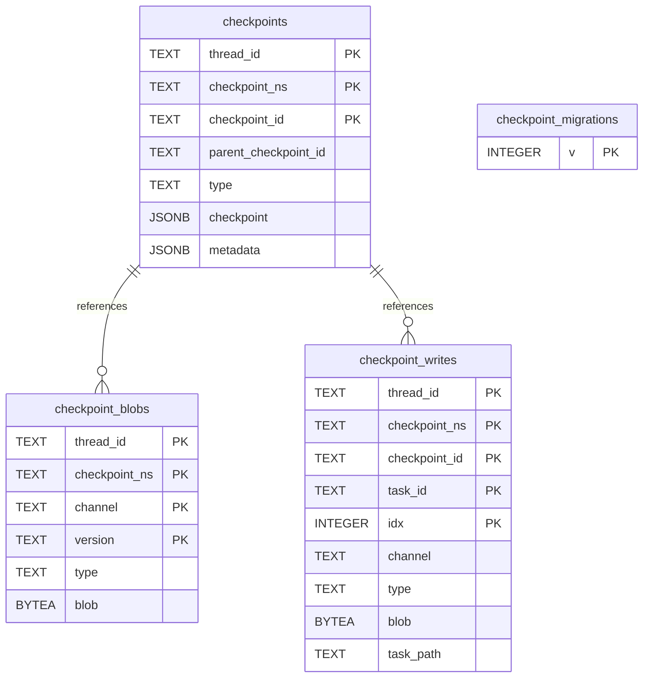
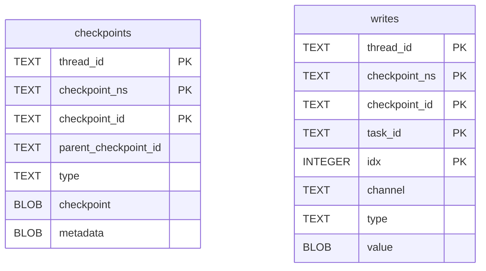

<!-- source: DeepWiki mcp.deepwiki.com · repo langchain-ai/langgraph · page 4.2 Checkpoint Implementations · fetched 2026-10-26 -->

# Checkpoint Implementations

<details>
<summary>Relevant source files</summary>

The following files were used as context for generating this wiki page:

- [libs/checkpoint-conformance/README.md](libs/checkpoint-conformance/README.md)
- [libs/checkpoint-conformance/langgraph/checkpoint/conformance/capabilities.py](libs/checkpoint-conformance/langgraph/checkpoint/conformance/capabilities.py)
- [libs/checkpoint-conformance/langgraph/checkpoint/conformance/spec/__init__.py](libs/checkpoint-conformance/langgraph/checkpoint/conformance/spec/__init__.py)
- [libs/checkpoint-conformance/langgraph/checkpoint/conformance/spec/test_list.py](libs/checkpoint-conformance/langgraph/checkpoint/conformance/spec/test_list.py)
- [libs/checkpoint-conformance/langgraph/checkpoint/conformance/validate.py](libs/checkpoint-conformance/langgraph/checkpoint/conformance/validate.py)
- [libs/checkpoint-conformance/pyproject.toml](libs/checkpoint-conformance/pyproject.toml)
- [libs/checkpoint-postgres/langgraph/checkpoint/postgres/__init__.py](libs/checkpoint-postgres/langgraph/checkpoint/postgres/__init__.py)
- [libs/checkpoint-postgres/langgraph/checkpoint/postgres/aio.py](libs/checkpoint-postgres/langgraph/checkpoint/postgres/aio.py)
- [libs/checkpoint-postgres/langgraph/checkpoint/postgres/base.py](libs/checkpoint-postgres/langgraph/checkpoint/postgres/base.py)
- [libs/checkpoint-postgres/langgraph/checkpoint/postgres/shallow.py](libs/checkpoint-postgres/langgraph/checkpoint/postgres/shallow.py)
- [libs/checkpoint-postgres/tests/test_async.py](libs/checkpoint-postgres/tests/test_async.py)
- [libs/checkpoint-postgres/tests/test_sync.py](libs/checkpoint-postgres/tests/test_sync.py)
- [libs/checkpoint-sqlite/langgraph/checkpoint/sqlite/__init__.py](libs/checkpoint-sqlite/langgraph/checkpoint/sqlite/__init__.py)
- [libs/checkpoint-sqlite/langgraph/checkpoint/sqlite/aio.py](libs/checkpoint-sqlite/langgraph/checkpoint/sqlite/aio.py)
- [libs/checkpoint-sqlite/tests/test_aiosqlite.py](libs/checkpoint-sqlite/tests/test_aiosqlite.py)
- [libs/checkpoint-sqlite/tests/test_conformance_delta.py](libs/checkpoint-sqlite/tests/test_conformance_delta.py)
- [libs/checkpoint-sqlite/tests/test_sqlite.py](libs/checkpoint-sqlite/tests/test_sqlite.py)
- [libs/checkpoint/langgraph/checkpoint/base/__init__.py](libs/checkpoint/langgraph/checkpoint/base/__init__.py)
- [libs/checkpoint/langgraph/checkpoint/memory/__init__.py](libs/checkpoint/langgraph/checkpoint/memory/__init__.py)
- [libs/checkpoint/tests/test_conformance_delta.py](libs/checkpoint/tests/test_conformance_delta.py)

</details>


This document describes the concrete implementations of the checkpoint persistence layer. These implementations provide different storage backends for saving and retrieving graph execution state, including PostgreSQL, SQLite, and in-memory options.

For the abstract checkpoint interface and base concepts, see page **4.1** (Checkpointing Architecture). For serialization of checkpoint data, see page **4.4** (Serialization).

---

## Overview

LangGraph provides multiple checkpoint saver implementations, each suited for different use cases:

| Implementation | Module | Async Support | Production Ready | Use Case |
|---|---|---|---|---|
| `PostgresSaver` | `langgraph.checkpoint.postgres` | Yes (`AsyncPostgresSaver`) | ✓ | Production workloads, full history |
| `SqliteSaver` | `langgraph.checkpoint.sqlite` | Yes (`AsyncSqliteSaver`) | Limited | Local development, small projects |
| `InMemorySaver` | `langgraph.checkpoint.memory` | Yes (native async) | ✗ | Testing, debugging |
| `ShallowPostgresSaver` | `langgraph.checkpoint.postgres.shallow` | Yes | Deprecated | Replaced by `durability='exit'` mode |

All implementations inherit from `BaseCheckpointSaver` [libs/checkpoint/langgraph/checkpoint/base/__init__.py:176-176]() and must implement the following core methods:
- `get_tuple()` / `aget_tuple()` - Retrieve a checkpoint [libs/checkpoint/langgraph/checkpoint/base/__init__.py:181-197]()
- `list()` / `alist()` - List checkpoints with filtering [libs/checkpoint/langgraph/checkpoint/base/__init__.py:199-231]()
- `put()` / `aput()` - Save a checkpoint [libs/checkpoint/langgraph/checkpoint/base/__init__.py:233-261]()
- `put_writes()` / `aput_writes()` - Save intermediate writes [libs/checkpoint/langgraph/checkpoint/base/__init__.py:263-286]()

**Sources:** [libs/checkpoint/langgraph/checkpoint/base/__init__.py:176-286](), [libs/checkpoint-postgres/langgraph/checkpoint/postgres/__init__.py:40-41](), [libs/checkpoint-sqlite/langgraph/checkpoint/sqlite/__init__.py:45-46](), [libs/checkpoint/langgraph/checkpoint/memory/__init__.py:33-35]()

---

## PostgreSQL Implementation

### Class Hierarchy

```mermaid
graph TD
    "BaseCheckpointSaver[V]"["BaseCheckpointSaver[V]"]
    "BasePostgresSaver"["BasePostgresSaver"]
    "PostgresSaver"["PostgresSaver"]
    "AsyncPostgresSaver"["AsyncPostgresSaver"]
    "ShallowPostgresSaver"["ShallowPostgresSaver"]
    "AsyncShallowPostgresSaver"["AsyncShallowPostgresSaver"]
    
    "BaseCheckpointSaver[V]" --> "BasePostgresSaver"
    "BasePostgresSaver" --> "PostgresSaver"
    "BasePostgresSaver" --> "AsyncPostgresSaver"
    "BasePostgresSaver" --> "ShallowPostgresSaver"
    "BasePostgresSaver" --> "AsyncShallowPostgresSaver"
    
    "PostgresSaver" -.->|"uses"| "psycopg.Connection"
    "PostgresSaver" -.->|"optional"| "psycopg.Pipeline"
    
    "AsyncPostgresSaver" -.->|"uses"| "psycopg.AsyncConnection"
    "AsyncPostgresSaver" -.->|"optional"| "psycopg.AsyncPipeline"
```

**Sources:** [libs/checkpoint-postgres/langgraph/checkpoint/postgres/base.py:12-17](), [libs/checkpoint-postgres/langgraph/checkpoint/postgres/__init__.py:40-50](), [libs/checkpoint-postgres/langgraph/checkpoint/postgres/aio.py:40-50](), [libs/checkpoint-postgres/langgraph/checkpoint/postgres/shallow.py:169-191]()

### Database Schema

The PostgreSQL implementation uses several tables to store checkpoint data, optimized for performance and storage efficiency:



The schema is defined in the `MIGRATIONS` list [libs/checkpoint-postgres/langgraph/checkpoint/postgres/base.py:43-91](). Key design points include:
1. **Blob Separation**: Complex channel values are stored in `checkpoint_blobs` [libs/checkpoint-postgres/langgraph/checkpoint/postgres/base.py:57-65]().
2. **Write Tracking**: Intermediate outputs are persisted in `checkpoint_writes` [libs/checkpoint-postgres/langgraph/checkpoint/postgres/base.py:66-76]().
3. **Optimized Reads**: `get_delta_channel_history` uses a two-stage reconstruction strategy to minimize wire payload and JSONB lookups [libs/checkpoint-postgres/langgraph/checkpoint/postgres/base.py:175-195]().

**Sources:** [libs/checkpoint-postgres/langgraph/checkpoint/postgres/base.py:43-91](), [libs/checkpoint-postgres/langgraph/checkpoint/postgres/base.py:175-195]()

### PostgresSaver and AsyncPostgresSaver

The implementation supports synchronous and asynchronous modes via `PostgresSaver` [libs/checkpoint-postgres/langgraph/checkpoint/postgres/__init__.py:40-40]() and `AsyncPostgresSaver` [libs/checkpoint-postgres/langgraph/checkpoint/postgres/aio.py:40-40]().

#### Connection Modes
Both savers support single connections, connection pools, and PostgreSQL's Pipeline mode for batching operations [libs/checkpoint-postgres/langgraph/checkpoint/postgres/__init__.py:47-60](), [libs/checkpoint-postgres/langgraph/checkpoint/postgres/aio.py:47-61]().

#### Migration System
The `setup()` method [libs/checkpoint-postgres/langgraph/checkpoint/postgres/__init__.py:85-111]() checks the `checkpoint_migrations` table and applies any missing scripts from the `MIGRATIONS` list in order.

**Sources:** [libs/checkpoint-postgres/langgraph/checkpoint/postgres/__init__.py:85-111](), [libs/checkpoint-postgres/langgraph/checkpoint/postgres/aio.py:90-118]()

---

## SQLite Implementation

### SqliteSaver and AsyncSqliteSaver

SQLite savers are designed for lightweight use cases. `SqliteSaver` [libs/checkpoint-sqlite/langgraph/checkpoint/sqlite/__init__.py:45-45]() uses `sqlite3`, while `AsyncSqliteSaver` [libs/checkpoint-sqlite/langgraph/checkpoint/sqlite/aio.py:38-38]() utilizes `aiosqlite`.

#### Schema
The SQLite implementation uses a two-table schema: `checkpoints` and `writes` [libs/checkpoint-sqlite/langgraph/checkpoint/sqlite/__init__.py:142-162]().



#### Thread Safety
Because SQLite has limited write concurrency, `SqliteSaver` uses a `threading.Lock` [libs/checkpoint-sqlite/langgraph/checkpoint/sqlite/__init__.py:95]() and `AsyncSqliteSaver` uses an `asyncio.Lock` [libs/checkpoint-sqlite/langgraph/checkpoint/sqlite/aio.py:127]() to serialize database access.

**Sources:** [libs/checkpoint-sqlite/langgraph/checkpoint/sqlite/__init__.py:139-163](), [libs/checkpoint-sqlite/langgraph/checkpoint/sqlite/aio.py:115-130]()

---

## InMemory Implementation

### InMemorySaver

`InMemorySaver` [libs/checkpoint/langgraph/checkpoint/memory/__init__.py:33-35]() is a transient checkpointer that stores all data in memory. It is the default for testing but does not persist across process restarts.

#### Storage Internals
It uses three primary `defaultdict` structures to simulate a database:
- `storage`: Maps `thread_id` -> `checkpoint_ns` -> `checkpoint_id` -> checkpoint mapping [libs/checkpoint/langgraph/checkpoint/memory/__init__.py:69-72]().
- `writes`: Maps `(thread_id, checkpoint_ns, checkpoint_id)` -> `(task_id, write_idx)` -> write tuple [libs/checkpoint/langgraph/checkpoint/memory/__init__.py:74-77]().
- `blobs`: Maps `(thread_id, checkpoint_ns, channel, version)` -> serialized bytes [libs/checkpoint/langgraph/checkpoint/memory/__init__.py:78-83]().

#### Delta History Reconstruction
The `get_delta_channel_history` method [libs/checkpoint/langgraph/checkpoint/memory/__init__.py:142-208]() implements a walk up the parent checkpoint chain to reconstruct state for `DeltaChannel` types.

**Sources:** [libs/checkpoint/langgraph/checkpoint/memory/__init__.py:69-83](), [libs/checkpoint/langgraph/checkpoint/memory/__init__.py:142-208]()

---

## Summary and Usage Patterns

### Implementation Association

```mermaid
graph LR
    subgraph "Natural Language Space"
        "Postgres Checkpointer"
        "SQLite Checkpointer"
        "In-Memory Checkpointer"
    end
    
    subgraph "Code Entity Space"
        "AsyncPostgresSaver"["AsyncPostgresSaver<br/>(langgraph.checkpoint.postgres.aio)"]
        "AsyncSqliteSaver"["AsyncSqliteSaver<br/>(langgraph.checkpoint.sqlite.aio)"]
        "InMemorySaver"["InMemorySaver<br/>(langgraph.checkpoint.memory)"]
    end
    
    "Postgres Checkpointer" --- "AsyncPostgresSaver"
    "SQLite Checkpointer" --- "AsyncSqliteSaver"
    "In-Memory Checkpointer" --- "InMemorySaver"
```

**Sources:** [libs/checkpoint-postgres/langgraph/checkpoint/postgres/aio.py:40-41](), [libs/checkpoint-sqlite/langgraph/checkpoint/sqlite/aio.py:38-39](), [libs/checkpoint/langgraph/checkpoint/memory/__init__.py:33-35]()

### Deprecation Note
`ShallowPostgresSaver` and `AsyncShallowPostgresSaver` are deprecated as of version 2.0.20 and will be removed in 3.0.0 [libs/checkpoint-postgres/langgraph/checkpoint/postgres/shallow.py:192-197](). Users should transition to `PostgresSaver` and use the `durability='exit'` flag in graph invocation for similar behavior.

**Sources:** [libs/checkpoint-postgres/langgraph/checkpoint/postgres/shallow.py:192-197]()

---

