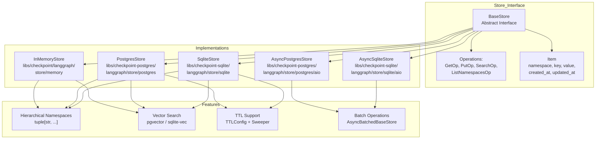
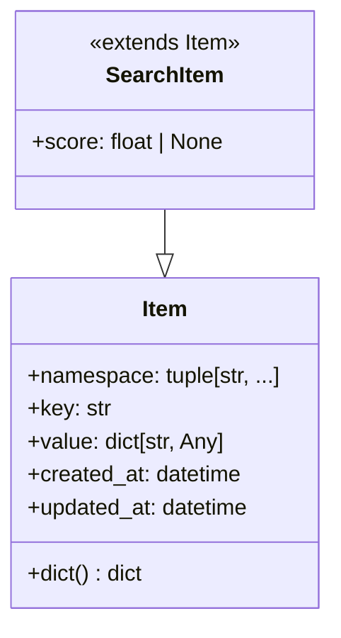
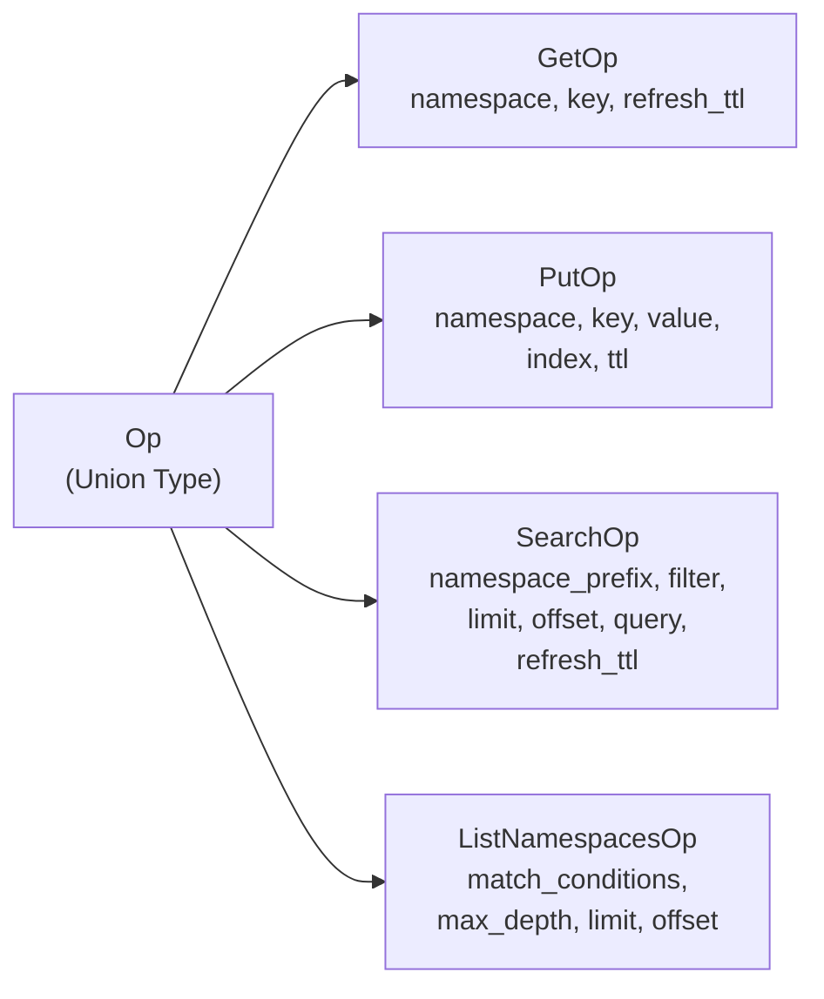
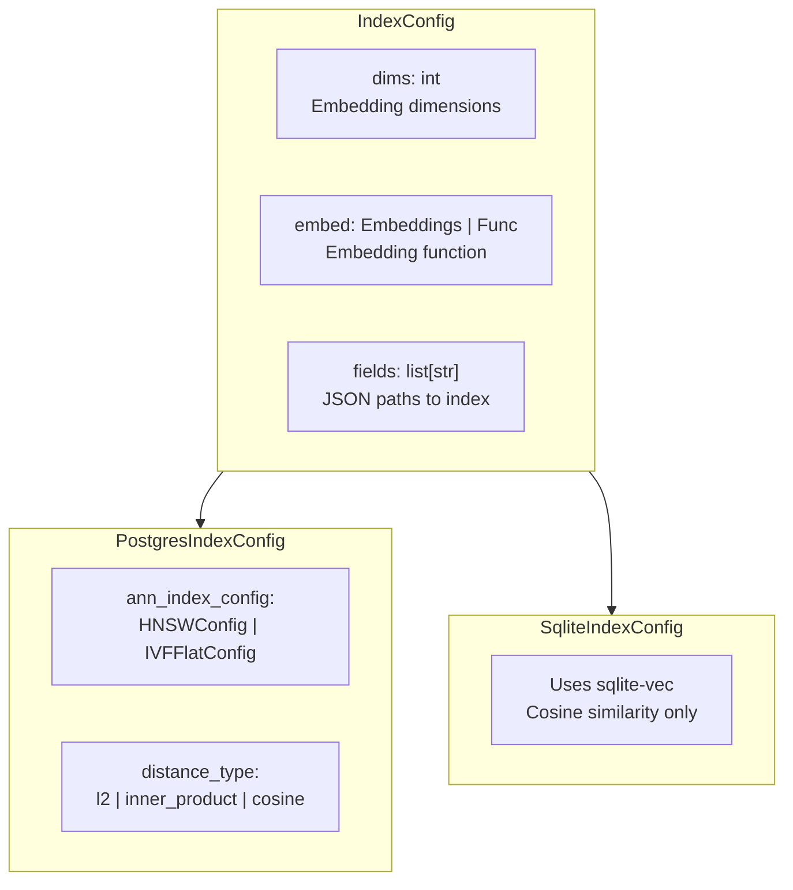
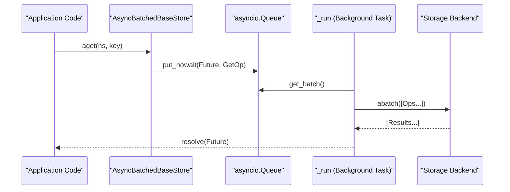

<!-- source: DeepWiki mcp.deepwiki.com · repo langchain-ai/langgraph · page 4.3 Store System · fetched 2026-10-26 -->

# Store System

Relevant source files

The following files were used as context for generating this wiki page:

- [libs/checkpoint-postgres/langgraph/store/postgres/aio.py](libs/checkpoint-postgres/langgraph/store/postgres/aio.py)
- [libs/checkpoint-postgres/langgraph/store/postgres/base.py](libs/checkpoint-postgres/langgraph/store/postgres/base.py)
- [libs/checkpoint-postgres/tests/conftest.py](libs/checkpoint-postgres/tests/conftest.py)
- [libs/checkpoint-postgres/tests/test_async_store.py](libs/checkpoint-postgres/tests/test_async_store.py)
- [libs/checkpoint-postgres/tests/test_store.py](libs/checkpoint-postgres/tests/test_store.py)
- [libs/checkpoint-sqlite/langgraph/store/sqlite/__init__.py](libs/checkpoint-sqlite/langgraph/store/sqlite/__init__.py)
- [libs/checkpoint-sqlite/langgraph/store/sqlite/aio.py](libs/checkpoint-sqlite/langgraph/store/sqlite/aio.py)
- [libs/checkpoint-sqlite/langgraph/store/sqlite/base.py](libs/checkpoint-sqlite/langgraph/store/sqlite/base.py)
- [libs/checkpoint-sqlite/tests/test_async_store.py](libs/checkpoint-sqlite/tests/test_async_store.py)
- [libs/checkpoint-sqlite/tests/test_store.py](libs/checkpoint-sqlite/tests/test_store.py)
- [libs/checkpoint-sqlite/tests/test_ttl.py](libs/checkpoint-sqlite/tests/test_ttl.py)
- [libs/checkpoint/langgraph/store/base/__init__.py](libs/checkpoint/langgraph/store/base/__init__.py)
- [libs/checkpoint/langgraph/store/base/batch.py](libs/checkpoint/langgraph/store/base/batch.py)
- [libs/checkpoint/langgraph/store/base/embed.py](libs/checkpoint/langgraph/store/base/embed.py)
- [libs/checkpoint/langgraph/store/memory/__init__.py](libs/checkpoint/langgraph/store/memory/__init__.py)
- [libs/checkpoint/tests/test_store.py](libs/checkpoint/tests/test_store.py)

The Store System provides persistent key-value storage with hierarchical namespaces for LangGraph applications. It enables long-term memory that persists across threads and conversations, with optional vector search and TTL (time-to-live) capabilities.

**Scope**: This page covers the Store interface, operations, implementations, and data model. For graph state persistence via checkpointing, see [Checkpointing Architecture](4.1). For checkpoint implementations, see [Checkpoint Implementations](4.2). For serialization mechanisms, see [Serialization](4.4).

---

## Core Architecture

The Store System is built around a base interface with pluggable implementations supporting different storage backends, including PostgreSQL, SQLite, and In-Memory variants.

### Store System Overview

**Code Entity Mapping**:
- `BaseStore`: Abstract interface at [libs/checkpoint/langgraph/store/base/__init__.py:700-721]()
- `InMemoryStore`: In-memory implementation at [libs/checkpoint/langgraph/store/memory/__init__.py:136-174]()
- `PostgresStore`: PostgreSQL sync implementation at [libs/checkpoint-postgres/langgraph/store/postgres/base.py:640-716]()
- `SqliteStore`: SQLite sync implementation at [libs/checkpoint-sqlite/langgraph/store/sqlite/base.py:211-218]()
- `AsyncPostgresStore`: PostgreSQL async implementation with batching at [libs/checkpoint-postgres/langgraph/store/postgres/aio.py:42-118]()
- `AsyncSqliteStore`: SQLite async implementation with batching at [libs/checkpoint-sqlite/langgraph/store/sqlite/aio.py:41-89]()

**Sources**: [libs/checkpoint/langgraph/store/base/__init__.py:700-721](), [libs/checkpoint-postgres/langgraph/store/postgres/base.py:640-716](), [libs/checkpoint-sqlite/langgraph/store/sqlite/base.py:211-218](), [libs/checkpoint/langgraph/store/memory/__init__.py:136-174](), [libs/checkpoint-postgres/langgraph/store/postgres/aio.py:42-118](), [libs/checkpoint-sqlite/langgraph/store/sqlite/aio.py:41-89]()

---

## Base Store Interface

### BaseStore Class

The `BaseStore` abstract class defines the storage interface with both synchronous and asynchronous methods.

| Method | Description | Returns |
|--------|-------------|---------|
| `batch(ops)` | Execute multiple operations synchronously | `list[Result]` |
| `abatch(ops)` | Execute multiple operations asynchronously | `list[Result]` |
| `get(namespace, key)` | Retrieve a single item | `Item \| None` |
| `put(namespace, key, value)` | Store or update an item | `None` |
| `search(namespace_prefix, ...)` | Search items with filters | `list[SearchItem]` |
| `delete(namespace, key)` | Delete an item | `None` |
| `list_namespaces(...)` | List namespaces with filters | `list[tuple[str, ...]]` |

**Sources**: [libs/checkpoint/langgraph/store/base/__init__.py:700-995]()

### Item Data Model

The `Item` class represents a stored document with metadata.

**Sources**: [libs/checkpoint/langgraph/store/base/__init__.py:51-116](), [libs/checkpoint/langgraph/store/base/__init__.py:118-155]()

---

## Operations

### Operation Types

The Store System uses typed operations for batch processing:

**Sources**: [libs/checkpoint/langgraph/store/base/__init__.py:157-201](), [libs/checkpoint/langgraph/store/base/__init__.py:203-308](), [libs/checkpoint/langgraph/store/base/__init__.py:431-535](), [libs/checkpoint/langgraph/store/base/__init__.py:368-429]()

### PutOp - Store Items

Stores or updates an item. Setting `value=None` deletes the item.

**Parameters**:
- `namespace`: Hierarchical path as tuple
- `key`: Unique identifier
- `value`: Dictionary data or `None` for deletion
- `index`: Field paths to index for search (default: uses store config)
- `ttl`: Time-to-live in minutes (optional)

**Sources**: [libs/checkpoint/langgraph/store/base/__init__.py:431-535]()

---

## Hierarchical Namespaces

Namespaces organize data in a hierarchical structure similar to file system paths.

### Namespace Structure

**Namespace Rules**:
1. Represented as tuples of strings [libs/checkpoint/langgraph/store/base/__init__.py:57-59]()
2. Cannot be empty tuple `()` [libs/checkpoint/langgraph/store/base/batch.py:141]()
3. Individual components cannot contain dots (`.`) in certain implementations (Postgres/SQLite) [libs/checkpoint-postgres/langgraph/store/postgres/base.py:7]() (Regex patterns), [libs/checkpoint-sqlite/langgraph/store/sqlite/base.py:162-170]()

**Sources**: [libs/checkpoint/langgraph/store/base/__init__.py:57-59](), [libs/checkpoint/langgraph/store/base/batch.py:141]()

---

## Vector Search

Vector search enables semantic similarity queries using embeddings.

### Vector Search Configuration

**Sources**: [libs/checkpoint/langgraph/store/base/__init__.py:570-698](), [libs/checkpoint-postgres/langgraph/store/postgres/base.py:177-233](), [libs/checkpoint-sqlite/langgraph/store/sqlite/base.py:90-93]()

---

## TTL Support

Time-to-live (TTL) enables automatic expiration of store items.

### TTL Configuration

The `TTLConfig` controls expiration behavior [libs/checkpoint/langgraph/store/base/__init__.py:545-568]().

| Field | Description |
|-------|-------------|
| `default_ttl` | Default minutes until expiration |
| `refresh_on_read` | Whether to refresh TTL on get/search |
| `sweep_interval_minutes` | How often to delete expired items |

**Sources**: [libs/checkpoint/langgraph/store/base/__init__.py:545-568]()

---

## Store Implementations

### InMemoryStore

Non-persistent dictionary-backed store for development and testing.

**Implementation Details**:
- Data stored in: `_data: dict[tuple[str, ...], dict[str, Item]]` [libs/checkpoint/langgraph/store/memory/__init__.py:186]()
- Vectors stored in: `_vectors: dict[tuple[str, ...], dict[str, dict[str, list[float]]]]` [libs/checkpoint/langgraph/store/memory/__init__.py:188-190]()

**Sources**: [libs/checkpoint/langgraph/store/memory/__init__.py:136-190]()

### PostgresStore & AsyncPostgresStore

Production-ready PostgreSQL-backed store using `pgvector`.

**Key Features**:
- Sync version uses `psycopg` connection/pool [libs/checkpoint-postgres/langgraph/store/postgres/base.py:640-650]()
- Async version supports `AsyncPipeline` and `AsyncConnectionPool` [libs/checkpoint-postgres/langgraph/store/postgres/aio.py:142-152]()
- Supports HNSW and IVFFlat index types [libs/checkpoint-postgres/langgraph/store/postgres/base.py:177-218]()

**Sources**: [libs/checkpoint-postgres/langgraph/store/postgres/base.py:640-650](), [libs/checkpoint-postgres/langgraph/store/postgres/aio.py:42-161]()

### SqliteStore & AsyncSqliteStore

SQLite-backed store using `sqlite-vec` for vector search.

**Key Features**:
- Sync version uses `sqlite3` [libs/checkpoint-sqlite/langgraph/store/sqlite/base.py:211-218]()
- Async version uses `aiosqlite` [libs/checkpoint-sqlite/langgraph/store/sqlite/aio.py:91-122]()
- Requires `sqlite-vec` extension for vector search [libs/checkpoint-sqlite/langgraph/store/sqlite/aio.py:191-193]()

**Sources**: [libs/checkpoint-sqlite/langgraph/store/sqlite/base.py:211-218](), [libs/checkpoint-sqlite/langgraph/store/sqlite/aio.py:41-111]()

---

## Batching and Async Processing

The `AsyncBatchedBaseStore` class provides an efficient background task for batching store operations. It uses an `asyncio.Queue` to collect operations and processes them in a background loop.

**Implementation Details**:
- Background task initialization: `_ensure_task()` [libs/checkpoint/langgraph/store/base/batch.py:77-80]()
- Operation queuing: `put_nowait()` in methods like `aget`, `aput`, `asearch` [libs/checkpoint/langgraph/store/base/batch.py:91-100](), [libs/checkpoint/langgraph/store/base/batch.py:143-150]()
- Sync compatibility: `batch()` and `get()` use `asyncio.run_coroutine_threadsafe` to interact with the async loop [libs/checkpoint/langgraph/store/base/batch.py:190-191](), [libs/checkpoint/langgraph/store/base/batch.py:194-203]()

**Sources**: [libs/checkpoint/langgraph/store/base/batch.py:58-203](), [libs/checkpoint/tests/test_store.py:25-72]()

---

## Database Schemas

### PostgreSQL Schema
The PostgreSQL implementation uses `psycopg` to manage the schema and migrations.

- `store` table: Primary storage for key-value pairs [libs/checkpoint-postgres/langgraph/store/postgres/base.py:64-72]()
- `store_vectors` table: Storage for vector embeddings, linked via foreign key to the `store` table [libs/checkpoint-postgres/langgraph/store/postgres/base.py:104-114]()
- Indices: B-tree for prefixes [libs/checkpoint-postgres/langgraph/store/postgres/base.py:76]() and HNSW/IVFFlat for embeddings [libs/checkpoint-postgres/langgraph/store/postgres/base.py:126-128]().

### SQLite Schema
The SQLite implementation utilizes standard SQL for core storage and `sqlite-vec` for vector operations.

- `store` table: Primary storage [libs/checkpoint-sqlite/langgraph/store/sqlite/base.py:43-51]()
- `store_vectors` table: Storage for vector embeddings [libs/checkpoint-sqlite/langgraph/store/sqlite/base.py:76-85]()

**Sources**: [libs/checkpoint-postgres/langgraph/store/postgres/base.py:62-144](), [libs/checkpoint-sqlite/langgraph/store/sqlite/base.py:41-87]()

---

