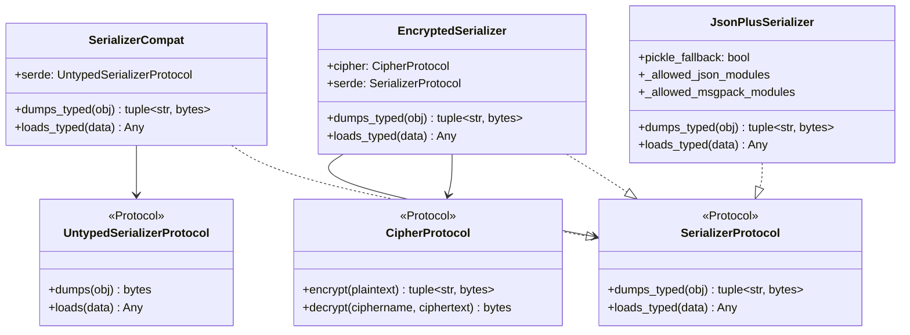
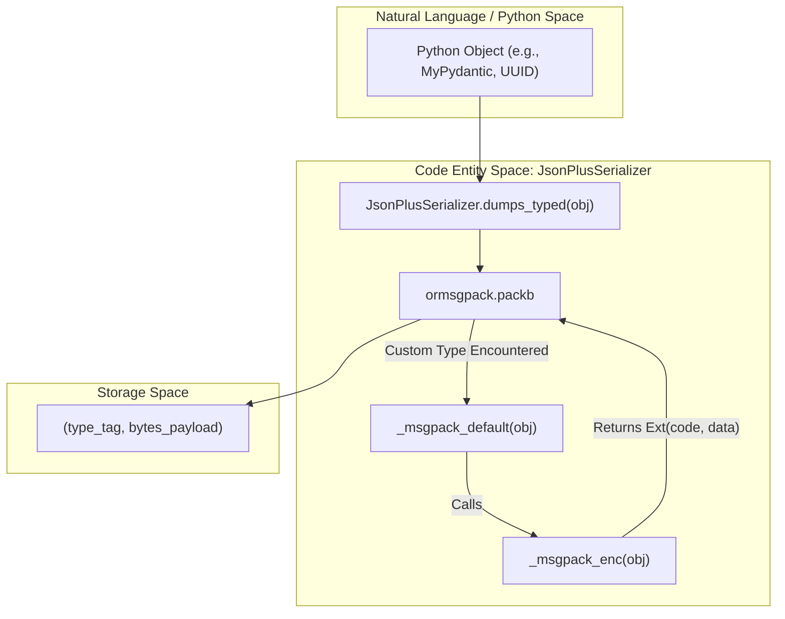
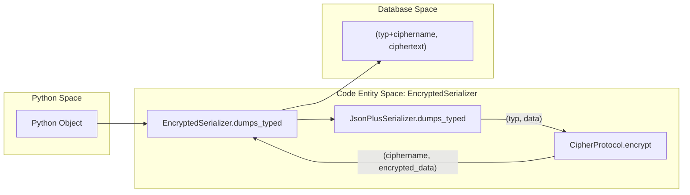

<!-- source: DeepWiki mcp.deepwiki.com · repo langchain-ai/langgraph · page 4.4 Serialization · fetched 2026-10-26 -->

# Serialization

Relevant source files

The following files were used as context for generating this wiki page:

- [libs/checkpoint/langgraph/checkpoint/serde/_msgpack.py](libs/checkpoint/langgraph/checkpoint/serde/_msgpack.py)
- [libs/checkpoint/langgraph/checkpoint/serde/base.py](libs/checkpoint/langgraph/checkpoint/serde/base.py)
- [libs/checkpoint/langgraph/checkpoint/serde/encrypted.py](libs/checkpoint/langgraph/checkpoint/serde/encrypted.py)
- [libs/checkpoint/langgraph/checkpoint/serde/jsonplus.py](libs/checkpoint/langgraph/checkpoint/serde/jsonplus.py)
- [libs/checkpoint/langgraph/checkpoint/serde/types.py](libs/checkpoint/langgraph/checkpoint/serde/types.py)
- [libs/checkpoint/tests/test_encrypted.py](libs/checkpoint/tests/test_encrypted.py)
- [libs/checkpoint/tests/test_jsonplus.py](libs/checkpoint/tests/test_jsonplus.py)
- [libs/checkpoint/tests/test_memory.py](libs/checkpoint/tests/test_memory.py)
- [libs/langgraph/tests/test_serde_allowlist.py](libs/langgraph/tests/test_serde_allowlist.py)

This page covers the serialization layer used by checkpointers and stores to encode and decode Python objects to and from bytes. The primary implementation is `JsonPlusSerializer`, which lives in `libs/checkpoint/langgraph/checkpoint/serde/`. This layer is internal to the persistence subsystem — for how checkpointers use it during the execution loop, see [4.1 Checkpointing Architecture](). For how stores persist items, see [4.3 Store System]().

---

## Overview

Checkpointers must serialize arbitrary Python objects (graph state, channel values, metadata) to bytes for storage in SQLite, Postgres, or other backends. The serialization layer provides:

- A **protocol interface** (`SerializerProtocol`) that any serializer must implement [[libs/checkpoint/langgraph/checkpoint/serde/base.py:15-27]]().
- A **default implementation** (`JsonPlusSerializer`) backed by `ormsgpack` with a rich set of natively supported types [[libs/checkpoint/langgraph/checkpoint/serde/jsonplus.py:82-95]]().
- A **pickle fallback** for types not handled natively, disabled by default for security [[libs/checkpoint/langgraph/checkpoint/serde/jsonplus.py:115-115]]().
- A **security allowlist mechanism** (`allowed_msgpack_modules`) to restrict deserialization to known-safe types [[libs/checkpoint/langgraph/checkpoint/serde/jsonplus.py:102-104]]().
- An **encryption wrapper** (`EncryptedSerializer`) that transparently encrypts serialized bytes [[libs/checkpoint/langgraph/checkpoint/serde/encrypted.py:8-10]]().

---

## Serializer Interfaces

**Module:** `libs/checkpoint/langgraph/checkpoint/serde/base.py`

### `SerializerProtocol`

The central protocol that all serializers must satisfy. It uses typed pairs `(type_tag: str, payload: bytes)` rather than raw bytes so that the deserializer can dispatch on format [[libs/checkpoint/langgraph/checkpoint/serde/base.py:15-27]]().

| Method | Signature | Description |
|---|---|---|
| `dumps_typed` | `(obj: Any) → tuple[str, bytes]` | Serialize an object; returns `(type_tag, bytes)` |
| `loads_typed` | `(data: tuple[str, bytes]) → Any` | Deserialize from `(type_tag, bytes)` |

### `UntypedSerializerProtocol`

A simpler protocol for legacy serializers with only `dumps(obj) → bytes` / `loads(data) → Any` [[libs/checkpoint/langgraph/checkpoint/serde/base.py:6-12]](). The adapter `SerializerCompat` wraps these to satisfy `SerializerProtocol` [[libs/checkpoint/langgraph/checkpoint/serde/base.py:29-38]]().

### `CipherProtocol`

Protocol for encryption backends used by `EncryptedSerializer` [[libs/checkpoint/langgraph/checkpoint/serde/base.py:51-65]]().

| Method | Signature | Description |
|---|---|---|
| `encrypt` | `(plaintext: bytes) → tuple[str, bytes]` | Returns `(cipher_name, ciphertext)` |
| `decrypt` | `(ciphername: str, ciphertext: bytes) → bytes` | Returns decrypted plaintext |

---

**Protocol hierarchy diagram:**

Sources: [[libs/checkpoint/langgraph/checkpoint/serde/base.py:6-65]](), [[libs/checkpoint/langgraph/checkpoint/serde/jsonplus.py:82-127]](), [[libs/checkpoint/langgraph/checkpoint/serde/encrypted.py:8-36]]()

---

## `JsonPlusSerializer`

**File:** `libs/checkpoint/langgraph/checkpoint/serde/jsonplus.py`

`JsonPlusSerializer` is the default serializer. It uses `ormsgpack` for performance and supports a wide variety of Python types [[libs/checkpoint/langgraph/checkpoint/serde/jsonplus.py:82-95]]().

| Parameter | Type | Default | Description |
|---|---|---|---|
| `pickle_fallback` | `bool` | `False` | Enable `pickle` for types not otherwise supported |
| `allowed_json_modules` | `Iterable[tuple[str,...]] \| True \| None` | `None` | Allowlist for legacy JSON constructor deserialization |
| `allowed_msgpack_modules` | `AllowedMsgpackModules \| True \| None` | `_SENTINEL` | Allowlist for msgpack extension deserialization. Defaults to `STRICT_MSGPACK_ENABLED` check [[libs/checkpoint/langgraph/checkpoint/serde/jsonplus.py:107-114]]() |

### `dumps_typed` dispatch

`dumps_typed` inspects the object type and returns a tagged byte payload [[libs/checkpoint/langgraph/checkpoint/serde/jsonplus.py:228-256]]().

| Type tag | Condition | Payload |
|---|---|---|
| `"null"` | `obj is None` | `b""` (empty) |
| `"bytes"` | `isinstance(obj, bytes)` | raw bytes |
| `"bytearray"` | `isinstance(obj, bytearray)` | raw bytearray |
| `"msgpack"` | all other types | `ormsgpack.packb(...)` result |
| `"pickle"` | msgpack fails and `pickle_fallback=True` | `pickle.dumps(obj)` |

### `loads_typed` dispatch

`loads_typed` dispatches on the type tag to reconstruct the object [[libs/checkpoint/langgraph/checkpoint/serde/jsonplus.py:258-278]]().

| Type tag | Deserialization |
|---|---|
| `"null"` | returns `None` |
| `"bytes"` | returns raw bytes |
| `"bytearray"` | returns `bytearray(data)` |
| `"json"` | `json.loads` with `_reviver` as the `object_hook` (legacy) |
| `"msgpack"` | `ormsgpack.unpackb` with the `_unpack_ext_hook` |
| `"pickle"` | `pickle.loads` (only if `pickle_fallback=True`) |

---

## msgpack Extension Type System

`JsonPlusSerializer` uses `ormsgpack` extension codes to handle complex Python objects that msgpack does not support natively [[libs/checkpoint/langgraph/checkpoint/serde/jsonplus.py:316-322]]().

### Extension Codes

Defined as integer constants in `jsonplus.py`:

| Constant | Value | Used for |
|---|---|---|
| `EXT_CONSTRUCTOR_SINGLE_ARG` | `0` | Reconstructed with `Cls(arg)` (UUID, Decimal, Enum, set, deque, ZoneInfo) |
| `EXT_CONSTRUCTOR_POS_ARGS` | `1` | Reconstructed with `Cls(*args)` (Path, Pattern, timedelta, date, timezone) |
| `EXT_CONSTRUCTOR_KW_ARGS` | `2` | Reconstructed with `Cls(**kwargs)` (namedtuple, time, dataclass, Item) |
| `EXT_METHOD_SINGLE_ARG` | `3` | Reconstructed via `Cls.method(arg)` (e.g., `datetime.fromisoformat`) |
| `EXT_PYDANTIC_V1` | `4` | Pydantic v1 `BaseModel` |
| `EXT_PYDANTIC_V2` | `5` | Pydantic v2 `BaseModel` |
| `EXT_NUMPY_ARRAY` | `6` | `numpy.ndarray` |
| `EXT_DELTA_SNAPSHOT` | `7` | `_DeltaSnapshot` for DeltaChannel state [[libs/checkpoint/langgraph/checkpoint/serde/types.py:19-29]]() |

### Supported Type Summary

The serializer handles a broad range of types including `pydantic.BaseModel` (v1 and v2), `uuid.UUID`, `decimal.Decimal`, `datetime.datetime`, and `numpy.ndarray`. For example, `datetime.datetime` is serialized using `.isoformat()` and reconstructed via `EXT_METHOD_SINGLE_ARG` calling `fromisoformat` [[libs/checkpoint/langgraph/checkpoint/serde/_msgpack.py:90-94]]().

---

## Encoding / Decoding Flow

**Diagram: Data flow from Python Space to Serialized Space**

Sources: [[libs/checkpoint/langgraph/checkpoint/serde/jsonplus.py:228-256]](), [[libs/checkpoint/langgraph/checkpoint/serde/jsonplus.py:325-341]](), [[libs/checkpoint/langgraph/checkpoint/serde/jsonplus.py:344-460]]()

---

## Security and Allowlists

Security is managed via `STRICT_MSGPACK_ENABLED` (environment variable `LANGGRAPH_STRICT_MSGPACK`) and explicit allowlists [[libs/checkpoint/langgraph/checkpoint/serde/_msgpack.py:12-16]]().

### `SAFE_MSGPACK_TYPES`

The framework provides a built-in list of safe types in `libs/checkpoint/langgraph/checkpoint/serde/_msgpack.py` [[libs/checkpoint/langgraph/checkpoint/serde/_msgpack.py:21-84]](). This includes:
- Standard library types (`datetime`, `uuid`, `decimal`, `ipaddress`, `pathlib`, `zoneinfo`).
- LangChain primitives (`BaseMessage`, `HumanMessage`, `Document`).
- LangGraph internal types (`Send`, `Interrupt`, `Command`, `Item`, `PregelTask`).

### Deserialization Enforcement

During msgpack deserialization, the `_unpack_ext_hook` validates incoming extension data [[libs/checkpoint/langgraph/checkpoint/serde/jsonplus.py:122-126]]().

- If strict mode is enabled, only types in `SAFE_MSGPACK_TYPES` or the user-provided `allowed_msgpack_modules` are allowed [[libs/checkpoint/langgraph/checkpoint/serde/jsonplus.py:107-114]]().
- If a type is blocked, it logs a warning via `_warn_once` to prevent code execution while avoiding log spam [[libs/checkpoint/langgraph/checkpoint/serde/jsonplus.py:73-79]]().

### Allowlist Collection
LangGraph provides utilities to automatically generate allowlists from graph schemas using `collect_allowlist_from_schemas` [[libs/langgraph/tests/test_serde_allowlist.py:89-96]]().

---

## `EncryptedSerializer`

**File:** `libs/checkpoint/langgraph/checkpoint/serde/encrypted.py`

`EncryptedSerializer` wraps another serializer (typically `JsonPlusSerializer`) and a cipher to provide transparent at-rest encryption [[libs/checkpoint/langgraph/checkpoint/serde/encrypted.py:8-15]]().

**Diagram: Encrypted Data Flow**

Sources: [[libs/checkpoint/langgraph/checkpoint/serde/encrypted.py:17-36]](), [[libs/checkpoint/langgraph/checkpoint/serde/base.py:51-65]]()

### AES Implementation

The factory method `from_pycryptodome_aes` configures an AES cipher using the `pycryptodome` library [[libs/checkpoint/langgraph/checkpoint/serde/encrypted.py:39-44]](). 

- **Key Management:** Reads from `LANGGRAPH_AES_KEY` environment variable if not provided in `kwargs` [[libs/checkpoint/langgraph/checkpoint/serde/encrypted.py:51-57]]().
- **Format:** Uses `AES.MODE_EAX` by default [[libs/checkpoint/langgraph/checkpoint/serde/encrypted.py:61-63]](). The stored ciphertext format is `nonce + tag + actual_ciphertext` [[libs/checkpoint/langgraph/checkpoint/serde/encrypted.py:66-69]]().

Sources: [[libs/checkpoint/langgraph/checkpoint/serde/encrypted.py:39-80]]()

---

