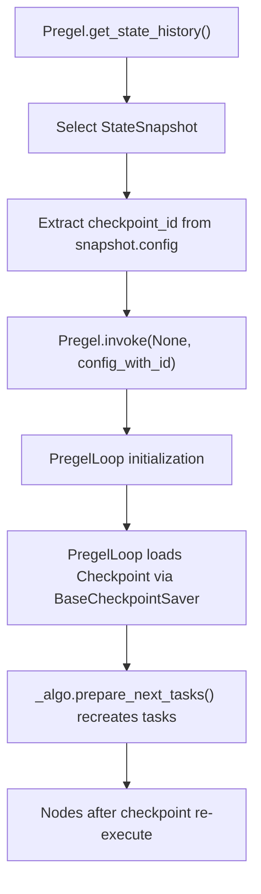
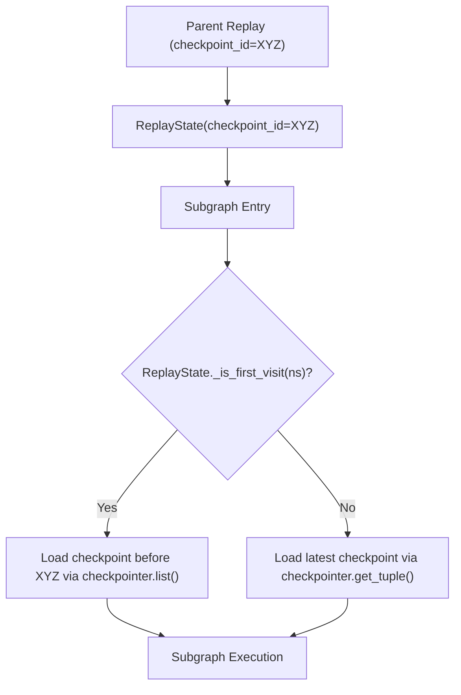

<!-- source: DeepWiki mcp.deepwiki.com · repo langchain-ai/langgraph · page 4.5 Time Travel and State Forking · fetched 2026-10-26 -->

# Time Travel and State Forking

<details>
<summary>Relevant source files</summary>

The following files were used as context for generating this wiki page:

- [libs/checkpoint-conformance/langgraph/checkpoint/conformance/spec/_delta_fixtures.py](libs/checkpoint-conformance/langgraph/checkpoint/conformance/spec/_delta_fixtures.py)
- [libs/checkpoint-conformance/langgraph/checkpoint/conformance/spec/test_delta_channel_history.py](libs/checkpoint-conformance/langgraph/checkpoint/conformance/spec/test_delta_channel_history.py)
- [libs/langgraph/langgraph/_internal/_replay.py](libs/langgraph/langgraph/_internal/_replay.py)
- [libs/langgraph/tests/__snapshots__/test_large_cases.ambr](libs/langgraph/tests/__snapshots__/test_large_cases.ambr)
- [libs/langgraph/tests/__snapshots__/test_pregel.ambr](libs/langgraph/tests/__snapshots__/test_pregel.ambr)
- [libs/langgraph/tests/__snapshots__/test_pregel_async.ambr](libs/langgraph/tests/__snapshots__/test_pregel_async.ambr)
- [libs/langgraph/tests/test_checkpoint_migration.py](libs/langgraph/tests/test_checkpoint_migration.py)
- [libs/langgraph/tests/test_delta_channel_migration.py](libs/langgraph/tests/test_delta_channel_migration.py)
- [libs/langgraph/tests/test_large_cases.py](libs/langgraph/tests/test_large_cases.py)
- [libs/langgraph/tests/test_large_cases_async.py](libs/langgraph/tests/test_large_cases_async.py)
- [libs/langgraph/tests/test_time_travel.py](libs/langgraph/tests/test_time_travel.py)
- [libs/langgraph/tests/test_time_travel_async.py](libs/langgraph/tests/test_time_travel_async.py)

</details>


This document explains LangGraph's time travel and state forking capabilities, which enable replaying graph execution from historical checkpoints and creating alternate execution branches. These features allow you to navigate checkpoint history, re-execute nodes from any point in time, and explore alternative execution paths.

**Scope**: This page covers the mechanics of replaying from checkpoints and forking execution state. For information about the checkpoint data structures and persistence layer, see [Checkpointing Architecture](4.1). For interrupt handling during execution, see [Human-in-the-Loop and Interrupts](3.7).

## Core Concepts

### Checkpoints and State History

Every step in a LangGraph execution creates a `Checkpoint` [libs/langgraph/langgraph/types.py:34-37]() that captures `channel_values` (state), `versions_seen`, and metadata. Checkpoints form a linked list through `parent_config`, creating an execution history. The `get_state_history` method (and its async counterpart `aget_state_history`) traverses this chain in reverse chronological order to yield `StateSnapshot` objects [libs/langgraph/langgraph/types.py:34-37]().

Sources: [libs/langgraph/langgraph/types.py:34-37](), [libs/langgraph/tests/test_time_travel.py:34-61]()

### Replay vs Fork

LangGraph supports two distinct time-travel operations defined by how they interact with the checkpointer:

| Operation | Mechanism | Checkpoint Lineage | Use Case |
|-----------|-----------|-------------------|----------|
| **Replay** | Invoke with `checkpoint_id` in config | Continues same lineage | Re-execute from a point, interrupts re-fire |
| **Fork** | `update_state()` then invoke | Creates new branch | Explore alternative execution paths |

**Replay**: Re-executes nodes that come after the specified checkpoint. Nodes before the checkpoint are not re-run [libs/langgraph/tests/test_time_travel.py:69-110](). Interrupts encountered during the original execution will re-fire during replay because pending tasks are recreated [libs/langgraph/tests/test_time_travel.py:13-17]().

**Fork**: Creates a new checkpoint via `update_state()` or `aupdate_state()` [libs/langgraph/tests/test_large_cases.py:122-122](). This new checkpoint typically has a `source` metadata value of `"update"` or `"fork"` [libs/langgraph/tests/test_large_cases.py:146-146](). It does not contain the cached pending writes of the original unless specified, forcing nodes to re-execute and creating a separate execution branch [libs/langgraph/tests/test_time_travel.py:143-180]().

Sources: [libs/langgraph/tests/test_time_travel.py:1-17](), [libs/langgraph/tests/test_time_travel.py:143-180](), [libs/langgraph/tests/test_large_cases.py:122-146]()

## Replay Mechanism

### Basic Replay Flow

The following diagram illustrates how the system transitions from a historical state to a replayed execution.

**Replay Execution Data Flow**


When replaying, the `PregelLoop` detects the `checkpoint_id` in the `RunnableConfig` via `CONFIG_KEY_CHECKPOINT_ID` [libs/langgraph/langgraph/_internal/_constants.py:42-42](). It uses the checkpointer to load the specific state at that point in time.

Sources: [libs/langgraph/langgraph/_internal/_constants.py:40-63](), [libs/langgraph/tests/test_time_travel.py:69-110]()

### ReplayState for Subgraphs

When replaying a parent graph that contains subgraphs, the `ReplayState` class [libs/langgraph/langgraph/_internal/_replay.py:14-24]() ensures subgraphs load the correct checkpoints relative to the parent's replay point.

**Subgraph Checkpoint Resolution**


The `ReplayState` tracks visited namespaces [libs/langgraph/langgraph/_internal/_replay.py:32-32](). On the first visit to a subgraph during a replay, it searches for the checkpoint immediately preceding the parent's replay point using the checkpointer's listing capabilities [libs/langgraph/langgraph/_internal/_replay.py:65-71](). Subsequent visits within the same replay (e.g., in a loop) fall back to normal latest-checkpoint loading [libs/langgraph/langgraph/_internal/_replay.py:73-73]().

Sources: [libs/langgraph/langgraph/_internal/_replay.py:14-90](), [libs/langgraph/langgraph/_internal/_constants.py:45-45]()

## State Forking

### Fork Creation with update_state

Forking creates a new checkpoint branch. Calling `update_state()` followed by `invoke()` results in a fork:

```python
# Fork by updating state at a specific checkpoint
fork_config = graph.update_state(before_node_b_config, {"value": ["modified"]})

# Then invoke - creates new branch starting from modified state
graph.invoke(None, fork_config)
```

The `update_state` call creates a new checkpoint whose `parent_config` points to the historical checkpoint [libs/langgraph/tests/test_large_cases.py:150-150](). Crucially, it clears pending writes (unless explicitly preserved), forcing the graph to re-evaluate the next steps based on the new state values [libs/langgraph/tests/test_time_travel.py:143-180]().

Sources: [libs/langgraph/tests/test_large_cases.py:122-150](), [libs/langgraph/tests/test_time_travel.py:143-180]()

### Fork as Copy Pattern

A "pure" fork can be created by calling `update_state(config, None)`. This creates a new checkpoint with the exact same values as the parent but with metadata source set to `"update"` [libs/langgraph/tests/test_large_cases.py:146-146](), allowing for a fresh execution branch from that state without modifying the original path [libs/langgraph/tests/test_time_travel.py:9-9]().

Sources: [libs/langgraph/tests/test_large_cases.py:144-147](), [libs/langgraph/tests/test_time_travel.py:9-9]()

## State History and Snapshots

### StateSnapshot Structure

The history API yields `StateSnapshot` objects [libs/langgraph/langgraph/types.py:34-37]().

| Field | Description |
|-------|-------------|
| `values` | The state (channel values) at this checkpoint [libs/langgraph/langgraph/types.py:34-34](). |
| `next` | Tuple of node names that are scheduled to run next [libs/langgraph/langgraph/types.py:34-34](). |
| `config` | The `RunnableConfig` containing `checkpoint_id` for this snapshot [libs/langgraph/langgraph/types.py:34-34](). |
| `parent_config` | The config of the checkpoint that preceded this one [libs/langgraph/langgraph/types.py:34-34](). |
| `tasks` | The `PregelTask` objects representing pending or executable work [libs/langgraph/langgraph/types.py:34-34](). |
| `metadata` | Metadata associated with the checkpoint, such as `step` and `source` [libs/langgraph/tests/test_large_cases.py:144-148](). |

Sources: [libs/langgraph/langgraph/types.py:34-37](), [libs/langgraph/tests/test_large_cases.py:133-152]()

## Implementation Details

### Configuration Keys for Time Travel

The following internal keys in `configurable` drive the time travel logic:

*   `CONFIG_KEY_CHECKPOINT_ID` (`checkpoint_id`): The ID of the specific checkpoint to load [libs/langgraph/langgraph/_internal/_constants.py:42-42]().
*   `CONFIG_KEY_REPLAY_STATE` (`__pregel_replay_state`): Holds the `ReplayState` object used to coordinate subgraph checkpoint loading [libs/langgraph/langgraph/_internal/_constants.py:45-45]().
*   `CONFIG_KEY_CHECKPOINT_NS` (`checkpoint_ns`): Identifies the current subgraph namespace for correct checkpoint scoping [libs/langgraph/langgraph/_internal/_constants.py:44-44]().

Sources: [libs/langgraph/langgraph/_internal/_constants.py:40-63]()

### Delta Channel Migration

When migrating threads from `BinaryOperatorAggregate` to `DeltaChannel`, LangGraph uses `get_delta_channel_history` to walk the parent chain [libs/langgraph/tests/test_delta_channel_migration.py:9-17](). If it finds an ancestor checkpoint where the channel is stored as a plain value (the "seed"), it treats that as the base and folds subsequent deltas on top [libs/langgraph/checkpoint-conformance/langgraph/checkpoint/conformance/spec/test_delta_channel_history.py:150-159](). This allows time travel into pre-migration checkpoints to remain consistent [libs/langgraph/tests/test_delta_channel_migration.py:25-27]().

Sources: [libs/langgraph/tests/test_delta_channel_migration.py:1-44](), [libs/langgraph/checkpoint-conformance/langgraph/checkpoint/conformance/spec/test_delta_channel_history.py:150-159]()

---

