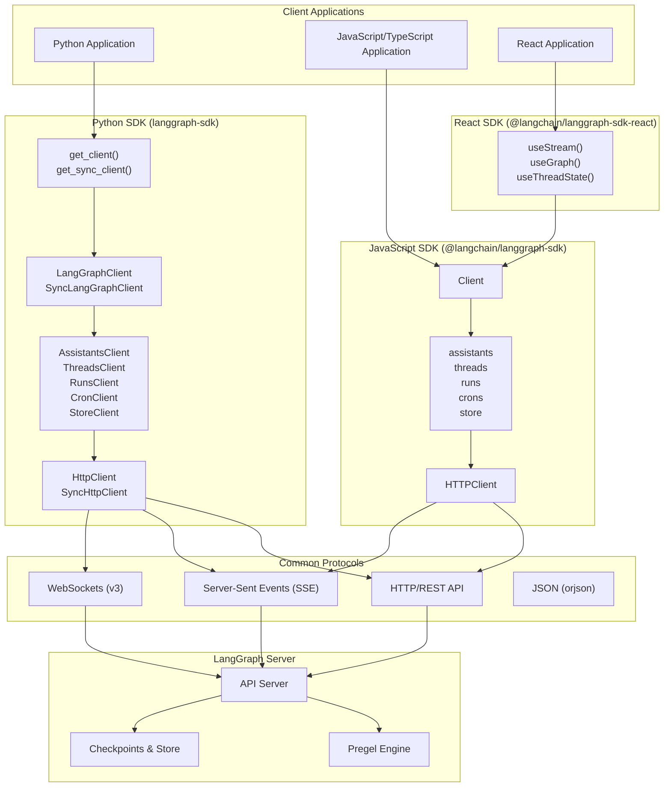
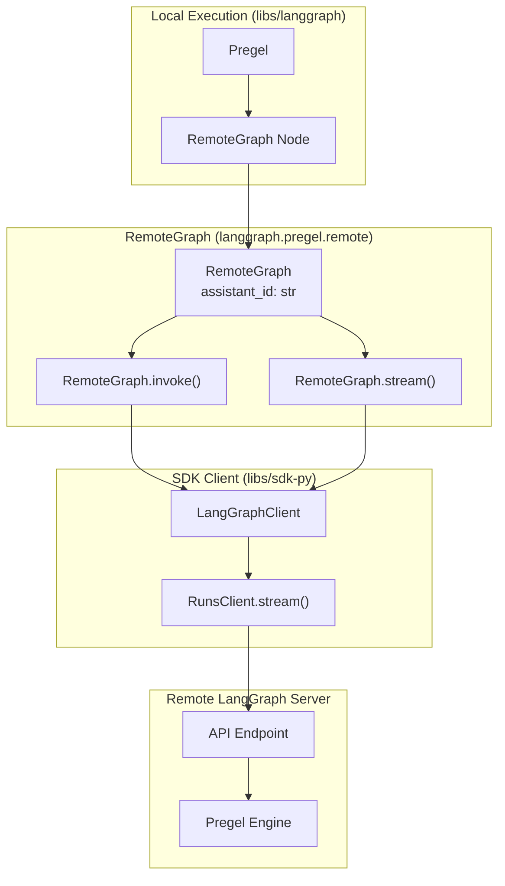

<!-- source: DeepWiki mcp.deepwiki.com · repo langchain-ai/langgraph · page 5 Client SDKs and Remote Execution · fetched 2026-10-26 -->

# Client SDKs and Remote Execution

<details>
<summary>Relevant source files</summary>

The following files were used as context for generating this wiki page:

- [README.md](README.md)
- [libs/langgraph/README.md](libs/langgraph/README.md)
- [libs/sdk-js/README.md](libs/sdk-js/README.md)
- [libs/sdk-py/MIGRATION.md](libs/sdk-py/MIGRATION.md)
- [libs/sdk-py/README.md](libs/sdk-py/README.md)
- [libs/sdk-py/langgraph_sdk/__init__.py](libs/sdk-py/langgraph_sdk/__init__.py)
- [libs/sdk-py/langgraph_sdk/auth/__init__.py](libs/sdk-py/langgraph_sdk/auth/__init__.py)
- [libs/sdk-py/langgraph_sdk/auth/exceptions.py](libs/sdk-py/langgraph_sdk/auth/exceptions.py)
- [libs/sdk-py/langgraph_sdk/auth/types.py](libs/sdk-py/langgraph_sdk/auth/types.py)
- [libs/sdk-py/langgraph_sdk/client.py](libs/sdk-py/langgraph_sdk/client.py)
- [libs/sdk-py/langgraph_sdk/schema.py](libs/sdk-py/langgraph_sdk/schema.py)
- [libs/sdk-py/pyproject.toml](libs/sdk-py/pyproject.toml)

</details>


## Purpose and Scope

This document provides an overview of the client libraries for interacting with deployed LangGraph applications via HTTP APIs. The SDKs enable programmatic access to remote graph deployments from both Python and JavaScript/TypeScript applications. Key capabilities include:

- Creating and managing assistants, threads, runs, and cron jobs.
- Streaming execution results via Server-Sent Events (SSE) and WebSockets.
- Using remote graphs as nodes within local graphs via `RemoteGraph`.
- Custom authentication and authorization management.
- Cross-thread persistent storage via the Store API.

For deployment information, see [CLI and Deployment](#6). For API endpoint details, see [Server API](#7).

**Related Pages:**
- [Python SDK](#5.1) - Python client implementation details (`LangGraphClient`, `SyncLangGraphClient`).
- [JavaScript/TypeScript SDK](#5.2) - JavaScript client implementation and React hooks.
- [HTTP Client and Streaming](#5.3) - HTTP layer, SSE protocol, and v3 thread-centric streaming.
- [Authentication and Authorization](#5.4) - Custom auth handlers, `@auth.authenticate`, and `AuthContext`.
- [Data Models and Schemas](#5.5) - `TypedDict` schemas for API resources (Assistants, Threads, Runs).
- [RemoteGraph](#5.6) - Using remote graphs as local nodes.

**Sources:** [libs/sdk-py/langgraph_sdk/client.py:1-8](), [libs/sdk-py/README.md:17-26]()

---

## Architecture Overview

The LangGraph SDK architecture provides client libraries in multiple languages that communicate with deployed LangGraph applications via HTTP APIs. Each SDK provides typed interfaces for resource management, streaming execution, and authentication.

### Multi-Language Client Architecture



**Sources:** [libs/sdk-py/langgraph_sdk/client.py:12-31](), [libs/sdk-py/langgraph_sdk/__init__.py:1-8](), [libs/sdk-py/pyproject.toml:15-20](), [libs/sdk-js/README.md:1-11]()

---

## Client Factory Functions

The SDK provides factory functions that create configured client instances with automatic authentication and connection handling.

### get_client() - Async Client

```python
def get_client(
    *,
    url: str | None = None,
    api_key: str | None = NOT_PROVIDED,
    headers: Mapping[str, str] | None = None,
    timeout: TimeoutTypes | None = None,
) -> LangGraphClient
```

Creates an async `LangGraphClient` instance [libs/sdk-py/langgraph_sdk/client.py:16](). It resolves API keys from environment variables: `LANGGRAPH_API_KEY`, `LANGSMITH_API_KEY`, or `LANGCHAIN_API_KEY`. It supports loopback transports for optimized in-process communication [libs/sdk-py/langgraph_sdk/client.py:52-53]().

**Sources:** [libs/sdk-py/langgraph_sdk/client.py:16](), [libs/sdk-py/langgraph_sdk/__init__.py:2](), [libs/sdk-py/langgraph_sdk/client.py:52-53]()

### get_sync_client() - Synchronous Client

```python
def get_sync_client(
    *,
    url: str | None = None,
    api_key: str | None = NOT_PROVIDED,
    headers: Mapping[str, str] | None = None,
    timeout: TimeoutTypes | None = None,
) -> SyncLangGraphClient
```

Creates a synchronous `SyncLangGraphClient` [libs/sdk-py/langgraph_sdk/client.py:26]() with identical configuration options as the async version.

**Sources:** [libs/sdk-py/langgraph_sdk/client.py:26](), [libs/sdk-py/langgraph_sdk/__init__.py:2]()

---

## Top-Level Client Classes

### LangGraphClient (Async)

The async top-level client exposes resource-specific sub-clients for interacting with the server's lifecycle.

| Sub-Client | Class | Purpose |
|------------|-------|---------|
| `assistants` | `AssistantsClient` | Manage graph configurations and metadata [libs/sdk-py/langgraph_sdk/client.py:12](). |
| `threads` | `ThreadsClient` | Manage conversation state and history [libs/sdk-py/langgraph_sdk/client.py:21](). |
| `runs` | `RunsClient` | Execute graphs and stream results [libs/sdk-py/langgraph_sdk/client.py:19](). |
| `cron` | `CronClient` | Schedule periodic graph executions [libs/sdk-py/langgraph_sdk/client.py:17](). |
| `store` | `StoreClient` | Cross-thread key-value storage [libs/sdk-py/langgraph_sdk/client.py:20](). |

**Sources:** [libs/sdk-py/langgraph_sdk/client.py:12-21]()

### SyncLangGraphClient

The synchronous equivalent provides the same sub-clients with blocking I/O: `SyncAssistantsClient`, `SyncThreadsClient`, `SyncRunsClient`, `SyncCronClient`, and `SyncStoreClient`.

**Sources:** [libs/sdk-py/langgraph_sdk/client.py:23-31]()

---

## RemoteGraph - Remote Execution as Local Nodes

The `RemoteGraph` class (documented in detail in [RemoteGraph](#5.6)) allows remote graphs to be used as nodes within local graphs. This enables complex, distributed graph architectures.

### RemoteGraph System Integration



**Sources:** [libs/sdk-py/langgraph_sdk/client.py:19](), [libs/sdk-py/README.md:19-22]()

---

## Data Models and Schemas

The SDK uses `TypedDict` classes for type-safe data structures. All schemas are defined in `langgraph_sdk.schema`.

- **Resource Status**: `RunStatus` ("pending", "running", "error", etc.) [libs/sdk-py/langgraph_sdk/schema.py:23-32]() and `ThreadStatus` ("idle", "busy", etc.) [libs/sdk-py/langgraph_sdk/schema.py:34-41]().
- **Streaming Modes**: `StreamMode` defines the granularity of updates ("values", "messages", "updates", "events", "debug", etc.) [libs/sdk-py/langgraph_sdk/schema.py:51-72]().
- **Execution Strategies**: `MultitaskStrategy` defines behavior when multiple tasks target the same thread ("reject", "interrupt", "rollback", "enqueue") [libs/sdk-py/langgraph_sdk/schema.py:81-88]().
- **Authentication Types**: `AuthContext` and `MinimalUserDict` define the structure for user identity and permissions [libs/sdk-py/langgraph_sdk/auth/types.py:164-180]().

**Sources:** [libs/sdk-py/langgraph_sdk/schema.py:1-237](), [libs/sdk-py/langgraph_sdk/auth/types.py:1-180]()

---

## Authentication and Authorization

The SDK provides a framework for custom authentication and authorization via the `Auth` class [libs/sdk-py/langgraph_sdk/auth/__init__.py:13]().

- **Authentication**: Custom `@auth.authenticate` handlers verify credentials (e.g., tokens) and return user identities [libs/sdk-py/langgraph_sdk/auth/__init__.py:49-59]().
- **Authorization**: Fine-grained `@auth.on` handlers control access to resources like threads and assistants based on the `AuthContext` [libs/sdk-py/langgraph_sdk/auth/__init__.py:62-94]().
- **Encryption**: The `Encryption` class handles at-rest data protection [libs/sdk-py/langgraph_sdk/__init__.py:3]().
- **Studio Access**: `StudioUser` allows specialized access control for developers using LangGraph Studio [libs/sdk-py/langgraph_sdk/auth/types.py:218-245]().

**Sources:** [libs/sdk-py/langgraph_sdk/auth/__init__.py:13-107](), [libs/sdk-py/langgraph_sdk/auth/types.py:218-245]()

---

## Package Structure

The SDK is distributed as the `langgraph-sdk` package. It uses `httpx` for networking, `orjson` for high-performance JSON encoding, and `websockets` for real-time communication [libs/sdk-py/pyproject.toml:14-20]().

**Sources:** [libs/sdk-py/pyproject.toml:6-20](), [libs/sdk-py/langgraph_sdk/client.py:1-8]()

---

