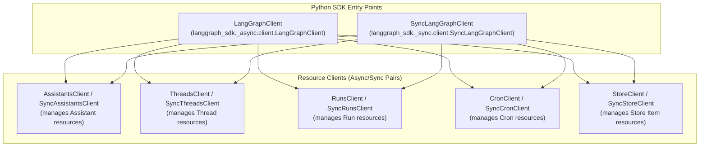
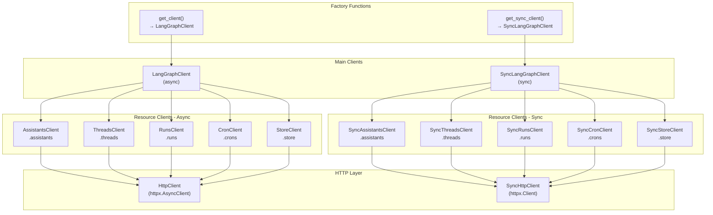
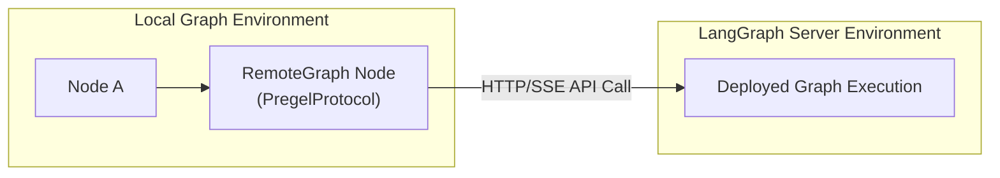

<!-- source: DeepWiki mcp.deepwiki.com · repo langchain-ai/langgraph · page 5.1 Python SDK · fetched 2026-10-26 -->

# Python SDK

<details>
<summary>Relevant source files</summary>

The following files were used as context for generating this wiki page:

- [libs/sdk-py/langgraph_sdk/__init__.py](libs/sdk-py/langgraph_sdk/__init__.py)
- [libs/sdk-py/langgraph_sdk/_async/assistants.py](libs/sdk-py/langgraph_sdk/_async/assistants.py)
- [libs/sdk-py/langgraph_sdk/_async/cron.py](libs/sdk-py/langgraph_sdk/_async/cron.py)
- [libs/sdk-py/langgraph_sdk/_async/runs.py](libs/sdk-py/langgraph_sdk/_async/runs.py)
- [libs/sdk-py/langgraph_sdk/_shared/utilities.py](libs/sdk-py/langgraph_sdk/_shared/utilities.py)
- [libs/sdk-py/langgraph_sdk/_sync/assistants.py](libs/sdk-py/langgraph_sdk/_sync/assistants.py)
- [libs/sdk-py/langgraph_sdk/_sync/cron.py](libs/sdk-py/langgraph_sdk/_sync/cron.py)
- [libs/sdk-py/langgraph_sdk/_sync/runs.py](libs/sdk-py/langgraph_sdk/_sync/runs.py)
- [libs/sdk-py/langgraph_sdk/auth/__init__.py](libs/sdk-py/langgraph_sdk/auth/__init__.py)
- [libs/sdk-py/langgraph_sdk/auth/exceptions.py](libs/sdk-py/langgraph_sdk/auth/exceptions.py)
- [libs/sdk-py/langgraph_sdk/auth/types.py](libs/sdk-py/langgraph_sdk/auth/types.py)
- [libs/sdk-py/langgraph_sdk/client.py](libs/sdk-py/langgraph_sdk/client.py)
- [libs/sdk-py/langgraph_sdk/schema.py](libs/sdk-py/langgraph_sdk/schema.py)
- [libs/sdk-py/pyproject.toml](libs/sdk-py/pyproject.toml)
- [libs/sdk-py/tests/test_crons_client.py](libs/sdk-py/tests/test_crons_client.py)
- [libs/sdk-py/tests/test_langsmith_tracing.py](libs/sdk-py/tests/test_langsmith_tracing.py)
- [libs/sdk-py/tests/test_path_encoding.py](libs/sdk-py/tests/test_path_encoding.py)

</details>


The Python SDK provides client libraries for interacting with LangGraph API servers. It offers both asynchronous and synchronous clients for managing assistants, threads, runs, cron jobs, and persistent storage. The SDK handles HTTP communication, Server-Sent Events (SSE) streaming with automatic reconnection, and provides strongly-typed data models for all API resources.

For information about the JavaScript/TypeScript SDK, see [JavaScript/TypeScript SDK](5.2). For details on authentication and authorization configuration (server-side), see [Authentication and Authorization](5.4). For RemoteGraph usage (using deployed graphs as nodes), see [RemoteGraph](5.6).

---

## Package Structure and Dependencies

The SDK is a standalone package located at `libs/sdk-py` with minimal dependencies. It uses `hatchling` as its build backend [libs/sdk-py/pyproject.toml:1-3]() and `uv` for dependency management [libs/sdk-py/pyproject.toml:61-62]().

**Core Dependencies**:
- `httpx>=0.25.2` - HTTP client with async support. [libs/sdk-py/pyproject.toml:15-15]()
- `orjson>=3.11.5` - Fast JSON serialization. [libs/sdk-py/pyproject.toml:16-16]()
- `langchain-protocol>=0.0.15` and `langchain-core>=1.4.0` [libs/sdk-py/pyproject.toml:17-18]()
- `websockets>=14,<17` [libs/sdk-py/pyproject.toml:19-19]()
- Python 3.10+ [libs/sdk-py/pyproject.toml:10-10]()

**Installation**:
```bash
pip install langgraph-sdk
```

Sources: [libs/sdk-py/pyproject.toml:1-20](), [libs/sdk-py/langgraph_sdk/__init__.py:1-9]()

---

## Client Architecture

The SDK is organized into resource-specific clients that wrap an underlying HTTP client. It supports both `asyncio` and synchronous execution patterns.

### Code Entity Space to System Names

This diagram maps the Python classes to the logical resources they manage within the LangGraph ecosystem.

Title: Python SDK Resource Mapping

Sources: [libs/sdk-py/langgraph_sdk/client.py:12-31](), [libs/sdk-py/langgraph_sdk/_async/runs.py:56-70](), [libs/sdk-py/langgraph_sdk/_sync/runs.py:56-70]()

### Client Factory and Hierarchy

The main entry points are factory functions `get_client` and `get_sync_client` that instantiate the primary client classes. [libs/sdk-py/langgraph_sdk/client.py:16-26]()

Title: SDK Client Factory Hierarchy


**Main Client Structure**

The SDK provides two main client classes that serve as entry points:

| Client | Purpose | Import Path |
|--------|---------|-------------|
| `LangGraphClient` | Async operations | `from langgraph_sdk import get_client` |
| `SyncLangGraphClient` | Synchronous operations | `from langgraph_sdk import get_sync_client` |

Each main client provides access to resource-specific sub-clients through properties (`.assistants`, `.threads`, `.runs`, `.crons`, `.store`). [libs/sdk-py/langgraph_sdk/client.py:12-31]()

Sources: [libs/sdk-py/langgraph_sdk/client.py:1-55](), [libs/sdk-py/langgraph_sdk/__init__.py:1-9]()

---

## Resource Client APIs

### AssistantsClient / SyncAssistantsClient

Manages `Assistant` resources, which are versioned configurations of a graph (linking a `graph_id` to specific `config`, `metadata`, and `context`). [libs/sdk-py/langgraph_sdk/schema.py:221-236]()

**Key Methods**:

| Method | Description | Returns |
|--------|-------------|---------|
| `create(graph_id, ...)` | Create new assistant. | `Assistant` |
| `get(assistant_id)` | Retrieve assistant by ID. | `Assistant` |
| `update(assistant_id, ...)` | Update assistant properties. | `Assistant` |
| `delete(assistant_id)` | Delete assistant. | `None` |
| `search(metadata=None, ...)` | Search assistants with filters. | `list[Assistant]` |
| `get_graph(assistant_id)` | Get graph structure (nodes/edges). | `dict` |
| `get_schemas(assistant_id)` | Get input/output/state schemas. | `GraphSchema` |

Sources: [libs/sdk-py/langgraph_sdk/_async/assistants.py:1-100](), [libs/sdk-py/langgraph_sdk/_sync/assistants.py:1-100]()

---

### ThreadsClient / SyncThreadsClient

Manages `Thread` resources, which maintain the state of a graph across multiple interactions. [libs/sdk-py/langgraph_sdk/_async/threads.py:30-43]()

**Key Methods**:

| Method | Description | Returns |
|--------|-------------|---------|
| `create(metadata=None, ...)` | Create new thread. [libs/sdk-py/langgraph_sdk/_async/threads.py:101-112]() | `Thread` |
| `get(thread_id)` | Retrieve thread by ID. [libs/sdk-py/langgraph_sdk/_async/threads.py:48-65]() | `Thread` |
| `update(thread_id, metadata)` | Update thread metadata or TTL. [libs/sdk-py/langgraph_sdk/_async/threads.py:214-222]() | `Thread` |
| `get_state(thread_id, ...)` | Get current thread state. | `ThreadState` |
| `update_state(thread_id, values, ...)` | Manually update thread state. | `ThreadUpdateStateResponse` |
| `get_history(thread_id, ...)` | Get state history (checkpoints). | `list[ThreadState]` |

Sources: [libs/sdk-py/langgraph_sdk/_async/threads.py:1-250](), [libs/sdk-py/langgraph_sdk/_sync/threads.py:1-250]()

---

### RunsClient / SyncRunsClient

Manages the execution of an assistant on a thread. A `Run` represents a single invocation. [libs/sdk-py/langgraph_sdk/_async/runs.py:56-68]()

**Key Methods**:

| Method | Description | Returns |
|--------|-------------|---------|
| `stream(thread_id, assistant_id, ...)` | Stream execution events (SSE). [libs/sdk-py/langgraph_sdk/_async/runs.py:195-210]() | `AsyncIterator[StreamPart]` |
| `create(thread_id, assistant_id, ...)` | Start a background run. | `Run` |
| `wait(thread_id, assistant_id, ...)` | Start run and block for result. | `dict` |
| `cancel(thread_id, run_id, action=None)` | Cancel a running execution. | `None` |

**Streaming Modes**: The `stream_mode` parameter determines what data is yielded: `values`, `messages`, `updates`, `events`, `tasks`, `checkpoints`, `debug`, `custom`, `messages-tuple`. [libs/sdk-py/langgraph_sdk/schema.py:51-61]()

Sources: [libs/sdk-py/langgraph_sdk/_async/runs.py:56-250](), [libs/sdk-py/langgraph_sdk/_sync/runs.py:56-250]()

---

### CronClient / SyncCronClient

Manages recurring runs scheduled via cron syntax. [libs/sdk-py/langgraph_sdk/_sync/cron.py:30-47]()

**Key Methods**:

| Method | Description | Returns |
|--------|-------------|---------|
| `create_for_thread(thread_id, assistant_id, schedule, ...)` | Schedule recurring run on thread. [libs/sdk-py/langgraph_sdk/_sync/cron.py:52-76]() | `Run` |
| `create(assistant_id, schedule, ...)` | Schedule stateless recurring run. [libs/sdk-py/langgraph_sdk/_sync/cron.py:165-180]() | `Run` |

Sources: [libs/sdk-py/langgraph_sdk/_async/cron.py:1-200](), [libs/sdk-py/langgraph_sdk/_sync/cron.py:1-200]()

---

## Authentication and Authorization

The SDK provides an `Auth` class for defining server-side authentication and authorization logic. This logic is loaded by the LangGraph server to secure API endpoints. [libs/sdk-py/langgraph_sdk/auth/__init__.py:13-41]()

**Request Processing Flow**:
1. **Authentication**: The `@auth.authenticate` handler is executed for every request to verify identity. [libs/sdk-py/langgraph_sdk/auth/__init__.py:98-98]()
2. **Authorization**: The most specific matching handler is called based on the resource and action. [libs/sdk-py/langgraph_sdk/auth/__init__.py:99-103]()

**Handler Precedence**:
- Exact resource and action (e.g., `@auth.on.threads.create`) [libs/sdk-py/langgraph_sdk/auth/__init__.py:100-100]()
- Resource-wide (e.g., `@auth.on.threads`) [libs/sdk-py/langgraph_sdk/auth/__init__.py:101-101]()
- Global handler (e.g., `@auth.on`) [libs/sdk-py/langgraph_sdk/auth/__init__.py:102-102]()

Sources: [libs/sdk-py/langgraph_sdk/auth/__init__.py:13-180](), [libs/sdk-py/langgraph_sdk/auth/types.py:1-200]()

---

## Data Models and Schemas

The SDK uses `TypedDict` and `Literal` types to provide static type checking for API resources.

**Common Enums**:
- `RunStatus`: `pending`, `running`, `error`, `success`, `timeout`, `interrupted`. [libs/sdk-py/langgraph_sdk/schema.py:23-32]()
- `ThreadStatus`: `idle`, `busy`, `interrupted`, `error`. [libs/sdk-py/langgraph_sdk/schema.py:34-41]()
- `MultitaskStrategy`: `reject`, `interrupt`, `rollback`, `enqueue`. [libs/sdk-py/langgraph_sdk/schema.py:81-88]()
- `Durability`: `sync`, `async`, `exit`. [libs/sdk-py/langgraph_sdk/schema.py:104-109]()

**Resource Schemas**:
- `Assistant`: Represents a configured graph instance. [libs/sdk-py/langgraph_sdk/schema.py:221-236]()
- `Thread`: Represents a stateful conversation. [libs/sdk-py/langgraph_sdk/schema.py:20-20]()
- `Checkpoint`: Represents a saved state snapshot. [libs/sdk-py/langgraph_sdk/schema.py:208-219]()

Sources: [libs/sdk-py/langgraph_sdk/schema.py:1-300]()

---

## RemoteGraph Integration

`RemoteGraph` allows using a deployed LangGraph API as if it were a local `Pregel` graph. It implements the `PregelProtocol`.

Title: RemoteGraph Data Flow


**Configuration**:
When initializing `RemoteGraph`, you provide an `assistant_id` and either a `url` or pre-configured clients. It automatically handles the translation between local `Pregel` calls and remote API requests, including support for V3 streaming protocols.

Sources: [libs/sdk-py/langgraph_sdk/client.py:1-55](), [libs/sdk-py/langgraph_sdk/_async/runs.py:195-210]()

---

## Usage Examples

### Async Client Initialization
```python
from langgraph_sdk import get_client

# Uses environment variables like LANGGRAPH_API_KEY by default
async with get_client(url="http://localhost:2024") as client:
    assistants = await client.assistants.search()
```
Sources: [libs/sdk-py/langgraph_sdk/client.py:16-16](), [libs/sdk-py/langgraph_sdk/_shared/utilities.py:26-48]()

### Streaming a Run
```python
async for chunk in client.runs.stream(
    thread_id=None, # Stateless run
    assistant_id="agent",
    input={"messages": [{"role": "user", "content": "hello"}]},
    stream_mode="values"
):
    print(f"Event: {chunk['event']}, Data: {chunk['data']}")
```
Sources: [libs/sdk-py/langgraph_sdk/_async/runs.py:195-210]()

---

