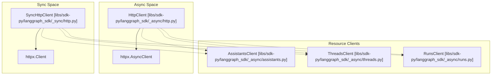
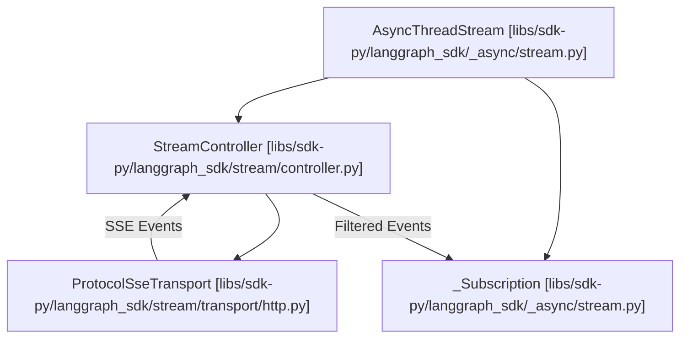

<!-- source: DeepWiki mcp.deepwiki.com · repo langchain-ai/langgraph · page 5.3 HTTP Client and Streaming · fetched 2026-10-26 -->

# HTTP Client and Streaming

Relevant source files

The following files were used as context for generating this wiki page:

- [libs/sdk-py/langgraph_sdk/_async/stream.py](libs/sdk-py/langgraph_sdk/_async/stream.py)
- [libs/sdk-py/langgraph_sdk/_async/threads.py](libs/sdk-py/langgraph_sdk/_async/threads.py)
- [libs/sdk-py/langgraph_sdk/_sync/stream.py](libs/sdk-py/langgraph_sdk/_sync/stream.py)
- [libs/sdk-py/langgraph_sdk/_sync/threads.py](libs/sdk-py/langgraph_sdk/_sync/threads.py)
- [libs/sdk-py/langgraph_sdk/errors.py](libs/sdk-py/langgraph_sdk/errors.py)
- [libs/sdk-py/langgraph_sdk/sse.py](libs/sdk-py/langgraph_sdk/sse.py)
- [libs/sdk-py/langgraph_sdk/stream/controller.py](libs/sdk-py/langgraph_sdk/stream/controller.py)
- [libs/sdk-py/langgraph_sdk/stream/decoders.py](libs/sdk-py/langgraph_sdk/stream/decoders.py)
- [libs/sdk-py/langgraph_sdk/stream/sync_controller.py](libs/sdk-py/langgraph_sdk/stream/sync_controller.py)
- [libs/sdk-py/langgraph_sdk/stream/transport/__init__.py](libs/sdk-py/langgraph_sdk/stream/transport/__init__.py)
- [libs/sdk-py/langgraph_sdk/stream/transport/base.py](libs/sdk-py/langgraph_sdk/stream/transport/base.py)
- [libs/sdk-py/langgraph_sdk/stream/transport/http.py](libs/sdk-py/langgraph_sdk/stream/transport/http.py)
- [libs/sdk-py/langgraph_sdk/stream/transport/sync_http.py](libs/sdk-py/langgraph_sdk/stream/transport/sync_http.py)
- [libs/sdk-py/langgraph_sdk/stream/transport/sync_ws.py](libs/sdk-py/langgraph_sdk/stream/transport/sync_ws.py)
- [libs/sdk-py/langgraph_sdk/stream/transport/ws.py](libs/sdk-py/langgraph_sdk/stream/transport/ws.py)
- [libs/sdk-py/tests/streaming/_events.py](libs/sdk-py/tests/streaming/_events.py)
- [libs/sdk-py/tests/streaming/_fake_server.py](libs/sdk-py/tests/streaming/_fake_server.py)
- [libs/sdk-py/tests/streaming/test_controller.py](libs/sdk-py/tests/streaming/test_controller.py)
- [libs/sdk-py/tests/streaming/test_decoders.py](libs/sdk-py/tests/streaming/test_decoders.py)
- [libs/sdk-py/tests/streaming/test_lifecycle_watcher.py](libs/sdk-py/tests/streaming/test_lifecycle_watcher.py)
- [libs/sdk-py/tests/streaming/test_scoped_handles.py](libs/sdk-py/tests/streaming/test_scoped_handles.py)
- [libs/sdk-py/tests/streaming/test_shared_stream.py](libs/sdk-py/tests/streaming/test_shared_stream.py)
- [libs/sdk-py/tests/streaming/test_sync_projections.py](libs/sdk-py/tests/streaming/test_sync_projections.py)
- [libs/sdk-py/tests/streaming/test_sync_scoped_handles.py](libs/sdk-py/tests/streaming/test_sync_scoped_handles.py)
- [libs/sdk-py/tests/streaming/test_sync_shared_stream.py](libs/sdk-py/tests/streaming/test_sync_shared_stream.py)
- [libs/sdk-py/tests/streaming/test_sync_thread_stream.py](libs/sdk-py/tests/streaming/test_sync_thread_stream.py)
- [libs/sdk-py/tests/streaming/test_sync_transport_ws.py](libs/sdk-py/tests/streaming/test_sync_transport_ws.py)
- [libs/sdk-py/tests/streaming/test_thread_stream.py](libs/sdk-py/tests/streaming/test_thread_stream.py)
- [libs/sdk-py/tests/streaming/test_transport_http.py](libs/sdk-py/tests/streaming/test_transport_http.py)
- [libs/sdk-py/tests/streaming/test_transport_path_encoding.py](libs/sdk-py/tests/streaming/test_transport_path_encoding.py)
- [libs/sdk-py/tests/streaming/test_transport_ws.py](libs/sdk-py/tests/streaming/test_transport_ws.py)
- [libs/sdk-py/tests/test_api_parity.py](libs/sdk-py/tests/test_api_parity.py)
- [libs/sdk-py/tests/test_client_stream.py](libs/sdk-py/tests/test_client_stream.py)
- [libs/sdk-py/tests/test_errors.py](libs/sdk-py/tests/test_errors.py)

This document describes the underlying HTTP client layer and streaming protocol implementation in the LangGraph Python SDK. It covers the core `HttpClient` abstractions, the Server-Sent Events (SSE) decoding logic, the v3 thread-centric streaming protocol, and the typed error handling system.

## HTTP Client Architecture

The SDK provides two primary HTTP client implementations: `HttpClient` for asynchronous operations and `SyncHttpClient` for synchronous operations. These classes wrap `httpx.AsyncClient` and `httpx.Client` respectively, adding LangGraph-specific features like automatic reconnection, typed error mapping, and specialized SSE streaming.

### HttpClient and SyncHttpClient

The clients serve as the foundational transport layer for all resource-specific clients (Assistants, Threads, Runs, etc.).

**Code Entity Mapping: HTTP Client Hierarchy**

Sources: [libs/sdk-py/langgraph_sdk/_async/http.py:26-37](), [libs/sdk-py/langgraph_sdk/_sync/http.py:25-37](), [libs/sdk-py/langgraph_sdk/client.py:12-31]()

### Request Lifecycle and Methods

Both clients implement a standard set of HTTP methods. Each method performs encoding, execution, validation, and decoding steps.

| Method | Purpose | Implementation Details |
| :--- | :--- | :--- |
| `get` | Fetch resources | Supports query params and custom headers [libs/sdk-py/langgraph_sdk/_async/http.py:39-52]() |
| `post` | Create resources | Handles JSON encoding and merges runtime headers [libs/sdk-py/langgraph_sdk/_async/http.py:54-77]() |
| `put` | Replace resources | Encodes body and performs standard update [libs/sdk-py/langgraph_sdk/_async/http.py:79-98]() |
| `patch` | Partial update | Merges updates into existing resources [libs/sdk-py/langgraph_sdk/_async/http.py:100-119]() |
| `delete` | Remove resources | Standard deletion with optional body [libs/sdk-py/langgraph_sdk/_async/http.py:121-137]() |
| `stream` | SSE Streaming | Returns an iterator of `StreamPart` [libs/sdk-py/langgraph_sdk/_async/http.py:187-210]() |

Sources: [libs/sdk-py/langgraph_sdk/_async/http.py:39-137](), [libs/sdk-py/langgraph_sdk/_sync/http.py:39-137]()

## v3 Thread-Centric Streaming

The v3 protocol introduces a thread-centric streaming surface implemented via `AsyncThreadStream` and `SyncThreadStream`. This protocol manages multiple filtered subscriptions over a shared transport, surfaces lifecycle state, and provides typed projections for graph data.

### Architecture and Data Flow

The `AsyncThreadStream` manages a `ProtocolSseTransport` bound to a specific `thread_id` [libs/sdk-py/langgraph_sdk/_async/stream.py:39-50](). It uses a `StreamController` to multiplex events from a single SSE connection to multiple typed subscribers.

**Code Entity Mapping: v3 Streaming Controller**

Sources: [libs/sdk-py/langgraph_sdk/_async/stream.py:3-12](), [libs/sdk-py/langgraph_sdk/stream/transport/http.py:33-58](), [libs/sdk-py/langgraph_sdk/stream/controller.py:28-40]()

### Key Streaming Components

1.  **ProtocolSseTransport**: Bound to a `thread_id`. Commands go to `POST /threads/{thread_id}/commands` [libs/sdk-py/langgraph_sdk/stream/transport/http.py:64-70](), while `open_event_stream` opens SSE connections at `POST /threads/{thread_id}/stream/events` [libs/sdk-py/langgraph_sdk/stream/transport/http.py:96-106]().
2.  **Projections**: The stream exposes specialized iterators like `thread.values`, `thread.messages`, `thread.tool_calls`, and `thread.extensions` [libs/sdk-py/langgraph_sdk/_async/stream.py:7-9]().
3.  **Run Lifecycle**: A dedicated "lifecycle watcher" monitors the run status. Terminal states (completed/errored) are resolved into `_run_done` to signal the end of the stream [libs/sdk-py/langgraph_sdk/_async/stream.py:55-61]().
4.  **Fanout and Dedup**: The `StreamController` handles fanning out events to all matching subscriptions and uses `_SeenEventIds` to deduplicate events during reconnections [libs/sdk-py/langgraph_sdk/stream/controller.py:28-35]().
5.  **Run Start Gate**: A synchronization mechanism (`_run_start_ready` in async, `_run_start_gate` in sync) ensures that subscriptions issued before a run starts block until the transport is initialized [libs/sdk-py/langgraph_sdk/_async/stream.py:185-192](), [libs/sdk-py/langgraph_sdk/stream/sync_controller.py:64-80]().

Sources: [libs/sdk-py/langgraph_sdk/_async/stream.py:3-12](), [libs/sdk-py/langgraph_sdk/stream/transport/http.py:33-58](), [libs/sdk-py/langgraph_sdk/stream/controller.py:28-40](), [libs/sdk-py/tests/streaming/test_sync_thread_stream.py:49-86]()

## Server-Sent Events (SSE) Protocol

LangGraph uses SSE to stream graph execution updates. The SDK implements a custom decoder to handle specific protocol requirements.

### BytesLineDecoder

The `BytesLineDecoder` incrementally reads bytes and splits them into lines per the SSE spec, handling `\n`, `\r`, and `\r\n` [libs/sdk-py/langgraph_sdk/sse.py:17-31](). It manages a buffer for partial lines [libs/sdk-py/langgraph_sdk/sse.py:54-66]().

### SSEDecoder and StreamPart

The `SSEDecoder` parses raw SSE fields:
-   **Accumulation**: It parses `event`, `data`, `id`, and `retry` fields [libs/sdk-py/langgraph_sdk/sse.py:119-137]().
-   **StreamPart**: When an empty line signals event completion, it returns a `StreamPart` containing the event name and the `orjson`-parsed payload [libs/sdk-py/langgraph_sdk/sse.py:103-114]().

Sources: [libs/sdk-py/langgraph_sdk/sse.py:78-139](), [libs/sdk-py/langgraph_sdk/schema.py:12-12]()

## Error Handling

The SDK provides a typed exception hierarchy mapping HTTP status codes to Python classes.

### APIStatusError Hierarchy

When a request returns a status code >= 400, `_raise_for_status_typed` is triggered [libs/sdk-py/langgraph_sdk/errors.py:213-231]().

| HTTP Status | Exception Class | Description |
| :--- | :--- | :--- |
| 400 | `BadRequestError` | Invalid request parameters [libs/sdk-py/langgraph_sdk/errors.py:108-109]() |
| 401 | `AuthenticationError` | Invalid API key [libs/sdk-py/langgraph_sdk/errors.py:112-113]() |
| 403 | `PermissionDeniedError` | Unauthorized for the resource [libs/sdk-py/langgraph_sdk/errors.py:116-117]() |
| 404 | `NotFoundError` | Resource does not exist [libs/sdk-py/langgraph_sdk/errors.py:120-121]() |
| 409 | `ConflictError` | Resource state conflict [libs/sdk-py/langgraph_sdk/errors.py:124-125]() |
| 422 | `UnprocessableEntityError` | Validation error [libs/sdk-py/langgraph_sdk/errors.py:128-129]() |
| 429 | `RateLimitError` | Too many requests [libs/sdk-py/langgraph_sdk/errors.py:132-133]() |
| 5xx | `InternalServerError` | Server-side failures [libs/sdk-py/langgraph_sdk/errors.py:136-137]() |

Sources: [libs/sdk-py/langgraph_sdk/errors.py:108-137](), [libs/sdk-py/langgraph_sdk/errors.py:190-210]()

### Reconnection and Backoff

For streaming connections, the `SyncStreamController` (and its async counterpart) implements exponential backoff with jitter between reconnection attempts [libs/sdk-py/langgraph_sdk/stream/sync_controller.py:148-157](). 

**Reconnection Logic:**
- **Shared Stream Filter**: The controller reconciles active subscriptions into a union filter [libs/sdk-py/langgraph_sdk/stream/subscription.py:38-39]().
- **Cursor Tracking**: It tracks the last successful sequence ID to resume the stream without data loss by passing `since` in the request body [libs/sdk-py/langgraph_sdk/stream/transport/http.py:104-106]().
- **Rotation**: When filters change, the controller rotates to a new stream, ensuring buffered events from the old stream are drained before closing [libs/sdk-py/tests/streaming/test_sync_thread_stream.py:130-191]().

Sources: [libs/sdk-py/langgraph_sdk/stream/sync_controller.py:148-157](), [libs/sdk-py/langgraph_sdk/stream/transport/http.py:96-106](), [libs/sdk-py/tests/streaming/test_sync_thread_stream.py:93-122]()

---

