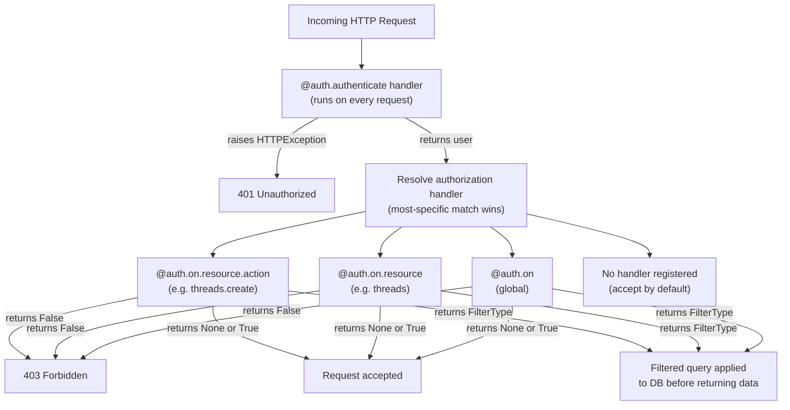
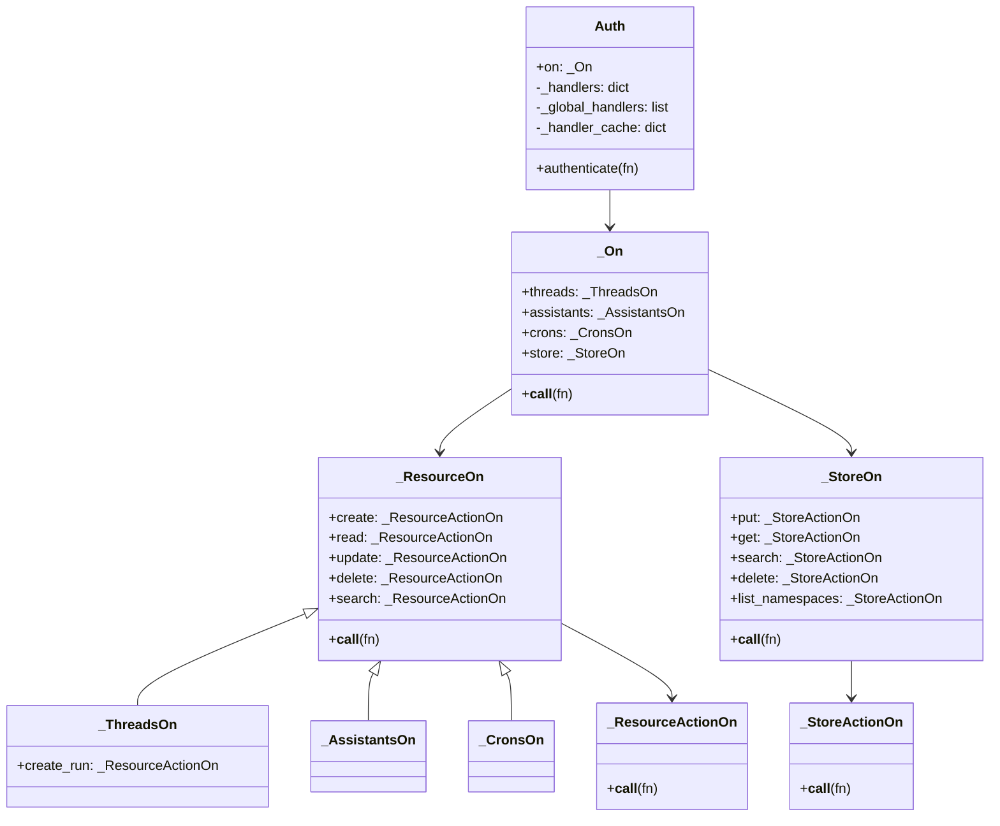

<!-- source: DeepWiki mcp.deepwiki.com · repo langchain-ai/langgraph · page 5.4 Authentication and Authorization · fetched 2026-10-26 -->

# Authentication and Authorization

<details>
<summary>Relevant source files</summary>

The following files were used as context for generating this wiki page:

- [.gitignore](.gitignore)
- [Makefile](Makefile)
- [docs/.gitignore](docs/.gitignore)
- [libs/sdk-py/langgraph_sdk/__init__.py](libs/sdk-py/langgraph_sdk/__init__.py)
- [libs/sdk-py/langgraph_sdk/auth/__init__.py](libs/sdk-py/langgraph_sdk/auth/__init__.py)
- [libs/sdk-py/langgraph_sdk/auth/exceptions.py](libs/sdk-py/langgraph_sdk/auth/exceptions.py)
- [libs/sdk-py/langgraph_sdk/auth/types.py](libs/sdk-py/langgraph_sdk/auth/types.py)
- [libs/sdk-py/langgraph_sdk/client.py](libs/sdk-py/langgraph_sdk/client.py)
- [libs/sdk-py/langgraph_sdk/encryption/__init__.py](libs/sdk-py/langgraph_sdk/encryption/__init__.py)
- [libs/sdk-py/langgraph_sdk/encryption/types.py](libs/sdk-py/langgraph_sdk/encryption/types.py)
- [libs/sdk-py/langgraph_sdk/schema.py](libs/sdk-py/langgraph_sdk/schema.py)
- [libs/sdk-py/pyproject.toml](libs/sdk-py/pyproject.toml)
- [libs/sdk-py/tests/test_encryption.py](libs/sdk-py/tests/test_encryption.py)

</details>


This page documents the authentication and authorization system available in the `langgraph-sdk` Python package. It covers the `Auth` class, how to register authentication and authorization handlers, the `FilterType` for server-side query filtering, the Encryption API for at-rest security, and the `ServerRuntime` for graph factory context.

For information about the HTTP client layer and error types (including `AuthenticationError`, `PermissionDeniedError`) raised when auth fails on the client side, see [HTTP Client and Streaming](). For the `langgraph.json` `auth` configuration block, see [Configuration System (langgraph.json)]().

---

## Overview

The auth system has two distinct stages that run server-side on every incoming request to the LangGraph API server:

1. **Authentication** — verifies the caller's identity and produces a user object.
2. **Authorization** — decides whether the authenticated user may perform the requested action on the requested resource, and optionally injects filters to limit what data is returned.

Both stages are configured by creating an `Auth` instance in a Python module, registering handlers on it with decorators, and pointing `langgraph.json` at that module.

**Request processing flow:**



Sources: [libs/sdk-py/langgraph_sdk/auth/__init__.py:96-107]()

---

## The `Auth` Class

`Auth` is defined in [libs/sdk-py/langgraph_sdk/auth/__init__.py:13-107]() and exported from `langgraph_sdk` directly [libs/sdk-py/langgraph_sdk/__init__.py:1-15]().

```python
from langgraph_sdk import Auth
```

Instantiate once per module; then use its decorators to register handlers.

| Attribute / Method | Type | Purpose |
|---|---|---|
| `authenticate` | decorator | Registers the single authentication handler [libs/sdk-py/langgraph_sdk/auth/__init__.py:225-231]() |
| `on` | `_On` instance | Entry point for all authorization handler registration [libs/sdk-py/langgraph_sdk/auth/__init__.py:130-182]() |
| `types` | module reference | Shortcut to `langgraph_sdk.auth.types` [libs/sdk-py/langgraph_sdk/auth/__init__.py:116-121]() |
| `exceptions` | module reference | Shortcut to `langgraph_sdk.auth.exceptions` [libs/sdk-py/langgraph_sdk/auth/__init__.py:122-127]() |

**Internal state** (accessed by the API server at runtime):

| Slot | Type | Purpose |
|---|---|---|
| `_authenticate_handler` | `Authenticator \| None` | The single registered auth function [libs/sdk-py/langgraph_sdk/auth/__init__.py:110-110]() |
| `_handlers` | `dict[tuple[str,str], list[Handler]]` | Per `(resource, action)` handler lists [libs/sdk-py/langgraph_sdk/auth/__init__.py:113-113]() |
| `_global_handlers` | `list[Handler]` | Handlers registered on `@auth.on` with no resource/action [libs/sdk-py/langgraph_sdk/auth/__init__.py:111-111]() |
| `_handler_cache` | `dict[tuple[str,str], Handler]` | Resolved handler cache [libs/sdk-py/langgraph_sdk/auth/__init__.py:112-112]() |

Sources: [libs/sdk-py/langgraph_sdk/auth/__init__.py:109-127]()

---

## Authentication — `@auth.authenticate`

Registers one async function as the credential verifier. Only one authenticator may be registered per `Auth` instance [libs/sdk-py/langgraph_sdk/auth/__init__.py:225-231]().

The server injects parameters by name into the handler. The handler must return one of:
- A `str` (treated as `identity`)
- A `MinimalUserDict` (TypedDict with `identity` required) [libs/sdk-py/langgraph_sdk/auth/types.py:164-179]()
- Any object implementing `MinimalUser` or `BaseUser` [libs/sdk-py/langgraph_sdk/auth/types.py:151-217]()
- Any `Mapping[str, Any]` with at least an `"identity"` key

If authentication fails, raise `Auth.exceptions.HTTPException(status_code=401, ...)` [libs/sdk-py/langgraph_sdk/auth/exceptions.py:9-57]().

**Usage example:**

```python
@auth.authenticate
async def authenticate(authorization: str) -> Auth.types.MinimalUserDict:
    user = await verify_token(authorization)
    if not user:
        raise Auth.exceptions.HTTPException(status_code=401, detail="Unauthorized")
    return {"identity": user["id"], "permissions": user.get("permissions", []), "display_name": user.get("name")}
```

Sources: [libs/sdk-py/langgraph_sdk/auth/__init__.py:49-59](), [libs/sdk-py/langgraph_sdk/auth/types.py:164-217]()

---

## Authorization — `auth.on`

`auth.on` is an instance of `_On` [libs/sdk-py/langgraph_sdk/auth/__init__.py:130](). It serves as the root for registering authorization handlers at three levels of specificity.

**Authorization handler class structure:**



Sources: [libs/sdk-py/langgraph_sdk/auth/__init__.py:318-744]()

### Handler Levels

**Global handler** — runs for all resources and actions not matched by a more specific handler [libs/sdk-py/langgraph_sdk/auth/__init__.py:157-160]():

```python
@auth.on
async def deny_all(ctx: Auth.types.AuthContext, value: Any) -> bool:
    return False
```

**Resource-level handler** — runs for all actions on the specified resource [libs/sdk-py/langgraph_sdk/auth/__init__.py:166-170]():

```python
@auth.on.threads
async def allow_threads(ctx: Auth.types.AuthContext, value: Any) -> Auth.types.FilterType:
    return {"owner": ctx.user.identity}
```

**Resource + action handler** — most specific; overrides both of the above [libs/sdk-py/langgraph_sdk/auth/__init__.py:175-179]():

```python
@auth.on.threads.delete
async def allow_admin_thread_deletion(ctx: AuthContext, value: Any) -> bool:
    return "admin" in ctx.user.permissions
```

### Handler Precedence

When a request arrives, the server selects the most specific registered handler:

```
(resource, action)  →  (resource, "*")  →  global  →  accept (no handler)
```

Only one handler is invoked per request. The first matching level wins [libs/sdk-py/langgraph_sdk/auth/__init__.py:99-106]().

---

## Handler Return Values

| Return value | Meaning |
|---|---|
| `None` or `True` | Accept the request |
| `False` | Reject with HTTP 403 |
| `FilterType` | Apply the filter to the database query before returning data |

`HandlerResult` is defined as `None | bool | FilterType` in [libs/sdk-py/langgraph_sdk/auth/types.py:138-143]().

---

## `FilterType`

`FilterType` [libs/sdk-py/langgraph_sdk/auth/types.py:58-66]() is a `dict` returned by authorization handlers to restrict which records the server returns.

**Supported operators:**

| Syntax | Meaning |
|---|---|
| `{"field": "value"}` | Exact match (shorthand) [libs/sdk-py/langgraph_sdk/auth/types.py:83-83]() |
| `{"field": {"$eq": "value"}}` | Exact match (explicit) [libs/sdk-py/langgraph_sdk/auth/types.py:89-89]() |
| `{"field": {"$contains": "value"}}` | Field list/set contains `value` [libs/sdk-py/langgraph_sdk/auth/types.py:95-95]() |
| `{"field": {"$contains": ["v1", "v2"]}}` | Field list/set contains all of `v1`, `v2` [libs/sdk-py/langgraph_sdk/auth/types.py:101-101]() |

Sources: [libs/sdk-py/langgraph_sdk/auth/types.py:58-109]()

---

## User Types and Server Injection

LangGraph Server propagates user identity from the auth layer into the graph execution runtime.

| Type | Location | Purpose |
|---|---|---|
| `MinimalUser` | [libs/sdk-py/langgraph_sdk/auth/types.py:151-161]() | Protocol: requires `identity` property |
| `MinimalUserDict` | [libs/sdk-py/langgraph_sdk/auth/types.py:164-179]() | TypedDict for authenticators |
| `BaseUser` | [libs/sdk-py/langgraph_sdk/auth/types.py:182-217]() | Full ASGI user protocol |
| `StudioUser` | [libs/sdk-py/langgraph_sdk/auth/types.py:218-275]() | Populated for requests from LangGraph Studio UI |

### `StudioUser`

`StudioUser` is set as `ctx.user` when a request originates from LangGraph Studio. Studio auth can be disabled in `langgraph.json` [libs/sdk-py/langgraph_sdk/auth/types.py:223-229](). Use `isinstance(ctx.user, Auth.types.StudioUser)` to grant developers pass-through access [libs/sdk-py/langgraph_sdk/auth/types.py:239-244]().

---

## `AuthContext`

`AuthContext` [libs/sdk-py/langgraph_sdk/auth/types.py:388-426]() is the `ctx` object injected into every authorization handler.

| Field | Type | Description |
|---|---|---|
| `user` | `BaseUser` | The authenticated user object |
| `permissions` | `Sequence[str]` | The user's permissions list |
| `resource` | `Literal` | "runs", "threads", "crons", "assistants", "store" |
| `action` | `Literal` | e.g., "read", "create", "delete" |

Sources: [libs/sdk-py/langgraph_sdk/auth/types.py:373-426]()

---

## Encryption API

The `Encryption` class [libs/sdk-py/langgraph_sdk/encryption/__init__.py:208-220]() provides a framework for implementing custom at-rest encryption for opaque blobs (checkpoints) and structured JSON data (metadata, state values).

### `EncryptionContext`
Handlers receive an `EncryptionContext` [libs/sdk-py/langgraph_sdk/encryption/types.py:17-43]() containing:
- `model`: The entity type (e.g., "assistant", "thread").
- `field`: The specific field (e.g., "metadata", "values").
- `metadata`: Arbitrary non-secret data used for key selection.

### Registration Decorators
- `@encryption.encrypt.blob` / `@encryption.decrypt.blob`: For `bytes` data [libs/sdk-py/langgraph_sdk/encryption/__init__.py:80-107](), [libs/sdk-py/langgraph_sdk/encryption/__init__.py:147-176]().
- `@encryption.encrypt.json` / `@encryption.decrypt.json`: For `dict` data [libs/sdk-py/langgraph_sdk/encryption/__init__.py:109-135](), [libs/sdk-py/langgraph_sdk/encryption/__init__.py:178-206]().

**Validation Rules:**
- Handlers must be `async` [libs/sdk-py/langgraph_sdk/encryption/__init__.py:54-55]().
- Handlers must accept exactly 2 parameters: `(ctx, data)` [libs/sdk-py/langgraph_sdk/encryption/__init__.py:63-67]().
- Duplicate handlers for the same type (e.g., two `blob` encryptors) will raise `DuplicateHandlerError` [libs/sdk-py/tests/test_encryption.py:41-85]().

Sources: [libs/sdk-py/langgraph_sdk/encryption/__init__.py:1-220](), [libs/sdk-py/langgraph_sdk/encryption/types.py:1-43](), [libs/sdk-py/tests/test_encryption.py:1-104]()

---

## Wiring into `langgraph.json`

The LangGraph server loads custom auth and encryption logic via the configuration file.

```json
{
  "auth": {
    "path": "./auth.py:my_auth"
  },
  "encryption": {
    "path": "./security.py:my_encryption"
  }
}
```

Sources: [libs/sdk-py/langgraph_sdk/auth/__init__.py:26-40](), [libs/sdk-py/langgraph_sdk/encryption/__init__.py:6-10]()

---

## Exceptions

Use `Auth.exceptions.HTTPException` to return structured errors [libs/sdk-py/langgraph_sdk/auth/exceptions.py:9-57]().

```python
raise Auth.exceptions.HTTPException(status_code=401, detail="Invalid token")
```

Sources: [libs/sdk-py/langgraph_sdk/auth/exceptions.py:1-59]()

---

