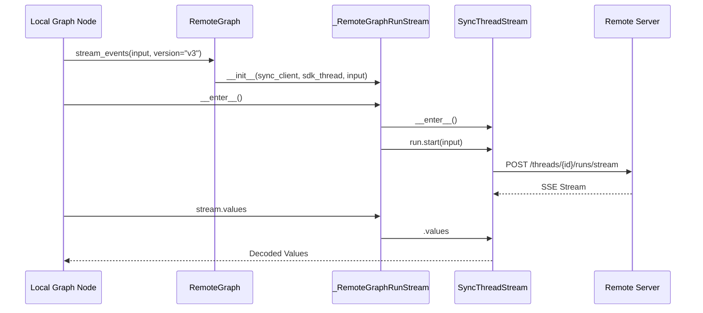

<!-- source: DeepWiki mcp.deepwiki.com · repo langchain-ai/langgraph · page 5.6 RemoteGraph · fetched 2026-10-26 -->

# RemoteGraph

<details>
<summary>Relevant source files</summary>

The following files were used as context for generating this wiki page:

- [libs/langgraph/langgraph/pregel/_remote_run_stream.py](libs/langgraph/langgraph/pregel/_remote_run_stream.py)
- [libs/langgraph/langgraph/pregel/remote.py](libs/langgraph/langgraph/pregel/remote.py)
- [libs/langgraph/tests/test_remote_graph.py](libs/langgraph/tests/test_remote_graph.py)
- [libs/langgraph/tests/test_remote_graph_v3.py](libs/langgraph/tests/test_remote_graph_v3.py)
- [libs/sdk-py/tests/integration/test_remote_graph_v3.py](libs/sdk-py/tests/integration/test_remote_graph_v3.py)

</details>


`RemoteGraph` is a client implementation for calling remote LangGraph APIs that conform to the LangGraph Server API specification. It implements the `PregelProtocol` interface [[libs/langgraph/langgraph/pregel/protocol.py:62-62]()] and behaves identically to a local `Graph`, enabling it to be used as a node in another graph for building distributed, multi-tier LangGraph applications.

For information about the LangGraph Server API endpoints, see **Server API (7)**. For details on the Python SDK client classes used internally, see **Python SDK (5.1)**. For information on using graphs as subgraphs locally, see **Graph Composition and Nested Graphs (3.6)**.

## Class Structure

The `RemoteGraph` class is located in [[libs/langgraph/langgraph/pregel/remote.py:118-1002]()] and implements the `PregelProtocol` interface. This enables it to be used interchangeably with locally-compiled `Pregel` instances.

### Entity Relationship Diagram

```mermaid
graph TB
    subgraph "Core Protocols"
        [PregelProtocol]
    end

    subgraph "Remote Execution"
        [RemoteGraph]
        [RemoteException]
        [_RemoteGraphRunStream]
    end

    subgraph "SDK Clients"
        [LangGraphClient]
        [SyncLangGraphClient]
        [SyncThreadStream]
    end
    
    [PregelProtocol] -->|implements| [RemoteGraph]
    [RemoteGraph] -->|uses| [LangGraphClient]
    [RemoteGraph] -->|uses| [SyncLangGraphClient]
    [RemoteGraph] -->|creates| [_RemoteGraphRunStream]
    [_RemoteGraphRunStream] -->|wraps| [SyncThreadStream]
    
    [RemoteGraph] -->|"get_graph()"| AssistantsAPI["AssistantsClient.get_graph()"]
    [RemoteGraph] -->|"get_state()"| ThreadsAPI["ThreadsClient.get_state()"]
    [RemoteGraph] -->|"stream_events(version='v3')"| RunsAPI["RunsClient.threads.stream()"]
    
    [LangGraphClient] --> AssistantsAPI
    [LangGraphClient] --> ThreadsAPI
```
Sources: [[libs/langgraph/langgraph/pregel/remote.py:118-121](), [libs/langgraph/langgraph/pregel/protocol.py:62-62](), [libs/langgraph/langgraph/pregel/remote.py:26-31](), [libs/langgraph/langgraph/pregel/_remote_run_stream.py:126-148]()]

## Initialization and Configuration

The `RemoteGraph` constructor [[libs/langgraph/langgraph/pregel/remote.py:132-180]()] accepts either client instances or connection parameters to create default clients.

### Constructor Parameters

| Parameter | Type | Description |
|-----------|------|-------------|
| `assistant_id` | `str` | The assistant ID or graph name of the remote graph (positional) [[libs/langgraph/langgraph/pregel/remote.py:134]()] |
| `url` | `str \| None` | The URL of the remote API server [[libs/langgraph/langgraph/pregel/remote.py:137]()] |
| `api_key` | `str \| None` | Authentication API key [[libs/langgraph/langgraph/pregel/remote.py:138]()] |
| `headers` | `dict[str, str] \| None` | Additional HTTP headers [[libs/langgraph/langgraph/pregel/remote.py:139]()] |
| `client` | `LangGraphClient \| None` | Pre-configured async client [[libs/langgraph/langgraph/pregel/remote.py:140]()] |
| `sync_client` | `SyncLangGraphClient \| None` | Pre-configured sync client [[libs/langgraph/langgraph/pregel/remote.py:141]()] |
| `config` | `RunnableConfig \| None` | Default configuration [[libs/langgraph/langgraph/pregel/remote.py:142]()] |
| `name` | `str \| None` | Human-readable name (defaults to `assistant_id`) [[libs/langgraph/langgraph/pregel/remote.py:143]()] |
| `distributed_tracing` | `bool` | Enable LangSmith distributed tracing headers [[libs/langgraph/langgraph/pregel/remote.py:144]()] |

At least one of `url`, `client`, or `sync_client` must be provided. If `url` is provided, default clients are created using `get_client()` and `get_sync_client()` from `langgraph_sdk` [[libs/langgraph/langgraph/pregel/remote.py:173-179]()].

Sources: [[libs/langgraph/langgraph/pregel/remote.py:132-180]()]

## Configuration Sanitization

Before sending configuration to the remote API, `RemoteGraph` sanitizes it to remove non-serializable fields and internal checkpoint state.

### Configuration Droplist
The constant `_CONF_DROPLIST` [[libs/langgraph/langgraph/pregel/remote.py:78-85]()] defines fields removed from `config["configurable"]`:
- `CONFIG_KEY_CHECKPOINT_MAP` [[libs/langgraph/langgraph/pregel/remote.py:80]()]
- `CONFIG_KEY_CHECKPOINT_ID` [[libs/langgraph/langgraph/pregel/remote.py:81]()]
- `CONFIG_KEY_CHECKPOINT_NS` [[libs/langgraph/langgraph/pregel/remote.py:82]()]
- `CONFIG_KEY_TASK_ID` [[libs/langgraph/langgraph/pregel/remote.py:83]()]

### Implementation
The `_sanitize_config()` method [[libs/langgraph/langgraph/pregel/remote.py:369-396]()] processes:
1. **recursion_limit**: Copied directly if present [[libs/langgraph/langgraph/pregel/remote.py:372]()].
2. **tags**: Filters to include only string values [[libs/langgraph/langgraph/pregel/remote.py:374-377]()].
3. **metadata**: Recursively sanitizes values using `_sanitize_config_value()` [[libs/langgraph/langgraph/pregel/remote.py:378-380]()].
4. **configurable**: Filters droplist keys and recursively sanitizes values [[libs/langgraph/langgraph/pregel/remote.py:381-394]()].

The `_sanitize_config_value()` helper [[libs/langgraph/langgraph/pregel/remote.py:90-109]()] ensures only primitives (str, int, float, bool, UUID), dicts, and lists/tuples containing primitives are passed.

Sources: [[libs/langgraph/langgraph/pregel/remote.py:78-109](), [libs/langgraph/langgraph/pregel/remote.py:369-396]()]

## State Management

`RemoteGraph` provides methods to read and write thread state on the remote graph by wrapping SDK calls.

### get_state() / aget_state()
[[libs/langgraph/langgraph/pregel/remote.py:398-468]()]
Retrieves the current or historical state of a thread. It calls `ThreadsClient.get_state()` or `ThreadsClient.get_state_checkpoint()` depending on whether a specific checkpoint ID is provided in the config [[libs/langgraph/langgraph/pregel/remote.py:448-464]()].

### update_state() / aupdate_state()
[[libs/langgraph/langgraph/pregel/remote.py:564-632]()]
Updates thread state on the remote graph. It calls `ThreadsClient.update_state()` [[libs/langgraph/langgraph/pregel/remote.py:613]()] and returns a `RunnableConfig` representing the new checkpoint [[libs/langgraph/langgraph/pregel/remote.py:623-632]()].

### Data Model Mapping

| SDK Schema (`ThreadState`) | Pregel Model (`StateSnapshot`) | Source |
|-------------------|---------------------|--------|
| `values` | `values` | [[libs/langgraph/langgraph/pregel/remote.py:304]()] |
| `next` | `next` (as tuple) | [[libs/langgraph/langgraph/pregel/remote.py:305]()] |
| `checkpoint` | `config["configurable"]` | [[libs/langgraph/langgraph/pregel/remote.py:308-315]()] |
| `tasks` | `tasks` (as `PregelTask`) | [[libs/langgraph/langgraph/pregel/remote.py:321-337]()] |

Sources: [[libs/langgraph/langgraph/pregel/remote.py:284-340]()]

## V3 Streaming Support

`RemoteGraph` supports the v3 streaming protocol via the `stream_events` and `astream_events` methods when `version="v3"` is passed [[libs/langgraph/langgraph/pregel/remote.py:905-950]()]. This path utilizes the `_RemoteGraphRunStream` and `_AsyncRemoteGraphRunStream` adapters [[libs/langgraph/langgraph/pregel/_remote_run_stream.py:126-258]()].

### _RemoteGraphRunStream Adapter
This class wraps the SDK's `SyncThreadStream` to provide a surface area compatible with LangGraph's local `GraphRunStream` [[libs/langgraph/langgraph/pregel/_remote_run_stream.py:126-127]()].

- **Input Translation**: Uses `_translate_command_input` to convert local `Command(resume=...)` into the wire format expected by the v3 server [[libs/langgraph/langgraph/pregel/_remote_run_stream.py:21-41]()].
- **Projection Registry**: The `_ProjectionRegistry` class [[libs/langgraph/langgraph/pregel/_remote_run_stream.py:80-125]()] mirrors local `extensions`. It maps standard channels (`values`, `messages`, `tool_calls`, `subgraphs`) to the SDK's typed projections [[libs/langgraph/langgraph/pregel/_remote_run_stream.py:113-114]()] and wraps others in `_ChannelProjection` [[libs/langgraph/langgraph/pregel/_remote_run_stream.py:115-116]()].
- **Data Decoding**: `_ChannelProjection` decodes raw wire events using the SDK's `DataDecoder` to ensure the item shape matches local expectations [[libs/langgraph/langgraph/pregel/_remote_run_stream.py:44-78]()].

### Subgraph Execution Data Flow (v3)


Sources: [[libs/langgraph/langgraph/pregel/_remote_run_stream.py:126-159](), [libs/langgraph/langgraph/pregel/remote.py:905-950]()]

## Integration Features

### Interrupt Propagation
When `RemoteGraph` is used as a node in a local graph, it monitors the remote stream for the `__interrupt__` key [[libs/langgraph/langgraph/pregel/remote.py:764-769]()]. If found, it raises a `GraphInterrupt` [[libs/langgraph/langgraph/pregel/remote.py:767]()] locally, effectively pausing the local graph execution at that node.

### Parent Command Support
Remote graphs can issue commands to the local parent graph. If a stream event has mode `"command"` and the target is `Command.PARENT`, `RemoteGraph` raises a `ParentCommand` exception [[libs/langgraph/langgraph/pregel/remote.py:754-755]()].

### Distributed Tracing
If `distributed_tracing=True` is set, `RemoteGraph` uses `langsmith.get_current_run_tree()` to extract tracing headers and injects them into the remote API request [[libs/langgraph/langgraph/pregel/remote.py:1004-1015]()]. This ensures trace continuity between the local orchestrator and remote executors.

Sources: [[libs/langgraph/langgraph/pregel/remote.py:144](), [libs/langgraph/langgraph/pregel/remote.py:754-769](), [libs/langgraph/langgraph/pregel/remote.py:1004-1015]()]

---

