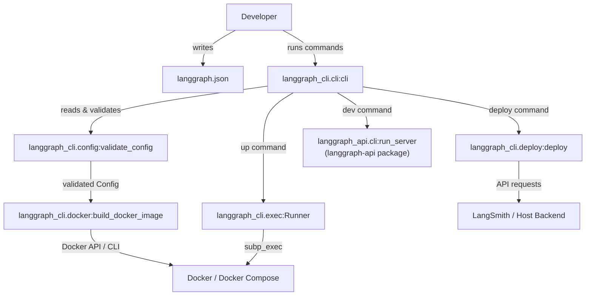
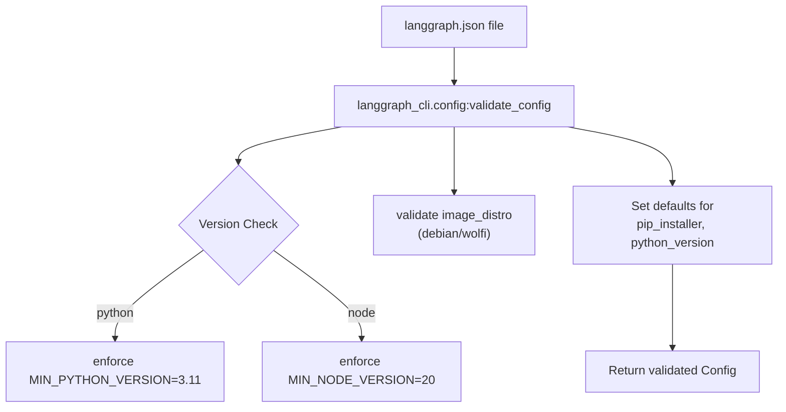
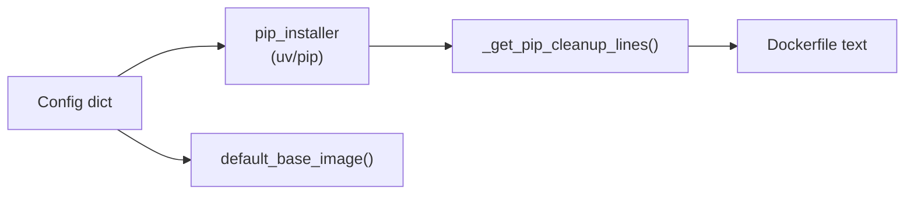

<!-- source: DeepWiki mcp.deepwiki.com · repo langchain-ai/langgraph · page 6 CLI and Deployment · fetched 2026-10-26 -->

# CLI and Deployment

Relevant source files

The following files were used as context for generating this wiki page:

- [libs/cli/langgraph_cli/__init__.py](libs/cli/langgraph_cli/__init__.py)
- [libs/cli/langgraph_cli/cli.py](libs/cli/langgraph_cli/cli.py)
- [libs/cli/langgraph_cli/config.py](libs/cli/langgraph_cli/config.py)
- [libs/cli/pyproject.toml](libs/cli/pyproject.toml)
- [libs/cli/tests/unit_tests/cli/test_cli.py](libs/cli/tests/unit_tests/cli/test_cli.py)
- [libs/cli/tests/unit_tests/test_config.py](libs/cli/tests/unit_tests/test_config.py)
- [libs/cli/uv.lock](libs/cli/uv.lock)

This page covers the `langgraph-cli` package: its purpose, the commands it exposes, how it reads a `langgraph.json` configuration file, and how it translates that configuration into Docker-based deployments or a local development server.

- For detailed documentation of each CLI command and its flags, see [CLI Commands](#6.1).
- For the full `langgraph.json` schema reference, see [Configuration System (langgraph.json)](#6.2).
- For Dockerfile generation internals, see [Docker Image Generation](#6.3).
- For Docker Compose orchestration, see [Multi-Service Orchestration](#6.4).
- For the `langgraph dev` server and hot reloading, see [Local Development Server](#6.5).
- For the Kafka-based distributed executor, see [Distributed Execution with Kafka](#6.6).
- For programmatic access to a deployed server, see [Client SDKs and Remote Execution](#5).

---

## Package Overview

The `langgraph-cli` package lives at `libs/cli/` and is installed as the `langgraph` command-line tool. Its entry point is declared in `libs/cli/pyproject.toml` [libs/cli/pyproject.toml:36-37]().

It depends on `click>=8.1.7`, `httpx>=0.24.0`, and `langgraph-sdk>=0.1.0` (for Python ≥ 3.11) [libs/cli/pyproject.toml:14-21](). For the in-memory development server, it requires the `[inmem]` extras group which pulls in `langgraph-api` and `langgraph-runtime-inmem` [libs/cli/pyproject.toml:24-28]().

| Extra group | Additional dependencies |
|---|---|
| *(none)* | `click`, `httpx`, `langgraph-sdk`, `pathspec`, `python-dotenv` |
| `[inmem]` | `langgraph-api>=0.5.35`, `langgraph-runtime-inmem>=0.7` |

Sources: [libs/cli/pyproject.toml:5-37]()

---

## Architectural Position

The CLI bridges local development and production deployment. It reads a `langgraph.json` file, validates it, and either launches a Docker Compose stack (for `up`/`build`/`dockerfile`) or starts an in-process server (for `dev`). It also facilitates deployments to LangSmith via the `deploy` command [libs/cli/langgraph_cli/cli.py:17-18]().

**CLI System Relationships**

Sources: [libs/cli/langgraph_cli/cli.py:1-23](), [libs/cli/langgraph_cli/config.py:14-23](), [libs/cli/langgraph_cli/exec.py:19-20]()

---

## Commands at a Glance

The `cli` group is the root Click group defined in `langgraph_cli/cli.py` [libs/cli/langgraph_cli/cli.py:37](). It uses a `NestedHelpGroup` to display subcommands clearly [libs/cli/langgraph_cli/cli.py:185-210]().

| Command | Implementation Function | What it does |
|---|---|---|
| `langgraph new` | `create_new()` | Scaffold a new project from a template [libs/cli/langgraph_cli/cli.py:21]() |
| `langgraph dev` | `dev()` | Start a local dev server with hot reload [libs/cli/langgraph_cli/cli.py:142]() |
| `langgraph up` | `up()` | Build and launch full Docker Compose stack [libs/cli/langgraph_cli/cli.py:61]() |
| `langgraph build` | `build_docker_image()` | Build a tagged Docker image [libs/cli/langgraph_cli/cli.py:18]() |
| `langgraph dockerfile` | `dockerfile()` | Generate a Dockerfile for custom deployments [libs/cli/langgraph_cli/cli.py:13]() |
| `langgraph deploy` | `deploy()` | Deploy the project to LangSmith [libs/cli/langgraph_cli/cli.py:17]() |

Sources: [libs/cli/langgraph_cli/cli.py:17-23](), [libs/cli/langgraph_cli/config.py:14-16]()

---

## Configuration File (`langgraph.json`)

Every command requires a configuration file (default: `./langgraph.json`). The file is loaded and validated by `validate_config()` in `config.py` [libs/cli/langgraph_cli/config.py:12-22]().

### Key Top-Level Fields

| Field | Type | Required | Description |
|---|---|---|---|
| `graphs` | `dict` | **Yes** | Mapping from graph ID to implementation path [libs/cli/langgraph_cli/cli.py:70-71]() |
| `dependencies` | `list[str]` | **Yes** | Array of dependencies for the server [libs/cli/langgraph_cli/cli.py:48]() |
| `python_version` | `str` | No | Defaults to `3.11` [libs/cli/langgraph_cli/config.py:82]() |
| `node_version` | `str` | No | Required for JS/TS graphs; defaults to `20` [libs/cli/langgraph_cli/config.py:18]() |
| `image_distro` | `str` | No | Distro for the base image (e.g., `debian`, `wolfi`) [libs/cli/langgraph_cli/config.py:84]() |
| `env` | `str \| dict` | No | Path to `.env` file or inline key-value mapping [libs/cli/langgraph_cli/cli.py:73]() |
| `dockerfile_lines` | `list[str]` | No | Additional lines to append to the generated Dockerfile [libs/cli/langgraph_cli/cli.py:57]() |
| `pip_installer` | `str` | No | One of `auto`, `pip`, or `uv` [libs/cli/tests/unit_tests/test_config.py:150]() |

Sources: [libs/cli/langgraph_cli/config.py:17-18, 81-84](), [libs/cli/langgraph_cli/cli.py:41-101](), [libs/cli/tests/unit_tests/test_config.py:136-166]()

---

## Config Validation Flow

The validation logic ensures that the specified Python or Node versions meet minimum requirements and that mandatory fields like `graphs` and `dependencies` are present [libs/cli/tests/unit_tests/test_config.py:136-213](). It also enforces version constraints such as `MIN_PYTHON_VERSION` (3.11) and `MIN_NODE_VERSION` (20) [libs/cli/langgraph_cli/config.py:17, 81]().

**Config Validation Pipeline**

Sources: [libs/cli/langgraph_cli/config.py:17-18, 81-84](), [libs/cli/tests/unit_tests/test_config.py:136-238]()

---

## Docker Image Generation

The CLI generates Dockerfiles that include a cleanup phase to remove build tools like `pip`, `setuptools`, and `wheel` unless explicitly kept [libs/cli/langgraph_cli/config.py:90-133](). It also supports `uv` as a high-performance installer for faster builds [libs/cli/langgraph_cli/config.py:124-127]().

**Dockerfile Generation Data Flow**

Sources: [libs/cli/langgraph_cli/config.py:90-133](), [libs/cli/tests/unit_tests/test_config.py:25-29]()

---

## Multi-Service Orchestration

The `langgraph up` command supports an `engine-runtime-mode` option, which can be `combined_queue_worker` (default) or `distributed` [libs/cli/langgraph_cli/cli.py:172-177](). In `distributed` mode, the system can utilize separate executor and orchestrator containers to scale graph execution [libs/cli/langgraph_cli/cli.py:176]().

Users can also provide a custom `docker-compose.yml` via the `--docker-compose` flag to launch additional services (like custom databases or caches) alongside the LangGraph API [libs/cli/langgraph_cli/cli.py:29-40]().

Sources: [libs/cli/langgraph_cli/cli.py:29-40](), [libs/cli/langgraph_cli/cli.py:172-177]()

---

